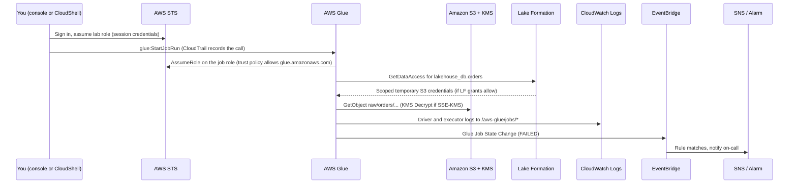
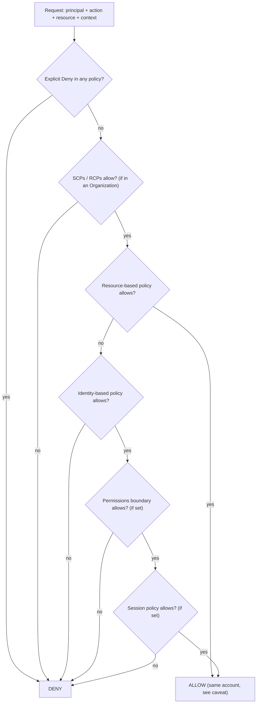

# 🧭 AWS Foundations for a GCP Developer: Accounts, Regions, IAM, Console, CLI, CloudWatch, CloudTrail, KMS

> **What it is:** the shared plumbing under every AWS data service: the account and region you work in, who you are (IAM/STS), how you call APIs (console, CLI, CloudShell), where logs, metrics and audit trails go (CloudWatch, CloudTrail), how data is encrypted (KMS), and how cost is tracked (tags, Cost Explorer, Budgets).
> **GCP equivalents:** Resource Manager (organization → folders → projects) · Cloud IAM + service accounts · `gcloud` + Cloud Shell · Cloud Logging + Cloud Monitoring · Cloud Audit Logs · Cloud KMS · labels + Billing budgets.
> **Where it appears in the HLD:** everywhere. Every arrow in the [HLD](../01_AWS_Data_Lakehouse_Demonstrated/assets/00_lakehouse_architecture_hld.png) is an API call made by some IAM role. Lab touchpoints: finding your own session role ([C](../01_AWS_Data_Lakehouse_Demonstrated/Challenge_C_LF_Tag_Based_Access_Control_Data_Science_And_Intern.md)), the EventBridge → Step Functions role and CloudShell lookups of suffixed names ([F](../01_AWS_Data_Lakehouse_Demonstrated/Challenge_F_Vendor_File_Pipeline_EventBridge_StepFunctions_Lambda.md)), Glue job errors in CloudWatch Logs ([A](../01_AWS_Data_Lakehouse_Demonstrated/Challenge_A_Product_Catalog_Schema_Mismatch_And_Partitioning.md), [G](../01_AWS_Data_Lakehouse_Demonstrated/Challenge_G_Orders_Ingest_Duplicates_And_Iceberg_Snapshot_Rollback.md)), and the Firehose role's permissions ([D](../01_AWS_Data_Lakehouse_Demonstrated/Challenge_D_Firehose_Iceberg_Streaming_Upserts_And_Buffering.md)).
> **As of:** Nov 2026 · ⚠️ = unverified or likely to change. Verify in the docs before you rely on it.
> **Guide index:** [README](README.md) · Next: [01 Amazon S3](01_Amazon_S3.md)

---

## ⭐ Must-know first (labs + exam)

1. **An AWS account is your project.** It's the hard boundary for resources, IAM, quotas and billing. **AWS Organizations** groups accounts into **OUs** (organizational units), much like GCP folders.
2. **Almost everything is regional.** The console's **region selector** (top right) decides what you see. If a resource "doesn't exist", check the region first. The lab region is **us-east-1**.
3. **ARNs name everything:** `arn:aws:<service>:<region>:<account-id>:<resource>`. Some services leave fields empty. S3 is `arn:aws:s3:::bucket`, and IAM is `arn:aws:iam::123456789012:role/Name`.
4. **An AWS "role" is not a GCP "role".** An AWS **IAM role** is an *identity* that people or services **assume** to get temporary credentials, which makes it closest to a **GCP service account**. A GCP role (a bundle of permissions) is closest to an AWS **managed policy**.
5. **A role has two policies.** The **trust policy** says *who* may assume it (e.g. `glue.amazonaws.com`). The **permission policies** say *what* it may do. Most "role doesn't work" bugs are in the trust policy.
6. **`iam:PassRole`:** to attach a role to a Glue job, Step Functions machine, EventBridge target or Firehose stream, **you** need `iam:PassRole` on that role. It's the AWS version of GCP's `iam.serviceAccounts.actAs`.
7. **Policy evaluation:** everything starts as **implicit deny**. An **explicit Deny anywhere wins**. You need at least one **Allow** (identity *or* resource policy in the same account). SCPs, permission boundaries and session policies can only **take away**.
8. **IAM is necessary but not sufficient with Lake Formation.** *"Insufficient Lake Formation permission(s)"* means IAM said yes and **Lake Formation said no**, so you need an LF grant (Challenges A, C, E). See [05 Lake Formation](05_AWS_Lake_Formation.md).
9. **Know your session role.** Open the account menu (top right), or run `aws sts get-caller-identity`. Grant Lake Formation permissions to the **role ARN** (`arn:aws:iam::<acct>:role/<Name>`), not to the session ARN (`arn:aws:sts::…:assumed-role/<Name>/<session>`).
10. **CloudShell** is a browser terminal that is already logged in as your console session, in the console's region. It's the fastest way to look up suffixed lab names with `--query` (JMESPath).
11. **CLI essentials:** `--query` filters the output on your side. `--output text` gives values you can put in shell variables. `file://x.json` reads a parameter from a file. The CLI **auto-paginates**. Set `AWS_PAGER=""` to stop it opening `less`.
12. **CloudWatch Logs is where errors live.** Glue writes to `/aws-glue/jobs/output` and `/aws-glue/jobs/error`, and Lambda writes to `/aws/lambda/<fn>`. **Metrics + Alarms** watch numbers. **EventBridge** carries service state-change events, such as "Glue Job State Change".
13. **CloudTrail records who called which API.** **Event history** keeps 90 days of management events for free. It's your "who changed my job or rule?" tool.
14. **KMS basics:** S3 encrypts with **SSE-S3** by default. **SSE-KMS** adds a key policy, an audit trail and per-request cost, and readers need **`kms:Decrypt`** as well as `s3:GetObject`. Every KMS key has a **key policy**, and IAM policies only work on a key if that key policy allows it.
15. **Tags drive cost reports.** **Activate cost allocation tags** in Billing, because they only apply from activation onwards. Set an **AWS Budget** alert on day one.

---

## 🧱 First principles

### The problem AWS solves at this layer
Millions of tenants share the same hardware, and every action is an **HTTPS API call**. That gives four hard requirements:

| Requirement | Constraint | AWS answer |
|---|---|---|
| **Isolation** | One tenant's mistakes or attacks must not reach another tenant | The **account** is the isolation and billing unit |
| **Fault containment** | Data centres fail, networks partition, and the speed of light limits sync replication | **Regions** (independent control planes) contain **AZs** (separate buildings, close enough for synchronous replication) |
| **Authenticate and authorise every call** | Each request must prove who sent it and that it's allowed | Requests are **SigV4-signed** with credentials, and IAM evaluates policies on **every** call |
| **Audit and observe** | You can't SSH into a managed service | **CloudTrail** (who called what) and **CloudWatch** (logs, metrics, alarms) |

### Why AWS IAM looks the way it does
- **Everything is an API call.** The console, CLI, SDKs, Glue and Step Functions all call the same signed APIs. So the question *"can I do X?"* always means *"is the action `service:Action` allowed on this ARN for these credentials?"*
- **Long-lived keys leak**, so AWS pushes **temporary credentials**. **STS** (Security Token Service) trades a trusted identity for a short-lived key triple (`AccessKeyId`, `SecretAccessKey`, `SessionToken`), valid from 15 minutes up to 12 hours. Roles exist to hand out these short-lived credentials.
- **Services act for you.** Glue reads *your* bucket, so Glue's infrastructure must **become** a principal in your account. It assumes a role you created, and your **trust policy** lets it do so. That's why every managed service needs a "service role".
- **Delegation must be controlled.** If anyone who can create Glue jobs could attach *any* role, they could escalate privileges by attaching an admin role to a job. **`iam:PassRole`** closes that hole.
- **Resource policies exist for sharing without identities.** A bucket policy or KMS key policy lets another account or service in without creating users there.

### Why regions and AZs
- A **region** (e.g. `us-east-1`, N. Virginia) is a fully independent deployment: its own APIs, its own data, and its own failure domain. Data **doesn't leave a region** unless you copy it, which matters for data residency.
- An **Availability Zone** is one or more data centres with independent power and networking. AZs in a region are linked with low latency, so S3, DynamoDB and Aurora storage replicate **synchronously across AZs** for you.
- **Second-order effect:** ARNs, quotas, endpoints and console views are all **per region**. A lab built in us-east-1 is invisible from us-west-2.

### Why separate logs, metrics and audit
- **Logs** hold what your code printed (high volume, for debugging). **Metrics** are numbers over time (cheap, for alarming). **Audit** (CloudTrail) records who called the control plane (for security and forensics). They have different volumes, retention needs and access controls, so they're three separate products.

### Why KMS uses envelope encryption
- A KMS key never leaves KMS's HSMs (hardware security modules). Sending terabytes to KMS would be too slow, so services ask KMS for a **data key**, encrypt the data **locally** with it, and store the data key **encrypted under the KMS key** next to the data. To read, the service asks KMS to decrypt the small data key. Every read is therefore also a **KMS API call** that needs a permission, costs money and is logged in CloudTrail.

---

## 🧩 Core concepts

### Accounts and Organizations

| Term | Meaning | GCP analogue |
|---|---|---|
| **Account** | 12-digit ID; container for resources, IAM, quotas and billing | Project (plus its billing link) |
| **Root user** | The email login that created the account and has unlimited power. Lock it with MFA and don't use it | Super admin |
| **AWS Organizations** | Groups accounts under one **management account** with consolidated billing | Organization node |
| **OU (organizational unit)** | A folder of accounts; policies attach here | Folder |
| **SCP (service control policy)** | A guardrail that caps the **maximum** permissions of every principal in member accounts. It never grants anything | Org-level IAM **deny** policies; Org Policy constraints are similar in spirit |
| **RCP (resource control policy)** ⚠️ | A newer guardrail on **resources** (e.g. "no S3 access from outside the org"). Verify which services support it | VPC Service Controls (loosely) |
| **IAM Identity Center** | Workforce single sign-on. Users get **permission sets**, which become roles named `AWSReservedSSO_<set>_<hash>` in each account | Cloud Identity + Workforce Identity Federation |

### Regions and AZs

| Concept | Detail |
|---|---|
| Region code | `us-east-1`, `eu-west-1`, … Lab = `us-east-1` |
| AZ **name** vs AZ **ID** | `us-east-1a` is mapped **per account** to a physical AZ. The **AZ ID** (`use1-az1`) is the same across accounts. Use IDs when coordinating subnets across accounts |
| Global or global-ish services | IAM, Organizations, Route 53, CloudFront. **S3 bucket names** are globally unique, but each bucket lives in one region. STS has regional endpoints |
| Regional services | S3 buckets, Glue, Athena, Lambda, Step Functions, EventBridge, Firehose, KMS keys, CloudWatch, Lake Formation |

### ARN anatomy

```text
arn:partition:service:region:account-id:resource-type/resource-id
arn:aws      :glue   :us-east-1:111122223333:table/lakehouse_db/orders
```

| Resource | ARN example | Note |
|---|---|---|
| S3 bucket | `arn:aws:s3:::anycompany-lakehouse-raw-7db76de0` | No region or account |
| S3 objects under a prefix | `arn:aws:s3:::anycompany-lakehouse-raw-7db76de0/raw/orders/*` | Bucket ARN ≠ object ARN (classic policy bug) |
| IAM role | `arn:aws:iam::111122223333:role/anycompany-eventbridge-sfn-role` | No region. May contain a **path** (`role/service-role/x`) |
| Assumed-role **session** | `arn:aws:sts::111122223333:assumed-role/WSParticipantRole/Participant` | What `get-caller-identity` returns. Not the role ARN |
| Glue job / table | `arn:aws:glue:us-east-1:111122223333:job/orders-ingest`, `…:table/lakehouse_db/orders` | Glue catalog actions also need `…:catalog` and `…:database/<db>` |
| Step Functions | `arn:aws:states:us-east-1:111122223333:stateMachine:vendor-file-pipeline-7db76de0` | Colon, not slash |
| Lambda | `arn:aws:lambda:us-east-1:111122223333:function:vendor-file-validator` | |
| KMS key | `arn:aws:kms:us-east-1:111122223333:key/1234abcd-…` | Aliases: `alias/lakehouse-curated` |
| Log group | `arn:aws:logs:us-east-1:111122223333:log-group:/aws-glue/jobs/error:*` | |

### IAM principals (who)

| Principal | What it is | When to use |
|---|---|---|
| **IAM user** | A long-lived identity with a password and/or access keys | Avoid for humans; use Identity Center. Legacy CI only |
| **IAM role** | An identity with no long-lived credentials, used by **assuming** it | Humans (via SSO), services, cross-account |
| **Role session** | A live assumption of a role: `assumed-role/<Role>/<SessionName>` | This is "you" in the lab console |
| **Federated user** | An external IdP user (SAML/OIDC) mapped to a role | Corporate SSO. The console shows *"Federated user"* |
| **Service principal** | An AWS service, e.g. `glue.amazonaws.com`, `states.amazonaws.com`, `events.amazonaws.com`, `firehose.amazonaws.com`, `lambda.amazonaws.com` | Goes in trust policies and resource policies |

### Policy types (what)

| Type | Attached to | Grants? | Lab example |
|---|---|---|---|
| **Identity-based**: AWS managed, customer managed, inline | User, group or role | Yes | Glue job role's S3/Glue permissions |
| **Resource-based** | A resource: S3 bucket policy, KMS key policy, Lambda resource policy, SNS/SQS policy, Glue catalog policy | Yes (can grant cross-account) | Bucket policy denying non-TLS |
| **Trust policy** | A role (it's a resource policy on the role) | Grants `sts:AssumeRole` | `anycompany-eventbridge-sfn-role` trusts `events.amazonaws.com` |
| **Permissions boundary** | A user or role | **No**, it only caps | "Developers may create roles, but only within this boundary" |
| **SCP / RCP** | OU or account (Organizations) | **No**, it only caps | "Nobody may leave us-east-1" |
| **Session policy** | Passed with `AssumeRole` | **No**, it only caps | Down-scoped temporary credentials |
| **Lake Formation grants** | Not IAM. LF's own permission store | Yes, for **data** in the catalog | SELECT on `customers` via a data cell filter (E) |

### Policy JSON anatomy

```json
{
  "Version": "2012-10-17",
  "Statement": [{
    "Sid": "ReadOneExportPrefix",
    "Effect": "Allow",
    "Action": ["s3:GetObject"],
    "Resource": "arn:aws:s3:::anycompany-lakehouse-raw-7db76de0/raw/orders/*",
    "Condition": { "Bool": { "aws:SecureTransport": "true" } }
  }]
}
```

- `Version` is always `"2012-10-17"`. It's the policy *language* version, not a date you update.
- `Principal` appears **only** in resource-based and trust policies. In identity policies, the principal is whoever the policy is attached to.
- **Useful condition keys:** `aws:SourceArn` and `aws:SourceAccount` (confused-deputy protection in trust and resource policies), `aws:PrincipalArn`, `aws:PrincipalTag/…` and `aws:ResourceTag/…` (ABAC), `aws:SecureTransport`, `s3:prefix`, `kms:ViaService`, `iam:PassedToService`, `aws:RequestedRegion`.
- **Wildcards:** `*` and `?` work in `Action` and `Resource`. `NotAction` and `NotResource` invert, so use them sparingly.

### Service role vs service-linked role
- **Service role:** a role *you* create and trust to a service (e.g. a Glue job role). You control its permissions, and creating or attaching it needs `iam:PassRole`.
- **Service-linked role:** created and owned by the service (e.g. `AWSServiceRoleForLakeFormationDataAccess`) with fixed permissions. You don't pass it. GCP's **Google-managed service agents** are the same idea.

### STS operations you'll meet

| Call | Use |
|---|---|
| `GetCallerIdentity` | "Who am I?" It needs no permission and never fails for valid credentials |
| `AssumeRole` | Get temporary credentials for a role (cross-account, services, CLI profiles) |
| `AssumeRoleWithSAML` / `AssumeRoleWithWebIdentity` | Federation: corporate IdP, GitHub Actions OIDC, EKS pods |
| Session duration | `DurationSeconds` runs from 900 s up to the role's `MaxSessionDuration` (1 to 12 h, default 1 h). **Role chaining** (a role assuming another role) is capped at **1 h** |

### Console orientation (first-time map)

| Element | Where | Why it matters |
|---|---|---|
| **Region selector** | Top right | Wrong region is the #1 cause of "my resource is missing" |
| **Account menu** | Top right (your name or role) | Shows the account ID and *"Assumed role: X/Y"* or *"Federated user: X/Y"*. The part before `/` is the **role name** (Challenge C) |
| **Search bar** | Top centre (`Alt+S` ⚠️) | Jump to services. *EventBridge* and *EventBridge Scheduler* are separate entries (Challenge F) |
| **CloudShell icon** | Top bar `>_`, or the footer | Pre-authenticated terminal |
| **"Edit ≠ live"** | Per service | Lambda **Deploy**. Glue and Step Functions **Save**. Firehose: wait for **Active** |

### AWS CLI v2 essentials

| Need | Syntax |
|---|---|
| Who am I | `aws sts get-caller-identity` |
| Region / profile | `--region us-east-1`, `--profile lab`, or env vars `AWS_REGION`, `AWS_PROFILE` |
| Output format | `--output json` (default), `text` (tab-separated, best for variables), `table`, `yaml` |
| Client-side filter | `--query` with JMESPath: `"Jobs[?starts_with(Name,'orders')].Name \| [0]"` |
| Server-side filter | Service-specific flags: `--prefix` (S3), `--log-group-name-prefix` (Logs), `--filters` (EC2). They cut data transfer **before** `--query` runs |
| JSON from a file | `--policy-document file://trust.json`. Binary: `fileb://`. A whole request: `--cli-input-json file://req.json` (template from `--generate-cli-skeleton`) |
| Pagination | Automatic by default. `--max-items N` + `--starting-token` for manual paging. `--page-size` only changes the size of each API call. `--no-paginate` returns the first page only |
| No pager | `--no-cli-pager` or `export AWS_PAGER=""` |
| Lambda payloads | `--cli-binary-format raw-in-base64-out` lets you pass plain JSON |
| Debug | `--debug` shows the signed requests and the credential source |

**Where credentials come from (simplified order):** command-line options → environment variables (`AWS_ACCESS_KEY_ID`, …) → SSO/assume-role profile in `~/.aws/config` → `~/.aws/credentials` → container or instance role. CloudShell injects your console session's credentials automatically.

### JMESPath cheat sheet (for `--query`)

| Pattern | Meaning |
|---|---|
| `Buckets[].Name` | Project one field from every element |
| `Buckets[?starts_with(Name,'anycompany-lakehouse-raw')].Name \| [0]` | Filter, then take the first match (the pipe stops projection) |
| `[?contains(Name,'7db76de0')]` / `ends_with(...)` | Substring and suffix match. **Case-sensitive** |
| `Roles[].{name:RoleName, arn:Arn}` | Rename fields (multi-select hash) |
| `sort_by(JobRuns,&StartedOn)[-1].JobRunState` | Latest run's state |
| ``[?Size > `1000000`]`` | Numeric literals go in **backticks** |
| ``length(Contents \|\| `[]`)`` | Default for a missing or null list |

### CloudShell
- A browser terminal with **AWS CLI v2, Python 3, jq, git** and more, authenticated as your console session, in the **console's current region**.
- About **1 GB of persistent `$HOME` per region**. ⚠️ It's deleted after a long period (about 120 days) of not being used. Sessions end after roughly 20–30 minutes idle ⚠️.
- When you paste multi-line text, choose **Paste** in the safety prompt. Upload and download are under **Actions**.

### CloudWatch: Logs, Metrics, Alarms

| Piece | Concept | Data-lake examples |
|---|---|---|
| **Log group** | A named container with a retention setting (default **never expire**) | `/aws-glue/jobs/output`, `/aws-glue/jobs/error`, `/aws-glue/jobs/logs-v2` (continuous logging), `/aws/lambda/vendor-file-validator`, `/aws/kinesisfirehose/<stream>` ⚠️, `/aws/vendedlogs/states/<sm>` (if enabled) |
| **Log stream** | One source inside a group | For Glue, the stream name is the **job run ID** (`jr_…`) |
| **Logs Insights** | A query language over log groups, priced per GB scanned | Find the exception for a failed run |
| **Metric filter** | Turns matching log lines into a metric | Count `"Exception"` lines |
| **Subscription filter** | Streams logs to Lambda, Kinesis or Firehose | Central log archive |
| **Metric** | Namespace + name + **dimensions** (key/value identity) | `AWS/Events TriggeredRules {RuleName=glue-job-failed}`, `AWS/Firehose`, `AWS/Lambda Errors` |
| **Statistic / period** | Sum, Average, Max, p99 over 1 min, 5 min, … | Sum of errors per 5 min |
| **Alarm** | OK / ALARM / INSUFFICIENT_DATA. Evaluation periods + "datapoints to alarm" + missing-data treatment | Page on ≥ 1 failure |
| **EventBridge events** | Services emit **state-change events** (not metrics) | `Glue Job State Change` (SUCCEEDED/FAILED/TIMEOUT/STOPPED), `Step Functions Execution Status Change` |

### CloudTrail

| Event type | Default | Cost | GCP |
|---|---|---|---|
| **Management events** (control plane: CreateJob, PutRule, PutBucketPolicy) | On. **Event history: 90 days**, free, per region | First trail copy is free | Admin Activity audit logs |
| **Data events** (S3 GetObject/PutObject, Lambda Invoke, …) | **Off**. Needs a trail or event data store with selectors | Per 100k events. Can be huge on a data lake | Data Access audit logs |
| **CloudTrail Lake / trails to S3** | Long-term storage + SQL | Per GB ingested/scanned | Log sinks to BigQuery |

### KMS and S3 encryption

| Option | Who holds the key | Extra permission to read | Audit per request | Use when |
|---|---|---|---|---|
| **SSE-S3** (AES-256) | S3 (invisible to you) | None | No | **Default for every new object** since Jan 2023. Good baseline |
| **SSE-KMS, AWS managed key** (`aws/s3`) | KMS, managed by AWS | `kms:Decrypt` (implicit within the account) | Yes | You want CloudTrail key logs but no key management |
| **SSE-KMS, customer managed key (CMK)** | KMS, **your key policy** | `kms:Decrypt` explicitly allowed | Yes | Compliance, cross-account control, crypto-shredding by disabling the key |
| **DSSE-KMS** | Two layers of KMS encryption | As SSE-KMS | Yes | Specific compliance regimes |
| **SSE-C** | You send the key with each request | You manage keys | — | Rare. ⚠️ AWS has been moving to disable it by default on new buckets; verify |

- **Key policy:** every KMS key has one, and it's **mandatory**. The default statement `"Principal": {"AWS": "arn:aws:iam::<acct>:root"}` means **"let this account's IAM policies decide"**. It does **not** mean the root user. Without that statement, IAM policies alone can't grant use of the key.
- **Grants:** temporary, programmatic delegations that services such as EBS and Aurora create.
- **Rotation:** automatic rotation of CMKs (yearly by default, with a configurable period ⚠️). Old versions stay so old data still decrypts.
- **S3 Bucket Keys:** S3 caches a bucket-level data key, which cuts KMS calls (and cost) by a large factor. **Turn this on for data lakes with SSE-KMS.**

### Tags and cost tools

| Tool | What it does | GCP |
|---|---|---|
| **Tags** | Key/value pairs on resources (max 50 per resource ⚠️). Used for ABAC, automation and cost | Labels |
| **Cost allocation tags** | Tags you **activate** in Billing so they appear as cost dimensions. **Not retroactive** | Labels in billing export |
| **Cost Explorer** | UI and API for cost by service, tag, account, day | Billing reports |
| **AWS Budgets** | Thresholds with email/SNS alerts, and optional actions | Budgets & alerts |
| **Cost and Usage Report / Data Exports** | Line-item billing data to S3, queryable with Athena | Billing export to BigQuery |
| **Cost Anomaly Detection** | ML alerts on spend spikes | Anomaly alerts ⚠️ |

---

## 🔄 How it works (flow)

### A Glue job run, end to end, through the foundation layer



1. **Authenticate.** Your console session is an assumed role. Every click is a signed API call made with it.
2. **Authorise the call.** IAM checks `glue:StartJobRun` on `arn:aws:glue:us-east-1:<acct>:job/orders-ingest`, and CloudTrail logs it.
3. **The service becomes your role.** Glue calls `sts:AssumeRole` on the **job role**. The role's **trust policy** must name `glue.amazonaws.com`.
4. **Data access.** For Lake Formation-governed tables, Glue asks LF for credentials. LF checks its own grants (Alter, Select, Insert…) and **vends** temporary S3 access. For ungoverned paths, the job role's IAM S3 permissions apply directly.
5. **Encryption.** Reading an SSE-KMS object triggers `kms:Decrypt`, which the key policy and the role must both allow.
6. **Observability.** Logs go to CloudWatch Logs. State changes go to EventBridge. Metrics go to CloudWatch, where alarms watch them.

### Policy evaluation (single account, simplified)



- **Cross-account:** both sides must allow. The caller's identity policy **and** the resource policy (or the trust policy, for AssumeRole).
- **KMS is special:** the key policy must allow use, either directly or by delegating to IAM through the `:root` statement.
- ⚠️ **Caveat:** whether a same-account resource-policy Allow bypasses a permissions boundary or session policy depends on whether it names the role ARN or the session ARN. Check "Policy evaluation logic" in the IAM docs for edge cases.

---

## 🛠️ Hands-on examples

> All CLI examples assume **CloudShell in us-east-1** (or `aws configure` with that region). Replace `111122223333` with your account ID. Every script sets `AWS_PAGER=""` so nothing opens `less`.

### Example 1: Find your session role (Challenge C's first step)

**Goal:** get the exact IAM role behind your console session, so Lake Formation grants (ASSOCIATE, SELECT) go to the right principal.

**Console steps**
1. Click the **account menu** (top right). Read *Assumed role* / *Federated user*: `RoleName/SessionName`.
2. The **role name** is the part **before** the `/`. Copy the 12-digit account ID too.
3. IAM → **Roles** → search the role name → copy its **ARN**. It may include a **path** such as `/aws-reserved/sso.amazonaws.com/`.

**CLI**
```bash
export AWS_PAGER=""
# 1) Who am I? Returns UserId, Account and the *session* ARN
aws sts get-caller-identity
# e.g. "Arn": "arn:aws:sts::111122223333:assumed-role/WSParticipantRole/Participant"   (role name is lab-specific ⚠️)

# 2) Turn the session ARN into the IAM role name
SESSION_ARN=$(aws sts get-caller-identity --query Arn --output text)
ACCOUNT=$(aws sts get-caller-identity --query Account --output text)
ROLE_NAME=$(echo "$SESSION_ARN" | cut -d/ -f2)      # assumed-role/<ROLE_NAME>/<session>

# 3) Get the real role ARN (includes any path; the session ARN never shows the path)
ROLE_ARN=$(aws iam get-role --role-name "$ROLE_NAME" --query Role.Arn --output text 2>/dev/null \
           || echo "arn:aws:iam::${ACCOUNT}:role/${ROLE_NAME}")   # fallback if iam:GetRole is denied
echo "Grant Lake Formation permissions to: $ROLE_ARN"

# 4) What can this role do? (may be denied in locked-down labs)
aws iam list-attached-role-policies --role-name "$ROLE_NAME" --query "AttachedPolicies[].PolicyName"
aws iam list-role-policies --role-name "$ROLE_NAME"

# 5) Is it a Lake Formation data lake admin?
aws lakeformation get-data-lake-settings --query "DataLakeSettings.DataLakeAdmins[].DataLakePrincipalIdentifier"
```

**Expected result:** a role ARN like `arn:aws:iam::111122223333:role/<LabRole>`, which appears in the LF admin list.
**What to check:** if `get-role` fails with AccessDenied, use the fallback ARN. It's right unless the role has a path. If LF grants "don't take", compare the principal in **Data permissions** against this ARN character by character.

---

### Example 2: A least-privilege Glue job role, with trust policy and PassRole

**Goal:** create `glue-orders-ingest-role` that can **only** read `raw/orders/` exports, write the curated `orders` Iceberg table, update that table's catalog entry and write logs. Then let a developer **attach** it to jobs and nothing else.

**Console steps (equivalent)**
1. IAM → Roles → **Create role** → Trusted entity: **AWS service** → Use case **Glue** (this generates the trust policy).
2. Skip the managed policies → name the role → **Create**.
3. Open the role → **Add permissions → Create inline policy → JSON** → paste the permissions policy below.
4. Lake Formation → **Data permissions → Grant** → this role: **Select, Insert, Delete, Alter, Describe** on `lakehouse_db.orders` (see [05 Lake Formation](05_AWS_Lake_Formation.md)).

**Trust policy** (`trust-glue.json`). Only the Glue service may assume the role:
```json
{
  "Version": "2012-10-17",
  "Statement": [
    {
      "Sid": "GlueServiceMayAssumeThisRole",
      "Effect": "Allow",
      "Principal": { "Service": "glue.amazonaws.com" },
      "Action": "sts:AssumeRole"
    }
  ]
}
```
> Optional hardening ⚠️: add `"Condition": {"StringEquals": {"aws:SourceAccount": "111122223333"}}` to block confused-deputy use from other accounts. If job runs then fail with an AssumeRole error, check that Glue sends that key for your job type.

**Permissions policy** (`perm-orders-ingest.json`). Each statement is scoped to the minimum ARNs:
```json
{
  "Version": "2012-10-17",
  "Statement": [
    {
      "Sid": "JobScriptAndTempDir",
      "Effect": "Allow",
      "Action": ["s3:GetObject", "s3:PutObject", "s3:DeleteObject"],
      "Resource": "arn:aws:s3:::aws-glue-assets-111122223333-us-east-1/*"
    },
    {
      "Sid": "ListOnlyTheOrdersExportPrefix",
      "Effect": "Allow",
      "Action": "s3:ListBucket",
      "Resource": "arn:aws:s3:::anycompany-lakehouse-raw-7db76de0",
      "Condition": { "StringLike": { "s3:prefix": ["raw/orders", "raw/orders/*"] } }
    },
    {
      "Sid": "ReadOrdersExports",
      "Effect": "Allow",
      "Action": "s3:GetObject",
      "Resource": "arn:aws:s3:::anycompany-lakehouse-raw-7db76de0/raw/orders/*"
    },
    {
      "Sid": "ReadWriteCuratedOrdersTableFiles",
      "Effect": "Allow",
      "Action": ["s3:GetObject", "s3:PutObject", "s3:DeleteObject"],
      "Resource": "arn:aws:s3:::anycompany-lakehouse-curated-7db76de0/orders/*"
    },
    {
      "Sid": "ListCuratedOrdersPrefix",
      "Effect": "Allow",
      "Action": "s3:ListBucket",
      "Resource": "arn:aws:s3:::anycompany-lakehouse-curated-7db76de0",
      "Condition": { "StringLike": { "s3:prefix": ["orders", "orders/*"] } }
    },
    {
      "Sid": "CatalogEntryForTheIcebergTable",
      "Effect": "Allow",
      "Action": ["glue:GetDatabase", "glue:GetTable", "glue:GetTables", "glue:UpdateTable", "glue:GetPartitions"],
      "Resource": [
        "arn:aws:glue:us-east-1:111122223333:catalog",
        "arn:aws:glue:us-east-1:111122223333:database/lakehouse_db",
        "arn:aws:glue:us-east-1:111122223333:table/lakehouse_db/orders"
      ]
    },
    {
      "Sid": "LakeFormationCredentialVending",
      "Effect": "Allow",
      "Action": "lakeformation:GetDataAccess",
      "Resource": "*"
    },
    {
      "Sid": "WriteGlueLogs",
      "Effect": "Allow",
      "Action": ["logs:CreateLogGroup", "logs:CreateLogStream", "logs:PutLogEvents"],
      "Resource": "arn:aws:logs:us-east-1:111122223333:log-group:/aws-glue/*"
    },
    {
      "Sid": "PublishGlueMetricsOnly",
      "Effect": "Allow",
      "Action": "cloudwatch:PutMetricData",
      "Resource": "*",
      "Condition": { "StringEquals": { "cloudwatch:namespace": "Glue" } }
    }
  ]
}
```

**PassRole policy for the developer** (`dev-passrole.json`). They can attach **only this role**, **only to Glue**:
```json
{
  "Version": "2012-10-17",
  "Statement": [
    {
      "Sid": "PassOnlyTheOrdersRoleOnlyToGlue",
      "Effect": "Allow",
      "Action": "iam:PassRole",
      "Resource": "arn:aws:iam::111122223333:role/glue-orders-ingest-role",
      "Condition": { "StringEquals": { "iam:PassedToService": "glue.amazonaws.com" } }
    },
    {
      "Sid": "ManageOnlyOrdersJobs",
      "Effect": "Allow",
      "Action": ["glue:CreateJob", "glue:UpdateJob", "glue:GetJob", "glue:StartJobRun", "glue:GetJobRun", "glue:GetJobRuns"],
      "Resource": "arn:aws:glue:us-east-1:111122223333:job/orders-*"
    }
  ]
}
```

**CLI**
```bash
export AWS_PAGER=""
aws iam create-role --role-name glue-orders-ingest-role \
  --assume-role-policy-document file://trust-glue.json \
  --description "Least-privilege role for the orders-ingest Glue job" \
  --tags Key=project,Value=lakehouse Key=owner,Value=data-eng

aws iam put-role-policy --role-name glue-orders-ingest-role \
  --policy-name orders-ingest-least-privilege \
  --policy-document file://perm-orders-ingest.json

# IAM is eventually consistent: a new role can take a few seconds before services accept it
sleep 10

# Verify with the policy simulator (identity policies only: ignores bucket policies and Lake Formation)
ROLE_ARN=$(aws iam get-role --role-name glue-orders-ingest-role --query Role.Arn --output text)
aws iam simulate-principal-policy --policy-source-arn "$ROLE_ARN" \
  --action-names s3:GetObject \
  --resource-arns "arn:aws:s3:::anycompany-lakehouse-raw-7db76de0/raw/orders/export-2025-05-02/part-0.json" \
                  "arn:aws:s3:::anycompany-lakehouse-raw-7db76de0/raw/vendors/acme.csv" \
  --query "EvaluationResults[].{resource:EvalResourceName,decision:EvalDecision}" --output table
```

**Expected result:** `allowed` for the orders export, `implicitDeny` for the vendors file.
**What to check:**
- When you attach the role to a job and get *"User … is not authorized to perform: iam:PassRole on resource …"*, the **caller** is missing PassRole. The role itself is fine.
- If the job fails with `AccessDenied` on a `glue:` or `s3:` action, read the exact action and ARN in `/aws-glue/jobs/error` and add **only that** to the policy. Don't reach for `*`.
- *"Insufficient Lake Formation permission(s)"* needs an LF grant, not an IAM change.
- If the buckets use SSE-KMS, add `kms:Decrypt` and `kms:GenerateDataKey` on the key ARN with `"kms:ViaService": "s3.us-east-1.amazonaws.com"`. See Example 5.

---

### Example 3: Look up suffixed lab resources from CloudShell (Challenge F/G pattern)

**Goal:** in one go, print the exact names of every lab resource (`-7db76de0`-style suffixes) so nothing in a pattern, policy or job parameter is guessed.

**Console steps:** CloudShell (top bar `>_`) → check the prompt's region is us-east-1 → paste the script (choose **Paste** when asked).

**Script** (`find-lab.sh`)
```bash
#!/usr/bin/env bash
# Usage: bash find-lab.sh [name-fragment]   e.g. bash find-lab.sh anycompany
set -uo pipefail                 # no -e: one denied API call shouldn't stop the inventory
export AWS_PAGER=""
F="${1:-anycompany}"
R="${AWS_REGION:-us-east-1}"
echo "Account: $(aws sts get-caller-identity --query Account --output text)  Region: $R  Filter: '$F'"

echo "== S3 buckets (global list)";       aws s3api list-buckets --query "Buckets[?contains(Name, '$F')].Name" --output text
echo "== Glue jobs";                      aws glue get-jobs --region "$R" --query "Jobs[].Name" --output text
echo "== Glue tables in lakehouse_db";    aws glue get-tables --region "$R" --database-name lakehouse_db --query "TableList[].Name" --output text
echo "== Glue connections";               aws glue get-connections --region "$R" --query "ConnectionList[].Name" --output text
echo "== Step Functions";                 aws stepfunctions list-state-machines --region "$R" --query "stateMachines[].stateMachineArn" --output text
echo "== Lambda functions";               aws lambda list-functions --region "$R" --query "Functions[].FunctionName" --output text
echo "== Firehose streams";               aws firehose list-delivery-streams --region "$R" --query "DeliveryStreamNames" --output text
echo "== EventBridge rules (default bus)"; aws events list-rules --region "$R" --event-bus-name default --query "Rules[].[Name,State,ScheduleExpression]" --output text
echo "== Athena workgroups";              aws athena list-work-groups --region "$R" --query "WorkGroups[].Name" --output text
echo "== IAM roles matching filter";      aws iam list-roles --query "Roles[?contains(RoleName, '$F')].[RoleName,Arn]" --output text
echo "== Glue log groups";                aws logs describe-log-groups --region "$R" --log-group-name-prefix /aws-glue --query "logGroups[].[logGroupName,retentionInDays]" --output text
```

**One-liners you'll reuse**
```bash
# exact raw bucket name (suffix-safe) and a job's default arguments (Challenge G)
RAW=$(aws s3api list-buckets --query "Buckets[?starts_with(Name,'anycompany-lakehouse-raw')].Name | [0]" --output text)
aws glue get-job --job-name orders-ingest --query "Job.DefaultArguments" --output json

# last 5 runs of a job, newest first
aws glue get-job-runs --job-name orders-ingest --max-items 5 \
  --query "JobRuns[].{id:Id,state:JobRunState,started:StartedOn,err:ErrorMessage}" --output table

# manual pagination: 2 items at a time; the JSON output carries NextToken -> pass it to --starting-token
aws glue get-jobs --max-items 2 --output json | jq '{names: [.Jobs[].Name], next: .NextToken}'
# aws glue get-jobs --max-items 2 --starting-token "<NextToken from above>"
```

**Expected result:** concrete names such as `vendors-ingest-7db76de0`, `anycompany-lakehouse-raw-7db76de0`.
**What to check:** `None` means no match. JMESPath is **case-sensitive**, so try a shorter fragment. An empty Glue table list or AccessDenied may be **Lake Formation** hiding tables your role can't DESCRIBE.

---

### Example 4: A CloudWatch alarm and notification on a failed Glue job

**Goal:** get an email whenever `orders-ingest*` ends in FAILED, TIMEOUT or ERROR, and have a **CloudWatch alarm** that shows the failure state on a dashboard.

**Design:** Glue emits a **`Glue Job State Change`** event to EventBridge. A rule matches failures and (a) publishes a readable message to SNS, and (b) bumps the `AWS/Events TriggeredRules` metric for that rule, which a CloudWatch alarm watches.

**Console steps**
1. **SNS** → Topics → Create topic (Standard) `glue-job-failures` → Create subscription → Email → confirm the email.
2. **EventBridge** → Event buses → `default` → Rules → Create rule (Advanced builder) → custom pattern (below) → target **SNS topic** → input transformer (below).
3. **CloudWatch** → Alarms → Create alarm → metric **Events → By Rule Name → `glue-job-failed` → TriggeredRules** → Sum, 5 min, ≥ 1 → notify the topic.

**CLI**
```bash
export AWS_PAGER=""
ACCOUNT=$(aws sts get-caller-identity --query Account --output text)
TOPIC_ARN=$(aws sns create-topic --name glue-job-failures --query TopicArn --output text)
aws sns subscribe --topic-arn "$TOPIC_ARN" --protocol email --notification-endpoint you@example.com
# -> click the confirmation link in the email

# Topic policy: allow EventBridge and CloudWatch alarms (from this account only) to publish
cat > topic-policy.json <<EOF
{
  "Version": "2012-10-17",
  "Statement": [
    {"Sid": "OwnerAccountFullControl", "Effect": "Allow", "Principal": {"AWS": "arn:aws:iam::${ACCOUNT}:root"},
     "Action": ["sns:Publish","sns:Subscribe","sns:GetTopicAttributes","sns:SetTopicAttributes"], "Resource": "${TOPIC_ARN}"},
    {"Sid": "EventBridgePublish", "Effect": "Allow", "Principal": {"Service": "events.amazonaws.com"},
     "Action": "sns:Publish", "Resource": "${TOPIC_ARN}", "Condition": {"StringEquals": {"aws:SourceAccount": "${ACCOUNT}"}}},
    {"Sid": "CloudWatchAlarmsPublish", "Effect": "Allow", "Principal": {"Service": "cloudwatch.amazonaws.com"},
     "Action": "sns:Publish", "Resource": "${TOPIC_ARN}", "Condition": {"StringEquals": {"aws:SourceAccount": "${ACCOUNT}"}}}
  ]
}
EOF
aws sns set-topic-attributes --topic-arn "$TOPIC_ARN" --attribute-name Policy --attribute-value file://topic-policy.json

# Event pattern: failed/timed-out runs of any job whose name starts with orders-ingest
cat > glue-fail-pattern.json <<'EOF'
{
  "source": ["aws.glue"],
  "detail-type": ["Glue Job State Change"],
  "detail": {
    "state": ["FAILED", "TIMEOUT", "ERROR"],
    "jobName": [{ "prefix": "orders-ingest" }]
  }
}
EOF
aws events put-rule --name glue-job-failed --event-bus-name default \
  --event-pattern file://glue-fail-pattern.json --state ENABLED

# Target: SNS, with a human-readable message built by an input transformer
cat > glue-fail-targets.json <<EOF
[{
  "Id": "notify-sns",
  "Arn": "${TOPIC_ARN}",
  "InputTransformer": {
    "InputPathsMap": {"job": "\$.detail.jobName", "state": "\$.detail.state",
                      "run": "\$.detail.jobRunId", "msg": "\$.detail.message"},
    "InputTemplate": "\"Glue job <job> run <run> ended <state>: <msg>\""
  }
}]
EOF
aws events put-targets --rule glue-job-failed --event-bus-name default --targets file://glue-fail-targets.json

# Check the exact dimensions EventBridge publishes for this rule (verify before alarming) ⚠️
# (the metric only appears after the rule has matched at least once)
aws cloudwatch list-metrics --namespace AWS/Events --metric-name TriggeredRules \
  --query "Metrics[?Dimensions[?Value=='glue-job-failed']].Dimensions"

# Alarm: any triggered failure in a 5-minute window -> ALARM (no data = OK, not INSUFFICIENT_DATA)
aws cloudwatch put-metric-alarm --alarm-name glue-orders-ingest-failed \
  --namespace AWS/Events --metric-name TriggeredRules \
  --dimensions Name=RuleName,Value=glue-job-failed \
  --statistic Sum --period 300 --evaluation-periods 1 --threshold 1 \
  --comparison-operator GreaterThanOrEqualToThreshold \
  --treat-missing-data notBreaching \
  --alarm-actions "$TOPIC_ARN"
```

**Find the cause fast (Logs Insights / tail)**
```bash
# Live tail of error output for the last hour, only lines mentioning Exception
aws logs tail /aws-glue/jobs/error --since 1h --filter-pattern Exception

# Logs Insights: newest exception lines across runs (log stream = job run id)
QID=$(aws logs start-query --log-group-name /aws-glue/jobs/error \
  --start-time $(date -d '-6 hours' +%s) --end-time $(date +%s) \
  --query-string 'fields @timestamp, @logStream, @message
                  | filter @message like /Exception|Error:/
                  | sort @timestamp desc | limit 20' --query queryId --output text)
sleep 5; aws logs get-query-results --query-id "$QID" --query "results[*][?field=='@message'].value" --output text
# results is a list of rows; each row is a list of {field, value}. [*] keeps rows, [?…] filters inside each row
```

**Test it:** run the job with a bad parameter so it fails, e.g. `aws glue start-job-run --job-name orders-ingest --arguments '{"--export_date":"1999-01-01"}'` (path not found). Don't do this in the graded lab after a rollback (Challenge G, Step 6). You can't fake the event with `put-events`, because `aws.*` sources are reserved. Use `aws events test-event-pattern --event-pattern file://glue-fail-pattern.json --event file://sample-event.json` to unit-test the pattern.

**Expected result:** an email reading *"Glue job orders-ingest run jr_… ended FAILED: …"*, and the alarm goes to **ALARM** for one period.
**What to check:** the rule's **Monitoring** tab (Invocations vs FailedInvocations). If FailedInvocations > 0, the topic policy is blocking EventBridge. If the email never arrives, the subscription is unconfirmed.

> **Alternatives:** a Logs **metric filter** on `/aws-glue/jobs/error` (noisy, because Spark writes WARN lines to stderr), or alarm on **Step Functions `ExecutionsFailed`** when Glue runs inside a state machine with retries. That only fires after retries are exhausted, so you get fewer false pages.

---

### Example 5 (beyond the lab): a customer managed KMS key for the curated zone

**Goal:** create a CMK whose key policy lets admins manage it and lets **only** the Glue role use it, and **only through S3**.

**Key policy** (`key-policy.json`):
```json
{
  "Version": "2012-10-17",
  "Id": "lakehouse-curated-key",
  "Statement": [
    {
      "Sid": "LetIamPoliciesInThisAccountWork",
      "Effect": "Allow",
      "Principal": { "AWS": "arn:aws:iam::111122223333:root" },
      "Action": "kms:*",
      "Resource": "*"
    },
    {
      "Sid": "GlueRoleMayUseKeyOnlyViaS3",
      "Effect": "Allow",
      "Principal": { "AWS": "arn:aws:iam::111122223333:role/glue-orders-ingest-role" },
      "Action": ["kms:Decrypt", "kms:GenerateDataKey"],
      "Resource": "*",
      "Condition": { "StringEquals": { "kms:ViaService": "s3.us-east-1.amazonaws.com" } }
    }
  ]
}
```
- In a key policy, `"Resource": "*"` means **this key**.
- `…:root` delegates to IAM for the **whole account**. Production setups often drop it and list admin roles explicitly. **Never** remove it unless another statement grants admin, or you can lock yourself out of the key.

**CLI**
```bash
KEY_ARN=$(aws kms create-key --description "Lakehouse curated zone" \
  --policy file://key-policy.json --tags TagKey=project,TagValue=lakehouse \
  --query KeyMetadata.Arn --output text)
aws kms create-alias --alias-name alias/lakehouse-curated --target-key-id "$KEY_ARN"
aws kms enable-key-rotation --key-id "$KEY_ARN"
aws kms get-key-rotation-status --key-id "$KEY_ARN"
```
Then set it as the bucket's default encryption **with Bucket Keys**. See [01 S3, Example 1](01_Amazon_S3.md).

**Expected result:** `KeyRotationEnabled: true`. Reads by the Glue role succeed, and reads by another role with `s3:GetObject` but no KMS rights fail with `AccessDenied … kms:Decrypt`.
**What to check:** creating the key fails with `MalformedPolicyDocumentException` if a principal in the policy doesn't exist yet. Create the role first.

---

### Example 6 (beyond the lab): CloudTrail forensics plus a budget guardrail

**Goal:** answer *"who switched the bucket's EventBridge notifications off, or edited the job?"*, and get an alert before a lab or project overspends.

```bash
export AWS_PAGER=""
# Who changed bucket notifications in the last 7 days? (management events, free 90-day history)
aws cloudtrail lookup-events \
  --lookup-attributes AttributeKey=EventName,AttributeValue=PutBucketNotificationConfiguration \
  --start-time "$(date -u -d '-7 days' +%FT%TZ)" --max-results 20 \
  --query "Events[].{time:EventTime,who:Username,event:EventName}" --output table

# Full detail of the latest UpdateJob: identity + request parameters
aws cloudtrail lookup-events --lookup-attributes AttributeKey=EventName,AttributeValue=UpdateJob \
  --max-results 1 --query "Events[0].CloudTrailEvent" --output text \
  | jq '{who: .userIdentity.arn, when: .eventTime, job: .requestParameters.jobName, src: .sourceIPAddress}'

# Monthly cost budget with an 80% actual-spend email alert (may be blocked in lab accounts)
ACCOUNT=$(aws sts get-caller-identity --query Account --output text)
cat > budget.json <<'EOF'
{"BudgetName": "lakehouse-monthly", "BudgetLimit": {"Amount": "50", "Unit": "USD"},
 "TimeUnit": "MONTHLY", "BudgetType": "COST"}
EOF
cat > budget-notify.json <<'EOF'
[{"Notification": {"NotificationType": "ACTUAL", "ComparisonOperator": "GREATER_THAN",
                   "Threshold": 80, "ThresholdType": "PERCENTAGE"},
  "Subscribers": [{"SubscriptionType": "EMAIL", "Address": "you@example.com"}]}]
EOF
aws budgets create-budget --account-id "$ACCOUNT" --budget file://budget.json \
  --notifications-with-subscribers file://budget-notify.json

# Cost by service for this month (Cost Explorer API calls are billed per request ⚠️)
aws ce get-cost-and-usage --time-period Start=$(date +%Y-%m-01),End=$(date +%F) \
  --granularity MONTHLY --metrics UnblendedCost --group-by Type=DIMENSION,Key=SERVICE \
  --query "ResultsByTime[0].Groups[].[Keys[0],Metrics.UnblendedCost.Amount]" --output text | sort -t$'\t' -k2 -nr | head
```

**Expected result:** a table of who and when, the JSON detail of the last job edit, and a created budget.
**What to check:** CloudTrail Event history is **per region**, so S3 bucket-level events show up in the bucket's region. Data events such as GetObject **won't** appear unless a trail logs them.

---

## ⚙️ Key settings, limits & quotas

| Item | Value | Note |
|---|---|---|
| STS session duration | 15 min to role `MaxSessionDuration` (1–12 h, default 1 h) | Role chaining capped at 1 h |
| Managed policies per role | 10 default, raisable ⚠️ | Use fewer, broader-but-scoped customer policies |
| Managed policy size | 6,144 chars ⚠️ | Whitespace doesn't count ⚠️ |
| Inline policy total per role | 10,240 chars ⚠️ | |
| Trust policy size | 2,048 chars default, raisable ⚠️ | |
| Roles per account | 1,000 default, raisable ⚠️ | |
| IAM propagation | Eventually consistent: seconds | Add a short wait after creating roles in scripts |
| CloudWatch metric retention | 1-min data 15 days, 5-min 63 days, 1-h 15 months | Older data is rolled up |
| Alarm period | 10 s, 30 s or multiples of 60 s | High-resolution alarms cost more |
| Log retention | Never expire (default), or 1 day to 10 years | **Set it** |
| Max log event size | 256 KB historically; ⚠️ recently raised (verify) | Big Spark stack traces get split |
| CloudTrail Event history | 90 days, management events, per region | Longer needs a trail or CloudTrail Lake |
| KMS key deletion wait | 7–30 days (default 30) | Disable first and watch for errors |
| KMS request rate | Shared per account per region, thousands to tens of thousands of req/s depending on region ⚠️ | SSE-KMS without Bucket Keys can throttle |
| Tags per resource | 50 ⚠️ | Keys and values are case-sensitive |
| CloudShell storage | ~1 GB `$HOME` per region ⚠️ | Not for big data |

---

## 🔐 Security

- **Root user:** enable MFA, delete its access keys, and use it only for the few root-only tasks.
- **Humans use IAM Identity Center (SSO).** Their credentials are temporary roles. No IAM users with access keys.
- **Workloads use service roles**, one per job or function. Don't share an all-powerful `etl-role`. Separate roles give separate CloudTrail identities and a smaller blast radius.
- **Least privilege in practice:**
  1. Start from an AWS managed policy *only* to prototype (`AWSGlueServiceRole` ⚠️ broad).
  2. Run the workload, then use **IAM Access Analyzer policy generation** (built from CloudTrail activity) to produce a scoped policy.
  3. Validate it with Access Analyzer **policy checks** and the **simulator**.
  4. Watch **unused access** findings and remove what nobody uses.
- **PassRole with `iam:PassedToService`** stops people attaching powerful roles to arbitrary services.
- **Confused deputy:** in trust and resource policies for services, add `aws:SourceAccount` / `aws:SourceArn` conditions where the service supports them ⚠️.
- **Permission boundaries** let a platform team delegate role creation to data engineers without risking escalation.
- **SCP guardrails** (org level): deny leaving approved regions, deny disabling CloudTrail, deny `s3:PutBucketPublicAccessBlock` changes.
- **Lake Formation layer:** with governed tables, data access = IAM allows the API **and** LF grants the data permission. Your console role needs **ASSOCIATE** on LF-Tags to retag tables (Challenge C), even as a data lake admin.
- **Encryption:** SSE-S3 is a free baseline. Use SSE-KMS with a CMK when you need key-level access control, separation of duties, or crypto-shredding. Enforce TLS with `aws:SecureTransport`.
- **Secrets** (DB passwords for JDBC) go in **Secrets Manager**, never in job parameters or scripts. See [10 Source systems](10_Source_Systems_Aurora_PostgreSQL_And_DynamoDB.md).

---

## 💰 Cost model & optimisation

| Item | Price driver (us-east-1, ⚠️ check the pricing pages) | Lever |
|---|---|---|
| IAM, STS, Organizations | Free | — |
| CloudShell | Free ⚠️ (you pay for resources it touches) | — |
| CloudWatch Logs | ~$0.50/GB ingested, ~$0.03/GB-month stored, Logs Insights ~$0.005/GB scanned ⚠️ | Retention, less verbose logging, Infrequent Access log class ⚠️ |
| CloudWatch Metrics / Alarms | ~$0.30 per custom metric-month, ~$0.10 per standard alarm-month ⚠️ | Avoid high-cardinality dimensions such as run IDs |
| CloudTrail | First copy of management events free. Data events ~$0.10 per 100k ⚠️ | Narrow selectors for data events |
| KMS | ~$1 per CMK-month + ~$0.03 per 10k requests ⚠️ | **S3 Bucket Keys**. Prefer AWS managed keys when you don't need control |
| Budgets / Cost Explorer | Budgets mostly free ⚠️. CE API ~$0.01/request ⚠️ | — |

**Worked example (monthly, rough):** a lakehouse with 6 Glue jobs that log about 1 GB/day in total.
- Logs ingestion: 30 GB × $0.50 = **$15**.
- Storage at 30-day retention: about 30 GB raw. Stored compressed it's maybe 5–10 GB × $0.03 ≈ **$0.30**. **With "never expire" it grows every month**, so after 2 years you're storing about 700 GB raw.
- 8 alarms × $0.10 = **$0.80**. One CMK = **$1** + requests.
- Requests: if curated data is SSE-KMS **without** Bucket Keys and queries read 4M small objects a month, that's 4M decrypts ≈ **$12**. With Bucket Keys it's near zero.
- **Total ≈ $20–30/month.** The biggest lever is log verbosity and retention, not the alarms.

---

## 📈 Monitoring & troubleshooting

| Symptom | Likely cause | How to confirm | Fix |
|---|---|---|---|
| Resource "not found" / empty list in console | Wrong **region** | Region selector; the ARN's region field | Switch to us-east-1 |
| `is not authorized to perform: iam:PassRole on resource …` | Caller lacks PassRole on the role being attached | The error names **your** session ARN | Add PassRole on that role ARN (with `iam:PassedToService`) |
| Service can't assume the role: *"… is not authorized to perform: sts:AssumeRole"* / "Invalid principal" | **Trust policy** names the wrong service (e.g. `lambda` instead of `states`) | IAM → Role → Trust relationships | Fix the `Principal.Service` |
| `AccessDenied` on `s3:GetObject` for a key that may not exist | Missing **`s3:ListBucket`** makes S3 return 403 instead of 404 | Simulator for ListBucket on the **bucket** ARN | Add ListBucket on the bucket ARN (with a prefix condition) |
| `AccessDenied … kms:Decrypt` reading S3 | SSE-KMS object; no key permission | `aws s3api head-object` shows `SSEKMSKeyId` | Allow kms:Decrypt in the key policy and/or IAM |
| *"Insufficient Lake Formation permission(s): Required SELECT/Alter"* | LF grant missing (IAM is fine) | LF → Data permissions for the principal | Grant in LF to the **role ARN** (Challenges A, C, E) |
| LF grant made but still denied | Granted to the session ARN or the wrong role | Compare with `get-caller-identity` → role ARN | Re-grant to `arn:aws:iam::<acct>:role/<Name>` |
| CLI: `Unable to locate credentials` | No profile or env vars outside CloudShell | `aws configure list` | `aws configure sso` or use CloudShell |
| CLI: `ExpiredToken` / `The security token included in the request is expired` | Session expired | `aws sts get-caller-identity` fails | Re-login or refresh the SSO session |
| CLI output stuck in `(END)` | Pager | — | `export AWS_PAGER=""` |
| `--query` prints `None` | No match, case mismatch, or wrong key name | Run without `--query` and inspect the JSON | Fix the case or path. Use `contains` |
| Glue failed but `/aws-glue/jobs/error` is empty | Error was before Spark started (role, script path), or continuous logging is going to `logs-v2` | `get-job-run` → `ErrorMessage` | Read `ErrorMessage`; check `/aws-glue/jobs/logs-v2` |
| Alarm stuck in `INSUFFICIENT_DATA` | Metric has no datapoints (event-based metric) | Graph the metric | `--treat-missing-data notBreaching` |
| EventBridge → SNS: no email, rule shows FailedInvocations | Topic policy doesn't allow `events.amazonaws.com` | Rule → Monitoring | Add the publish statement (Example 4) |
| Can't find who changed something | Looking in the wrong region, or a data event | CloudTrail Event history region selector | Switch region. Data events need a trail |

---

## 🧠 Second-order thinking

1. **Broad managed policies to move fast** (`AmazonS3FullAccess` on the job role) → the job works on the first try → every job can read raw PII and overwrite *any* bucket. A bug in one job becomes a lake-wide incident, and auditors flag it → **mitigation:** per-job roles scoped by prefix, generated from CloudTrail activity with Access Analyzer.
2. **One account for dev, test and prod** → simple setup → shared **quotas** (Glue concurrent runs, KMS request rate, Lambda concurrency), so a dev load test can throttle prod. Costs can't be separated → **mitigation:** a multi-account setup under Organizations (dev/prod/data/log-archive) with SCP guardrails.
3. **Default "never expire" log retention** → nothing is ever lost → log storage cost grows linearly forever, and old logs may hold PII you're obliged to delete → **mitigation:** 30–90 day retention, plus a subscription to S3/Firehose for a cheaper long-term archive when needed.
4. **SSE-KMS with a CMK on a small-files lake** → strong control and an audit trail → one KMS call per object read. Small files (Challenge D before the fix) multiply calls, causing **KMS throttling** (`ThrottlingException`) and request costs → **mitigation:** S3 Bucket Keys plus compaction (Challenge B).
5. **Granting LF permissions to individual people or session ARNs** → works today → access leaves with the person, sessions don't match grants, and audits are noisy → **mitigation:** grant to **roles** (and to LF-Tag expressions), and map people to roles through SSO.
6. **Turning on CloudTrail S3 data events for the whole lake** → a perfect audit trail → a billion GETs a month from Athena and Glue cost real money, and the trail becomes harder to search → **mitigation:** advanced event selectors on sensitive prefixes only (e.g. `curated/customers/`). Lake Formation's own audit covers governed reads.
7. **Paging on every Glue job failure** → nothing is missed → Step Functions retries cause failures that heal themselves, so on-call stops trusting alerts (alert fatigue) → **mitigation:** alarm on **final** failure (state machine `ExecutionsFailed`, or a rule on `Step Functions Execution Status Change` = FAILED). Send individual job failures to a lower-severity channel.
8. **Not tagging anything** → faster provisioning → when the bill doubles you can't tell which pipeline caused it, and cost allocation tags **don't apply retroactively** → **mitigation:** tag policies plus IaC defaults (`project`, `owner`, `env`, `pipeline`) from day one.
9. **Long `MaxSessionDuration` (12 h) for convenience** → fewer re-logins → leaked credentials stay valid all day → **mitigation:** a 1–4 h session. Use SSO refresh, not long sessions.

**When *not* to use these:**
- Don't create **IAM users** for humans or CI when SSO or OIDC federation exists.
- Don't use a **CMK** if SSE-S3 meets your requirements. It adds cost, quota pressure and lockout risk.
- Don't build alerting on **log metric filters** when the service already emits a structured **state-change event**.

---

## 🔀 Alternatives & comparisons

### AWS alternatives (when to pick which)

| Need | Option A | Option B | Pick |
|---|---|---|---|
| Human access | IAM Identity Center (SSO) | IAM users | SSO, almost always |
| Notification on failures | EventBridge rule → SNS | CloudWatch alarm on a metric | Events for discrete failures, alarms for rates and thresholds. Often both (Example 4) |
| Log analytics | CloudWatch Logs Insights | Export to S3 + Athena, or OpenSearch | Insights for recent ad-hoc debugging, S3 + Athena for long-term and cheap analysis |
| Audit | CloudTrail Event history | Trail → S3 + Athena, or CloudTrail Lake | Event history for 90 days, a trail for compliance |
| Keys | KMS (multi-tenant HSMs) | CloudHSM (dedicated) | KMS unless regulations need a single-tenant HSM |
| Secrets | Secrets Manager (rotation, ~$0.40/secret-month ⚠️) | SSM Parameter Store SecureString (cheaper, no built-in rotation) | Secrets Manager for DB credentials |
| Metrics dashboards | CloudWatch dashboards | Amazon Managed Grafana / Prometheus | CloudWatch for AWS-native metrics |

### GCP → AWS mapping

| GCP | AWS | Key difference |
|---|---|---|
| Organization / Folder / Project | Organizations / OU / **Account** | An account is heavier than a project: separate IAM, quotas and bill |
| Org Policy constraints / IAM deny policies | **SCPs** (+ RCPs ⚠️) | SCPs cap API permissions. Org Policy constrains resource configuration |
| Region / zone | Region / **AZ** | AZ names are per-account aliases. Use AZ IDs |
| Resource name (`//storage.googleapis.com/projects/_/buckets/x`) | **ARN** | |
| Predefined / custom **role** (permission bundle) | **Managed policy** | Name clash! |
| **Service account** | **IAM role** (assumed) | AWS roles are assumed by anyone the trust policy allows. There are no keys to download |
| `roles/iam.serviceAccountTokenCreator` (impersonation) | `sts:AssumeRole` + **trust policy** | |
| `iam.serviceAccounts.actAs` (`roles/iam.serviceAccountUser`) | **`iam:PassRole`** | Same purpose: preventing escalation via services |
| Google-managed service agents | **Service-linked roles** | |
| IAM allow policy bindings on resources (inherited down the hierarchy) | **Identity-based** policies (mostly) + **resource-based** policies | GCP binds on resources. AWS mostly attaches to identities. No hierarchy inheritance except SCPs |
| Principal access boundary policies ⚠️ | **Permissions boundaries** | |
| OAuth2 access token (1 h) | STS temporary credentials | |
| `gcloud` / `gsutil` / `bq` + `--format` / `--filter` | AWS CLI v2 + **`--query` (JMESPath)** / `--output` | |
| Cloud Shell | **CloudShell** | |
| Cloud Logging / Logs Explorer / Log Analytics | **CloudWatch Logs** / Logs Insights | |
| Log-based metrics | **Metric filters** | |
| Cloud Monitoring alerting policies | **CloudWatch Alarms** | |
| Eventarc / Pub/Sub service notifications | **EventBridge** service events | |
| Admin Activity / Data Access audit logs | CloudTrail **management** / **data** events | Data events are off by default in both (except BigQuery in GCP) |
| Cloud KMS / CMEK / CSEK | **KMS** / SSE-KMS with a CMK / SSE-C | Key policy is mandatory in AWS |
| Google default encryption | **SSE-S3** | |
| Labels | **Tags** (+ cost allocation activation) | |
| Billing reports / budgets / BigQuery billing export | **Cost Explorer** / **Budgets** / **CUR (Data Exports)** + Athena | |
| Secret Manager | **Secrets Manager** | |

---

## 🎯 Exam angle

**DEA-C01 domains** ⚠️ verify weights: Data Ingestion & Transformation (~34%), Data Store Management (~26%), Data Operations & Support (~22%), **Data Security & Governance (~18%)**. This file is mostly the last two.

**Typical patterns**
- *"A Glue job must read an S3 bucket encrypted with a customer managed KMS key and fails with AccessDenied."* → Add `kms:Decrypt` to the job role **and** make sure the **key policy** allows it.
- *"Developers must be able to create Glue jobs but not escalate privileges."* → Restrict **`iam:PassRole`** to specific roles with `iam:PassedToService`, and/or use **permission boundaries**.
- *"Audit who deleted a table / changed a policy."* → **CloudTrail** (management events). *"Who read this object?"* → CloudTrail **data events** (must be enabled), or Lake Formation audit.
- *"Notify the team when a Glue job fails, with the least operational overhead."* → **EventBridge rule** on `Glue Job State Change` → **SNS**.
- *"Reduce KMS costs for S3 with millions of objects."* → **S3 Bucket Keys**.
- *"Users in all accounts must never disable CloudTrail."* → **SCP**.
- *"Grant a role from account B access to a bucket in account A."* → Bucket policy in A **and** IAM policy in B (both sides).

**Keywords → answer:** "least privilege" → scoped policies / Access Analyzer · "temporary credentials" → STS / roles · "centralised multi-account governance" → Organizations + SCPs · "encryption key rotation, audit of key use" → KMS CMK · "API activity history" → CloudTrail · "operational metrics, threshold" → CloudWatch alarm.

**Distractors and traps**
- **IAM user access keys** in code: almost always wrong. Use roles.
- **Security groups / NACLs** for S3 or IAM problems: network controls don't fix authorisation.
- **CloudWatch vs CloudTrail:** CloudWatch is about performance and logs. CloudTrail is about who did what.
- **SCP that "grants" access:** SCPs never grant.
- **"Use root user"**: never the answer except for root-only tasks.

---

## 🧪 Self-test

1. Your console shows *"Assumed role: WSParticipantRole/Participant"*. What exact principal ARN do you grant Lake Formation ASSOCIATE to?
2. What are the two policies every IAM role has, and which one fixes *"Glue cannot assume role"*?
3. A developer gets *"not authorized to perform iam:PassRole"* when saving a Glue job. Whose permissions change: the developer's or the job role's?
4. An identity policy allows `s3:*` and the bucket policy has an explicit `Deny` when `aws:SecureTransport` is false. Can the user download over HTTP?
5. Why does a missing `s3:ListBucket` make S3 return 403 instead of 404?
6. Which CLI flag would you use to get a bare bucket name into a shell variable, and why?
7. Glue logs: which log group holds Python exceptions from the driver, and what is the log stream name?
8. Where do you look to find who disabled the S3 → EventBridge setting last Tuesday? Would S3 GetObject calls show up there by default?
9. What does `"Principal": {"AWS": "arn:aws:iam::111122223333:root"}` mean in a key policy?
10. Why do S3 Bucket Keys reduce cost for SSE-KMS data lakes?
11. Name the GCP equivalents of an IAM role, a managed policy and `iam:PassRole`.
12. An SCP allows only `s3:*` and `glue:*`. The role's identity policy allows `athena:*`. Can the role run Athena queries?

<details><summary>Answers</summary>

1. `arn:aws:iam::<account-id>:role/WSParticipantRole` (plus any path from `aws iam get-role`). Not the `sts … assumed-role/…/Participant` session ARN.
2. The **trust policy** (who can assume) and the **permission policies** (what it can do). The trust policy must name `glue.amazonaws.com`.
3. The **developer's**. They need `iam:PassRole` on the job role ARN (ideally with `iam:PassedToService = glue.amazonaws.com`).
4. No. An explicit Deny always wins over any Allow.
5. Without ListBucket, S3 can't reveal whether a key exists (that would leak information), so it returns AccessDenied for missing keys too.
6. `--output text` together with `--query "...| [0]"`. Text output gives the raw value without JSON quotes.
7. `/aws-glue/jobs/error` (stderr). The stream name is the **job run ID** (`jr_…`). Continuous logging also writes to `/aws-glue/jobs/logs-v2`.
8. **CloudTrail Event history** in the bucket's region (event `PutBucketNotificationConfiguration`). GetObject is a **data event** and isn't logged unless a trail is configured for it.
9. "This account may use IAM policies to grant access to this key." It delegates to IAM. It doesn't mean only the root user.
10. S3 gets a bucket-level key from KMS and uses it to derive per-object keys for a period, so most object reads and writes don't call KMS. That means fewer requests, lower cost and less throttling.
11. IAM role ≈ **service account**. Managed policy ≈ **GCP IAM role** (predefined/custom). `iam:PassRole` ≈ **`iam.serviceAccounts.actAs`** (Service Account User).
12. No. SCPs cap the maximum permissions, and `athena:*` isn't within the SCP, so it's implicitly denied.

</details>

---

## 📚 References

- IAM User Guide, introduction: https://docs.aws.amazon.com/IAM/latest/UserGuide/introduction.html
- IAM policy evaluation logic: https://docs.aws.amazon.com/IAM/latest/UserGuide/reference_policies_evaluation-logic.html
- Passing a role to a service (`iam:PassRole`): search "IAM grant a user permissions to pass a role to an AWS service"
- IAM Access Analyzer: search "IAM Access Analyzer policy generation"
- AWS Organizations: https://docs.aws.amazon.com/organizations/latest/userguide/orgs_introduction.html
- AWS CLI v2 User Guide: https://docs.aws.amazon.com/cli/latest/userguide/cli-chap-welcome.html. Also search "AWS CLI filter output --query" and "AWS CLI pagination"
- JMESPath tutorial: https://jmespath.org/tutorial.html
- AWS CloudShell: https://docs.aws.amazon.com/cloudshell/latest/userguide/welcome.html
- Amazon CloudWatch: https://docs.aws.amazon.com/AmazonCloudWatch/latest/monitoring/WhatIsCloudWatch.html
- CloudWatch Logs: https://docs.aws.amazon.com/AmazonCloudWatch/latest/logs/WhatIsCloudWatchLogs.html
- Monitoring Glue with EventBridge: search "AWS Glue Job State Change EventBridge"
- AWS CloudTrail: https://docs.aws.amazon.com/awscloudtrail/latest/userguide/cloudtrail-user-guide.html
- AWS KMS concepts: https://docs.aws.amazon.com/kms/latest/developerguide/overview.html. Also search "KMS default key policy" and "S3 Bucket Keys"
- AWS Budgets: search "AWS Budgets managing your costs"
- DEA-C01 exam page: https://aws.amazon.com/certification/certified-data-engineer-associate/
- Workshop: search "AWS IAM workshop permission boundaries" (Workshop Studio)
