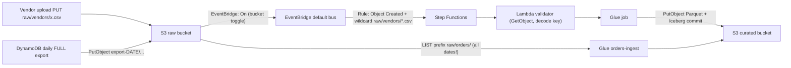

# 🪣 Amazon S3: The Storage Layer of the Lakehouse

> **What it is:** Amazon Simple Storage Service, a regional, highly durable **object store** with an HTTP API. Every zone of the lakehouse (raw, curated, analytics) is S3. Iceberg tables are just files in S3 plus metadata.
> **GCP equivalent:** **Cloud Storage (GCS)**. S3 Tables ≈ BigLake managed Iceberg tables ⚠️. S3 → EventBridge ≈ GCS → Eventarc / Pub/Sub notifications.
> **Where it appears in the HLD:** the raw export bucket (G), the raw vendor CSV bucket (F), the curated and analytics buckets (A, B, D write here), and Athena scanning files (B). Lab challenges where S3 behaviour decided the outcome: **F** (bucket must send events to EventBridge: [Challenge F](../01_AWS_Data_Lakehouse_Demonstrated/Challenge_F_Vendor_File_Pipeline_EventBridge_StepFunctions_Lambda.md)), **G** (a prefix that kept accumulating daily full exports: [Challenge G](../01_AWS_Data_Lakehouse_Demonstrated/Challenge_G_Orders_Ingest_Duplicates_And_Iceberg_Snapshot_Rollback.md)), **B/D** (small files: [Challenge B](../01_AWS_Data_Lakehouse_Demonstrated/Challenge_B_Analytics_Query_Performance_Compaction_And_MOR.md), [Challenge D](../01_AWS_Data_Lakehouse_Demonstrated/Challenge_D_Firehose_Iceberg_Streaming_Upserts_And_Buffering.md)).
> **As of:** Nov 2026 · ⚠️ = unverified or likely to change. Verify in the docs.
> **Guide index:** [README](README.md) · Prev: [00 Foundations](00_AWS_Foundations_IAM_Regions_CLI_CloudWatch_KMS.md) · Next: [02 Iceberg](02_Apache_Iceberg_On_AWS.md)

---

## ⭐ Must-know first (labs + exam)

1. **Bucket + key, nothing else.** A bucket is a regional container with a **globally unique** name. A key is the object's full name, e.g. `raw/orders/export-2025-05-02/part-0.json.gz`. **Folders don't exist.** `/` is just a character, and the console draws folders from shared **prefixes**.
2. **A "folder" read is a prefix read, and it's recursive in Spark.** `spark.read.json("s3://raw/raw/orders/")` reads **every object under that prefix**, including all sub-"folders". That's exactly how Challenge G loaded 3 daily full exports (150,000 rows instead of 50,000).
3. **Strong read-after-write consistency** for PUT, DELETE, GET, HEAD and LIST (since Dec 2020). There's **no rename and no append**. A "rename" is copy + delete, and an object is replaced as a whole.
4. **Request-rate scaling is per prefix:** about **3,500 writes and 5,500 reads per second per partitioned prefix**, and it scales automatically. While it scales you may see `503 SlowDown`. Spread hot data across prefixes.
5. **Small files kill query latency.** Each file costs at least one request, plus footer reads and planning work. Aim for **128 MB–512 MB** Parquet files. Fix the cause (bigger Firehose buffers, D) and compact afterwards (OPTIMIZE, B).
6. **Partition-style prefixes** (`dt=2026-11-10/`) let Hive-style tables prune. **Iceberg doesn't depend on folder names.** It prunes from metadata (hidden partitioning, A).
7. **Storage classes + lifecycle rules** move or expire objects by age, prefix, tag or size. IA and Glacier classes have **minimum durations** and **retrieval fees**. **Never** let lifecycle rules expire or archive **Iceberg data files**. Use Iceberg maintenance instead.
8. **Versioning** keeps old versions and turns deletes into **delete markers**. Noncurrent versions cost money until a lifecycle rule expires them.
9. **Encryption:** every new object is encrypted with **SSE-S3** by default. **SSE-KMS** needs `kms:Decrypt`/`GenerateDataKey` for readers and writers. Turn on **Bucket Keys** to cut KMS calls.
10. **Block Public Access is on and ACLs are off by default** on new buckets. Control access with **IAM policies + bucket policies** (and Lake Formation for governed tables).
11. **Bucket policy ARN rule:** `s3:ListBucket` goes on `arn:aws:s3:::bucket` (scope it with `s3:prefix`). Object actions go on `arn:aws:s3:::bucket/prefix/*`.
12. **Events, two systems.** **Classic notifications** go to SNS, SQS or Lambda, with prefix/suffix filters. The **EventBridge integration** is one bucket toggle that sends **all** events to EventBridge, where you get rich patterns and 20+ targets. **Challenge F needed *Amazon EventBridge: On*.**
13. **Events only fire for new writes.** Objects that existed before the rule need a **backfill** (copy, or start executions manually).
14. **Keys in event payloads can be URL-encoded.** Classic notifications turn `my file.csv` into `my+file.csv` (documented). Decode with `urllib.parse.unquote_plus`. For EventBridge payloads, **test with a key that contains a space** ⚠️.
15. **`put-bucket-notification-configuration` replaces the whole config.** Read it, merge, then write (the lab's CloudShell script does this).

---

## 🧱 First principles

### The problem
You need to store **unbounded** amounts of data (petabytes, trillions of objects) **durably** (losing data is unacceptable), **cheaply** (cents per GB-month), and reach it from **anywhere** over HTTP, without managing disks, filesystems or servers.

### The constraints, and the design they force

| Constraint | Consequence in S3's design |
|---|---|
| **Durability**: disks and racks fail constantly at this scale | Objects are erasure-coded and spread across **≥ 3 AZs** (except One Zone classes). Designed for **11 nines** of durability |
| **Scale**: no single metadata server can index trillions of keys | The key space is **partitioned by key prefix** across index servers. Throughput scales **per prefix**, hence the per-prefix request limits and `503 SlowDown` while partitions split |
| **Simplicity and immutability**: in-place edits of erasure-coded data across AZs are expensive and hard to make consistent | Objects are **immutable blobs**. Every PUT replaces the whole object. No append, no rename, no partial update |
| **HTTP API**: every operation is a request | You pay **per request** (PUT/LIST more than GET) **and per GB-month**. Per-request latency is tens of milliseconds, so **many small files = many slow requests** |
| **Flat namespace**: a real directory tree would need locks and atomic renames | **No directories.** `LIST` with a `prefix` + `delimiter=/` *simulates* folders. Renaming a "folder" means copying every object |
| **Consistency**: since Dec 2020, strong read-after-write for objects and lists | Many old "S3 is eventually consistent" workarounds (EMRFS consistent view, S3Guard) are obsolete. **Bucket configuration** changes can still take time to propagate ⚠️ |

### Why table formats exist (the bridge to Iceberg)
A "table" made of files in S3 has problems that come directly from these constraints:
1. **No atomic multi-file commit.** A job that writes 100 files and dies at file 60 leaves readers seeing a half-written table.
2. **No atomic rename**, so Hadoop's "write to `_temporary` then rename" trick is slow (a copy) and not atomic on S3.
3. **LIST is slow and costly.** Planning a query by listing millions of objects takes minutes.
4. **No row-level updates.** Objects are immutable, so an update means rewriting files.
5. **Schema and partition changes** would require rewriting data.

**Apache Iceberg** solves all five with a **metadata tree**: a `metadata.json` points to manifest lists, which point to manifests, which list the data files with column stats. A commit is a single **atomic pointer swap** in the catalog (the Glue Data Catalog). Readers never LIST. They read the manifests. See [02 Iceberg](02_Apache_Iceberg_On_AWS.md). **S3 Tables** (below) goes further and makes S3 itself manage Iceberg tables.

---

## 🧩 Core concepts

### Bucket types ⚠️ (the family has grown)

| Type | What | Use |
|---|---|---|
| **General purpose bucket** | Classic S3. Flat namespace, all storage classes except Express | Default for all lake zones |
| **Directory bucket** (S3 Express One Zone) | **Single AZ**, real directories, single-digit-ms latency, session-based auth | Hot scratch data, ML training shuffles. Not a durable lake tier |
| **Table bucket** (S3 Tables) | S3-managed **Apache Iceberg tables** with automatic maintenance | Managed analytics tables (see below) ⚠️ |
| **Vector bucket** (S3 Vectors) ⚠️ | Vector storage and similarity search | RAG/embeddings. Out of scope here |

### Object anatomy

| Part | Detail |
|---|---|
| **Key** | Up to 1,024 bytes (UTF-8). Treat it as an opaque string. `/` is only a convention |
| **Value** | 0 bytes up to **50 TB** (raised from 5 TB in Dec 2025). A single PUT is limited to **5 GB**, so use multipart above that |
| **Version ID** | `null` when unversioned. A unique ID per write when versioning is on |
| **System metadata** | Content-Type, ETag (MD5 for single-part unencrypted/SSE-S3 objects, *not* for multipart), storage class, encryption |
| **User metadata** | `x-amz-meta-*`, about 2 KB, set at write time only |
| **Object tags** | Up to 10 key/value pairs. Mutable. Usable in lifecycle filters and IAM conditions |

### Storage classes (us-east-1 prices ⚠️ approximate. Check the S3 pricing page)

| Class | AZs | Min duration | Min billable size | Retrieval | ~$/GB-month | Lake use |
|---|---|---|---|---|---|---|
| **Standard** | ≥ 3 | — | — | ms | 0.023 | Hot curated/analytics data |
| **Intelligent-Tiering** | ≥ 3 | — | objects < 128 KB stay in the frequent tier | ms (archive tiers optional) | 0.023 → lower tiers + small per-object monitoring fee | Unknown access patterns. **Safe for Iceberg** (transparent to readers) |
| **Standard-IA** | ≥ 3 | 30 days | 128 KB | ms + per-GB retrieval fee | 0.0125 | Raw data read occasionally |
| **One Zone-IA** | 1 | 30 days | 128 KB | ms + fee | 0.01 | Re-creatable data only |
| **Glacier Instant Retrieval** | ≥ 3 | 90 days | 128 KB | ms + higher fee | 0.004 | Quarterly-read archives |
| **Glacier Flexible Retrieval** | ≥ 3 | 90 days | ~40 KB metadata overhead per object ⚠️ | minutes to hours (**restore first**) | ~0.0036 | Compliance copies of raw |
| **Glacier Deep Archive** | ≥ 3 | 180 days | ~40 KB overhead per object ⚠️ | 12–48 h restore | ~0.001 | 7-year retention |
| **Express One Zone** | 1 | — | — | single-digit ms | higher storage, cheaper requests ⚠️ | Scratch/hot |

⚠️ **Athena and Glue can't read Glacier Flexible or Deep Archive objects without a restore.** Queries skip or fail on them. Verify the current behaviour for Glacier IR.

### Lifecycle rules

| Action | Example |
|---|---|
| **Transition** | `raw/` → Standard-IA after 30 days → Glacier Flexible after 180 |
| **Expiration** | Delete Athena query results after 7 days. Delete raw exports after 90 |
| **NoncurrentVersionExpiration** | Keep 3 old versions for 30 days, then delete |
| **AbortIncompleteMultipartUpload** | Clean up failed uploads after 7 days (they're invisible but **billed**) |
| **ExpiredObjectDeleteMarker** | Remove delete markers that have no versions left |
| **Filters** | Prefix, object tags, `ObjectSizeGreaterThan` / `LessThan`. Since 2024, objects under 128 KB aren't transitioned by default ⚠️ |

Lifecycle is **asynchronous** (it runs about daily ⚠️). Billing stops when an object becomes eligible, but deletion may happen later.

### Versioning and protection

| Feature | What | Gotcha |
|---|---|---|
| **Versioning** | States: Unversioned → Enabled → Suspended. You **can't go back** to unversioned | A DELETE adds a **delete marker**, and the old data remains billed |
| **MFA Delete** | Requires MFA to delete versions or change versioning | Root user only |
| **Object Lock** | WORM retention (Governance or Compliance mode) + legal hold. Needs versioning | Compliance mode can't be shortened, even by root |
| **Replication** (SRR/CRR) | Async copy to another bucket or region. Needs versioning on both. **Batch Replication** for existing objects | Not a backup on its own: it replicates deletes too (configurable) |

### Encryption

| Option | Header / setting | Reader needs | Notes |
|---|---|---|---|
| **SSE-S3** | `AES256` | `s3:GetObject` | **Default** for all new objects since Jan 2023 |
| **SSE-KMS** | `aws:kms` + key ID | + `kms:Decrypt` (writers: `kms:GenerateDataKey`) | Audit in CloudTrail. Enable **Bucket Keys** |
| **DSSE-KMS** | `aws:kms:dsse` | as SSE-KMS | Dual-layer |
| **SSE-C** | Customer key per request | The key | ⚠️ Being phased toward disabled-by-default for new buckets. Verify |
| **Client-side** | You encrypt before upload | Your key | Engines can't read it natively |

Default bucket encryption applies to **new writes only**. Existing objects keep their encryption until they're rewritten (S3 Batch Operations can copy them in place).

### Access control layers (evaluated together)

| Layer | Scope | Lab relevance |
|---|---|---|
| **IAM identity policies** | Principal | Glue, Lambda and Firehose roles |
| **Bucket policy** | Bucket (resource-based, cross-account capable, up to 20 KB) | TLS-only, deny outside the VPC endpoint, cross-account sharing |
| **Block Public Access (BPA)** | Account + bucket. Overrides policies and ACLs that would make data public | On by default |
| **Object Ownership** | "Bucket owner enforced" = ACLs disabled | Default since Apr 2023 |
| **Access Points** | Named endpoints with their own policy (and optionally VPC-only) | Per-application or per-vendor access ⚠️ |
| **VPC endpoint policy** | Gateway endpoint for S3 (free) | Glue jobs in a VPC need an S3 endpoint or NAT ([10 Sources](10_Source_Systems_Aurora_PostgreSQL_And_DynamoDB.md)) |
| **Lake Formation** | Registered locations. LF vends credentials for governed tables | Curated/analytics zones in the HLD ([05 LF](05_AWS_Lake_Formation.md)) |

### Event notifications: classic vs EventBridge

| | **Classic S3 event notifications** | **S3 → EventBridge** |
|---|---|---|
| Setup | Per-bucket notification configs (event types + filters + destination) | One toggle: *Properties → Event notifications → Amazon EventBridge → On* (`"EventBridgeConfiguration": {}`) |
| Destinations | **SNS topic, SQS queue, Lambda** only | Any EventBridge target: **Step Functions**, Lambda, SQS, Firehose, API destinations, other buses/accounts |
| Filtering | Key **prefix and suffix** only. **Overlapping** configs for the same event type are rejected | Full event patterns: `wildcard`, `prefix`, `suffix`, `anything-but`, numeric (size), `equals-ignore-case` |
| Fan-out | One destination per config (fan out via SNS) | Many rules on the same event |
| Payload | `Records[0].s3.bucket.name`, `Records[0].s3.object.key`, **key URL-encoded** | `detail.bucket.name`, `detail.object.key`, `detail.reason`, `detail.object.size` |
| Extras | — | Archive & replay, input transformers, DLQ, cross-account |
| Delivery | At-least-once, usually seconds. **Not ordered** (use `sequencer`) | At-least-once. Rule targets retry |
| Cost | No S3 charge | ⚠️ EventBridge event charges may apply. Verify |

**URL-encoded keys gotcha.** Classic notification payloads URL-encode the key the way an HTML form would: space becomes `+`, `:` becomes `%3A`, non-ASCII is percent-encoded. Code that passes the raw key to `GetObject` fails with `NoSuchKey` for any key containing those characters. Fix: `urllib.parse.unquote_plus(key)`. ⚠️ The EventBridge docs don't say whether `detail.object.key` is encoded. Test it (Example 2), or resolve the key defensively (try decoded, then raw).

### Performance toolkit

| Technique | When |
|---|---|
| **Multipart upload** | Required above 5 GB, recommended above ~100 MB. Parts 5 MiB–5 GiB, max 10,000 parts. Gives parallelism and retry per part. The CLI switches to multipart automatically above `multipart_threshold` (8 MB default) |
| **Byte-range GETs** | Parquet readers fetch footers and column chunks only (what Athena and Spark do) |
| **Prefix spreading** | Very high request rates: hash or date-spread prefixes. Rarely needed under 3.5k/5.5k rps per prefix |
| **S3 Select** ⚠️ | Server-side SQL filter on a single CSV/JSON/Parquet object. **AWS closed it to new customers in 2024** ⚠️, so don't design on it. Use Athena or Iceberg pruning |
| **Same region** | Glue, Athena and S3 in one region means no transfer cost and lower latency |
| **Gateway VPC endpoint** | Private, free S3 access from VPC workloads (Glue JDBC jobs) |

### S3 as the lakehouse storage layer

```text
s3://anycompany-lakehouse-raw-<sfx>/         ← RAW: immutable landing, source format
  raw/orders/export-2025-05-01/ …            ← one folder per DynamoDB export (G)
  raw/vendors/acme_2026-11-10.csv            ← vendor drops (F)
s3://anycompany-lakehouse-curated-<sfx>/     ← CURATED: cleaned, typed, Iceberg tables
  products/metadata/*.metadata.json          ← Iceberg metadata (A)
  products/data/category=…/updated_at_month=…/*.parquet
s3://anycompany-lakehouse-analytics-<sfx>/   ← ANALYTICS: aggregates for BI (B)
s3://<athena-results>/                       ← workgroup query results (expire after N days)
```

| Zone | Format | Mutability | Lifecycle | Access |
|---|---|---|---|---|
| **Raw / landing / bronze** | As delivered (CSV, JSON, DynamoDB JSON) | Append-only, never edited | IA after 30 d, archive or expire later | Ingest jobs only |
| **Curated / silver** | Iceberg (Parquet) | Upserts via Iceberg commits | **No S3 lifecycle on data files.** Iceberg VACUUM | LF-governed |
| **Analytics / gold** | Iceberg aggregates | Rebuilt or merged by jobs | Iceberg maintenance | LF-governed, Athena |

- **Partition-style prefixes** (`key=value/`) let Hive-style catalogs and Spark discover partitions and prune. **Low cardinality** is good (date, region). **High cardinality** (customer ID) creates millions of tiny prefixes and files.
- **Separate buckets per zone** (as in the lab) give simple, coarse IAM/LF boundaries and different lifecycle and encryption per zone.

### S3 Tables (managed Iceberg) ⚠️ fast-moving feature
- A **table bucket** holds **namespaces**, which hold **tables**. Each table is Iceberg, with its own ARN (`arn:aws:s3tables:<region>:<acct>:bucket/<name>/table/<id>`).
- S3 runs **compaction, snapshot expiration and unreferenced-file removal for you**. That's Challenge B's OPTIMIZE/VACUUM as a managed service, configured through maintenance settings.
- Query it through the **AWS analytics integration**: tables appear in the Glue Data Catalog under a federated catalog (`s3tablescatalog/<table-bucket>`), governed by Lake Formation, and queryable from Athena, Glue/EMR Spark, Redshift and Firehose. There's also an **Iceberg REST endpoint**.
- Trade-offs: separate pricing (storage + per-object monitoring + compaction charges ⚠️), less control over maintenance internals, and newer tooling. Check region availability and current limits.

### Access Points ⚠️
- A **named endpoint** for a bucket with its **own policy** (and optionally **VPC-only** access). Address it by ARN or **alias** (`<name>-<random>-s3alias`).
- Pattern: the bucket policy **delegates** to access points (`s3:DataAccessPointAccount` condition), and each consumer (vendor, team, app) gets its own access point and policy. This avoids one giant bucket policy.
- Related: Multi-Region Access Points (global routing), access points for directory buckets and FSx. ⚠️ Check whether S3 Object Lambda access points are still open to new customers.

---

## 🔄 How it works (flow)

### Write → event → pipeline (Challenge F) and read path (Challenge G)



**Write and event path (numbered)**
1. The client sends `PUT` (or a multipart upload). S3 stores the object redundantly across AZs and returns `200` with an ETag. From now on, GET and LIST see it (strong consistency).
2. If **EventBridge: On**, S3 emits `Object Created` (`reason: PutObject | CopyObject | CompleteMultipartUpload`) to the **default bus**, usually within seconds, at least once.
3. Rules evaluate patterns. Matching rules invoke targets with the target's IAM role (e.g. `states:StartExecution`).
4. Consumers read the object with `GetObject` (plus `kms:Decrypt` if SSE-KMS). The key must be the **real** key (decode if needed).

**Read path for a prefix (why G tripled)**
1. Spark lists `raw/orders/` **recursively** and gets every object under every `export-*` folder.
2. It plans one task per file or split, reads them all, and unions the rows.
3. Each export is a **full** copy of the table, so N exports give N× rows. Scope the path to `export-<date>/` or MERGE on the key.

---

## 🛠️ Hands-on examples

> Run in **CloudShell, us-east-1**. `export AWS_PAGER=""` first. Names like `-7db76de0` are lab suffixes, so look yours up ([00 Foundations, Example 3](00_AWS_Foundations_IAM_Regions_CLI_CloudWatch_KMS.md)).

### Example 1: A raw-zone bucket with secure defaults, versioning, KMS and lifecycle

**Goal:** create a landing bucket the way a production lake should have it: private, TLS-only, versioned, SSE-KMS with Bucket Keys, and lifecycle rules that clean up uploads, old versions and old exports.

**Console steps:** S3 → **Create bucket** → name, region us-east-1 → Object Ownership **ACLs disabled** → **Block all public access** ✅ → Versioning **Enable** → Default encryption **SSE-KMS**, choose key, **Bucket Key: Enable** → Create. Then **Permissions → Bucket policy** (paste), and **Management → Lifecycle rules** (create the three rules below).

**CLI**
```bash
export AWS_PAGER=""
ACCOUNT=$(aws sts get-caller-identity --query Account --output text)
REGION=us-east-1
BUCKET="qb-lake-raw-${ACCOUNT}-${REGION}"            # globally unique: include account + region
KEY_ARN=$(aws kms describe-key --key-id alias/lakehouse-curated --query KeyMetadata.Arn --output text)  # from 00 Foundations Ex 5

# us-east-1 is special: NO --create-bucket-configuration (other regions need LocationConstraint=<region>)
aws s3api create-bucket --bucket "$BUCKET" --region "$REGION"

aws s3api put-public-access-block --bucket "$BUCKET" --public-access-block-configuration \
  BlockPublicAcls=true,IgnorePublicAcls=true,BlockPublicPolicy=true,RestrictPublicBuckets=true
aws s3api put-bucket-versioning --bucket "$BUCKET" --versioning-configuration Status=Enabled
aws s3api put-bucket-tagging --bucket "$BUCKET" --tagging 'TagSet=[{Key=project,Value=lakehouse},{Key=zone,Value=raw}]'

# Default encryption: SSE-KMS + Bucket Key (cuts KMS requests dramatically)
cat > enc.json <<EOF
{"Rules": [{"ApplyServerSideEncryptionByDefault": {"SSEAlgorithm": "aws:kms", "KMSMasterKeyID": "${KEY_ARN}"},
            "BucketKeyEnabled": true}]}
EOF
aws s3api put-bucket-encryption --bucket "$BUCKET" --server-side-encryption-configuration file://enc.json

# Bucket policy: refuse any non-TLS request
cat > policy.json <<EOF
{
  "Version": "2012-10-17",
  "Statement": [{
    "Sid": "DenyInsecureTransport",
    "Effect": "Deny",
    "Principal": "*",
    "Action": "s3:*",
    "Resource": ["arn:aws:s3:::${BUCKET}", "arn:aws:s3:::${BUCKET}/*"],
    "Condition": {"Bool": {"aws:SecureTransport": "false"}}
  }]
}
EOF
aws s3api put-bucket-policy --bucket "$BUCKET" --policy file://policy.json

# Lifecycle: abort failed uploads, expire old versions, age out raw exports
cat > lifecycle.json <<'EOF'
{
  "Rules": [
    { "ID": "abort-incomplete-mpu", "Status": "Enabled", "Filter": {"Prefix": ""},
      "AbortIncompleteMultipartUpload": {"DaysAfterInitiation": 7} },
    { "ID": "expire-noncurrent-versions", "Status": "Enabled", "Filter": {"Prefix": ""},
      "NoncurrentVersionExpiration": {"NoncurrentDays": 30, "NewerNoncurrentVersions": 3},
      "Expiration": {"ExpiredObjectDeleteMarker": true} },
    { "ID": "raw-orders-exports-age-out", "Status": "Enabled", "Filter": {"Prefix": "raw/orders/"},
      "Transitions": [{"Days": 30, "StorageClass": "STANDARD_IA"}],
      "Expiration": {"Days": 120} }
  ]
}
EOF
aws s3api put-bucket-lifecycle-configuration --bucket "$BUCKET" --lifecycle-configuration file://lifecycle.json

# Verify
aws s3api get-bucket-encryption --bucket "$BUCKET" --query "ServerSideEncryptionConfiguration.Rules[0]"
aws s3api get-bucket-lifecycle-configuration --bucket "$BUCKET" --query "Rules[].ID"
echo hello > t.txt && aws s3 cp t.txt "s3://$BUCKET/tmp/t.txt" \
  && aws s3api head-object --bucket "$BUCKET" --key tmp/t.txt --query "{sse:ServerSideEncryption,key:SSEKMSKeyId,bk:BucketKeyEnabled}"
```

**Expected result:** `head-object` shows `aws:kms`, your key ARN and `BucketKeyEnabled: true`. There are three lifecycle rule IDs.
**What to check:**
- Errors: `IllegalLocationConstraintException` (you passed a LocationConstraint in us-east-1, or the wrong one elsewhere), `BucketAlreadyExists` (the name is taken in **another** account, since names are global), `MalformedXML` on lifecycle (an invalid combination, e.g. `ExpiredObjectDeleteMarker` together with `Days` in one `Expiration`).
- **Don't** put this lifecycle on the **curated Iceberg** bucket's data prefixes. Iceberg tracks those files, so expire them with VACUUM ([04 Athena](04_Amazon_Athena.md)).

---

### Example 2: Reproduce Challenge F's S3 side, then capture and inspect real S3 events

**Goal:** confirm the bucket emits events to EventBridge, turn it on safely if it's off, and **see the actual event payload** (including how a key with a space looks) by sending matching events to a CloudWatch Logs group.

**Console steps:** S3 → bucket → **Properties** → *Event notifications* → **Amazon EventBridge: Edit → On → Save**. EventBridge → Event buses → `default` → Rules → Create rule (pattern below) → target **CloudWatch log group** `/aws/events/s3-raw-debug`.

**CLI**
```bash
export AWS_PAGER=""
ACCOUNT=$(aws sts get-caller-identity --query Account --output text)
RAW=$(aws s3api list-buckets --query "Buckets[?starts_with(Name,'anycompany-lakehouse-raw')].Name | [0]" --output text)

# 1) Is EventBridge delivery on? (look for "EventBridgeConfiguration": {})
aws s3api get-bucket-notification-configuration --bucket "$RAW"

# 2) Turn it on WITHOUT wiping existing classic notifications (put-* replaces the whole config)
aws s3api get-bucket-notification-configuration --bucket "$RAW" > notif.json
[ -s notif.json ] || echo '{}' > notif.json
jq '. + {"EventBridgeConfiguration": {}}' notif.json > notif-new.json
aws s3api put-bucket-notification-configuration --bucket "$RAW" --notification-configuration file://notif-new.json

# 3) Debug rule -> CloudWatch Logs (log group resource policy lets EventBridge write)
aws logs create-log-group --log-group-name /aws/events/s3-raw-debug 2>/dev/null
cat > logs-policy.json <<EOF
{"Version": "2012-10-17", "Statement": [{"Effect": "Allow",
  "Principal": {"Service": ["events.amazonaws.com", "delivery.logs.amazonaws.com"]},
  "Action": ["logs:CreateLogStream", "logs:PutLogEvents"],
  "Resource": "arn:aws:logs:us-east-1:${ACCOUNT}:log-group:/aws/events/*:*"}]}
EOF
aws logs put-resource-policy --policy-name eventbridge-to-cwlogs --policy-document file://logs-policy.json

cat > debug-pattern.json <<EOF
{"source": ["aws.s3"], "detail-type": ["Object Created"],
 "detail": {"bucket": {"name": ["${RAW}"]}, "object": {"key": [{"prefix": "debug/"}]}}}
EOF
aws events put-rule --name s3-raw-debug --event-pattern file://debug-pattern.json --state ENABLED
aws events put-targets --rule s3-raw-debug \
  --targets "Id"="cwlogs","Arn"="arn:aws:logs:us-east-1:${ACCOUNT}:log-group:/aws/events/s3-raw-debug"

# 4) Upload keys with a space, a plus and a colon; outside raw/vendors/ so the real pipeline won't fire
echo "vendor_id,name" > t.csv
aws s3 cp t.csv "s3://$RAW/debug/my file+v1:final.csv"
sleep 20
aws logs tail /aws/events/s3-raw-debug --since 5m --format short | grep -o '"key": *"[^"]*"'
```

**Python: resolve the real key defensively** (works whether or not the payload is encoded)
```python
import urllib.parse
import boto3
from botocore.exceptions import ClientError

s3 = boto3.client("s3")

def resolve_key(bucket: str, key_from_event: str) -> str:
    """Return the object key that actually exists.
    Classic notifications URL-encode keys ('my file.csv' -> 'my+file.csv').
    Try the decoded form first, then the raw form, so a literal '+' still works."""
    candidates = [urllib.parse.unquote_plus(key_from_event), key_from_event]
    for key in dict.fromkeys(candidates):            # de-duplicate, keep order
        try:
            s3.head_object(Bucket=bucket, Key=key)
            return key
        except ClientError as err:
            if err.response["Error"]["Code"] in ("404", "NoSuchKey", "NotFound"):
                continue
            raise                                     # 403 etc. is a real permission problem
    raise FileNotFoundError(f"s3://{bucket}/{key_from_event} not found (raw or decoded)")

def handler(event, context):
    bucket, key = event["bucket"], resolve_key(event["bucket"], event["key"])  # {bucket,key} from the input transformer
    body = s3.get_object(Bucket=bucket, Key=key)["Body"].read()
    return {"bucket": bucket, "key": key, "bytes": len(body)}
```

**Expected result:** the debug log shows one `Object Created` event. The `"key"` value tells you **empirically** whether this integration encodes keys. Record the answer in your notes ⚠️.
**What to check:** no log entry means the toggle is off, the pattern is wrong, or the logs resource policy is missing (the rule's *Monitoring* tab shows `FailedInvocations`). Clean up afterwards: `aws events remove-targets --rule s3-raw-debug --ids cwlogs && aws events delete-rule --name s3-raw-debug`.

---

### Example 3: Reproduce Challenge G's S3 side: the prefix that kept accumulating exports

**Goal:** prove that the read path, not the data, caused the 3× duplicates, and see how to make the S3 layout itself safer.

**Console steps:** S3 → raw bucket → `raw/orders/`. You'll see `export-2025-05-01/`, `export-2025-05-02/`, … Each one is a **complete** copy of the table.

**CLI: size up each export folder**
```bash
export AWS_PAGER=""
RAW=$(aws s3api list-buckets --query "Buckets[?starts_with(Name,'anycompany-lakehouse-raw')].Name | [0]" --output text)

# "Folders" are CommonPrefixes from a delimiter listing
aws s3api list-objects-v2 --bucket "$RAW" --prefix raw/orders/ --delimiter / \
  --query "CommonPrefixes[].Prefix" --output text | tr '\t' '\n' > exports.txt
cat exports.txt

# Objects and bytes per export (|| `[]` guards empty prefixes)
while read -r P; do
  aws s3api list-objects-v2 --bucket "$RAW" --prefix "$P" \
    --query "['$P', length(Contents || \`[]\`), sum((Contents || \`[]\`)[].Size)]" --output text
done < exports.txt

# Whole-prefix totals (what the broken job actually read)
aws s3 ls "s3://$RAW/raw/orders/" --recursive --summarize --human-readable | tail -2
```

**PySpark (Glue notebook or job): show where every row came from**
```python
from pyspark.sql import functions as F

raw = "anycompany-lakehouse-raw-7db76de0"          # use your exact bucket name

# BROKEN (what the lab script did): reads every export folder under the prefix, recursively
everything = spark.read.json(f"s3://{raw}/raw/orders/")
(everything
   .withColumn("export", F.regexp_extract(F.input_file_name(), r"export-([0-9-]+)/", 1))
   .groupBy("export").count().orderBy("export").show())
# export-2025-05-01 | 50000
# export-2025-05-02 | 50000
# export-2025-05-03 | 50000   -> 150,000 rows, every order_id x3

# FIXED: one logical date = one prefix (the job's --export_date parameter)
one_day = spark.read.json(f"s3://{raw}/raw/orders/export-2025-05-02/")
print(one_day.count())                               # 50000
```

**Make the layout itself safer (beyond the lab)**
- **Partition-style naming** (`raw/orders/export_date=2025-05-02/`) lets you filter with a predicate (`.where("export_date = '2025-05-02'")`) and makes the date visible in the data.
- **A completion marker:** have the exporter write `_SUCCESS` or `manifest.json` *last*, and only read folders that have it. With DynamoDB exports, read `manifest-files.json` ([10 Sources](10_Source_Systems_Aurora_PostgreSQL_And_DynamoDB.md)).
- **A latest pointer:** write `raw/orders/_latest.json` = `{"export_date": "2025-05-02"}` after each export. Jobs read the pointer, never the whole prefix.
- **Lifecycle** (Example 1's `raw-orders-exports-age-out`) caps how many exports pile up. It's a cost control, not a correctness fix.

**Expected result:** the per-export count shows three equal blocks of 50,000, and the scoped read returns 50,000.
**What to check:** if `input_file_name()` shows files outside `export-*/` (manifests, `_started`, `.md5`), your reader also ingests non-data files. Restrict it to `.../data/` or use `pathGlobFilter`.

---

### Example 4 (beyond the lab): least-privilege bucket policy plus a vendor Access Point

**Goal:** the curated bucket allows **only** the Glue job role and the Lake Formation service-linked role, and each vendor uploads through its **own access point** that can only `PutObject` under its own prefix.

**Bucket policy on the raw bucket: delegate access control to access points owned by this account** ⚠️ (documented delegation pattern)
```json
{
  "Version": "2012-10-17",
  "Statement": [
    {
      "Sid": "DelegateToThisAccountsAccessPoints",
      "Effect": "Allow",
      "Principal": { "AWS": "*" },
      "Action": "*",
      "Resource": ["arn:aws:s3:::anycompany-lakehouse-raw-7db76de0", "arn:aws:s3:::anycompany-lakehouse-raw-7db76de0/*"],
      "Condition": { "StringEquals": { "s3:DataAccessPointAccount": "111122223333" } }
    },
    {
      "Sid": "DenyInsecureTransport",
      "Effect": "Deny",
      "Principal": "*",
      "Action": "s3:*",
      "Resource": ["arn:aws:s3:::anycompany-lakehouse-raw-7db76de0", "arn:aws:s3:::anycompany-lakehouse-raw-7db76de0/*"],
      "Condition": { "Bool": { "aws:SecureTransport": "false" } }
    }
  ]
}
```

**Access point policy for vendor ACME** (`ap-acme.json`). Write-only, own prefix, CSV only:
```json
{
  "Version": "2012-10-17",
  "Statement": [{
    "Sid": "AcmeMayOnlyPutCsvUnderItsPrefix",
    "Effect": "Allow",
    "Principal": { "AWS": "arn:aws:iam::111122223333:role/vendor-acme-uploader" },
    "Action": "s3:PutObject",
    "Resource": "arn:aws:s3:us-east-1:111122223333:accesspoint/vendor-acme/object/raw/vendors/acme/*.csv"
  }]
}
```

**CLI**
```bash
ACCOUNT=$(aws sts get-caller-identity --query Account --output text)
aws s3control create-access-point --account-id "$ACCOUNT" --name vendor-acme --bucket "$RAW"
aws s3control put-access-point-policy --account-id "$ACCOUNT" --name vendor-acme --policy file://ap-acme.json
AP_ARN="arn:aws:s3:us-east-1:${ACCOUNT}:accesspoint/vendor-acme"
# As the vendor role, upload through the access point (the CLI accepts access point ARNs in s3:// URIs)
aws s3 cp acme_2026-11-10.csv "s3://${AP_ARN}/raw/vendors/acme/acme_2026-11-10.csv"
```

**The classic ListBucket trap, for comparison (identity policy)**
```json
{
  "Version": "2012-10-17",
  "Statement": [
    { "Sid": "ListOnlyVendorsPrefix", "Effect": "Allow", "Action": "s3:ListBucket",
      "Resource": "arn:aws:s3:::anycompany-lakehouse-raw-7db76de0",
      "Condition": { "StringLike": { "s3:prefix": ["raw/vendors/*"] } } },
    { "Sid": "ReadVendorFiles", "Effect": "Allow", "Action": "s3:GetObject",
      "Resource": "arn:aws:s3:::anycompany-lakehouse-raw-7db76de0/raw/vendors/*" }
  ]
}
```
`ListBucket` on `…/raw/vendors/*` (an object ARN) silently grants nothing. It must be on the **bucket** ARN.

**Expected result:** the vendor role can upload `acme/*.csv` through the access point. A direct `s3://bucket/...` PUT, a `.xlsx` key or another vendor's prefix is denied.
**What to check:** `put-bucket-policy` may be rejected by **Block Public Access** if S3 decides the policy is public. The `s3:DataAccessPointAccount` condition normally keeps it non-public ⚠️. Test in a sandbox first.

---

### Example 5 (beyond the lab): diagnose small files per partition before they hurt Athena

**Goal:** find partitions whose average file size is tiny (Firehose 60-second buffers, Challenge D) so you can fix the source and schedule compaction (Challenge B).

```python
#!/usr/bin/env python3
"""small_files.py <bucket> <prefix> [suffix]
Prints file count and average size per 'directory' under a prefix, worst first.
For Iceberg tables prefer the $files metadata table: a raw listing also counts
orphaned/expired files that the table no longer references."""
import sys
from collections import defaultdict
import boto3

bucket, prefix = sys.argv[1], sys.argv[2]
suffix = sys.argv[3] if len(sys.argv) > 3 else ".parquet"

s3 = boto3.client("s3")
stats = defaultdict(lambda: [0, 0])                 # dir -> [file_count, total_bytes]
for page in s3.get_paginator("list_objects_v2").paginate(Bucket=bucket, Prefix=prefix):
    for obj in page.get("Contents", []):
        if obj["Key"].endswith(suffix):
            directory = obj["Key"].rsplit("/", 1)[0]
            stats[directory][0] += 1
            stats[directory][1] += obj["Size"]

rows = sorted(stats.items(), key=lambda kv: kv[1][1] / kv[1][0])   # smallest average first
for directory, (n, size) in rows[:25]:
    avg_mb = size / n / 1_048_576
    flag = "  <-- SMALL FILES" if avg_mb < 32 and n >= 10 else ""
    print(f"{n:7d} files  {avg_mb:9.2f} MB avg  {directory}{flag}")
```

```bash
python3 small_files.py anycompany-lakehouse-curated-7db76de0 daily_orders/data/
```
```sql
-- Iceberg-aware equivalent in Athena (counts only files the current snapshot references)
SELECT partition, COUNT(*) AS files, ROUND(AVG(file_size_in_bytes)/1048576.0, 2) AS avg_mb
FROM "lakehouse_db"."daily_orders$files"
GROUP BY partition ORDER BY avg_mb ASC LIMIT 25;
```

**Expected result:** partitions with hundreds of files of about 1 MB each are flagged.
**What to check:** if the S3 listing shows far more files than `$files`, old snapshots are keeping files alive. Run VACUUM, and check `vacuum_*` properties (Challenge B).

---

### Example 6 (beyond the lab): S3 Tables quick start ⚠️ (verify CLI names in the current docs)

**Goal:** create a managed Iceberg table whose compaction and snapshot cleanup S3 runs for you, then query it from Athena.

**Console steps:** S3 → **Table buckets** → *Enable integration with AWS analytics services* (one-time per region ⚠️) → **Create table bucket** → **Create table with Athena**, which opens Athena with the `s3tablescatalog/<bucket>` catalog selected.

```bash
export AWS_PAGER=""
aws s3tables create-table-bucket --name qb-analytics-tables --region us-east-1
TB_ARN=$(aws s3tables list-table-buckets --query "tableBuckets[?name=='qb-analytics-tables'].arn | [0]" --output text)
aws s3tables create-namespace --table-bucket-arn "$TB_ARN" --namespace analytics
aws s3tables list-namespaces --table-bucket-arn "$TB_ARN"
# Inspect maintenance (compaction / snapshot management) once a table exists
aws s3tables get-table-maintenance-configuration --table-bucket-arn "$TB_ARN" --namespace analytics --name daily_orders
```
```sql
-- Athena: data catalog = s3tablescatalog/qb-analytics-tables, database = analytics
CREATE TABLE daily_orders (order_date date, city string, orders bigint, revenue decimal(14,2))
PARTITIONED BY (month(order_date))
TBLPROPERTIES ('table_type' = 'ICEBERG');
INSERT INTO daily_orders VALUES (DATE '2026-11-10', 'Pune', 1250, 48250.00);
SELECT * FROM daily_orders;
```

**Expected result:** a queryable Iceberg table with **no** OPTIMIZE/VACUUM jobs for you to schedule.
**What to check:** the integration must be enabled, and Lake Formation grants apply to the federated catalog ⚠️. Compare costs with self-managed Iceberg before you migrate.

---

## ⚙️ Key settings, limits & quotas

| Item | Value | Note |
|---|---|---|
| Max object size | **50 TB** (since Dec 2025, most regions) | Was 5 TB |
| Max single PUT | 5 GB | Use multipart above it |
| Multipart | 10,000 parts. Parts 5 MiB–5 GiB (last part may be smaller) | Incomplete uploads are billed. Use a lifecycle abort rule |
| Key length | 1,024 bytes UTF-8 | |
| User metadata | ~2 KB | Immutable after write |
| Object tags | 10 per object | |
| Buckets per account | 10,000 default (raised in 2024) ⚠️ | Up to ~1M on request ⚠️ |
| Bucket name | 3–63 chars, lowercase, digits, `-`, `.`. Globally unique | Avoid `.` (TLS wildcard issues) |
| Request rate | ~3,500 PUT/COPY/POST/DELETE + ~5,500 GET/HEAD per second **per partitioned prefix** | Auto-scales. `503 SlowDown` during ramp |
| LIST page size | 1,000 keys per call | The CLI paginates for you |
| DeleteObjects batch | 1,000 keys per request | |
| Bucket policy size | 20 KB | Use access points to split |
| Lifecycle rules | 1,000 per bucket ⚠️ | |
| Event delivery | Typically seconds. At-least-once. Unordered | Use `sequencer` for ordering |
| Consistency | Strong for object read-after-write, overwrite, delete, LIST | Bucket config changes may lag ⚠️ |
| Presigned URL max | 7 days (SigV4), and never past the signing credentials' expiry | Role credentials expire sooner |
| S3 Tables | Table buckets per region and tables per bucket have quotas ⚠️ | Check Service Quotas |

---

## 🔐 Security

- **Default posture (keep it):** BPA on, ACLs disabled (bucket owner enforced), SSE-S3 or SSE-KMS by default, TLS-only bucket policy.
- **Least privilege:** grant per role and per **prefix** (Example 4). Separate buckets per zone keep policies simple and limit the damage if a job misbehaves.
- **KMS:** writers need `kms:GenerateDataKey`, readers need `kms:Decrypt`, **in the key policy or IAM**. Turn on **Bucket Keys**. Cross-account readers need the key policy to name them.
- **Network:** use a **gateway VPC endpoint** for VPC workloads. Bucket policies can `Deny` unless `aws:SourceVpce` matches, for strict perimeters.
- **Lake Formation:** register the curated/analytics locations with LF. Engines (Athena, Glue, EMR) then get **temporary, table-scoped credentials** from LF, so analysts don't need broad `s3:GetObject`. Keep direct S3 IAM grants for those prefixes to the minimum, because direct S3 access bypasses LF's row and column filters.
- **Data protection:** versioning + Object Lock for raw compliance data, and replication for DR. Use **Macie** to find PII in buckets ⚠️.
- **Audit:** CloudTrail **data events** on sensitive prefixes, S3 server access logs (best effort), and Storage Lens for org-wide posture.

---

## 💰 Cost model & optimisation

**You pay for:** storage (GB-month per class) · requests (PUT/COPY/POST/LIST ≈ $0.005 per 1,000; GET ≈ $0.0004 per 1,000 ⚠️) · retrievals (IA/Glacier) · data transfer **out** of the region or to the internet (in-region to Glue/Athena is free) · features (Intelligent-Tiering monitoring, Inventory, Storage Lens advanced, replication, S3 Tables maintenance) · and KMS requests if SSE-KMS.

**Levers:** lifecycle to cheaper classes for raw · Intelligent-Tiering for unknown patterns · **compaction** (fewer, larger files) · columnar formats (Parquet + compression) so engines read less · expire Athena results and temp prefixes · abort incomplete MPUs · **Bucket Keys** · avoid cross-region reads.

**Worked example (us-east-1, ⚠️ prices approximate):** a curated `daily_orders` table of 300 GB queried by dashboards 2,000 times a month.

| Scenario | Files touched per query | GET cost/month | KMS cost/month (SSE-KMS, **no** Bucket Key) | Latency |
|---|---|---|---|---|
| Before (60 s Firehose buffer, no compaction): ~43,000 tiny files | 43,000 | 2,000 × 43,000 = 86M GETs × $0.0004/1k ≈ **$34** | 86M decrypts × $0.03/10k ≈ **$258** | 60–90 s (Challenge B) |
| After (300 s buffer + OPTIMIZE): ~600 files of ~500 MB | 600 | 1.2M GETs ≈ **$0.48** | ≈ $3.60 (≈ $0 with Bucket Keys) | Seconds |
| Storage either way | — | 300 GB × $0.023 ≈ **$6.90** | — | — |

These are lower bounds: they assume one GET per file, and Parquet readers usually do several (footer + column chunks).

**Lesson:** storage is cheap. **Request counts × small files × KMS** is where money and latency go.

---

## 📈 Monitoring & troubleshooting

| Symptom | Likely cause | How to confirm | Fix |
|---|---|---|---|
| Upload to `raw/vendors/` starts nothing (F) | Bucket's **EventBridge** toggle is Off | `get-bucket-notification-configuration` has no `EventBridgeConfiguration` | Turn it on (merge, Example 2) |
| Still nothing | Pattern bucket name wrong (suffix!), key outside prefix, `.CSV` vs `.csv` | Rule *Monitoring* → MatchedEvents = 0. `aws events test-event-pattern` | Copy the exact bucket name. Fix the pattern |
| Existing files never processed | Events fire only for **new** writes | Upload time vs rule creation time | Copy or re-upload, or start executions manually |
| Lambda `NoSuchKey` for keys with spaces/special chars | Key in event is **URL-encoded** | Log the raw key: `my+file.csv` | `unquote_plus` / `resolve_key` (Example 2) |
| 150,000 rows instead of 50,000 (G) | Job reads the **whole** export prefix | Group by `input_file_name()` (Example 3) | Read `export-<date>/` only. MERGE on the key |
| `put-bucket-notification-configuration` wiped other notifications | The API **replaces** the full config | Previous Lambda/SQS triggers stopped | Always get → merge → put |
| `Configurations overlap` error | Two classic configs share an event type and overlapping prefix/suffix | Read the notification config | Merge into one config, or use EventBridge |
| `Unable to validate the following destination configurations` | SNS/SQS/Lambda resource policy doesn't allow S3 | Destination's policy | Allow `s3.amazonaws.com` with `aws:SourceArn` = bucket ARN |
| `403 AccessDenied` on GetObject | Missing IAM/bucket permission, **KMS** denial, or missing ListBucket (403 for missing keys) | `head-object` (encryption), simulator, CloudTrail `errorCode` | Fix the policy on the right ARN. Add kms:Decrypt |
| `301 PermanentRedirect` / wrong-region errors | Client region ≠ bucket region | `aws s3api get-bucket-location` | Use the bucket's region |
| `503 SlowDown` | Request-rate burst on one prefix | CloudWatch request metrics (if enabled), retries in logs | Exponential backoff (SDKs do it). Spread prefixes. Fewer, bigger files |
| Athena slow with lots of tiny files (B/D) | Small files | `$files` average size (Example 5) | Bigger buffers + OPTIMIZE + VACUUM |
| Storage bill keeps growing after deletes | Versioning keeps **noncurrent** versions. Incomplete MPUs | Storage Lens / `list-object-versions` | Noncurrent expiration + MPU abort lifecycle |
| Lifecycle "didn't run" | Runs asynchronously. Size/age filters | Check the rule filter. Wait 24–48 h | Patience. Verify `ObjectSizeGreaterThan` defaults |
| Iceberg query fails: file not found | Lifecycle or manual delete removed data files Iceberg still references | Athena error lists the missing path | Never lifecycle Iceberg data. Restore the version if versioning is on |

---

## 🧠 Second-order thinking

1. **Read a whole prefix "to be safe"** → the job never misses a file → every new export or drop **adds** to the read set: N× duplicates for full snapshots (G), growing runtime and cost → **mitigation:** read exactly one logical unit (a date folder or a manifest), make writes idempotent (MERGE), and use lifecycle as a cost cap.
2. **High-cardinality partition prefixes** (`customer_id=…/`) → precise pruning for single-customer queries → millions of prefixes, tiny files, catalog bloat, slow planning → **mitigation:** partition by date/region and `bucket(N, customer_id)` in Iceberg.
3. **Short Firehose/stream buffers** → fresh data in about a minute → thousands of small files a day → slow scans and higher GET/KMS cost (worked example) → **mitigation:** 300–900 s buffers (D) + scheduled OPTIMIZE (B), or S3 Tables managed compaction.
4. **Enable versioning on the Iceberg bucket** → protection against accidental deletes → every VACUUM/compaction "delete" leaves **noncurrent versions** that are billed forever, which can double storage → **mitigation:** a noncurrent-version expiration rule (e.g. 7–30 days), or rely on Iceberg snapshots and keep versioning for raw only.
5. **SSE-KMS with a CMK everywhere** → key-level control and audit → per-object KMS calls, throttling risk and cross-account complexity (every consumer needs key policy access) → **mitigation:** Bucket Keys, and SSE-S3 for non-sensitive zones.
6. **Lifecycle "archive after 90 days" applied to the whole curated bucket** → cheaper storage → Iceberg tables reference archived files, so queries **fail** and time travel breaks → **mitigation:** lifecycle only on raw/landing and Athena-results prefixes. Use Iceberg expire/VACUUM for tables, or Intelligent-Tiering (transparent to readers).
7. **Classic notifications straight to Lambda** → simplest trigger → one destination per prefix, no replay, and overlapping-config conflicts when a second team needs the same events → **mitigation:** EventBridge (fan-out, archive/replay) or SNS → SQS fan-out.
8. **Event-driven ingestion only** → low latency → missed events (toggle off, rule disabled, failed target without a DLQ) mean silent data loss → **mitigation:** a daily **reconciliation** job (S3 Inventory or LIST vs ingestion ledger), plus DLQs and archive/replay.

**When *not* to use S3 (or a given S3 feature):**
- For **low-latency random row reads or updates**, use DynamoDB or Aurora.
- For **POSIX file semantics** (rename, append, locks), use EFS or FSx.
- Don't use **S3 Select** for new designs ⚠️.
- Don't use **One Zone** classes for data you can't re-create.
- Don't use **S3 Express One Zone** as the durable lake tier.

---

## 🔀 Alternatives & comparisons

### AWS alternatives

| Need | Choose | Instead of S3 general purpose because |
|---|---|---|
| Managed Iceberg tables with automatic maintenance | **S3 Tables** ⚠️ | You don't run OPTIMIZE/VACUUM yourself (Challenge B as a service) |
| Ultra-low-latency hot data in one AZ | **S3 Express One Zone** | ms latency, cheaper requests. Less durable (1 AZ) |
| Shared POSIX filesystem | **EFS** / **FSx for Lustre** (can link to S3) | Rename/append/locks, HPC throughput |
| Data warehouse managed storage | **Redshift** (RMS) | SQL warehouse semantics, but storage isn't open files |
| Moving data in | **DataSync**, **Transfer Family** (SFTP for vendors), **Snowball** | Managed transfer, SFTP endpoints for partners |
| Bulk operations on billions of objects | **S3 Batch Operations** | Copy, tag, restore, invoke Lambda per object, with a report |

### GCS → S3 mapping

| GCS | S3 | Difference |
|---|---|---|
| Bucket (global names) | Bucket (global names, **single region**) | GCS has dual- and multi-region buckets. S3 uses CRR / Multi-Region Access Points |
| Strong consistency | Strong consistency (since 2020) | Equivalent today |
| Standard / Nearline / Coldline / Archive | Standard / Standard-IA / Glacier IR / Glacier Flexible / Deep Archive | Different minimum durations: Nearline 30 d ≈ IA 30 d. Archive 365 d vs Deep Archive 180 d |
| Autoclass | **Intelligent-Tiering** | |
| Object Lifecycle Management | **Lifecycle rules** | |
| Object Versioning / soft delete | **Versioning** (+ lifecycle) | GCS soft delete (default retention) has no direct S3 equivalent ⚠️ |
| Bucket Lock / retention policies | **Object Lock** | |
| Uniform bucket-level access | **Object Ownership: bucket owner enforced** | |
| Public access prevention | **Block Public Access** | |
| IAM on bucket / managed folders | **Bucket policy / Access Points** | |
| Pub/Sub notifications for Cloud Storage | **Classic notifications** (SNS/SQS/Lambda) | |
| Eventarc (Cloud Storage triggers) | **S3 → EventBridge** | |
| Resumable / XML multipart / composite uploads | **Multipart upload** | |
| Hierarchical namespace buckets ⚠️ | **Directory buckets** (Express One Zone) | Real directories in both |
| BigLake tables / BigLake Iceberg (managed) ⚠️ | Glue + Iceberg / **S3 Tables** | |
| Signed URLs | **Presigned URLs** | |
| Storage Transfer Service | **DataSync / Batch Operations** | |
| `gcloud storage` / `gsutil` | `aws s3` (high-level) / `aws s3api` (low-level) | |
| VPC Service Controls | Gateway endpoint policies + `aws:SourceVpce` conditions + RCPs ⚠️ | |

---

## 🎯 Exam angle

**Patterns you'll see (DEA-C01-style)**
- *"Reduce storage cost for data rarely accessed after 30 days but needed instantly when accessed."* → Lifecycle to **Standard-IA** or **Glacier Instant Retrieval**. Unknown pattern → **Intelligent-Tiering**.
- *"Retain for 7 years, rarely accessed, cheapest."* → **Glacier Deep Archive** (+ Object Lock if WORM is needed).
- *"Trigger processing when files land, with multiple consumers and content filtering."* → **S3 → EventBridge** rules (not classic notifications).
- *"Trigger a Lambda when a CSV lands in a prefix, simplest."* → **Classic notification** with prefix/suffix.
- *"Athena queries slow, many small files."* → **Compact** (Iceberg OPTIMIZE / Glue job), bigger files, Parquet, partitioning.
- *"High request rate 503s."* → **Spread prefixes**, backoff.
- *"Ensure all objects are encrypted with a specific KMS key."* → Default bucket encryption SSE-KMS (+ bucket policy deny on a missing/different key). *"Reduce KMS costs"* → **Bucket Keys**.
- *"Share a subset of a bucket with many teams with different permissions."* → **Access Points** (or Lake Formation for tables).
- *"Query with SQL directly on files in S3, serverless."* → **Athena** (not S3 Select for new designs ⚠️).
- *"Upload large files faster from far away."* → **Multipart + Transfer Acceleration**.
- *"Accidental deletes."* → **Versioning** (+ MFA Delete / Object Lock).

**Keywords:** "object storage, data lake, durable, lifecycle, archive, prefix, event notification, versioning, WORM, presigned".

**Traps**
- Lifecycle can't move objects into Standard-IA **before 30 days** in Standard.
- One Zone-IA is **not** resilient to an AZ loss.
- Glacier Flexible and Deep Archive need a **restore** before Athena can read them.
- S3 is **not** eventually consistent any more. Answers built on "wait for consistency" are outdated.
- **No rename**: "move a folder" is a copy of every object.

---

## 🧪 Self-test

1. Why does `spark.read.json("s3://b/raw/orders/")` return 3× the rows after three days of full exports, and what are two fixes?
2. What's wrong with an IAM statement granting `s3:ListBucket` on `arn:aws:s3:::b/raw/*`?
3. A vendor uploads `raw/vendors/Q4 report.csv`. The classic-notification Lambda fails with `NoSuchKey`. Why, and what's the fix?
4. You run `put-bucket-notification-configuration` with only `{"EventBridgeConfiguration": {}}`. What might you have broken?
5. Name three differences between classic S3 notifications and S3 → EventBridge.
6. Why is reading 43,000 1 MB files slower than reading 86 files of 500 MB, even though the bytes are the same?
7. Why must you not use S3 lifecycle expiration on an Iceberg table's data prefix?
8. Versioning is on and VACUUM deletes 10 GB of old data files every day. What happens to the bill, and what's the fix?
9. What do S3 Bucket Keys change, and when do they matter most?
10. What's the minimum storage duration for Standard-IA and Glacier Deep Archive?
11. What does S3 Tables manage for you that you did by hand in Challenge B?
12. Which GCP features map to S3 → EventBridge, Intelligent-Tiering and Block Public Access?

<details><summary>Answers</summary>

1. Spark lists the prefix recursively and reads every export folder, and each export is a full copy, so you get 3 copies. Fixes: read only `export-<date>/` from a job parameter, and/or MERGE on `order_id` after deduplicating the source (plus a manifest or completion marker).
2. `ListBucket` acts on the **bucket** resource. Use `arn:aws:s3:::b` with a `s3:prefix` condition. The statement as written grants nothing.
3. The event key is URL-encoded (`Q4+report.csv`). Decode it with `urllib.parse.unquote_plus`, or resolve it defensively by trying decoded, then raw.
4. The call **replaces** the whole configuration, so any existing classic Lambda/SQS/SNS notifications were deleted. Get → merge → put.
5. Destinations (3 vs 20+, including Step Functions), filtering (prefix/suffix vs full patterns), fan-out (one vs many rules), archive/replay and input transformers (EventBridge only), and setup (per-config vs one toggle).
6. Each file costs request latency (tens of ms), footer reads, task scheduling and planning overhead. Fixed costs multiply by file count. (Plus a KMS call per object without Bucket Keys.)
7. Iceberg metadata still references those files. Expiring them breaks queries and time travel. Use Iceberg snapshot expiration/VACUUM, which knows what's safe to delete.
8. Deleted files become noncurrent versions that are still billed, so storage grows by about 10 GB a day. Add a `NoncurrentVersionExpiration` rule, or don't version the Iceberg bucket.
9. S3 uses a bucket-level data key from KMS for a period, instead of calling KMS for each object. They matter most with many small objects or high request rates under SSE-KMS.
10. Standard-IA: 30 days. Deep Archive: 180 days.
11. Compaction (OPTIMIZE), snapshot expiration (VACUUM) and unreferenced-file cleanup, run automatically by S3.
12. Eventarc (or Pub/Sub notifications) ≈ S3 → EventBridge. Autoclass ≈ Intelligent-Tiering. Public access prevention ≈ Block Public Access.

</details>

---

## 📚 References

- What is Amazon S3: https://docs.aws.amazon.com/AmazonS3/latest/userguide/Welcome.html
- S3 consistency model: search "Amazon S3 data consistency model strong read-after-write"
- Storage classes: https://aws.amazon.com/s3/storage-classes/ · Pricing: https://aws.amazon.com/s3/pricing/
- Lifecycle configuration: search "S3 lifecycle configuration examples"
- Performance guidelines: search "Best practices design patterns optimizing Amazon S3 performance"
- Event notifications (classic): search "Amazon S3 event notifications" and "event message structure" (documents key URL-encoding)
- S3 with EventBridge: search "Using EventBridge Amazon S3" and "EventBridge event message structure S3"
- Encryption and Bucket Keys: search "Amazon S3 Bucket Keys reduce cost SSE-KMS"
- Block Public Access / Object Ownership: search "S3 Block Public Access" and "S3 Object Ownership"
- Access Points: search "Managing access to shared datasets with access points"
- S3 Tables: search "Amazon S3 Tables user guide table buckets" (feature evolving ⚠️)
- S3 Select availability notice ⚠️: search "Amazon S3 Select no longer available to new customers"
- Max object size 50 TB announcement (Dec 2025): search "Amazon S3 increases the maximum object size to 50 TB"
- Workshop: search "Amazon S3 workshop" and "AWS data lake workshop S3 layout" (Workshop Studio)
