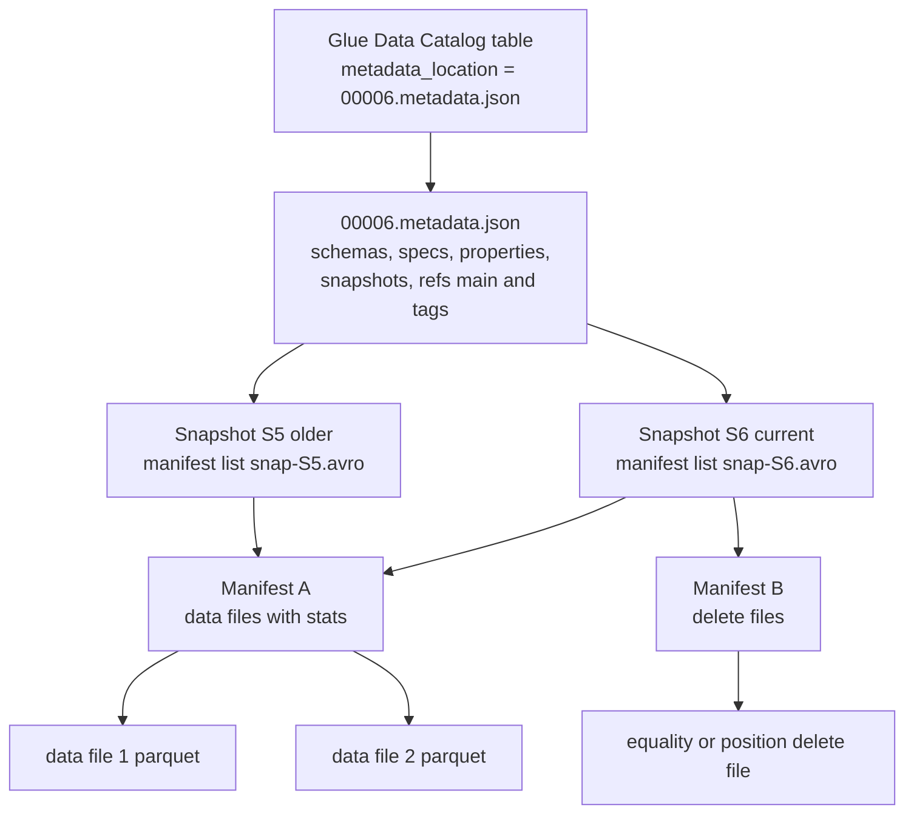
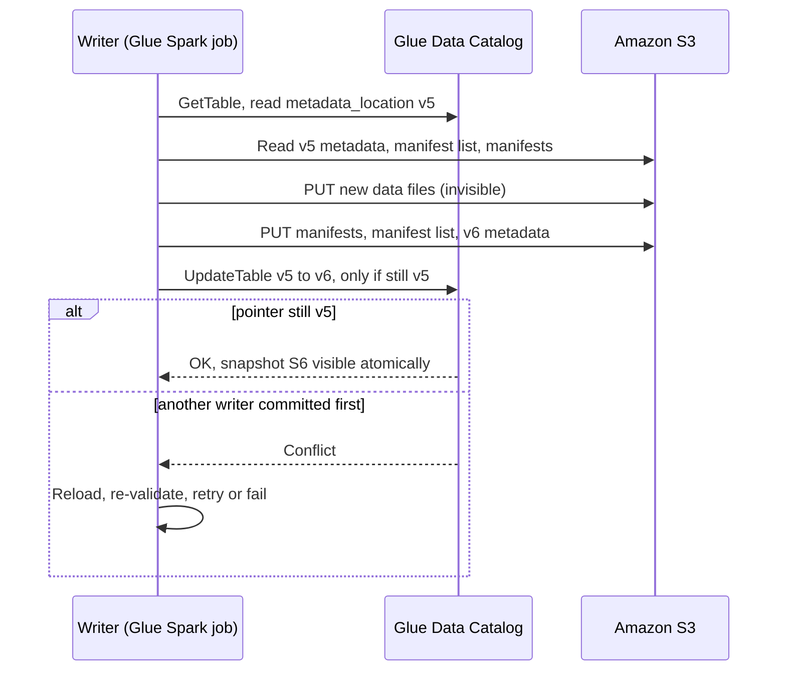

# 🧊 Apache Iceberg on AWS

> **What it is:** an open **table format**: a spec plus libraries that turn Parquet files in S3 into a real table with atomic commits, schema and partition evolution, row-level changes and time travel. It isn't an AWS service. Glue, Athena, Firehose, EMR, Redshift and S3 Tables all read and write it.
> **GCP equivalent:** BigQuery tables for Apache Iceberg and BigLake Iceberg tables, with BigLake metastore as the catalog. It feels like BigQuery native storage (ACID, time travel), except that you own the files and you run the maintenance.
> **In the HLD:** every curated and analytics table. **A** [schema and partition evolution](../01_AWS_Data_Lakehouse_Demonstrated/Challenge_A_Product_Catalog_Schema_Mismatch_And_Partitioning.md) · **B** [compaction, VACUUM, MOR](../01_AWS_Data_Lakehouse_Demonstrated/Challenge_B_Analytics_Query_Performance_Compaction_And_MOR.md) · **D** [Firehose upserts and equality deletes](../01_AWS_Data_Lakehouse_Demonstrated/Challenge_D_Firehose_Iceberg_Streaming_Upserts_And_Buffering.md) · **G** [snapshot rollback](../01_AWS_Data_Lakehouse_Demonstrated/Challenge_G_Orders_Ingest_Duplicates_And_Iceberg_Snapshot_Rollback.md). Lake Formation (C, E) governs these tables.
> **As of Nov 2026.** ⚠️ = unverified or likely to change, so verify in the docs. Related: [03 Glue](03_AWS_Glue.md) · [04 Athena](04_Amazon_Athena.md) · [05 Lake Formation](05_AWS_Lake_Formation.md) · [06 Firehose](06_Amazon_Data_Firehose.md) · [01 S3](01_Amazon_S3.md)

---

## ⭐ Must-know first (labs + exam)

1. **An Iceberg table is a tree of metadata files plus one pointer in a catalog.** A commit writes new files, then swaps the pointer atomically. Readers see a whole snapshot or nothing.
2. **On AWS the catalog is usually the Glue Data Catalog.** The table has parameters `table_type=ICEBERG` and `metadata_location=s3://…/metadata/000NN-….metadata.json`. In Spark the table is `glue_catalog.<db>.<table>`. In Athena it's `<db>.<table>`.
3. **Spark needs Iceberg switched on:** the job parameter `--datalake-formats iceberg`, the SQL extensions and the catalog confs (see [03 Glue](03_AWS_Glue.md#iceberg-spark-configuration)). Without the extensions, `ADD PARTITION FIELD` and `CALL` fail with a `ParseException` *(A)*.
4. **Columns are tracked by field ID**, so add, drop, rename and reorder are metadata-only. Type changes may only **widen**: `int → bigint`, `float → double`, `decimal(P,S) → decimal(P2,S)` with P2 > P *(A)*.
5. **Hidden partitioning:** you partition by a **transform** (`months(updated_at)`) and users filter on the raw column. **Partition evolution** is metadata-only and only affects **new** writes *(A)*. Athena can't evolve partitions. Use Spark.
6. **Every commit is a snapshot.** Read an old one with `FOR VERSION AS OF <id>` (Athena) or `VERSION AS OF <id>` (Spark). Rolling back is a **Spark `CALL` procedure**, because Athena has no `CALL` *(G)*.
7. **Row-level changes come in two modes.** Copy-on-write (COW) rewrites whole files. Merge-on-read (MOR) writes small **delete files**. MOR needs **format v2**. You set it with `write.delete.mode`, `write.update.mode` and `write.merge.mode`, from Spark only *(B)*.
8. **There are two kinds of delete file.** A **position delete** (file + row number) comes from Spark or Athena DML. An **equality delete** (`order_id = 42`) comes from Firehose and Flink upserts. Equality deletes are the most expensive to read *(D)*.
9. **Small files and delete files slow reads down, so compact.** Athena: `OPTIMIZE t REWRITE DATA USING BIN_PACK`. Spark: `rewrite_data_files`. Or turn on Glue Data Catalog **automatic compaction** *(B)*.
10. **Old snapshots keep old files alive, so expire them.** Athena: `VACUUM t`. Spark: `expire_snapshots` + `remove_orphan_files`. Expiring a snapshot also removes time travel and rollback to it *(B, G)*.
11. **Athena maintenance obeys table properties.** `optimize_rewrite_data_file_threshold` defaults to 5, `vacuum_min_snapshots_to_keep` to 1 and `vacuum_max_snapshot_age_seconds` to 432000 (5 days). If OPTIMIZE or VACUUM "does nothing", check these first *(B)*.
12. **Athena's `SET TBLPROPERTIES` takes an allow-list only.** Native Iceberg `write.*` properties, partition evolution, procedures and branches all need Spark (Glue or EMR) *(A, B)*.
13. **The metadata tables are your debugger:** `"db"."t$snapshots"`, `$history`, `$files`, `$manifests`, `$partitions` (Athena) or `glue_catalog.db.t.snapshots` and so on (Spark).
14. **Concurrent writers use optimistic concurrency.** Two row-level writers that touch the same files conflict, and one has to retry. Simple rule: one writer per table or partition at a time.
15. **Format v3** (deletion vectors, row lineage, variant) arrived in Glue 5.1 and 6.0. AWS docs say **Athena SQL can't read v3 tables created in Glue 6.0**, and the upgrade is **one-way**. Keep shared tables on **v2** ⚠️.

---

## 🧱 First principles

### The problem: a "table" on top of object storage

S3 is a key → blob store. It has **no real directories** (only key prefixes), **no rename**, and **no multi-object transaction**. What it does guarantee: one object PUT is atomic, and reads after writes are strongly consistent (since Dec 2020). `LIST` returns at most 1,000 keys per call and is slow compared with a GET.

Analytics teams still want a table: terabytes of data, several writers, readers who see a consistent view, schemas that change, and row-level updates for GDPR and CDC. Something has to bridge that gap.

### How Hive-style tables bridged it, and where that breaks

In the Hive model, **table = directory** and **partition = sub-directory** (`dt=2026-11-11/`). A metastore (the Hive metastore, or the Glue Data Catalog filled by a crawler) stores the list of partitions. Whatever files sit in those folders *are* the table.

| Hive design choice | What breaks | Lab echo |
|---|---|---|
| Table state = the files in the folders | Query planning has to **LIST** every partition prefix: O(partitions) calls. Thousands of partitions means minutes of planning, and the partition list in the metastore grows huge | B |
| A write = drop files into the folder | **No atomicity.** Readers see half-written jobs. A failed job leaves partial files. An overwrite deletes and then writes, so there's a window with missing data. Two writers can clobber each other | G |
| Columns mapped by **position** (CSV) or **name** (Parquet) | Rename a column and old files read as null. Drop a column and re-add the same name, and old values come back. Change a type and old files fail to read | A |
| A partition is an explicit column (`dt` string) | Users must filter on `dt`, not `event_ts`, or nothing gets pruned. A typo such as `'2026-11-1'` silently scans the wrong data. Changing granularity means rewriting the table **and** every query | A |
| No file-level statistics in the metastore | The engine must open each file footer to decide whether to skip it | B |
| No row-level operations | Updating one row means rewriting the partition | B, D, G |

### Iceberg's answer: track files, not folders

Iceberg keeps an **explicit, immutable list of files** in metadata. The only mutable thing is a **pointer** to the current metadata file, and that pointer lives in a catalog that can swap it atomically.

| Level | Example file | What it holds | Why this level exists |
|---|---|---|---|
| **Catalog pointer** | Glue table parameter `metadata_location` | Path of the current metadata file | The single mutable value. Swapping it **is** the commit |
| **Table metadata** | `metadata/00042-<uuid>.metadata.json` | Schemas (with field IDs), partition specs, sort orders, properties, the list of snapshots, refs (branches and tags), `current-snapshot-id` | Everything about the table, in one small file |
| **Manifest list** | `metadata/snap-<snapshot-id>-1-<uuid>.avro` | One row per manifest, with partition value ranges | Lets the planner skip whole manifests |
| **Manifest** | `metadata/<uuid>-m0.avro` | One row per data or delete file: path, partition tuple, record count, per-column min/max, null counts | Lets the planner skip files **without opening them** |
| **Data and delete files** | `data/category=Books/updated_at_month=2026-10/00000-…parquet` | Rows, or deletes | Immutable once written |

Why this fixes each Hive problem:

- **Planning** reads a handful of metadata files instead of listing folders. The folder names are cosmetic, and Iceberg never relies on them.
- **Atomicity:** new files stay invisible until the pointer swap. A failed job leaves **orphan files**, never a half-written table.
- **Isolation:** a reader pins one snapshot, so writers can't disturb it mid-query.
- **Schema:** each column has a permanent **field ID**, which is also written into the Parquet files. A rename changes the name, not the ID.
- **Partitioning:** the spec stores *source column + transform*. The engine turns a predicate on `updated_at` into a partition filter. Each data file records the `spec_id` it was written with, which is what makes evolution possible.
- **Statistics:** min/max values in the manifests allow **file skipping** on any column, not just partition columns.
- **Row-level changes:** delete files (v2) change rows without rewriting the data files.

### Optimistic concurrency and the atomic commit

1. The writer reads the current pointer (say version 5) and plans its work against snapshot S5.
2. It writes the new data files, manifests, manifest list and `00006-….metadata.json`. All of these are new objects, so nobody can see them yet.
3. It asks the catalog to **swap the pointer from 5 to 6, but only if it is still 5** (compare-and-swap). Glue does this with **optimistic locking** on the table version. Athena supports only Glue optimistic locking, so don't configure other lock managers.
4. If another writer committed first, the swap fails. The writer reloads, **re-validates** (did the other commit touch the files I read or deleted?) and retries (`commit.retry.num-retries`, default 4 ⚠️).
   - Appends almost never conflict. They simply re-apply on top.
   - Overwrites, MERGEs and deletes that touch the same files fail with a validation error (`Found conflicting files…`).

### Constraints → design consequences

| Constraint | Consequence | What you must do |
|---|---|---|
| Files are immutable, and each commit writes new metadata | Snapshots are nearly free, so time travel is easy | **Expire snapshots**, or storage grows forever |
| Each commit writes at least 3 metadata files plus data files | Frequent tiny commits bloat the metadata and create small files | Bigger batches (Firehose buffer *(D)*), compaction, `rewrite_manifests` |
| One pointer per table | Commits to one table are serialised | Limit concurrent writers per table |
| Deletes live in separate files | Cheap writes, more expensive reads | Compaction folds the deletes back into the data |
| Old snapshots reference old files | Deleting a row doesn't remove its bytes | For GDPR: delete, then expire, then remove orphans |

---

## 🧩 Core concepts

### Glossary

| Term | Meaning |
|---|---|
| **Catalog** | The service that maps `db.table` to the current metadata file and does the atomic swap. On AWS: the Glue Data Catalog, the Glue Iceberg REST endpoint ⚠️, or S3 Tables |
| **Snapshot** | The table's full state at one commit. It has a `snapshot_id` (a 64-bit number), a `parent_id`, an `operation` (`append`, `overwrite`, `delete`, `replace`) and a `summary` map |
| **Sequence number** | A counter that goes up with each commit (v2). It decides which delete files apply to which data files |
| **Ref** | A named pointer to a snapshot. `main` is the default **branch**. You can add more branches, and **tags** (immutable names) |
| **Partition spec** | A list of (source field, transform, name). A table can have several specs, and every file records its `spec_id` |
| **Sort order** | An optional order for rows inside each file (`WRITE ORDERED BY`). It tightens min/max stats so more files can be skipped |
| **Field ID** | The permanent integer identity of a column |
| **Identifier fields** | Optional "primary key" columns (`SET IDENTIFIER FIELDS`). Flink upserts use them |
| **Orphan file** | A file in the table location that no metadata references, such as output from a failed job |

### Format versions

| | v1 | v2 | v3 ⚠️ |
|---|---|---|---|
| Core idea | Analytic tables, append and overwrite | **Row-level deletes** (delete files) and sequence numbers | Deletion vectors, row lineage, new types |
| Row-level change | COW only (rewrite files) | COW or **MOR** | MOR with **deletion vectors** (one Puffin bitmap per data file) instead of position delete files |
| Extras | — | Stricter metadata rules | Default column values, `variant`, `geometry`/`geography`, `timestamp_ns`, multi-argument transforms, table encryption keys |
| AWS support | Everywhere (legacy) | **Everywhere. Athena only creates v2** | Glue 5.1 (deletion vectors, row lineage) and Glue 6.0 (full v3 types). Athena SQL can't read v3 tables made in Glue 6.0 (per the Glue 6.0 docs) ⚠️ |

Upgrade with `ALTER TABLE … SET TBLPROPERTIES ('format-version'='2')` from Spark. Upgrades are **one-way**: v3 can't go back to v2.

### Delete files: position vs equality

| | Position delete | Equality delete | Deletion vector (v3) |
|---|---|---|---|
| Content | `(file_path, row_position)` pairs | Column values, e.g. `order_id = 'o-42'` | A bitmap of deleted row positions for **one** data file |
| Who writes it | Spark MOR DML, Athena `UPDATE`/`DELETE`/`MERGE` | **Firehose upserts** *(D)*, Flink. Spark never writes these | Glue 5.1+ Spark on v3 tables ⚠️ |
| Writer cost | Must find the row first (a read) | **None.** It's a blind write, which is why streams like it | Must find the row |
| Reader cost | Medium: skip rows by position | **High:** load every equality key in the partition and anti-join each data file against it | Low: one bitmap per file |
| Applies to | Data files with sequence number **≤** the delete's | Data files with sequence number **<** the delete's (strictly older) | Its one data file |
| `$files.content` | `1` | `2` | ⚠️ |

The strict `<` rule is what makes a Firehose upsert work. In one commit Firehose writes an equality delete *and* the new row. The delete only removes **older** rows with that key, so the new row (same sequence number) survives.

### Schema evolution

| Operation | Spark SQL (Glue/EMR) | Athena DDL | Rewrites data? |
|---|---|---|---|
| Add a column | `ALTER TABLE t ADD COLUMNS (c string)` | `ALTER TABLE t ADD COLUMNS (c string)` | No |
| Drop a column | `ALTER TABLE t DROP COLUMN c` | `ALTER TABLE t DROP COLUMN c` | No |
| Rename | `ALTER TABLE t RENAME COLUMN a TO b` | `ALTER TABLE t CHANGE COLUMN a b <type>` | No |
| Widen a type | `ALTER TABLE t ALTER COLUMN q TYPE bigint` | `ALTER TABLE t CHANGE COLUMN q q bigint` | No |
| Reorder | `ALTER TABLE t ALTER COLUMN c AFTER b` | `ALTER TABLE t CHANGE COLUMN c c string AFTER b` | No |
| Nested field | `ALTER TABLE t ADD COLUMN addr.zip string` | Limited ⚠️ | No |
| Make nullable | `ALTER TABLE t ALTER COLUMN c DROP NOT NULL` | ⚠️ | No |

**Allowed type promotions (v2):** `int → long (bigint)`, `float → double`, and `decimal(P,S) → decimal(P2,S)` with P2 > P. v3 adds `date → timestamp` and promotion from the `unknown` type ⚠️. Anything else is **not** allowed. That includes `long → int`, `string → int`, `double → decimal` and any change of decimal scale. For those, add a new column, backfill it, then swap names.

**Why widening is safe:** an old file stores 32-bit `quantity`. The reader looks up field ID 7, sees that the table now says `long`, and widens each value on read. No information is lost. Narrowing could overflow, so the spec forbids it, and so does the Spark write path. That's exactly the Challenge A failure: *"Cannot safely cast 'quantity': bigint to int"*.

### Hidden partitioning, transforms and partition evolution

| Transform (Spark DDL) | Athena `CREATE TABLE` form | Source types | Default field name | Use for |
|---|---|---|---|---|
| `identity(col)`, or just `col` | `col` | Any | `col` | Low-cardinality columns (`category`, `country`) |
| `years(ts)` | `year(ts)` | date, timestamp | `ts_year` | Very low volume |
| `months(ts)` | `month(ts)` | date, timestamp | `ts_month` | Low volume *(A: `updated_at_month`)* |
| `days(ts)` | `day(ts)` | date, timestamp | `ts_day` | Typical event tables |
| `hours(ts)` | `hour(ts)` | timestamp | `ts_hour` | Very high volume or streaming |
| `bucket(N, col)` | `bucket(N, col)` | int, long, decimal, date, timestamp, string, binary | `col_bucket` (or `col_bucket_N` when added by evolution ⚠️) | High-cardinality keys (`customer_id`), join co-location |
| `truncate(W, col)` | `truncate(W, col)` | int, long, decimal, string | `col_trunc` ⚠️ | Prefixes, value ranges |

- **Hidden** means the partition value is *derived*. Writers don't add a `month` column, readers filter on `updated_at`, and Iceberg prunes.
- **Evolution:** `ADD PARTITION FIELD`, `DROP PARTITION FIELD` and `REPLACE PARTITION FIELD … WITH …` (Spark only) create a new spec. Old files keep their old `spec_id`, and the planner prunes each spec separately. To move old data onto the new spec, run `rewrite_data_files` (with `rewrite-all`).
- **Choosing granularity:** aim for partitions of hundreds of MB to a few GB. Too fine (hourly on low volume) gives the small-file problem. Too coarse gives little pruning. The sort order and the min/max stats do the rest.

### Copy-on-write vs merge-on-read

| | Copy-on-write (COW) | Merge-on-read (MOR) |
|---|---|---|
| Effect of `UPDATE`/`DELETE`/`MERGE` | Rewrites **every data file** that holds a touched row | Writes **delete files** plus new data files |
| Write cost | High: write amplification *(B: `orders`)* | Low |
| Read cost | Lowest | Higher until compaction |
| Snapshot `operation` | `overwrite` | `overwrite` or `delete` |
| Needs | v1 or v2 | **v2+** |
| Best for | Read-heavy tables with rare, bulk updates (`daily_orders`) | Frequent upserts, CDC, streaming merges |
| Properties (Spark) | `write.{delete,update,merge}.mode = copy-on-write` (default) | `= merge-on-read` |
| Athena DML | n/a | **Athena always writes MOR position deletes**, whatever the properties say |

### Snapshots, time travel, rollback, branches, tags and WAP

| Feature | Spark (Glue/EMR) | Athena |
|---|---|---|
| Time travel by ID | `SELECT … FROM t VERSION AS OF 1234` | `SELECT … FROM t FOR VERSION AS OF 1234` |
| Time travel by time | `… TIMESTAMP AS OF '2026-11-10 06:00:00'` | `… FOR TIMESTAMP AS OF TIMESTAMP '2026-11-10 06:00:00 UTC'` |
| Roll back to an ancestor | `CALL cat.system.rollback_to_snapshot('db.t', id)` | ❌ |
| Roll back to a time | `CALL cat.system.rollback_to_timestamp('db.t', TIMESTAMP '…')` | ❌ |
| Jump to any snapshot | `CALL cat.system.set_current_snapshot('db.t', id)` | ❌ |
| Re-apply one snapshot's change | `CALL cat.system.cherrypick_snapshot('db.t', id)` | ❌ |
| Branch (a movable ref) | `ALTER TABLE t CREATE BRANCH audit RETAIN 3 DAYS` | ❌ ⚠️ |
| Tag (an immutable name) | `ALTER TABLE t CREATE TAG eom_2026_10 AS OF VERSION 1234 RETAIN 365 DAYS` | ❌ ⚠️ |
| Read a branch or tag | `VERSION AS OF 'audit'`, or `t.branch_audit` | ❌ ⚠️ |
| Publish a branch | `CALL cat.system.fast_forward('db.t', 'main', 'audit')` | ❌ |

- **Rollback is metadata-only.** It moves `main` back and takes seconds. The bad snapshots stay in history until they expire. In `$history` they show `is_current_ancestor = false`.
- **Write-Audit-Publish (WAP):** write to a branch, audit it (counts, uniqueness, DQ rules), then fast-forward `main`. Readers of `main` never see bad data. Branch DDL needs Iceberg ≥ 1.2 and `fast_forward` needs ≥ 1.4 ⚠️, so use **Glue 5.0+** (Glue 4.0 ships Iceberg 1.0.0).
- **Tags** stop the snapshots you care about (month-end, "known good") from being expired.

### Maintenance operations

| Goal | Spark procedure | Athena | What it does | Creates a snapshot? |
|---|---|---|---|---|
| Compact small files, fold in deletes | `rewrite_data_files` (binpack, sort, zorder) | `OPTIMIZE t REWRITE DATA USING BIN_PACK [WHERE …]` | Rewrites many small files (and their deletes) into target-size files | Yes (`replace`) |
| Compact position deletes | `rewrite_position_delete_files` (Iceberg 1.3+, so Glue 5.0+ ⚠️) | Part of OPTIMIZE | Merges small position delete files and drops dangling ones | Yes |
| Expire snapshots | `expire_snapshots(older_than, retain_last)` | `VACUUM t` (uses `vacuum_*` properties) | Removes old snapshots and deletes files only they referenced | No (it edits metadata) |
| Remove orphans | `remove_orphan_files(older_than, dry_run)` | Part of VACUUM | Deletes unreferenced files in the location | No |
| Tidy manifests | `rewrite_manifests` | ❌ ⚠️ | Regroups many small manifests so planning is fast | Yes |
| Automatic (managed) | — | — | **Glue Data Catalog optimizers**: compaction, snapshot retention, orphan deletion. Or **S3 Tables** maintenance | — |

**Order matters:** compact first (this writes a new snapshot, and the old small files stay referenced by older snapshots). Expire next (this frees those files). Remove orphans last.

### Metadata tables (the debugging toolkit)

| Athena name | Spark name | Key columns | Answers |
|---|---|---|---|
| `"db"."t$snapshots"` | `cat.db.t.snapshots` | `committed_at, snapshot_id, parent_id, operation, summary` | What committed, when, how many rows? *(G)* |
| `"db"."t$history"` | `cat.db.t.history` | `made_current_at, snapshot_id, parent_id, is_current_ancestor` | Was a rollback done? What is the current lineage? |
| `"db"."t$files"` | `cat.db.t.files` (also `data_files`, `delete_files`) | `content, file_path, record_count, file_size_in_bytes, lower_bounds, upper_bounds` | Small files? Delete files? *(B, D)* |
| `"db"."t$manifests"` | `cat.db.t.manifests` | `path, added_data_files_count, partition_spec_id` | Manifest bloat, mixed specs |
| `"db"."t$partitions"` | `cat.db.t.partitions` | `partition, record_count, file_count` | Is the new partition field in use? *(A)* |
| `"db"."t$refs"` ⚠️ | `cat.db.t.refs` | `name, type, snapshot_id` | Branches and tags |

Useful `summary` keys: `added-records`, `deleted-records`, `total-records`, `added-data-files`, `total-data-files`, `added-equality-deletes`, `total-position-deletes`. ⚠️ **`total-records` counts physical rows in data files and ignores MOR deletes.** Use `COUNT(*)` for the true row count.

Lake Formation note: if a table has row or cell filters, or you can't see every column, Athena **fails** queries on `$partitions`, `$files`, `$manifests` and `$snapshots` with `AccessDeniedException`. Lake Formation doesn't evaluate metadata tables.

### Important table properties (native Iceberg, set from Spark)

| Property | Default | Why you'd change it |
|---|---|---|
| `format-version` | 2 (Iceberg ≥ 1.4) ⚠️ | Needed for MOR. Avoid 3 for tables Athena must read |
| `write.delete.mode` / `write.update.mode` / `write.merge.mode` | `copy-on-write` | `merge-on-read` for upsert-heavy tables *(B)* |
| `write.target-file-size-bytes` | 536870912 (512 MB) | Lower (128–256 MB) for small tables or many partitions |
| `write.parquet.compression-codec` | `zstd` (Iceberg ≥ 1.4) ⚠️ | `snappy` if a reader needs it |
| `write.distribution-mode` | Depends on version ⚠️ | `hash` groups rows by partition before writing, so you get fewer files |
| `write.merge.isolation-level` | `serializable` | `snapshot` allows more concurrency with weaker guarantees |
| `history.expire.max-snapshot-age-ms` / `history.expire.min-snapshots-to-keep` | 5 days / 1 | Defaults for `expire_snapshots` |
| `write.metadata.delete-after-commit.enabled` / `write.metadata.previous-versions-max` | false / 100 | Cap old `metadata.json` files |
| `write.object-storage.enabled` | false | Hash-prefix file paths to spread S3 request load across prefixes |
| `write.wap.enabled` | false | Needed for the `spark.wap.branch` WAP flow |
| `commit.retry.num-retries` | 4 ⚠️ | More retries when commits often conflict |

**Athena's own allow-list** (verified in the Athena docs, Nov 2026): `format`, `write_compression`, `optimize_rewrite_data_file_threshold` (default 5, must be < 50), `optimize_rewrite_delete_file_threshold` (default 2, < 50), `vacuum_min_snapshots_to_keep` (1), `vacuum_max_snapshot_age_seconds` (432000), `vacuum_max_metadata_files_to_keep` (100) and `write_data_path_enabled`. The challenge notes also list `optimize_rewrite_min/max_data_file_size_bytes` and `write_target_data_file_size_bytes`. ⚠️ Those weren't in the docs list, so check before you rely on them.

### Which AWS engine does what ⚠️ verify

| Capability | Glue Spark 5.x/6.0 | Athena (engine v3) | Firehose | EMR (Spark/Trino/Flink) | Redshift ⚠️ | Glue catalog optimizers |
|---|---|---|---|---|---|---|
| Read (incl. delete files) | ✅ | ✅ (equality deletes ⚠️) | — | ✅ | ✅ | — |
| Append | ✅ | ✅ | ✅ | ✅ | ✅ (write support 2025 ⚠️) | — |
| MERGE / UPDATE / DELETE | ✅ COW or MOR | ✅ MOR position deletes | Upsert/delete via **unique keys** (equality deletes) | ✅ | Limited ⚠️ | — |
| Schema evolution DDL | ✅ | ✅ (column changes) | Optional auto-add columns ⚠️ | ✅ | ❌ ⚠️ | — |
| Partition evolution | ✅ | ❌ | ❌ | ✅ | ❌ | — |
| Time travel | ✅ | ✅ | — | ✅ | ⚠️ | — |
| Rollback, cherry-pick, branches | ✅ | ❌ | ❌ | ✅ | ❌ | — |
| Compaction | ✅ | ✅ OPTIMIZE | ❌ | ✅ | ❌ | ✅ binpack, sort, z-order |
| Expire snapshots, orphans | ✅ | ✅ VACUUM | ❌ | ✅ | ❌ | ✅ |
| Format v3 | ✅ 5.1+ | ❌ (Glue 6.0 docs) ⚠️ | ⚠️ | Recent EMR ⚠️ | ⚠️ | ✅ (docs say v3 supported) |

### Athena vs Spark DDL capability matrix ⚠️ verify

| Operation | Athena | Spark (Glue/EMR) |
|---|---|---|
| `CREATE TABLE` | `TBLPROPERTIES ('table_type'='ICEBERG')`, **v2 only**, no `EXTERNAL` keyword | `USING iceberg`, any version |
| CTAS, `INSERT INTO` | ✅ | ✅ |
| `INSERT OVERWRITE` | ❌ ⚠️ | ✅ (static or dynamic) |
| `UPDATE` / `DELETE` / `MERGE INTO` | ✅ (always MOR) | ✅ (follows `write.*.mode`) |
| Add, drop, rename, reorder columns, widen types | ✅ (`ADD COLUMNS`, `DROP COLUMN`, `CHANGE COLUMN`) | ✅ |
| `ADD`/`DROP`/`REPLACE PARTITION FIELD` | ❌ | ✅ (needs extensions) |
| `WRITE ORDERED BY` (sort order) | ❌ | ✅ |
| `SET TBLPROPERTIES` | **Allow-list only** | Any property |
| `write.*.mode`, `format-version` | ❌ | ✅ |
| `OPTIMIZE … BIN_PACK` / `VACUUM` | ✅ | (use procedures) |
| `CALL` procedures (rollback, expire, rewrite, fast_forward) | ❌ **none** | ✅ |
| Branches and tags | ❌ ⚠️ | ✅ (Glue 5.0+) |
| `SET IDENTIFIER FIELDS` | ❌ | ✅ |
| `ALTER TABLE SET LOCATION` | ❌ (documented) | n/a |
| Multiple statements per run | ❌ (one statement per execution) | ✅ (one `spark.sql` per statement) |

⚠️ The Athena docs also say Athena "does not currently support DDL operations on Iceberg tables that are registered with Lake Formation", and that Lake Formation doesn't govern `VACUUM`, `MERGE`, `UPDATE` or `OPTIMIZE` (IAM and S3 permissions do). The lab's Athena `ALTER`/`OPTIMIZE`/`VACUUM` on `daily_orders` worked anyway, so the exact scope depends on how the location is registered. Verify for your setup.

### Catalog options on AWS

| Option | What it is | When to pick it |
|---|---|---|
| **Glue Data Catalog** (`GlueCatalog` in Spark) | An Iceberg table is a Glue table with `table_type=ICEBERG` and `metadata_location`. The commit is Glue `UpdateTable` with optimistic locking | The default. Works with Athena, Lake Formation, Firehose, Redshift, EMR. **The lab uses it** |
| **Glue Iceberg REST endpoint** ⚠️ | An Iceberg REST catalog API on top of the Glue catalog (`https://glue.<region>.amazonaws.com/iceberg`, SigV4) | Engines outside AWS (Snowflake, DuckDB, PyIceberg) that speak REST |
| **Amazon S3 Tables** ⚠️ | A **table bucket** type with built-in Iceberg tables, managed compaction, snapshot management and unreferenced-file removal. It shows up in Glue as the federated catalog `s3tablescatalog/<bucket>` | You want maintenance handled for you and accept S3 Tables pricing and API limits |
| **Glue catalog optimizers** | Per-table (or catalog-level) **compaction** (binpack, sort, z-order), **snapshot retention** and **orphan file deletion**, run by Glue under an IAM role you supply | Glue-catalog tables where you don't want to schedule OPTIMIZE/VACUUM yourself. Billed as compute ⚠️ |

---

## 🔄 How it works (flow)





**Write path (an append or a MERGE):**
1. Resolve `glue_catalog.lakehouse_db.orders` → Glue `GetTable` → `metadata_location`.
2. Read the current metadata and manifests to find the files the change affects (MERGE and DELETE only).
3. Write Parquet data files, plus delete files (MOR) or replacement files (COW).
4. Write new manifests, a manifest list (the new snapshot) and a new metadata JSON.
5. Compare-and-swap the pointer in Glue. On success, every reader's next plan sees the snapshot.

**Read path (Athena or Spark):**
1. Get the pointer and read the metadata JSON (or the requested snapshot, for time travel).
2. Read the manifest list and drop manifests whose partition ranges can't match the predicate.
3. Read the surviving manifests and drop files using partition values plus column min/max.
4. Read the remaining data files and apply their delete files (MOR). Return the rows.

---

## 🛠️ Hands-on examples

> **Where code runs.** Spark SQL and PySpark go in a **Glue job** (Script tab → **Save** → **Run**), inside `spark.sql("""…""")`. Use the job skeleton in [03 Glue, Example 1](03_AWS_Glue.md#example-1-an-iceberg-ready-glue-job-skeleton). Athena SQL goes in the Athena editor, **workgroup `anycompany-lakehouse`**, **one statement per run**. Look up the exact names (suffixes like `-7db76de0`) before you paste anything.

### Example 1: Schema and partition evolution (reproduces Challenge A)

**Goal:** `products-ingest` fails because Aurora widened `quantity` from `INT` to `BIGINT`, and `updated_at` range queries scan every file. Widen the column, then add `months(updated_at)` while keeping `category`.

**Console steps:**
1. Glue → ETL jobs → `products-ingest` → Runs → failed run → **Error logs** (`/aws-glue/jobs/error`). Look for *Cannot safely cast 'quantity': bigint to int*.
2. Athena → run the saved query `products-describe-schema`. It shows `quantity int`.
3. Edit `products-schema-fix` (code below) → Save → Run. Re-run `products-ingest`.
4. Edit `products-partition-fix` → Save → Run → run the saved query `products-partition-validation`.

**Code (in the Glue job scripts, after the Iceberg-enabled `spark` session exists):**

```python
from pyspark.sql.types import LongType

TABLE = "glue_catalog.lakehouse_db.products"   # catalog name must match spark.sql.catalog.<name>

# --- products-schema-fix: metadata-only type promotion, written to be idempotent ---
current_type = spark.table(TABLE).schema["quantity"].dataType
if not isinstance(current_type, LongType):
    spark.sql(f"ALTER TABLE {TABLE} ALTER COLUMN quantity TYPE bigint")
print("quantity is now:", spark.table(TABLE).schema["quantity"].dataType)

# --- products-partition-fix: add a hidden month partition and keep category ---
try:
    spark.sql(f"ALTER TABLE {TABLE} ADD PARTITION FIELD months(updated_at)")  # auto-named updated_at_month
except Exception as e:                       # a re-run raises 'Cannot add duplicate partition field'
    if "duplicate" not in str(e).lower():
        raise
    print("Partition field already present; nothing to do.")

# Optional: move old files onto the new spec so that old data prunes by month too
# spark.sql(f"CALL glue_catalog.system.rewrite_data_files(table => 'lakehouse_db.products', "
#           f"options => map('rewrite-all', 'true'))")
```

**Verify (Athena, one statement per run):**

```sql
DESCRIBE lakehouse_db.products;                 -- quantity bigint; partition: category, month(updated_at)
SHOW CREATE TABLE lakehouse_db.products;        -- shows PARTITIONED BY (category, month(updated_at))
SELECT partition, record_count, file_count
FROM "lakehouse_db"."products$partitions";      -- new rows have updated_at_month set
```

**Expected result:** `quantity bigint`. The ingest job succeeds. New files carry both `category` and `updated_at_month`. Old files show `updated_at_month = null` until they're rewritten.

**What to check:** pruning really happens. Compare "Data scanned" for `WHERE updated_at >= TIMESTAMP '2026-10-01 00:00:00'` before and after a new ingest. Athena can't do this partition change itself; trying `ADD PARTITION FIELD` in Athena gives a syntax error.

### Example 2: Compaction, snapshot expiry and MOR (reproduces Challenge B, plus a Spark maintenance job)

**Goal:** make `OPTIMIZE` and `VACUUM` actually work on `daily_orders`, switch `orders` to merge-on-read, and build the Spark equivalent you would schedule in production.

**Console steps (Athena, `anycompany-lakehouse`, one statement per run):**

```sql
SHOW TBLPROPERTIES lakehouse_db.daily_orders;                    -- baseline thresholds

SELECT COUNT(*) AS files, ROUND(AVG(file_size_in_bytes)/1024.0,1) AS avg_kb
FROM "lakehouse_db"."daily_orders$files";                        -- baseline file count

ALTER TABLE lakehouse_db.daily_orders SET TBLPROPERTIES ('optimize_rewrite_data_file_threshold'='2');

OPTIMIZE lakehouse_db.daily_orders REWRITE DATA USING BIN_PACK;  -- re-run if Athena says more work remains

ALTER TABLE lakehouse_db.daily_orders SET TBLPROPERTIES (
  'vacuum_min_snapshots_to_keep'='2',
  'vacuum_max_snapshot_age_seconds'='60'                         -- lab only; production = days
);

-- wait more than 60 s after OPTIMIZE, then:
VACUUM lakehouse_db.daily_orders;

SELECT COUNT(*) AS snapshots FROM "lakehouse_db"."daily_orders$snapshots";  -- expect <= 5
```

**Code: `orders-write-mode-fix` (Glue job; Athena can't set `write.*`):**

```python
spark.sql("""
    ALTER TABLE glue_catalog.lakehouse_db.orders SET TBLPROPERTIES (
        'format-version'    = '2',              -- MOR needs v2 (a no-op if it's already v2)
        'write.delete.mode' = 'merge-on-read',
        'write.update.mode' = 'merge-on-read',
        'write.merge.mode'  = 'merge-on-read'
    )
""")
spark.sql("SHOW TBLPROPERTIES glue_catalog.lakehouse_db.orders").show(100, truncate=False)
```

**Code: a production maintenance job in Spark (beyond the lab; schedule it daily):**

```python
from datetime import datetime, timedelta, timezone

T = "lakehouse_db.orders"                     # procedures take 'db.table' WITHOUT the catalog prefix
CAT = "glue_catalog"
TODAY = datetime.now(timezone.utc).strftime("%Y-%m-%d")

def ts(days_ago: int) -> str:
    """UTC timestamp string N days ago, for TIMESTAMP literals."""
    return (datetime.now(timezone.utc) - timedelta(days=days_ago)).strftime("%Y-%m-%d %H:%M:%S")

# 1) Compact: skip today's partition (streaming writers are busy there) and fold in delete files.
#    'where' is a string predicate; use literals, not functions such as current_date().
spark.sql(f"""
  CALL {CAT}.system.rewrite_data_files(
    table   => '{T}',
    strategy => 'binpack',
    where   => "order_date < DATE '{TODAY}'",
    options => map(
      'min-input-files', '2',
      'target-file-size-bytes', '268435456',      -- 256 MB
      'delete-file-threshold', '1',               -- rewrite any file that has deletes
      'partial-progress.enabled', 'true'          -- commit in groups, so one conflict doesn't lose everything
    ))
""").show(truncate=False)

# 2) Compact position delete files (Iceberg 1.3+, so Glue 5.0+)
spark.sql(f"CALL {CAT}.system.rewrite_position_delete_files(table => '{T}')").show(truncate=False)

# 3) Expire: keep 7 days and at least 20 snapshots, so rollback (Challenge G) stays possible
spark.sql(f"""
  CALL {CAT}.system.expire_snapshots(
    table => '{T}', older_than => TIMESTAMP '{ts(7)}', retain_last => 20)
""").show(truncate=False)

# 4) Orphans: older than the longest-running writer, or you can delete files that are still in flight
spark.sql(f"""
  CALL {CAT}.system.remove_orphan_files(table => '{T}', older_than => TIMESTAMP '{ts(3)}')
""").show(truncate=False)

# 5) Manifests: regroup them for fast planning
spark.sql(f"CALL {CAT}.system.rewrite_manifests('{T}')").show(truncate=False)
```

**Expected result:** Athena shows fewer, larger files and ≤ 5 snapshots. The Spark job prints `rewritten_data_files_count`, `added_data_files_count`, then `deleted_*_files_count`, then the orphan paths.

**What to check:** `$snapshots` gains a `replace` snapshot after compaction. `SHOW TBLPROPERTIES` on `orders` lists the three `merge-on-read` modes. If VACUUM "did nothing", the snapshots were younger than `vacuum_max_snapshot_age_seconds`.

### Example 3: Streaming upserts create equality deletes (reproduces Challenge D)

**Goal:** after pointing Firehose at `orders_realtime_staging` with unique key `order_id` and a 300 s buffer, prove that upserts are happening and keep the delete files under control.

**Console steps:** Firehose → `orders-realtime-stream` → Configuration → Destination settings → Edit → table `orders_realtime_staging`, unique keys `order_id`, buffer interval 300 → Save. Wait for **Active**. Details are in [06 Firehose](06_Amazon_Data_Firehose.md).

```json
[
  { "DestinationDatabaseName": "lakehouse_db",
    "DestinationTableName": "orders_realtime_staging",
    "UniqueKeys": ["order_id"] }
]
```

**Code: send test events (Python, boto3), then inspect the table (Athena):**

```python
import json
from datetime import datetime, timezone
import boto3

fh = boto3.client("firehose", region_name="us-east-1")
for status in ["PLACED", "PAID", "SHIPPED"]:          # three state changes for one order
    rec = {"order_id": "o-test-42", "status": status,
           "event_time": datetime.now(timezone.utc).isoformat()}
    resp = fh.put_record(DeliveryStreamName="orders-realtime-stream",
                         Record={"Data": (json.dumps(rec) + "\n").encode()})
    print(status, resp["RecordId"])
# ⚠️ If several events for one key land in the same buffer, check which one wins.
# Readers that care should still order by event_time.
```

```sql
-- after one buffer interval: one row per order (new data)
SELECT order_id, COUNT(*) AS versions
FROM lakehouse_db.orders_realtime_staging
GROUP BY order_id HAVING COUNT(*) > 1;            -- expect no rows for new orders

-- content 0 = data, 1 = position deletes, 2 = equality deletes
SELECT content, COUNT(*) AS files, SUM(record_count) AS records
FROM "lakehouse_db"."orders_realtime_staging$files"
GROUP BY content ORDER BY content;

SELECT committed_at, operation,
       summary['added-records']          AS added_rows,
       summary['added-equality-deletes'] AS added_eq_deletes
FROM "lakehouse_db"."orders_realtime_staging$snapshots"
ORDER BY committed_at DESC LIMIT 10;
```

**Then fold the deletes in.** Run Athena `OPTIMIZE lakehouse_db.orders_realtime_staging REWRITE DATA USING BIN_PACK;`, or in Spark:

```python
spark.sql("""
  CALL glue_catalog.system.rewrite_data_files(
    table => 'lakehouse_db.orders_realtime_staging',
    options => map('delete-file-threshold', '1', 'min-input-files', '2'))
""").show(truncate=False)
```

**Expected result:** content `2` rows appear, with one snapshot every ~5 minutes. After compaction, content `2` counts shrink. An equality delete only disappears once every older file it applies to has been rewritten.

**What to check:** the commit rate (≈ 288/day at 300 s), and any compaction failures caused by Firehose committing at the same time. Retry, or let the Glue optimizer handle it. Old duplicates in `orders_realtime` aren't touched by the fix. Clean them up with a `ROW_NUMBER()` dedup (Example 6).

### Example 4: Find the clean snapshot and roll back (reproduces Challenge G)

**Goal:** `orders` has 150,000 rows (3 × 50,000) after three full-export reads. Restore 50,000 unique rows without reloading anything.

**Console steps:** fix the ingest read path first (see [03 Glue, Example 4](03_AWS_Glue.md#example-4-date-scoped-read-and-rollback-reproduces-challenge-g)). **Save it, don't run it.** Then use Athena to find the snapshot, and run the rollback job.

```sql
SELECT committed_at, snapshot_id, operation,
       summary['added-records'] AS added, summary['total-records'] AS total
FROM "lakehouse_db"."orders$snapshots"
ORDER BY committed_at;

SELECT COUNT(*) AS total, COUNT(DISTINCT order_id) AS unique_orders
FROM lakehouse_db.orders FOR VERSION AS OF 1234567890123456789;   -- your ID; expect 50000 | 50000
```

**Code: `orders-rollback` (Glue job), with a safety check before the change:**

```python
TABLE_SQL  = "glue_catalog.lakehouse_db.orders"
TABLE_PROC = "lakehouse_db.orders"
EXPECTED   = 50000

# In the lab, use the ID from the saved query 'orders-earliest-snapshot'.
# In general, pick the LAST good snapshot before the bad run, not blindly the earliest.
snap_id = spark.sql(f"""
    SELECT snapshot_id FROM {TABLE_SQL}.snapshots ORDER BY committed_at ASC LIMIT 1
""").collect()[0]["snapshot_id"]

check = spark.sql(f"""
    SELECT COUNT(*) AS total, COUNT(DISTINCT order_id) AS uniq
    FROM {TABLE_SQL} VERSION AS OF {snap_id}
""").collect()[0]
assert check["total"] == check["uniq"] == EXPECTED, f"Snapshot {snap_id} is not clean: {check}"

# Optional: tag the good state so expiry can never remove it
spark.sql(f"ALTER TABLE {TABLE_SQL} CREATE TAG IF NOT EXISTS known_good_2026_11 "
          f"AS OF VERSION {snap_id} RETAIN 30 DAYS")       # Glue 5.0+ (branch/tag DDL)

# Metadata-only: main moves back to snap_id. The ID is a bare number, never quoted.
spark.sql(f"CALL glue_catalog.system.rollback_to_snapshot('{TABLE_PROC}', {snap_id})").show()
# If you get 'not an ancestor' (e.g. after an earlier rollback):
# spark.sql(f"CALL glue_catalog.system.set_current_snapshot('{TABLE_PROC}', {snap_id})")
```

**Expected result:** the procedure prints `previous_snapshot_id | current_snapshot_id`. Athena `SELECT COUNT(*), COUNT(DISTINCT order_id) FROM lakehouse_db.orders` returns `50000 | 50000`.

**What to check:** `"lakehouse_db"."orders$history"` shows the bad snapshots with `is_current_ancestor = false`. **Don't** run `orders-ingest` again afterwards, because an append would add 50,000 rows. Keep VACUUM retention longer than your "time to notice", or this undo button disappears.

### Example 5: Write-Audit-Publish with branches (beyond the lab)

**Goal:** stop Challenge G from happening at all. New data lands on an `audit` branch. It's validated there. Only then does `main` (what Athena users read) move forward.

**Console steps:** use a Glue **5.0+** job (Iceberg ≥ 1.4) with the Iceberg skeleton. Give the job role Lake Formation **ALTER, INSERT, DELETE, SELECT, DESCRIBE** on `orders`.

```python
from pyspark.sql import Window, functions as F

TABLE      = "glue_catalog.lakehouse_db.orders"
TABLE_PROC = "lakehouse_db.orders"
BRANCH     = "audit"
MAX_NEW_ORDERS = 60000                                 # sanity bound for one daily batch

# 0) One-time setup: allow WAP on the table
spark.sql(f"ALTER TABLE {TABLE} SET TBLPROPERTIES ('write.wap.enabled'='true')")

# 1) Fresh audit branch from the current main
spark.sql(f"ALTER TABLE {TABLE} DROP BRANCH IF EXISTS {BRANCH}")
spark.sql(f"ALTER TABLE {TABLE} CREATE BRANCH {BRANCH} RETAIN 3 DAYS")

# 2) Stage the batch: typed Parquet with exactly the table's columns, deduplicated per key
staged = spark.read.parquet("s3://anycompany-lakehouse-curated-7db76de0/staging/orders/dt=2025-05-02/")
w = Window.partitionBy("order_id").orderBy(F.col("updated_at").desc())
(staged.withColumn("rn", F.row_number().over(w))
       .filter("rn = 1").drop("rn")                    # drop helper column, or UPDATE SET * fails
       .createOrReplaceTempView("staged_orders"))

# 3) WRITE: every write in this session now goes to the branch, not main
spark.conf.set("spark.wap.branch", BRANCH)
spark.sql(f"""
  MERGE INTO {TABLE} t
  USING staged_orders s
  ON t.order_id = s.order_id
  WHEN MATCHED THEN UPDATE SET *
  WHEN NOT MATCHED THEN INSERT *
""")
spark.conf.unset("spark.wap.branch")                  # back to main for reads below

# 4) AUDIT the branch explicitly
a = spark.sql(f"SELECT COUNT(*) AS total, COUNT(DISTINCT order_id) AS uniq "
              f"FROM {TABLE} VERSION AS OF '{BRANCH}'").collect()[0]
m = spark.sql(f"SELECT COUNT(*) AS total FROM {TABLE} VERSION AS OF 'main'").collect()[0]
ok = (a["total"] == a["uniq"]) and (m["total"] <= a["total"] <= m["total"] + MAX_NEW_ORDERS)

# 5) PUBLISH (atomic, metadata-only) or leave main untouched
if ok:
    spark.sql(f"CALL glue_catalog.system.fast_forward('{TABLE_PROC}', 'main', '{BRANCH}')").show()
else:
    raise RuntimeError(f"WAP audit failed, main untouched: branch={a}, main={m}")
```

**Expected result:** if the audit passes, `main` points at the branch's snapshot and Athena sees the new data. If it fails, the job fails (alerting via EventBridge) and Athena still sees yesterday's data.

**What to check:** `cat.db.orders.refs` lists `audit`. `UPDATE SET *` and `INSERT *` need the source columns to match the table. `fast_forward` fails if `main` moved since you branched, because it's no longer an ancestor. In that case re-run from step 1. Athena can't read the branch ⚠️, so audit in Spark.

### Example 6: MERGE upsert with a deduplicated source (beyond the lab)

**Goal:** apply a batch of change records (inserts, updates, deletes) idempotently. Duplicates in the source and late, out-of-order events must not corrupt the table.

**Why the dedup matters:** if two source rows match one target row, Iceberg's Spark MERGE fails (*"…matched a single row from the target table with multiple rows of the source table"*). Athena/Trino raises a similar error. So dedup to **one row per key** first.

```python
spark.sql("""
MERGE INTO glue_catalog.lakehouse_db.orders AS t
USING (
  SELECT order_id, customer_id, status, amount, order_date, updated_at, op
  FROM (
    SELECT c.*,
           ROW_NUMBER() OVER (PARTITION BY order_id
                              ORDER BY updated_at DESC, event_seq DESC) AS rn   -- tie-break
    FROM orders_changes c                    -- temp view with columns incl. op in ('I','U','D')
  ) WHERE rn = 1
) AS s
ON  t.order_id   = s.order_id
AND t.order_date = s.order_date              -- immutable column: lets Iceberg prune target partitions
WHEN MATCHED AND s.op = 'D' THEN DELETE
WHEN MATCHED AND s.updated_at > t.updated_at THEN UPDATE SET
     t.customer_id = s.customer_id,
     t.status      = s.status,
     t.amount      = s.amount,
     t.updated_at  = s.updated_at            -- the guard skips late, older events
WHEN NOT MATCHED AND s.op <> 'D' THEN INSERT
     (order_id, customer_id, status, amount, order_date, updated_at)
     VALUES (s.order_id, s.customer_id, s.status, s.amount, s.order_date, s.updated_at)
""")
```

**Athena variant:** Athena supports `MERGE INTO` too, but the `UPDATE SET` targets must be **unqualified** (`status = s.status`), and the write is always MOR.

**Expected result:** re-running the same batch changes nothing. The `updated_at` guard makes it idempotent, and `$snapshots` shows a snapshot with zero changes or a no-op. Deletes remove rows.

**What to check:** a `SELECT order_id, COUNT(*) … HAVING COUNT(*) > 1` check returns zero rows. Under MOR, `$files` shows `content = 1` files after the MERGE. Only put `t.order_date = s.order_date` in `ON` if the column really never changes. If it does, the update becomes an insert, and you get a duplicate.

---

## ⚙️ Key settings, limits & quotas

| Item | Value | Notes |
|---|---|---|
| Glue versions and bundled Iceberg | 4.0 → 1.0.0 · 5.0 → 1.7.1 · 5.1 → 1.10.0 · 6.0 → 1.11.0 | From the Glue 6.0 migration guide (Nov 2026) |
| Athena's Iceberg library | 1.4.2 (per the Athena docs) | Explains the lag on new features |
| Athena-created format | v2 only | Athena SQL can't read v3 tables made in Glue 6.0 ⚠️ |
| `optimize_rewrite_data_file_threshold` | Default 5, must be < 50 | Lab: 2 *(B)* |
| `optimize_rewrite_delete_file_threshold` | Default 2, must be < 50 | |
| `vacuum_min_snapshots_to_keep` / `vacuum_max_snapshot_age_seconds` | 1 / 432000 | Lab: 2 / 60 *(B)* |
| `vacuum_max_metadata_files_to_keep` | 100 | |
| `write.target-file-size-bytes` | 512 MB | |
| `expire_snapshots` default | Older than 5 days, keep 1 | |
| `remove_orphan_files` default `older_than` | 3 days ⚠️ | Never go below your longest write |
| Firehose buffer interval for Iceberg | 0–900 s ⚠️ | Lab: ≥ 300 *(D)* |
| Athena timestamp precision | Milliseconds (Iceberg allows microseconds) | Compaction through Athena truncates to ms |
| Athena partition by nested field | Not supported | |
| Athena types not supported in Iceberg DDL | `tinyint`, `smallint`, `char`, `fixed(L)` | |
| Glue table versions per table | ⚠️ quota (≈ 100,000) | Each commit can create a Glue table version. Iceberg's `glue.skip-archive` (default true in recent versions ⚠️) avoids this |

---

## 🔐 Security

| Layer | What's needed |
|---|---|
| **IAM (job or user role)** | `glue:GetDatabase`, `GetTable`, `UpdateTable` (commits), `CreateTable`. `lakeformation:GetDataAccess`. S3 `GetObject`/`PutObject`/`DeleteObject`/`ListBucket` on the table location, unless Lake Formation vends credentials ⚠️. `kms:Decrypt`/`GenerateDataKey` on the bucket key |
| **Lake Formation (data)** | Read: **SELECT + DESCRIBE**. Append: **INSERT** (+ SELECT, DESCRIBE). MERGE/UPDATE/DELETE: **SELECT, INSERT, DELETE, DESCRIBE**. DDL, procedures, rollback: **ALTER** (+ DESCRIBE). Create: **CREATE_TABLE** on the DB + **DATA_LOCATION_ACCESS**. The Firehose role in the lab needed SELECT, INSERT, DELETE, DESCRIBE, ALTER *(D)* |
| **Metadata tables** | Blocked (`AccessDeniedException`) when row or cell filters apply or columns are hidden, so auditors need full-table grants |
| **Encryption** | Use bucket default SSE-KMS (simplest), or S3FileIO properties `s3.sse.type=kms` and `s3.sse.key=<arn>` ⚠️. Metadata files are data too: they contain min/max values of columns |
| **Deletion and privacy** | `DELETE` hides a row but **doesn't remove the bytes**. Old snapshots and data files keep it until `expire_snapshots` + `remove_orphan_files`. Also, column min/max stats in manifests can leak values, so think about stats for PII columns ⚠️ |
| **Least privilege** | Give separate roles to writers (ingest), maintainers (ALTER + DELETE on S3) and readers (SELECT). Only the maintenance role should be able to delete objects in the table location |

---

## 💰 Cost model & optimisation

Iceberg has no licence fee. You pay for **S3 storage** (current files + files kept by old snapshots + orphans), **S3 requests** (every file read is at least one GET), **compute** (Athena per TB scanned ⚠️, Glue DPU-hours ⚠️, optimizer DPU-hours ⚠️) and **Glue Data Catalog** objects and requests (with a free tier ⚠️). Prices below are ⚠️ illustrative. Check the S3, Athena and Glue pricing pages.

**Worked example: the cost of the Challenge D small-file problem.**
- **60 s buffer:** 1,440 commits a day, each with ≥ 1 data file and ≥ 1 equality delete file. After 30 days without maintenance that's ~86,000 small files.
- **One dashboard query** that touches them all: ≥ 2 GETs per file ≈ 172,000 GETs × $0.0004 per 1,000 ⚠️ ≈ **$0.07 per query** in requests alone, plus seconds of planning and open latency.
- **500 queries a day** ≈ **$35/day ≈ $1,000/month** in GETs, and the SLA is still missed *(B)*.
- **After the fix:** 300 s buffer (288 commits/day) plus daily compaction to ~256 MB files leaves a 30 GB table at ~120 files. That's ~240 GETs per query, which is negligible.
- **Cost of the fix:** a daily Athena OPTIMIZE that scans ~1 GB of recent data costs about half a cent at $5/TB ⚠️. A Glue job (2 × G.1X for 10 min ≈ 0.33 DPU-h × $0.44 ⚠️) is ≈ $0.15/run.
- **Snapshot retention of 7 days** on ~5 GB/day of churn ≈ 35 GB × $0.023 ⚠️ ≈ **$0.80/month**. That's cheap insurance for rollback *(G)*.

**Levers:** buffer or batch bigger · compact on a schedule (or use the Glue optimizer, or S3 Tables) · expire snapshots and remove orphans · MOR for upsert-heavy tables (less rewrite I/O) · sort order and right-sized partitions (less data scanned) · S3 lifecycle rules **don't** apply cleanly inside a live Iceberg location, so don't expire objects with lifecycle rules there.

---

## 📈 Monitoring & troubleshooting

| Symptom | Likely cause | How to confirm | Fix |
|---|---|---|---|
| Glue: *Cannot write incompatible data… Cannot safely cast 'quantity': bigint to int* *(A)* | The source widened, the table didn't | `DESCRIBE`; the error log | `ALTER COLUMN quantity TYPE bigint` (Spark) or `CHANGE COLUMN` (Athena) |
| `ParseException` near `PARTITION FIELD`, `CALL` or `BRANCH` | Iceberg SQL extensions not enabled | Job params and SparkConf | `spark.sql.extensions=…IcebergSparkSessionExtensions` |
| `Table or view not found` in Spark | Missing or wrong catalog prefix | `spark.sql.catalog.<name>` in the script | Use `glue_catalog.lakehouse_db.t` |
| *Cannot add duplicate partition field* | The job re-ran | `SHOW CREATE TABLE` | try/except (Example 1) |
| New partition column all null | Evolution only affects new writes | `$partitions` | Re-ingest, or `rewrite_data_files` with `rewrite-all` |
| OPTIMIZE or VACUUM "no effect" *(B)* | Threshold or retention too permissive | `SHOW TBLPROPERTIES` | Lower `optimize_rewrite_data_file_threshold` and `vacuum_*` |
| Athena: *Only one SQL statement is allowed* | Several statements in one run | — | One per run |
| Athena: *Unsupported table property key* | Not on Athena's allow-list (e.g. `write.merge.mode`) | The docs list | Set it from Spark |
| Merge-on-read error mentioning the format version | Table is v1 | `format-version` property | Set `'format-version'='2'` |
| Duplicates from Firehose *(D)* | No unique keys, so append only | `GROUP BY order_id HAVING COUNT(*)>1` | Unique key `order_id` |
| MERGE fails: *matched a single row … with multiple rows of the source* | Duplicate keys in the source batch | `GROUP BY key HAVING COUNT(*)>1` on the source | `ROW_NUMBER()` dedup (Example 6) |
| `CommitFailedException` / *Found conflicting files* | Concurrent writers or compaction | `$snapshots` around the failure time | Retry, serialise writers, `partial-progress.enabled` |
| Rollback: *not an ancestor* *(G)* | The snapshot isn't in the current lineage | `$history.is_current_ancestor` | `set_current_snapshot` |
| Rollback: snapshot not found | ID mistyped, or already expired | `$snapshots` | Copy the ID again; if it was expired, restore from a backup |
| Queries get slower each week | Small files, delete files, manifest bloat | `$files` count and `content`; `$manifests` count | Compaction, `rewrite_position_delete_files`, `rewrite_manifests` |
| Storage grows after deletes | Snapshots never expired | `$snapshots` count; S3 size vs `$files` size | VACUUM / `expire_snapshots` + orphan removal |
| Athena `AccessDeniedException` on `$files` | Lake Formation filters on the table | LF grants | Full-table grant for the auditing role |
| Athena: *Cannot read unsupported version 3* | Table upgraded to v3 (Glue 6.0) | `format-version` | Keep v2 for Athena tables. The upgrade can't be undone |

---

## 🧠 Second-order thinking

1. **Short snapshot retention** → less storage and fast VACUUM → you can't time-travel or roll back past it, so a bad load found on day 3 can't be undone *(G)* → set retention longer than your "time to detect", and **tag** known-good snapshots.
2. **Switch to MOR** → cheap MERGEs and short write windows *(B)* → delete files pile up and reads slow down week by week → schedule compaction (or the Glue optimizer) and alarm on the delete-file count.
3. **Firehose upserts with a small buffer** → fresh data → 1,440 commits/day of equality deletes, the most expensive kind to read *(D)* → slow Athena queries and high GET cost → bigger buffer, frequent compaction, and keep compaction away from the hot partition.
4. **Very fine partitions (`hours`) on modest volume** → great pruning on paper → thousands of tiny files and big manifests → slow planning and compaction that never catches up → `days` or `months` plus a sort order. Partition evolution lets you change your mind later.
5. **Upgrade to format v3 for deletion vectors** → faster MOR in Glue → Athena SQL can no longer read the table, and the change is one-way → keep v3 for Spark-only tables until Athena supports it ⚠️.
6. **Several jobs writing the same table** → parallel ingestion → commit conflicts and retries, and a MERGE fails at 3 a.m. → one writer per table or partition, orchestration that serialises runs (Glue max concurrency 1, Step Functions), and `partial-progress` for compaction.
7. **`remove_orphan_files` with a short `older_than`** → aggressive cleanup → deletes files that a still-running job has written but not yet committed, which corrupts that commit → keep it ≥ the longest job, plus a margin (the default is 3 days).
8. **A crawler over an Iceberg location** → a "table" appears automatically → it may be registered as a plain Parquet table that reads deleted rows and old files → never crawl Iceberg data folders as Hive. Register Iceberg via DDL or an Iceberg-aware crawler.

**When not to use Iceberg:** a tiny or static dataset (plain Parquet or CSV is simpler) · pure append-only logs that no one updates and that are queried by date (Hive partitions plus partition projection may be enough) · sub-second OLTP lookups (use DynamoDB or Aurora) · heavy concurrent point updates (a database, not a table format) · a team that can't run maintenance (choose S3 Tables or a managed warehouse).

---

## 🔀 Alternatives & comparisons

### AWS alternatives

| Option | Pick it when |
|---|---|
| **Iceberg on S3 + Glue catalog** (the lab) | Multi-engine lakehouse, Lake Formation governance, Athena and Firehose writes |
| **S3 Tables** ⚠️ | You want Iceberg with AWS-managed maintenance and table-level access policies |
| **Plain Parquet Hive tables** (+ partition projection) | Append-only, read-mostly, no row-level changes |
| **Delta Lake or Hudi on S3** (Glue `--datalake-formats delta,hudi`) | Existing Databricks/Delta estate, or Hudi's record-level index for heavy CDC. Athena support is more limited ⚠️ |
| **Redshift managed storage** | Warehouse-first, lots of concurrent BI, SQL-only team |

### Iceberg vs Delta Lake vs Hudi vs BigQuery

| | **Iceberg** | **Delta Lake** | **Apache Hudi** | **BigQuery native / BigLake Iceberg** |
|---|---|---|---|---|
| Metadata | Tree + catalog pointer swap | `_delta_log/` JSON commits + Parquet checkpoints. Commit = write the next log file (needs put-if-absent: S3 conditional writes or a DynamoDB log store ⚠️) | `.hoodie/` timeline of instants | Managed by BigQuery. Iceberg tables in BigQuery export Iceberg metadata to GCS |
| Partitioning | **Hidden**, transforms, **evolution** | Hive-style columns, generated columns, **liquid clustering** | Hive-style | Time/integer partitioning + clustering, managed for you |
| Row-level | COW, MOR (delete files, v3 deletion vectors) | COW + deletion vectors | **COW or MOR table types**, record keys, indexes | DML is native and ACID |
| Upsert/CDC strength | Good (MERGE, Firehose, Flink) | Good (MERGE) | **Best** (built for upserts, incremental pulls) | Good (MERGE, CDC via Datastream) |
| Engine neutrality | **Highest** (Spark, Trino/Athena, Flink, Snowflake, BigQuery, Redshift) | Spark-centric (UniForm adds Iceberg readers) | Spark/Flink-centric | BigQuery (BigLake opens read access to Spark) |
| Maintenance | You (or the Glue optimizer, or S3 Tables) | You (OPTIMIZE, VACUUM) or Databricks | You (table services) | **None.** BigQuery does it |
| Time travel | Snapshots, as long as you keep them | Log retention | Timeline | 2–7 day window + fail-safe |

### GCP → AWS mapping

| GCP | AWS / Iceberg |
|---|---|
| BigQuery tables for Apache Iceberg / BigLake Iceberg tables | Iceberg tables on S3 in the Glue Data Catalog |
| BigLake metastore (Iceberg REST catalog) | Glue Data Catalog (+ Glue Iceberg REST endpoint ⚠️) |
| BigQuery time travel `FOR SYSTEM_TIME AS OF` | `FOR TIMESTAMP AS OF` / `FOR VERSION AS OF` |
| BigQuery partitioning + clustering | Hidden partitioning + sort order (`WRITE ORDERED BY`) |
| BigQuery automatic storage optimisation | OPTIMIZE/VACUUM, Glue catalog optimizers, S3 Tables maintenance |
| BigQuery table snapshots / clones | Iceberg tags / branches |
| Dataplex data governance on BigLake | Lake Formation (TBAC, cell filters) on Glue catalog tables |

---

## 🎯 Exam angle

- **Keywords → Iceberg:** "ACID transactions on S3", "row-level updates/deletes in the data lake", "GDPR right to be forgotten", "time travel", "schema evolution without rewriting data", "change partitioning without rewriting", "concurrent writers", "upserts from streaming".
- **Keywords → OPTIMIZE / compaction:** "many small files", "queries slow down over time", "after enabling streaming".
- **Keywords → VACUUM / expire snapshots:** "storage keeps growing", "deleted data still in S3", "reduce metadata".
- **Keywords → rollback:** "restore the table to before the faulty job", "without reloading".
- **Keywords → Firehose Iceberg destination with unique keys:** "deliver streaming CDC directly into Iceberg with no code".
- **Distractors:** re-running a Glue **crawler** to "fix" a schema (it doesn't evolve Iceberg) · S3 Versioning or Object Lock for table rollback (wrong layer) · Hive `MSCK REPAIR TABLE` (not needed: Iceberg doesn't use partition folders) · "Athena `CALL rollback_to_snapshot`" (doesn't exist) · "Athena `ALTER TABLE ADD PARTITION FIELD`" (not supported).
- **Traps:** VACUUM with aggressive retention destroys rollback · MOR without compaction · `long → int` "type change" (not allowed) · equality deletes from streaming are expensive to read · partition evolution doesn't rewrite old files.

---

## 🧪 Self-test

1. Why does an Iceberg commit stay atomic even though S3 has no multi-object transactions?
2. List three Hive-table problems that Iceberg's metadata tree removes, and name the mechanism for each.
3. `bigint → int` is rejected but `int → bigint` is fine. Why, and what do you do if you really need `string → int`?
4. After `ADD PARTITION FIELD months(updated_at)`, what happens to existing files, and how do you migrate them?
5. Position delete vs equality delete: who writes each, and which is more expensive to read? Why?
6. Why doesn't a Firehose upsert's equality delete remove the new row written in the same commit?
7. VACUUM ran but the snapshot count didn't change. Give two reasons.
8. Name two Iceberg operations the Glue job must do because Athena can't.
9. How do you check that a snapshot is clean before rolling back to it?
10. What does WAP add over "write to main, then roll back if bad"?
11. Your MERGE fails with "matched a single row … with multiple rows of the source". What's wrong, and what's the fix?
12. Why might you **not** upgrade a shared table to format v3 in Nov 2026?

<details><summary>Answers</summary>

1. All new files are written first and are invisible. The commit is one compare-and-swap of the `metadata_location` pointer in the Glue catalog (optimistic locking). Either the swap happens or it doesn't.
2. (a) Expensive LIST-based planning → an explicit file list in manifests. (b) No atomic writes → snapshot + pointer swap. (c) Schema by position or name → field IDs. Also: explicit partition columns → hidden partitioning; no stats → min/max in manifests.
3. Widening can't lose information, and old 32-bit values can be read as 64-bit. Narrowing can overflow, so the spec forbids it. For `string → int`, add a new column, backfill it with a cast, then swap names.
4. They keep their old `spec_id` (no month value) and are still pruned under the old spec. New writes use the new spec. Run `rewrite_data_files` with `rewrite-all`, or re-ingest.
5. Position: Spark and Athena DML (file + row position). Equality: Firehose and Flink (key values). Equality is more expensive because readers must anti-join each data file in scope against every key.
6. An equality delete applies only to data files with a strictly lower sequence number. The new row has the same sequence number as the delete.
7. The snapshots were younger than `vacuum_max_snapshot_age_seconds`, and/or `vacuum_min_snapshots_to_keep` kept them. Also possible: a tag or branch retained them.
8. Any two of: partition evolution, setting `write.*.mode`, `rollback_to_snapshot` or other `CALL` procedures, branches and tags, `rewrite_manifests`.
9. Time travel: `SELECT COUNT(*), COUNT(DISTINCT order_id) FROM t FOR VERSION AS OF <id>`, and compare with the expected value.
10. Readers of `main` never see bad data. Validation happens on the branch, and publishing is an atomic fast-forward. Rollback is cleanup after the damage has already been seen.
11. The source has duplicate keys. Deduplicate it with `ROW_NUMBER() OVER (PARTITION BY key ORDER BY updated_at DESC) = 1` before the MERGE.
12. AWS docs say Athena SQL can't read v3 tables created in Glue 6.0, and the upgrade is one-way.

</details>

---

## 📚 References

- Apache Iceberg table spec: https://iceberg.apache.org/spec/
- Apache Iceberg docs (Spark DDL, procedures, branching, maintenance): https://iceberg.apache.org/docs/latest/ · search: "iceberg spark procedures rewrite_data_files expire_snapshots"
- Athena: Query Apache Iceberg tables (with considerations and limitations): https://docs.aws.amazon.com/athena/latest/ug/querying-iceberg.html
- Athena: Create Iceberg tables (transforms, the table property allow-list): https://docs.aws.amazon.com/athena/latest/ug/querying-iceberg-creating-tables.html
- Athena: Optimize Iceberg tables (OPTIMIZE, VACUUM): https://docs.aws.amazon.com/athena/latest/ug/querying-iceberg-data-optimization.html
- Athena: Time travel and version travel: https://docs.aws.amazon.com/athena/latest/ug/querying-iceberg-time-travel-and-version-travel-queries.html
- Athena: Evolve Iceberg table schema: https://docs.aws.amazon.com/athena/latest/ug/querying-iceberg-evolving-table-schema.html
- Glue: Optimizing Iceberg tables (compaction, snapshot retention, orphan deletion): https://docs.aws.amazon.com/glue/latest/dg/table-optimizers.html
- Glue: Migrating to Glue 6.0 (Iceberg 1.11, v3, Athena caveat): https://docs.aws.amazon.com/glue/latest/dg/migrating-version-60.html
- Glue: Using the Iceberg framework in AWS Glue: search "aws glue using the iceberg framework datalake-formats"
- Firehose: Deliver data to Apache Iceberg tables: search "amazon data firehose apache iceberg tables destination unique keys"
- Amazon S3 Tables: search "amazon s3 tables table buckets iceberg"
- AWS Big Data Blog posts on Iceberg on AWS (WAP, maintenance, Firehose to Iceberg): search "aws big data blog iceberg write audit publish branches glue"
