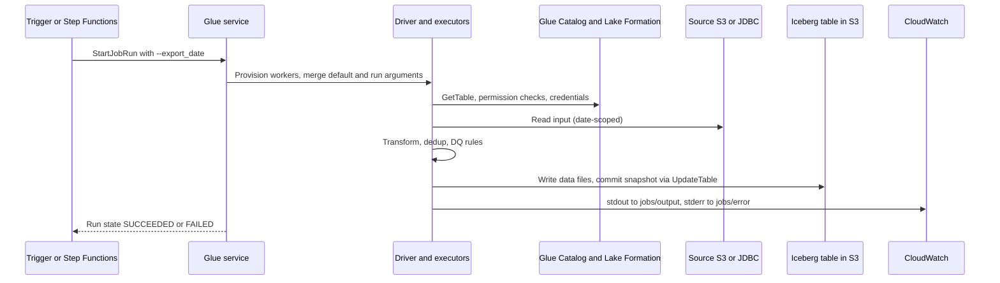

# 🧰 AWS Glue

> **What it is:** serverless data integration. It has two halves. The **Glue Data Catalog** is the shared metastore that turns S3 prefixes into tables for Athena, EMR, Redshift and Lake Formation. **Glue ETL** is serverless Spark and Python jobs, plus crawlers, Data Quality and triggers/workflows.
> **GCP equivalent:** Catalog → Dataproc Metastore / BigLake metastore / Dataplex Universal Catalog · ETL jobs → Serverless for Apache Spark (Dataproc Serverless), sometimes Dataflow · crawlers → Dataplex discovery · Data Quality → Dataplex data quality scans · workflows → Cloud Composer / Workflows.
> **In the HLD:** **A** ingest products over JDBC ([Challenge A](../01_AWS_Data_Lakehouse_Demonstrated/Challenge_A_Product_Catalog_Schema_Mismatch_And_Partitioning.md)) · **B** `orders-write-mode-fix` ([Challenge B](../01_AWS_Data_Lakehouse_Demonstrated/Challenge_B_Analytics_Query_Performance_Compaction_And_MOR.md)) · **F** `vendors-ingest`, started by Step Functions ([Challenge F](../01_AWS_Data_Lakehouse_Demonstrated/Challenge_F_Vendor_File_Pipeline_EventBridge_StepFunctions_Lambda.md)) · **G** ingest orders and rollback ([Challenge G](../01_AWS_Data_Lakehouse_Demonstrated/Challenge_G_Orders_Ingest_Duplicates_And_Iceberg_Snapshot_Rollback.md)) · the curated → analytics job · the catalog under every table.
> **As of Nov 2026.** ⚠️ = unverified or likely to change, so verify in the docs. Related: [02 Iceberg](02_Apache_Iceberg_On_AWS.md) · [04 Athena](04_Amazon_Athena.md) · [05 Lake Formation](05_AWS_Lake_Formation.md) · [08 Step Functions](08_AWS_Step_Functions.md) · [10 Sources](10_Source_Systems_Aurora_PostgreSQL_And_DynamoDB.md) · [00 Foundations](00_AWS_Foundations_IAM_Regions_CLI_CloudWatch_KMS.md)

---

## ⭐ Must-know first (labs + exam)

1. **Glue has two halves.** The **Data Catalog** (metadata: databases → tables → partitions) is used by Athena, EMR, Redshift Spectrum, Firehose and Lake Formation. **ETL jobs** are serverless Spark (or Python) that you pay for per DPU-hour.
2. **Athena runs SQL. Glue jobs run PySpark.** `spark.sql("…")` goes in the Glue **script**, never in the Athena editor *(A)*.
3. **Edit → Save → Run.** A run uses the last **saved** script. Start long runs **early**, because they take minutes *(G: ran out of time)*.
4. **A job** = script in S3 + IAM role + Glue version + worker type and count + parameters. **A run** = one execution with an ID (`jr_…`), a state and its own log streams.
5. **Parameters:** keys look like `--export_date`. Read them with `getResolvedOptions(sys.argv, ["JOB_NAME", "export_date"])`, which takes **names, not values**. Every listed name is **required**. Run-time `Arguments` override `DefaultArguments`, and `NonOverridableArguments` beat both *(G)*.
6. **Iceberg in Glue** = `--datalake-formats iceberg` + `spark.sql.extensions=…IcebergSparkSessionExtensions` + `spark.sql.catalog.glue_catalog.*` confs. Tables are addressed as `glue_catalog.<db>.<table>` *(A, B, G)*.
7. **Know the versions:** 4.0 (Spark 3.3, Iceberg 1.0.0) · 5.0 (Spark 3.5.4, Iceberg 1.7.1) · 5.1 (3.5.6, 1.10.0, Iceberg v3) · **6.0** (Aug 2026: Spark 4.1.1, Python 3.13, Iceberg 1.11.0, **ANSI mode on**, about 30% cheaper ⚠️). Iceberg branches need 5.0+.
8. **Capacity:** 1 DPU = 4 vCPU + 16 GB. G.1X is 1 DPU per worker. Spark jobs need ≥ 2 workers. Billing is per second with a 1-minute minimum ⚠️. **Auto scaling** trims idle workers. **Flex** is cheaper for jobs that aren't urgent.
9. **GlueContext** wraps Spark and adds **DynamicFrames** (flexible schema, *choice* types, `ResolveChoice`, `ApplyMapping`), catalog reads, bookmarks and Lake Formation integration. Use DataFrames and `spark.sql` for Iceberg DDL and MERGE.
10. **Job bookmarks** make S3 and JDBC reads incremental. They need `transformation_ctx`, `job.init()` and `job.commit()`, and they apply to Glue (DynamicFrame) readers, not to `spark.read` or Iceberg sources.
11. **JDBC sources** (Aurora) need a Glue **connection**: subnet, a security group with a **self-referencing** inbound rule, an S3 gateway endpoint, and credentials in **Secrets Manager**.
12. **Lake Formation:** the job role needs LF grants (DESCRIBE, SELECT, INSERT, DELETE, ALTER) **as well as** IAM. *"Insufficient Lake Formation permission(s)"* means a grant is missing *(A, B, G)*.
13. **Logs:** `/aws-glue/jobs/output` (stdout, your `print`/`.show()`) and `/aws-glue/jobs/error` (stderr: stack traces). Continuous logs go to `/aws-glue/jobs/logs-v2`. Log stream name = run ID.
14. **Max concurrent runs per job defaults to 1.** A second start gives `ConcurrentRunsExceededException`, which Step Functions should **Retry** *(F)*.
15. **Glue Data Quality (DQDL)** can **fail a job** before bad data is published, e.g. `IsUnique "order_id"`. It would have caught G.

---

## 🧱 First principles

### Five problems Glue exists to solve

| # | Problem from first principles | Constraint | Glue's answer |
|---|---|---|---|
| 1 | S3 objects are just bytes. Every engine needs to know "table X = these files, this schema, these partitions" | If each engine keeps its own metadata, the copies drift | **Data Catalog:** one serverless, Hive-metastore-compatible catalog per account and region, with Lake Formation permissions on top |
| 2 | Big transformations need a distributed engine (Spark) | Running clusters 24/7 for bursty batch work wastes money and needs ops staff | **Serverless Spark:** declare workers per job. Glue provisions, runs and tears down, and bills per DPU-second |
| 3 | Raw data is messy: `price` is an int in one file and a string in another | A Spark DataFrame needs one schema up front, so it fails or silently nulls | **DynamicFrame:** each record describes itself, conflicts become *choice* types, and you resolve them explicitly |
| 4 | Inputs grow, and batch jobs re-run | Re-reading everything duplicates data *(G)* | **Bookmarks**, or explicit logical-date parameters, plus idempotent writes (MERGE) |
| 5 | Pipelines need ordering, retries and quality gates | Hand-written cron and glue code is fragile | **Triggers and workflows**, **Data Quality**, and integration with Step Functions, EventBridge and MWAA |

### Constraints that shape how you use it

- **Stateless runs.** Each run starts on fresh workers. Only S3, the catalog, bookmarks and your tables survive between runs, so **idempotency is your job**.
- **Start-up latency.** Workers take a while to provision (seconds to a minute or more ⚠️). Glue is for batch and micro-batch work, not request/response.
- **Networking.** With no connection, a job runs in AWS-managed networking and reaches S3 and public endpoints. A **VPC connection** puts ENIs in *your* subnet. That reaches private Aurora, but you now need VPC endpoints or NAT for S3, Secrets Manager, Glue and CloudWatch.
- **Billing shape.** Cost ≈ DPUs × time. Doubling workers costs about the same if the job finishes twice as fast, and costs double if the bottleneck is elsewhere (a JDBC source, skew, a single-threaded driver).
- **Identity.** The job runs **as its IAM role**. Assigning that role needs `iam:PassRole`. Data access needs IAM **and** Lake Formation.

### Core abstractions

**Catalog objects** (database, table, partition) · **job** (definition) and **job run** (execution) · **DynamicFrame/DataFrame** (data in flight) · **connection** (network plus credentials) · **bookmark** (incremental state) · **trigger/workflow** (orchestration) · **ruleset** (data quality).

---

## 🧩 Core concepts

### The Glue Data Catalog

| Object | What it is | Notes |
|---|---|---|
| **Catalog** | Top level, identified by a **catalog ID** = the AWS account ID | One per account per region. Federated or child catalogs (e.g. `s3tablescatalog/<bucket>` for S3 Tables, Redshift) appear under it ⚠️ |
| **Database** | A namespace (`lakehouse_db`) | Has an optional `LocationUri`, used as the default location for new tables |
| **Table** | Name, `StorageDescriptor` (location, columns, input/output formats, SerDe), `PartitionKeys`, `TableType`, `Parameters` | Iceberg tables: `Parameters.table_type=ICEBERG` and `metadata_location=…metadata.json`. Iceberg tracks its own partitions, so Glue partitions stay empty |
| **Partition** | Values + location, for Hive-style tables only | Added by crawlers, `MSCK REPAIR TABLE`, `ALTER TABLE ADD PARTITION`, `BatchCreatePartition`, or skipped with Athena partition projection |
| **Table version** | A history entry for each `UpdateTable` | Iceberg commits call `UpdateTable`. There's a quota per table ⚠️, so Iceberg's `glue.skip-archive` avoids filling it |
| **Partition index** | An index on partition keys | Speeds up `GetPartitions` filters on tables with very many partitions |
| **Column statistics** | NDV, nulls, min/max | Used by Athena and Redshift cost-based optimisers ⚠️ |
| **Resource link** ⚠️ | A catalog object that **points to** a database or table, usually one shared from another account through Lake Formation | Lets engines refer to a shared object by a local name. You need DESCRIBE on the link **and** permissions on the target |

- **Hive-metastore compatible:** Spark on Glue or EMR uses the catalog as its Hive metastore (`--enable-glue-datacatalog`, a presence flag). Athena uses it natively. Iceberg's `GlueCatalog` calls the Glue API directly (`GetTable`/`UpdateTable`).
- **Cross-account:** share through Lake Formation (preferred) or a Glue catalog resource policy. To point Spark at another account's catalog, set `spark.sql.catalog.glue_catalog.glue.id=<account-id>`.
- **Iceberg REST endpoint** ⚠️: the Glue catalog also speaks the Iceberg REST protocol, for non-AWS engines.

```bash
# Resource link in my account that points to a database shared from account 444455556666
aws glue create-database --database-input '{
  "Name": "sales_shared_link",
  "TargetDatabase": {"CatalogId": "444455556666", "DatabaseName": "sales"}
}'
```

### Crawlers and their pitfalls

A **crawler** connects to a data store (S3 path, JDBC, DynamoDB, Iceberg/Delta/Hudi locations ⚠️). It samples files, uses **classifiers** (built-in for CSV, JSON, Parquet, Avro, ORC, XML, plus custom grok/JSON/CSV/XML ones) to infer a schema, and creates or updates tables and partitions in a database. Settings include the schedule, the **schema change policy** (update, log or deprecate on change and on delete), the **recrawl policy** (everything, or new folders only) and **exclusion patterns**.

| Pitfall | Why it happens | Fix |
|---|---|---|
| Dozens of tables instead of one | Files under one path have different schemas or formats, or the layout looks like separate datasets | Consistent layout. Option "Create a single schema for each S3 path" ⚠️. Set the table level |
| Partitions named `partition_0`, `partition_1` | Folders aren't `key=value` | Use `dt=2026-11-11/` folders, or rename the keys afterwards |
| Every CSV column is `string`, or the header row becomes data | Header detection is heuristic | Custom CSV classifier with `Header: PRESENT` and the right delimiter |
| Your curated schema gets overwritten | Schema change policy = update the table | `UpdateBehavior: LOG`, or "add new columns only" ⚠️. Manage curated tables with DDL |
| Tables vanish when folders are deleted | Delete behaviour = delete from the database | Choose `DEPRECATE_IN_DATABASE` or `LOG` |
| Crawl takes hours and costs DPU-hours | Re-lists huge buckets on every run | "Crawl new folders only", or S3 event-based crawls ⚠️ |
| **Iceberg data folder crawled as Parquet** | Produces a Hive table over every data file, **including deleted rows and expired history** | Never crawl Iceberg `data/` as Hive. Create Iceberg tables with DDL, or use an Iceberg-aware crawler target ⚠️ |
| Junk tables from `_temporary`, Athena results, `.metadata` | Crawled the wrong prefix | Exclusion patterns, or narrower include paths |
| Crawler `AccessDenied` on an LF-managed DB | LF grants missing | Grant the crawler role **CREATE_TABLE** on the DB plus **DATA_LOCATION_ACCESS** on the path |
| Rare fields missing from the schema | Crawler samples files ⚠️ | Explicit DDL for critical tables |

### Glue ETL job types

| Type | `Command.Name` | Engine | Capacity | Use for |
|---|---|---|---|---|
| **Spark (batch)** | `glueetl` | PySpark or Scala | G.* workers, minimum 2 | Most ETL. Iceberg MERGE and DDL. The lab's jobs |
| **Spark streaming** | `gluestreaming` | Structured Streaming micro-batches (Glue 6.0 adds a real-time mode) | From G.025X | Kinesis, MSK or Kafka into S3 or Iceberg |
| **Python shell** | `pythonshell` | Plain Python 3.9 ⚠️ | 0.0625 or 1 DPU | Small tasks: API calls, kicking off Athena SQL, light pandas |
| **Ray** ⚠️ | `glueray` | Ray | Z.2X | Python-native parallelism. Check that it's still offered in your account and region |

### Glue versions (verified against the Glue 6.0 migration guide)

| Glue | Spark | Python | Java | Iceberg | Notable |
|---|---|---|---|---|---|
| 4.0 | 3.3.0 | 3.10 | 8 | 1.0.0 | No Iceberg branch/tag DDL, no `rewrite_position_delete_files` |
| 5.0 | 3.5.4 | 3.11 | 17 | 1.7.1 | Lake Formation FGAC (`--enable-lakeformation-fine-grained-access`) |
| 5.1 | 3.5.6 | 3.11 | 17 | 1.10.0 | Iceberg v3 deletion vectors and row lineage |
| **6.0** | **4.1.1** | **3.13** | 17 | **1.11.0** | **ANSI mode on by default** (bad casts and overflow now **throw**) · `SQLContext` removed · EMRFS removed (S3A only) · Scala 2.13 · `getResolvedOptions` no longer accepts abbreviated names · full v3 types (DataFrames only) · Athena can't read v3 tables · about 30% lower price ⚠️ |

### Workers, DPUs, auto scaling and Flex

| Worker | DPU | vCPU | Memory | Use |
|---|---|---|---|---|
| G.025X | 0.25 | 2 | 4 GB | Low-volume **streaming** only |
| **G.1X** | 1 | 4 | 16 GB | The default. Most batch jobs |
| G.2X | 2 | 8 | 32 GB | Wide joins, heavy shuffles, ML transforms |
| G.4X / G.8X | 4 / 8 | 16 / 32 | 64 / 128 GB | Large shuffles. Fewer, bigger executors |
| G.12X / G.16X | 12 / 16 | 48 / 64 | 192 / 256 GB ⚠️ | Very large jobs |
| R.1X – R.8X | ⚠️ | 4 – 32 | Memory-optimised ⚠️ | Memory-bound jobs (caching, big broadcasts) |
| Z.2X | ⚠️ | 8 | ⚠️ | Ray |

- **Auto scaling** (Glue 3.0+, `--enable-auto-scaling true`): your worker count becomes a **maximum**. Glue adds and removes executors with the stage's parallelism, and you're billed for what's used.
- **Flex execution** (`ExecutionClass=FLEX`) runs on spare capacity, so it's cheaper (about $0.29 vs $0.44 per DPU-hour ⚠️) but can start late or be interrupted. Use it for non-urgent batch work. It isn't for streaming or SLA jobs ⚠️.
- **`--executor-cores`** caps parallel tasks per worker (up to 2× vCPU). Lower it when executors run out of memory, or when a JDBC source can't take more connections.

### GlueContext vs SparkSession, DynamicFrame vs DataFrame

| | **DynamicFrame** (Glue) | **DataFrame** (Spark) |
|---|---|---|
| Schema | Computed per record. Conflicts become **choice** types (`price: choice<int,string>`) | One schema, fixed at read time |
| Best at | Messy, semi-structured input. Catalog sources and sinks. **Bookmarks**. Glue transforms (ApplyMapping, ResolveChoice, Relationalize, DropNullFields) | SQL, joins, window functions, **Iceberg MERGE/DDL**, performance tuning |
| Get one | `glueContext.create_dynamic_frame.from_catalog(...)` / `.from_options(...)` | `spark.read…`, `spark.table(...)`, `spark.sql(...)` |
| Convert | `dyf.toDF()` | `DynamicFrame.fromDF(df, glueContext, "name")` |

`GlueContext(sc)` wraps the SparkContext. `glueContext.spark_session` is the ordinary SparkSession. `Job(glueContext)` with `job.init()` and `job.commit()` manages bookmarks and run state.

```python
from awsglue.transforms import ApplyMapping, ResolveChoice

# ApplyMapping: rename and retype in one step (source name, source type, target name, target type)
mapped = ApplyMapping.apply(
    frame=vendor_dyf,
    mappings=[("vendor id", "string", "vendor_id", "string"),
              ("qty",       "int",    "quantity",  "bigint"),
              ("updated",   "string", "updated_at","timestamp")],
    transformation_ctx="map_vendor")

# ResolveChoice: decide what to do with columns whose type varies between records
fixed = ResolveChoice.apply(frame=mapped, specs=[("price", "cast:double")],
                            transformation_ctx="resolve_price")
# Other choices: choice="make_cols" (price_int + price_string columns), "make_struct",
#                "project:double", or choice="match_catalog", database=..., table_name=...
```

### Job parameters

| Layer | Set where | Wins over |
|---|---|---|
| `DefaultArguments` | Job details → Advanced properties → **Job parameters** | — |
| Run `Arguments` | "Run with parameters", `start-job-run --arguments`, triggers, Step Functions `Arguments` | Default |
| `NonOverridableArguments` | API/CLI on the job | Both of the above |

**Rules that bit the learner (G):**
- In the console the **key** is `--export_date` and the **value** is `2025-05-02`. In code: `getResolvedOptions(sys.argv, ["export_date"])` → `args["export_date"]`. Put **names** in the list, never values.
- Every name in the list is required. A missing one fails at start-up (*"the following arguments are required: --export_date"*).
- Keep the script's single `args = getResolvedOptions(...)` line and add to it. A second `args = …` replaces the first.
- Prefer `snake_case` names. Glue 6.0 disables abbreviated matching (`allow_abbrev=False`).
- `--JOB_NAME`, `--debug`, `--mode` and `--endpoint` are internal. Don't set them. (Glue passes `JOB_NAME` for you.)

```python
import sys
from datetime import date, timedelta
from awsglue.utils import getResolvedOptions

args = getResolvedOptions(sys.argv, ["JOB_NAME", "raw_bucket"])          # required
# Optional parameter pattern: resolve it only if it was passed
export_date = (getResolvedOptions(sys.argv, ["export_date"])["export_date"]
               if "--export_date" in sys.argv
               else (date.today() - timedelta(days=1)).isoformat())     # default = yesterday
```

**Special parameters you'll meet** (from the Glue job-parameters reference):

| Parameter | Value | Purpose |
|---|---|---|
| `--datalake-formats` | `iceberg` (or `hudi`, `delta`, comma-separated) | Adds the framework JARs (Glue 3.0+) |
| `--conf` | `k=v --conf k2=v2 …` | Spark confs. There's only one `--conf` key, so chain extra pairs inside the value |
| `--job-bookmark-option` | `job-bookmark-enable` / `-disable` / `-pause` | Bookmarks |
| `--TempDir` | `s3://…/temp/` | Scratch space (e.g. Redshift staging). Glue may create a default bucket, so check public-access settings |
| `--enable-metrics` | Presence flag (the console stores `true`) ⚠️ | Job profiling metrics in CloudWatch |
| `--enable-observability-metrics` | `true` | Extra metrics on the job-run monitoring page |
| `--enable-continuous-cloudwatch-log` | `true` | Real-time driver and executor logs |
| `--enable-spark-ui` + `--spark-event-logs-path` | `true` + `s3://…/sparkui/` | Spark UI event logs |
| `--enable-auto-scaling` | `true` | Auto scaling |
| `--enable-glue-datacatalog` | Presence flag | Glue catalog as the Spark Hive metastore |
| `--additional-python-modules` | `pkg==1.2.3,s3://…/x.whl` | pip installs at start-up |
| `--extra-py-files` / `--extra-jars` / `--extra-files` | S3 paths | Your libraries and configs |
| `--enable-lakeformation-fine-grained-access` | `true` | Glue 5.0+ FGAC (row and column filters) |
| `--job-language`, `--executor-cores`, `--user-jars-first` | — | Language, parallelism, classpath order |

Job arguments have a **260 KB** total size limit.

### Iceberg Spark configuration

Do **one** of the following.

**(a) Job parameters:**

| Key | Value |
|---|---|
| `--datalake-formats` | `iceberg` |
| `--conf` | `spark.sql.extensions=org.apache.iceberg.spark.extensions.IcebergSparkSessionExtensions --conf spark.sql.catalog.glue_catalog=org.apache.iceberg.spark.SparkCatalog --conf spark.sql.catalog.glue_catalog.catalog-impl=org.apache.iceberg.aws.glue.GlueCatalog --conf spark.sql.catalog.glue_catalog.io-impl=org.apache.iceberg.aws.s3.S3FileIO --conf spark.sql.catalog.glue_catalog.warehouse=s3://anycompany-lakehouse-curated-7db76de0/warehouse/` |

**(b) In the script, before the SparkContext exists** (what most lab scripts do). See [Example 1](#example-1-an-iceberg-ready-glue-job-skeleton).

**(c) Interactive sessions:** a `%%configure` cell with the same `--datalake-formats` and `--conf` keys.

Extras ⚠️: `spark.sql.catalog.glue_catalog.glue.lakeformation-enabled=true` (Lake Formation credential vending), and `…glue.id=<account>` (another account's catalog). The catalog **name** (`glue_catalog`) is yours to choose, but every SQL statement must use the same one *(B hint: "fully qualified catalog name")*.

### Job bookmarks

- **What they do:** remember what each source has already processed. For S3 that's file paths and modification times. For JDBC it's the max value of the **bookmark keys** (a column that only ever increases). The next run reads only new data.
- **Requirements:** `--job-bookmark-option job-bookmark-enable`, a unique `transformation_ctx` on every source, sink and transform, `job.init(args["JOB_NAME"], args)` at the start and `job.commit()` at the end. The state only saves if the run **succeeds** and calls commit.
- **They don't apply to** `spark.read…` or Iceberg tables as sources ⚠️. For Iceberg, read incrementally by snapshot range: `spark.read.format("iceberg").option("start-snapshot-id", a).option("end-snapshot-id", b).load(...)` (appends only).
- **Operations:** `aws glue get-job-bookmark --job-name X` · `aws glue reset-job-bookmark --job-name X` (full reprocess) · `job-bookmark-pause` with `job-bookmark-from`/`-to` to replay a range.
- **Gotchas:** renaming a `transformation_ctx` loses its state. Files overwritten in place may be skipped. Concurrent runs of one job race on the state, so keep max concurrency at 1.

```python
# JDBC bookmark on an increasing key
src = glueContext.create_dynamic_frame.from_catalog(
    database="aurora_src", table_name="public_products",
    additional_options={"jobBookmarkKeys": ["product_id"], "jobBookmarkKeysSortOrder": "asc"},
    transformation_ctx="products_src")      # required for bookmarks
```

### Connections and JDBC

| Item | What to know |
|---|---|
| Connection types | JDBC (PostgreSQL, MySQL, Oracle, SQL Server, Redshift), Network (VPC only), Kafka, MongoDB, native connectors (Snowflake, BigQuery, …) and Marketplace/custom ⚠️ |
| Network | Pick a **subnet + security group**. Glue creates ENIs there. The SG needs an **inbound rule allowing all TCP from itself** (Glue workers talk to each other), plus egress to the DB port |
| Reaching AWS services from the VPC | An **S3 gateway endpoint** is required. Secrets Manager, Glue, CloudWatch Logs and STS need interface endpoints or NAT |
| Credentials | Connection property `SECRET_ID` (Secrets Manager), not a password in plain text. The job role needs `secretsmanager:GetSecretValue` |
| Attach | Job details → Advanced → **Connections**. Without it, a job can't reach a private Aurora |
| Parallel reads | Spark JDBC `partitionColumn` + `lowerBound`/`upperBound`/`numPartitions`, or Glue `hashfield`/`hashexpression` + `hashpartitions`. Otherwise **one task reads the whole table** |

### Glue Data Quality (DQDL)

A **ruleset** is written in **DQDL**. You can evaluate it against a catalog table (a DQ run) or **inside a job** with the `EvaluateDataQuality` transform. Results go to the console, to CloudWatch metrics and to EventBridge ⚠️, and they can fail the job.

```text
Rules = [
    RowCount between 45000 and 55000,
    IsComplete "order_id",
    IsUnique "order_id",
    ColumnValues "status" in ["PLACED", "PAID", "SHIPPED", "DELIVERED", "CANCELLED"],
    ColumnValues "amount" >= 0,
    Completeness "customer_id" >= 0.99,
    DataFreshness "updated_at" <= 48 hours,
    CustomSql "SELECT COUNT(*) FROM primary WHERE order_date > current_date()" = 0,
    RowCount > avg(last(7)) * 0.8
]
```

Other rule types: `IsPrimaryKey`, `Uniqueness`, `ColumnLength`, `ColumnDataType`, `ColumnExists`, `DistinctValuesCount`, `Mean`, `Sum`, `StandardDeviation`, `SchemaMatch`, `ReferentialIntegrity`, `DetectAnomalies` ⚠️. The `last(7)` form compares against the history of earlier runs, which needs results publishing turned on.

### Orchestration: Glue triggers/workflows vs Step Functions vs MWAA

| | **Glue triggers + workflows** | **Step Functions** | **MWAA (Airflow)** | **EventBridge Scheduler** |
|---|---|---|---|---|
| Model | Scheduled, on-demand, conditional (job/crawler state) and EventBridge triggers. A workflow is a graph with shared **run properties** | State machine (ASL): any AWS service, Retry/Catch, Map, Choice | Python DAGs, sensors, hundreds of operators | Cron or rate → one target |
| Strength | Simple Glue-only chains, no extra service | Error handling, mixing services *(F: `glue:startJobRun.sync`)* | Complex DAGs, backfills, an existing Airflow team | The cheapest way to "run X daily" |
| Weakness | Glue-only, limited branching and error handling | ASL verbosity | Always-on environment cost ⚠️ | No flow logic |
| GCP | — | Workflows | Cloud Composer | Cloud Scheduler |

```json
"RunOrdersIngest": {
  "Type": "Task",
  "Resource": "arn:aws:states:::glue:startJobRun.sync",
  "Parameters": { "JobName": "orders-ingest", "Arguments": { "--export_date.$": "$.export_date" } },
  "Retry": [ { "ErrorEquals": ["Glue.ConcurrentRunsExceededException"],
               "IntervalSeconds": 30, "MaxAttempts": 5, "BackoffRate": 2.0 } ],
  "End": true
}
```

### Glue Studio and interactive sessions

- **Glue Studio** has three ways to author a job. **Visual ETL** is a node graph that **generates** a PySpark script. The **script editor** is plain code. A **notebook** is backed by interactive sessions. Once you edit the generated script by hand, the job becomes a script job and you can't go back to the visual graph ⚠️. The lab jobs are script jobs: Script tab → edit → **Save**.
- **Interactive sessions** give you on-demand Spark for Jupyter or Studio notebooks, billed per second with a 1-minute minimum ⚠️. Common magics: `%glue_version 5.0`, `%worker_type G.1X`, `%number_of_workers 2`, `%idle_timeout 30`, `%connections aurora-products-conn`, `%%configure` (job parameters as JSON), `%stop_session`. **Always set `%idle_timeout`**, because idle sessions keep billing.

---

## 🔄 How it works (flow)



1. **Start:** a trigger, schedule, Step Functions, EventBridge or the console calls `StartJobRun`, with optional run arguments.
2. **Resolve:** Glue merges Default ← Run ← NonOverridable arguments and passes them as `sys.argv`, along with `--JOB_NAME` and the run ID.
3. **Provision:** workers start (in your subnet if there's a connection), JARs for `--datalake-formats` load, and modules install.
4. **Script runs:** `getResolvedOptions` → SparkConf → `GlueContext` → `job.init`.
5. **Read:** catalog lookups (Lake Formation checks the role) → S3 or JDBC reads (bookmarks filter them if enabled).
6. **Transform and validate:** DataFrame or DynamicFrame logic, then optional DQ rules that can raise.
7. **Write:** Iceberg `append`, `overwritePartitions` or `MERGE INTO` writes files, then the catalog pointer swap commits.
8. **Finish:** `job.commit()` saves the bookmark state. The run state becomes SUCCEEDED, FAILED, TIMEOUT, STOPPED or ERROR, and an EventBridge "Glue Job State Change" event fires.

---

## 🛠️ Hands-on examples

> All examples assume us-east-1, database `lakehouse_db`, catalog name `glue_catalog`, and suffixed bucket names like `anycompany-lakehouse-raw-7db76de0`. **Look up your exact names.** Code is a **shape to adapt**: keep the lab script's own variable names and hints.

### Example 1: An Iceberg-ready Glue job skeleton

**Goal:** a complete, reusable PySpark job that can do Iceberg DDL, MERGE and procedures.

**Console steps:** Glue → **ETL jobs** → **Script editor** → Spark → Create. Job details: IAM role, Glue version **5.0** (or the lab's version), G.1X × 2, job bookmark *Disable*, and job parameters `--datalake-formats=iceberg` and `--warehouse_path=s3://…/warehouse/` → **Save**.

```python
import sys
from awsglue.utils import getResolvedOptions
from awsglue.context import GlueContext
from awsglue.job import Job
from pyspark.conf import SparkConf
from pyspark.context import SparkContext

args = getResolvedOptions(sys.argv, ["JOB_NAME", "warehouse_path"])   # NAMES, not values

CATALOG = "glue_catalog"
conf = SparkConf()
conf.set("spark.sql.extensions",
         "org.apache.iceberg.spark.extensions.IcebergSparkSessionExtensions")   # ALTER ... PARTITION FIELD, CALL
conf.set(f"spark.sql.catalog.{CATALOG}", "org.apache.iceberg.spark.SparkCatalog")
conf.set(f"spark.sql.catalog.{CATALOG}.catalog-impl", "org.apache.iceberg.aws.glue.GlueCatalog")
conf.set(f"spark.sql.catalog.{CATALOG}.io-impl", "org.apache.iceberg.aws.s3.S3FileIO")
conf.set(f"spark.sql.catalog.{CATALOG}.warehouse", args["warehouse_path"])

sc = SparkContext(conf=conf)            # confs must be set before the context/session exists
glueContext = GlueContext(sc)
spark = glueContext.spark_session
job = Job(glueContext)
job.init(args["JOB_NAME"], args)

# ---- body: replace with your logic ----
spark.sql(f"SHOW TABLES IN {CATALOG}.lakehouse_db").show(truncate=False)
# ----------------------------------------

job.commit()
```

**CLI equivalent:**

```bash
aws s3 cp iceberg_skeleton.py s3://anycompany-glue-scripts-7db76de0/jobs/iceberg_skeleton.py
aws glue create-job --name iceberg-skeleton \
  --role arn:aws:iam::111122223333:role/GlueLakehouseJobRole \
  --glue-version "5.0" --worker-type G.1X --number-of-workers 2 --timeout 30 \
  --command '{"Name":"glueetl","ScriptLocation":"s3://anycompany-glue-scripts-7db76de0/jobs/iceberg_skeleton.py","PythonVersion":"3"}' \
  --default-arguments '{"--datalake-formats":"iceberg",
                        "--warehouse_path":"s3://anycompany-lakehouse-curated-7db76de0/warehouse/",
                        "--enable-metrics":"true","--enable-continuous-cloudwatch-log":"true"}'
RUN_ID=$(aws glue start-job-run --job-name iceberg-skeleton --query JobRunId --output text)
aws glue get-job-run --job-name iceberg-skeleton --run-id "$RUN_ID" --query 'JobRun.JobRunState'
aws logs tail /aws-glue/jobs/output --log-stream-names "$RUN_ID" --follow
```

**Expected result:** state **SUCCEEDED**, and the table list in `/aws-glue/jobs/output`. **What to check:** a `ParseException` on Iceberg SQL means the extensions conf didn't apply. Set it before the `SparkContext`. ⚠️ `aws glue update-job` replaces the **whole** job definition, so fields you leave out reset to their defaults.

### Example 2: The schema-fix and partition-fix jobs (reproduces Challenge A)

**Goal:** `products-ingest` fails after Aurora widened `quantity` to BIGINT, and date queries don't prune. Fix both in the graded jobs.

**Console steps:**
1. `products-ingest` → **Runs** → failed run → **Error logs**. Find *Cannot safely cast 'quantity': bigint to int*.
2. Athena (`anycompany-lakehouse`) → saved query `products-describe-schema` → `quantity int`.
3. `products-schema-fix` → Script → body below → **Save → Run** → Succeeded. Re-run `products-ingest`.
4. `products-partition-fix` → Script → body below → **Save → Run** → saved query `products-partition-validation`.

```python
# ---- products-schema-fix: body (header and footer as in Example 1) ----
from pyspark.sql.types import LongType

TABLE = "glue_catalog.lakehouse_db.products"
if not isinstance(spark.table(TABLE).schema["quantity"].dataType, LongType):
    spark.sql(f"ALTER TABLE {TABLE} ALTER COLUMN quantity TYPE bigint")   # metadata-only widening
spark.sql(f"DESCRIBE TABLE {TABLE}").show(50, truncate=False)               # proof in /aws-glue/jobs/output
```

```python
# ---- products-partition-fix: body ----
TABLE = "glue_catalog.lakehouse_db.products"
try:
    spark.sql(f"ALTER TABLE {TABLE} ADD PARTITION FIELD months(updated_at)")   # becomes updated_at_month
except Exception as e:
    if "duplicate" not in str(e).lower():     # re-runs: 'Cannot add duplicate partition field'
        raise
spark.sql(f"SELECT * FROM {TABLE}.partitions").show(20, truncate=False)
```

**Expected result:** `DESCRIBE lakehouse_db.products` in Athena shows `quantity bigint`, the ingest job succeeds, and the validation query shows `category` **and** `updated_at_month`.

**What to check:** the job role has LF **ALTER + DESCRIBE** on `products`. Partition evolution only applies to **new** writes, so re-run ingest (or `rewrite_data_files`) if the validation needs populated values. More detail: [02 Iceberg, Example 1](02_Apache_Iceberg_On_AWS.md#example-1-schema-and-partition-evolution-reproduces-challenge-a).

### Example 3: `orders-write-mode-fix` (reproduces Challenge B, Glue part)

**Goal:** switch `lakehouse_db.orders` from copy-on-write to merge-on-read so the ingest MERGE stops rewriting whole files. Athena can't set `write.*` properties.

**Console steps:** Glue → `orders-write-mode-fix` → Script → at the TODO, add the body → **Save → Run** → Succeeded → **Check**.

```python
# ---- orders-write-mode-fix: body ----
TABLE = "glue_catalog.lakehouse_db.orders"      # fully qualified: catalog.database.table
spark.sql(f"""
    ALTER TABLE {TABLE} SET TBLPROPERTIES (
        'format-version'    = '2',
        'write.merge.mode'  = 'merge-on-read',
        'write.update.mode' = 'merge-on-read',
        'write.delete.mode' = 'merge-on-read'
    )
""")
props = {r["key"]: r["value"] for r in spark.sql(f"SHOW TBLPROPERTIES {TABLE}").collect()}
assert props.get("write.merge.mode") == "merge-on-read" and props.get("write.update.mode") == "merge-on-read", props
print({k: v for k, v in props.items() if k.startswith("write.")})
```

**Expected result:** Succeeded, and the log shows the three modes. **What to check:** `Table or view not found` means a missing catalog prefix. A Lake Formation error means you need to grant **ALTER**. Remember the follow-up: MOR now needs regular compaction (OPTIMIZE or the optimizer).

### Example 4: Date-scoped read and rollback (reproduces Challenge G)

**Goal:** stop `orders-ingest` from reading every daily full export, then restore `orders` to the clean 50,000-row snapshot with `orders-rollback`.

**Console steps:**
1. `orders-ingest` → Job details → Advanced → Job parameters: `--export_date` = `2025-05-02` and `--raw_bucket` = `anycompany-lakehouse-raw-7db76de0` (the **name** only, no `s3://`).
2. S3 console: confirm `raw/orders/export-2025-05-02/` exists.
3. Script: fix the **existing** `getResolvedOptions` line and the read path → **Save** (don't run after the rollback).
4. Athena: `orders-snapshot-history` / `orders-earliest-snapshot` → time-travel check (`FOR VERSION AS OF`).
5. `orders-rollback`: put in the snapshot ID → **Save → Run** → verify `50000 | 50000`.

```python
# ---- orders-ingest: the graded lab fix (only these lines change) ----
args = getResolvedOptions(sys.argv, ["JOB_NAME", "raw_bucket", "export_date"])   # add the NAME export_date

# BEFORE: export_path = f"s3://{args['raw_bucket']}/raw/orders/"   -> reads every export -> 3x rows
export_path = f"s3://{args['raw_bucket']}/raw/orders/export-{args['export_date']}/"  # trailing '/' = prefix
df = spark.read.json(export_path)
```

**Production-grade version of the body** (beyond the lab: flatten DynamoDB JSON, dedup, MERGE so re-runs are harmless):

```python
from pyspark.sql import Window, functions as F

raw = spark.read.json(export_path)          # lines like {"Item": {"order_id": {"S": "o-1"}, "amount": {"N": "12.5"}}}
orders = raw.select(
    F.col("Item.order_id.S").alias("order_id"),
    F.col("Item.customer_id.S").alias("customer_id"),
    F.col("Item.status.S").alias("status"),
    F.expr("try_cast(Item.amount.N AS decimal(12,2))").alias("amount"),   # try_cast: safe under Glue 6.0 ANSI mode
    F.to_date(F.col("Item.order_date.S")).alias("order_date"),
    F.to_timestamp(F.col("Item.updated_at.S")).alias("updated_at"),
).filter(F.col("order_id").isNotNull())

w = Window.partitionBy("order_id").orderBy(F.col("updated_at").desc_nulls_last())
orders.withColumn("rn", F.row_number().over(w)).filter("rn = 1").drop("rn") \
      .createOrReplaceTempView("orders_batch")

spark.sql("""
  MERGE INTO glue_catalog.lakehouse_db.orders t
  USING orders_batch s
  ON t.order_id = s.order_id
  WHEN MATCHED AND s.updated_at > t.updated_at THEN UPDATE SET *
  WHEN NOT MATCHED THEN INSERT *
""")
```

```python
# ---- orders-rollback: body (snapshot id may come from an optional --snapshot_id parameter) ----
TABLE_PROC = "lakehouse_db.orders"                  # procedures take db.table, no catalog prefix
SNAPSHOT_ID = 1234567890123456789                   # paste YOUR id from Athena: a bare number, no quotes
if "--snapshot_id" in sys.argv:
    SNAPSHOT_ID = int(getResolvedOptions(sys.argv, ["snapshot_id"])["snapshot_id"])

spark.sql(f"CALL glue_catalog.system.rollback_to_snapshot('{TABLE_PROC}', {SNAPSHOT_ID})").show()
# 'not an ancestor' -> CALL glue_catalog.system.set_current_snapshot('lakehouse_db.orders', <id>)
spark.sql("SELECT COUNT(*) AS total, COUNT(DISTINCT order_id) AS uniq "
          "FROM glue_catalog.lakehouse_db.orders").show()
```

**Expected result:** the rollback prints `previous_snapshot_id | current_snapshot_id`. Athena returns `50000 | 50000`.

**What to check:** `KeyError: 'export_date'` / *argument required* means the name is missing from `getResolvedOptions` or from Job parameters. Zero rows means the folder naming doesn't match S3. `UPDATE SET *` needs the batch columns to match the table exactly. **Time management:** start `orders-rollback` early and edit other tasks while it runs.

### Example 5: An incremental MERGE job with a dedup window (beyond the lab)

**Goal:** process order **change events** that land in `raw/order_events/dt=YYYY-MM-DD/` every day. Late files can arrive up to 2 days later. The job must be **idempotent** (safe to re-run for any date) and must handle duplicates, out-of-order updates and deletes.

**Design:** each run re-reads a **window** of `lookback_days` + 1 date folders. It keeps the latest event per `order_id` (dedup), then MERGEs with an `updated_at` guard. Re-reading the window catches late files, and the guard makes the re-reads harmless. The target is partitioned by `days(order_date)`, an **immutable** column, so it goes in `ON` for partition pruning.

**Console steps:** create the job from the Example 1 header. Parameters: `--raw_bucket`, `--process_date` (e.g. `2026-11-10`), `--lookback_days` = `2`. Bookmarks **disabled** (the window replaces them). Max concurrency **1**.

```python
# ---- header: as in Example 1, but resolve these names ----
args = getResolvedOptions(sys.argv, ["JOB_NAME", "warehouse_path", "raw_bucket",
                                     "process_date", "lookback_days"])
# ... SparkConf / GlueContext / job.init exactly as in Example 1 ...

from datetime import date, timedelta
import boto3
from pyspark.sql import Window, functions as F
from pyspark.sql.types import (StructType, StructField, StringType,
                               DecimalType, DateType, TimestampType, LongType)

TABLE = "glue_catalog.lakehouse_db.orders"
bucket = args["raw_bucket"]
end = date.fromisoformat(args["process_date"])
days = [end - timedelta(days=i) for i in range(int(args["lookback_days"]) + 1)]

# 1) Only read folders that exist (spark.read fails on a missing path)
s3 = boto3.client("s3")
paths = []
for d in days:
    prefix = f"raw/order_events/dt={d.isoformat()}/"
    if s3.list_objects_v2(Bucket=bucket, Prefix=prefix, MaxKeys=1).get("KeyCount", 0) > 0:
        paths.append(f"s3://{bucket}/{prefix}")
if not paths:
    print("No input in window; nothing to do.")
else:
    # 2) Explicit schema: faster than inference and stable when a day has odd records
    schema = StructType([
        StructField("event_id", StringType()), StructField("event_seq", LongType()),
        StructField("op", StringType()),                       # I, U or D
        StructField("order_id", StringType()), StructField("customer_id", StringType()),
        StructField("status", StringType()), StructField("amount", DecimalType(12, 2)),
        StructField("order_date", DateType()), StructField("updated_at", TimestampType()),
    ])
    events = spark.read.schema(schema).json(paths).filter(F.col("order_id").isNotNull())

    # 3) Dedup window: latest event per key; event_seq breaks timestamp ties
    w = Window.partitionBy("order_id").orderBy(F.col("updated_at").desc(), F.col("event_seq").desc())
    latest = (events.withColumn("rn", F.row_number().over(w))
                    .filter("rn = 1").drop("rn", "event_id", "event_seq"))
    latest.createOrReplaceTempView("order_changes")
    print("input events:", events.count(), "keys after dedup:", latest.count())

    # 4) Idempotent MERGE with a late-arrival guard and partition pruning on the immutable order_date
    spark.sql(f"""
      MERGE INTO {TABLE} t
      USING order_changes s
      ON t.order_id = s.order_id AND t.order_date = s.order_date
      WHEN MATCHED AND s.op = 'D' THEN DELETE
      WHEN MATCHED AND s.updated_at > t.updated_at THEN UPDATE SET
           t.customer_id = s.customer_id, t.status = s.status,
           t.amount = s.amount, t.updated_at = s.updated_at
      WHEN NOT MATCHED AND s.op <> 'D' THEN INSERT
           (order_id, customer_id, status, amount, order_date, updated_at)
           VALUES (s.order_id, s.customer_id, s.status, s.amount, s.order_date, s.updated_at)
    """)
    spark.sql(f"SELECT snapshot_id, operation, summary FROM {TABLE}.snapshots "
              f"ORDER BY committed_at DESC LIMIT 1").show(truncate=False)

job.commit()
```

**Expected result:** the first run inserts and updates. Re-running the same `--process_date` adds a no-op or empty snapshot: the row count doesn't change.

**What to check:** run the duplicate check (`GROUP BY order_id HAVING COUNT(*) > 1` = 0 rows). Delete events remove rows. Events that arrive after the window closes are **missed**, which is the price of a bounded window. Size `lookback_days` from your observed lateness, and alarm on events with `updated_at` older than the window. Merge-on-read (Example 3) keeps each MERGE cheap.

### Example 6: A Data Quality gate that fails the job (beyond the lab)

**Goal:** never publish a batch that has duplicate keys, null IDs or a suspicious row count. This is exactly what would have stopped Challenge G.

**Console steps:** add this before the MERGE in Example 4 or 5. The job role needs `glue:PublishDataQuality` ⚠️ for results publishing. Results appear under the job's **Data quality** tab ⚠️ and as CloudWatch metrics.

```python
from awsglue.dynamicframe import DynamicFrame
from awsglue.transforms import SelectFromCollection
from awsgluedq.transforms import EvaluateDataQuality
from pyspark.sql import functions as F

RULESET = """
Rules = [
    RowCount between 45000 and 55000,
    IsComplete "order_id",
    IsUnique "order_id",
    ColumnValues "amount" >= 0,
    ColumnValues "status" in ["PLACED", "PAID", "SHIPPED", "DELIVERED", "CANCELLED"]
]
"""

batch_df = spark.table("orders_batch")                      # the deduped batch from Example 4
batch_dyf = DynamicFrame.fromDF(batch_df, glueContext, "orders_batch_dyf")

dq = EvaluateDataQuality().process_rows(
    frame=batch_dyf,
    ruleset=RULESET,
    publishing_options={
        "dataQualityEvaluationContext": "orders_ingest_gate",   # name shown in results and metrics
        "enableDataQualityCloudWatchMetrics": True,
        "enableDataQualityResultsPublishing": True,
    },
    additional_options={"performanceTuning.caching": "CACHE_NOTHING"},
)

rule_outcomes = SelectFromCollection.apply(dfc=dq, key="ruleOutcomes").toDF()
rule_outcomes.select("Rule", "Outcome", "FailureReason").show(truncate=False)   # in /aws-glue/jobs/output

failed = rule_outcomes.filter(F.col("Outcome") == "Failed").count()
if failed > 0:
    # Optional: write failing rows somewhere for triage (row-level results)
    rows = SelectFromCollection.apply(dfc=dq, key="rowLevelOutcomes").toDF()
    (rows.filter(F.col("DataQualityEvaluationResult") == "Failed")          # ⚠️ column name
         .write.mode("overwrite").parquet("s3://anycompany-lakehouse-raw-7db76de0/quarantine/orders/"))
    raise RuntimeError(f"Data Quality gate failed: {failed} rule(s). Batch NOT published.")
```

**Expected result:** on a good batch, all rules show `Passed` and the MERGE runs. On a bad one (e.g. 150,000 rows), the run is **FAILED** with the message above, and the table is untouched.

**What to check:** an EventBridge rule on Glue Job State Change `FAILED` alerts someone. Studio's visual "Evaluate Data Quality" node can generate a similar gate ⚠️. Thresholds need tuning, because a hard `RowCount` range breaks on growth, while `RowCount > avg(last(7)) * 0.8` adapts.

### Example 7: A JDBC partitioned read from Aurora PostgreSQL (beyond the lab)

**Goal:** read `public.products` from Aurora in parallel (Flow A) without one task pulling the whole table, using Secrets Manager credentials.

**Console steps:**
1. Secrets Manager: secret `anycompany/aurora/products-reader` with `username`, `password`, `host`, `port`, `dbname`.
2. Glue → **Data connections** → Create → **JDBC** / Amazon Aurora PostgreSQL → URL, secret, **VPC, subnet, security group** (self-referencing all-TCP inbound; DB SG allows 5432 from it) → Save → **Test connection**.
3. Job details → **Connections** → add `aurora-products-conn`. Make sure the VPC has an S3 gateway endpoint and a Secrets Manager endpoint or NAT.

```bash
aws glue create-connection --connection-input '{
  "Name": "aurora-products-conn",
  "ConnectionType": "JDBC",
  "ConnectionProperties": {
    "JDBC_CONNECTION_URL": "jdbc:postgresql://anycompany-aurora.cluster-abc123.us-east-1.rds.amazonaws.com:5432/anycompany",
    "SECRET_ID": "anycompany/aurora/products-reader"
  },
  "PhysicalConnectionRequirements": {
    "SubnetId": "subnet-0123456789abcdef0",
    "SecurityGroupIdList": ["sg-0123456789abcdef0"],
    "AvailabilityZone": "us-east-1a"
  }
}'
```

```python
# ---- body (header as in Example 1; add "db_secret_id" to getResolvedOptions) ----
import json
import boto3

secret = json.loads(boto3.client("secretsmanager", region_name="us-east-1")
                    .get_secret_value(SecretId=args["db_secret_id"])["SecretString"])
url = f"jdbc:postgresql://{secret['host']}:{secret.get('port', 5432)}/{secret['dbname']}"
common = {"url": url, "user": secret["username"], "password": secret["password"],
          "driver": "org.postgresql.Driver"}

# 1) Bounds for the split column (a numeric, indexed, evenly spread key)
b = (spark.read.format("jdbc").options(**common)
     .option("query", "SELECT MIN(product_id) AS lo, MAX(product_id) AS hi FROM public.products")
     .load().collect()[0])

# 2) Parallel read: Spark issues numPartitions range queries on product_id.
#    'dbtable' (not 'query') is required with partitionColumn; a subquery with an alias works too.
products = (spark.read.format("jdbc").options(**common)
            .option("dbtable", "(SELECT product_id, name, category, price, quantity, updated_at "
                               " FROM public.products) AS src")
            .option("partitionColumn", "product_id")
            .option("lowerBound", str(b["lo"])).option("upperBound", str(b["hi"]))
            .option("numPartitions", "8")      # = concurrent DB connections; protect the OLTP database
            .option("fetchsize", "10000")      # rows per round trip (the PostgreSQL default streams poorly)
            .load())
print("partitions:", products.rdd.getNumPartitions(), "rows:", products.count())

products.writeTo("glue_catalog.lakehouse_db.products").append()   # Flow A appends to curated

# Glue-native alternative (catalog table over the JDBC connection; bookmarks possible):
# dyf = glueContext.create_dynamic_frame.from_catalog(
#     database="aurora_src", table_name="anycompany_public_products",
#     additional_options={"hashfield": "product_id", "hashpartitions": "8"},
#     transformation_ctx="products_src")
```

**Expected result:** `partitions: 8`. The Spark UI shows 8 parallel JDBC tasks. The append commits a snapshot.

**What to check:** connection **timeout** means a missing SG self-reference, route or DB SG rule. *"Could not find S3 endpoint or NAT gateway for subnetId"* means you need an S3 gateway endpoint. **Skew:** lower and upper bounds only set the stride, so keys clustered in one range land in one task. Aurora CPU rises during the read, so read from a **reader endpoint** off-peak. Lower and upper bounds don't filter rows; every row is read. The append still fails with the Challenge A cast error if the table isn't widened.

---

## ⚙️ Key settings, limits & quotas

| Setting or limit | Value | Notes |
|---|---|---|
| DPU | 4 vCPU + 16 GB | Billing unit |
| Minimum workers (Spark) | 2 | Python shell: 0.0625 or 1 DPU |
| Billing granularity | Per second, 1-minute minimum (Glue 2.0+) ⚠️ | Crawlers had a 10-minute minimum ⚠️ |
| Job timeout | Default 480 min for new jobs ⚠️ (was 2,880) | Always set it. A hung JDBC read burns DPUs |
| Max concurrent runs per job | Default **1** | Exceeding it gives `ConcurrentRunsExceededException` *(F)* |
| Max retries | 0 by default | Prefer orchestrator retries for idempotent jobs |
| Job arguments size | 260 KB total | From the docs |
| `--executor-cores` | ≤ 2 × vCPU of the worker | e.g. 8 on G.1X |
| Data Catalog free tier | First 1M objects stored and 1M requests per month ⚠️ | Then priced per 100k objects and per 1M requests ⚠️ |
| Catalog quotas | Databases, tables per DB, partitions per table, table versions | ⚠️ check **Service Quotas → AWS Glue** (often 10k DBs, 200k tables/DB, 10M partitions/table) |
| Job and trigger counts per account | ⚠️ | Service Quotas |
| Interactive session idle timeout | Long by default ⚠️ | Set `%idle_timeout` |

---

## 🔐 Security

**1. The job role (IAM).** Trust `glue.amazonaws.com`. The person who creates or edits the job needs `iam:PassRole` on it.

```json
{
  "Version": "2012-10-17",
  "Statement": [
    { "Sid": "CatalogForIceberg", "Effect": "Allow",
      "Action": ["glue:GetDatabase","glue:GetTable","glue:GetTables","glue:UpdateTable",
                 "glue:CreateTable","glue:GetPartitions"],
      "Resource": ["arn:aws:glue:us-east-1:111122223333:catalog",
                   "arn:aws:glue:us-east-1:111122223333:database/lakehouse_db",
                   "arn:aws:glue:us-east-1:111122223333:table/lakehouse_db/*"] },
    { "Sid": "LakeFormationVending", "Effect": "Allow",
      "Action": ["lakeformation:GetDataAccess"], "Resource": "*" },
    { "Sid": "LakeData", "Effect": "Allow",
      "Action": ["s3:GetObject","s3:PutObject","s3:DeleteObject","s3:ListBucket"],
      "Resource": ["arn:aws:s3:::anycompany-lakehouse-*-7db76de0",
                   "arn:aws:s3:::anycompany-lakehouse-*-7db76de0/*"] },
    { "Sid": "Secrets", "Effect": "Allow", "Action": ["secretsmanager:GetSecretValue"],
      "Resource": "arn:aws:secretsmanager:us-east-1:111122223333:secret:anycompany/aurora/*" },
    { "Sid": "Logs", "Effect": "Allow",
      "Action": ["logs:CreateLogGroup","logs:CreateLogStream","logs:PutLogEvents"],
      "Resource": "arn:aws:logs:us-east-1:111122223333:log-group:/aws-glue/*" }
  ]
}
```

Also: VPC connections need EC2 network-interface permissions (the AWS managed `AWSGlueServiceRole` policy covers these), `kms:Decrypt`/`GenerateDataKey` on the bucket and log keys, and `glue:PublishDataQuality` for DQ ⚠️.

**2. Lake Formation grants for the job role** (IAM alone is **not** enough on LF-managed tables) ⚠️:

| What the job does | LF permission |
|---|---|
| Read a table | **SELECT + DESCRIBE** (and DESCRIBE on the database) |
| Append (`writeTo().append()`, INSERT) | **INSERT** + SELECT + DESCRIBE |
| MERGE / UPDATE / DELETE | **SELECT, INSERT, DELETE, DESCRIBE** (add ALTER if commits are denied) |
| `ALTER TABLE`, `CALL` procedures, rollback *(A, B, G)* | **ALTER** + DESCRIBE |
| Create a table | **CREATE_TABLE** on the DB + **DATA_LOCATION_ACCESS** on the S3 location |
| Crawler writes tables | CREATE_TABLE + ALTER + DATA_LOCATION_ACCESS |

```bash
aws lakeformation grant-permissions \
  --principal DataLakePrincipalIdentifier=arn:aws:iam::111122223333:role/GlueLakehouseJobRole \
  --permissions ALTER DESCRIBE \
  --resource '{"Table":{"DatabaseName":"lakehouse_db","Name":"products"}}'
```

- **Row and column filters (Challenge E)** are enforced for Glue only in **FGAC mode** (`--enable-lakeformation-fine-grained-access`, Glue 5.0+), which has limits ⚠️. Otherwise a job needs **full-table** access.
- **Encryption:** a Glue **security configuration** sets SSE-KMS for S3 output, CloudWatch Logs and **bookmark** encryption. Attach it to the job. Bucket default SSE-KMS also works for S3.
- **Network:** keep JDBC in private subnets, and use the secret, not a password in plain text. Glue 5.0+ FGAC jobs can encrypt their system logs with a CMK (`--system-logs-kms-key-arn`).
- **Least privilege:** use a separate role per job family (ingest, maintenance, analytics). Only maintenance jobs get `s3:DeleteObject` and LF ALTER.

---

## 💰 Cost model & optimisation

**You pay for** ⚠️ (check the Glue pricing page): ETL and streaming jobs per **DPU-hour** (about $0.44 for Standard, ~$0.29 for Flex, and Glue 6.0 reported about 30% lower), billed per second with a minimum · Python shell per DPU-hour at 0.0625 DPU · interactive sessions per DPU-hour · crawlers per DPU-hour · Data Quality as the DPU time it adds · catalog storage and requests beyond the free tier · table optimizers per DPU-hour · plus S3, KMS, CloudWatch Logs and NAT data processing.

**Worked example (⚠️ prices illustrative):**

| Job | Config | Runtime | DPU-h per run | Standard | Flex | Glue 6.0 (~$0.308 ⚠️) |
|---|---|---|---|---|---|---|
| `orders-ingest` daily | G.1X × 10 | 12 min | 10 × 0.2 = **2.0** | $0.88 | $0.58 | $0.62 |
| Same, with auto scaling (6 workers on average) | max 10 | 12 min | **1.2** | $0.53 | — | $0.37 |
| Maintenance (Iceberg procedures) | G.1X × 2 | 10 min | 0.33 | $0.15 | $0.10 | $0.10 |
| Dev interactive session, forgotten overnight | 5 × G.1X ⚠️ | 10 h idle | **50** | **$22** | — | — |

A month of daily `orders-ingest` costs ≈ $26 (Standard) vs ≈ $17 (Flex). The forgotten session costs as much as almost a month of that job, which is why the idle timeout matters most.

**Levers:** right-size workers from the Spark UI (most jobs are I/O-bound, so more workers rarely help) · auto scaling · Flex for non-urgent batch · date-scoped or bookmarked reads (read less) · `groupFiles`/`groupSize` for many small S3 files · pushdown predicates on partitioned catalog sources (`push_down_predicate="dt >= '2026-11-01'"`) · short timeouts · combine tiny jobs (each run has a minimum charge) · avoid NAT data charges with VPC endpoints.

---

## 📈 Monitoring & troubleshooting

**Where to look:** Job → **Runs** tab (state, duration, DPU-hours, error message) · CloudWatch Logs `/aws-glue/jobs/output` (stdout), `/aws-glue/jobs/error` (stderr, Python tracebacks), `/aws-glue/jobs/logs-v2` (continuous logs) · **Spark UI** (stages, skew, spills; enable `--enable-spark-ui` + event log path) · **Job metrics** (`glue.driver.aggregate.bytesRead`, `glue.ALL.jvm.heap.usage`, executors) and observability metrics · **Job run insights** (root-cause hints) · EventBridge `Glue Job State Change`.

**Run states:** `STARTING → RUNNING → SUCCEEDED`, or `FAILED`, `ERROR` (service or configuration error), `TIMEOUT`, `STOPPING → STOPPED`, `WAITING`, `EXPIRED`.

```json
{ "source": ["aws.glue"], "detail-type": ["Glue Job State Change"],
  "detail": { "state": ["FAILED", "TIMEOUT", "ERROR"] } }
```

| Symptom | Likely cause | How to confirm | Fix |
|---|---|---|---|
| *Cannot write incompatible data… Cannot safely cast 'quantity': bigint to int* *(A)* | Source widened, table didn't | `/aws-glue/jobs/error`; Athena `DESCRIBE` | `ALTER COLUMN quantity TYPE bigint` in the schema-fix job |
| `ParseException` near `ADD PARTITION FIELD`, `CALL`, `BRANCH` *(A)* | Iceberg extensions missing | Job parameters and SparkConf | `--datalake-formats iceberg` + `spark.sql.extensions` (set before the SparkContext) |
| `Table or view not found` / catalog not found *(B)* | No catalog prefix, or a different catalog name | `spark.sql.catalog.<name>` lines | `glue_catalog.lakehouse_db.t` |
| *Insufficient Lake Formation permission(s)* *(A, B, G)* | LF grant missing for the job role | LF → Data permissions → filter by role | Grant ALTER/INSERT/DELETE/SELECT/DESCRIBE as needed |
| `KeyError: 'export_date'` / *arguments are required: --export_date* *(G)* | Name not in `getResolvedOptions`, or the parameter isn't set | Job details → Job parameters; the script | Add the **name** to the list and the `--key` to the parameters |
| Job looks for `--2025-05-02` *(G)* | A value was put in `getResolvedOptions` | The script | Names only |
| Row count 3× expected *(G)* | Read path covers every daily full export | Log `df.count()`; S3 listing | Date-scoped path + MERGE + DQ `IsUnique` |
| Zero rows read | Path or folder naming mismatch | S3 console prefix | Copy the exact prefix; trailing `/` |
| `ConcurrentRunsExceededException` *(F)* | Max concurrency 1 | Runs tab shows a running run | Step Functions Retry, or raise max concurrency (careful with Iceberg) |
| *Cannot add duplicate partition field* | Re-run of the DDL | Runs history | try/except (Example 2) |
| `CommitFailedException` / *conflicting files* | Concurrent writers on the table | `$snapshots`; other running jobs | Serialise writers, retry, partial progress for compaction |
| MERGE: *multiple rows of the source* | Duplicate keys in the batch | `GROUP BY key HAVING COUNT(*)>1` | `ROW_NUMBER()` dedup |
| JDBC connection timeout | SG self-reference, route or DB SG missing | Glue **Test connection** | Fix the SG and route. Use the right subnet |
| *Could not find S3 endpoint or NAT gateway for subnetId* | VPC has no S3 path | VPC → endpoints | Add an S3 gateway endpoint |
| `Container killed… exceeding memory limits` / `No space left on device` | Skew, big shuffle, `collect()` on the driver | Spark UI (stage task times, spill) | Bigger workers (G.2X / R.*), repartition, avoid `collect`, salt skewed keys |
| Bookmark reprocesses or skips data | Missing `transformation_ctx` or `job.commit()`, renamed ctx, `spark.read` source | `get-job-bookmark` | Add ctx and commit; reset the bookmark; use explicit dates |
| Glue 6.0 job now fails on casts | ANSI mode on by default | Error mentions *invalid input* or *overflow* | `try_cast` / cleansing, or `spark.sql.ansi.enabled=false` |
| Athena can't read a table after a Glue 6.0 job | Table upgraded to Iceberg v3 | Athena: *Cannot read unsupported version 3* | Keep `format-version` 2 (the upgrade can't be undone) |
| Script edit "didn't apply" | Not **saved**, or the run started before the save | Runs tab timestamp vs save | **Save**, then **Run** |

---

## 🧠 Second-order thinking

1. **Read the whole export prefix** → simple code that works on day 1 → each new full export multiplies rows (3× by day 3) and downstream revenue triples *(G)* → logical-date parameter + MERGE on the key + DQ `IsUnique` gate.
2. **Turn on bookmarks for incrementality** → only new files are processed → backfills and reprocessing get awkward, files overwritten in place are skipped, and renaming a `transformation_ctx` silently resets the state → for reproducible pipelines prefer explicit `--process_date` windows. Keep a `reset-job-bookmark` runbook.
3. **Add workers to a JDBC job** → the Spark side is faster → Aurora gets `numPartitions` concurrent heavy scans and OLTP latency spikes → read from a reader endpoint, cap `numPartitions`, run off-peak, or export to S3 first (snapshot export, DMS).
4. **Upgrade to Glue 6.0 for the ~30% price cut** → cheaper runs → ANSI mode makes casts that used to return NULL throw, and v3 tables become unreadable in Athena → test each job in an interactive session first, use `try_cast`, and pin `format-version=2`.
5. **Raise max concurrency so runs overlap** → more throughput → Iceberg commit conflicts, duplicate processing of the same input, racing bookmarks → keep writers at concurrency 1 and split work by key or partition instead.
6. **Use Flex to save money** → cheaper DPU-hours → start delays and possible interruptions → missed SLAs and retries that cost more → Flex only for jobs with slack. Never for time-boxed lab work.
7. **A scheduled crawler over curated data** → schemas stay "up to date" automatically → silent drift (a column flips to `string`, partitions appear as new tables) breaks Athena views and Lake Formation tags → schema change policy LOG, DDL-managed curated tables, DQ `ColumnDataType`/`SchemaMatch` rules.
8. **Put the job in a VPC to reach Aurora** → private DB access → the job loses S3 and Secrets Manager access, or pays NAT data charges → S3 gateway endpoint plus interface endpoints, and a dedicated subnet with enough free IPs (one ENI per worker).
9. **Develop in interactive sessions** → fast iteration → forgotten sessions bill for hours → `%idle_timeout 30` and `%stop_session` as habits.

**When not to use Glue:** tiny transforms or per-file work (Lambda, Athena CTAS/INSERT/MERGE) · millisecond stateful streaming (Managed Service for Apache Flink) · an always-on, heavily tuned Spark platform (EMR on EC2 or EKS) · SQL-only modelling in a warehouse (Redshift + dbt) · replicating databases with CDC (DMS, zero-ETL integrations) · simple stream-to-Iceberg delivery (Firehose).

---

## 🔀 Alternatives & comparisons

| Option | Pick it over Glue when |
|---|---|
| **EMR on EC2 / EKS** | Long-running clusters, custom Spark tuning or images, spot savings at scale, Trino/Flink/HBase |
| **EMR Serverless** | Serverless Spark with more control over Spark versions and config. Similar model to Glue, without DynamicFrames or the catalog conveniences |
| **Athena SQL** (CTAS, INSERT, MERGE, OPTIMIZE) | The transformation is plain SQL over catalog tables |
| **Lambda** | Per-file, under 15 minutes, small data *(F validator)* |
| **Glue DataBrew** | No-code data preparation for analysts (on DEA-C01) |
| **Amazon Data Firehose** | Streaming delivery into S3 or Iceberg with light transforms *(D)* |
| **AWS DMS / zero-ETL** | Database replication and CDC into S3, Redshift or Iceberg |
| **Step Functions + Glue** | Orchestration with retries and branching around Glue jobs *(F)* |

### GCP → AWS mapping

| GCP | AWS Glue piece |
|---|---|
| Dataproc Metastore (managed Hive metastore) | Glue Data Catalog (Hive-compatible API) |
| BigLake metastore / Iceberg REST catalog | Glue Data Catalog + Glue Iceberg REST endpoint ⚠️ |
| Dataplex Universal Catalog (discovery, search, governance) | Glue Data Catalog + crawlers + Lake Formation (+ SageMaker Catalog ⚠️) |
| Serverless for Apache Spark (Dataproc Serverless) batches | Glue Spark jobs |
| Dataproc clusters | EMR on EC2 |
| Dataflow (Beam, batch and stream) | Glue (batch, micro-batch) or Managed Flink (stream) |
| Dataplex data quality scans | Glue Data Quality (DQDL) |
| Cloud Composer | MWAA (or Glue workflows for Glue-only chains) |
| Workflows | Step Functions |
| Dataproc interactive sessions / BigQuery Studio notebooks | Glue interactive sessions / Glue Studio notebooks |
| Cloud Data Fusion (visual ETL) | Glue Studio Visual ETL, DataBrew |
| Secret Manager + Serverless VPC networking | Secrets Manager + Glue connections (subnet/SG) |

---

## 🎯 Exam angle

- **Keywords → Glue ETL:** "serverless Spark", "minimal operational overhead ETL", "transform and load into S3/Redshift", "PySpark".
- **Keywords → Data Catalog / crawler:** "make S3 data queryable by Athena", "discover schema", "central metadata", "Hive metastore replacement on EMR".
- **Keywords → bookmarks:** "process only new files since the last run". **Flex:** "non-urgent, lowest cost". **Auto scaling:** "variable workload, avoid over-provisioning".
- **Keywords → DynamicFrame:** "inconsistent types across records", "ResolveChoice". **FindMatches:** "deduplicate records without a common key" ⚠️. **Sensitive data detection:** "find PII in ETL" ⚠️.
- **Keywords → Glue DQ:** "validate data before loading", "rules", "fail the pipeline on quality issues". **Glue Schema Registry:** "enforce schemas for Kinesis/MSK producers".
- **Keywords → workflows vs Step Functions vs MWAA:** "Glue-only dependencies" → workflows · "multiple services, retries, error handling" → Step Functions · "existing Airflow DAGs" → MWAA.
- **Distractors:** "run the crawler to fix the Iceberg schema" (no: use ALTER) · "increase workers" when the bottleneck is one JDBC partition or skew · "Python shell for TB-scale ETL" · "Glue streaming for millisecond latency" · "IAM policy alone" on LF-governed tables.
- **Traps:** `getResolvedOptions` names vs values · `--` prefix in config but not in code · bookmarks need `transformation_ctx` and `job.commit()` · max concurrency 1 · VPC jobs need an S3 endpoint · `update-job` replaces the whole definition.

---

## 🧪 Self-test

1. What are the two halves of Glue, and which other services depend on the catalog half?
2. A job has `--export_date=2025-05-02` in Job parameters. Write the line that reads it, and say what happens if you write `"2025-05-02"` in the list instead.
3. A run is started with `--export_date=2025-05-03`, and the job default is `2025-05-02`. Which value wins? What would beat both?
4. Name the three Spark settings, plus the job parameter, that make `ALTER TABLE … ADD PARTITION FIELD` work in Glue.
5. When would you choose a DynamicFrame over a DataFrame, and what do `ApplyMapping` and `ResolveChoice` do?
6. Your bookmark-enabled job reprocesses everything every run. List three likely causes.
7. A JDBC read of a 200M-row table runs in one task for an hour. Why, and how do you fix it?
8. A Glue job in a VPC fails with "Could not find S3 endpoint or NAT gateway". Why does a VPC job need this?
9. Which Lake Formation permissions does `orders-rollback` need, and why isn't IAM enough?
10. Give two reasons a Glue 5.1 job could fail after a switch to Glue 6.0.
11. Glue workflow vs Step Functions for Flow F: which would you pick, and why?
12. How would a Glue Data Quality gate have changed the outcome of Challenge G?

<details><summary>Answers</summary>

1. The Data Catalog (metadata) and the ETL engine (serverless Spark/Python). Athena, EMR, Redshift Spectrum, Lake Formation, Firehose (Iceberg destination) and QuickSight (through Athena) all rely on the catalog.
2. `args = getResolvedOptions(sys.argv, ["JOB_NAME", "export_date"])`, then `args["export_date"]`. With `"2025-05-02"` in the list, Glue looks for a `--2025-05-02` argument, finds none, and fails at start-up.
3. The run argument (`2025-05-03`) overrides the default. `NonOverridableArguments` on the job beat both.
4. `spark.sql.extensions=org.apache.iceberg.spark.extensions.IcebergSparkSessionExtensions`, `spark.sql.catalog.glue_catalog=org.apache.iceberg.spark.SparkCatalog` and `spark.sql.catalog.glue_catalog.catalog-impl=org.apache.iceberg.aws.glue.GlueCatalog` (plus `io-impl`/`warehouse`), and `--datalake-formats iceberg`.
5. For messy or semi-structured input with type conflicts, for catalog sources and sinks, and for bookmarks. `ApplyMapping` renames and retypes columns. `ResolveChoice` decides what to do with columns that have several types (cast, split into columns, struct, match the catalog).
6. Any three of: `job.commit()` missing; `transformation_ctx` missing or renamed; the source is read with `spark.read` (not a Glue reader); the bookmark option is disabled or paused; the bookmark was reset; the job failed before the commit.
7. With no `partitionColumn`/bounds/`numPartitions` (or `hashfield`/`hashpartitions`), Spark opens one JDBC connection. Add a partitioned read on an evenly spread, indexed column, cap the number of partitions to protect the database, and set `fetchsize`.
8. The workers run as ENIs in your subnet, so all traffic follows your VPC routing. They need a route to S3 (a gateway endpoint, or NAT) to fetch the script, libraries, temp data and table data.
9. ALTER (+ DESCRIBE) on `orders`. Lake Formation governs catalog and data access to registered resources. IAM only allows the API call. LF must also grant the data permission.
10. Any two of: ANSI mode makes invalid casts or overflow throw · `SQLContext` removed · Scala 2.12 JARs incompatible · EMRFS-specific configs removed · AWS SDK v1 classes gone · abbreviated argument names no longer accepted.
11. Step Functions. Flow F mixes EventBridge, Lambda and Glue, needs Retry/Catch (`ConcurrentRunsExceededException`), and passes the S3 key from the event. Glue workflows only orchestrate Glue jobs and crawlers.
12. A rule like `IsUnique "order_id"` or `RowCount between 45000 and 55000` would have failed the job before the MERGE/append. The table would never have reached 150,000 rows, so no rollback would have been needed.

</details>

---

## 📚 References

- What is AWS Glue? https://docs.aws.amazon.com/glue/latest/dg/what-is-glue.html
- Using job parameters in AWS Glue jobs (the special parameter list): https://docs.aws.amazon.com/glue/latest/dg/aws-glue-programming-etl-glue-arguments.html
- Migrating to AWS Glue 6.0 (versions, ANSI mode, Iceberg v3 caveats): https://docs.aws.amazon.com/glue/latest/dg/migrating-version-60.html
- Migrating to AWS Glue 5.1: https://docs.aws.amazon.com/glue/latest/dg/migrating-version-51.html
- Optimizing Iceberg tables (Glue catalog optimizers): https://docs.aws.amazon.com/glue/latest/dg/table-optimizers.html
- AWS Glue pricing: https://aws.amazon.com/glue/pricing/
- Using the Iceberg framework in AWS Glue: search "aws glue using the iceberg framework datalake-formats"
- Job bookmarks: search "aws glue tracking processed data using job bookmarks"
- Data Quality Definition Language (DQDL) reference: search "aws glue dqdl reference rule types"
- Glue connections and VPC setup: search "aws glue setting up network access to data stores self-referencing security group"
- Reading from JDBC in parallel: search "aws glue reading from jdbc tables in parallel hashfield hashpartitions"
- Glue interactive sessions magics: search "aws glue interactive sessions magics idle_timeout"
- Lake Formation with Glue FGAC: search "aws glue lake formation fine-grained access control glue 5.0"
- AWS Big Data Blog: "Introducing AWS Glue 6.0 for Apache Spark" (search the title)
