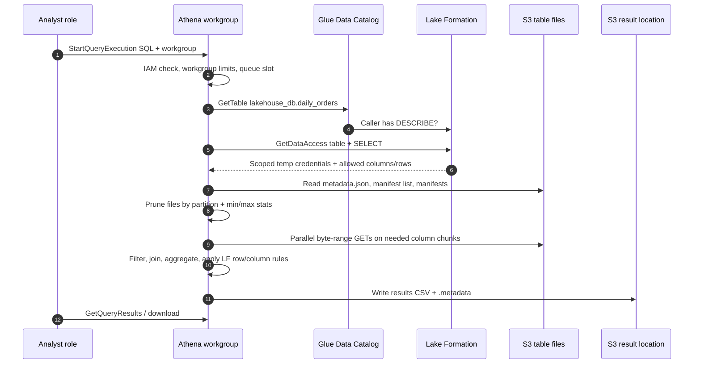
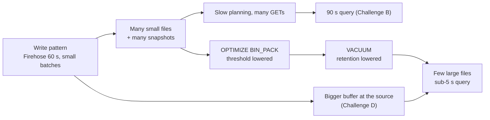

# 🔎 Amazon Athena

> **What it is:** a serverless, distributed SQL engine (Trino-based, "engine version 3") that queries files in S3 using table definitions from the Glue Data Catalog. You pay per byte scanned and never manage a cluster.
> **GCP equivalent:** BigQuery on-demand querying **BigLake / external tables** over GCS. The engine itself is closest to Trino/Presto on Dataproc.
> **In the HLD:** label **B** (users → Athena → scans Iceberg data files): [Challenge B](../01_AWS_Data_Lakehouse_Demonstrated/Challenge_B_Analytics_Query_Performance_Compaction_And_MOR.md). Athena is also the **verification tool** in [A](../01_AWS_Data_Lakehouse_Demonstrated/Challenge_A_Product_Catalog_Schema_Mismatch_And_Partitioning.md), [D](../01_AWS_Data_Lakehouse_Demonstrated/Challenge_D_Firehose_Iceberg_Streaming_Upserts_And_Buffering.md), [E](../01_AWS_Data_Lakehouse_Demonstrated/Challenge_E_LF_Data_Cell_Filters_Marketing_And_Regional_Manager.md), [F](../01_AWS_Data_Lakehouse_Demonstrated/Challenge_F_Vendor_File_Pipeline_EventBridge_StepFunctions_Lambda.md) and [G](../01_AWS_Data_Lakehouse_Demonstrated/Challenge_G_Orders_Ingest_Duplicates_And_Iceberg_Snapshot_Rollback.md). See the [HLD image](../01_AWS_Data_Lakehouse_Demonstrated/assets/00_lakehouse_architecture_hld.png).
> **Related guide files:** [Iceberg](02_Apache_Iceberg_On_AWS.md) · [Glue](03_AWS_Glue.md) · [Lake Formation](05_AWS_Lake_Formation.md) · [S3](01_Amazon_S3.md) · [Foundations](00_AWS_Foundations_IAM_Regions_CLI_CloudWatch_KMS.md) · [Index](README.md)
> **As of Nov 2026.** ⚠️ = unverified or likely to change, so check the docs before relying on it.

---

## ⭐ Must-know first (labs + exam)

1. **Athena runs SQL only.** `spark.sql("...")` is Python, so it belongs in a Glue job script. In the lab you **verify** in Athena and **change** in Glue *(Challenge A, Mistake 1)*.
2. **Pick the workgroup before you run anything.** The workgroup decides the result location, encryption, engine version and scan limits, and it holds the **saved queries**. The *"set up a query result location"* banner means you're in `primary`. Switch to `anycompany-lakehouse` *(A)*.
3. **One statement per run** in the console editor. Run each `ALTER`, `OPTIMIZE` and `VACUUM` on its own *(B)*.
4. **Cost = bytes scanned** (about $5/TB ⚠️, 10 MB minimum per query ⚠️). DDL and failed queries are free. File layout decides the bill: **columnar (Parquet/ORC) + compression + partitioning + right-sized files**.
5. **Two table families.** **Hive** tables (`CREATE EXTERNAL TABLE`) only append, with no row-level changes. **Iceberg** tables (`CREATE TABLE ... TBLPROPERTIES ('table_type'='ICEBERG')`, with **no** `EXTERNAL` keyword) support `INSERT`, `UPDATE`, `DELETE`, `MERGE INTO`, time travel, `OPTIMIZE` and `VACUUM`.
6. **`OPTIMIZE t REWRITE DATA USING BIN_PACK [WHERE <partition predicate>]`** compacts small files and folds in delete files. It only rewrites when the file count reaches `optimize_rewrite_data_file_threshold` (**default 5**, must be < 50). That's why it "did nothing" in B.
7. **`VACUUM t`** expires snapshots and removes orphan files. Snapshots are kept unless they're older than `vacuum_max_snapshot_age_seconds` (**default 432000 = 5 days**), and the newest `vacuum_min_snapshots_to_keep` (**default 1**) are always kept. Expired snapshots are no longer available for **time travel** *(B → G)*.
8. **Athena accepts only an allow-list of Iceberg TBLPROPERTIES** (`format`, `write_compression`, `optimize_*`, `vacuum_*` and a few others). Iceberg-native properties such as `write.merge.mode`, and **partition evolution**, have to be set from **Spark** (a Glue job) *(A, B)*.
9. **Metadata tables:** `SELECT * FROM "db"."table$snapshots"` (also `$files`, `$history`, `$partitions`, `$manifests`). The double quotes are required because of the `$`.
10. **Time travel:** `... FOR VERSION AS OF <snapshot_id>` or `... FOR TIMESTAMP AS OF TIMESTAMP '2026-11-10 06:00:00 UTC'`. **Rollback isn't an Athena command.** It's the Spark procedure `CALL glue_catalog.system.rollback_to_snapshot(...)` *(G)*.
11. **Pruning needs predicates on partition columns.** On Hive tables, filter the partition column itself. On Iceberg tables, filter the **source column** (`WHERE updated_at >= ...`) and hidden partitioning does the rest *(A)*. For Hive tables with many partitions, **partition projection** removes the need for `MSCK REPAIR` and crawlers.
12. **Small files kill latency.** Each file costs S3 requests and planning overhead. Aim for files of roughly 128–512 MB. Fix this at the source (Firehose buffer, D) and with compaction (B).
13. **Lake Formation is enforced inside Athena.** Athena calls `lakeformation:GetDataAccess`, gets scoped temporary credentials, and applies column and row filters. *"Insufficient Lake Formation permission(s)"* means IAM was fine and **LF** said no *(C, E)*.
14. **Cost guardrails live on the workgroup:** a per-query bytes-scanned cutoff, "override client-side settings", CloudWatch metrics and alarms, and IAM policies that pin users to a workgroup.
15. **Quotas you'll hit:** DML timeout **30 min** by default (can be raised to 240), **200** active DML queries in us-east-1, and `TooManyRequestsException` when you go over.

---

## 🧱 First principles

### The problem
You have terabytes of files in object storage, and people want to ask SQL questions of them. The old answer was to load everything into a warehouse (copy, schedule, pay for an always-on cluster). Athena's answer is to **leave the data where it is and bring short-lived, shared compute to it for the length of one query.**

### The constraints that shape the design

| Constraint | Consequence for the design |
|---|---|
| **S3 has high throughput but high per-request latency** (tens of ms to first byte ⚠️), and objects are immutable | The engine reads **many files in parallel**, uses **byte-range GETs** to fetch only the column chunks it needs, and suffers when there are **many tiny files** (latency per object dominates) |
| **Separating compute from storage** | Storage is cheap and durable. Compute is rented per query from a large shared fleet. Several engines (Athena, Glue Spark, Redshift Spectrum, EMR) read the **same files**, so there's no lock-in to one engine |
| **Billing per byte scanned** | The cost incentive lines up with performance: read fewer bytes and you go faster *and* pay less. The levers are columnar formats, compression, partition pruning and column projection |
| **Multi-file changes on S3 aren't atomic** | Plain Hive tables can't do safe `UPDATE`/`DELETE`, and readers can see half-written data. **Table formats** (Iceberg) add atomic commits by swapping one metadata pointer in the catalog. See [02_Apache_Iceberg_On_AWS.md](02_Apache_Iceberg_On_AWS.md) |
| **The data stays in *your* bucket** | Athena needs permission to read it (IAM, or Lake Formation credential vending) and to write results somewhere (the **result location**) |
| **MPP engines pipeline data in memory across stages** | Interactive queries are fast, but a long query that fails restarts from scratch. Hence the **timeouts** and the advice to run heavy ETL on Spark |

### The core abstractions
- **Table** = schema + location + format + partitioning, all stored in the **Glue Data Catalog** (the Hive-metastore equivalent). A table is only a *description* of files.
- **Query** = a distributed plan. The coordinator plans, and workers process **splits** (pieces of files, such as Parquet row groups) in parallel.
- **Workgroup** = the administrative boundary: settings, limits, history, saved queries, metrics and cost allocation.

### Why file layout decides both speed and cost (mental model)

```text
query time ≈ planning (catalog + listing/manifests)
           + files × per-file overhead (open, footer read, request latency)
           + bytes actually read ÷ parallel throughput
query cost ≈ bytes actually read (after pruning and column projection) × $/TB
```

Worked intuition: a 1 TB CSV table with 30 columns and 365 days of data. A query on **3 columns for 1 day**:

| Layout | Bytes read | Cost at $5/TB ⚠️ |
|---|---|---|
| CSV, unpartitioned | 1 TB (every byte, every column) | $5.00 |
| Parquet + ZSTD (~4× smaller ⚠️ ratio varies) | 250 GB × 3/30 columns = 25 GB | $0.125 |
| + partitioned by day | 25 GB ÷ 365 ≈ 70 MB | ≈ $0.0003 |

Same data, same question, about 15,000× cheaper. **That's the whole game with Athena.**

---

## 🧩 Core concepts

### Engines

| Engine | Basis | Use it for | Notes |
|---|---|---|---|
| **Athena engine version 3** | Trino (AWS keeps it in step with upstream) | All SQL: Hive, Iceberg, federated | The current SQL engine. Workgroups can be set to **AUTO** (Athena upgrades it for you) or pinned to a version |
| Athena engine version 2 | Presto 0.217 | Legacy | Deprecated. Upgrade to v3 ⚠️ |
| **Apache Spark in Athena** ⚠️ | Spark (a "Spark 3.5" version shows in quotas ⚠️) | PySpark notebooks/sessions, billed per DPU-hour | A **separate workgroup type** (Spark, not SQL). Not what the lab means by "Athena". The lab's PySpark goes in **Glue jobs** |

### Workgroups

| Setting | What it does | Gotcha |
|---|---|---|
| **Query result location** | S3 prefix where each query writes `<query-id>.csv` + `.metadata` | `primary` has none by default, which causes the lab banner. Newer workgroups can use **Athena-managed results** with no bucket needed ⚠️ |
| **Override client-side settings** (`EnforceWorkGroupConfiguration`) | Workgroup settings win over whatever the client sends | Turn it on for governed workgroups, otherwise users can redirect results |
| **Result encryption** | `SSE_S3`, `SSE_KMS` or `CSE_KMS` | With KMS, users need `kms:Decrypt`/`GenerateDataKey` on the key |
| **Engine version** | AUTO or pinned | Pin versions for regression-sensitive production work |
| **Per-query data usage control** (`BytesScannedCutoffPerQuery`) | Cancels a query once it has scanned more than N bytes | You still pay for the bytes scanned up to the cutoff |
| **Workgroup data usage alerts** | CloudWatch alarms on scanned bytes per period, notifying SNS | They alert, they don't block ⚠️ |
| **Publish CloudWatch metrics** | Per-workgroup `ProcessedBytes`, `TotalExecutionTime`, `QueryQueueTime`… | Needed for the alarms |
| **Saved (named) queries, history, prepared statements** | All scoped to the workgroup | That's why the lab's saved queries "disappear" in `primary` |
| **Capacity reservation** | Runs the workgroup's queries on reserved DPUs | See cost section |
| **Tags** | Cost allocation per team | Up to 50 per workgroup |

### Data sources and catalogs

| Catalog | What it is | Query form |
|---|---|---|
| **`AwsDataCatalog`** | The account's Glue Data Catalog (the default) | `SELECT ... FROM lakehouse_db.orders` |
| **Federated (Lambda) catalogs** ⚠️ | Connectors built on the Athena Query Federation SDK, running as **Lambda** (DynamoDB, CloudWatch Logs, JDBC MySQL/PostgreSQL, Redshift, …). Newer connectors can be set up through Glue connections ⚠️ | `SELECT * FROM "ddb_catalog"."default"."orders"` |
| External Hive metastore | Your own metastore through a Lambda | Rare |
| Cross-account Glue catalog | Another account's catalog registered as a data source | `"other_cat"."db"."t"` |
| S3 Tables catalog ⚠️ | Managed Iceberg "table buckets" | `"s3tablescatalog/<bucket>"."ns"."t"` ⚠️ |

**How federation works:** Athena calls the connector Lambda for metadata and splits. The Lambda reads the source and returns Arrow batches, **spilling** large results to an S3 spill bucket. You pay for the Lambda plus Athena's scan charge. Federated queries put load on the source (for example an OLTP database) and are slower than reading Parquet in S3 ⚠️.

### Hive tables vs Iceberg tables in Athena

| Capability | Hive table | Iceberg table |
|---|---|---|
| Create | `CREATE EXTERNAL TABLE ... LOCATION ...` | `CREATE TABLE ... LOCATION ... TBLPROPERTIES ('table_type'='ICEBERG')`. Using `EXTERNAL` errors |
| CTAS | `WITH (format=..., external_location=..., partitioned_by=ARRAY[...])` | `WITH (table_type='ICEBERG', is_external=false, location=..., partitioning=ARRAY[...])` |
| `INSERT INTO` | ✅ append | ✅ append |
| `UPDATE` / `DELETE` / `MERGE INTO` | ❌ | ✅ writes **position delete files** (merge-on-read) ⚠️ |
| Partitions | Directory style `dt=2026-11-11/`, registered in the catalog (or projected) | **Hidden** transforms: `year`, `month`, `day`, `hour`, `bucket(N,c)`, `truncate(L,c)`. Athena spells them `day(ts)`, Spark spells them `days(ts)` |
| Partition evolution | n/a | Spark only ⚠️ |
| Schema change | `ALTER TABLE ADD/REPLACE COLUMNS` (and the files must agree) | `ADD COLUMNS`, `DROP COLUMN`, `CHANGE COLUMN` (safe, by field ID) |
| Time travel | ❌ | ✅ |
| Maintenance | none (rewrite with CTAS) | `OPTIMIZE`, `VACUUM` |
| `DROP TABLE` | Removes metadata only, files stay | Removes the table **and its data** ⚠️ (verify before running) |

### Athena Iceberg table properties (the full allow-list)

| Property | Default | Meaning |
|---|---|---|
| `table_type` | must be `ICEBERG` | Marks the table as Iceberg |
| `format` | `parquet` | Data file format (`parquet`, `orc`, `avro`, depending on engine version) |
| `write_compression` | depends on engine version and format ⚠️ (ZSTD for Parquet on v3 ⚠️) | Compression codec |
| `optimize_rewrite_data_file_threshold` | **5** (positive, < 50) | OPTIMIZE skips the rewrite when fewer data files than this need optimizing |
| `optimize_rewrite_delete_file_threshold` | **2** (positive, < 50) | A data file is rewritten only once it has at least this many delete files |
| `vacuum_min_snapshots_to_keep` | **1** | Always keep at least this many snapshots on `main`. Overrides the age rule |
| `vacuum_max_snapshot_age_seconds` | **432000** (5 days) | Snapshots older than this are expired, and orphan files older than this are deleted |
| `vacuum_max_metadata_files_to_keep` | **100** | Old `metadata.json` files kept |
| `write_data_path_enabled` | `false` | Use `write.data.path` instead of the deprecated `write.object-storage.path` |
| `write_target_data_file_size_bytes` ⚠️ | 512 MB ⚠️ | Target output file size. Listed in older docs, **missing from the current allow-list**. Check before use |
| `optimize_rewrite_min_data_file_size_bytes` ⚠️ | 0.75 × target ⚠️ | Files smaller than this are rewrite candidates. Older docs only |
| `optimize_rewrite_max_data_file_size_bytes` ⚠️ | 1.8 × target ⚠️ | Files larger than this get split. Older docs only |
| `use_iceberg_statistics` ⚠️ | — | Lets the cost-based optimizer use Glue column statistics (set via Glue `UpdateTable`) |

`SET TBLPROPERTIES` rejects any key that isn't on this list (custom keys aren't accepted). For `write.merge.mode`, `write.update.mode`, `format-version` and similar, use Spark. See [03_AWS_Glue.md](03_AWS_Glue.md) and [02_Apache_Iceberg_On_AWS.md](02_Apache_Iceberg_On_AWS.md).

### OPTIMIZE vs VACUUM vs time travel

| | `OPTIMIZE ... REWRITE DATA USING BIN_PACK` | `VACUUM` | `FOR VERSION/TIMESTAMP AS OF` |
|---|---|---|---|
| Does | Bin-packs small files into larger ones and merges delete files into data files | Expires old snapshots, deletes unreachable data and metadata files, removes orphan files | Reads an older snapshot |
| New snapshot? | Yes (`replace`) | No | No (read only) |
| Billed by | Bytes scanned during the rewrite | S3 requests (plus a small scan ⚠️) | Bytes scanned |
| Filter | `WHERE` on **partition columns only** | none, whole table | — |
| Needs | Lake Formation/IAM write permission on the table | `s3:DeleteObject` on the location, **otherwise it "succeeds" and deletes nothing** | SELECT |

### Iceberg metadata tables (Athena)

| Table | Key columns | Use |
|---|---|---|
| `"db"."t$snapshots"` | `committed_at`, `snapshot_id`, `parent_id`, `operation`, `summary` (map) | Commit history and record counts (`summary['total-records']`) *(G)* |
| `"db"."t$history"` | `made_current_at`, `snapshot_id`, `parent_id`, `is_current_ancestor` | Which snapshots are in the current lineage, including after rollbacks |
| `"db"."t$files"` | `content` (0 = data, 1 = position deletes, 2 = equality deletes), `file_path`, `file_format`, `record_count`, `file_size_in_bytes` | Small-file and delete-file diagnosis *(B, D)* |
| `"db"."t$partitions"` | `partition`, `record_count`, `file_count`, `total_size` | Partition skew, checking the new partition field *(A)* |
| `"db"."t$manifests"` | manifest paths, added/deleted file counts | Metadata bloat |
| `"db"."t$refs"` ⚠️ | branches and tags | Write-audit-publish |

### Formats, compression and predicate pushdown

| Format | Layout | Splittable | Pushdown | Verdict |
|---|---|---|---|---|
| CSV / JSON | Row | Yes uncompressed. **gzip is not** splittable | None (reads every byte) | Raw/landing zone only |
| **Parquet** | Columnar, row groups with min/max stats, dictionaries, page indexes | Yes | Column projection + row-group/page skipping | The default for analytics |
| ORC | Columnar, stripes with stats and bloom filters | Yes | Same idea | Fine, less common on AWS |
| Avro | Row, with schema | Yes | None | Streaming/interchange |

- **Compression:** ZSTD (good ratio and speed), Snappy (fast), gzip (good ratio, but not splittable as a whole-file codec on text). Inside Parquet, compression is per column chunk, so it stays splittable.
- **Predicate pushdown** works in layers: (1) **partition pruning** (skip directories or partitions), (2) **Iceberg manifest stats** (skip files whose min/max can't match), (3) **Parquet row-group/page stats** (skip chunks inside a file). Data **sorted** by the filter column makes layers 2 and 3 far more effective.
- **The small-files effect:** 10,000 × 1 MB files means 10,000+ GETs, 10,000 footer reads and 10,000 splits. 20 × 512 MB files holding the same data is **one to two orders of magnitude faster** ⚠️ (it depends on the query).

### Partitioning options for Hive tables

| Method | How partitions get into the catalog | Trade-off |
|---|---|---|
| `MSCK REPAIR TABLE t` | Scans S3 for `key=value/` folders | Slow with many partitions, and needs the Hive-style naming |
| `ALTER TABLE t ADD PARTITION (...) LOCATION ...` | Explicit, one per call (or batched) | You have to automate it |
| Glue crawler | Discovers them on a schedule | Lag and cost. It can also change the schema unexpectedly |
| **Partition projection** | **Nothing is stored.** Athena *computes* partition values from table properties | Fastest planning. Hive tables only, and queries should filter on the projected columns |

### Other features worth knowing

| Feature | One-liner |
|---|---|
| **CTAS** | `CREATE TABLE x WITH (...) AS SELECT ...`: writes new files and registers the table. The main tool for reshaping data with Athena |
| **UNLOAD** | `UNLOAD (SELECT ...) TO 's3://...' WITH (format='PARQUET')`: writes files without creating a table |
| **INSERT INTO** | Appends. For Hive tables, **100 partitions per statement** ⚠️ (CTAS has the same limit) |
| **Views** | Logical only. Stored in the Glue catalog (Presto views). Glue "Data Catalog views" work across engines ⚠️ |
| **Prepared statements** | `PREPARE s FROM ... ?`, `EXECUTE s USING ...`, or `--execution-parameters` on the API. Guards against SQL injection and allows reuse |
| **Query result reuse** | Returns the result of an identical earlier query if it's younger than a max age (up to 7 days ⚠️). No scan cost. **Stale by design** |
| **Capacity reservations** | Dedicated DPUs (minimum 4) assigned to workgroups. Billed per DPU-hour, not per TB |
| **Cost-based optimizer** | Uses Glue column statistics for join order. Generate stats for large dimension/fact joins |

### How Lake Formation is enforced on Athena queries
1. IAM must allow `athena:StartQueryExecution` on the workgroup, `glue:GetTable`-type reads, and **`lakeformation:GetDataAccess`**.
2. Glue catalog calls are checked against LF **metadata** permissions (DESCRIBE). Without them you get *"Table not found"* or *"Database not found"*.
3. For a table whose S3 location is **registered** with LF (and not left IAM-only), Athena calls **`GetDataAccess`**. LF evaluates named, TBAC and data-filter grants and returns **temporary credentials scoped to the table's location**, plus the allowed columns and row filter.
4. Athena reads S3 with **those** credentials (credential vending). The user needs **no** `s3:GetObject` on the data bucket, and shouldn't have it.
5. Athena, as a trusted integrated engine, **removes disallowed columns and rows inside the engine** before returning results. `SELECT *` on a column-filtered table returns only the permitted columns ⚠️ (or errors on an explicitly named, hidden column).
6. **Results are not governed by LF.** Whatever lands in the result location is plain S3 objects. Lock down that bucket.

See [05_AWS_Lake_Formation.md](05_AWS_Lake_Formation.md) for the full model.

---

## 🔄 How it works (flow)





**Numbered flow for one Iceberg query:**
1. Athena resolves the **workgroup** (result location, limits, engine) and queues the query against your concurrency quota.
2. It asks Glue for the table. For Iceberg, the table's `metadata_location` points at the current `metadata.json`.
3. Lake Formation authorises the request and vends credentials and filters.
4. The planner reads the **manifest list → manifests** for the current (or time-travel) snapshot, prunes by partition values and column stats, and produces **splits**.
5. Workers read only the needed **column chunks**, apply delete files (MOR), evaluate filters and aggregate.
6. The coordinator writes results to S3 and records statistics (`DataScannedInBytes`, execution time). You're billed on the scanned bytes.

---

## 🛠️ Hands-on examples

> All examples assume **us-east-1**, workgroup **`anycompany-lakehouse`** and database **`lakehouse_db`**. In CloudShell, look up suffixed names first (Challenge F pattern).

### Reusable CLI helper (one statement per execution)

```bash
# Paste into CloudShell. Runs ONE SQL statement in the lab workgroup and waits for it.
WG=anycompany-lakehouse
DB=lakehouse_db

run_q () {
  local sql="$1" qid state
  qid=$(aws athena start-query-execution \
          --work-group "$WG" \
          --query-execution-context Database="$DB",Catalog=AwsDataCatalog \
          --query-string "$sql" \
          --query QueryExecutionId --output text) || return 1
  while true; do
    state=$(aws athena get-query-execution --query-execution-id "$qid" \
              --query QueryExecution.Status.State --output text)
    case "$state" in
      SUCCEEDED) break ;;
      FAILED|CANCELLED)
        echo "❌ $state: $(aws athena get-query-execution --query-execution-id "$qid" \
              --query QueryExecution.Status.StateChangeReason --output text)"
        return 1 ;;
      *) sleep 2 ;;
    esac
  done
  # Bytes scanned = what you pay for
  aws athena get-query-execution --query-execution-id "$qid" \
    --query 'QueryExecution.Statistics.{scannedBytes:DataScannedInBytes,ms:TotalExecutionTimeInMillis}' --output text
  aws athena get-query-results --query-execution-id "$qid" --max-items 50 --output text \
    --query 'ResultSet.Rows[].Data[].VarCharValue'
}

# Run a saved (named) query by its name from the workgroup
run_saved () {
  local name="$1" ids sql
  ids=$(aws athena list-named-queries --work-group "$WG" --query 'NamedQueryIds' --output text)
  sql=$(aws athena batch-get-named-query --named-query-ids $ids \
          --query "NamedQueries[?Name=='$name'] | [0].QueryString" --output text)
  echo "-- $name:"; echo "$sql"
  run_q "$sql"
}
```

### Example 1 (lab): Challenge B, exactly as it was solved

**Goal:** get `lakehouse_db.daily_orders` under a 5-second SLA by making OPTIMIZE and VACUUM actually do something, then switch `orders` to merge-on-read.

**Console steps**
1. Athena → **Query editor** → top right **Workgroup: `anycompany-lakehouse`**. Data source `AwsDataCatalog`, database `lakehouse_db`.
2. Run each statement below in its **own** run. Clear the editor or highlight just one statement.
3. For saved queries: **Saved queries** tab → search for the name → click the name → **Run**.

**SQL (one per run, in this order)**

```sql
-- 0a. Baseline: read the current optimize_* / vacuum_* values
SHOW TBLPROPERTIES lakehouse_db.daily_orders;
```
```sql
-- 0b. Baseline file layout (the same idea as saved query daily-orders-file-sizes)
SELECT COUNT(*)                                      AS file_count,
       ROUND(AVG(file_size_in_bytes) / 1024.0, 1)    AS avg_file_kb,
       ROUND(SUM(file_size_in_bytes) / 1048576.0, 2) AS total_mb
FROM "lakehouse_db"."daily_orders$files"
WHERE content = 0;                                   -- 0 = data files only
```
```sql
-- 0c. Baseline snapshot count (the same idea as daily-orders-snapshot-count)
SELECT COUNT(*) AS snapshot_count FROM "lakehouse_db"."daily_orders$snapshots";
```
```sql
-- 1. Make compaction eligible: a partition qualifies with >= 2 files needing a rewrite
ALTER TABLE lakehouse_db.daily_orders SET TBLPROPERTIES (
  'optimize_rewrite_data_file_threshold' = '2'
);
```
```sql
-- 2. Compact. If Athena says more work remains, run it again until it finishes
OPTIMIZE lakehouse_db.daily_orders REWRITE DATA USING BIN_PACK;
```
```sql
-- 3. Tighten retention (LAB VALUES ONLY: 60 s kills time travel in production)
ALTER TABLE lakehouse_db.daily_orders SET TBLPROPERTIES (
  'vacuum_min_snapshots_to_keep'    = '2',
  'vacuum_max_snapshot_age_seconds' = '60'
);
```
```sql
-- 4. Wait at least 60 s after OPTIMIZE committed, then expire snapshots and orphans
VACUUM lakehouse_db.daily_orders;
```
Then re-run 0b and 0c (or the saved queries). You should see **fewer, larger files** and **≤ 5 snapshots**.

**Step 5 (Glue, not Athena):** job `orders-write-mode-fix` → Script → at the hint:
```python
spark.sql("""
  ALTER TABLE glue_catalog.lakehouse_db.orders SET TBLPROPERTIES (
    'write.merge.mode'  = 'merge-on-read',
    'write.update.mode' = 'merge-on-read'
  )""")
```
**Save → Run → Succeeded.** Athena can't set `write.*` properties, which is why a Glue job is used.

**CLI version (CloudShell)**
```bash
run_q "SHOW TBLPROPERTIES lakehouse_db.daily_orders"
run_saved daily-orders-file-sizes
run_saved daily-orders-snapshot-count
run_q "ALTER TABLE lakehouse_db.daily_orders SET TBLPROPERTIES ('optimize_rewrite_data_file_threshold'='2')"
run_q "OPTIMIZE lakehouse_db.daily_orders REWRITE DATA USING BIN_PACK"
run_q "ALTER TABLE lakehouse_db.daily_orders SET TBLPROPERTIES ('vacuum_min_snapshots_to_keep'='2','vacuum_max_snapshot_age_seconds'='60')"
sleep 65    # retention is 60 s, so the OPTIMIZE snapshot's predecessors must age out
run_q "VACUUM lakehouse_db.daily_orders"
run_saved daily-orders-file-sizes
run_saved daily-orders-snapshot-count
```

**Expected result:** file count drops from hundreds to a handful, the average size goes from KB to MB, and the snapshot count goes from 50+ to ≤ 5. The Glue job ends **Succeeded**.

**What to check:** `SHOW TBLPROPERTIES` shows the new values. If OPTIMIZE still does nothing, look for odd `optimize_rewrite_*_size_bytes` values. If VACUUM leaves snapshots, they're younger than 60 s, or `vacuum_min_snapshots_to_keep` is holding them.

### Example 2 (lab): verification queries for A, D, E, F and G

**Goal:** prove each fix with SQL, since Athena is the lab's "eyes". Each block below holds several statements, so **run them one at a time**.

**A: schema and partition evolution (after the Glue jobs)**
```sql
DESCRIBE lakehouse_db.products;            -- expect: quantity bigint; partitioning includes month(updated_at)

SELECT "partition", record_count, file_count  -- "partition" is a ROW, e.g. {category=toys, updated_at_month=670}
FROM "lakehouse_db"."products$partitions"
ORDER BY record_count DESC
LIMIT 20;

-- Pruning check: filter on the SOURCE column, so hidden partitioning prunes. Compare scanned bytes with a full scan
SELECT COUNT(*) FROM lakehouse_db.products
WHERE updated_at >= TIMESTAMP '2026-10-01 00:00:00';
```

**D: Firehose upserts and file sizes**
```sql
-- Duplicates in the OLD append-only table (the orders-realtime-duplicates idea)
SELECT order_id, COUNT(*) AS versions
FROM lakehouse_db.orders_realtime
GROUP BY order_id HAVING COUNT(*) > 1
ORDER BY versions DESC LIMIT 20;

-- The staging (upsert) table should have exactly one row per key
SELECT COUNT(*) AS total, COUNT(DISTINCT order_id) AS unique_orders
FROM lakehouse_db.orders_realtime_staging;

-- Commit cadence: about 12 commits/hour at a 300 s buffer, about 60/hour at 60 s
SELECT date_trunc('hour', committed_at) AS hr, COUNT(*) AS commits
FROM "lakehouse_db"."orders_realtime_staging$snapshots"
GROUP BY 1 ORDER BY 1 DESC LIMIT 24;

-- Upserts create equality-delete files (content = 2). They are what OPTIMIZE folds in
SELECT content, COUNT(*) AS files, SUM(record_count) AS records
FROM "lakehouse_db"."orders_realtime_staging$files"
GROUP BY content;
```

**E: exact row-filter values (customers-region-values)**
```sql
-- Casing, suffixes and invisible spaces all break an exact-match row filter
SELECT region, length(region) AS len, COUNT(*) AS n
FROM lakehouse_db.customers
GROUP BY region ORDER BY region;
```

**F: did the vendor pipeline load good rows only?**
```sql
SELECT COUNT(*) AS loaded,
       COUNT_IF(vendor_id IS NULL OR trim(vendor_id) = '') AS bad_vendor_ids   -- expect 0
FROM lakehouse_db.vendor_catalog;
```

**G: find the clean snapshot, check it with time travel, verify after the rollback**
```sql
SELECT committed_at, snapshot_id, parent_id, operation,
       summary['added-records'] AS added, summary['total-records'] AS total
FROM "lakehouse_db"."orders$snapshots"
ORDER BY committed_at;

SELECT COUNT(*) AS total, COUNT(DISTINCT order_id) AS unique_orders
FROM lakehouse_db.orders FOR VERSION AS OF 1234567890123456789;   -- bare number, no quotes

SELECT COUNT(*) AS total, COUNT(DISTINCT order_id) AS unique_orders
FROM lakehouse_db.orders FOR TIMESTAMP AS OF TIMESTAMP '2026-11-10 06:00:00 UTC';

-- After the Spark rollback_to_snapshot in Glue: expect 50000 | 50000
SELECT COUNT(*) AS total, COUNT(DISTINCT order_id) AS unique_orders FROM lakehouse_db.orders;
```

**What to check:** copy snapshot IDs straight from the results grid (18–19 digits, so never through Excel). `$history.is_current_ancestor` tells you whether a rollback moved the lineage.

### Example 3 (beyond the lab): design a cost-efficient table with CTAS

**Goal:** turn raw JSON orders into (a) a partitioned Parquet Hive table and (b) an Iceberg table, then measure how much less each one scans.

**Console steps:** run each statement in the query editor (workgroup `anycompany-lakehouse` or your own). After each `SELECT`, open **Query stats** and note **Data scanned**.

```sql
-- 1. Raw landing table over JSON (a Hive external table; nothing is copied)
CREATE EXTERNAL TABLE IF NOT EXISTS lakehouse_db.orders_json_raw (
  order_id    string,
  customer_id string,
  order_ts    string,          -- ISO-8601 text, e.g. 2026-11-10T08:15:00Z
  status      string,
  amount      double,
  region      string
)
ROW FORMAT SERDE 'org.openx.data.jsonserde.JsonSerDe'
LOCATION 's3://<raw-bucket>/raw/orders_json/';
```
```sql
-- 2a. CTAS to a partitioned Parquet HIVE table. Partition columns must be LAST in the SELECT.
--     Limit: 100 partitions per CTAS/INSERT, so load bigger ranges with INSERT INTO in batches.
CREATE TABLE lakehouse_db.orders_parquet_hive
WITH (
  format            = 'PARQUET',
  write_compression = 'ZSTD',
  external_location = 's3://<analytics-bucket>/hive/orders_parquet/',
  partitioned_by    = ARRAY['order_date']
) AS
SELECT order_id, customer_id, status,
       CAST(amount AS decimal(12,2))                       AS amount,
       region,
       date(from_iso8601_timestamp(order_ts))              AS order_date   -- partition column, last
FROM lakehouse_db.orders_json_raw
WHERE date(from_iso8601_timestamp(order_ts)) >= DATE '2026-09-01';       -- <= 100 days
```
```sql
-- 2b. CTAS to an ICEBERG table with hidden partitioning (day + bucket on a high-cardinality key)
CREATE TABLE lakehouse_db.orders_iceberg_demo
WITH (
  table_type        = 'ICEBERG',
  is_external       = false,                                   -- required for Iceberg CTAS
  location          = 's3://<analytics-bucket>/iceberg/orders_iceberg_demo/',
  format            = 'PARQUET',
  write_compression = 'ZSTD',
  partitioning      = ARRAY['day(order_ts)', 'bucket(16, customer_id)']
) AS
SELECT order_id, customer_id,
       CAST(from_iso8601_timestamp(order_ts) AT TIME ZONE 'UTC' AS timestamp(6)) AS order_ts,  -- Iceberg: microsecond timestamp
       status,
       CAST(amount AS decimal(12,2)) AS amount,
       region
FROM lakehouse_db.orders_json_raw;
```
```sql
-- 3. Same question, three layouts (three separate runs). Compare "Data scanned" for each
SELECT region, SUM(amount) FROM lakehouse_db.orders_json_raw
WHERE date(from_iso8601_timestamp(order_ts)) = DATE '2026-11-10' GROUP BY region;

SELECT region, SUM(amount) FROM lakehouse_db.orders_parquet_hive
WHERE order_date = DATE '2026-11-10' GROUP BY region;

SELECT region, SUM(amount) FROM lakehouse_db.orders_iceberg_demo
WHERE order_ts >= TIMESTAMP '2026-11-10 00:00:00' AND order_ts < TIMESTAMP '2026-11-11 00:00:00'
GROUP BY region;
```

**Expected result:** JSON scans the whole prefix. Parquet scans only 2 columns of one partition (often KB–MB). Iceberg is similar, and also prunes by file statistics.

**What to check:** for the Hive table, `SHOW PARTITIONS lakehouse_db.orders_parquet_hive`. For Iceberg, check `"$partitions"` and `"$files"` and confirm the average file size isn't tiny. If it is, run `OPTIMIZE` or reduce `bucket(N)`, because over-partitioning creates small files.

### Example 4 (beyond the lab): partition projection over Firehose's raw S3 output

**Goal:** query Firehose's default `YYYY/MM/DD/HH/` layout without crawlers or `MSCK REPAIR`, and keep pruning fast.

**Console steps:** run the DDL, then a query filtered on `datehour`. No partition-management job is needed.

```sql
CREATE EXTERNAL TABLE IF NOT EXISTS lakehouse_db.order_events_raw (
  event_id   string,
  order_id   string,
  status     string,
  event_time string
)
PARTITIONED BY (datehour string)
ROW FORMAT SERDE 'org.openx.data.jsonserde.JsonSerDe'
LOCATION 's3://<raw-bucket>/firehose/order-events/'
TBLPROPERTIES (
  'projection.enabled'             = 'true',
  'projection.datehour.type'       = 'date',
  'projection.datehour.format'     = 'yyyy/MM/dd/HH',        -- matches Firehose's default UTC prefix
  'projection.datehour.range'      = '2026/01/01/00,NOW',
  'projection.datehour.interval'   = '1',
  'projection.datehour.interval.unit' = 'HOURS',
  'storage.location.template'      = 's3://<raw-bucket>/firehose/order-events/${datehour}/'
);
```
```sql
-- Prunes to 24 hourly prefixes. No catalog partitions exist at all
SELECT status, COUNT(*) AS n
FROM lakehouse_db.order_events_raw
WHERE datehour BETWEEN '2026/11/10/00' AND '2026/11/10/23'
GROUP BY status;
```

**Other projection types:** `integer` (with `range`, `digits`), `enum` (fixed list of values), `injected` (the value must come from an equality predicate in the query; good for tenant IDs).

**Expected result:** the query succeeds right away. `SHOW PARTITIONS` returns nothing, because projected partitions aren't stored.

**What to check:** without a `datehour` filter, Athena enumerates **every** projected hour since 2026/01/01, which is slow. Always filter. Partition projection is **not** for Iceberg tables, which have their own metadata.

### Example 5 (beyond the lab): MERGE upsert into an Iceberg table

**Goal:** apply a daily change batch idempotently, with no duplicates (the Challenge G lesson) and no Spark.

```sql
MERGE INTO lakehouse_db.orders AS t
USING (
  -- Dedupe the batch first: MERGE fails if two source rows match the same target row
  SELECT order_id, status, amount, updated_at
  FROM (
    SELECT s.*,
           row_number() OVER (PARTITION BY order_id ORDER BY updated_at DESC) AS rn
    FROM lakehouse_db.orders_changes_staging s
    WHERE batch_date = DATE '2026-11-10'          -- scope the input (the G lesson)
  ) x
  WHERE rn = 1
) AS s
ON t.order_id = s.order_id
WHEN MATCHED AND s.status = 'DELETED' THEN
  DELETE
WHEN MATCHED AND s.updated_at > t.updated_at THEN  -- ignore late, older changes
  UPDATE SET status = s.status, amount = s.amount, updated_at = s.updated_at
WHEN NOT MATCHED AND s.status <> 'DELETED' THEN
  INSERT (order_id, status, amount, updated_at)
  VALUES (s.order_id, s.status, s.amount, s.updated_at);
```

Single-row maintenance on Iceberg (each runs separately):
```sql
UPDATE lakehouse_db.orders SET status = 'CANCELLED' WHERE order_id = 'o-000123';
DELETE FROM lakehouse_db.orders WHERE customer_id = 'c-gdpr-erasure-42';   -- GDPR-style erasure
```

**Expected result:** re-running the same MERGE changes nothing, which shows it's idempotent. `COUNT(*) = COUNT(DISTINCT order_id)`.

**What to check:** `SELECT content, COUNT(*) FROM "lakehouse_db"."orders$files" GROUP BY content`. Position-delete files (`content = 1`) grow with every MERGE, UPDATE or DELETE, so schedule `OPTIMIZE`. For GDPR, the deleted rows still exist in **older snapshots** until `VACUUM` expires them.

### Example 6 (beyond the lab): workgroup cost guardrails with the CLI

**Goal:** give analysts a workgroup that cancels runaway queries, forces encrypted results into a team prefix, publishes metrics and alarms on spikes, and make sure IAM lets them use only this workgroup.

**Console path:** Athena → **Administration → Workgroups → Create workgroup** → query result configuration, **Override client-side settings** ✅, **Per query data usage control** → 10 GB, **Publish query metrics to CloudWatch** ✅. After creating it: **Data usage alerts** tab → add an alert.

```bash
ACCOUNT=$(aws sts get-caller-identity --query Account --output text)
REGION=us-east-1
KMS_KEY_ARN="arn:aws:kms:${REGION}:${ACCOUNT}:key/<key-id>"   # or use SSE_S3 and drop KmsKey

# 1. Create the workgroup (10 GiB per-query cutoff = 10737418240 bytes)
aws athena create-work-group \
  --name analysts-adhoc \
  --description "Ad-hoc analyst SQL, 10 GiB per-query cap" \
  --configuration "{
    \"ResultConfiguration\": {
      \"OutputLocation\": \"s3://anycompany-athena-results-${ACCOUNT}/analysts-adhoc/\",
      \"EncryptionConfiguration\": {\"EncryptionOption\": \"SSE_KMS\", \"KmsKey\": \"${KMS_KEY_ARN}\"}
    },
    \"EnforceWorkGroupConfiguration\": true,
    \"PublishCloudWatchMetricsEnabled\": true,
    \"BytesScannedCutoffPerQuery\": 10737418240,
    \"EngineVersion\": {\"SelectedEngineVersion\": \"AUTO\"}
  }" \
  --tags Key=team,Value=analysts Key=cost-center,Value=cc-1234

# 2. Tighten or loosen later without recreating it
aws athena update-work-group --work-group analysts-adhoc \
  --configuration-updates '{"BytesScannedCutoffPerQuery": 5368709120}'

# 3. Alarm if the workgroup scans > 200 GiB in an hour (an alert, not a block)
#    ⚠️ Athena publishes ProcessedBytes with dimensions {QueryState, QueryType, WorkGroup}.
#    The alarm must match the published dimension set exactly; check CloudWatch > All metrics > AWS/Athena.
aws cloudwatch put-metric-alarm \
  --alarm-name athena-analysts-adhoc-hourly-scan \
  --namespace AWS/Athena --metric-name ProcessedBytes \
  --dimensions Name=WorkGroup,Value=analysts-adhoc Name=QueryState,Value=SUCCEEDED Name=QueryType,Value=DML \
  --statistic Sum --period 3600 --evaluation-periods 1 \
  --threshold 214748364800 --comparison-operator GreaterThanThreshold \
  --treat-missing-data notBreaching \
  --alarm-actions "arn:aws:sns:${REGION}:${ACCOUNT}:athena-cost-alerts"

# 4. Lifecycle on the results prefix: results are copies of data and are NOT governed by Lake Formation
aws s3api put-bucket-lifecycle-configuration --bucket "anycompany-athena-results-${ACCOUNT}" \
  --lifecycle-configuration '{"Rules":[{"ID":"expire-athena-results","Status":"Enabled",
    "Filter":{"Prefix":"analysts-adhoc/"},"Expiration":{"Days":14}}]}'
```

IAM policy for the analyst role (pins them to this workgroup):
```json
{
  "Version": "2012-10-17",
  "Statement": [
    {
      "Sid": "QueryOnlyInAnalystWorkgroup",
      "Effect": "Allow",
      "Action": [
        "athena:StartQueryExecution", "athena:StopQueryExecution", "athena:GetQueryExecution",
        "athena:GetQueryResults", "athena:GetWorkGroup", "athena:ListQueryExecutions",
        "athena:BatchGetQueryExecution", "athena:ListNamedQueries", "athena:GetNamedQuery",
        "athena:BatchGetNamedQuery", "athena:CreateNamedQuery", "athena:CreatePreparedStatement",
        "athena:GetPreparedStatement", "athena:ListPreparedStatements"
      ],
      "Resource": "arn:aws:athena:us-east-1:111122223333:workgroup/analysts-adhoc"
    },
    {
      "Sid": "ListForConsole",
      "Effect": "Allow",
      "Action": ["athena:ListWorkGroups", "athena:ListDataCatalogs", "athena:ListEngineVersions"],
      "Resource": "*"
    },
    {
      "Sid": "CatalogReadAndLakeFormation",
      "Effect": "Allow",
      "Action": ["glue:GetDatabase", "glue:GetDatabases", "glue:GetTable", "glue:GetTables",
                 "glue:GetPartition", "glue:GetPartitions", "lakeformation:GetDataAccess"],
      "Resource": "*"
    },
    {
      "Sid": "OwnResultsPrefixOnly",
      "Effect": "Allow",
      "Action": ["s3:GetObject", "s3:PutObject", "s3:AbortMultipartUpload"],
      "Resource": "arn:aws:s3:::anycompany-athena-results-111122223333/analysts-adhoc/*"
    },
    {
      "Sid": "ResultsBucketLocation",
      "Effect": "Allow",
      "Action": ["s3:GetBucketLocation", "s3:ListBucket"],
      "Resource": "arn:aws:s3:::anycompany-athena-results-111122223333"
    }
  ]
}
```
(Add `kms:Decrypt`, `kms:GenerateDataKey` on the results key. Data access itself comes from **Lake Formation grants**, not S3 permissions.)

**Bonus: parameterised and reusable queries**
```bash
# Parameterised query: no string concatenation, so no SQL injection
aws athena start-query-execution --work-group analysts-adhoc \
  --query-string "SELECT order_id, amount FROM lakehouse_db.orders WHERE region = ? AND updated_at >= ?" \
  --execution-parameters "'us-east'" "TIMESTAMP '2026-11-10 00:00:00'" \
  --result-reuse-configuration '{"ResultReuseByAgeConfiguration":{"Enabled":true,"MaxAgeInMinutes":60}}'
```

**Expected result:** a query over the cutoff fails with a *bytes scanned limit exceeded* message. Results land encrypted under `analysts-adhoc/`. The analyst can't pick `primary`.

**What to check:** `aws athena get-work-group --work-group analysts-adhoc`. A test query from the analyst role in another workgroup should get `AccessDenied`.

---

## ⚙️ Key settings, limits & quotas

| Item | Value | Notes |
|---|---|---|
| Active DML queries (running + queued) | us-east-1 **200**, us-east-2/us-west-2/eu-west-1 150, many others 20 | Adjustable. Going over gives `TooManyRequestsException` |
| Active DDL queries | 20 | Adjustable |
| DML query timeout | **30 min** default | Can be raised up to **240 min** |
| DDL query timeout | 600 min | Not adjustable |
| Query string length | 262,144 bytes | Not adjustable |
| Workgroups per Region | 1,000 | Prepared statements per workgroup: 1,000. Tags per workgroup: 50 |
| Partitions | Tables up to 10M partitions, but **≤ 1M partitions read per scan** | |
| Partitions written per CTAS/INSERT (Hive) | 100 ⚠️ | Batch with INSERT INTO |
| `optimize_*_threshold` allowed values | positive, < 50 | Defaults 5 (data) and 2 (delete) |
| OPTIMIZE `WHERE` | partition columns only | Other columns fail the query |
| VACUUM location | Table data must be in a **folder**, not the bucket root | Otherwise: `Path missing in file system location` |
| Capacity reservation | min **4 DPUs**, ≤ 1,000 DPUs and ≤ 100 reservations per account/Region, ≤ 20 workgroups per reservation, queue up to 10 h | DML uses 4–124 DPUs each, DDL uses 4 |
| Spark DPU concurrency | 160 | Spark workgroups only |
| Minimum billed per query | 10 MB ⚠️ | Rounded up to the nearest MB ⚠️ |
| Query result reuse max age | up to 7 days ⚠️ | Engine v3 |
| Per-query cutoff minimum | 10 MB ⚠️ | |
| StartQueryExecution API rate | 100/s in us-east-1 (burst ×5) | Throttling gives `ThrottlingException` |

---

## 🔐 Security

- **IAM for the caller:** Athena actions on the **workgroup ARN**, Glue catalog reads, `lakeformation:GetDataAccess`, S3 read/write on the **results prefix**, and KMS for encrypted results or data. Pin people to workgroups with resource-level permissions (Example 6).
- **Lake Formation:** grants decide which databases, tables, columns and rows a principal sees. With LF enforced, **don't** give analysts `s3:GetObject` on data buckets. That path bypasses LF entirely.
- **DDL and writes through Athena under LF:** `CREATE TABLE`/CTAS needs LF **CREATE_TABLE** on the database plus **DATA_LOCATION_ACCESS** on the S3 path. INSERT/MERGE/UPDATE/DELETE need **INSERT/DELETE** (and **ALTER** for commits ⚠️). OPTIMIZE and VACUUM need write-level grants ⚠️ plus `s3:DeleteObject` for VACUUM to actually delete.
- **Encryption:** data at rest is whatever S3 uses (SSE-S3 or SSE-KMS). For results, set **SSE_KMS** on the workgroup and enforce it. In transit it's TLS. With SSE-KMS data buckets registered in LF, the **LF registration role** needs `kms:Decrypt` ⚠️.
- **Result-bucket hygiene:** results are copies of governed data. Use per-workgroup prefixes, lifecycle expiry, deny public access and SSE-KMS.
- **Network:** Athena has interface **VPC endpoints** (PrivateLink). S3 access goes through gateway or interface endpoints. Use `aws:SourceVpce` conditions where needed ⚠️.
- **Federated connectors:** each connector Lambda has its own execution role and network path to the source. Treat it as a privileged service account.
- **Least privilege by persona:**

| Persona | Gets |
|---|---|
| Analyst | Their workgroup + LF SELECT via TBAC + results prefix |
| Data engineer | Engineering workgroup + LF CREATE_TABLE/INSERT/DELETE/ALTER on curated + DATA_LOCATION_ACCESS |
| Maintenance automation (OPTIMIZE/VACUUM) | Dedicated workgroup + write-level LF grants on target tables + `s3:DeleteObject` |

---

## 💰 Cost model & optimisation

| You pay for | Price (us-east-1) ⚠️ check the [pricing page](https://aws.amazon.com/athena/pricing/) |
|---|---|
| SQL queries (on-demand) | ~$5 per TB scanned, rounded up per MB, 10 MB minimum. DDL, failed and `SHOW` queries are free. **Cancelled queries are billed for what they scanned** |
| Capacity reservations | ~$0.30 per DPU-hour ⚠️, per-minute billing with a minimum duration ⚠️. **No per-TB charge** for queries in assigned workgroups |
| Spark in Athena | ~$0.35 per DPU-hour ⚠️ |
| Federated queries | Lambda invocations/duration + bytes scanned + spill bucket |
| Indirect | S3 GET/LIST requests on data (many small files cost more), results storage, KMS requests, Glue catalog requests (beyond the free tier ⚠️) |

**Levers, most impactful first:**
1. **Columnar + compression** (Parquet/ORC with ZSTD/Snappy): 3–10× fewer bytes ⚠️.
2. **Partitioning/pruning** that matches the dominant filter (date, usually). Filter on it **every time**.
3. **Column projection:** never `SELECT *` in dashboards.
4. **Right-sized files** (compaction, Firehose buffer): fewer requests and faster scans.
5. **Pre-aggregate** hot dashboards with CTAS/INSERT into small summary tables.
6. **Query result reuse** for repeated dashboard queries.
7. **Workgroup cutoffs and alerts** as a safety net. **Capacity reservations** once spend is steady and high.

**Worked example (assumptions ⚠️):** 2 TB/year of orders as JSON, 25 columns. A dashboard runs 1,000 queries/day, each touching 4 columns over the last 7 days.

| Step | Scanned per query | Daily cost |
|---|---|---|
| Raw JSON | 2 TB | 1,000 × $10 = **$10,000** |
| Parquet + ZSTD (~5× smaller) | 400 GB × 4/25 = 64 GB | 1,000 × $0.32 = **$320** |
| + daily partitions, 7/365 days | 64 GB × 7/365 ≈ 1.2 GB | 1,000 × $0.006 = **$6** |
| + result reuse (80% hit rate) | — | ≈ **$1.20** |

Moving to a reservation only makes sense once the optimised on-demand spend is consistently above the reserved DPU cost.

---

## 📈 Monitoring & troubleshooting

**Where to look:** query **History** (status, error text, data scanned, stats and the **query plan** via *Explain* / `EXPLAIN ANALYZE`), CloudWatch `AWS/Athena` metrics (`ProcessedBytes`, `TotalExecutionTime`, `QueryQueueTime`, `QueryPlanningTime`, `DPUConsumed`), CloudTrail (`StartQueryExecution` by whom and in which workgroup), and `aws athena get-query-execution`.

| Symptom | Likely cause | How to confirm | Fix |
|---|---|---|---|
| Banner *"Before you run your first query, you need to set up a query result location"* *(A)* | You're in workgroup **`primary`**, which has no output location | Workgroup selector (top right) | Switch to **`anycompany-lakehouse`**. Don't edit `primary` in a lab |
| Syntax error at `spark.sql(` / `"""` *(A)* | PySpark pasted into the SQL editor | The text starts with Python | Put it in the **Glue job** script |
| *"Only one sql statement is allowed"* *(B)* | Several statements in one run | Count the `;` | Run one at a time (highlight → Run) |
| OPTIMIZE succeeds, file count unchanged *(B)* | `optimize_rewrite_data_file_threshold` too high, or size properties exclude the files | `SHOW TBLPROPERTIES` | Lower the threshold (e.g. `2`) and re-run |
| OPTIMIZE says more work remains | Work is capped per run | Status message | Run OPTIMIZE again (or scope it with `WHERE` on partitions) |
| VACUUM succeeds, snapshots remain *(B)* | Snapshots younger than `vacuum_max_snapshot_age_seconds`, or min-to-keep | `$snapshots.committed_at` vs now | Lower the retention, wait past it, run again |
| VACUUM succeeds, storage doesn't drop | Missing `s3:DeleteObject` (fails silently) | IAM/LF role policy | Grant delete on the table prefix |
| `GENERIC_INTERNAL_ERROR: Path missing in file system location` | Iceberg table located at the bucket root | `SHOW CREATE TABLE` | Put tables under a folder prefix |
| `External keyword not supported for table type ICEBERG` | `CREATE EXTERNAL TABLE` used for Iceberg | DDL text | Use `CREATE TABLE ... TBLPROPERTIES ('table_type'='ICEBERG')` |
| `SET TBLPROPERTIES` rejected for `write.merge.mode` *(B)* | Not on Athena's allow-list | Error text | Set it from Spark (Glue job) |
| *"Insufficient Lake Formation permission(s): Required SELECT"* *(C)* | LF grant missing, or TBAC tags don't match | LF → Data permissions, plus the table's LF-Tags | Fix the tags or grant. See [05](05_AWS_Lake_Formation.md) |
| *"Table/Database not found"* but it exists | No LF **DESCRIBE**, wrong database context, or wrong Region | `SHOW DATABASES`, Region selector | Grant DESCRIBE, qualify `db.table`, switch Region |
| Query returns 0 rows for a role, no error *(E)* | Row filter value doesn't match the data (case-sensitive) | `SELECT DISTINCT region, length(region)` | Fix the filter string |
| `FOR VERSION AS OF` error *(G)* | ID quoted, truncated or expired | `$snapshots` | Use the bare full number. Check VACUUM retention |
| Metadata query fails on `daily_orders$files` | Missing double quotes | — | `"lakehouse_db"."daily_orders$files"` |
| Hive table returns 0 rows after new data lands | Partitions not registered | `SHOW PARTITIONS` | `MSCK REPAIR TABLE`, `ALTER TABLE ADD PARTITION`, or **partition projection** |
| `HIVE_PARTITION_SCHEMA_MISMATCH` / `HIVE_BAD_DATA` | Files and partition schema differ, or bad rows/types | Error names the file or partition | Fix the files, align the schema, or use Iceberg for schema evolution |
| `TooManyRequestsException` | Over the active DML quota (running + queued) | CloudWatch / error | Back off and retry, raise the quota, or use a capacity reservation |
| *"Query exhausted resources at this scale factor"* | Huge join/aggregation/ORDER BY in memory | `EXPLAIN ANALYZE` | Filter earlier, put the big table on the left of the join ⚠️, approximate functions, CTAS in stages, or Spark |
| Query cancelled at 30 min | DML timeout | History | Optimise layout, raise the timeout (≤ 240), or move to Glue/EMR |
| *"Bytes scanned limit was exceeded"* | Workgroup per-query cutoff | Workgroup config | Add partition filters, or use another workgroup |
| `ICEBERG_COMMIT_ERROR` / concurrent modification ⚠️ | Concurrent writers (MERGE vs OPTIMIZE vs Firehose) | Error + `$snapshots` | Retry. Schedule maintenance away from ingest |
| S3 `SlowDown` (503) | Too many requests on one prefix | Error text | Fewer, bigger files. Spread prefixes (Iceberg object-storage layout) |
| Access denied writing results | No S3 put on the results prefix, or KMS key policy | Error mentions the output location | Fix the IAM/KMS or bucket policy |

---

## 🧠 Second-order thinking

1. **Lower the OPTIMIZE threshold and run it often** → fewer small files, fast queries → OPTIMIZE is **billed per byte it rewrites**, creates a snapshot each run, and can conflict with concurrent writers (Firehose, MERGE jobs) → **scope it with `WHERE` on recent partitions**, schedule it off-peak, or use Glue Data Catalog **automatic compaction** ([03](03_AWS_Glue.md)).
2. **Aggressive VACUUM (60 s, as in the lab)** → storage reclaimed, small metadata → **time travel and rollback window gone**, so Challenge G's recovery becomes impossible, and GDPR "undo" is impossible too → keep retention **longer than your time-to-detect a bad load** (for example 7 days) and run VACUUM daily.
3. **Partition by a high-cardinality column (`customer_id`)** → perfect pruning for single-customer lookups → millions of tiny files and partitions, slow planning, the 100-partition CTAS limit, Glue API pressure → use `bucket(N, customer_id)` or **sort** within day partitions instead.
4. **Per-query 10 GB cutoff** → no runaway $500 queries → legitimate month-end queries fail half-way (and you still pay for what they scanned), and users start splitting queries manually → give scheduled reporting its own workgroup or reservation, and **pre-aggregate** with CTAS.
5. **Turn on query result reuse for dashboards** → near-zero cost and instant tiles → dashboards show **stale** data while Firehose keeps delivering → set `MaxAgeInMinutes` ≤ the freshness SLA, and don't use it on tables where a stale answer is worse than a slow one.
6. **Frequent `UPDATE`/`DELETE`/`MERGE` from Athena** → convenient row-level fixes → **position-delete files pile up** (MOR), so every read pays to apply them → compaction becomes mandatory (`optimize_rewrite_delete_file_threshold`), linking B and D.
7. **Leave the results bucket unmanaged** → every query writes a CSV copy → months of results that **include PII the user was allowed to see once, readable by anyone with access to that bucket** (LF doesn't govern results) → per-workgroup prefixes, SSE-KMS, lifecycle expiry, a tight bucket policy.
8. **Move everything to a capacity reservation** → predictable bill, no queue fights with other teams → you pay for idle DPUs overnight, and queries still queue when the reservation is full → keep ad-hoc on on-demand. Size reservations from `DPUConsumed` and use auto-scaling or scheduled resizing ⚠️.
9. **Federate queries straight onto the Aurora OLTP database** → no pipeline to build → analytic scans compete with production traffic, plus Lambda timeouts and spill costs → replicate to the lake (Glue JDBC, zero-ETL ⚠️) for anything regular.

**When NOT to use Athena:**
- **Sub-second, high-concurrency serving** (customer-facing APIs) → DynamoDB, OpenSearch, Redshift or a cache.
- **Long, heavy ETL** (complex multi-hour transforms, ML features) → Glue/EMR Spark.
- **OLTP-style single-row writes at high rates** → Aurora or DynamoDB.
- **Streaming upserts at scale** → Firehose → Iceberg, Flink or Spark Structured Streaming.
- **Procedural logic or Python** → Glue jobs or Athena for Spark (separately).

---

## 🔀 Alternatives & comparisons

### AWS options

| Option | Pick it when | Versus Athena |
|---|---|---|
| **Redshift Spectrum** | You already run Redshift and want to join lake tables (external schema from the Glue catalog) with warehouse tables | Same idea (SQL over S3, ~$5/TB for provisioned ⚠️), but needs a cluster or Serverless. LF is enforced too |
| **Redshift (Serverless) native tables** | Repeated, latency-sensitive BI with many concurrent users | Data is loaded into managed storage. Faster and more consistent, with more modelling work |
| **EMR (Trino/Spark/Hive)** | You need engine control, custom connectors, or very large or long jobs | You run (or at least configure) clusters |
| **Glue ETL (Spark)** | Transformations, Iceberg `CALL` procedures, partition evolution, rollback | Not interactive. Billed per DPU-hour |
| **Athena for Apache Spark** ⚠️ | Interactive PySpark notebooks without Glue job overhead | Separate workgroup type, billed per DPU-hour |
| **S3 Select** ⚠️ | Filtering inside one object | Very limited. Being retired for new customers ⚠️ |
| **QuickSight SPICE** | Dashboards on imported extracts | Pairs with Athena as the source |

### GCP mapping

| Concept | AWS (Athena world) | GCP |
|---|---|---|
| Serverless SQL over object storage | Athena over S3 + Glue catalog | BigQuery over **BigLake/external tables** on GCS |
| Open table format DML | Athena on **Iceberg** tables | **BigQuery tables for Apache Iceberg** / BigLake Iceberg ⚠️ |
| Billing | $/TB scanned (on-demand) or **DPU reservations** | **On-demand $/TiB** (~$6.25 ⚠️) or **editions slots** (autoscaling) |
| Admin boundary and limits | **Workgroup** (results, cutoffs, engine, history) | Project + reservations/assignments, custom quotas, `maximum_bytes_billed` |
| Per-query cost cap | `BytesScannedCutoffPerQuery` | `--maximum_bytes_billed` |
| Result caching | Query result reuse (opt-in, max age) | Cached results (default on, ~24 h) |
| Dry-run cost estimate | **None.** `EXPLAIN` gives no byte estimate ⚠️ | `--dry_run` |
| Partition pruning | Hive partitions / Iceberg hidden partitions + sorting | Partitioned + **clustered** tables |
| Federated SQL | Federated query (Lambda connectors) | `EXTERNAL_QUERY` to Cloud SQL/Spanner |
| Fine-grained access | Lake Formation | BigQuery policy tags + row access policies (BigLake applies them to GCS data) |
| Query history | Athena history + CloudTrail | `INFORMATION_SCHEMA.JOBS` |
| Scheduled SQL | EventBridge Scheduler / Step Functions → `StartQueryExecution` | BigQuery scheduled queries |

**Key mindset shift from BigQuery:** BigQuery hides storage layout (Capacitor, automatic). In Athena **you own the layout**: file format, file size, partitioning and compaction. Most Athena performance and cost problems are really layout problems.

---

## 🎯 Exam angle

**Keywords that point to Athena:** "serverless", "ad-hoc SQL on S3", "no infrastructure", "pay per query", "query CloudTrail/ALB/VPC Flow logs in S3", "analysts familiar with SQL", "lowest operational overhead".

**Typical DEA-C01 patterns:**
- *Reduce cost or time of Athena queries* → convert to **Parquet/ORC**, **compress**, **partition** on the filter column, select fewer columns, **compact small files**. (Distractor: "increase Athena memory". You can't.)
- *Thousands of partitions, `MSCK REPAIR` is slow, new partitions every hour* → **partition projection**.
- *Control and track query cost per team, separate history and results* → **workgroups** with data usage controls and tags.
- *Query DynamoDB/RDS/CloudWatch Logs with SQL without moving data* → **Athena federated query**.
- *Row-level updates/deletes on S3 data (GDPR), time travel, ACID* → **Iceberg** tables + Athena `DELETE`/`MERGE`.
- *Transform with SQL and write the result back to S3* → **CTAS** or **UNLOAD** (or `INSERT INTO`).
- *Same query repeated by dashboards* → **query result reuse**.
- *Predictable cost and guaranteed concurrency for critical queries* → **capacity reservations**.
- *Hide columns/rows from analysts querying through Athena* → **Lake Formation** (not IAM, not bucket policies).

**Traps:**
- Athena **doesn't** support `INSERT OVERWRITE` or row-level DML on **Hive** tables.
- gzip-compressed CSV isn't splittable, so one big `.gz` file means one reader.
- Partition projection works for **Hive** tables, not Iceberg.
- `DROP TABLE` on an Iceberg table may delete data ⚠️. On a Hive external table it never does.
- Workgroup cutoffs **cancel** queries, but you still pay for the bytes scanned up to the cutoff.
- Athena **can't** run `CALL` procedures (rollback, `expire_snapshots` options): use Spark.

---

## 🧪 Self-test

1. You open the Athena console and see *"set up a query result location in Amazon S3"*. What's the most likely cause in the lab, and the right fix?
2. `OPTIMIZE ... BIN_PACK` succeeds but nothing changes. Name the property and its default.
3. Which two properties control VACUUM's snapshot expiry, and which one wins when they conflict?
4. Why can't you run `ALTER TABLE ... SET TBLPROPERTIES ('write.merge.mode'='merge-on-read')` in Athena, and where do you run it instead?
5. Write the query that counts snapshots for `lakehouse_db.orders`, quoting it correctly.
6. What's the difference between `FOR VERSION AS OF` and `rollback_to_snapshot`?
7. A Hive table gets new hourly partitions, and analysts complain new data is "missing". Give three fixes and say which scales best.
8. Why does a CTAS to a Hive table fail with a partition-count error, and how do you load a year of daily partitions?
9. Your MERGE fails because multiple source rows match one target row. Fix it in SQL.
10. Name two ways to cap or alert on Athena spend per team.
11. An analyst has LF SELECT on a table but gets `AccessDenied` writing results. Why?
12. When would you choose Redshift Spectrum over Athena?

<details>
<summary>Answers</summary>

1. You're in the `primary` workgroup, which has no output location. Switch to `anycompany-lakehouse`, which has one and also holds the saved queries. Don't edit `primary`.
2. `optimize_rewrite_data_file_threshold`, default **5**. A partition is skipped if fewer files than that need compaction.
3. `vacuum_max_snapshot_age_seconds` (default 432000) and `vacuum_min_snapshots_to_keep` (default 1). **Min-to-keep wins**: those snapshots are kept even when they're older than the max age.
4. Athena only accepts its own allow-list of Iceberg properties. Run it from Spark: `spark.sql("ALTER TABLE glue_catalog.lakehouse_db.orders SET TBLPROPERTIES (...)")` in a Glue job.
5. `SELECT COUNT(*) FROM "lakehouse_db"."orders$snapshots";`
6. Time travel only **reads** an old snapshot. Rollback **changes** the table's current snapshot pointer (a Spark `CALL`, metadata only).
7. `MSCK REPAIR TABLE`, `ALTER TABLE ADD PARTITION` (automated), or **partition projection**. Projection scales best because no partition metadata is stored or maintained. (A crawler also works, but it lags.)
8. Athena limits CTAS/INSERT INTO to 100 partitions per statement ⚠️. Create the table with CTAS for ≤ 100 days, then `INSERT INTO` in batches of ≤ 100 days.
9. Deduplicate the source with `row_number() OVER (PARTITION BY key ORDER BY updated_at DESC) = 1` inside the `USING` subquery.
10. A workgroup per-query `BytesScannedCutoffPerQuery`, plus workgroup data usage alerts (CloudWatch alarms on `ProcessedBytes`). Also IAM pinning to the workgroup and tags for cost allocation. Capacity reservations give a fixed cost.
11. The result location is plain S3. The analyst needs `s3:PutObject` (and KMS) on the workgroup's results prefix. LF grants don't cover it.
12. When you already run Redshift and need to join lake data with warehouse tables, or want Redshift's concurrency, workload management and BI performance on the same SQL endpoint.

</details>

---

## 📚 References

- Amazon Athena User Guide: what is Athena: https://docs.aws.amazon.com/athena/latest/ug/what-is.html
- Create Iceberg tables (table properties allow-list and defaults): https://docs.aws.amazon.com/athena/latest/ug/querying-iceberg-creating-tables.html
- Optimize Iceberg tables: https://docs.aws.amazon.com/athena/latest/ug/querying-iceberg-data-optimization.html
- OPTIMIZE statement: https://docs.aws.amazon.com/athena/latest/ug/optimize-statement.html
- VACUUM statement: https://docs.aws.amazon.com/athena/latest/ug/vacuum-statement.html
- ALTER TABLE SET TBLPROPERTIES (Iceberg): https://docs.aws.amazon.com/athena/latest/ug/querying-iceberg-alter-table-set-properties.html
- Service quotas (user guide): https://docs.aws.amazon.com/athena/latest/ug/service-limits.html, and the quota table: https://docs.aws.amazon.com/general/latest/gr/athena.html
- Workgroups and cost control: https://docs.aws.amazon.com/athena/latest/ug/workgroups-manage-queries-control-costs.html
- Capacity reservations: https://docs.aws.amazon.com/athena/latest/ug/capacity-management.html
- Pricing: https://aws.amazon.com/athena/pricing/
- Iceberg Spark procedures (rollback, expire_snapshots): https://iceberg.apache.org/docs/latest/spark-procedures/
- *Partition projection with Amazon Athena*: search "Athena partition projection supported types"
- *Querying Iceberg table metadata / time travel in Athena*: search "Athena query Iceberg table metadata $snapshots"
- *MERGE INTO / UPDATE / DELETE for Iceberg in Athena*: search "Athena MERGE INTO Iceberg syntax"
- *Top 10 performance tuning tips for Amazon Athena* (AWS Big Data Blog): search that title
- *Using Athena federated query / data source connectors*: search "Athena data source connectors DynamoDB"
- *Query result reuse*: search "Athena reusing query results"
- Workshop: search "Amazon Athena workshop catalog.workshops.aws"
- BigQuery comparison: https://cloud.google.com/bigquery/pricing · BigLake: search "BigLake tables overview"
