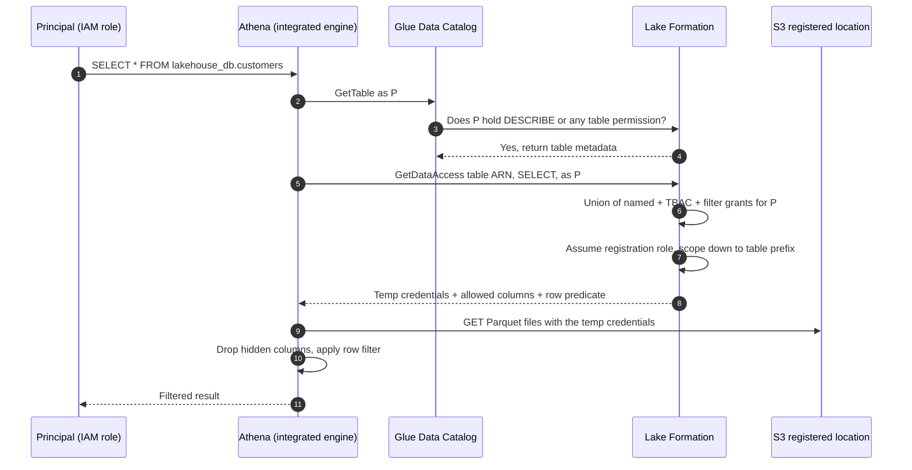
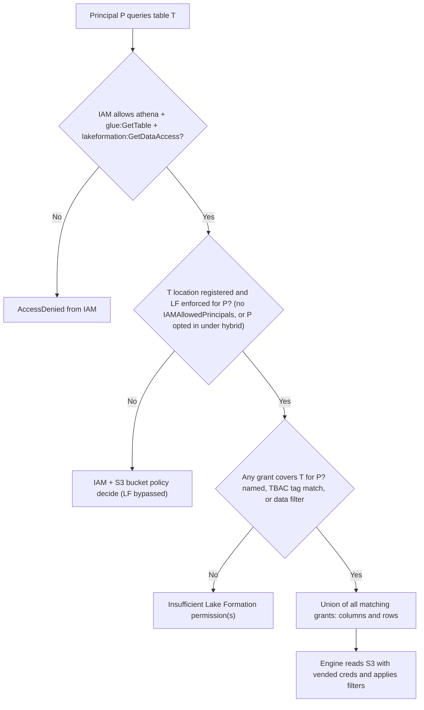
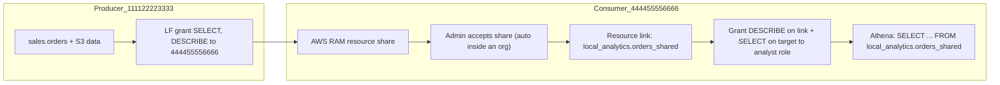

# 🛡️ AWS Lake Formation

> **What it is:** a central permission layer on top of the Glue Data Catalog. It grants database, table, column, row and cell access to principals, and **vends temporary S3 credentials** to trusted query engines so that users never need raw S3 access.
> **GCP equivalent:** BigQuery **policy tags** (column security) + **row access policies** + **BigLake** connection delegation + **Dataplex** governance. Cross-account sharing ≈ **Analytics Hub** linked datasets.
> **In the HLD:** the big **AWS Lake Formation boundary** around the curated and analytics zones. Label **C** = tag-based access control: [Challenge C](../01_AWS_Data_Lakehouse_Demonstrated/Challenge_C_LF_Tag_Based_Access_Control_Data_Science_And_Intern.md). Label **E** = data cell filters: [Challenge E](../01_AWS_Data_Lakehouse_Demonstrated/Challenge_E_LF_Data_Cell_Filters_Marketing_And_Regional_Manager.md). LF permission errors are also a likely failure in [A](../01_AWS_Data_Lakehouse_Demonstrated/Challenge_A_Product_Catalog_Schema_Mismatch_And_Partitioning.md), [B](../01_AWS_Data_Lakehouse_Demonstrated/Challenge_B_Analytics_Query_Performance_Compaction_And_MOR.md), [D](../01_AWS_Data_Lakehouse_Demonstrated/Challenge_D_Firehose_Iceberg_Streaming_Upserts_And_Buffering.md) and [G](../01_AWS_Data_Lakehouse_Demonstrated/Challenge_G_Orders_Ingest_Duplicates_And_Iceberg_Snapshot_Rollback.md) (job and stream roles). See the [HLD image](../01_AWS_Data_Lakehouse_Demonstrated/assets/00_lakehouse_architecture_hld.png).
> **Related guide files:** [Athena](04_Amazon_Athena.md) · [Glue](03_AWS_Glue.md) · [Firehose](06_Amazon_Data_Firehose.md) · [S3](01_Amazon_S3.md) · [Foundations (IAM, CloudTrail, KMS)](00_AWS_Foundations_IAM_Regions_CLI_CloudWatch_KMS.md) · [Index](README.md)
> **As of Nov 2026.** ⚠️ = unverified or likely to change. Console labels move often, so verify in the docs.

---

## ⭐ Must-know first (labs + exam)

1. **Two locks, both must open.** **IAM** must allow the API call (`athena:*`, `glue:GetTable`, `lakeformation:GetDataAccess`), **and** Lake Formation must grant the data permission (SELECT, DESCRIBE, …). *"Insufficient Lake Formation permission(s): Required SELECT"* means IAM passed and **LF denied** *(C)*.
2. **Out of the box, LF is effectively off.** New databases and tables give **Super** to the virtual group **`IAMAllowedPrincipals`** ("Use only IAM access control" ✅). To enforce LF you untick those defaults **and revoke `IAMAllowedPrincipals`** from existing resources. **Hybrid access mode** lets you opt principals in gradually.
3. **Register the S3 location.** LF then uses its own role to hand out **short-lived, prefix-scoped credentials** to integrated engines (**credential vending**). Analysts need **no** `s3:GetObject` on data buckets, and they **must not** have it, because direct S3 access bypasses LF.
4. **Data lake administrators** can see (DESCRIBE) everything and **grant anything to anyone, including themselves**. They do **not** automatically get SELECT, ALTER or DROP on others' tables, and in the lab they couldn't re-tag without **ASSOCIATE** on the tags *(C)*.
5. **Two ways to grant.** **Named-resource** grants ("role X: SELECT on table Y") and **LF-TBAC** ("role X: SELECT on any table whose tags match `zone=curated`"). With TBAC, **access = grant expression ∩ the resource's effective tags**. When access is wrong, **check the tags before the grants** *(C)*.
6. **LF-Tags inherit** database → table → column. A lower-level assignment **overrides** the inherited value for that key, and each resource holds **one value per key**. A column override can quietly leak PII *(C)*.
7. **Tag permissions are separate from data permissions:** **DESCRIBE**, **ASSOCIATE** (attach the tag to resources), **ALTER** (change allowed values), **DROP**, and **GRANT WITH LF-TAG EXPRESSION**. ASSOCIATE implies DESCRIBE.
8. **Data cell filters** = column include/exclude list + **row filter expression** on one table. You grant **SELECT on the filter** as a **named resource**, never through LF-Tags *(E)*.
9. **Row filters are a PartiQL subset:** `=, <>, !=, <, >, <=, >=, BETWEEN, IN, LIKE, NOT, IS [NOT] NULL`, `AND/OR`. **String literals take single quotes, comparisons are case-sensitive**, there are no functions, no column-to-column comparisons, and the expression must be under 2048 characters *(E)*.
10. **Grants add up (union).** One broad grant (full-table SELECT) undoes a tight filter. Always audit **every** grant a principal holds *(E)*.
11. **Include-lists beat exclude-lists** for PII. A new column stays hidden by default.
12. **Service roles need LF grants too:** Glue jobs (DESCRIBE + SELECT/INSERT/DELETE/**ALTER** for Iceberg commits), crawlers (CREATE_TABLE + **DATA_LOCATION_ACCESS**), and the Firehose role (SELECT/INSERT/DELETE/ALTER/DESCRIBE on the target table) *(A, B, D, G)*.
13. **Cross-account sharing** = grant to an account or organization → LF creates an **AWS RAM** share → the consumer creates a **resource link** → the consumer grants DESCRIBE on the link and SELECT on the **target** to its own principals.
14. **Integrated engines enforce fine-grained rules:** Athena, Redshift Spectrum, EMR, and Glue ETL (version-dependent ⚠️). Query results and copies made outside these engines are **not** governed.
15. **Audit with CloudTrail:** `GetDataAccess` (who read which table), `GrantPermissions`/`RevokePermissions`, `AddLFTagsToResource`, `PutDataLakeSettings`.

---

## 🧱 First principles

### The problem: S3 + IAM can't express "who sees which column or row"

Take the lab's `customers` table: 2,000 Parquet files under `s3://curated/customers/`. The requirements:
- Marketing sees every column **except** `customer_email`.
- The us-east regional manager sees **only us-east rows** and four columns.
- Interns see only "public" tables. Data scientists see every "curated" table, **including tables created next month**.

Now try it with IAM and bucket policies:

| Constraint | Why IAM/S3 can't do it |
|---|---|
| **Granularity** | IAM authorises **objects and prefixes**. `customer_email` lives *inside every Parquet file*, and so do us-east rows. No object ARN means "column 3" or "rows where region = us-east" |
| **Two places to govern** | Metadata lives in the Glue catalog (resource policy) and data lives in S3 (bucket policy). They drift apart: a user sees a table they can't read, or reads files with no table |
| **Scale** | N principals × M tables × K columns as policy statements hits IAM policy size limits (managed policies ~6 KB, bucket policies 20 KB ⚠️) and can't be reviewed by humans |
| **Engine sprawl** | Athena, Spark, Redshift and EMR would each need their own ACL system (Ranger, Redshift GRANTs…), with no single source of truth |
| **Workaround cost** | Physical copies per audience (a "customers_no_pii" table) mean duplicated storage, extra pipelines and copies that drift |

### The idea: a database-style GRANT for the lake, enforced by trusted engines

1. **Move authorization up a level**, from objects to **catalog entities** (databases, tables, columns, rows). That's the vocabulary the business already uses ("no PII columns", "only us-east").
2. **Give the engine, not the user, the keys to the data.** You **register** an S3 location with LF, together with a role that can read it. When a principal queries a table, the engine calls **`GetDataAccess`**. LF checks the grants and returns **temporary credentials scoped down to that table's prefix**. The user's own IAM identity never needs S3 permission.
3. **Trust the engine to cut columns and rows.** Column and row filtering can't happen at the S3 layer (it's inside the files), so LF only vends credentials to **integrated engines** that promise to apply the allowed-column list and row predicate before returning results.
4. **One choke point means one audit trail.** Every data access becomes a `GetDataAccess` call in CloudTrail.

### Constraints that shaped the product (and its sharp edges)

| Constraint | Design result | Sharp edge |
|---|---|---|
| LF (2019) arrived after millions of existing Glue catalogs that use IAM | **Backward compatibility**: `IAMAllowedPrincipals` gets Super by default, so nothing breaks | "I added LF grants and nothing changed": IAM-only mode is still on |
| Enforcement happens in engines | Only **integrated engines** get credentials, and fine-grained filtering depends on the engine | Direct S3 reads (CLI, a non-integrated tool) bypass LF if IAM allows S3 |
| Thousands of tables, constant change | **LF-TBAC**: grants target tag expressions, and new tagged tables are covered automatically | Wrong tags mean wrong access, silently *(C)* |
| Separation of duties | **ASSOCIATE** (who may classify) is separate from **SELECT** (who may read) | An admin who can't tag *(C)*, or a steward who can **downgrade** a tag to give someone access |
| Least privilege by default | No grant means no access. Filters are allow-lists | Fail-closed surprises: a typo in a row filter gives **0 rows**, not an error *(E)* |

### Core abstractions
**Principal** (IAM user/role, SAML/IAM Identity Center group ⚠️, external account, organization/OU) · **Resource** (catalog, database, table, column, data cells filter, data location, LF-Tag) · **Permission** (SELECT, DESCRIBE, …) · **Grant** (principal + resource + permissions [+ grant option]) · **LF-Tag** (a key with allowed values) · **Tag expression** (AND across keys, OR within a key) · **Data cells filter** (columns × row predicate on one table).

---

## 🧩 Core concepts

### Personas

| Persona | What they can do | How you set it |
|---|---|---|
| **Data lake administrator** | Implicit DESCRIBE on all catalog resources, data location access everywhere, **grant/revoke any permission to any principal (including self)**, create databases. **Not** implicit: drop databases or alter/drop tables created by others (they can grant those to themselves) | LF → **Administration → Administrative roles and tasks** ⚠️, or `put-data-lake-settings` |
| Read-only administrator ⚠️ | Views permissions and metadata, can't change them | Same page |
| Database creator | All permissions on databases they create, and can grant CREATE_TABLE in them | Grant `CREATE_DATABASE` on the catalog |
| Table creator | All permissions on tables they create, and can grant on them within the account | Grant `CREATE_TABLE` on a database |
| LF-Tag creator ⚠️ | Creates tags and holds full permissions on tags they create | `CREATE_LF_TAG` on the catalog ⚠️ |
| Data steward | Classifies resources (**ASSOCIATE** on specific tag values) | LF-Tag permissions |
| Consumer / service role | SELECT/INSERT/… through named, TBAC or filter grants | Data permissions |

### Permissions by resource

| Resource | Permissions | Notes |
|---|---|---|
| Catalog | `CREATE_DATABASE`, `CREATE_LF_TAG` ⚠️ | |
| Database | `CREATE_TABLE`, `ALTER`, `DROP`, `DESCRIBE` | DESCRIBE lets a principal *see* the database (Athena: "Database not found" without it) |
| Table | `SELECT`, `INSERT`, `DELETE`, `DESCRIBE`, `ALTER`, `DROP`, **`ALL` (= Super)** | Iceberg commits update the catalog entry, so writers need **ALTER** ⚠️ |
| Columns | `SELECT` on listed columns (include) or all except listed (exclude) | Named grants only |
| Data cells filter | `SELECT` (plus DESCRIBE/DROP on the filter object ⚠️) | Filters apply to **reads only** |
| Data location | `DATA_LOCATION_ACCESS` | Needed to **create** a table or database pointing at a registered path |
| LF-Tag | `DESCRIBE`, `ASSOCIATE`, `ALTER`, `DROP`, `GRANT WITH LF-TAG EXPRESSION` | Permissions on the tag itself, not on data |
| Any of the above | **Grantable** (`--permissions-with-grant-option`) | The grantee can pass it on. Be stingy, especially cross-account |

### The default "IAM-only" settings and `IAMAllowedPrincipals`

- **`IAMAllowedPrincipals`** is a virtual group meaning "every IAM principal whose IAM policy allows it". Granting it **Super** on a database or table means **LF steps aside**, and IAM plus S3 policies decide.
- LF → **Data Catalog settings** ⚠️ has two checkboxes, ticked by default:
  - ✅ *Use only IAM access control for new databases*
  - ✅ *Use only IAM access control for new tables in new databases*
  
  Ticked means every new database and table automatically grants `IAMAllowedPrincipals` Super. In the API these are `CreateDatabaseDefaultPermissions` / `CreateTableDefaultPermissions` in `DataLakeSettings`.
- **To really enforce LF** on existing data, untick both, then **revoke `IAMAllowedPrincipals`** from each existing database and table, **after** granting LF permissions to every job, crawler, stream and user that needs access (Example 3).

### Hybrid access mode ⚠️ (newer, for gradual adoption)

- Register an S3 location **in hybrid mode**. Then, per database or table, **opt in** specific principals to LF permissions. Opted-in principals need **both** IAM and LF permissions. Everyone else keeps using IAM alone (through `IAMAllowedPrincipals`).
- By default, hybrid mode enforces only `CREATE_TABLE`, `CREATE_PARTITION` and `UPDATE_TABLE` through LF.
- Use it to move a busy, IAM-governed lake to LF one team at a time without breaking existing jobs. For cross-account hybrid sharing, set **Cross account version settings → Version 4**.
- API: `register-resource --hybrid-access-enabled`, then `create-lake-formation-opt-in`.

### Registering locations

| Choice | Detail |
|---|---|
| **Service-linked role** (`AWSServiceRoleForLakeFormationDataAccess`) | Simplest. LF gets read/write on the registered paths |
| **Custom role** | Needed for some cases: KMS CMK-encrypted buckets (the role needs `kms:Decrypt`), certain EMR/Redshift integrations, or tighter control ⚠️ |
| What it means | LF will **vend credentials** for tables under that path. Unregistered paths behave as IAM-only |
| `DATA_LOCATION_ACCESS` | A *separate* permission to create tables or databases whose `LOCATION` is in a registered path. Missing it means CTAS/crawler failures |

### Named-resource grants vs LF-TBAC

| | Named-resource | LF-TBAC |
|---|---|---|
| Grant targets | A specific database, table, columns or **filter** | A **tag expression**, such as `zone=curated AND sensitivity IN (public, internal)` |
| New tables | Need new grants | Covered automatically once tagged (or by inheriting the database tag) |
| Count of grants | principals × tables | principals × expressions (≤ 50 expressions per principal) |
| Row/cell filtering | ✅ (grant on a data cells filter) | ❌ (TBAC can hide **columns** through column tags, but not rows) |
| Failure mode | Forgotten grant for a new table | **Wrong tag** on a resource *(C)* |
| Best for | Exceptions, filters, small estates | Scale, domains, sensitivity classes |

### LF-Tags: the rules

- A tag is a **key with a list of allowed values**: `zone ∈ {raw, curated, analytics}`, `sensitivity ∈ {public, internal, pii}`.
- You assign them to **databases, tables and columns**. **Effective tag** = the nearest assignment walking up column → table → database.
- **One value per key per resource.** Re-assigning replaces the value.
- **Untagged = unmatched.** A TBAC grant that requires `sensitivity=public` never matches a table with no `sensitivity` tag (fail-closed). Set database-level defaults so nothing is untagged.
- If an expression matches only **some columns** of a table, permissions that need full-column access (ALTER, DROP, INSERT, DELETE ⚠️) don't apply to that table.
- Limits: inline expressions ≤ **900 bytes**, ≤ **50** expressions per principal. Key and value counts ⚠️ (see limits).

**Expression semantics, worked through:**

| Grant expression | Table tags (effective) | Match? |
|---|---|---|
| `zone=curated` | `zone=curated, sensitivity=pii` | ✅ (keys not in the expression are ignored) |
| `zone=curated AND sensitivity=public` | `zone=curated, sensitivity=pii` | ❌ |
| `zone IN (curated, analytics)` | `zone=analytics` | ✅ |
| `sensitivity=public` | table `pii`, column `email` `public` | ✅ **for `email` only** (column override, the C leak) |
| `sensitivity=public` | no `sensitivity` tag anywhere | ❌ |

### LF-Tag permissions (on the tag, not the data)

| Permission | Allows | Lab note |
|---|---|---|
| **DESCRIBE** | See the tag and its values | Implied by the others |
| **ASSOCIATE** | Attach or detach the tag/value on resources. Also needed to grant TBAC with that tag ⚠️ | **Challenge C:** grant it to **your exact console role** for **all values** |
| **ALTER** | Add or remove allowed values | Can't be granted cross-account |
| **DROP** | Delete the tag (needs permission on all its values) | Can't be granted cross-account |
| **GRANT WITH LF-TAG EXPRESSION** | Grant data permissions using that expression | Lets team leads delegate within a boundary |

### Data cells filters (row, column and cell security)

| Filter content | Security level |
|---|---|
| All columns + row expression | **Row-level** |
| Include/exclude columns + **all rows** (`AllRowsWildcard`) | **Column-level** |
| Include/exclude columns + row expression | **Cell-level** |

- A filter belongs to **one table** and is granted **SELECT** (reads only).
- **Union semantics** ⚠️: several filters (or a filter plus a table grant) for the same principal on the same table **combine with OR**. Rows that pass any predicate are visible, with each filter's columns visible for its rows.
- Row-filter grammar (verified against the docs): see Must-know item 9. Columns can be top-level, partition or nested (`customer.customerId`). `IS [NOT] NULL` isn't allowed on partition columns. Supported types: string/char/varchar, int/long/bigint/float/decimal/double, boolean, struct. Reserved words such as `first` or `last` need double quotes.
- **Positive filters fail closed, negative filters fail open.** `region = 'us-east'` with dirty data returns *fewer* rows. `region <> 'eu'` with a new value `'EU'` **exposes** those rows. Prefer allow-style predicates.

### Integrated engines ⚠️ (support changes often, so check each engine's LF page)

| Engine | Table / column | Row / cell filters | Notes |
|---|---|---|---|
| **Athena** (SQL engine v3) | ✅ | ✅ | The most complete. See [04_Amazon_Athena.md](04_Amazon_Athena.md) |
| **Redshift Spectrum** / Redshift with LF | ✅ | ✅ ⚠️ | External schema from the Glue catalog |
| **EMR** (EC2 runtime roles, Serverless, EKS) | ✅ | ✅ ⚠️ (Spark, version-dependent) | Needs LF integration config |
| **Glue ETL (Spark)** | ✅ catalog checks, full-table access | FGAC in newer Glue versions (5.x) ⚠️ | Many Iceberg jobs read S3 with the **job role's own IAM** while LF gates catalog calls ⚠️ |
| **Firehose → Iceberg** | write path needs grants | n/a | *(D)* |
| QuickSight | via Athena | via Athena | QuickSight's role/users need grants ⚠️ |
| Third-party engines | "Full table access" via application integration settings / `GetTemporaryGlueTableCredentials` ⚠️ | Generally ❌ | Opt-in under **Application integration settings** ⚠️ |

### Cross-account sharing in one picture
Producer grants SELECT (optionally grantable) on database/table/TBAC expression to **account 444455556666** (or an org/OU) → LF creates an **AWS RAM** resource share (auto-accepted inside an Organization ⚠️) → consumer admin sees the shared resources → creates a **resource link** (a local catalog pointer, `TargetDatabase`/`TargetTable`) → grants local principals **DESCRIBE on the link** and **SELECT on the target** ("grant on target") → consumer queries `local_db.link_name` in Athena. Data never moves. The producer's LF still vends the credentials.

---

## 🔄 How it works (flow)





**Numbered flow (lab view):**
1. The engine authenticates the principal and checks **IAM** for the API calls.
2. Catalog reads are checked against LF **metadata** permissions (DESCRIBE or any table permission).
3. If the location is registered and LF is enforced, the engine calls **`GetDataAccess`**. LF evaluates **named grants, TBAC (expression ∩ effective tags) and filter grants**, then takes the **union**.
4. LF assumes the **registration role**, scopes it down to the table's S3 prefix, and returns short-lived credentials with the permitted columns and row predicate.
5. The engine reads S3 with those credentials and enforces the column and row restrictions.
6. CloudTrail records `GetDataAccess` (and all grant and tag changes) for auditing.

---

## 🛠️ Hands-on examples

> CloudShell, us-east-1. Start each session with:
```bash
ACCOUNT=$(aws sts get-caller-identity --query Account --output text)
CALLER_ARN=$(aws sts get-caller-identity --query Arn --output text)      # arn:aws:sts::<acct>:assumed-role/<RoleName>/<session>
ROLE_NAME=$(echo "$CALLER_ARN" | cut -d/ -f2)
# The IAM role ARN may include a path (e.g. SSO roles). Prefer the real ARN from IAM if you're allowed to read it:
MY_ROLE_ARN=$(aws iam get-role --role-name "$ROLE_NAME" --query Role.Arn --output text 2>/dev/null \
              || echo "arn:aws:iam::${ACCOUNT}:role/${ROLE_NAME}")
echo "$MY_ROLE_ARN"
```

### Example 1 (lab): Challenge C, fix TBAC by fixing tags (console + CLI)

**Goal:** the data science role (grant `zone=curated`) can read `customer_segments`, and the intern (grant `sensitivity=public`) loses `analytics_summary`.

**Console steps**
1. **Who am I?** Console account menu (top right) → *Assumed role: `<RoleName>/<session>`*. The role name is the part **before** `/`.
2. **Grant yourself tag permissions:** LF → **Permissions → LF-Tags and permissions** → **LF-Tag permissions** tab → **Grant permissions** → *LF-Tag key-value pair permissions* → principal = **IAM users and roles → your role** → key `zone`, values **raw, curated, analytics** → **Add LF-Tag key-value pair** → `sensitivity`, values **public, internal, pii** → permissions ✅ **Associate** (✅ Describe) → **Grant**.
3. **Re-tag:** **Data Catalog → Tables** → `customer_segments` → **Actions → Edit LF-Tags** → `zone` = **curated** → **Save**. Then `analytics_summary` → `sensitivity` = **pii** → **Save**.
4. **Check column overrides:** open `analytics_summary` → **Schema** → column LF-Tags. Make sure `customer_email` has no `sensitivity=public` override.
5. Press **Check**.

**CLI (same fix, plus inspection)**
```bash
# 1. Look before you touch anything: the tag ontology, current tags, current grants
aws lakeformation list-lf-tags --query 'LFTags[].{key:TagKey,values:TagValues}'
aws lakeformation get-resource-lf-tags \
  --resource '{"Table":{"DatabaseName":"lakehouse_db","Name":"customer_segments"}}'
aws lakeformation get-resource-lf-tags \
  --resource '{"Table":{"DatabaseName":"lakehouse_db","Name":"analytics_summary"}}'
aws lakeformation list-permissions \
  --principal DataLakePrincipalIdentifier="arn:aws:iam::${ACCOUNT}:role/anycompany-data-science-role" \
  --query 'PrincipalResourcePermissions[].{res:Resource,perms:Permissions}'

# 2. ASSOCIATE (+DESCRIBE) on ALL values of both keys, granted to MY exact role
aws lakeformation grant-permissions \
  --principal DataLakePrincipalIdentifier="$MY_ROLE_ARN" \
  --resource '{"LFTag":{"TagKey":"zone","TagValues":["raw","curated","analytics"]}}' \
  --permissions ASSOCIATE DESCRIBE
aws lakeformation grant-permissions \
  --principal DataLakePrincipalIdentifier="$MY_ROLE_ARN" \
  --resource '{"LFTag":{"TagKey":"sensitivity","TagValues":["public","internal","pii"]}}' \
  --permissions ASSOCIATE DESCRIBE

# 3. Re-tag. This replaces the value for that key (if it errors, remove the old value first)
aws lakeformation add-lf-tags-to-resource \
  --resource '{"Table":{"DatabaseName":"lakehouse_db","Name":"customer_segments"}}' \
  --lf-tags '[{"TagKey":"zone","TagValues":["curated"]}]'
aws lakeformation add-lf-tags-to-resource \
  --resource '{"Table":{"DatabaseName":"lakehouse_db","Name":"analytics_summary"}}' \
  --lf-tags '[{"TagKey":"sensitivity","TagValues":["pii"]}]'
#    Expected output for both: {"Failures": []}

# 4. Column-level overrides on the PII table (look for customer_email = public)
aws lakeformation get-resource-lf-tags \
  --resource '{"Table":{"DatabaseName":"lakehouse_db","Name":"analytics_summary"}}' \
  --query 'LFTagsOnColumns'

# 5. Which tables does each grant match NOW?
aws lakeformation search-tables-by-lf-tags \
  --expression '[{"TagKey":"zone","TagValues":["curated"]}]' --query 'TableList[].Table.Name'
aws lakeformation search-tables-by-lf-tags \
  --expression '[{"TagKey":"sensitivity","TagValues":["public"]}]' --query 'TableList[].Table.Name'
```

**Expected result:** `customer_segments` shows up in the `zone=curated` search, and `analytics_summary` no longer shows up in the `sensitivity=public` search. No grants changed for the scientist or the intern.

**What to check:** if Save or `add-lf-tags-to-resource` fails with a permission error, the ASSOCIATE grant went to a different principal (the SSO role path or the wrong role) or is missing some values. Grant again to the ARN you printed.

### Example 2 (lab): Challenge E, data cell filters (console + CLI)

**Goal:** remove `customer_email` from the `marketing-no-pii` include-list, then create `regional-us-east` (4 columns + us-east rows) and grant it to the regional manager.

**Console steps**
1. **Exact value first:** Athena (workgroup `anycompany-lakehouse`) → saved query **`customers-region-values`**. Copy the us-east string **exactly** (case and suffix).
2. LF → **Data Catalog → Data filters** ⚠️ → `marketing-no-pii` → **Edit** → keep **Include columns**, **remove `customer_email`** → **Save**.
3. **Create new filter**: name **`regional-us-east`**, database `lakehouse_db`, table `customers`, **Include columns** `customer_id, region, signup_date, lifetime_value`, **Filter rows** → `region = 'us-east'` (the exact value, single quotes) → **Create filter**.
4. LF → **Permissions → Data permissions** → **Grant** → principal `anycompany-regional-manager-role` → **Named Data Catalog resources** → database `lakehouse_db` → table `customers` → **Data filters: `regional-us-east`** → **Data filter permissions: Select** → **Grant**.
5. (Practical, not graded) Grant **Describe** on `lakehouse_db` to the manager role so the database is visible in Athena.

**CLI**
```bash
TABLE_JSON="{\"CatalogId\":\"${ACCOUNT}\",\"DatabaseName\":\"lakehouse_db\",\"Name\":\"customers\"}"
MGR_ARN="arn:aws:iam::${ACCOUNT}:role/anycompany-regional-manager-role"

# 1. Inspect the existing filters on the table
aws lakeformation list-data-cells-filter --table "$TABLE_JSON" \
  --query 'DataCellsFilters[].{name:Name,cols:ColumnNames,wild:ColumnWildcard,rows:RowFilter}'

# 2. Fix marketing-no-pii: fetch, drop customer_email from the include list, update (update REPLACES the definition)
aws lakeformation get-data-cells-filter --table-catalog-id "$ACCOUNT" \
  --database-name lakehouse_db --table-name customers --name marketing-no-pii \
  --query DataCellsFilter > marketing.json
jq '.ColumnNames -= ["customer_email"]' marketing.json > marketing-fixed.json
jq '.ColumnNames' marketing-fixed.json           # customer_email must be gone; nothing else changed
aws lakeformation update-data-cells-filter --table-data file://marketing-fixed.json

# 3. Create regional-us-east from a file (avoids shell quote escaping inside the row filter)
cat > regional.json <<EOF
{
  "TableCatalogId": "${ACCOUNT}",
  "DatabaseName": "lakehouse_db",
  "TableName": "customers",
  "Name": "regional-us-east",
  "RowFilter": { "FilterExpression": "region = 'us-east'" },
  "ColumnNames": ["customer_id", "region", "signup_date", "lifetime_value"]
}
EOF
aws lakeformation create-data-cells-filter --table-data file://regional.json

# 4. Named-resource SELECT grant ON THE FILTER (not on the table)
aws lakeformation grant-permissions \
  --principal DataLakePrincipalIdentifier="$MGR_ARN" \
  --permissions SELECT \
  --resource "{\"DataCellsFilter\":{\"TableCatalogId\":\"${ACCOUNT}\",\"DatabaseName\":\"lakehouse_db\",\"TableName\":\"customers\",\"Name\":\"regional-us-east\"}}"

# 5. Optional: database visibility for the manager
aws lakeformation grant-permissions --principal DataLakePrincipalIdentifier="$MGR_ARN" \
  --permissions DESCRIBE --resource '{"Database":{"Name":"lakehouse_db"}}'

# 6. Audit EVERY grant held by the marketing and manager roles (grants union)
for r in anycompany-marketing-role anycompany-regional-manager-role; do
  echo "== $r"
  aws lakeformation list-permissions \
    --principal DataLakePrincipalIdentifier="arn:aws:iam::${ACCOUNT}:role/$r" \
    --query 'PrincipalResourcePermissions[].{res:Resource,perms:Permissions}'
done
```

**Expected result:** the list shows `marketing-no-pii` without `customer_email` and `regional-us-east` with the 4 columns and the row filter. The manager's permissions show **SELECT** on resource `DataCellsFilter … regional-us-east`.

**What to check:**
- If the manager gets **0 rows**, the filter string doesn't match the data (`'US-East'` vs `'us-east'`).
- If marketing still sees email, look for a **second grant** (full-table SELECT or another filter).
- *Invalid row filter* usually means double quotes around the string or a function call.
- Optional live test (only if your role may assume theirs): `aws sts assume-role --role-arn "$MGR_ARN" --role-session-name lf-test`, export the credentials, then run an Athena query ([04, CLI helper](04_Amazon_Athena.md)).

### Example 3 (foundation, beyond the lab): switch a database from IAM-only to Lake Formation

**Goal:** make LF the real gatekeeper for `lakehouse_db` without breaking the pipelines. This is the step the lab had already done for you.

**Console:** LF → **Administrative roles and tasks** → add yourself as **Data lake administrator** → **Data Catalog settings** → untick both *Use only IAM access control…* boxes → **Data lake locations** → **Register location** (curated and analytics buckets; service-linked role, or hybrid) → grant the service roles (Example 6 table) → **Data permissions** → filter by principal `IAMAllowedPrincipals` → **Revoke** on `lakehouse_db` and its tables.

```bash
# a. Add me as data lake admin and stop new IAM-only defaults.
#    put-data-lake-settings REPLACES everything, so merge into the current settings.
aws lakeformation get-data-lake-settings --query DataLakeSettings > settings.json
jq --arg me "$MY_ROLE_ARN" '
  .DataLakeAdmins = ((.DataLakeAdmins // []) + [{"DataLakePrincipalIdentifier": $me}] | unique)
  | .CreateDatabaseDefaultPermissions = []
  | .CreateTableDefaultPermissions    = []' settings.json > settings-new.json
aws lakeformation put-data-lake-settings --data-lake-settings file://settings-new.json

# b. Register the data locations (add --hybrid-access-enabled to adopt gradually)
CURATED=$(aws s3api list-buckets --query "Buckets[?contains(Name,'curated')].Name | [0]" --output text)
aws lakeformation register-resource --resource-arn "arn:aws:s3:::${CURATED}" --use-service-linked-role
aws lakeformation list-resources --query 'ResourceInfoList[].ResourceArn'

# c. FIRST grant LF permissions to every job/crawler/stream role (see the Security section), THEN:
# d. Remove the IAM-only escape hatch from the database and each existing table
aws lakeformation revoke-permissions --principal DataLakePrincipalIdentifier=IAM_ALLOWED_PRINCIPALS \
  --permissions ALL --resource '{"Database":{"Name":"lakehouse_db"}}'
for t in $(aws glue get-tables --database-name lakehouse_db --query 'TableList[].Name' --output text); do
  aws lakeformation revoke-permissions --principal DataLakePrincipalIdentifier=IAM_ALLOWED_PRINCIPALS \
    --permissions ALL --resource "{\"Table\":{\"DatabaseName\":\"lakehouse_db\",\"Name\":\"$t\"}}" \
    && echo "revoked on $t" || echo "skip $t (no IAMAllowedPrincipals grant)"
done
```

**Expected result:** `list-permissions --principal DataLakePrincipalIdentifier=IAM_ALLOWED_PRINCIPALS` returns nothing for `lakehouse_db`. Principals without LF grants now get *Insufficient Lake Formation permission(s)*, which is the point.

**What to check:** run every pipeline once (Glue jobs, crawlers, the Firehose stream) **right after** the switch. Also remove `s3:GetObject` on the data buckets from analyst roles, otherwise LF is cosmetic.

### Example 4 (beyond the lab): onboard a new analyst team with TBAC

**Goal:** the finance analysts get every **curated/analytics** table in the **finance** domain that isn't **pii**, today and in the future, with no per-table grants.

```bash
TEAM_ROLE="arn:aws:iam::${ACCOUNT}:role/anycompany-finance-analyst-role"

# 1. Ontology: add a domain key (zone and sensitivity already exist)
aws lakeformation create-lf-tag --tag-key domain --tag-values sales finance marketing

# 2. Classify at the DATABASE level so new tables inherit it (fail-safe defaults)
aws lakeformation add-lf-tags-to-resource --resource '{"Database":{"Name":"finance_db"}}' \
  --lf-tags '[{"TagKey":"domain","TagValues":["finance"]},
              {"TagKey":"zone","TagValues":["curated"]},
              {"TagKey":"sensitivity","TagValues":["internal"]}]'

# 3. Database visibility via TBAC
aws lakeformation grant-permissions --principal DataLakePrincipalIdentifier="$TEAM_ROLE" \
  --permissions DESCRIBE \
  --resource '{"LFTagPolicy":{"ResourceType":"DATABASE","Expression":[{"TagKey":"domain","TagValues":["finance"]}]}}'

# 4. Table read via TBAC: AND across keys, OR within a key
aws lakeformation grant-permissions --principal DataLakePrincipalIdentifier="$TEAM_ROLE" \
  --permissions SELECT DESCRIBE \
  --resource '{"LFTagPolicy":{"ResourceType":"TABLE","Expression":[
      {"TagKey":"domain","TagValues":["finance"]},
      {"TagKey":"zone","TagValues":["curated","analytics"]},
      {"TagKey":"sensitivity","TagValues":["public","internal"]}]}}'

# 5. Preview exactly what they'll see
aws lakeformation search-tables-by-lf-tags --expression '[
  {"TagKey":"domain","TagValues":["finance"]},
  {"TagKey":"zone","TagValues":["curated","analytics"]},
  {"TagKey":"sensitivity","TagValues":["public","internal"]}]' \
  --query 'TableList[].{db:Table.DatabaseName,t:Table.Name}'
```

**Rest of the onboarding:** give the role an IAM policy for its Athena workgroup, Glue reads and `lakeformation:GetDataAccess` (the pattern in [04, Example 6](04_Amazon_Athena.md)), with **no S3 data permissions**, and its own **workgroup** with a scan cutoff. Optionally give a team lead **GRANT WITH LF-TAG EXPRESSION** on `domain=finance` so they can delegate within finance only.

**Expected result:** a new table created in `finance_db` next week is readable by the team immediately, through inheritance.

**What to check:** a table with a table-level `sensitivity=pii` (an override) drops out of the search, which is correct. If an expected table is missing, it lacks one of the three keys.

### Example 5 (beyond the lab): column-level PII tagging instead of table-level

**Goal:** fix Challenge C the *better* way. The intern keeps the useful columns of `analytics_summary`, but PII columns disappear.

**Why:** tagging the **whole table** `pii` (the lab's fix) hides harmless columns too, which invites someone to make a "temporary" full-table exception.

```bash
# 1. Table stays public (the intern's grant matches the table)...
aws lakeformation add-lf-tags-to-resource \
  --resource '{"Table":{"DatabaseName":"lakehouse_db","Name":"analytics_summary"}}' \
  --lf-tags '[{"TagKey":"sensitivity","TagValues":["public"]}]'

# 2. ...but the PII columns override to pii, so the intern's sensitivity=public grant skips them
aws lakeformation add-lf-tags-to-resource \
  --resource '{"TableWithColumns":{"DatabaseName":"lakehouse_db","Name":"analytics_summary",
               "ColumnNames":["customer_email","phone","street_address"]}}' \
  --lf-tags '[{"TagKey":"sensitivity","TagValues":["pii"]}]'

# 3. Verify the column-level view
aws lakeformation get-resource-lf-tags \
  --resource '{"Table":{"DatabaseName":"lakehouse_db","Name":"analytics_summary"}}' \
  --query 'LFTagsOnColumns[].{col:Name,tags:LFTags}'
```

**Expected result (as the intern, in Athena):** `SELECT segment, revenue FROM lakehouse_db.analytics_summary` works. `SELECT customer_email ...` fails (column not found or not authorised ⚠️), and `SELECT *` returns only the permitted columns ⚠️.

**What to check:** grants that need all columns (ALTER, INSERT, DELETE, DROP) won't apply for principals who only match some columns. Write jobs need their own grant that matches every column. **Automation idea:** Macie or Glue sensitive-data detection finds PII → EventBridge → a Lambda applies column tags. Pair it with human review, because detection isn't classification ⚠️.

### Example 6 (beyond the lab): debug "Insufficient Lake Formation permission(s)" step by step

**Goal:** a repeatable runbook. Sample errors: *"Insufficient Lake Formation permission(s): Required SELECT on customer_segments"* (Athena), or *"Insufficient Lake Formation permission(s) on orders (Service: AWSGlue; … AccessDeniedException)"* (a Glue job).

```bash
# Step 1. WHO is actually calling? (Athena: the user's role. Glue job: the JOB ROLE. Firehose: the DELIVERY ROLE.)
aws glue get-job --job-name orders-ingest --query Job.Role --output text     # for a Glue job
# For a Firehose stream: aws firehose describe-delivery-stream --delivery-stream-name <name> \
#   --query 'DeliveryStreamDescription.Destinations[0].IcebergDestinationDescription.RoleARN'   ⚠️ field name
P="arn:aws:iam::${ACCOUNT}:role/anycompany-data-science-role"

# Step 2. WHAT permission on WHICH resource? Read the error: "Required SELECT" / "DESCRIBE" / "ALTER" / "CREATE_TABLE"

# Step 3. Is LF even enforced here? (registered location? IAMAllowedPrincipals still present?)
aws lakeformation list-resources --query 'ResourceInfoList[].{arn:ResourceArn,hybrid:HybridAccessEnabled}'
aws lakeformation list-permissions --principal DataLakePrincipalIdentifier=IAM_ALLOWED_PRINCIPALS \
  --resource-type TABLE --resource '{"Table":{"DatabaseName":"lakehouse_db","Name":"customer_segments"}}'

# Step 4. Every grant P holds (named, TBAC policies, filters). Remember grants UNION
aws lakeformation list-permissions --principal DataLakePrincipalIdentifier="$P" \
  --query 'PrincipalResourcePermissions[].{res:Resource,perms:Permissions,grantable:PermissionsWithGrantOption}'

# Step 5. If P's grant is a TBAC expression: compare it with the table's EFFECTIVE tags (db + table + columns)
aws lakeformation get-resource-lf-tags \
  --resource '{"Table":{"DatabaseName":"lakehouse_db","Name":"customer_segments"}}'
aws lakeformation get-resource-lf-tags --resource '{"Database":{"Name":"lakehouse_db"}}'

# Step 6. Who else can touch this table? (catches cross-grants and admin assumptions)
aws lakeformation list-permissions --resource-type TABLE \
  --resource '{"Table":{"DatabaseName":"lakehouse_db","Name":"customer_segments"}}' \
  --query 'PrincipalResourcePermissions[].{who:Principal.DataLakePrincipalIdentifier,perms:Permissions}'

# Step 7. The IAM side: the identity policy must allow lakeformation:GetDataAccess and the glue reads
aws iam simulate-principal-policy --policy-source-arn "$P" \
  --action-names lakeformation:GetDataAccess glue:GetTable athena:StartQueryExecution \
  --query 'EvaluationResults[].{a:EvalActionName,d:EvalDecision}'

# Step 8. Cross-account? Grants must exist on the TARGET table (producer catalog ID), DESCRIBE on the LINK.

# Step 9. Evidence: the denied call in CloudTrail (management events, last 90 days)
aws cloudtrail lookup-events --max-results 20 \
  --lookup-attributes AttributeKey=EventSource,AttributeValue=lakeformation.amazonaws.com \
  --query 'Events[].{t:EventTime,name:EventName,user:Username}'
```

**Decision table:**

| Finding | Fix |
|---|---|
| Grant is TBAC and the tags don't match | **Re-tag the resource** (needs ASSOCIATE), *(C)* |
| No grant at all | Grant SELECT/DESCRIBE (named or TBAC) |
| Job or stream role is missing write permissions | Grant INSERT, DELETE, **ALTER**, DESCRIBE on the target, and SELECT on sources |
| *"Required CREATE_TABLE"* / location error | CREATE_TABLE on the database + **DATA_LOCATION_ACCESS** on the S3 path |
| Grant exists, but on the **link** only | Grant SELECT on the **target** table |
| IAM simulate says `implicitDeny` | Add `lakeformation:GetDataAccess` / glue reads to the IAM policy |
| Works for an admin, fails for a user | Admins have DESCRIBE everywhere, not SELECT. Grant SELECT explicitly |

Permission changes take effect within seconds ⚠️. Re-run the query.

### Example 7 (beyond the lab): cross-account sharing (high level)

**Goal:** the analytics account (444455556666) reads `sales.orders` owned by the producer (111122223333) without copying data.



```bash
# Producer account: grant to the consumer ACCOUNT (grantable, so the consumer admin can re-grant locally ⚠️)
aws lakeformation grant-permissions \
  --principal DataLakePrincipalIdentifier=444455556666 \
  --permissions SELECT DESCRIBE --permissions-with-grant-option SELECT DESCRIBE \
  --resource '{"Table":{"DatabaseName":"sales","Name":"orders"}}'

# Consumer account: accept (if not in the same Organization), link, grant
aws ram get-resource-share-invitations --query "resourceShareInvitations[?status=='PENDING'].resourceShareInvitationArn"
aws ram accept-resource-share-invitation --resource-share-invitation-arn <invitation-arn>
aws glue create-table --database-name local_analytics --table-input \
  '{"Name":"orders_shared","TargetTable":{"CatalogId":"111122223333","DatabaseName":"sales","Name":"orders"}}'
ANALYST="arn:aws:iam::444455556666:role/consumer-analyst"
aws lakeformation grant-permissions --principal DataLakePrincipalIdentifier="$ANALYST" \
  --permissions DESCRIBE --resource '{"Table":{"DatabaseName":"local_analytics","Name":"orders_shared"}}'
aws lakeformation grant-permissions --principal DataLakePrincipalIdentifier="$ANALYST" \
  --permissions SELECT --resource '{"Table":{"CatalogId":"111122223333","DatabaseName":"sales","Name":"orders"}}'
```

**What to check:** the consumer needs the **cross-account version setting** that matches the producer (v3/v4 ⚠️). TBAC sharing works too (grant a tag expression to the external account). Tag ALTER/DROP can't be shared, but DESCRIBE/ASSOCIATE can. Query costs land on the **consumer's** Athena bill, storage stays with the producer.

---

## ⚙️ Key settings, limits & quotas

| Item | Value | Notes |
|---|---|---|
| Default for new databases/tables | `IAMAllowedPrincipals` Super ("IAM only") | Untick in Data Catalog settings |
| Row filter expression length | **< 2048 characters** | PartiQL subset, no functions |
| Permission grantable with a filter | **SELECT** only | Filters are read-only constructs |
| LF-Tag expressions per principal | **50** | |
| Inline LF-Tag expression size | **900 bytes** | Use saved/named expressions ⚠️ for bigger ones |
| LF-Tag keys per account / values per key | ~1,000 / ~1,000 ⚠️ | Check the LF quotas page |
| LF-Tags per resource | ~50 ⚠️ | |
| Tag key / value length | 128 / 256 characters ⚠️ | |
| Data lake administrators | up to ~30 ⚠️ | Prefer roles over users |
| Cross-account version settings | Version 1–4 ⚠️ | v4 is needed for hybrid-mode cross-account sharing |
| Credential lifetime (GetDataAccess) | short-lived, about minutes to an hour ⚠️ | Engines refresh automatically |
| Propagation of grants | seconds ⚠️ | |
| Tag permission sharing cross-account | DESCRIBE and ASSOCIATE only | Not ALTER/DROP |

**Console map ⚠️ (labels move):** *Data Catalog → Databases / Tables / Data filters* · *Permissions → Data permissions / LF-Tags and permissions / Data locations* · *Administration → Administrative roles and tasks / Data lake locations / Data Catalog settings / Application integration settings / Cross-account version settings*.

---

## 🔐 Security

### IAM policies by persona (LF still decides on data)

| Persona | IAM essentials |
|---|---|
| **LF admin** | AWS managed `AWSLakeFormationDataAdmin` ⚠️ + `AWSLakeFormationCrossAccountManager` (for sharing) + `iam:PassRole`/`iam:GetRole` for registration roles + S3 read for registering locations |
| **Analyst** | `lakeformation:GetDataAccess`, Glue catalog reads, Athena on their workgroup, S3 on the **results prefix only**, KMS for results |
| **Glue ETL job role** | `glue:GetTable/GetTables/GetDatabase/UpdateTable/CreateTable`, `lakeformation:GetDataAccess`, S3 for scripts/temp, CloudWatch Logs, and S3 on data if the job reads with its own credentials ⚠️ |
| **Firehose → Iceberg role** | `glue:GetTable/GetDatabase/UpdateTable`, S3 put/get/list/delete on the table location and error prefix, `lakeformation:GetDataAccess`, KMS |

Minimal analyst identity policy (data access comes from LF grants):
```json
{
  "Version": "2012-10-17",
  "Statement": [
    { "Sid": "LFDataAccess", "Effect": "Allow",
      "Action": ["lakeformation:GetDataAccess"], "Resource": "*" },
    { "Sid": "CatalogRead", "Effect": "Allow",
      "Action": ["glue:GetDatabase", "glue:GetDatabases", "glue:GetTable", "glue:GetTables",
                 "glue:GetPartition", "glue:GetPartitions", "glue:SearchTables"],
      "Resource": "*" },
    { "Sid": "NoDirectDataBucketAccess", "Effect": "Deny",
      "Action": ["s3:GetObject"],
      "Resource": ["arn:aws:s3:::anycompany-lakehouse-curated-*/*",
                   "arn:aws:s3:::anycompany-lakehouse-analytics-*/*"] }
  ]
}
```
The explicit **Deny** on data buckets makes the "LF is the only path" rule hold even if someone attaches a broad S3 policy later. Vended credentials come from LF's role, so the deny doesn't block them.

### LF grants for service roles (the lab's hidden dependencies)

| Role | LF grants |
|---|---|
| Glue job writing Iceberg (A `products-*`, G `orders-*`, B `orders-write-mode-fix`) | DESCRIBE on `lakehouse_db`. **SELECT, INSERT, DELETE, ALTER, DESCRIBE** on targets. SELECT on sources. ALTER is needed for schema/partition evolution, `SET TBLPROPERTIES` and rollback |
| Glue job creating tables / crawler | **CREATE_TABLE** on the database + **DATA_LOCATION_ACCESS** on the path |
| Firehose role (D) | DESCRIBE on the database. **SELECT, INSERT, DELETE, ALTER, DESCRIBE** on `orders_realtime_staging` |
| Athena maintenance automation | Write-level grants on the table ⚠️ + `s3:DeleteObject` (VACUUM) |

```bash
# Example: Firehose role grants for Challenge D's target table
FH_ROLE="arn:aws:iam::${ACCOUNT}:role/<firehose-delivery-role>"
aws lakeformation grant-permissions --principal DataLakePrincipalIdentifier="$FH_ROLE" \
  --permissions DESCRIBE --resource '{"Database":{"Name":"lakehouse_db"}}'
aws lakeformation grant-permissions --principal DataLakePrincipalIdentifier="$FH_ROLE" \
  --permissions SELECT INSERT DELETE ALTER DESCRIBE \
  --resource '{"Table":{"DatabaseName":"lakehouse_db","Name":"orders_realtime_staging"}}'
```

### Other controls
- **Encryption:** LF doesn't encrypt anything itself. With SSE-KMS buckets, the **registration role** needs `kms:Decrypt` (use a custom role), and writers need `kms:GenerateDataKey`.
- **Separation of duties:** admins write policies (grants), stewards classify (ASSOCIATE on **specific values** only), consumers read. Nobody should hold both "ASSOCIATE `public`" and the ability to read `public` data they classify.
- **Least privilege:** avoid `ALL`/Super and grantable permissions except for owners. Prefer TBAC for breadth and named filters for exceptions.
- **Results leakage:** Athena results and Glue outputs are ordinary S3 objects. Govern them with bucket policies ([04 Security](04_Amazon_Athena.md)).

### Auditing via CloudTrail

| Event (source `lakeformation.amazonaws.com`) | Why you care |
|---|---|
| `GetDataAccess` | Who read which table, through which engine. Engines can pass an audit context such as the query ID ⚠️ |
| `GrantPermissions`, `BatchGrantPermissions`, `RevokePermissions` | Permission changes |
| `AddLFTagsToResource`, `RemoveLFTagsFromResource` | **Classification changes.** A `pii → public` change grants access silently |
| `CreateDataCellsFilter`, `UpdateDataCellsFilter`, `DeleteDataCellsFilter` | Filter edits (E) |
| `RegisterResource`, `DeregisterResource`, `PutDataLakeSettings`, `CreateLakeFormationOptIn` | Admin, location and enforcement changes. High severity |

Real-time alert on sensitive changes (EventBridge rule on the default bus, needs a CloudTrail trail):
```json
{
  "source": ["aws.lakeformation"],
  "detail-type": ["AWS API Call via CloudTrail"],
  "detail": {
    "eventSource": ["lakeformation.amazonaws.com"],
    "eventName": ["PutDataLakeSettings", "AddLFTagsToResource", "RemoveLFTagsFromResource",
                  "GrantPermissions", "BatchGrantPermissions", "UpdateDataCellsFilter"]
  }
}
```

---

## 💰 Cost model & optimisation

- **Lake Formation permissions, LF-Tags and data filters: no separate charge** ⚠️ (check the [pricing page](https://aws.amazon.com/lake-formation/pricing/) for any API, storage-optimisation or legacy governed-table charges). You pay for the underlying services: Athena scans, Glue catalog requests/storage, S3, KMS and CloudTrail.
- **The real savings are indirect:**
  1. **No per-audience copies.** A filter replaces a "customers_no_pii" table.
  2. **Less admin time.** TBAC grants scale with the number of policies, not with tables × roles.
  3. **Fewer incidents.** One choke point to audit.
- **Second-order costs:** fine-grained filtering can make engines read more than the user sees (rows are filtered after the read). Row filters don't prune partitions unless the predicate is on a partition column ⚠️. KMS requests on credential vending, and CloudTrail data volume.

**Worked example (assumptions ⚠️):** a 2 TB `customers` dataset needs 4 audience views.

| Approach | Storage | Pipelines | Grants to manage |
|---|---|---|---|
| 4 physical copies | +8 TB × ~$23/TB-month ≈ **$184/month** ⚠️ | 4 extra jobs (Glue DPU-hours daily) | 4 tables × N roles |
| 4 data cell filters | **$0** extra | none | 4 filters + 4 grants |

With 200 tables and 12 roles: named grants ≈ 2,400 (plus one per new table), versus TBAC ≈ 12 expressions + 200 tag assignments (mostly inherited from ~10 databases).

---

## 📈 Monitoring & troubleshooting

| Symptom | Likely cause | How to confirm | Fix |
|---|---|---|---|
| *"Insufficient Lake Formation permission(s): Required SELECT"* *(C)* | TBAC grant doesn't match the table's tags (or no grant) | `get-resource-lf-tags` vs `list-permissions` | Re-tag the resource (preferred) or grant |
| Intern still sees `customer_email` after the table re-tag *(C)* | Column-level override `sensitivity=public` | `LFTagsOnColumns` | Remove the override or set `pii` |
| *"You don't have permission to associate…"* / Edit LF-Tags save fails *(C)* | No **ASSOCIATE** on that key/value for **your session role** | Account menu role vs grant principal | Grant ASSOCIATE (+DESCRIBE) on **all values** to that exact ARN |
| Your role isn't in the principal picker | Federated/SSO role, or path in the ARN | `aws sts get-caller-identity` | Paste the ARN. Choose *IAM users and roles* |
| Manager sees **0 rows** *(E)* | Row filter literal doesn't match the data's case or spelling | `SELECT DISTINCT region, length(region)` | Copy the exact value |
| *Invalid row filter expression* *(E)* | Double quotes, functions, column-to-column compare, reserved word | Read the expression | Single-quoted literals. Quote reserved column names with `"` |
| **Data filters** list empty in the Grant page *(E)* | Chose LF-Tags, or no table picked | — | *Named Data Catalog resources* → database → **table** |
| Check fails: grant is on the table, not the filter *(E)* | Wrong resource type | `list-permissions` shows `Table` not `DataCellsFilter` | Grant SELECT on the **filter** |
| Marketing still sees email after the filter fix *(E)* | A second grant (full table, another filter, or a TBAC match) | `list-permissions` for that role | Revoke the extra grant. Grants union |
| *"Database not found"* in Athena | No DESCRIBE on the database | — | Grant DESCRIBE (named or TBAC on DATABASE) |
| Glue job: *Insufficient LF permission(s) … Alter* *(A, B, G)* | Job role missing ALTER/INSERT/DELETE | Error text + `list-permissions` | Grant to the **job role** |
| Firehose records in the error prefix: access denied *(D)* | Firehose role lacks LF grants on the new table | Firehose CloudWatch logs | Grant SELECT/INSERT/DELETE/ALTER/DESCRIBE |
| Crawler/CTAS: *Required CREATE_TABLE* or location denied | Missing CREATE_TABLE or DATA_LOCATION_ACCESS | Error text | Grant both |
| LF grants seem ignored and everyone can read | `IAMAllowedPrincipals` still has Super, or the location isn't registered | `list-permissions --principal ...IAM_ALLOWED_PRINCIPALS`, `list-resources` | Revoke, register (Example 3) |
| User reads data that LF denies | Direct S3 access via IAM (CLI, non-integrated tool) | IAM policy / bucket policy | Remove S3 data permissions. Explicit Deny |
| Cross-account consumer: *Required SELECT* | Grant made on the resource link, not the target | `list-permissions` in the consumer | Grant SELECT on the target (producer catalog ID) |
| Can't see a shared database | RAM invite not accepted, or version-setting mismatch | `aws ram get-resource-share-invitations` | Accept. Align cross-account versions |

---

## 🧠 Second-order thinking

1. **Enforce LF but leave analysts with S3 read on the bucket** → the grants *look* right in every review → anyone can `aws s3 cp` the Parquet files, or point a non-integrated engine at them, and bypass all column and row rules → explicit **Deny** on data buckets for human roles, bucket policy allowing only LF and pipeline roles.
2. **Revoke `IAMAllowedPrincipals` in one go** → LF now really enforces → that night every Glue job, crawler and Firehose stream without LF grants fails ("Insufficient LF permission(s)") → inventory principals from CloudTrail first, grant first, use **hybrid mode** to cut over per team, and keep a rollback script.
3. **Tag the whole table `pii` (the lab's fix)** → the intern is safe → the intern loses useful columns, asks for an exception, and someone grants named SELECT on the full table, so the leak is back → **column-level tags** (Example 5).
4. **Write filters as exclude-lists** → quick to set up → next month a `phone_number` column is added and is **visible to everyone automatically** → include-lists, plus a schema-change review that requires a sensitivity tag on new columns.
5. **Write negative row filters (`region <> 'eu'`)** → simple → upstream starts sending `'EU'` and those rows **leak** (fail-open), while positive filters (`= 'us-east'`) fail **closed** → prefer positive predicates and normalise values at ingestion.
6. **Give stewards ASSOCIATE on every value of `sensitivity`** → they can classify freely → a steward can **downgrade** `pii → public` and grant access by re-labelling (privilege escalation through tagging) → ASSOCIATE on limited values, alert on `AddLFTagsToResource`, and require two people for downgrades.
7. **Mix named grants, TBAC and filters freely** → maximum flexibility → effective access becomes an unreadable union, and audits miss leaks → one method per layer (TBAC for tables, filters for rows, named grants only for exceptions) plus a scheduled `list-permissions` export.
8. **Share cross-account with grant option** → the consumer admin can serve their own users → your data can be **re-shared** beyond your knowledge → grant without grant option unless needed, and share to specific accounts, not whole OUs.
9. **Rely on LF for "all" governance** → tables are protected → **Athena results, Glue outputs, exports and BI extracts aren't**, and copies escape → govern the results buckets, encrypt with KMS, set lifecycle rules, and use LF-governed tables for derived data.

**When NOT to use Lake Formation:**
- A single team with a handful of tables and no column or row needs: IAM + bucket policies (or **S3 Access Grants** ⚠️) are simpler.
- Your engines aren't integrated (third-party Spark without LF support), so fine-grained rules won't be enforced. Use views/copies or the engine's own ACLs.
- The data lives in Redshift native tables: use Redshift GRANTs, RLS and **dynamic data masking** (LF has no native masking ⚠️).

---

## 🔀 Alternatives & comparisons

### AWS options

| Option | Use when | Limits |
|---|---|---|
| **IAM + S3 bucket policies / Access Points** | Coarse prefix-level access, few consumers | No column/row semantics, metadata not governed |
| **S3 Access Grants** ⚠️ | Map directory users/groups to S3 prefixes at scale | Still object/prefix level |
| **Athena views** | Quick projections or filters for one engine | Underlying table access must be locked down. Per-engine |
| **Redshift GRANT / RLS / DDM** | Warehouse tables | Doesn't cover S3 lake access by other engines |
| **EMR + Apache Ranger** | Hadoop-ecosystem shops with existing Ranger | Self-managed, EMR-only |
| **Amazon DataZone / SageMaker Catalog** ⚠️ | Business catalog, subscription workflows on top of LF | Uses LF underneath for lake grants |

### GCP mapping

| Concept | AWS Lake Formation | GCP |
|---|---|---|
| Central lake permission layer | Lake Formation over the Glue catalog | BigLake + Dataplex (Universal Catalog ⚠️) governance |
| Credential vending | Registration role + `GetDataAccess` → temp S3 creds | **BigLake connection service account** reads GCS, users need no GCS access |
| Tag-based access | LF-Tags + TBAC on db/table/column | **Policy tags** (taxonomies) for columns. **Resource Manager tags + IAM Conditions** for resources |
| Column security | Column grants, column LF-Tags, filter column lists | Policy tags + *Fine-Grained Reader* role |
| Row security | Data cell filter row expression | `CREATE ROW ACCESS POLICY ... FILTER USING (...)` |
| Multiple policies | Union | Union (a user sees rows from every policy they're in) |
| Masking | None natively ⚠️ | **Dynamic data masking** on policy tags (nullify, hash, default) |
| "Open by default" switch | `IAMAllowedPrincipals` | Plain IAM dataset roles until policies exist |
| Cross-account/project sharing | RAM share + **resource links** | **Analytics Hub** listing → **linked dataset** |
| Audit | CloudTrail `GetDataAccess` | Cloud Audit Logs (Data Access) |

BigQuery equivalent of Challenge E's regional filter, for comparison:
```sql
-- Row-level: only us-east rows for regional managers
CREATE ROW ACCESS POLICY regional_us_east
ON `myproj.lakehouse.customers`
GRANT TO ('group:regional-managers@example.com')
FILTER USING (region = 'us-east');
```
Column-level: attach a policy tag to the PII column in the table schema (a `bq` schema JSON fragment):
```json
{"name": "customer_email", "type": "STRING",
 "policyTags": {"names": ["projects/myproj/locations/us/taxonomies/123/policyTags/456"]}}
```
**Mindset shift:** in BigQuery, policies sit **on the table** inside one engine. In AWS, LF policies sit **in the catalog** and are enforced by **several engines**, which is why "integrated engine" and "direct S3 bypass" matter so much more.

---

## 🎯 Exam angle

**Keywords that point to Lake Formation:** "column-level", "row-level", "cell-level", "fine-grained access", "centralised permissions for the data lake", "tag-based / attribute-based access at scale", "least operational overhead to grant access to hundreds of tables", "share Data Catalog tables with another account without copying".

**Typical DEA-C01 patterns:**
- *Analysts in Athena mustn't see PII columns* → LF column permissions / column LF-Tags / data cell filter. (Distractors: IAM conditions on S3, Macie, KMS.)
- *Regional managers see only their region's rows* → **data cell filter** with a row expression.
- *Hundreds of tables, new ones daily, access by domain/sensitivity* → **LF-TBAC**.
- *Share curated tables with another account* → LF cross-account grant (RAM) + **resource link**.
- *After enabling LF, the Glue crawler/job fails* → grant CREATE_TABLE/ALTER + DATA_LOCATION_ACCESS to its role (not more IAM).
- *Existing IAM-based lake, adopt LF without disruption* → **hybrid access mode**.
- *Who accessed table X?* → CloudTrail `GetDataAccess`.

**Traps:**
- **Macie** discovers PII but doesn't restrict access. **KMS** encrypts but doesn't do column security.
- A Glue catalog **resource policy** is coarse (catalog/database/table), with no rows or columns.
- Granting S3 read to "fix" an LF error bypasses governance, and it's the wrong answer.
- Data lake admin ≠ SELECT on everything.
- Row filters can't be granted through LF-Tags. Use a named grant on the filter.

---

## 🧪 Self-test

1. An analyst gets *"Insufficient Lake Formation permission(s): Required SELECT"*. Is the fix in IAM or LF, and why?
2. What does `IAMAllowedPrincipals` with Super on a table mean in practice?
3. Your role is a data lake administrator but can't change a table's LF-Tag. What's missing, and why does the admin role not cover it?
4. A grant matches `zone=curated AND sensitivity=public`. The table has `zone=curated` and no sensitivity tag. Does it match?
5. Table `sensitivity=pii`, column `email` tagged `public`. The intern's grant is `sensitivity=public`. What can the intern read?
6. Write a valid row filter: us-east customers with lifetime value above 5,000.
7. Why does `region <> 'eu'` carry more risk than `region = 'us-east'`?
8. The manager has SELECT on the `regional-us-east` filter **and** SELECT on the whole `customers` table. What do they see?
9. What LF permissions does a Glue job need to run `ALTER TABLE ... SET TBLPROPERTIES` on an Iceberg table, and to create a new table in a registered location?
10. In cross-account sharing, where do you grant DESCRIBE and where SELECT?
11. Name two ways a user can read LF-protected data while bypassing LF, and how to prevent each.
12. When would you choose hybrid access mode?

<details>
<summary>Answers</summary>

1. In LF. The message means IAM allowed the call and Lake Formation denied it. Grant SELECT (or fix the TBAC tags). Adding IAM or S3 permissions doesn't help.
2. LF steps aside for that resource: any principal whose IAM policies allow the Glue/S3 actions has access. It's the backward-compatible "IAM only" mode.
3. **ASSOCIATE** on the tag key and values. Admins can *grant* any permission to themselves but don't implicitly hold ASSOCIATE, so they grant it first (Challenge C).
4. No. A missing key never matches an expression that requires it (fail-closed).
5. The `email` column only. The column override makes it `public`, and the other columns inherit `pii`. That's the leak pattern from C.
6. `region = 'us-east' AND lifetime_value > 5000`, using the exact string from the data in single quotes.
7. Negative filters fail **open**: a new or differently cased value (`'EU'`) passes and leaks. Positive filters fail **closed** and return fewer rows.
8. The union, which here means the **full table**. The table grant overrides the filter's intent. Revoke the table grant.
9. ALTER (+ DESCRIBE) on the table. To create a table: CREATE_TABLE on the database **and** DATA_LOCATION_ACCESS on the S3 path. Plus IAM for the Glue APIs.
10. DESCRIBE on the **resource link** (local catalog), and SELECT on the **target** table (producer catalog ID).
11. (a) Direct S3 reads with IAM S3 permissions → remove them or add an explicit Deny, and restrict the bucket policy. (b) Leftover `IAMAllowedPrincipals` grants or an unregistered location → revoke and register. Also: copies in Athena results buckets → lock down the results.
12. When an existing lake runs on IAM permissions and you want to move some principals or tables to LF gradually without breaking other workloads.

</details>

---

## 📚 References

- What is AWS Lake Formation: https://docs.aws.amazon.com/lake-formation/latest/dg/what-is-lake-formation.html
- Implicit permissions (admins, creators): https://docs.aws.amazon.com/lake-formation/latest/dg/implicit-permissions.html
- Metadata permissions and `IAMAllowedPrincipals`: https://docs.aws.amazon.com/lake-formation/latest/dg/metadata-permissions.html
- Hybrid access mode: https://docs.aws.amazon.com/lake-formation/latest/dg/hybrid-access-mode.html
- Data filtering and cell-level security: https://docs.aws.amazon.com/lake-formation/latest/dg/data-filtering.html
- PartiQL support in row filter expressions: https://docs.aws.amazon.com/lake-formation/latest/dg/partiql-support.html
- Granting permissions with LF-TBAC: https://docs.aws.amazon.com/lake-formation/latest/dg/granting-catalog-perms-TBAC.html
- Managing LF-Tag value permissions: https://docs.aws.amazon.com/lake-formation/latest/dg/TBAC-granting-tags.html
- LF-Tag permissions via the CLI: https://docs.aws.amazon.com/lake-formation/latest/dg/TBAC-granting-revoking-tags-cli.html
- TBAC best practices and considerations: https://docs.aws.amazon.com/lake-formation/latest/dg/lf-tag-considerations.html
- Pricing: https://aws.amazon.com/lake-formation/pricing/
- *Cross-account data sharing in Lake Formation / resource links*: search "Lake Formation cross-account data sharing resource links"
- *Lake Formation quotas*: search "Lake Formation quotas LF-Tags data filters"
- *Easily manage your data lake at scale using AWS Lake Formation tag-based access control* (AWS Big Data Blog): search that title
- Workshop: search "AWS Lake Formation workshop catalog.workshops.aws"
- BigQuery row-level security: https://cloud.google.com/bigquery/docs/row-level-security-intro · column-level security: https://cloud.google.com/bigquery/docs/column-level-security-intro
