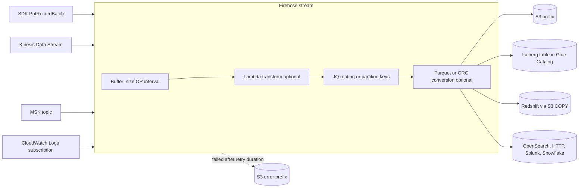
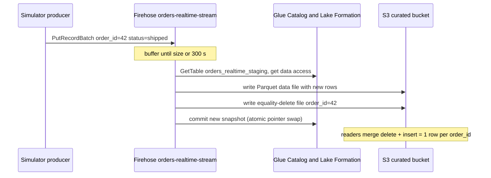

# 🚰 Amazon Data Firehose (formerly Kinesis Data Firehose)

> **What it is:** a fully managed "buffer → (transform) → deliver" pipe that takes streaming records and writes them, in batches, to storage and analytics destinations (S3, Apache Iceberg tables, Redshift, OpenSearch, HTTP endpoints, SaaS tools). You write no consumer code and manage no servers or shards.
> **Name change:** *Amazon Kinesis Data Firehose* was renamed **Amazon Data Firehose** in Feb 2024 ⚠️. The API, CLI and SDK still say `firehose` and "delivery stream" (`aws firehose create-delivery-stream`), CloudFormation still says `AWS::KinesisFirehose::DeliveryStream`, and logs still go to `/aws/kinesisfirehose/...`.
> **GCP equivalent:** Pub/Sub **BigQuery subscription** and **Cloud Storage subscription** (no-code delivery), **Dataflow templates** (Pub/Sub → GCS/BigQuery/Splunk), and the **BigQuery Storage Write API** (CDC upserts).
> **In the HLD:** label **D**, *Firehose (order status) → put JSON records in batches → curated Iceberg table*. See [Challenge D](../01_AWS_Data_Lakehouse_Demonstrated/Challenge_D_Firehose_Iceberg_Streaming_Upserts_And_Buffering.md). The lab's traffic generator is the scheduled rule `firehose-simulator-schedule-7db76de0` seen in [Challenge F](../01_AWS_Data_Lakehouse_Demonstrated/Challenge_F_Vendor_File_Pipeline_EventBridge_StepFunctions_Lambda.md) (don't touch it).
> **As of:** Nov 2026 · ⚠️ = unverified or likely to change, so verify in the docs · Related: [02 Iceberg](02_Apache_Iceberg_On_AWS.md) · [05 Lake Formation](05_AWS_Lake_Formation.md) · [04 Athena](04_Amazon_Athena.md) · [07 EventBridge](07_Amazon_EventBridge.md)

---

## ⭐ Must-know first (labs + exam)

1. **Firehose is a delivery pipe, not a stream you read from.** It has no consumers, no replay and no ordering guarantee. If you need those, put **Kinesis Data Streams (KDS)** or **MSK** in front of it.
2. **The source is fixed when you create the stream.** It is one of **Direct PUT** (your code or an AWS service calls `PutRecord`/`PutRecordBatch`), **Kinesis Data Streams**, or **Amazon MSK**. You can't change it later.
3. **It flushes when the size OR the interval threshold is hit, whichever comes first.** These **buffering hints** are typically 1–128 MiB and 0–900 s. Low volume means the interval decides the flush, so the interval decides how many files you get.
4. **Delivery is at-least-once.** Retries can write a record twice, so make the sink idempotent: use unique keys (Iceberg), a downstream MERGE, or dedupe on an `event_id`.
5. **Apache Iceberg Tables destination:** Firehose writes **Parquet** data files into **Iceberg format v2** tables registered in the **Glue Data Catalog** (or S3 Tables), using **merge-on-read**. v1 tables fail with `Iceberg.NoSuchTable`.
6. **The default operation is `insert`** (confirmed in the docs). With no operation, every status event becomes a new row, which is exactly the duplicate problem in Challenge D.
7. **`update` and `delete` need a row identity:** either **unique keys** in the stream's table configuration or Iceberg **`identifier-field-ids`** on the table. For a single table, the operation itself must come from a **JQ expression** or **Lambda metadata**. Setting unique keys alone does not switch the operation to `update`.
8. **An update is an equality-delete file plus an insert.** Delete files pile up and slow reads, so you must compact (`OPTIMIZE`, see [Challenge B](../01_AWS_Data_Lakehouse_Demonstrated/Challenge_B_Analytics_Query_Performance_Compaction_And_MOR.md)).
9. **Every flush to Iceberg is a commit, and every commit is a snapshot.** A 60 s interval gives about 1,440 snapshots and file sets per table per day. Raise it to ≥ 300 s (Challenge D) and schedule compaction and snapshot expiry.
10. **To edit a stream:** console **Configuration → Destination settings → Edit → Save changes**, then **wait for Active**. On the CLI, `update-destination` needs the **current version ID** and the **destination ID**, both taken from `describe-delivery-stream`.
11. **Nothing is silently dropped.** Records that fail after the retry duration go to the **S3 error/backup prefix** (`processing-failed/`, `format-conversion-failed/`, Iceberg error prefix…). Look there first.
12. **The Firehose IAM role needs IAM permissions and Lake Formation grants** (DESCRIBE on the database; SELECT/INSERT/DELETE/DESCRIBE/ALTER on the table ⚠️) when the catalog is governed by Lake Formation.
13. **Record format conversion** (JSON → Parquet/ORC) takes its schema from a **Glue table**, and the input must be JSON. **Dynamic partitioning** builds S3 prefixes from record fields with **JQ** (`!{partitionKeyFromQuery:key}`) or Lambda (`!{partitionKeyFromLambda:key}`).
14. **The one alarm to set is `DataFreshness`** (age of the oldest undelivered record). Also watch `ThrottledRecords`, delivery `Success`, and the error prefix.
15. **Exam keywords:** "near real time", "no code / least operational overhead", "load streaming data into S3 / Redshift / OpenSearch / Splunk", "convert to Parquet", "partition by field" all point to **Firehose**. "Milliseconds", "multiple consumers", "replay", "ordering" or "custom processing" point to **KDS/MSK + consumers (Flink/Lambda)**.

---

## 🧱 First principles

### The problem: streaming-to-storage

Producers emit **small events continuously**: a 1 KB order-status change, 50 times a second. Analytics storage wants **large, immutable, columnar files**. Firehose sits between the two.

| Constraint | Why it matters |
|---|---|
| **Object stores can't append** | An S3 object is written once. "Add one event" means writing a new object. |
| **Per-object costs** | Each object costs a PUT request when written, a GET and footer read for each query, and a LIST entry. A million 1 KB objects cost far more to write *and* to query than eight 128 MB objects holding the same data. |
| **Query engines pay per file** | Athena/Spark plan, open and read each file. Thousands of tiny files leave a query dominated by I/O latency (Challenge B). |
| **Producers want a fast ACK** | A web request can't wait 5 minutes for a file to be written. The pipe must accept the record, store it durably, and acknowledge quickly. |
| **Destinations fail** | S3 throttles, a Redshift cluster is paused, an HTTP endpoint returns 503. The pipe must retry and must not lose data. |

### The core trade-off: latency vs file size

Firehose holds records in a buffer and flushes when **size ≥ S** *or* **age ≥ T**. With an incoming rate `r` (bytes/s):

```text
time between flushes  = min(T, S / r)
file size per flush   = min(S, r × T)          (per destination table / partition)
files per day         = 86,400 / min(T, S / r)
```

- **Low volume** (r × T < S): the **interval wins**. Files are small and you get one every T seconds. Challenge D had T = 60 s, so ~1,440 tiny files per day.
- **High volume** (r × T > S): the **size wins**. Files are S-sized, and the interval rarely matters.
- **Lower T** gives fresher data, smaller files and more commits. **Higher T** gives staler data, fewer and larger files, and cheaper queries.

**Rule of thumb:** pick T from the freshness SLA. Dashboards rarely need data fresher than 5–15 minutes, so 300–900 s is normal. Then let compaction clean up whatever small files remain.

### Delivery semantics: why "at-least-once"

To ACK fast and never lose data, Firehose persists the record durably before acknowledging it, then writes it to the destination later. Any crash or timeout between "file written" and "progress recorded" leads to a retry, and the retry can write the same records again. **Exactly-once** would need a transactional handshake with every destination, and most destinations (S3 files, HTTP endpoints) can't offer one. So Firehose promises **at-least-once**, and **idempotency is your job**:

- S3/raw: dedupe downstream on `event_id`.
- Iceberg: **unique keys + `update`** make a repeat of the same key harmless (the last write wins).
- Firehose also **doesn't keep records in order** (the docs say so). "Last write wins" can therefore mean "the *older* status wins" (see second-order chain 3).

### Retries and backpressure

- **Destination down:** Firehose retries for a **retry duration** (Iceberg: 0–7200 s, default 300 s). After that, records go to the **S3 error/backup bucket**. For an S3 destination, Firehose keeps retrying for up to ~24 h ⚠️.
- **Producer too fast:** Direct PUT has per-stream quotas. Past them, `PutRecordBatch` fails with **`ServiceUnavailableException`** (throttling), and **the producer must back off**. That is backpressure, pushed to you.
- **Want a shock absorber?** Put **KDS** (retention 24 h to 365 days) in front. Producers write to shards at their own pace, and Firehose drains them. This also gives you **replay**.

### What the Iceberg destination adds

A plain S3 destination just drops files. An **Iceberg** destination must also:
1. **Read the table metadata** from the catalog (schema, partition spec, current snapshot).
2. **Write Parquet data files** (and **equality-delete files** for updates/deletes).
3. **Commit atomically**: swap the table's metadata pointer to a new snapshot. If a concurrent writer committed first, Firehose retries the commit (optimistic concurrency).

Each flush therefore creates a **snapshot**, and each update creates **delete files**. Those are the two maintenance debts Challenge B teaches you to pay off.

---

## 🧩 Core concepts

### Vocabulary

| Term | Meaning |
|---|---|
| **Firehose stream** (API: *delivery stream*) | The configured pipe: one source, one destination, buffering, processing, role |
| **Record** | One blob up to 1,000 KiB (before base64). For S3, you decide the framing (add `\n` for JSON Lines). For Iceberg, one JSON object = one row |
| **Buffering hints** | `SizeInMBs` + `IntervalInSeconds`. "Hints" because Firehose may adjust them. If you set one in the API, you must set both |
| **Processing configuration** | Ordered list of **processors**: `Lambda`, `MetadataExtraction` (JQ), `AppendDelimiterToRecord`, `RecordDeAggregation`, `Decompression`, `CloudWatchLogProcessing` ⚠️ |
| **Destination ID** | e.g. `destinationId-000000000001`. Needed by `update-destination` |
| **Version ID** | Increments on every config change. `update-destination` requires the current one (optimistic locking) |
| **Error output prefix** | Where failed records land in S3, with the failure type in the path |
| **S3 backup** | `FailedDataOnly` (default) or `AllData` (for S3 destinations: a raw copy of every source record) |

### Sources

| Source | How data arrives | Notes |
|---|---|---|
| **Direct PUT** | `PutRecord` / `PutRecordBatch` from SDK or Kinesis Agent; many AWS services deliver this way (EventBridge target, IoT rules, SNS subscription, WAF/VPC Flow Logs ⚠️) | Simplest. Per-stream throughput quotas apply (see limits) |
| **Kinesis Data Streams** | Firehose reads the shards for you | Direct `PutRecord` to the Firehose stream is disabled. Firehose counts as a consumer sharing the shard read limits ⚠️. Watch `KinesisMillisBehindLatest` |
| **Amazon MSK** ⚠️ | Firehose reads one Kafka topic (provisioned or serverless cluster, IAM auth, private or public connectivity ⚠️) | Lambda output uses `kafkaRecordValue` instead of `data`. Starting position options ⚠️ |
| **CloudWatch Logs subscription** ⚠️ | A subscription filter on a log group sends gzip-compressed batches of log events (Direct PUT under the hood) | Newer streams can **decompress** and **extract the message** natively ⚠️. Older designs used a Lambda blueprint |
| **Database CDC (preview?)** ⚠️ | Firehose "database streams" from MySQL/PostgreSQL into Iceberg was announced at re:Invent 2024 ⚠️ | Check whether it's GA in your region before relying on it |

### Destinations

| Destination | How Firehose writes | Buffer range (default) ⚠️ | Notes |
|---|---|---|---|
| **Amazon S3** | Objects under a prefix (default `YYYY/MM/DD/HH/` in UTC) | 1–128 MiB (5), 0–900 s (300) | Compression GZIP/Snappy/ZIP/Hadoop-Snappy. Format conversion. Dynamic partitioning |
| **Apache Iceberg Tables** (incl. **S3 Tables**) | Parquet data files + equality deletes, Glue Catalog commits | 1–128 MiB, 0–900 s (docs). Defaults ⚠️ | v2 only. MOR. Routing, unique keys, insert/update/delete |
| **Amazon Redshift** | Writes to an intermediate S3 bucket, then runs `COPY` | 1–128 MiB (5), 0–900 s (300) | Provisioned or Serverless. Retry duration 0–7200 s |
| **OpenSearch Service / Serverless** | Bulk API, optional index rotation (hour/day/week/month) | 1–100 MiB (5), 0–900 s (300) | VPC delivery supported |
| **HTTP endpoint** | POSTs a JSON body `{requestId, timestamp, records:[{data}]}` | 1–64 MiB, 0–900 s ⚠️ | Endpoint must echo `requestId`. Access key in a header |
| **Splunk / Snowflake / Datadog / New Relic / MongoDB / Elastic…** ⚠️ | Partner integrations (Splunk HEC, Snowpipe Streaming…) | Partner-specific ⚠️ | Snowflake is GA (2024) ⚠️ |

### Processing features

| Feature | What it does | Key detail |
|---|---|---|
| **Lambda transformation** | Firehose invokes your function **synchronously** with a batch, and you return each record as `Ok` / `Dropped` / `ProcessingFailed` | Every input `recordId` must come back exactly once. Lambda buffer ~0.2–3 MiB, 0–900 s ⚠️ (6 MB sync payload limit) |
| **Record format conversion** | JSON → **Parquet** or **ORC** using a **Glue table** as the schema | Deserializer: OpenX JSON SerDe or Hive JSON SerDe. Fields not in the table are dropped. Needs a bigger buffer (min 64 MiB ⚠️) |
| **Dynamic partitioning** (S3 only) | Builds the S3 prefix from record content | JQ (`MetadataExtraction`) or Lambda (`metadata.partitionKeys`). Error prefix required. Enable **at creation** only ⚠️. ~500 active partitions per stream ⚠️ |
| **Inline JQ for Iceberg routing** | Pulls database, table and operation from each record | Same `MetadataExtraction` processor ⚠️. Static values must be quoted: `"lakehouse_db"` |
| **Delimiter / de-aggregation** | Append `\n` between records. Split multi-JSON or KPL-aggregated records | Useful for S3 JSON Lines files |

### S3 prefix expressions

| Expression | Value |
|---|---|
| `!{timestamp:yyyy/MM/dd/HH}` | Firehose **arrival time** in UTC, *not* event time |
| `!{firehose:random-string}` | Random string (spreads keys) |
| `!{firehose:error-output-type}` | `processing-failed`, `format-conversion-failed`, … (use it in `ErrorOutputPrefix`) |
| `!{partitionKeyFromQuery:name}` | Value extracted by the JQ query key `name` |
| `!{partitionKeyFromLambda:name}` | Value your Lambda returned in `metadata.partitionKeys.name` |

### The Apache Iceberg Tables destination in depth

**Configuration fields** (`IcebergDestinationConfiguration` / `IcebergDestinationUpdate`):

| Field | Purpose |
|---|---|
| `CatalogConfiguration.CatalogARN` | `arn:aws:glue:<region>:<acct>:catalog`, or `…:catalog/s3tablescatalog/<table-bucket>` for S3 Tables |
| `DestinationTableConfigurationList[]` | Per table: `DestinationDatabaseName`, `DestinationTableName`, `UniqueKeys[]`, optional `S3ErrorOutputPrefix`. **One entry per table** |
| `ProcessingConfiguration` | Lambda and/or JQ routing (`MetadataExtraction`) |
| `BufferingHints`, `RetryOptions.DurationInSeconds` | 1–128 MiB, 0–900 s. Retry 0–7200 s (default 300) |
| `S3Configuration` + `S3BackupMode` | Error/backup bucket. Iceberg supports `FailedDataOnly` |
| `AppendOnly` | Default **false**. `true` means inserts only, and Firehose raises the throughput limit automatically. With updates/deletes it causes **out-of-order delivery** (API reference) |
| `SchemaEvolutionConfiguration.Enabled` ⚠️ | Auto-add new columns from incoming records. Marked *preview* in the API reference |
| `TableCreationConfiguration.Enabled` ⚠️ | Auto-create missing tables. Marked *preview* in the API reference |
| `RoleARN`, `CloudWatchLoggingOptions` | Role Firehose assumes; log group/stream |

**Routing precedence** (from the docs):
1. **Lambda output** `metadata.otfMetadata.{destinationDatabaseName, destinationTableName, operation}` is checked first.
2. Then the **JQ expressions** fill in any missing fields.
3. If neither gives routing info, Firehose treats it as a **single-table** stream and uses the one entry in the unique-keys/table configuration.
4. If no route matches a configured table, the record goes to the **S3 error bucket**.

**Operations:**

| Operation | What Firehose writes | Requirement |
|---|---|---|
| `insert` (**default**) | New data row | None. Duplicates are preserved |
| `update` | **Equality delete** on the key + insert of the new row. Inserts if the key doesn't exist (an upsert) | Unique keys or `identifier-field-ids` |
| `delete` | Equality delete on the key | Unique keys or `identifier-field-ids` |

**Unique-key gotchas:**
- If unique keys are configured, the **table must exist** when you create the stream (Firehose validates it).
- A key column name must be **unique across the whole schema**. `_id` at the top level *and* inside a struct is invalid, and dotted paths like `top._id` aren't supported.
- The database and table names in routing must match **exactly**, otherwise the records go to the error bucket.

**Errors you'll see** (CloudWatch Logs + error prefix): `Iceberg.NoSuchTable` (missing or v1 table), `Iceberg.InvalidTableName`, `S3.AccessDenied`, `Glue.AccessDenied`.

---

## 🔄 How it works (flow)



**Iceberg upsert, step by step (Challenge D after the fix):**



1. A producer calls `PutRecordBatch`. Firehose stores the records durably and returns per-record results.
2. Records are buffered **per destination** (per table or per partition).
3. When size or interval is reached, the **Lambda** runs (if configured), then **JQ** extracts routing or partition keys.
4. **S3 path:** optional conversion to Parquet, then the object is written to `prefix/…`. **Iceberg path:** Firehose loads table metadata (with **Lake Formation** credential vending if the location is registered ⚠️), writes data and delete files, and commits a snapshot.
5. On failure it retries for the retry duration, then writes the records to the **error prefix** and logs to `/aws/kinesisfirehose/<stream>`.
6. CloudWatch metrics (`AWS/Firehose`) record incoming, delivery success and freshness.

---

## 🛠️ Hands-on examples

### Example 1: Reproduce Challenge D (redirect to the staging table, add the unique key, raise the buffer)

**Goal:** the stream `orders-realtime-stream` writes to `lakehouse_db.orders_realtime_staging` with unique key `order_id` and a buffer interval ≥ 300 s.

**Console steps**
1. **Athena** (workgroup `anycompany-lakehouse`, *not* `primary`) → **Saved queries** → `orders-realtime-duplicates` → Run. Note the duplicates.
2. **Amazon Data Firehose** → **Firehose streams** → `orders-realtime-stream…` (check for a suffix) → **Configuration** tab → **Destination settings** → **Edit**. If Edit is greyed out, the stream isn't **Active** yet.
3. **Unique key configuration** (JSON editor):
   ```json
   [
     {
       "DestinationDatabaseName": "lakehouse_db",
       "DestinationTableName": "orders_realtime_staging",
       "UniqueKeys": ["order_id"]
     }
   ]
   ```
   Remove any other entry that still names `orders_realtime`.
4. **Inline parsing for routing information** (if enabled): change the **table expression** from `"orders_realtime"` to `"orders_realtime_staging"`. Keep the quotes, because a quoted value is a static string and an unquoted `.x` is a JQ path. Beyond the grader: for real upserts, set the **operation expression** to `"update"`.
5. **Buffer hints** → **Buffer interval = 300** (anything from 300 to 900 passes). Leave the size alone.
6. **Save changes** → status goes **Updating → Active** → re-open the Configuration tab and confirm → **Check**.

**CLI equivalent (CloudShell, us-east-1)**

```bash
# 0. Find the exact (suffixed) stream name
STREAM=$(aws firehose list-delivery-streams --limit 100 \
  --query "DeliveryStreamNames[?starts_with(@, 'orders-realtime-stream')] | [0]" --output text)
echo "STREAM=$STREAM"

# 1. Save the current config: it's your "before" record and your undo copy
aws firehose describe-delivery-stream --delivery-stream-name "$STREAM" > ds-before.json
jq '.DeliveryStreamDescription | {Status: .DeliveryStreamStatus, VersionId, DestId: .Destinations[0].DestinationId}' ds-before.json
jq '.DeliveryStreamDescription.Destinations[0].IcebergDestinationDescription
    | {DestinationTableConfigurationList, BufferingHints, ProcessingConfiguration, AppendOnly}' ds-before.json

# 2. Values update-destination needs
VERSION_ID=$(jq -r '.DeliveryStreamDescription.VersionId' ds-before.json)
DEST_ID=$(jq -r '.DeliveryStreamDescription.Destinations[0].DestinationId' ds-before.json)
# BufferingHints needs BOTH fields, so keep the current size
SIZE_MB=$(jq -r '.DeliveryStreamDescription.Destinations[0].IcebergDestinationDescription.BufferingHints.SizeInMBs // 128' ds-before.json)

# 3. Build the update (unquoted heredoc so $SIZE_MB expands)
cat > iceberg-update.json <<EOF
{
  "DestinationTableConfigurationList": [
    {
      "DestinationDatabaseName": "lakehouse_db",
      "DestinationTableName": "orders_realtime_staging",
      "UniqueKeys": ["order_id"]
    }
  ],
  "BufferingHints": { "IntervalInSeconds": 300, "SizeInMBs": $SIZE_MB }
}
EOF

# 3b. ONLY if step 1 showed a ProcessingConfiguration whose JQ names "orders_realtime":
#     rewrite that literal and merge the processing config into the same update.
if jq -e '.DeliveryStreamDescription.Destinations[0].IcebergDestinationDescription.ProcessingConfiguration.Enabled == true' ds-before.json >/dev/null; then
  jq '.DeliveryStreamDescription.Destinations[0].IcebergDestinationDescription.ProcessingConfiguration
      | walk(if type == "string" then gsub("\"orders_realtime\""; "\"orders_realtime_staging\"") else . end)' \
      ds-before.json > proc-new.json
  jq -s '.[0] + {ProcessingConfiguration: .[1]}' iceberg-update.json proc-new.json > tmp.json && mv tmp.json iceberg-update.json
fi
cat iceberg-update.json

# 4. Apply (one call, because the version ID changes after every update)
aws firehose update-destination \
  --delivery-stream-name "$STREAM" \
  --current-delivery-stream-version-id "$VERSION_ID" \
  --destination-id "$DEST_ID" \
  --iceberg-destination-update file://iceberg-update.json

# 5. Wait for ACTIVE, then verify
until [ "$(aws firehose describe-delivery-stream --delivery-stream-name "$STREAM" \
          --query DeliveryStreamDescription.DeliveryStreamStatus --output text)" = "ACTIVE" ]; do
  echo "waiting..."; sleep 10
done
aws firehose describe-delivery-stream --delivery-stream-name "$STREAM" \
  --query "DeliveryStreamDescription.Destinations[0].IcebergDestinationDescription.{Tables:DestinationTableConfigurationList,Buffer:BufferingHints}"
```

> ⚠️ `update-destination` **merges** fields of the same destination type into the existing config, but list-valued fields (the table list, the processor list) are replaced as a whole. That's why the script sends the complete `DestinationTableConfigurationList` and the complete `ProcessingConfiguration`. Verify the merge behaviour in the `UpdateDestination` API docs.

**If deliveries fail after the switch** (records in the error prefix, `Glue.AccessDenied` or a Lake Formation error in the logs), grant the Firehose role access to the new table:

```bash
FH_ROLE=$(jq -r '.DeliveryStreamDescription.Destinations[0].IcebergDestinationDescription.RoleARN' ds-before.json)
aws lakeformation grant-permissions \
  --principal DataLakePrincipalIdentifier="$FH_ROLE" \
  --resource '{"Table": {"DatabaseName": "lakehouse_db", "Name": "orders_realtime_staging"}}' \
  --permissions SELECT INSERT DELETE DESCRIBE ALTER
```

**Expected result:** status **Active**; the table list shows only `orders_realtime_staging` with `["order_id"]`; `IntervalInSeconds: 300`.

**What to check (Athena, after a few flushes):**

```sql
-- 1) Duplicates in the NEW table (needs operation=update to be truly zero; see Must-know 7)
SELECT order_id, COUNT(*) AS versions
FROM lakehouse_db.orders_realtime_staging
GROUP BY order_id HAVING COUNT(*) > 1 LIMIT 20;

-- 2) Commits: one snapshot per flush, so ~12/hour at 300 s instead of ~60/hour at 60 s
SELECT date_trunc('hour', committed_at) AS hr, COUNT(*) AS snapshots
FROM "lakehouse_db"."orders_realtime_staging$snapshots"
GROUP BY 1 ORDER BY 1 DESC LIMIT 24;

-- 3) Data vs delete files (content: 0 = data, 1 = position deletes, 2 = equality deletes) ⚠️
SELECT content, COUNT(*) AS files, ROUND(AVG(file_size_in_bytes) / 1024.0, 1) AS avg_kb
FROM "lakehouse_db"."orders_realtime_staging$files"
GROUP BY content;
```

The old `orders_realtime` table keeps its duplicates. Redirecting only affects **new** records (see the clean-up SQL in Challenge D, study note 6).

---

### Example 2 (beyond the lab): a Direct PUT producer in Python with partial-failure retries

**Goal:** send order-status events reliably. `PutRecordBatch` can return **HTTP 200 with some records failed**. The SDK's built-in retries **don't** cover that, so your code must.

**Console steps (setup):** create an IAM policy for the producer with `firehose:PutRecord` and `firehose:PutRecordBatch` on `arn:aws:firehose:us-east-1:<acct>:deliverystream/<stream>`, then attach it to the role your code runs as.

```python
"""
Direct PUT producer for Amazon Data Firehose.
- Batches respect the service limits: 500 records AND 4 MiB per call, 1,000 KiB per record.
- Retries ONLY the records that failed (FailedPutCount > 0), with exponential backoff + full jitter.
- Retries the whole call when throttled (ServiceUnavailableException).
- Never loops forever: records that still fail go to a local dead-letter file.
"""
import json
import random
import time
import uuid
from datetime import datetime, timezone

import boto3
from botocore.config import Config
from botocore.exceptions import ClientError

STREAM_NAME = "orders-realtime-stream-7db76de0"   # look up the exact, suffixed name
REGION = "us-east-1"

MAX_RECORDS_PER_CALL = 500
MAX_BYTES_PER_CALL = 4 * 1024 * 1024    # whole request
MAX_BYTES_PER_RECORD = 1000 * 1024      # one record, before base64

firehose = boto3.client(
    "firehose",
    region_name=REGION,
    # SDK retries handle network errors / 5xx for the WHOLE call only.
    config=Config(retries={"mode": "standard", "max_attempts": 5}),
)


def make_event(order_id: str, status: str) -> dict:
    return {
        "order_id": order_id,
        "status": status,
        "event_time": datetime.now(timezone.utc).isoformat(timespec="milliseconds"),
        "event_id": str(uuid.uuid4()),  # lets downstream jobs drop exact duplicates from retries
    }


def to_record(event: dict, newline: bool) -> dict:
    body = json.dumps(event, separators=(",", ":"))
    if newline:                      # S3 destination: makes files JSON Lines
        body += "\n"                 # Iceberg destination: send one JSON object, no delimiter
    data = body.encode("utf-8")
    if len(data) > MAX_BYTES_PER_RECORD:
        raise ValueError(f"record too large ({len(data)} bytes)")
    return {"Data": data}


def chunks(records):
    """Yield batches that respect both the record-count and byte limits."""
    batch, size = [], 0
    for rec in records:
        n = len(rec["Data"])
        if batch and (len(batch) == MAX_RECORDS_PER_CALL or size + n > MAX_BYTES_PER_CALL):
            yield batch
            batch, size = [], 0
        batch.append(rec)
        size += n
    if batch:
        yield batch


def backoff(attempt: int, base: float = 0.1, cap: float = 10.0) -> None:
    time.sleep(random.uniform(0, min(cap, base * 2 ** attempt)))  # "full jitter"


def put_batch(records: list, max_attempts: int = 8) -> list:
    """Send one batch. Return the records that still failed after all attempts."""
    pending = records
    for attempt in range(max_attempts):
        try:
            resp = firehose.put_record_batch(DeliveryStreamName=STREAM_NAME, Records=pending)
        except ClientError as err:
            if err.response["Error"]["Code"] == "ServiceUnavailableException":  # throttled
                backoff(attempt)
                continue
            raise  # InvalidArgument / ResourceNotFound / AccessDenied: fix config, don't retry

        if resp["FailedPutCount"] == 0:
            return []

        # RequestResponses lines up 1:1 with the Records we sent
        failed = [(rec, r) for rec, r in zip(pending, resp["RequestResponses"]) if "ErrorCode" in r]
        pending = [rec for rec, _ in failed]
        codes = sorted({r["ErrorCode"] for _, r in failed})
        print(f"attempt {attempt + 1}: {len(pending)} failed {codes}; retrying failed ones only")
        backoff(attempt)
    return pending


def send(events, newline: bool = False) -> int:
    dead = []
    for batch in chunks(to_record(e, newline) for e in events):
        dead.extend(put_batch(batch))
    if dead:  # don't lose data: park it for a replay script
        with open("firehose_dead_letter.jsonl", "ab") as f:
            for rec in dead:
                f.write(rec["Data"].rstrip(b"\n") + b"\n")
    return len(dead)


if __name__ == "__main__":
    statuses = ["placed", "paid", "shipped", "delivered"]
    # NOTE: Firehose does not preserve order. If all 4 statuses of one order land in the
    # same flush, "last write wins" is not guaranteed to be "delivered". See second-order chain 3.
    events = [make_event(f"ORD-{i:05d}", s) for i in range(1000) for s in statuses]
    failed = send(events, newline=False)
    print(f"sent {len(events) - failed}, dead-lettered {failed}")
```

**Expected result:** `sent 4000, dead-lettered 0`. In CloudWatch, `IncomingRecords` rises by 4,000.
**What to check:** `ThrottledRecords` stays at 0. If it doesn't, lower the send rate or request a quota increase. `FailedPutCount` should be rare. Persistent `InternalFailure` codes mean you should open a support case, not retry harder.

---

### Example 3 (beyond the lab): dynamic partitioning to S3 with Parquet conversion

**Goal:** clickstream JSON → S3 as **Parquet**, laid out as `event_date=YYYY-MM-DD/country=XX/` from fields **inside the record** (event time, not arrival time), queryable by Athena without crawlers.

**Step 1: Glue table that supplies the schema (Athena DDL).** Partition projection removes the need for `MSCK REPAIR`.

```sql
CREATE EXTERNAL TABLE lakehouse_db.clickstream_raw (
  event_id     string,
  user_id      string,
  page         string,
  event_ts     string,
  duration_ms  int
)
PARTITIONED BY (event_date string, country string)
STORED AS PARQUET
LOCATION 's3://anycompany-lakehouse-raw-7db76de0/raw/clickstream/'
TBLPROPERTIES (
  'projection.enabled'            = 'true',
  'projection.event_date.type'    = 'date',
  'projection.event_date.format'  = 'yyyy-MM-dd',
  'projection.event_date.range'   = '2026-01-01,NOW',
  'projection.country.type'       = 'enum',
  'projection.country.values'     = 'IN,US,GB,DE,OTHER',
  'storage.location.template'     = 's3://anycompany-lakehouse-raw-7db76de0/raw/clickstream/event_date=${event_date}/country=${country}/'
);
```

**Step 2: console.** Create Firehose stream → Source **Direct PUT**, Destination **Amazon S3** → *Transform and convert records*: **Record format conversion: Enabled**, output **Apache Parquet**, Glue region/database `lakehouse_db`/table `clickstream_raw` → *Destination settings*: bucket, **Dynamic partitioning: Enabled**, **Inline parsing for JSON: Enabled**, keys `event_date` = `.event_ts[0:10]` and `country` = `.country // "OTHER"` → **Apply dynamic partitioning keys** (the console fills in the prefix) → **S3 bucket error output prefix** (required) → Buffer 128 MiB / 300 s → Create or choose an IAM role → **Create**.

**Step 3: CLI.** `s3-dest.json`:

```json
{
  "RoleARN": "arn:aws:iam::111122223333:role/firehose-clickstream-role",
  "BucketARN": "arn:aws:s3:::anycompany-lakehouse-raw-7db76de0",
  "Prefix": "raw/clickstream/event_date=!{partitionKeyFromQuery:event_date}/country=!{partitionKeyFromQuery:country}/",
  "ErrorOutputPrefix": "errors/clickstream/!{firehose:error-output-type}/!{timestamp:yyyy/MM/dd}/",
  "BufferingHints": { "SizeInMBs": 128, "IntervalInSeconds": 300 },
  "CompressionFormat": "UNCOMPRESSED",
  "DynamicPartitioningConfiguration": {
    "Enabled": true,
    "RetryOptions": { "DurationInSeconds": 300 }
  },
  "ProcessingConfiguration": {
    "Enabled": true,
    "Processors": [
      {
        "Type": "MetadataExtraction",
        "Parameters": [
          { "ParameterName": "MetadataExtractionQuery",
            "ParameterValue": "{event_date: .event_ts[0:10], country: (.country // \"OTHER\")}" },
          { "ParameterName": "JsonParsingEngine", "ParameterValue": "JQ-1.6" }
        ]
      }
    ]
  },
  "DataFormatConversionConfiguration": {
    "Enabled": true,
    "InputFormatConfiguration":  { "Deserializer": { "OpenXJsonSerDe": {} } },
    "OutputFormatConfiguration": { "Serializer":   { "ParquetSerDe": { "Compression": "SNAPPY" } } },
    "SchemaConfiguration": {
      "RoleARN": "arn:aws:iam::111122223333:role/firehose-clickstream-role",
      "DatabaseName": "lakehouse_db",
      "TableName": "clickstream_raw",
      "Region": "us-east-1",
      "VersionId": "LATEST"
    }
  },
  "CloudWatchLoggingOptions": {
    "Enabled": true,
    "LogGroupName": "/aws/kinesisfirehose/clickstream-to-s3",
    "LogStreamName": "DestinationDelivery"
  }
}
```

```bash
aws firehose create-delivery-stream \
  --delivery-stream-name clickstream-to-s3 \
  --delivery-stream-type DirectPut \
  --extended-s3-destination-configuration file://s3-dest.json

# Send a test record (the CLI v2 flag lets you pass the blob as plain text)
aws firehose put-record --delivery-stream-name clickstream-to-s3 \
  --cli-binary-format raw-in-base64-out \
  --record '{"Data":"{\"event_id\":\"e1\",\"user_id\":\"u1\",\"page\":\"/home\",\"event_ts\":\"2026-11-11T10:00:00Z\",\"duration_ms\":420,\"country\":\"IN\"}"}'
```

- `CompressionFormat` must be `UNCOMPRESSED` when converting, because Parquet compresses internally (Snappy) ⚠️.
- With conversion or dynamic partitioning on, the buffer size must be ≥ 64 MiB ⚠️.
- The schema role needs `glue:GetTable`, `glue:GetTableVersion`, `glue:GetTableVersions`.

**Expected result** (after ≤ 300 s): `s3://…/raw/clickstream/event_date=2026-11-11/country=IN/<stream>-…parquet`.
**What to check:**
```sql
SELECT country, COUNT(*) FROM lakehouse_db.clickstream_raw
WHERE event_date = '2026-11-11' GROUP BY country;
```
Then look at `SucceedConversion.Records`, `FailedConversion.Records`, `PartitionCount` and `PartitionCountExceeded` in CloudWatch, and at anything under `errors/clickstream/`.

---

### Example 4 (beyond the lab): one stream, many Iceberg tables, routed with JQ

**Goal:** one stream carries `orders`, `payments` and `shipments` events. Orders and payments are **upserted** by key, and shipments are **append-only**. Each record carries `entity` and `op`:

```json
{"entity":"orders","op":"update","order_id":"ORD-42","status":"shipped","amount":"129.90","event_time":"2026-11-11T10:00:00Z"}
{"entity":"payments","op":"update","payment_id":"PAY-9","order_id":"ORD-42","state":"captured","event_time":"2026-11-11T10:00:01Z"}
{"entity":"shipments","op":"insert","shipment_id":"SHP-7","order_id":"ORD-42","checkpoint":"BLR-HUB","event_time":"2026-11-11T10:00:02Z"}
```

**Step 1: create v2 Iceberg tables** (Athena creates v2 by default). Partition on something that **never changes for a key** (see second-order chain 4).

```sql
CREATE TABLE lakehouse_db.rt_orders (
  order_id string, status string, amount string, event_time string)
PARTITIONED BY (bucket(16, order_id))
LOCATION 's3://anycompany-lakehouse-curated-7db76de0/iceberg/rt_orders/'
TBLPROPERTIES ('table_type' = 'ICEBERG', 'format' = 'parquet');
-- repeat for rt_payments (key payment_id) and rt_shipments (no key needed)
```
> `event_time` is kept as an ISO string here. Check how Firehose maps JSON strings to Iceberg `timestamp` before you use typed timestamps ⚠️.

**Step 2: console.** Destination **Apache Iceberg Tables** → catalog (this account, us-east-1) → **Inline parsing for routing information: On** → Database expression `"lakehouse_db"` · Table expression `("rt_" + .entity)` · Operation expression `(.op // "insert")` → **Unique key configuration**: entries for `rt_orders` and `rt_payments` only → Buffer 128 MiB / 300 s → Backup: S3 bucket + error prefix → IAM role → Create.

**Step 3: CLI.** `iceberg-dest.json`:

```json
{
  "RoleARN": "arn:aws:iam::111122223333:role/firehose-iceberg-role",
  "CatalogConfiguration": { "CatalogARN": "arn:aws:glue:us-east-1:111122223333:catalog" },
  "DestinationTableConfigurationList": [
    { "DestinationDatabaseName": "lakehouse_db", "DestinationTableName": "rt_orders",
      "UniqueKeys": ["order_id"],   "S3ErrorOutputPrefix": "iceberg-errors/rt_orders/" },
    { "DestinationDatabaseName": "lakehouse_db", "DestinationTableName": "rt_payments",
      "UniqueKeys": ["payment_id"], "S3ErrorOutputPrefix": "iceberg-errors/rt_payments/" }
  ],
  "ProcessingConfiguration": {
    "Enabled": true,
    "Processors": [
      {
        "Type": "MetadataExtraction",
        "Parameters": [
          { "ParameterName": "MetadataExtractionQuery",
            "ParameterValue": "{destinationDatabaseName: \"lakehouse_db\", destinationTableName: (\"rt_\" + .entity), operation: (.op // \"insert\")}" },
          { "ParameterName": "JsonParsingEngine", "ParameterValue": "JQ-1.6" }
        ]
      }
    ]
  },
  "BufferingHints": { "SizeInMBs": 128, "IntervalInSeconds": 300 },
  "RetryOptions": { "DurationInSeconds": 300 },
  "S3BackupMode": "FailedDataOnly",
  "S3Configuration": {
    "RoleARN": "arn:aws:iam::111122223333:role/firehose-iceberg-role",
    "BucketARN": "arn:aws:s3:::anycompany-firehose-errors-7db76de0",
    "ErrorOutputPrefix": "iceberg-errors/"
  },
  "CloudWatchLoggingOptions": {
    "Enabled": true, "LogGroupName": "/aws/kinesisfirehose/ops-events-to-iceberg", "LogStreamName": "DestinationDelivery"
  }
}
```

```bash
aws firehose create-delivery-stream --delivery-stream-name ops-events-to-iceberg \
  --delivery-stream-type DirectPut --iceberg-destination-configuration file://iceberg-dest.json
```

> ⚠️ The console's three "inline parsing" boxes are stored as one `MetadataExtraction` query, as above. Field names and quoting have tripped people up (*"JQ Query must be a valid JSON"*). The safest method is to build the stream once in the console, then run `describe-delivery-stream` and **copy that exact shape** into your IaC.

**Lambda alternative** (when routing needs logic JQ can't express). The return format is from the docs, and the sample there has syntax errors, so use this corrected version:

```python
import base64
import json

ROUTES = {"orders": ("rt_orders", "update"),
          "payments": ("rt_payments", "update"),
          "shipments": ("rt_shipments", "insert")}

def lambda_handler(event, context):
    out = []
    for rec in event["records"]:
        try:
            payload = json.loads(base64.b64decode(rec["data"]))
            table, op = ROUTES[payload["entity"]]
            if payload.get("is_deleted"):
                op = "delete"
            out.append({
                "recordId": rec["recordId"],           # must echo every recordId exactly once
                "result": "Ok",
                "data": base64.b64encode(json.dumps(payload).encode()).decode(),
                "metadata": {"otfMetadata": {
                    "destinationDatabaseName": "lakehouse_db",
                    "destinationTableName": table,
                    "operation": op}},
            })
        except (KeyError, ValueError):                 # bad JSON / unknown entity
            out.append({"recordId": rec["recordId"], "result": "ProcessingFailed", "data": rec["data"]})
    return {"records": out}
```

**Expected result:** each table receives only its own entity. Re-sending `ORD-42` with a new status leaves **one** row. A record with `"entity":"refunds"` (no such table) lands in the error prefix.
**What to check:** `SELECT order_id, COUNT(*) FROM lakehouse_db.rt_orders GROUP BY 1 HAVING COUNT(*) > 1;` returns nothing; error-prefix objects contain the error code; there are no `Glue.AccessDenied` entries in the log group.

---

## ⚙️ Key settings, limits & quotas

| Setting / limit | Value | Notes |
|---|---|---|
| Max record size | 1,000 KiB (before base64) | Bigger payloads: store in S3, send a pointer |
| `PutRecordBatch` | ≤ 500 records **and** ≤ 4 MiB per call | Check `FailedPutCount` every time |
| Direct PUT quota per stream ⚠️ | us-east-1/us-west-2/eu-west-1: 500,000 records/s, 2,000 requests/s, 5 MiB/s. Other regions: 100,000 / 1,000 / 1 MiB/s | Soft. Watch the `*PerSecondLimit` metrics |
| Streams per account per region ⚠️ | 5,000 | Soft |
| S3 buffer | 1–128 MiB (default 5 ⚠️), 0–900 s (default 300 ⚠️) | 0 s = "zero buffering" (lowest latency) |
| With format conversion or dynamic partitioning ⚠️ | Size ≥ 64 MiB (conversion default 128 MiB) | |
| Iceberg buffer | 1–128 MiB, 0–900 s | Docs. Defaults ⚠️ |
| Iceberg retry duration | 0–7200 s, default 300 s | Then the error bucket |
| Redshift / OpenSearch / Splunk / HTTP retry ⚠️ | 0–7200 s | |
| Lambda processor buffer ⚠️ | ~0.2–3 MiB, 0–900 s (default ~1 MiB / 60 s) | Lambda sync payload limit is 6 MB |
| Active dynamic partitions ⚠️ | 500 per stream | `PartitionCountExceeded` metric. Soft |
| Source / dynamic partitioning | Fixed at creation ⚠️ | Recreate the stream to change them |
| Unique keys | Table must exist at stream creation; key names unique in the schema | One table-config entry per table |

---

## 🔐 Security

**Trust policy** for the Firehose role. `sts:ExternalId` = your account ID guards against the confused-deputy problem:

```json
{
  "Version": "2012-10-17",
  "Statement": [{
    "Effect": "Allow",
    "Principal": { "Service": "firehose.amazonaws.com" },
    "Action": "sts:AssumeRole",
    "Condition": { "StringEquals": { "sts:ExternalId": "111122223333" } }
  }]
}
```

**Permissions policy** (Iceberg destination, least privilege, lab names):

```json
{
  "Version": "2012-10-17",
  "Statement": [
    { "Sid": "GlueCatalog", "Effect": "Allow",
      "Action": ["glue:GetDatabase", "glue:GetTable", "glue:UpdateTable"],
      "Resource": [
        "arn:aws:glue:us-east-1:111122223333:catalog",
        "arn:aws:glue:us-east-1:111122223333:database/lakehouse_db",
        "arn:aws:glue:us-east-1:111122223333:table/lakehouse_db/orders_realtime_staging"] },
    { "Sid": "TableDataAndErrors", "Effect": "Allow",
      "Action": ["s3:AbortMultipartUpload", "s3:GetBucketLocation", "s3:GetObject", "s3:ListBucket",
                 "s3:ListBucketMultipartUploads", "s3:PutObject", "s3:DeleteObject"],
      "Resource": ["arn:aws:s3:::anycompany-lakehouse-curated-7db76de0",
                   "arn:aws:s3:::anycompany-lakehouse-curated-7db76de0/*"] },
    { "Sid": "LakeFormationCredentialVending", "Effect": "Allow",
      "Action": ["lakeformation:GetDataAccess"], "Resource": "*" },
    { "Sid": "Logs", "Effect": "Allow", "Action": ["logs:PutLogEvents"],
      "Resource": "arn:aws:logs:us-east-1:111122223333:log-group:/aws/kinesisfirehose/*:*" }
  ]
}
```

Add `glue:CreateTable` if automatic table creation is on ⚠️. Add `kinesis:DescribeStream/GetShardIterator/GetRecords/ListShards` for a KDS source, `lambda:InvokeFunction`/`GetFunctionConfiguration` for transforms, and `kms:Decrypt`/`GenerateDataKey` for KMS-encrypted buckets.

**Lake Formation** (when `lakehouse_db` is governed, as in the lab). IAM alone isn't enough. The role also needs LF grants ⚠️ (Challenge D's troubleshooting set):

| Resource | Permissions |
|---|---|
| Database `lakehouse_db` | `DESCRIBE` (plus `CREATE_TABLE` if auto-creation is on ⚠️) |
| Table `orders_realtime_staging` | `SELECT`, `INSERT`, `DELETE`, `DESCRIBE`, `ALTER` |
| Data location (S3 path) | `DATA_LOCATION_ACCESS` if Firehose creates tables there ⚠️ |

See [05 Lake Formation](05_AWS_Lake_Formation.md). A common trap: the grant goes to *your* console role instead of the **Firehose role**.

**Encryption and network:**
- Server-side encryption of the Firehose buffer for Direct PUT (`start-delivery-stream-encryption`, AWS-owned key or CMK). With a KDS source, encryption is configured on KDS.
- Destination encryption: S3 default SSE-KMS or Firehose's `EncryptionConfiguration`. TLS in transit.
- **PrivateLink**: an interface VPC endpoint `com.amazonaws.<region>.kinesis-firehose` lets producers in private subnets call `PutRecordBatch`. Firehose can deliver into VPC-hosted OpenSearch, and to HTTP endpoints with private connectivity ⚠️.
- Producers need only `firehose:PutRecord*` on the one stream ARN. Never give them the delivery role.

---

## 💰 Cost model & optimisation

⚠️ Prices are us-east-1 list prices from memory. Check the "Amazon Data Firehose pricing" page.

| You pay for | Approx. price ⚠️ | Notes |
|---|---|---|
| Ingestion (Direct PUT, KDS source) | ~$0.029/GB (first 500 TB/month) | **Each record is rounded up to the next 5 KB** |
| MSK source / Iceberg destination | Separate per-GB rates ⚠️ | Check whether 5 KB rounding applies |
| Format conversion | ~$0.018/GB converted | |
| Dynamic partitioning | ~$0.020/GB + ~$0.005 per 1,000 S3 objects + JQ processing hours | Object count rises as the interval falls |
| VPC delivery | Per AZ-hour + per GB | |
| Downstream | S3 PUT/storage, Lambda, KMS, CloudWatch Logs, Athena scans | Often bigger than Firehose itself |

**Worked example (order-status stream, S3 destination):** 50 events/s × 0.8 KB, 30 days.
- Records: 50 × 86,400 × 30 = **129.6 M**. Actual data ≈ 129.6 M × 0.8 KB ≈ **104 GB**.
- **Billed** with 5 KB rounding: 129.6 M × 5 KB ≈ **648 GB × $0.029 ≈ $18.8/month** (the true data would cost ~$3).
- **Lever:** pack 6 events per record as newline-delimited JSON (4.8 KB). That's 21.6 M records × 5 KB ≈ 108 GB, about **$3.1/month**, an 83% saving. (This doesn't work for Iceberg, where one record is one row ⚠️.)
- S3 objects at a 300 s interval: 288/day (vs 1,440 at 60 s). PUT cost is tiny, but **query** cost and latency on 1,440 files/day is not.

**Levers:** right-size records (5 KB rounding) · bigger buffer intervals · Parquet conversion (Athena bills scanned bytes, and columnar + compression often cuts scans 5–20×) · JQ instead of Lambda · low-cardinality partition keys · skip KDS unless you need replay or multiple consumers.

---

## 📈 Monitoring & troubleshooting

**Key metrics** (namespace `AWS/Firehose`, dimension `DeliveryStreamName`):

| Metric | Meaning | Alarm idea |
|---|---|---|
| `IncomingRecords` / `IncomingBytes` / `IncomingPutRequests` | Traffic in | Drop to 0 means the producer died |
| `ThrottledRecords` (+ `RecordsPerSecondLimit`, `BytesPerSecondLimit`) | Quota exceeded | > 0 for 5 min |
| `DeliveryToS3.Success` | Ratio 0–1 of successful S3 puts | < 1 |
| `DeliveryToS3.DataFreshness` | Age (s) of the oldest record not yet delivered | > 2 × interval + retry |
| `DeliveryToS3.Records` / `.Bytes` | Delivered volume | |
| `DeliveryToIceberg.*` ⚠️ | Iceberg-specific success/freshness (names vary; check the console's Monitoring tab) | |
| `ExecuteProcessing.Success` / `.Duration`, `SucceedProcessing.Records` | Lambda transform health | Success < 1 |
| `SucceedConversion.Records` / `FailedConversion.Records` | Parquet/ORC conversion | Failed > 0 |
| `PartitionCount` / `PartitionCountExceeded` / `JQProcessing.Duration` | Dynamic partitioning | Exceeded > 0 |
| `KinesisMillisBehindLatest` | KDS source lag | Rising trend |
| `BackupToS3.Success` / `.DataFreshness` | Backup path health | |

**Logs:** `/aws/kinesisfirehose/<stream>` → `DestinationDelivery`, `BackupDelivery`. **Error data:** the S3 error prefix (each object records the error code and the original data).

| Symptom | Likely cause | How to confirm | Fix |
|---|---|---|---|
| Same order appears 4–5 times (**Challenge D**) | Wrong table, no unique key, operation defaults to `insert` | Saved query `orders-realtime-duplicates`; Configuration tab | Target `orders_realtime_staging`, `UniqueKeys ["order_id"]`, operation `update` via JQ/Lambda |
| Tiny files every minute (**Challenge D**) | Buffer interval 60 s on a low-volume stream | `$files` avg size; snapshots per hour | Interval ≥ 300 s; compaction (Challenge B) |
| **Edit** greyed out / Check fails right after Save | Stream not **Active** (Creating/Updating) | Status column | Wait for Active |
| Check still sees `orders_realtime` | Old name left in the JQ table expression or a second table entry | `describe-delivery-stream` | Replace every occurrence |
| `Glue.AccessDenied` / `S3.AccessDenied` / *Insufficient Lake Formation permission(s)* | Role lacks IAM or LF grants on the new table | Log group; error prefix | IAM policy + LF grants (Security) |
| `Iceberg.NoSuchTable` | Name mismatch, table missing, or table is v1 | `SHOW TBLPROPERTIES` (format-version) | Create a v2 table; fix the names |
| Update/delete records go to the error prefix | No unique keys and no `identifier-field-ids` | Error object code | Add unique keys (table must exist) |
| Still duplicates with unique keys set | Operation still `insert` (default), or `AppendOnly = true` | Check JQ/Lambda operation; `AppendOnly` in describe | Set operation `update`; AppendOnly false |
| Status goes backwards (delivered → shipped) | Firehose doesn't preserve order | Compare `event_time` per key | Downstream MERGE with an `event_time` guard |
| `ServiceUnavailableException` / `ThrottledRecords` | Over the Direct PUT quota | Metrics vs `*PerSecondLimit` | Backoff + jitter, quota increase, or KDS in front |
| Partial failures ignored, data missing | Producer never checks `FailedPutCount` | Producer logs | Retry failed entries (Example 2) |
| `processing-failed/` objects | Lambda error/timeout, missing recordId, bad base64 | Lambda logs; `ExecuteProcessing.Success` | Fix the function; raise its timeout; echo all recordIds |
| `format-conversion-failed/` objects | JSON doesn't match the Glue schema (types, timestamps) | Error object message | Fix producer types or the schema; pick the right SerDe |
| `PartitionCountExceeded` | High-cardinality partition key | Metric | Coarser keys (date, region) |
| Parquet in S3 but Athena returns 0 rows | Partitions not registered, or wrong table location | `SHOW PARTITIONS`; compare paths | Partition projection or `MSCK REPAIR TABLE` |
| `update-destination` fails with a version error | Stale `VersionId` (someone else updated) | Re-describe | Re-read the VersionId and retry |
| `DataFreshness` keeps climbing | Destination slow or failing, Lambda slow, KDS lag | Delivery `Success`, logs | Fix the destination/role; scale; check retries |

---

## 🧠 Second-order thinking

1. **Small buffer interval (60 s)** → data fresh within a minute → ~1,440 files and snapshots per table per day, more with partitions → slow Athena planning, metadata bloat, high GET cost → **raise to 300–900 s** and schedule `OPTIMIZE` + `VACUUM` (or Glue automatic table optimisation ⚠️).
2. **Unique keys + `update`** → no duplicate rows → every update adds an **equality-delete file**, so reads must check all of them, and query time grows week by week → **compaction schedule** sized to the update rate; watch `$files` where content = 2.
3. **Trusting arrival order** → simple "last write wins" → Firehose **doesn't preserve order**, so `shipped` can overwrite `delivered` → silent wrong state in dashboards → carry `event_time`; land an **append-only history** table and MERGE into the current-state table with `WHEN MATCHED AND s.event_time > t.event_time`.
4. **Partitioning the upsert table by event time** → nice pruning → equality deletes only apply to data files **in the same partition** ⚠️ (Iceberg spec), so an order whose first and last events fall on different days ends up with two live rows → **partition on immutable attributes** (order date, `bucket(n, order_id)`), or leave the table unpartitioned.
5. **Direct PUT with no KDS** → fewer moving parts and lower cost → no replay, and a misconfiguration longer than the retry duration sends hours of data to the error bucket → write a **reprocessing runbook** (error prefix → re-put), or put KDS in front when replay matters.
6. **High-cardinality dynamic partition key (`user_id`)** → perfect pruning for one user → exceeds ~500 active partitions, gives tiny files per partition and a per-object charge → partition by **date/region** and sort or cluster inside the files instead.
7. **Format conversion pinned to a Glue schema** → typed Parquet with no extra job → new producer fields are **silently dropped**, and type changes cause `format-conversion-failed` → treat the schema as a **contract**: versioned changes, alarm on `FailedConversion.Records`; for Iceberg consider schema evolution ⚠️.
8. **Lambda transform for routing or cleanup** → unlimited flexibility → another failure mode (timeouts → `processing-failed`), extra latency and cost → use **JQ** when it can express the logic, and keep Lambda for enrichment.
9. **`AppendOnly = true`** for throughput → higher automatic throughput → updates and deletes are no longer meaningful, and delivery can be out of order → use it only for pure event logs; keep current-state tables on a separate stream.
10. **One shared Firehose role for every stream** → quick setup → a bug in one stream can write or delete any table → **one role per stream**, with LF grants scoped to its tables.

**When not to use Firehose:** sub-second latency; several independent consumers; replay or reprocessing from a log; strict per-key ordering; exactly-once requirements; stateful processing (joins, windows, dedupe across time) → use **KDS/MSK + Managed Service for Apache Flink / Spark Structured Streaming / Lambda**. Also not for records over 1 MB, or for request/response APIs.

---

## 🔀 Alternatives & comparisons

| | **Kinesis Data Streams** | **Amazon Data Firehose** | **Amazon MSK** | **Direct writes** (PutObject / Glue or Spark streaming MERGE / Flink) |
|---|---|---|---|---|
| What it is | Durable, ordered, sharded log | Managed delivery pipe | Managed Apache Kafka | Your own code writes the sink |
| Consumers | Many (shared or enhanced fan-out) | None (it *is* the consumer) | Many consumer groups | n/a |
| Replay | Yes (24 h–365 days retention) | No | Yes (topic retention) | n/a |
| Ordering | Per shard (partition key) | No | Per partition | You decide |
| Latency | ~70–200 ms ⚠️ | Seconds to minutes (buffer) | ms | You decide |
| Ops | Shards or on-demand mode | Near zero | Brokers/partitions (or Serverless) | Highest (code, scaling, retries) |
| Upserts to Iceberg | Needs a consumer | **Built-in** (unique keys) | Needs a consumer (or Firehose from MSK) | Full MERGE control, exactly-once possible |
| Pick when | Multiple apps, replay, ordering | "Land it in S3/Iceberg/Redshift/OpenSearch with no code" | Kafka ecosystem/protocol, very high throughput | Complex merge logic, late data, custom dedupe |

**Common combinations:** KDS → Firehose (replay + no-code delivery) · MSK → Firehose → Iceberg · Firehose append to raw → scheduled Glue **MERGE** (label G style) · **Redshift streaming ingestion** (KDS/MSK → materialized view, no Firehose).

**GCP mapping**

| AWS | GCP | Notes |
|---|---|---|
| Firehose → S3 with buffering | **Pub/Sub Cloud Storage subscription** | Batches by max duration/bytes into Avro/text files ⚠️ |
| Firehose → Iceberg / Redshift | **Pub/Sub BigQuery subscription** | Writes rows directly (uses the Storage Write API) |
| Iceberg unique keys + `update`/`delete` | **BigQuery CDC** via the Storage Write API (`_CHANGE_TYPE` = `UPSERT`/`DELETE`, primary key, `max_staleness`) | Closest conceptual match |
| Lambda transform | Pub/Sub **single message transforms** (JavaScript UDFs) ⚠️, or Dataflow | |
| Format conversion / dynamic partitioning | **Dataflow templates** (Pub/Sub → GCS text/Avro/Parquet ⚠️), windowed file writes | |
| Splunk / HTTP destinations | Dataflow *Pub/Sub to Splunk* template; Pub/Sub **push** subscriptions | |
| KDS (+ Firehose) | **Pub/Sub** (one service is both the durable stream and the delivery) | On AWS these are separate services |
| Error output prefix | **Dead-letter topic** | |

---

## 🎯 Exam angle

- **"Near-real-time delivery to S3/Redshift/OpenSearch/Splunk with the least operational overhead"** → Firehose. "Real-time (ms)", "custom consumers", "replay", "ordering" → KDS (or MSK).
- **"Convert incoming JSON to Parquet before storing"** → Firehose **record format conversion** with a Glue table. A distractor offers a Lambda that writes Parquet.
- **"Partition S3 data by `customer_id` in flight"** → **dynamic partitioning** (JQ). A distractor offers a Glue job afterwards.
- **"Streaming upserts into an Iceberg table, no code"** → Firehose **Iceberg destination with unique keys** (+ operation). "Duplicates in an Iceberg table fed by Firehose" → missing unique keys / insert operation.
- **"Too many small files from Firehose"** → raise **buffer interval/size**, plus compaction.
- **Redshift** loads go through S3 and `COPY`, so the intermediate bucket and the COPY options appear in questions.
- **Lowest latency:** buffer interval **0 s** (zero buffering) ⚠️, at the cost of tiny files.
- **Traps:** Firehose can't read from SQS directly (use Pipes or Lambda); it can't change its source after creation; it doesn't guarantee ordering; "Kinesis Data Analytics" is now **Managed Service for Apache Flink**; data that fails delivery goes to the **S3 backup/error bucket**, not a DLQ queue.
- **Keywords:** *buffer size/interval, delivery stream, transform with Lambda, Parquet/ORC, Glue Data Catalog schema, dynamic partitioning, Direct PUT, Splunk HEC, near real time, S3 backup*.

---

## 🧪 Self-test

1. Your stream receives 20 KB/s and has hints 128 MiB / 300 s. Which threshold triggers flushes, and roughly how big is each file?
2. In Challenge D, after setting `UniqueKeys ["order_id"]` only, will a new status for an existing order replace the old row? Why or why not?
3. What does Firehose physically write to S3 for an `update` on an Iceberg table?
4. Name two ways to give Firehose the destination table and operation per record, and which wins if both are present.
5. Why does `update-destination` require `--current-delivery-stream-version-id`?
6. A producer gets HTTP 200 from `PutRecordBatch` but data is missing. What did it forget?
7. Why is a 0.5 KB record expensive with a Direct PUT source, and how do you fix it for an S3 destination?
8. You enable format conversion and Athena shows nulls for a new field `coupon_code`. Why?
9. Your table is partitioned by `day(event_time)` and you upsert by `order_id`. What can go wrong?
10. The Firehose role has full IAM access to Glue and S3, but delivery fails with a Lake Formation error. What's missing?
11. Which metric would you alarm on to catch "data stopped arriving in the lake", and why that one?
12. When would you put Kinesis Data Streams in front of Firehose?

<details><summary>Answers</summary>

1. 20 KB/s × 300 s ≈ 6 MB, which is far below 128 MiB, so the **interval** triggers. Each flush writes ~6 MB (per table/partition).
2. Not by itself. The default operation is **insert**, and for a single table the docs say update/delete must be supplied via JQ or Lambda. Unique keys define *which* row to update; the operation must be `update`. (The lab grader only checks table, key and buffer.)
3. A Parquet **data file** with the new row and an **equality-delete file** matching `order_id = X`, committed together as a new snapshot (merge-on-read).
4. **Lambda** metadata (`otfMetadata`) and **JQ** inline parsing. Lambda wins, and JQ fills missing fields. With neither, Firehose falls back to the single-table configuration.
5. Optimistic concurrency: it prevents you from overwriting a change someone else made since you last read the config.
6. It never checked `FailedPutCount` or retried the failed entries from `RequestResponses`.
7. Each record is billed as at least 5 KB, so 0.5 KB costs 10×. Pack several events per record (newline-delimited) before sending.
8. Conversion uses the **Glue table schema**. Fields not in the table are dropped. Add the column to the table (and re-check the SerDe).
9. Equality deletes are partition-scoped ⚠️. A later event with a different day lands in another partition, and the old row isn't deleted, so you get duplicates. Partition on an immutable attribute or a bucket of the key.
10. **Lake Formation grants** for the Firehose role (DESCRIBE on the database; SELECT/INSERT/DELETE/DESCRIBE/ALTER on the table), plus `lakeformation:GetDataAccess` in IAM.
11. **`DataFreshness`** (for the destination). It rises whenever delivery stalls, whatever the cause, while `Incoming*` only shows the producer side.
12. When you need **replay**, **multiple consumers**, **per-key ordering** for other consumers, or a buffer to absorb producer bursts beyond Firehose's Direct PUT quotas.

</details>

---

## 📚 References

- What is Amazon Data Firehose: https://docs.aws.amazon.com/firehose/latest/dev/what-is-this-service.html
- Set up a stream to Apache Iceberg Tables: https://docs.aws.amazon.com/firehose/latest/dev/apache-iceberg-stream.html
- Prerequisites for the Iceberg destination: https://docs.aws.amazon.com/firehose/latest/dev/apache-iceberg-prereq.html
- Route records to a single Iceberg table: https://docs.aws.amazon.com/firehose/latest/dev/apache-iceberg-format-input-record.html
- Route records to different Iceberg tables (JQ / Lambda `otfMetadata`): https://docs.aws.amazon.com/firehose/latest/dev/apache-iceberg-format-input-record-different.html
- API: IcebergDestinationUpdate (AppendOnly, schema evolution, table creation): https://docs.aws.amazon.com/firehose/latest/APIReference/API_IcebergDestinationUpdate.html
- API: DestinationTableConfiguration: https://docs.aws.amazon.com/firehose/latest/APIReference/API_DestinationTableConfiguration.html
- Transform source data with Lambda: https://docs.aws.amazon.com/firehose/latest/dev/data-transformation.html
- Dynamic partitioning: search "Amazon Data Firehose dynamic partitioning partitionKeyFromQuery"
- Record format conversion: search "Firehose convert input data format Parquet ORC Glue"
- Monitoring with CloudWatch metrics: search "Amazon Data Firehose CloudWatch metrics DataFreshness"
- Firehose quotas: search "Amazon Data Firehose quota PutRecordBatch 500 records"
- Pricing: search "Amazon Data Firehose pricing"
- Blog: search "Build a data lake for streaming data with Amazon S3 Tables and Amazon Data Firehose"
- boto3 `put_record_batch`: search "boto3 Firehose put_record_batch"
- GCP: search "Pub/Sub BigQuery subscription", "Pub/Sub Cloud Storage subscription", "BigQuery change data capture Storage Write API _CHANGE_TYPE"
