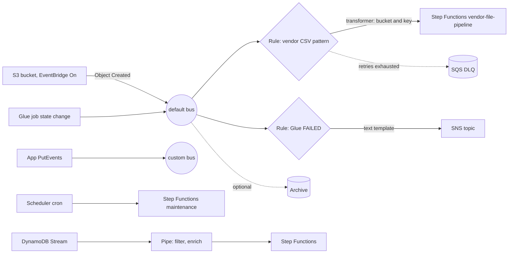
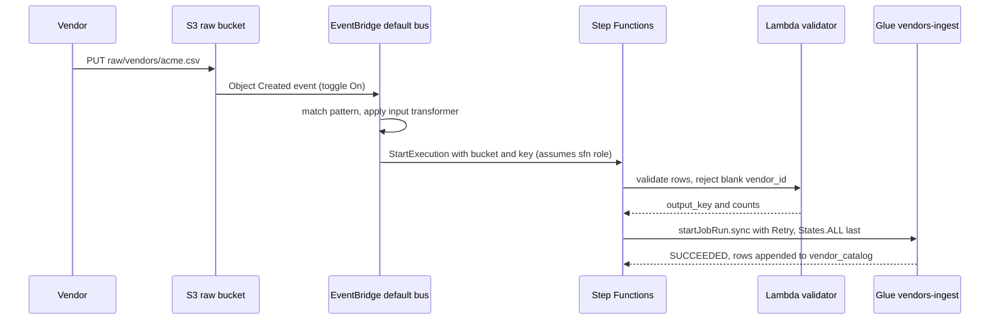

# 🚦 Amazon EventBridge

> **What it is:** a serverless **event router**. AWS services, your apps and SaaS partners publish JSON events to an **event bus**. **Rules** match events by content and push them to **targets** (Step Functions, Lambda, SNS, SQS, Firehose, API endpoints…). The same family also includes **EventBridge Scheduler** (cron/one-time jobs) and **EventBridge Pipes** (point-to-point source → filter → enrich → target).
> **GCP equivalent:** **Eventarc** (and Eventarc Advanced ⚠️) for routing, **Pub/Sub** for topics/filters, **Cloud Scheduler** for cron, **Cloud Storage Pub/Sub notifications** for "file landed" events.
> **In the HLD:** label **F**, *vendor CSV in S3 raw → EventBridge → Step Functions → Lambda validator → Glue*. See [Challenge F](../01_AWS_Data_Lakehouse_Demonstrated/Challenge_F_Vendor_File_Pipeline_EventBridge_StepFunctions_Lambda.md). Also behind the scenes: the scheduled rule `firehose-simulator-schedule-7db76de0` drives the traffic for [Challenge D](../01_AWS_Data_Lakehouse_Demonstrated/Challenge_D_Firehose_Iceberg_Streaming_Upserts_And_Buffering.md).
> **As of:** Nov 2026 · ⚠️ = unverified or likely to change, so verify in the docs · Related: [01 S3](01_Amazon_S3.md) · [08 Step Functions](08_AWS_Step_Functions.md) · [09 Lambda](09_AWS_Lambda.md) · [06 Firehose](06_Amazon_Data_Firehose.md) · [10 DynamoDB](10_Source_Systems_Aurora_PostgreSQL_And_DynamoDB.md) · [00 IAM](00_AWS_Foundations_IAM_Regions_CLI_CloudWatch_KMS.md)

---

## ⭐ Must-know first (labs + exam)

1. **Bus → rule → target.** An event lands on a **bus**. Each **rule** on that bus tests it against an **event pattern**. Every matching rule sends it to its targets (up to **5 per rule**).
2. **Every AWS service event goes to the `default` bus** in that account and region, and you pay nothing for those. You only write the rule.
3. **Envelope:** `version, id, detail-type, source, account, time, region, resources, detail`. Patterns usually match on `source`, `detail-type` and fields inside `detail`.
4. **Pattern logic:** values in an **array are OR**, separate **fields are AND**, string matching is **exact and case-sensitive**, and events may contain extra fields the pattern doesn't mention.
5. **Operators:** `prefix`, `suffix`, `wildcard`, `anything-but`, `numeric`, `exists`, `equals-ignore-case`, `cidr`, and `$or` ⚠️. **`wildcard` is the only way to AND a prefix with a suffix on one field** (`raw/vendors/*.csv`).
6. **The new console (seen Nov 2026):** rules live under **Event buses → `default` → Rules tab → Create rule**. The create page defaults to the **Enhanced builder** (visual canvas, launched Nov 2025). Switch to the **Advanced builder** for the classic step-by-step JSON wizard. Or skip the console and use **CloudShell**.
7. **Scheduled rules are "legacy".** Use **EventBridge Scheduler** for new cron jobs (time zones, one-time schedules, flexible windows, millions of schedules). The *Scheduled rules (legacy)* page doesn't list event-pattern rules (Challenge F, Mistake 1).
8. **S3 sends nothing to EventBridge until the bucket toggle is On** (Properties → Amazon EventBridge). The detail-type is `Object Created`. **Object keys arrive URL-encoded.**
9. **Input transformer** = `InputPathsMap` (JSONPath → variable) + `InputTemplate` (`<variable>` placeholders). **Quote string placeholders** (`"<key>"`) and leave numbers/objects unquoted.
10. **Target permissions:** Step Functions, Kinesis, Firehose, ECS and other targets need an **IAM role** that trusts `events.amazonaws.com`. Lambda, SNS, SQS and CloudWatch Logs use **resource-based policies** instead. Whoever creates the target needs `iam:PassRole` on the role.
11. **Delivery is at-least-once with no ordering.** Failed deliveries are retried for up to **24 h / 185 attempts** by default, then dropped unless the target has a **DLQ** (an SQS queue).
12. **Rules only see new events.** Files that existed before the rule need a backfill. **Archive & replay** only works for events archived *before* the problem.
13. **Debug in this order:** `test-event-pattern` → the rule's **MatchedEvents** → **Invocations** / **FailedInvocations** → the target's own logs.
14. **Pipes** = one source (SQS, Kinesis, DynamoDB Streams, MSK/Kafka, MQ) → filter → optional enrichment → one target. Use it instead of glue-code Lambdas between a stream and a service.
15. **EventBridge can't start a Glue job directly** (it can only start a Glue **workflow**) ⚠️. That's why the lab goes EventBridge → Step Functions → `glue:startJobRun.sync`. Scheduler's **universal targets** can call `glue:StartJobRun` directly.

---

## 🧱 First principles

### The problem: who tells whom that something happened?

A vendor file lands in S3. Three teams care: ingestion (start the pipeline), audit (log it), and ops (alert if it's huge). Your options:

| Approach | What happens | Cost of change |
|---|---|---|
| **Point-to-point** (S3 calls each consumer) | The producer must know every consumer | Each new consumer means changing the producer's config. N producers × M consumers integrations |
| **Topic pub/sub** (SNS, Pub/Sub) | The producer publishes to a named channel, and consumers subscribe | Consumers get **everything on the topic** and filter it themselves (or use limited attribute filters). The producer decides the channel taxonomy |
| **Content-based routing** (EventBridge) | The producer emits **facts** ("Object Created"). Consumers declare **patterns** over the event body | Adding a consumer = adding a rule. The producer is untouched |

EventBridge is a **router**: it looks at the content and decides where each event goes. Producers and consumers never know about each other.

### Constraints that shape the design

1. **Matching must be fast at scale.** Each event is checked against hundreds of rules in milliseconds. So patterns are **declarative JSON** with a small set of operators (no arbitrary code, no general regex) that compile into an efficient matching engine (AWS open-sourced it as *Event Ruler* ⚠️). That's why the `wildcard` rules are restricted and why you can't write "prefix AND suffix" as two conditions on one field.
2. **Events must be self-describing.** A common **envelope** (`source`, `detail-type`, `detail`) lets one engine route events from hundreds of services and lets you write patterns without reading producer code.
3. **Targets fail.** The router can't block producers while a target is down, so it **retries asynchronously** (exponential backoff, up to 24 h), then gives up or uses a **DLQ**. Parallel retrying means **no ordering**, and retries after a lost ACK mean **at-least-once**.
4. **A bus is not a queue.** There's no backlog you can pull from later, and no consumer offsets. If a consumer needs buffering, throttling or batching, make an **SQS queue the target**. If you need to look at history, add an **archive**.
5. **Targets act with your authority.** Starting a state machine is a privileged action, so EventBridge assumes an **IAM role** you provide, or the target's **resource policy** allows `events.amazonaws.com`, ideally scoped with `aws:SourceArn` to one rule.
6. **Payloads are small.** Events are capped at **256 KB**. For big data, send a pointer (`bucket` + `key`), never the file. This is the *claim-check* pattern, and it's exactly what Challenge F's input transformer passes.

### History (why the API is still `aws events`)

- **CloudWatch Events** (≈2016): AWS service events and cron schedules on what is now the `default` bus.
- **EventBridge** (July 2019): the same service and API, plus **custom buses**, **SaaS partner buses** and a new name. The CLI namespace stayed `events`, the console URL is `/events/`, and the metrics namespace is `AWS/Events`.
- Later additions: **schema registry** (2019) ⚠️, **archive & replay** (2020), **API destinations** (2021), **Pipes** and **Scheduler** (re:Invent 2022), **wildcard** matching (2023) ⚠️, the **Enhanced visual builder** (Nov 2025).

---

## 🧩 Core concepts

### Event buses

| Bus | Who publishes | Typical use |
|---|---|---|
| **default** | Every AWS service in the account/region (S3 with the toggle on, Glue, Step Functions, EC2, CloudTrail API calls…). You can also `PutEvents` to it | Reacting to AWS changes (the lab) |
| **custom** | Your applications (`PutEvents`), other accounts/regions (bus-to-bus) | Domain events (`OrderPlaced`), multi-account event meshes |
| **partner** | SaaS providers (Datadog, Zendesk, Auth0…) via a **partner event source** you accept | SaaS integrations without webhooks |

Buses are **regional**. Cross-region and cross-account delivery works by making **another bus a target**, with a resource policy on the receiving bus.

### The event envelope (S3 Object Created, the shape Challenge F matches)

```json
{
  "version": "0",
  "id": "17793124-05d4-b198-2fde-7ededc63b103",
  "detail-type": "Object Created",
  "source": "aws.s3",
  "account": "111122223333",
  "time": "2026-11-11T10:00:00Z",
  "region": "us-east-1",
  "resources": ["arn:aws:s3:::anycompany-lakehouse-raw-7db76de0"],
  "detail": {
    "version": "0",
    "bucket": { "name": "anycompany-lakehouse-raw-7db76de0" },
    "object": {
      "key": "raw/vendors/acme_2026-11-11.csv",
      "size": 20480,
      "etag": "d41d8cd98f00b204e9800998ecf8427e",
      "version-id": "IYV3p45BT0ac8hjHg1houSdS1a.Mxpoz",
      "sequencer": "00617F08299329D189"
    },
    "request-id": "N4N7GDK58NMKJ12R",
    "requester": "111122223333",
    "source-ip-address": "203.0.113.15",
    "reason": "PutObject"
  }
}
```

| Field | Meaning |
|---|---|
| `source` | Who emitted it (`aws.s3`, `aws.glue`, `com.anycompany.orders`). `aws.*` is **reserved**, so you can't `PutEvents` with it |
| `detail-type` | What happened (`Object Created`, `Glue Job State Change`) |
| `detail` | Service-specific payload. Most patterns match in here |
| `time` | When the event occurred (UTC) |
| `resources` | ARNs involved (here, the bucket) |
| `detail.reason` | `PutObject`, `POST Object`, `CopyObject`, `CompleteMultipartUpload` |
| `detail.object.key` | **URL-encoded**: `my file.csv` arrives as `my+file.csv` → decode with `urllib.parse.unquote_plus` |

Other S3 detail-types: `Object Deleted`, `Object Restore Initiated/Completed/Expired`, `Object Tags Added/Deleted`, `Object ACL Updated`, `Object Storage Class Changed`, `Object Access Tier Changed`.

### Three ways to run something on a trigger

| | **Rule with an event pattern** | **Scheduled rule (legacy)** | **EventBridge Scheduler** |
|---|---|---|---|
| Fires on | A matching event | `cron()` / `rate()` | `cron()`, `rate()`, one-time `at()` |
| Time zone | n/a | **UTC only** | Any IANA zone (DST-aware) |
| Scale | ~300 rules per bus ⚠️ | Counts against the bus rule quota | ~1 M schedules per account/region ⚠️ |
| Targets | Up to 5, ~20+ types | Up to 5 | 1 per schedule; templated targets + **universal targets** (thousands of SDK API actions) |
| Extras | Input transformer, DLQ, retry | Same | **Flexible time window**, per-schedule retry/DLQ, start/end dates, auto-delete after a one-time run |
| Console | **Event buses → default → Rules** | *Scheduler → Scheduled rules (legacy)* | *Scheduler → Schedules* |

### Console layout (what the learner hit in the lab)

| Where | Old layout | New layout (Nov 2026) |
|---|---|---|
| Event-pattern rules | Left menu → **Buses → Rules** | **Event buses → `default` → Rules** tab (no "Rules" item in the left menu) |
| Create rule page | One wizard | **Enhanced builder** (default: visual drag-and-drop canvas with Events/Targets palettes, Build/Configure tabs) or **Advanced builder** (the classic 5-step JSON wizard) |
| Cron rules | Rules list (type *Scheduled*) | **Scheduler → Scheduled rules (legacy)** |
| Direct URL | `https://us-east-1.console.aws.amazon.com/events/home?region=us-east-1#/rules` | Still works ⚠️ |

**Tip:** for exam labs, choose the **Advanced builder** (each field maps 1:1 to the API) or use **CloudShell** (`put-rule` + `put-targets`), which is faster and easier to verify.

### Pattern-matching operators

All examples sit inside a pattern such as `{"detail": {"object": {"key": [ ... ]}}}`.

| Operator | Example | Matches |
|---|---|---|
| Exact (OR list) | `"state": ["FAILED", "TIMEOUT"]` | Either value |
| `prefix` | `[{"prefix": "raw/vendors/"}]` | Starts with |
| `suffix` | `[{"suffix": ".csv"}]` | Ends with |
| Case-insensitive prefix/suffix ⚠️ | `[{"suffix": {"equals-ignore-case": ".csv"}}]` | `.csv`, `.CSV`, `.Csv` |
| `wildcard` | `[{"wildcard": "raw/vendors/*.csv"}]` | `*` = any characters, **including `/`** (sub-folders match) |
| `anything-but` | `[{"anything-but": ["test", "dev"]}]` | Any value except these |
| `anything-but` + prefix/suffix/wildcard ⚠️ | `[{"anything-but": {"prefix": "tmp/"}}]` | Exclude a prefix |
| `numeric` | `[{"numeric": [">", 0, "<=", 5242880]}]` | 0 < size ≤ 5 MiB |
| `exists` | `[{"exists": true}]` / `[{"exists": false}]` | Field present / absent (leaf fields only) |
| `equals-ignore-case` | `[{"equals-ignore-case": "failed"}]` | Case-insensitive equality |
| `cidr` | `[{"cidr": "10.0.0.0/24"}]` | IP in range |
| null / empty | `[null]`, `[""]` | JSON null / empty string |
| `$or` ⚠️ | `{"$or": [{"state": ["FAILED"]}, {"severity": ["ERROR"]}]}` | OR across **different fields** |

**Combining operators:**
- Several matchers in one array are **OR**: `"key": [{"prefix": "a/"}, {"prefix": "b/"}]`.
- To **AND** two conditions on the **same field**, use `wildcard`. `[{"prefix": "raw/vendors/"}, {"suffix": ".csv"}]` would be an **OR**, not an AND (a classic bug).
- Case-insensitive *and* prefix + suffix: `[{"wildcard": "raw/vendors/*.csv"}, {"wildcard": "raw/vendors/*.CSV"}]`.

### Targets and how they're authorised

| Target | Auth mechanism | Notes |
|---|---|---|
| Step Functions (Standard/Express) | **IAM role** (`states:StartExecution`) | Async start; EventBridge doesn't wait for the result. Execution name is auto-generated ⚠️ |
| Lambda | **Resource policy** (`lambda add-permission --principal events.amazonaws.com`) | Async invoke, so Lambda's own async retries apply as well |
| SNS / SQS | **Topic/queue policy** | KMS-encrypted topic/queue: the key policy must allow `events.amazonaws.com` |
| Kinesis / Firehose | IAM role | Common for "land all events in S3" ([06](06_Amazon_Data_Firehose.md)) |
| Another event bus (cross-account/region) | IAM role + receiving bus policy | Event mesh |
| API destination (any HTTPS endpoint) | Connection (API key / Basic / OAuth client credentials), stored in Secrets Manager | Rate-limited per destination |
| Glue **workflow**, ECS task, CodeBuild, Batch, Redshift Data API, SSM… | IAM role | Not Glue **jobs** directly ⚠️ |

### Input transformer

Two parts:
- **`InputPathsMap`** (console: *Input path*): `{"bucket": "$.detail.bucket.name", "size": "$.detail.object.size"}`. Up to 100 variables ⚠️.
- **`InputTemplate`** (console: *Template*): the target's input text with `<variable>` placeholders.

| Situation | Template | Result |
|---|---|---|
| String value in JSON | `{"bucket": "<bucket>"}` | `{"bucket": "anycompany-lakehouse-raw-…"}` |
| Number/object/array value | `{"size": <size>, "detail": <detail>}` | Inserted as raw JSON (**no quotes**) |
| Plain-text target (SNS email) | `"File <key> landed in <bucket>"` | A text message. In CLI JSON the whole template is a quoted string: `"\"File <key> ...\""` |
| Whole original event | `<aws.events.event.json>` | The full event as JSON |
| Built-ins | `<aws.events.rule-name>`, `<aws.events.rule-arn>`, `<aws.events.event.ingestion-time>` | Rule and timing metadata |

The common mistake: `{"bucket": <bucket>}` without quotes produces invalid JSON, so the target gets nothing or `put-targets` rejects it. A path that doesn't exist yields an empty value ⚠️, so don't rely on that behaviour.

### Retry policy and DLQ (per target)

- `RetryPolicy`: `MaximumRetryAttempts` 0–185 (default 185), `MaximumEventAgeInSeconds` 60–86,400 (default 86,400 = 24 h).
- Retried: throttling and 5xx-type errors. **Not retried**: permanent errors such as access denied or a missing resource. Those go straight to the DLQ ⚠️.
- `DeadLetterConfig.Arn` = an **SQS standard queue** (with a queue policy allowing `events.amazonaws.com`). DLQ messages carry attributes such as `ERROR_CODE`, `ERROR_MESSAGE`, `RULE_ARN`, `TARGET_ARN`.

### Archive & replay, schema registry, API destinations

- **Archive:** stores events from a bus (optionally filtered by a pattern) for N days or forever. **Replay:** re-sends a time range from the archive to the same bus, optionally to specific rules only. Replayed events carry a `replay-name` field, aren't guaranteed to be in order, and **a rule sees them like new events, so targets must be idempotent**.
- **Schema registry:** schemas for AWS events (`aws.events` registry), plus **schema discovery** on a bus that infers schemas from traffic and generates code bindings (Java/Python/TypeScript/Go ⚠️). The Enhanced builder uses it to offer event fields visually.
- **API destinations:** call third-party HTTPS APIs from a rule or pipe. You create a **connection** (auth) and an **API destination** (URL, method, `InvocationRateLimitPerSecond`). The timeout is a few seconds ⚠️, so use it for webhooks, not long calls.

### EventBridge Pipes

```text
Source (SQS | Kinesis | DynamoDB Streams | MSK | self-managed Kafka | Amazon MQ)
  → Filter (same pattern syntax; filtered-out records are dropped and not billed)
  → Enrichment (optional: Lambda | Step Functions Express (sync) | API Gateway | API destination)
  → Target (Step Functions, Lambda, SQS, SNS, Kinesis, Firehose, event bus, ECS, Batch, API destination…)
```

- **Point-to-point**: one source, one target. For fan-out, make an event bus the target.
- Pipes **poll** pull-based sources (like Lambda event source mappings) with batch size, batching window, starting position, retries, **bisect on error** and a DLQ.
- Step Functions **Standard** targets only support `FIRE_AND_FORGET`. **Express** also supports `REQUEST_RESPONSE`.

---

## 🔄 How it works (flow)



**Challenge F end to end:**



1. The producer emits an event (S3 does this only if the bucket's EventBridge toggle is **On**).
2. The event lands on the **default bus** in the bucket's region.
3. Every rule on the bus evaluates its pattern, and each match is independent.
4. For each target of a matching rule: apply the **input transformer**, then invoke with the **role** (or via the resource policy).
5. On failure: retry with backoff (up to 24 h / 185 attempts), then the **DLQ** or drop.
6. Metrics: `MatchedEvents` → `Invocations` → `FailedInvocations` per rule.

---

## 🛠️ Hands-on examples

### Example 1: Reproduce Challenge F's rule (Advanced builder + CloudShell)

**Goal:** the rule matches `Object Created` for `raw/vendors/*.csv` in the raw bucket and starts `vendor-file-pipeline` with `{"bucket": ..., "key": ...}` using `anycompany-eventbridge-sfn-role`.

> **Order matters:** fix and **Deploy** the Lambda and **Save** the state machine first. Then create the rule, then upload a test file.

**Console steps (Advanced builder)**
1. **Region** (top right) = **us-east-1**, the region of `vendor-file-pipeline`.
2. **S3 → raw bucket** (copy the **exact** suffixed name) → **Properties → Event notifications → Amazon EventBridge → Edit → On → Save**.
3. **Amazon EventBridge** (not *EventBridge Scheduler*) → **Event buses → `default` → Rules tab → Create rule**.
4. Builder choice: switch from **Enhanced builder** to **Advanced builder**.
5. *Define rule detail:* Name `vendor-csv-uploaded` · Event bus `default` · Enabled · Rule type **Rule with an event pattern** → Next.
6. *Build event pattern:* Event source **AWS events or EventBridge partner events** · Creation method **Custom pattern (JSON editor)** · paste (with your bucket name):
   ```json
   {
     "source": ["aws.s3"],
     "detail-type": ["Object Created"],
     "detail": {
       "bucket": { "name": ["anycompany-lakehouse-raw-7db76de0"] },
       "object": { "key": [{ "wildcard": "raw/vendors/*.csv" }] }
     }
   }
   ```
   Optional: **Sample event → AWS events → S3 Object Created → Test pattern**. Edit the sample's bucket and key first. → Next.
7. *Select targets:* **AWS service** → **Step Functions state machine** → `vendor-file-pipeline…` · Execution role **Use existing role** → `anycompany-eventbridge-sfn-role` · **Additional settings → Configure target input → Input transformer → Configure input transformer**:
   - Target input transformer, **Input path**: `{"bucket": "$.detail.bucket.name", "key": "$.detail.object.key"}`
   - **Template**: `{"bucket": "<bucket>", "key": "<key>"}` → **Confirm** → Next.
8. Tags → Next → Review → **Create rule**. Confirm the rule is **Enabled** and the **Targets** tab shows the state machine.

**CloudShell (the faster route used in the lab)**

```bash
# 3a. Look up exact names (lab resources carry a suffix)
ACCOUNT=$(aws sts get-caller-identity --query Account --output text)
BUCKET=$(aws s3api list-buckets --query "Buckets[?starts_with(Name, 'anycompany-lakehouse-raw')].Name | [0]" --output text)
SFN_ARN=$(aws stepfunctions list-state-machines --query "stateMachines[?starts_with(name, 'vendor-file-pipeline')].stateMachineArn | [0]" --output text)
ROLE_ARN=$(aws iam list-roles --query "Roles[?starts_with(RoleName, 'anycompany-eventbridge-sfn-role')].Arn | [0]" --output text 2>/dev/null)
if [ -z "$ROLE_ARN" ] || [ "$ROLE_ARN" = "None" ]; then ROLE_ARN="arn:aws:iam::${ACCOUNT}:role/anycompany-eventbridge-sfn-role"; fi
echo "BUCKET=$BUCKET"; echo "SFN_ARN=$SFN_ARN"; echo "ROLE_ARN=$ROLE_ARN"   # none may print None

# 3b. Turn on S3 -> EventBridge, MERGING with any existing notification config
aws s3api get-bucket-notification-configuration --bucket "$BUCKET" > notif.json
[ -s notif.json ] || echo '{}' > notif.json
if jq -e 'has("EventBridgeConfiguration")' notif.json >/dev/null; then
  echo "EventBridge notifications already ON"
else
  jq '. + {"EventBridgeConfiguration": {}}' notif.json > notif-new.json
  aws s3api put-bucket-notification-configuration --bucket "$BUCKET" --notification-configuration file://notif-new.json
  echo "EventBridge notifications turned ON"
fi

# 3c. Rule with the event pattern ($BUCKET expands because the heredoc delimiter is unquoted)
cat > pattern.json <<EOF
{
  "source": ["aws.s3"],
  "detail-type": ["Object Created"],
  "detail": {
    "bucket": { "name": ["$BUCKET"] },
    "object": { "key": [{ "wildcard": "raw/vendors/*.csv" }] }
  }
}
EOF
aws events put-rule --name vendor-csv-uploaded --event-bus-name default --state ENABLED --event-pattern file://pattern.json

# 3d. Target: state machine + role + input transformer
cat > targets.json <<EOF
[
  {
    "Id": "vendor-file-pipeline",
    "Arn": "$SFN_ARN",
    "RoleArn": "$ROLE_ARN",
    "InputTransformer": {
      "InputPathsMap": {
        "bucket": "\$.detail.bucket.name",
        "key": "\$.detail.object.key"
      },
      "InputTemplate": "{\"bucket\": \"<bucket>\", \"key\": \"<key>\"}"
    }
  }
]
EOF
aws events put-targets --rule vendor-csv-uploaded --event-bus-name default --targets file://targets.json
# expect: "FailedEntryCount": 0

# 3e. Verify
aws events describe-rule --name vendor-csv-uploaded --query "{State:State, Pattern:EventPattern}"
aws events list-targets-by-rule --rule vendor-csv-uploaded

# 3f. (extra) Prove the pattern offline before uploading anything
cat > event.json <<EOF
{
  "version": "0", "id": "11111111-2222-3333-4444-555555555555",
  "detail-type": "Object Created", "source": "aws.s3",
  "account": "$ACCOUNT", "time": "2026-11-11T10:00:00Z", "region": "us-east-1",
  "resources": ["arn:aws:s3:::$BUCKET"],
  "detail": { "bucket": {"name": "$BUCKET"},
              "object": {"key": "raw/vendors/acme_2026-11-11.csv", "size": 2048},
              "reason": "PutObject" }
}
EOF
aws events test-event-pattern --event-pattern file://pattern.json --event file://event.json   # {"Result": true}
sed -i 's/acme_2026-11-11.csv/acme.CSV/' event.json
aws events test-event-pattern --event-pattern file://pattern.json --event file://event.json   # {"Result": false}: case-sensitive
```

**Heredoc and quoting notes (study these):**
- `<<EOF` (unquoted delimiter) **expands** `$BUCKET`, `$SFN_ARN` and `$ROLE_ARN`. `<<'EOF'` (quoted) would keep everything literal.
- `\$.detail...` keeps a literal `$` for the JSONPath inside an expanding heredoc. Without the backslash, bash would expand `$.` (to nothing useful).
- Inside an unquoted heredoc, `\"` is left as-is. That is exactly the escaped-quote form the `InputTemplate` **string** needs, since its value is JSON inside a JSON string.
- `file://x.json` makes the CLI read the parameter from a file and avoids shell quoting problems.
- `put-rule` and `put-targets` are **idempotent upserts**. Re-running them updates the same rule and target `Id`.
- `put-bucket-notification-configuration` **replaces** the whole config, hence the read-merge-write in 3b.
- `test-event-pattern` needs every envelope field (`id, account, source, time, region, resources, detail-type`), or it errors.

**Expected result:** `FailedEntryCount: 0`; `describe-rule` shows `ENABLED`; the test returns `true` for `.csv` and `false` for `.CSV`.
**What to check (end to end):** copy an existing CSV to a new key under `raw/vendors/` → **Step Functions → Executions** shows a new run whose **input is only `{bucket, key}`** → `SELECT COUNT(*) FROM lakehouse_db.vendor_catalog;` (workgroup `anycompany-lakehouse`) is > 0 → the rule's **Monitoring** tab shows `MatchedEvents` and `Invocations` = 1 with `FailedInvocations` = 0.

---

### Example 2 (beyond the lab): alert on Glue job failure through SNS

**Goal:** an email arrives when any `orders-*` or `vendors-*` Glue job ends in FAILED, TIMEOUT or ERROR, with a readable message instead of raw JSON.

**Console steps:** SNS → Create topic `glue-job-failures` → Create subscription (Email) → confirm the email. EventBridge → Event buses → default → Rules → Create rule (Advanced builder) → pattern below → target **SNS topic** → Input transformer (paths + text template below) → Create. The console adds the SNS topic policy for you. **The CLI does not.**

```bash
ACCOUNT=$(aws sts get-caller-identity --query Account --output text)
TOPIC_ARN=$(aws sns create-topic --name glue-job-failures --query TopicArn --output text)
aws sns subscribe --topic-arn "$TOPIC_ARN" --protocol email --notification-endpoint you@example.com
# -> click the confirmation link in the email, or nothing is delivered

cat > glue-failed-pattern.json <<'EOF'
{
  "source": ["aws.glue"],
  "detail-type": ["Glue Job State Change"],
  "detail": {
    "state": ["FAILED", "TIMEOUT", "ERROR"],
    "jobName": [{ "prefix": "orders-" }, { "prefix": "vendors-" }]
  }
}
EOF
aws events put-rule --name glue-job-failed-alert --event-bus-name default \
  --event-pattern file://glue-failed-pattern.json --state ENABLED
RULE_ARN=$(aws events describe-rule --name glue-job-failed-alert --query Arn --output text)

# Topic policy: only THIS rule may publish. NOTE: this replaces the topic's default policy;
# on a shared topic, merge this statement into the existing policy instead.
cat > topic-policy.json <<EOF
{
  "Version": "2012-10-17",
  "Statement": [{
    "Sid": "AllowEventBridgeRule",
    "Effect": "Allow",
    "Principal": { "Service": "events.amazonaws.com" },
    "Action": "sns:Publish",
    "Resource": "$TOPIC_ARN",
    "Condition": { "ArnEquals": { "aws:SourceArn": "$RULE_ARN" } }
  }]
}
EOF
aws sns set-topic-attributes --topic-arn "$TOPIC_ARN" --attribute-name Policy --attribute-value file://topic-policy.json

# Target with a plain-text template (the whole template is a JSON string, so it's wrapped in \"...\")
cat > glue-targets.json <<EOF
[{
  "Id": "sns-glue-failures",
  "Arn": "$TOPIC_ARN",
  "InputTransformer": {
    "InputPathsMap": {
      "job":   "\$.detail.jobName",
      "run":   "\$.detail.jobRunId",
      "state": "\$.detail.state",
      "msg":   "\$.detail.message",
      "time":  "\$.time"
    },
    "InputTemplate": "\"Glue job <job> ended in state <state> at <time> (run <run>). Message: <msg>\""
  },
  "RetryPolicy": { "MaximumRetryAttempts": 10, "MaximumEventAgeInSeconds": 3600 }
}]
EOF
aws events put-targets --rule glue-job-failed-alert --targets file://glue-targets.json
```

**Test offline** (you can't `PutEvents` with `source: aws.glue`, because `aws.*` is reserved):

```bash
cat > glue-event.json <<EOF
{
  "version": "0", "id": "abcdef00-1234-5678-9abc-def012345678",
  "detail-type": "Glue Job State Change", "source": "aws.glue",
  "account": "$ACCOUNT", "time": "2026-11-11T10:15:00Z", "region": "us-east-1", "resources": [],
  "detail": { "jobName": "orders-ingest-7db76de0", "severity": "ERROR", "state": "FAILED",
              "jobRunId": "jr_0123456789abcdef", "message": "KeyError: 'export_date'" }
}
EOF
aws events test-event-pattern --event-pattern file://glue-failed-pattern.json --event file://glue-event.json
```

**Test for real:** run a job that fails on purpose. For example, start `orders-ingest` **without** `--export_date` and it fails with the `KeyError` from Challenge G (only in a sandbox, never on a graded table).

**Expected result:** an email *"Glue job orders-ingest-7db76de0 ended in state FAILED at … Message: …"*.
**What to check:** rule Monitoring shows `MatchedEvents` = 1, `Invocations` = 1. If `FailedInvocations` > 0, the topic policy is missing or the topic uses a KMS key whose key policy doesn't allow `events.amazonaws.com` (`kms:GenerateDataKey*`, `kms:Decrypt`).

---

### Example 3 (beyond the lab): EventBridge Scheduler cron → Step Functions with a flexible window

**Goal:** run Iceberg maintenance (OPTIMIZE then VACUUM, as in [Challenge B](../01_AWS_Data_Lakehouse_Demonstrated/Challenge_B_Analytics_Query_Performance_Compaction_And_MOR.md)) nightly at **02:30 local time**, with a 30-minute flexible window so many schedules don't all fire at the same second.

**State machine** (`iceberg-maintenance`, Standard). Athena runs **one statement per execution**, so each statement gets its own state:

```json
{
  "Comment": "Nightly Iceberg maintenance for daily_orders",
  "StartAt": "OptimizeDailyOrders",
  "States": {
    "OptimizeDailyOrders": {
      "Type": "Task",
      "Resource": "arn:aws:states:::athena:startQueryExecution.sync",
      "Parameters": {
        "QueryString": "OPTIMIZE lakehouse_db.daily_orders REWRITE DATA USING BIN_PACK",
        "WorkGroup": "anycompany-lakehouse"
      },
      "Retry": [{ "ErrorEquals": ["States.ALL"], "IntervalSeconds": 60, "MaxAttempts": 2, "BackoffRate": 2.0 }],
      "Next": "VacuumDailyOrders"
    },
    "VacuumDailyOrders": {
      "Type": "Task",
      "Resource": "arn:aws:states:::athena:startQueryExecution.sync",
      "Parameters": {
        "QueryString": "VACUUM lakehouse_db.daily_orders",
        "WorkGroup": "anycompany-lakehouse"
      },
      "End": true
    }
  }
}
```

**Scheduler role:** the trust policy lets `scheduler.amazonaws.com` assume it (scope it with `aws:SourceAccount`). The permissions policy allows `states:StartExecution` on the state machine and `sqs:SendMessage` on the DLQ.

```json
{
  "Version": "2012-10-17",
  "Statement": [{
    "Effect": "Allow",
    "Principal": { "Service": "scheduler.amazonaws.com" },
    "Action": "sts:AssumeRole",
    "Condition": { "StringEquals": { "aws:SourceAccount": "111122223333" } }
  }]
}
```

**Console steps:** Amazon EventBridge → **Scheduler → Schedules → Create schedule** → name `nightly-iceberg-maintenance`, group `lakehouse-maintenance` → **Recurring schedule → Cron-based** `30 2 * * ? *`, time zone of your choice (e.g. `Asia/Kolkata`) → **Flexible time window: 30 minutes** → Next → Target **AWS Step Functions StartExecution** → state machine `iceberg-maintenance` → Input (below) → Settings: retry policy, DLQ, role → Create.

**CLI:**

```bash
aws scheduler create-schedule-group --name lakehouse-maintenance

cat > sched-target.json <<'EOF'
{
  "Arn": "arn:aws:states:us-east-1:111122223333:stateMachine:iceberg-maintenance",
  "RoleArn": "arn:aws:iam::111122223333:role/scheduler-sfn-maintenance-role",
  "Input": "{\"run_type\": \"nightly\", \"scheduled_time\": \"<aws.scheduler.scheduled-time>\", \"attempt\": \"<aws.scheduler.attempt-number>\"}",
  "RetryPolicy": { "MaximumEventAgeInSeconds": 3600, "MaximumRetryAttempts": 3 },
  "DeadLetterConfig": { "Arn": "arn:aws:sqs:us-east-1:111122223333:scheduler-dlq" }
}
EOF

aws scheduler create-schedule \
  --name nightly-iceberg-maintenance \
  --group-name lakehouse-maintenance \
  --schedule-expression "cron(30 2 * * ? *)" \
  --schedule-expression-timezone "Asia/Kolkata" \
  --flexible-time-window '{"Mode": "FLEXIBLE", "MaximumWindowInMinutes": 30}' \
  --target file://sched-target.json \
  --state ENABLED

aws scheduler get-schedule --name nightly-iceberg-maintenance --group-name lakehouse-maintenance
```

- **Cron format** has 6 fields: `minutes hours day-of-month month day-of-week year`. One of day-of-month or day-of-week must be `?`.
- `<aws.scheduler.scheduled-time>` is a **context attribute**: the *logical* run time. Use it to derive the run date (like `--export_date` in [Challenge G](../01_AWS_Data_Lakehouse_Demonstrated/Challenge_G_Orders_Ingest_Duplicates_And_Iceberg_Snapshot_Rollback.md)) instead of the wall clock. Then retries and late starts process the right day.
- One-time variant: `--schedule-expression "at(2026-11-12T09:00:00)" --action-after-completion DELETE`.
- **Universal target** alternative (no state machine): `"Arn": "arn:aws:scheduler:::aws-sdk:glue:startJobRun"` with `"Input": "{\"JobName\": \"orders-ingest\"}"` ⚠️.

**Expected result:** each night between 02:30 and 03:00 local time, a `iceberg-maintenance` execution runs both queries.
**What to check:** Step Functions execution history (two Athena query IDs); Athena `$snapshots` count drops after VACUUM; CloudWatch metrics for Scheduler (`InvocationAttemptCount`, `TargetErrorCount`) ⚠️; the DLQ stays empty.

---

### Example 4 (beyond the lab): Pipes from DynamoDB Streams to Step Functions with a filter

**Goal:** when an order's status **changes to** `CANCELLED` in DynamoDB, start `order-cancellation-flow`, with no Lambda glue and without starting it for any other update.

**Step 1: enable the stream** (old *and* new images are needed to detect a *change*):

```bash
aws dynamodb update-table --table-name orders \
  --stream-specification StreamEnabled=true,StreamViewType=NEW_AND_OLD_IMAGES
STREAM_ARN=$(aws dynamodb describe-table --table-name orders --query Table.LatestStreamArn --output text)
```

**Step 2: filter.** Stream records use **DynamoDB JSON** (`{"S": "..."}`), so the pattern must too:

```json
{
  "eventName": ["MODIFY"],
  "dynamodb": {
    "NewImage": { "status": { "S": ["CANCELLED"] } },
    "OldImage": { "status": { "S": [{ "anything-but": ["CANCELLED"] }] } }
  }
}
```

**Step 3: pipe role.** Trust `pipes.amazonaws.com`. Permissions:

```json
{
  "Version": "2012-10-17",
  "Statement": [
    { "Effect": "Allow",
      "Action": ["dynamodb:DescribeStream", "dynamodb:GetRecords", "dynamodb:GetShardIterator", "dynamodb:ListStreams"],
      "Resource": "arn:aws:dynamodb:us-east-1:111122223333:table/orders/stream/*" },
    { "Effect": "Allow", "Action": "states:StartExecution",
      "Resource": "arn:aws:states:us-east-1:111122223333:stateMachine:order-cancellation-flow" },
    { "Effect": "Allow", "Action": "sqs:SendMessage",
      "Resource": "arn:aws:sqs:us-east-1:111122223333:orders-pipe-dlq" }
  ]
}
```

**Step 4: create the pipe.** `jq` builds the escaped `Pattern` string for you, so there's no hand-escaping:

```bash
# filter.json = the pattern from Step 2
jq -n --arg p "$(jq -c . filter.json)" '{
  DynamoDBStreamParameters: {
    StartingPosition: "LATEST",
    BatchSize: 1,
    MaximumRetryAttempts: 3,
    OnPartialBatchItemFailure: "AUTOMATIC_BISECT",
    DeadLetterConfig: { Arn: "arn:aws:sqs:us-east-1:111122223333:orders-pipe-dlq" }
  },
  FilterCriteria: { Filters: [ { Pattern: $p } ] }
}' > source-params.json

cat > target-params.json <<'EOF'
{
  "StepFunctionStateMachineParameters": { "InvocationType": "FIRE_AND_FORGET" },
  "InputTemplate": "{\"order_id\": \"<$.dynamodb.Keys.order_id.S>\", \"cancelled_at\": \"<$.dynamodb.NewImage.updated_at.S>\", \"stream_event_id\": \"<$.eventID>\"}"
}
EOF

aws pipes create-pipe \
  --name orders-cancelled-to-sfn \
  --role-arn arn:aws:iam::111122223333:role/pipes-orders-cancel-role \
  --source "$STREAM_ARN" \
  --source-parameters file://source-params.json \
  --target arn:aws:states:us-east-1:111122223333:stateMachine:order-cancellation-flow \
  --target-parameters file://target-params.json \
  --desired-state RUNNING
```

**Console steps:** EventBridge → **Pipes → Create pipe** → Source **DynamoDB stream** `orders` (starting position *Latest*, batch size 1) → **Filtering**: paste the pattern → **Enrichment**: none (or a Lambda that looks up customer details) → **Target**: Step Functions, invocation type *Fire and forget*, **Input transformer** as above → Permissions: create or choose a role → Create.

- Pipe input templates use `<$.path>` (a JSONPath inside the brackets), unlike rule transformers' named variables.
- ⚠️ Check in the execution's input whether a batch arrives as one object or a one-element array, and adapt the state machine's paths (`$[0]...`).

**Expected result:** `aws dynamodb update-item ... status=CANCELLED` starts one execution with `{"order_id": "...", ...}`. Changing status to `SHIPPED`, or re-saving an already-cancelled order, starts **none**.
**What to check:** Pipe **Monitoring** (events received vs filtered vs target invocations ⚠️), the Step Functions executions list, and the DLQ depth.

---

### Example 5 (short, beyond the lab): custom bus + PutEvents + archive for replay

```python
import json
import boto3

events = boto3.client("events", region_name="us-east-1")
resp = events.put_events(Entries=[{
    "EventBusName": "lakehouse-bus",                 # create first: aws events create-event-bus --name lakehouse-bus
    "Source": "com.anycompany.vendor-portal",         # aws.* is reserved
    "DetailType": "Vendor File Approved",
    "Detail": json.dumps({"vendor_id": "V001", "bucket": "anycompany-lakehouse-raw-7db76de0",
                          "key": "raw/vendors/acme.csv"}),
}])
# Like Firehose PutRecordBatch: HTTP 200 can still contain failed entries
for entry in resp["Entries"]:
    if "ErrorCode" in entry:
        print("retry me:", entry["ErrorCode"], entry["ErrorMessage"])
```

```bash
aws events create-archive --archive-name lakehouse-bus-30d \
  --event-source-arn arn:aws:events:us-east-1:111122223333:event-bus/lakehouse-bus --retention-days 30
# after fixing a consumer bug, replay one day to one rule only:
aws events start-replay --replay-name vendor-fix-2026-11-10 \
  --event-source-arn arn:aws:events:us-east-1:111122223333:archive/lakehouse-bus-30d \
  --event-start-time 2026-11-10T00:00:00Z --event-end-time 2026-11-11T00:00:00Z \
  --destination '{"Arn": "arn:aws:events:us-east-1:111122223333:event-bus/lakehouse-bus", "FilterArns": ["arn:aws:events:us-east-1:111122223333:rule/lakehouse-bus/vendor-approved-to-sfn"]}'
```

`PutEvents` takes ≤ 10 entries per call. Replayed events re-trigger targets, so they must be **idempotent**.

---

## ⚙️ Key settings, limits & quotas

| Item | Value | Notes |
|---|---|---|
| Event size | 256 KB | Send pointers for big payloads |
| `PutEvents` entries per call | 10 | Check `FailedEntryCount` |
| `PutEvents` rate ⚠️ | ~10,000/s in us-east-1 (region-dependent, soft) | Throttled → `ThrottlingException` |
| Target invocations rate ⚠️ | ~18,750/s in us-east-1 (soft) | `ThrottledRules` metric |
| Rules per bus ⚠️ | 300 (soft) | |
| Targets per rule | 5 (hard) | Fan out further via SNS or another bus |
| Event buses per account ⚠️ | 100 (soft) | |
| Input transformer variables ⚠️ | 100 | Template length limit ⚠️ ~8,192 chars |
| Target retry | 0–185 attempts, 60 s–24 h age (defaults 185 / 24 h) | DLQ = SQS standard queue |
| Archive retention | N days or indefinite | Replay to the same bus |
| Scheduler ⚠️ | ~1 M schedules per account/region; flexible window up to 24 h; one target per schedule | Time zones, `at()`, `rate()`, `cron()` |
| API destination ⚠️ | Rate limit up to ~300 invocations/s per destination; ~5 s timeout | |
| Pipes ⚠️ | ~1,000 pipes per account/region | One source, one target |
| Scheduled rule cron | UTC only | Use Scheduler for local time |

---

## 🔐 Security

**Who can build what:**
- Creating rules needs `events:PutRule`, `events:PutTargets`, and **`iam:PassRole`** on any target role (`anycompany-eventbridge-sfn-role`). Without PassRole, `put-targets` fails even though the role exists.
- Publishing needs `events:PutEvents` on the **bus ARN**. Cross-account publishing needs a **bus resource policy** (`aws events put-permission` or `put-policy` ⚠️).

**Target role (Challenge F's `anycompany-eventbridge-sfn-role`), least privilege:**

```json
{
  "Version": "2012-10-17",
  "Statement": [{
    "Effect": "Allow",
    "Principal": { "Service": "events.amazonaws.com" },
    "Action": "sts:AssumeRole",
    "Condition": { "StringEquals": { "aws:SourceAccount": "111122223333" } }
  }]
}
```
```json
{
  "Version": "2012-10-17",
  "Statement": [{
    "Effect": "Allow",
    "Action": "states:StartExecution",
    "Resource": "arn:aws:states:us-east-1:111122223333:stateMachine:vendor-file-pipeline-7db76de0"
  }]
}
```

**Resource policies** (Lambda/SNS/SQS targets, DLQs): always add `aws:SourceArn` = the rule ARN, so only that rule can invoke them (confused-deputy protection).

**Encryption:** events are encrypted at rest with AWS-owned keys. Custom buses and archives can use a **customer managed KMS key** ⚠️ (newer feature, so check the region). KMS-encrypted SNS/SQS targets and DLQs need a key policy that allows `events.amazonaws.com`.

**Data exposure:** archives, DLQs and API-destination payloads **contain event content**. Keep PII out of events (send IDs and pointers), and restrict access to archives and DLQs.

**Spoofing:** `source` values starting with `aws.` can't be published by you, so a rule on `aws.s3` really came from S3. Custom sources can be published by anyone with `PutEvents` on the bus, so lock down the bus policy.

**Lake Formation:** EventBridge only moves metadata about events and never reads table data, so it needs no LF grants. The **targets** it starts (Glue jobs via Step Functions) need LF grants on the tables they write. A useful governance angle: Glue Data Catalog changes emit events (e.g. *Glue Data Catalog Table State Change* ⚠️) that you can audit or alert on.

---

## 💰 Cost model & optimisation

⚠️ us-east-1 list prices from memory. Check https://aws.amazon.com/eventbridge/pricing/

| Item | Approx. price ⚠️ |
|---|---|
| AWS service events on the default bus (S3, Glue…) | **Free** |
| Custom / partner events published | ~$1.00 per million (each 64 KB chunk counts as one event) |
| Cross-account / cross-region delivery | ~$1.00 per million |
| Rule matching and target delivery | No separate charge (you pay the target service) |
| Archive | ~$0.10/GB archived + ~$0.023/GB-month storage. Replays billed as events |
| Schema discovery | Free tier, then ~$0.10 per million events |
| API destinations | ~$0.20 per million invocations |
| Pipes | ~$0.40 per million requests **after filtering** (64 KB chunks) |
| Scheduler | ~14 M invocations/month free, then ~$1.00 per million |

**Worked example (a lakehouse like the lab, per month):**
- Vendor uploads: 300 files/day → 9,000 S3 events → **$0** (AWS service events). Step Functions/Lambda/Glue costs dominate (see [08](08_AWS_Step_Functions.md), [03](03_AWS_Glue.md)).
- App domain events: 20 M × 3 KB custom events → **$20**. Archive 30 days: 60 GB → $6 + ~$1.4 storage.
- Pipe on the orders stream: 50 M stream records, filter passes 0.5% → 250 k billed → **~$0.10**.
- Scheduler: 30 maintenance runs → **$0**.
- **Total ≈ $28/month.** The levers: filter in Pipes (you're only billed for what passes), keep payloads under 64 KB, archive with a **pattern** (only the events worth replaying), and don't use EventBridge for high-volume telemetry (see chain 10).

---

## 📈 Monitoring & troubleshooting

**Metrics** (namespace `AWS/Events`, dimension `RuleName`, also `EventBusName`). They appear on the rule's **Monitoring** tab:

| Metric | Meaning |
|---|---|
| `MatchedEvents` | Events that matched the rule's pattern |
| `TriggeredRules` | Times the rule was triggered |
| `Invocations` | Target invocations (successful or permanently failed, not counting retries in flight) |
| `FailedInvocations` | Invocations that failed permanently |
| `ThrottledRules` | Rule invocations throttled |
| `DeadLetterInvocations` / `InvocationsSentToDlq` ⚠️ | Sent to the DLQ |
| `InvocationsFailedToBeSentToDlq` | DLQ itself unreachable (check its policy/KMS) |
| `RetryInvocationAttempts`, `IngestionToInvocationStartLatency` ⚠️ | Retries; end-to-end delay |

**Debug ladder:** `MatchedEvents = 0` means the pattern, bus, region or source is the problem. `MatchedEvents > 0` with `FailedInvocations > 0` means permissions, the target or the input is the problem. `Invocations > 0` but nothing happens means the target's own logic (check its logs or executions).

| Symptom | Likely cause | How to confirm | Fix |
|---|---|---|---|
| Can't find **Rules** (Challenge F) | New console puts rules inside the bus; or you're in Scheduler; or the wrong region | Left menu has no "Rules" | **Event buses → default → Rules**; check the region |
| Only *Scheduled rules (legacy)* visible (Challenge F, Mistake 1) | That page lists cron/rate rules only | Page title | Use the bus's Rules tab |
| Create page looks like a drag-and-drop canvas | **Enhanced builder** (default since Nov 2025) | Builder toggle | Switch to **Advanced builder**, or use CloudShell |
| `vendor-file-pipeline` missing from the target list | Console region ≠ lab region | Region selector | Switch to us-east-1 |
| Upload made, no execution, `MatchedEvents = 0` | Bucket **EventBridge toggle Off** | S3 → Properties → Amazon EventBridge | Turn it **On** (or 3b script) |
| Still `MatchedEvents = 0` | Bucket name missing its suffix; key outside `raw/vendors/`; `.CSV` vs `.csv`; rule on a custom bus | `test-event-pattern` with a real event | Copy names exactly; add a `.CSV` wildcard; use the default bus |
| `MatchedEvents > 0`, `FailedInvocations > 0` | Role lacks `states:StartExecution`, wrong trust principal, or a KMS/resource-policy gap | CloudTrail `StartExecution` AccessDenied; DLQ attributes | Fix the role policy/trust; add the resource or key policy |
| Execution starts but the first state fails reading input | Full event passed, or a malformed template (missing quotes) | Execution input in the SFN console | Template `{"bucket": "<bucket>", "key": "<key>"}` |
| `put-targets` returns `FailedEntryCount: 1` | Invalid template JSON, missing PassRole, bad ARN | `FailedEntries[].ErrorMessage` | Fix and re-run (idempotent) |
| Lambda says *NoSuchKey* for files with spaces | Keys are **URL-encoded** in events | Compare the event key to the S3 key | `urllib.parse.unquote_plus(key)` |
| Pipeline runs twice for one file | At-least-once delivery, or two rules matching | Two executions, same key | Idempotent loads (MERGE / load-tracking on bucket+key+etag) |
| Infinite loop, costs climbing | Target writes output back under the matched prefix | Executions keep coming without uploads | Write to `validated/` or another bucket; tighten the pattern |
| Old files never processed (Challenge F) | Rules only see new events | No events before the rule existed | Re-copy objects or start executions by script |
| Glue failure alert never arrives | Email not confirmed; topic policy missing (CLI); KMS topic | SNS subscription status; `FailedInvocations` | Confirm; add the topic/key policy |
| Scheduler fires at the "wrong" hour | Legacy rule cron is UTC; DST | Compare to the time zone | Scheduler with `--schedule-expression-timezone` |
| Pipe never triggers | Filter uses plain JSON instead of DynamoDB JSON; stream view lacks `OldImage` | Pipe metrics show events filtered out | `{"S": [...]}` shapes; `NEW_AND_OLD_IMAGES` |

---

## 🧠 Second-order thinking

1. **Turn on S3 → EventBridge for the whole bucket** → one toggle, no per-prefix config → every object event in the bucket flows (free, but noisy); broad rules fire on temp files, `_SUCCESS` markers and rejects → **tight patterns** (wildcard on prefix + extension), plus separate prefixes for outputs.
2. **The validator writes its cleaned file next to the input** (`raw/vendors/acme_clean.csv`) → simple paths → the rule matches its own output and the pipeline triggers itself, **in a loop** → write outputs outside the matched prefix (`validated/`), or exclude with `anything-but`.
3. **Accept at-least-once delivery** → simple, resilient routing → occasional duplicate executions double-load data (Challenge G-style duplicates) → **idempotent loads**: MERGE on a key, or a load ledger keyed by `bucket/key/etag`.
4. **Minimal `{bucket, key}` contract** (Challenge F) → the workflow is decoupled from the event format → later you need `etag`, `version-id`, `size` and `time` for dedupe and audit, and every consumer must change → **design the contract with room**: include `etag`, `version-id` and `event_time` from day one.
5. **Leave the default retry policy and no DLQ** → zero config → a permissions bug means 24 h of silent retries, then events vanish → **DLQ + alarm on `FailedInvocations`**. Use a shorter `MaximumEventAgeInSeconds` for time-sensitive targets.
6. **No archive** → cheap and simple → a consumer bug loses a day of events, and the only recovery is re-listing S3 or source systems → **archive with a pattern** on important buses (pennies), and practise a replay.
7. **Keep using scheduled rules (UTC cron)** → it works today → DST moves business-time jobs twice a year, there's no flexible window or per-schedule DLQ, and they count against the rule quota → **migrate to Scheduler** with time zones.
8. **Flexible time windows** → load is spread and there's no thundering herd → start times are non-deterministic, and anything that keys off "now" can process the wrong day → derive the logical date from `<aws.scheduler.scheduled-time>`.
9. **Pipes with a filter instead of a Lambda** → less code and lower cost → filtered-out records are **gone** (no retry later). A failing target blocks the shard until the record ages out → set `MaximumRetryAttempts`, bisect, a DLQ, and alarms.
10. **EventBridge for high-volume telemetry** → one familiar tool → 10,000 events/s ≈ 26 B events/month ≈ **$26k/month** ⚠️, plus quota pressure → use **Kinesis/Firehose** for streams, and EventBridge for business events (low volume, high value).

**When not to use EventBridge:** high-throughput streams (KDS/MSK/Firehose); strict ordering or exactly-once; consumers that need a backlog, pull or rate control (SQS); payloads > 256 KB (claim-check via S3); synchronous request/response; multi-step orchestration with state (Step Functions).

---

## 🔀 Alternatives & comparisons

| | **EventBridge bus + rules** | **SNS** | **SQS** | **EventBridge Pipes** | **S3 event notifications (classic)** |
|---|---|---|---|---|---|
| Model | Content-based router (push) | Topic fan-out (push) | Queue (pull) | Point-to-point poller | Per-bucket push |
| Filtering | Rich, on the whole event | Filter policies on attributes or payload | None (consumers filter) | Rich (same syntax) | Prefix + suffix only |
| Fan-out | 5 targets per rule × many rules | Very high subscriber counts | One consumer group | 1 target | One destination per event type/prefix (no overlaps) |
| Ordering | None | FIFO topics | FIFO queues | Per shard/partition (stream sources) | None |
| Backlog/buffer | None (24 h retries) | None (retries) | Up to 14 days | Source holds it | None |
| Targets | 20+ services, API destinations, buses | Lambda, SQS, HTTP, email/SMS, Firehose | Your consumers | 15+ ⚠️ | **Lambda, SQS, SNS only** |
| Latency | ~sub-second ⚠️ | Tens of ms | ms (+ poll) | Batching-dependent | Sub-second |
| Pick when | Many consumers, content routing, AWS service events, SaaS | Massive fan-out, mobile/email | Buffering, load levelling, retries you control | Stream/queue → service with no glue code | Simple Lambda trigger on one prefix |

**Common pairings:** S3 → EventBridge → **SQS** → Lambda (buffer bursts) · EventBridge → **SNS** (fan-out to people) · Pipes → **event bus** (stream → content routing).

**GCP mapping**

| AWS | GCP | Notes |
|---|---|---|
| Default bus + AWS service events | **Eventarc** (direct events + Cloud Audit Logs) | Eventarc triggers deliver CloudEvents |
| Custom bus + rules | **Eventarc Advanced** bus + enrollments ⚠️, or a Pub/Sub topic + filtered subscriptions | Pub/Sub filters on **attributes only** |
| Event pattern | Eventarc trigger filters (exact/path pattern); CEL in Eventarc Advanced ⚠️ | EventBridge's operators are richer than standard Eventarc |
| Input transformer | Eventarc Advanced pipeline transformations (CEL) ⚠️; Pub/Sub SMTs ⚠️ | |
| Targets (Step Functions, Lambda) | **Workflows**, Cloud Run, Cloud Functions, GKE | |
| SNS | Pub/Sub push subscriptions | |
| SQS | Pub/Sub pull subscription / **Cloud Tasks** | |
| Archive & replay | Pub/Sub message retention + **seek** (to a snapshot/timestamp) | |
| Schema registry | **Pub/Sub schemas** | |
| API destinations | Pub/Sub push to HTTPS; Eventarc HTTP destinations ⚠️ | |
| Pipes | No 1:1 service. Eventarc Advanced pipelines ⚠️, or Pub/Sub → Cloud Run glue | |
| Scheduler / scheduled rules | **Cloud Scheduler** (cron + time zone, HTTP/PubSub targets) | Scheduler adds flexible windows and one-time `at()` |
| S3 → EventBridge Object Created | **Cloud Storage Pub/Sub notifications** (`OBJECT_FINALIZE`) or the Eventarc trigger `google.cloud.storage.object.v1.finalized` | Same "file landed" idea |

---

## 🎯 Exam angle

- **"Start a Step Functions workflow when a `.csv` lands under a prefix, with minimal code"** → S3 **EventBridge notifications** + rule (wildcard/suffix) → Step Functions. **Trap:** classic S3 event notifications can't target Step Functions (only Lambda/SQS/SNS).
- **"Pass only the bucket and key to the target"** → **input transformer**.
- **"Notify the team when a Glue job fails"** → rule on `aws.glue` / `Glue Job State Change` / `state: FAILED` → SNS. Similar: *Glue Crawler State Change* → start the next job.
- **"Run a job at 2 AM local time, DST-safe, at scale"** → **EventBridge Scheduler** (or Glue scheduled triggers for Glue-only flows). **Trap:** a UTC cron rule.
- **"React to SaaS events (Zendesk, Datadog…)"** → **partner event bus**.
- **"Reprocess yesterday's events after a bug fix"** → **archive & replay** (only if the archive existed).
- **"Call an external REST API with OAuth on each event"** → **API destination**.
- **"SQS/Kinesis/DynamoDB Streams → filter → Step Functions, no Lambda"** → **Pipes**.
- **"Events from another account"** → cross-account bus target + bus resource policy.
- **"Audit specific API calls"** → detail-type `AWS API Call via CloudTrail` (needs CloudTrail; some events need a trail ⚠️).
- **Keywords:** *event-driven, decoupled, rule, event pattern, content-based filtering, schedule, cron, SaaS, replay, input transformer, serverless integration*.
- **Distractors:** "use CloudTrail data events for S3 uploads" (the old way before native S3 → EventBridge), "poll S3 with a cron Lambda", "SNS filter policy" when the condition needs the full event body.

---

## 🧪 Self-test

1. A file `raw/vendors/sub/acme.csv` is uploaded. Does the Challenge F wildcard pattern match it?
2. Write a pattern value that matches keys starting with `raw/vendors/` **and** ending with `.csv` **or** `.CSV`.
3. Why is `"key": [{"prefix": "raw/vendors/"}, {"suffix": ".csv"}]` a bug?
4. In an input template, when do you put quotes around a placeholder?
5. `MatchedEvents` is 5 and `FailedInvocations` is 5. Where do you look first?
6. Which targets use an IAM role, and which use a resource-based policy? Give two of each.
7. Why can't you test the Glue failure rule with `aws events put-events --entries Source=aws.glue,...`? How else can you test it?
8. What happens to an event whose Step Functions target keeps failing with AccessDenied, if there's no DLQ?
9. Name three advantages of EventBridge Scheduler over scheduled rules.
10. In Pipes, why does the DynamoDB filter use `{"S": ["CANCELLED"]}` instead of `["CANCELLED"]`?
11. Your rule worked yesterday. Today you need to process 200 files uploaded last week, before the rule existed. Options?
12. Where are event-pattern rules in the new console, and which builder matches the classic wizard?

<details><summary>Answers</summary>

1. **Yes.** `*` matches any characters including `/`, so sub-folders match. Use a stricter design (or `anything-but`) if that's unwanted.
2. `"key": [{"wildcard": "raw/vendors/*.csv"}, {"wildcard": "raw/vendors/*.CSV"}]`. Entries in the array are OR'ed, and each wildcard ANDs prefix with suffix.
3. Matchers in one array are **OR**. It matches *any* key under `raw/vendors/` **or** *any* `.csv` anywhere in the bucket.
4. When the variable holds a **string** and the template is JSON (`"<key>"`). Numbers, booleans, objects and arrays go unquoted.
5. The **target permissions**: the role's `states:StartExecution` policy and its trust (`events.amazonaws.com`), then CloudTrail for AccessDenied, then any KMS/resource policy. The pattern is fine, because it matched.
6. Role: Step Functions, Kinesis, Firehose, ECS, cross-account bus. Resource policy: Lambda, SNS, SQS, CloudWatch Logs.
7. `aws.*` sources are reserved, so you can't publish them. Use `test-event-pattern` with a sample event, or cause a real (sandbox) job failure.
8. AccessDenied is a permanent error, so it isn't retried ⚠️. It counts as a `FailedInvocation`, and the event is **dropped**. With a DLQ, it would be kept in SQS with the error attributes.
9. Time zones (DST-aware), one-time `at()` schedules, flexible time windows, per-schedule retry/DLQ, universal targets, and a much higher schedule quota.
10. DynamoDB stream records use **DynamoDB JSON**, where each attribute is wrapped in a type descriptor (`S`, `N`, `M`…). The pattern must mirror the record's actual shape.
11. Re-copy each object (creates new events), script `start-execution` with `{bucket, key}` per key, or use S3 Batch Operations to invoke a Lambda that starts executions. Replay only works if an archive captured those events.
12. **Event buses → `default` → Rules tab → Create rule.** Choose **Advanced builder** (the Enhanced builder is the visual canvas).

</details>

---

## 📚 References

- What is Amazon EventBridge: https://docs.aws.amazon.com/eventbridge/latest/userguide/eb-what-is.html
- Rules in EventBridge: https://docs.aws.amazon.com/eventbridge/latest/userguide/eb-rules.html
- Creating rules with the Advanced Builder: https://docs.aws.amazon.com/eventbridge/latest/userguide/eb-create-rule-wizard.html
- Creating rules with the Enhanced Builder: https://docs.aws.amazon.com/eventbridge/latest/userguide/eb-create-rule-visual.html
- What's New (Nov 2025): enhanced visual rule builder: https://aws.amazon.com/about-aws/whats-new/2025/11/eventbridge-enhanced-visual-rule-builder
- Event patterns: https://docs.aws.amazon.com/eventbridge/latest/userguide/eb-event-patterns.html
- Content filtering operators (wildcard, anything-but, `$or`…): search "EventBridge content filtering in event patterns"
- Input transformation: search "EventBridge input transformer InputPathsMap InputTemplate"
- Using EventBridge with Amazon S3: https://docs.aws.amazon.com/AmazonS3/latest/userguide/EventBridge.html
- EventBridge Scheduler user guide: https://docs.aws.amazon.com/scheduler/latest/UserGuide/what-is-scheduler.html
- EventBridge Pipes: search "Amazon EventBridge Pipes user guide filtering DynamoDB stream"
- Archive and replay: search "EventBridge archive and replay events"
- Glue events: search "AWS Glue EventBridge Glue Job State Change event"
- Pricing: https://aws.amazon.com/eventbridge/pricing/
- Pattern library: https://serverlessland.com/patterns
- Event Ruler (the open-source matching engine): search "aws event-ruler github"
- GCP: search "Eventarc overview", "Eventarc Advanced", "Pub/Sub notifications for Cloud Storage", "Cloud Scheduler cron time zone"
