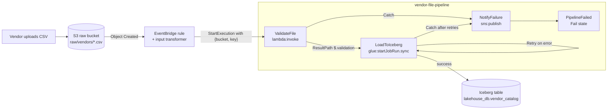
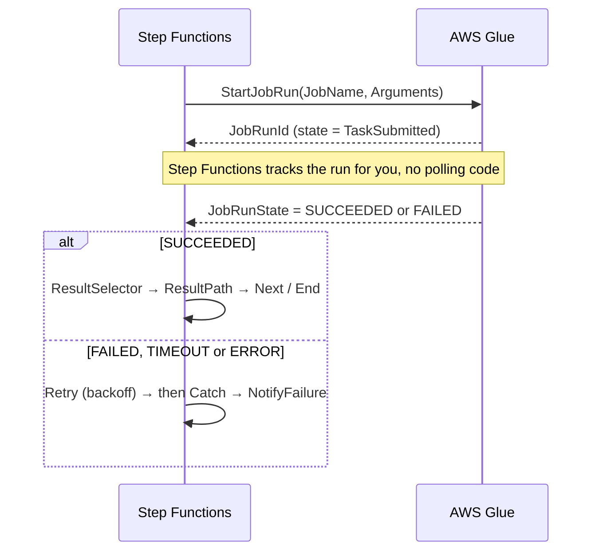

# 🧭 AWS Step Functions

> **What it is:** a managed workflow engine. You describe a workflow as a JSON state machine in the **Amazon States Language (ASL)**. Step Functions runs it durably and calls other AWS services at each step.
> **GCP equivalent:** **Workflows** (closest match), **Cloud Composer** for Airflow-style DAGs, **Cloud Tasks** for queued dispatch with retries.
> **In the HLD:** label **F**. Vendor CSV → EventBridge → **`vendor-file-pipeline`** → Lambda validator → Glue `vendors-ingest` (state `LoadToIceberg`). See [Challenge F](../01_AWS_Data_Lakehouse_Demonstrated/Challenge_F_Vendor_File_Pipeline_EventBridge_StepFunctions_Lambda.md). The idempotency lessons from [Challenge G](../01_AWS_Data_Lakehouse_Demonstrated/Challenge_G_Orders_Ingest_Duplicates_And_Iceberg_Snapshot_Rollback.md) also apply to anything Step Functions retries.
> **Related files:** [09 Lambda](09_AWS_Lambda.md) · [03 Glue](03_AWS_Glue.md) · [07 EventBridge](07_Amazon_EventBridge.md) · [04 Athena](04_Amazon_Athena.md) · [00 Foundations (IAM)](00_AWS_Foundations_IAM_Regions_CLI_CloudWatch_KMS.md)
> **As of Nov 2026** · ⚠️ = unverified or likely to change, so verify it in the docs.

---

## ⭐ Must-know first (labs + exam)

1. **A state machine is JSON (ASL).** Each run of it is an **execution**. Each step is a **state**. Moving from one state to the next is a **transition**. **Save** makes an edit live for *new* executions. Running executions keep the definition they started with.
2. **Standard vs Express.** Standard workflows run for up to 1 year, run each step **exactly once**, keep 90 days of history and are billed **per state transition**. Express workflows run for up to 5 minutes, are **at-least-once** (async) or at-most-once (sync) and are billed per request plus duration. **Express can't use `.sync` or `.waitForTaskToken`.**
3. **There are three integration patterns.** The plain ARN is **Request Response** (call and move on). **`.sync`** is **Run a Job** (wait for it to finish). **`.waitForTaskToken`** is **Callback** (pause until someone returns the token).
4. **`arn:aws:states:::glue:startJobRun.sync` waits for the Glue job to finish.** Without `.sync` the state succeeds as soon as the job *starts*, so a failed job goes unnoticed and Retry never fires.
5. **A key ending in `.$` means "evaluate this path".** `"--source_bucket.$": "$.bucket"` reads from the state input. A path starting with `$$.` reads the **context object** (execution ID, task token, map item).
6. **The I/O pipeline runs in a fixed order:** `InputPath → Parameters → [task] → ResultSelector → ResultPath → OutputPath`. **`ResultPath` defaults to `$`, so the result replaces the whole input.** Use `"ResultPath": "$.validation"` to keep the input, and `null` to throw the result away.
7. **The optimised Lambda integration (`lambda:invoke`) wraps the function's return value in `Payload`.** Pick it out with `ResultSelector` (`"x.$": "$.Payload.x"`) or `OutputPath: "$.Payload"`.
8. **Retry defaults:** `IntervalSeconds` 1, `MaxAttempts` 3, `BackoffRate` 2.0, `JitterStrategy` `NONE`. Retriers are checked **top to bottom and the first match wins**. **`States.ALL` must be alone in its `ErrorEquals` and in the last retrier or catcher.**
9. **Retry runs first, then Catch.** Catch routes to a fallback state only after the retries are used up. `"ResultPath": "$.error"` on a catcher keeps the original input and adds `{Error, Cause}` to it.
10. **`States.ALL` does not catch `States.Runtime` or `States.DataLimitExceeded`.** Name `DataLimitExceeded` explicitly if you want to handle it. `States.Runtime` can't be retried or caught at all.
11. **Payload limit: 256 KiB per state input/output ⚠️.** Pass S3 *pointers* (`bucket`, `key`), never file contents.
12. **IAM has two roles.** The state machine's **execution role** (trusts `states.amazonaws.com`) needs permission for every service it calls. Whoever *starts* it needs `states:StartExecution`: for EventBridge that's the rule's target role (`anycompany-eventbridge-sfn-role` in the lab).
13. **Map has two modes.** **Inline** runs iterations inside this execution (about 40 concurrent ⚠️, and they count toward its history). **Distributed** starts **child executions** (up to 10,000 in parallel ⚠️), reads items straight from S3, writes results to S3 and tolerates a set failure percentage.
14. **Redrive** restarts a failed, aborted or timed-out **Standard** execution from the state that failed, within **14 days ⚠️**. It uses the **same definition** and resets retry counts to 0.
15. **Edit ≠ live, part 2.** If an EventBridge rule targets a state machine **alias** or **version**, *Save* doesn't change what runs. You must publish a version and move the alias.

---

## 🧱 First principles

### 1. Orchestration is a separate concern from the work

A data pipeline does two different kinds of thing:

| | **The work** | **The orchestration** |
|---|---|---|
| Examples | Parse a CSV (Lambda), run Spark (Glue), run SQL (Athena) | Run A then B, branch on a result, wait 2 hours, retry with backoff, alert on failure, record what happened, resume after a crash |
| Resource profile | CPU and memory heavy, minutes of compute | Almost no compute, but it must **remember state for hours or days** |
| What fails | Bad data, code bugs, OOM | Lost state, double execution, silent hangs |

If you put orchestration inside the work (a Lambda that calls Glue and polls in a loop), you hit physical constraints fast:

- **Time:** Lambda stops at 15 minutes, and a Glue job can run for hours.
- **Cost:** you pay for a process that's only sleeping.
- **Durability:** if the process crashes, the knowledge of "where we were" is lost, because it lived in memory.
- **Visibility:** nobody can see which step a file reached unless you build that logging yourself.

**Step Functions splits the two concerns.** Workers do the work. A durable, managed engine holds the "where are we and what next" state *between* steps.

### 2. Durable state machines vs code-based retries

```python
# Orchestration in code: looks simple, fails in ways that matter
for attempt in range(3):
    try:
        run_id = glue.start_job_run(JobName="vendors-ingest")["JobRunId"]
        wait_until_done(run_id)          # blocks for up to an hour; Lambda dies at 15 min
        break
    except Exception:
        time.sleep(2 ** attempt)        # you pay for sleeping; a crash forgets the attempt count
```

A **durable state machine** checkpoints after every transition. A deployment or host failure loses no progress, and a 3-hour wait costs nothing in a Standard workflow (it's billed per transition, not per second). Retry policy becomes **declarative data** (`Retry: [...]`) instead of code scattered across functions.

**Second-order effect of code retries: retry storms.** If the client retries 3 times, the Lambda retries 3 times and the SDK retries 3 times, one failure turns into 27 calls. **Retry at one layer, ideally the orchestrator.**

### 3. Execution semantics: why Standard and Express differ

Durability costs money and latency. Each Standard transition is persisted before the next one starts, which is what makes **exactly-once** possible. AWS defines this as "tasks and states never run more than once, unless you configured Retry". Express keeps less durable state. That makes it far cheaper and higher throughput, but delivery weakens:

| | Standard | Express (async) | Express (sync) |
|---|---|---|---|
| Semantics | **Exactly-once** per state (except explicit Retry) | **At-least-once**: the whole workflow may run twice | **At-most-once**: may not run if something fails |
| Max duration | 1 year | 5 minutes | 5 minutes |
| History | 90 days, in the console and API | CloudWatch Logs only (if you enable logging) | CloudWatch Logs only |
| `.sync` / `.waitForTaskToken` | ✅ | ❌ | ❌ |
| Billing | Per state transition | Per request + GB-second | Per request + GB-second |
| Typical use | ETL orchestration, approvals, anything long or auditable | High-volume event processing, IoT, streaming transforms | API backends that need a response |

**The key caveat:** "exactly-once" covers Step Functions' *own bookkeeping*, not side effects in other systems. If `LoadToIceberg` commits an append and then the state fails (say it times out while Glue finishes), Retry starts a **second append**. Any step you retry must be **idempotent**: MERGE on a key, overwrite a deterministic output, or record processed keys. That's the lesson of Challenge G, applied to orchestration.

### 4. Core abstractions

- **State machine:** the definition (ASL JSON) plus an execution role.
- **Execution:** one run, with a unique name (unique per state machine for 90 days), an input JSON and an event history.
- **State:** a node. Its type decides what it does (Task, Choice, Map…).
- **Task:** a state that does work by calling a service through an **integration**.
- **Task token:** an opaque string that lets an *external* actor complete a paused task.

---

## 🧩 Core concepts

### ASL skeleton

```json
{
  "Comment": "What this workflow does",
  "QueryLanguage": "JSONPath",
  "StartAt": "FirstState",
  "TimeoutSeconds": 7200,
  "States": {
    "FirstState": { "Type": "Pass", "Next": "Done" },
    "Done": { "Type": "Succeed" }
  }
}
```

- `StartAt` names the first state. Every non-terminal state has `Next` *or* `"End": true` (Choice uses `Choices`/`Default` instead).
- A top-level `TimeoutSeconds` caps the whole execution. A timed-out execution fails with `States.Timeout`.
- `QueryLanguage` is `JSONPath` (the default) or `JSONata` (added Nov 2024 ⚠️). It can be overridden per state.

### State types

| Type | What it does | Key fields | Use it for |
|---|---|---|---|
| **Task** | Calls a service or activity | `Resource`, `Parameters`/`Arguments`, `TimeoutSeconds`, `HeartbeatSeconds`, `Retry`, `Catch` | Lambda, Glue, Athena, SNS, any AWS SDK call |
| **Choice** | Branches on input values | `Choices` (rules → `Next`), `Default` | "Any valid rows?", "DQ passed?" |
| **Parallel** | Runs fixed branches concurrently and waits for **all** of them | `Branches` (each a mini state machine), `Retry`, `Catch` | Two Glue jobs at once |
| **Map** | Runs the same sub-workflow for each item of a list | `ItemProcessor`, `ItemsPath`/`ItemReader`, `MaxConcurrency`, `ItemSelector` | Each file, each partition, each row |
| **Wait** | Pauses | `Seconds`, `Timestamp`, `SecondsPath`, `TimestampPath` | Polling loops, "run at 02:00" |
| **Pass** | Passes input to output, optionally injecting or reshaping data | `Result`, `Parameters` | Stubbing, defaults, reshaping JSON |
| **Succeed** | Ends the execution (or a branch) successfully | — | Early exit ("nothing to load") |
| **Fail** | Ends the execution as failed | `Error`, `Cause`, or `ErrorPath`/`CausePath` | Explicit, named failures |

**Choice rules (JSONPath)** compare a `Variable` with an operator. The operators are `StringEquals`, `StringMatches` (wildcard `*`), `NumericGreaterThan`, `NumericEquals`, `BooleanEquals`, `TimestampLessThan`, `IsPresent`, `IsNull`, `IsNumeric` and others. Each one has a `...Path` variant that compares two input fields. Combine rules with `And`, `Or` and `Not`. **If no rule matches and there's no `Default`, the state fails with `States.NoChoiceMatched`.** Choice states can't have `End`, `Retry` or `Catch`.

### Map: inline vs distributed

| | **Inline** (`ProcessorConfig.Mode: INLINE`) | **Distributed** (`Mode: DISTRIBUTED`) |
|---|---|---|
| Where the items come from | A JSON array in the state input (`ItemsPath`) | The input, **or S3** via `ItemReader`: list a prefix (`s3:listObjectsV2`), one CSV, JSON, JSONL or Parquet file, an S3 Inventory or an Athena UNLOAD manifest |
| How iterations run | Inside the parent execution | As **child executions** (`ExecutionType`: `STANDARD` or `EXPRESS`) |
| Concurrency | Up to 40 effectively ⚠️ | Up to 10,000 parallel children ⚠️ (`MaxConcurrency`) |
| History | Each iteration's events count toward the parent's **25,000-event** limit | Each child has its own history |
| Failure tolerance | Any failure fails the Map | `ToleratedFailurePercentage` / `ToleratedFailureCount`. Above the threshold the Map fails with `States.ExceedToleratedFailureThreshold` |
| Results | An array in the state output | Optionally written to S3 with `ResultWriter` (keeps you under 256 KiB) |
| Extras | — | `ItemBatcher` (N items per child), `Label`, redrive of failed children |

`Iterator` and `Parameters` are the old names for `ItemProcessor` and `ItemSelector`. You'll still see them in older examples.

### The input/output processing pipeline (JSONPath)

Every state receives JSON and emits JSON. Five optional fields shape the data, **always in this order**:

```text
state input ──InputPath──► ──Parameters──► [ TASK RUNS ] ──ResultSelector──► ──ResultPath (merged into the ORIGINAL input)──► ──OutputPath──► state output
```

| Field | Operates on | Default | Purpose |
|---|---|---|---|
| `InputPath` | The raw state input | `$` (all of it) | Select a subset to feed the task |
| `Parameters` | The InputPath result | The InputPath result | Build the exact request: static values plus `.$` paths plus intrinsics |
| `ResultSelector` | The raw task result | The raw result | Keep only the fields you need from a big API response |
| `ResultPath` | Where to put the (selected) result **in the raw state input** | `$` = replace the input | `$.x` = add the result under `x`; `null` = discard it and pass the input through |
| `OutputPath` | The combined JSON | `$` | Select what goes to the next state |

#### Worked example: tracing the JSON through each step

**State input:**
```json
{
  "file": { "bucket": "anycompany-lakehouse-raw-7db76de0", "key": "raw/vendors/acme.csv" },
  "requested_by": "eventbridge"
}
```

**State definition:**
```json
"ValidateFile": {
  "Type": "Task",
  "Resource": "arn:aws:states:::lambda:invoke",
  "InputPath": "$.file",
  "Parameters": {
    "FunctionName": "vendor-file-validator-7db76de0",
    "Payload": {
      "bucket.$": "$.bucket",
      "key.$": "$.key",
      "started_at.$": "$$.State.EnteredTime"
    }
  },
  "ResultSelector": {
    "output_key.$": "$.Payload.output_key",
    "valid_count.$": "$.Payload.valid_count"
  },
  "ResultPath": "$.validation",
  "OutputPath": "$",
  "Next": "LoadToIceberg"
}
```

| Step | JSON after this step |
|---|---|
| **1. InputPath** `$.file` | `{"bucket": "anycompany-lakehouse-raw-7db76de0", "key": "raw/vendors/acme.csv"}` |
| **2. Parameters** (this is the Lambda API request) | `{"FunctionName": "vendor-file-validator-7db76de0", "Payload": {"bucket": "anycompany-…", "key": "raw/vendors/acme.csv", "started_at": "2026-11-11T10:00:00.000Z"}}` |
| **3. Task result** (the raw `lambda:invoke` response) | `{"ExecutedVersion": "$LATEST", "StatusCode": 200, "Payload": {"output_key": "validated/vendors/acme.csv", "valid_count": 98, "rejected_count": 2}, "SdkHttpMetadata": {…}, "SdkResponseMetadata": {…}}` |
| **4. ResultSelector** | `{"output_key": "validated/vendors/acme.csv", "valid_count": 98}` |
| **5. ResultPath** `$.validation`, merged into the **original** input (not the InputPath subset) | `{"file": {…}, "requested_by": "eventbridge", "validation": {"output_key": "validated/vendors/acme.csv", "valid_count": 98}}` |
| **6. OutputPath** `$` | Unchanged. With `"OutputPath": "$.validation"` the next state would get only `{"output_key": …, "valid_count": 98}` |

**Three things beginners get wrong here:**
- **ResultPath merges into the original input**, so `requested_by` survives even though InputPath dropped it.
- **Without ResultSelector**, the next state would need `$.validation.Payload.output_key`. The lab's `LoadToIceberg` reads `$.validation.output_key`, so the lab's `ValidateFile` must either use a `ResultSelector` like this one or the legacy direct ARN (`"Resource": "arn:aws:lambda:…:function:vendor-file-validator…"`), which returns the bare payload.
- **A missing path is a hard failure.** `"x.$": "$.does.not.exist"` raises `States.Runtime`, which can't be retried or caught. Use `ResultPath` deliberately so the paths later states read always exist.

### The context object (`$$`)

| Path | Value |
|---|---|
| `$$.Execution.Id` / `.Name` / `.StartTime` / `.Input` | Execution ARN, name, start time, original input |
| `$$.State.Name` / `.EnteredTime` / `.RetryCount` | The current state and its retry count |
| `$$.StateMachine.Id` | The state machine ARN |
| `$$.Task.Token` | The callback token (only valid in `.waitForTaskToken` tasks) |
| `$$.Map.Item.Index` / `.Value` | The current Map item and its index (in `ItemSelector`) |

### Intrinsic functions (JSONPath mode)

Use them as the value of a `.$` key in `Parameters`, `ResultSelector`, `ItemSelector` or `Assign`.

| Group | Functions | Example |
|---|---|---|
| String | `States.Format`, `States.StringSplit` | `"msg.$": "States.Format('File {} failed', $.key)"` |
| JSON | `States.StringToJson`, `States.JsonToString`, `States.JsonMerge` | `"n.$": "States.StringToJson($.count_as_string)"` turns `"0"` into `0` |
| Array | `States.Array`, `States.ArrayPartition`, `States.ArrayContains`, `States.ArrayRange`, `States.ArrayGetItem`, `States.ArrayLength`, `States.ArrayUnique` | `"batches.$": "States.ArrayPartition($.keys, 50)"` |
| Encoding / hash | `States.Base64Encode`, `States.Base64Decode`, `States.Hash` (MD5, SHA-1, SHA-256, SHA-384, SHA-512) | `"id.$": "States.Hash($.key, 'SHA-256')"` |
| Math / ID | `States.MathAdd`, `States.MathRandom`, `States.UUID` | `"run_id.$": "States.UUID()"` |

Inside intrinsic string literals, the characters `' { } \` are special and must be escaped with a backslash (and in JSON the backslash itself is doubled) ⚠️. If you need a lot of string building, JSONata is easier.

### JSONata and Variables (Nov 2024 ⚠️) vs JSONPath

**Problem they solve:** the five-field JSONPath pipeline is verbose, can't do arithmetic or string concatenation, and passing a value from step 1 to step 5 means threading it through every state's output.

| | JSONPath (classic) | JSONata (`"QueryLanguage": "JSONata"`) |
|---|---|---|
| Request field | `Parameters` with `.$` keys | `Arguments`, with expressions in `` |
| Output shaping | `InputPath`, `ResultSelector`, `ResultPath`, `OutputPath` | One field: `Output` |
| Input / result | `$` | `$states.input`, `$states.result`, `$states.errorOutput`, `$states.context` |
| Choice | `Variable` + operator | `"Condition": ""` |
| Functions | 18 intrinsics | The full JSONata library (`$sum`, `$substring`, `$now`, `&` concatenation…) plus Step Functions extras (`$partition`, `$range`, `$hash`, `$random`, `$uuid`, `$parse`) ⚠️ |

**Variables (`Assign`)** work in both modes. A state can assign workflow variables that **any later state** can read without threading them through outputs: `$bucket` in JSONata, or `"x.$": "$bucket"` in JSONPath. Rules worth knowing ⚠️: every expression in one `Assign` block sees the values from *before* that block. Inner states (Map/Parallel) can read outer variables, but the outer scope only sees inner results through the state's output. Distributed Map children can't see the parent's variables. There are size caps per variable and per execution ⚠️.

```json
{
  "QueryLanguage": "JSONata",
  "StartAt": "ValidateFile",
  "States": {
    "ValidateFile": {
      "Type": "Task",
      "Resource": "arn:aws:states:::lambda:invoke",
      "Arguments": {
        "FunctionName": "vendor-file-validator-7db76de0",
        "Payload": { "bucket": "", "key": "" }
      },
      "Assign": {
        "bucket": "",
        "outputKey": "",
        "validCount": ""
      },
      "Next": "AnyValidRows"
    },
    "AnyValidRows": {
      "Type": "Choice",
      "Choices": [ { "Condition": "", "Next": "LoadToIceberg" } ],
      "Default": "NothingToLoad"
    },
    "LoadToIceberg": {
      "Type": "Task",
      "Resource": "arn:aws:states:::glue:startJobRun.sync",
      "Arguments": {
        "JobName": "vendors-ingest-7db76de0",
        "Arguments": { "--source_bucket": "", "--source_key": "" }
      },
      "Output": { "loaded_key": "", "valid_rows": "" },
      "End": true
    },
    "NothingToLoad": { "Type": "Succeed" }
  }
}
```

**When to use which:** for labs, **read and edit what's already there** (the lab used JSONPath). For new work, JSONata plus Variables gives shorter, clearer definitions. You can mix them per state. A JSONPath state machine can have JSONata states, but ⚠️ reportedly not the other way round.

### Service integration patterns

| Pattern | Resource suffix | Step Functions… | Standard | Express | Example |
|---|---|---|---|---|---|
| **Request Response** | *(none)* | Calls the API and moves on as soon as the HTTP call returns | ✅ | ✅ | `arn:aws:states:::sns:publish`, `glue:startJobRun` (start only) |
| **Run a Job** | `.sync` | Starts the job and **waits until it reaches a terminal state**. Job failure becomes state failure | ✅ | ❌ | `glue:startJobRun.sync`, `athena:startQueryExecution.sync`, `states:startExecution.sync:2`, `ecs:runTask.sync` |
| **Wait for Callback** | `.waitForTaskToken` | Sends a **task token** to something, then pauses (up to 1 year) until `SendTaskSuccess`/`SendTaskFailure` comes back with that token | ✅ | ❌ | `sqs:sendMessage.waitForTaskToken`, `sns:publish.waitForTaskToken`, `lambda:invoke.waitForTaskToken` |

**Two families of integration:**
- **Optimised integrations** (`arn:aws:states:::lambda:invoke`, `glue:startJobRun.sync`, …) have special handling: `.sync` support, the Lambda `Payload` wrapper and IAM templates.
- **AWS SDK integrations** (`arn:aws:states:::aws-sdk:<service>:<apiAction>`, e.g. `aws-sdk:s3:copyObject`) call almost any API with request-response semantics. SDK errors are named `<Service>.<Exception>` (e.g. `S3.NoSuchKeyException`) ⚠️.

**Glue `.sync` pattern (the lab's `LoadToIceberg`):**
```json
"Resource": "arn:aws:states:::glue:startJobRun.sync",
"Parameters": {
  "JobName": "vendors-ingest-7db76de0",
  "Arguments": { "--source_bucket.$": "$.bucket", "--source_key.$": "$.validation.output_key" }
}
```
- `Arguments` keys keep their `--` prefix and become Glue **run-time arguments**, which override the job's default arguments for this run. The script reads them with `getResolvedOptions(sys.argv, ["source_bucket", "source_key"])`, using the **names without the dashes** (lesson from G).
- The output on success is the Glue job run description (`Id`, `JobRunState`, timings…) ⚠️. Check it in the execution history.
- If the execution is aborted, Step Functions tries to stop the Glue run, which is why the role needs `glue:BatchStopJobRun`.

**Lambda optimised integration:**
```json
"Resource": "arn:aws:states:::lambda:invoke",
"Parameters": { "FunctionName": "vendor-file-validator-7db76de0:prod", "Payload.$": "$" },
"OutputPath": "$.Payload"
```
- `FunctionName` can be a name, an ARN, or a name with an alias or version qualifier (`:prod`). **Pin the alias in production.** An unqualified name runs `$LATEST`, which changes on every Deploy.
- Handle Lambda's transient service errors. Workflow Studio adds a retrier like this by default (exact values vary ⚠️): `["Lambda.ServiceException", "Lambda.AWSLambdaException", "Lambda.SdkClientException", "Lambda.TooManyRequestsException"]`.
- An exception your function raises arrives as an error named after its type (e.g. `ValidationError`). Timeouts appear as `Sandbox.Timedout` or `States.TaskFailed` (and as `Lambda.Unknown` in older runtimes).

### Error handling in depth

**Retrier fields:**

| Field | Default | Limits / notes |
|---|---|---|
| `ErrorEquals` | required | Non-empty array of error names (case-sensitive) |
| `IntervalSeconds` | 1 | Wait before the first retry. Max 99,999,999 |
| `MaxAttempts` | 3 | `0` = never retry this error. Max 99,999,999 |
| `BackoffRate` | 2.0 | Multiplier applied after each attempt |
| `MaxDelaySeconds` | none (no cap) | Caps the computed wait. Must be > 0 and < 31,622,401 (~1 year) |
| `JitterStrategy` | `NONE` | `FULL` = each wait is random between 0 and the computed value |

**Backoff math:** wait *n* (1-based) = `IntervalSeconds × BackoffRate^(n−1)`, capped at `MaxDelaySeconds`.
- Lab retrier `30 s, ×2, 3 attempts`: **30 → 60 → 120 s**, so up to 3.5 minutes of waiting plus 4 job runs in total.
- `3 s, ×2, 3 attempts, MaxDelaySeconds 5`: **3 → 5 → 5 s**.
- With `FULL` jitter: uniform random in **[0, 30] → [0, 60] → [0, 120]**. Spreading retries out stops 500 parallel executions from all hammering Glue at the same instant.

**Evaluation rules:**
1. When a state fails, its `Retry` array is scanned **in order**. The **first retrier whose `ErrorEquals` contains the error** applies.
2. **Each retrier keeps its own attempt counter** for that state visit. When a retrier is exhausted, retrying stops for that error even if a later retrier would also match.
3. If no retrier matches, or the matching one is exhausted, the `Catch` array is scanned in order. The first match transitions to its `Next`.
4. No catcher matches, so **the execution fails**.
5. `States.ALL` must be **alone** in its `ErrorEquals` and in the **last** retrier or catcher. Otherwise the definition is rejected on save.
6. `States.TaskFailed` is a wildcard for everything **except `States.Timeout`**.
7. Each retry counts as a state transition, so it's billed.

**Predefined error names:**

| Name | Meaning |
|---|---|
| `States.ALL` | Wildcard. **Doesn't match `States.Runtime` or `States.DataLimitExceeded`** |
| `States.TaskFailed` | Task failed. Wildcard for everything except `States.Timeout` |
| `States.Timeout` | Task ran longer than `TimeoutSeconds`, missed a heartbeat, or the whole execution timed out |
| `States.HeartbeatTimeout` | No heartbeat within `HeartbeatSeconds` |
| `States.Permissions` | The role lacks permission to run the task |
| `States.DataLimitExceeded` | Input or output over the payload quota. **Terminal**: catch it only by naming it explicitly |
| `States.Runtime` | Runtime error such as a JSONPath that doesn't resolve. **Can't be retried or caught** |
| `States.ResultPathMatchFailure` | `ResultPath` can't be applied to the input (e.g. the input isn't an object) |
| `States.ParameterPathFailure` | A `.$` path in `Parameters` doesn't resolve. ⚠️ In practice the console usually reports this as `States.Runtime` (*"The JSONPath … could not be found in the input"*), which is uncatchable |
| `States.BranchFailed` | A Parallel branch failed |
| `States.NoChoiceMatched` | Choice with no matching rule and no `Default` |
| `States.IntrinsicFailure` | An intrinsic function failed |
| `States.QueryEvaluationError` ⚠️ | A JSONata expression failed |
| `States.ExceedToleratedFailureThreshold` | Distributed Map: too many failed items |
| `States.ItemReaderFailed` / `States.ResultWriterFailed` | Distributed Map couldn't read items or write results |

**Catch and the error output.** A caught error produces an **error output** `{"Error": "<name>", "Cause": "<string>"}`. **Error** is the machine-readable name you match on. **Cause** is human-readable detail, and for service integrations it's often an **escaped JSON string** (e.g. the full Glue job run). Convert it with `States.StringToJson($.error.Cause)` if you need fields from it. The catcher's `ResultPath` works like the state's:

| Catcher `ResultPath` | What the fallback state receives |
|---|---|
| omitted (= `$`) | **Only** `{Error, Cause}`, so the bucket and key are lost and your alert can't say which file failed |
| `"$.error"` | The original input plus `"error": {Error, Cause}` ✅ |

### Execution history, Workflow Studio, versions, redrive

- **Execution history (Standard):** every event (`ExecutionStarted`, `TaskStateEntered`, `TaskScheduled`, `TaskSubmitted`, `TaskSucceeded`/`TaskFailed`, `ExecutionFailed`…) with its input and output. The console shows a **graph view** (failed state in red), a **table view** and an **events** list. Kept for 90 days, with a **25,000-event cap per execution**. **Express:** you only get history if you enable CloudWatch Logs.
- **Workflow Studio vs code:** the console has **Design** (drag and drop, an *Error handling* tab per state for Retry and Catch), **Code** (raw ASL) and **Config** (name, role, logging, tracing) modes. Both edit the same JSON, so switch freely. **Save** at the top right. If it warns that the role may lack permissions, *Save anyway* is fine in labs, but in real life fix the role. **Test state** (the TestState API, Nov 2023 ⚠️) runs one state with a sample input without a full execution. It's the fastest way to debug a JSONPath or JSONata expression.
- **Versions and aliases (June 2023 ⚠️):** *Publish version* freezes the definition as an immutable `…:stateMachine:name:3`. An **alias** (`…:name:prod`) points to one version, or splits traffic between two by weight (canary). EventBridge, APIs and parent workflows can target the alias. **Trap:** after Save, the unqualified ARN runs the new definition, but an alias keeps running the old version until you move it.
- **Redrive (Nov 2023 ⚠️):** `aws stepfunctions redrive-execution --execution-arn …` restarts a FAILED, ABORTED or TIMED_OUT **Standard** execution from the failed state. Succeeded steps don't re-run. It must be within **14 days** of the execution closing ⚠️. It reuses the **original definition and input**, and **retry counters reset to 0**. **So redrive fixes transient or external problems** (a Glue outage, a missing IAM permission you've since added), **not bugs in the definition**. For those, start a new execution.

---

## 🔄 How it works (flow)





**Numbered flow for one vendor file:**
1. The vendor uploads `raw/vendors/acme.csv`. S3 (with *EventBridge: On*) emits `Object Created`.
2. The EventBridge rule matches the bucket and the `raw/vendors/*.csv` wildcard. The input transformer builds `{"bucket": …, "key": …}`, and the rule's role calls `states:StartExecution`.
3. Step Functions persists `ExecutionStarted` with that input, then enters `ValidateFile`.
4. `ValidateFile` invokes the Lambda (as the **execution role**). `ResultSelector` keeps `output_key` and the counts, and `ResultPath` stores them under `$.validation`.
5. `LoadToIceberg` starts `vendors-ingest` with `--source_bucket` and `--source_key` (the **validated** file) and waits (`.sync`).
6. If Glue fails, the retriers apply in order (concurrency error first, then `States.ALL`). If it still fails, the catcher adds `$.error` and routes to `NotifyFailure`, which publishes to SNS. The `Fail` state then marks the execution failed, keeping the original error name.
7. On success the execution ends `SUCCEEDED`. Athena shows the new rows in `vendor_catalog`.

---

## 🛠️ Hands-on examples

### Example 1 (lab reproduction): the complete `vendor-file-pipeline`

**Goal:** a plausible full definition of the lab's state machine with the Challenge F fixes applied: ValidateFile (Lambda) → LoadToIceberg (Glue `.sync` with Retry and Catch) → NotifyFailure.

**Console steps:**
1. **Step Functions → State machines → `vendor-file-pipeline-…` → Edit.** Check the region (us-east-1) and the suffix.
2. Switch to **Code**. Compare it with the definition below. In the lab, change **only** what the task asks for (add `Retry` to `LoadToIceberg`) and keep the existing names and paths.
3. **Save.** Then **Start execution** with a test input, or upload a file (see Challenge F Step 4).

**ASL:**
```json
{
  "Comment": "vendor-file-pipeline: validate a vendor CSV, load it into Iceberg, alert on failure",
  "StartAt": "ValidateFile",
  "TimeoutSeconds": 7200,
  "States": {
    "ValidateFile": {
      "Type": "Task",
      "Resource": "arn:aws:states:::lambda:invoke",
      "Parameters": {
        "FunctionName": "arn:aws:lambda:us-east-1:111122223333:function:vendor-file-validator-7db76de0",
        "Payload": {
          "bucket.$": "$.bucket",
          "key.$": "$.key"
        }
      },
      "ResultSelector": {
        "output_key.$": "$.Payload.output_key",
        "valid_count.$": "$.Payload.valid_count",
        "rejected_count.$": "$.Payload.rejected_count"
      },
      "ResultPath": "$.validation",
      "TimeoutSeconds": 300,
      "Retry": [
        {
          "ErrorEquals": [
            "Lambda.ServiceException",
            "Lambda.AWSLambdaException",
            "Lambda.SdkClientException",
            "Lambda.TooManyRequestsException"
          ],
          "IntervalSeconds": 2,
          "MaxAttempts": 3,
          "BackoffRate": 2.0,
          "JitterStrategy": "FULL"
        }
      ],
      "Catch": [
        {
          "ErrorEquals": ["States.ALL"],
          "ResultPath": "$.error",
          "Next": "NotifyFailure"
        }
      ],
      "Next": "LoadToIceberg"
    },
    "LoadToIceberg": {
      "Type": "Task",
      "Resource": "arn:aws:states:::glue:startJobRun.sync",
      "Parameters": {
        "JobName": "vendors-ingest-7db76de0",
        "Arguments": {
          "--source_bucket.$": "$.bucket",
          "--source_key.$": "$.validation.output_key"
        }
      },
      "TimeoutSeconds": 3600,
      "ResultPath": "$.glue",
      "Retry": [
        {
          "ErrorEquals": ["Glue.ConcurrentRunsExceededException"],
          "IntervalSeconds": 30,
          "MaxAttempts": 3,
          "BackoffRate": 2.0
        },
        {
          "ErrorEquals": ["States.ALL"],
          "IntervalSeconds": 60,
          "MaxAttempts": 2,
          "BackoffRate": 2.0
        }
      ],
      "Catch": [
        {
          "ErrorEquals": ["States.ALL"],
          "ResultPath": "$.error",
          "Next": "NotifyFailure"
        }
      ],
      "End": true
    },
    "NotifyFailure": {
      "Type": "Task",
      "Resource": "arn:aws:states:::sns:publish",
      "Parameters": {
        "TopicArn": "arn:aws:sns:us-east-1:111122223333:vendor-pipeline-alerts",
        "Subject": "vendor-file-pipeline failed",
        "Message.$": "States.Format('File s3://{}/{} failed in execution {}. Error: {}. Cause: {}', $.bucket, $.key, $$.Execution.Name, $.error.Error, $.error.Cause)"
      },
      "ResultPath": null,
      "Catch": [
        {
          "ErrorEquals": ["States.ALL"],
          "ResultPath": "$.notify_error",
          "Next": "PipelineFailed"
        }
      ],
      "Next": "PipelineFailed"
    },
    "PipelineFailed": {
      "Type": "Fail",
      "ErrorPath": "$.error.Error",
      "CausePath": "$.error.Cause"
    }
  }
}
```

**Why each piece is there:**
- **`ResultSelector` on `ValidateFile`** strips the `Payload` wrapper, so `$.validation.output_key` exists exactly where `LoadToIceberg` expects it.
- **The `ValidateFile` Retry** handles only Lambda *service* hiccups. A `ValidationError` raised by the function (a bad header) isn't retried, because retrying won't fix bad data. It goes straight to Catch.
- **`TimeoutSeconds` on each Task.** The default for a Task is effectively infinite (99,999,999 s). A hung Glue job would otherwise hold the execution open for up to the Glue job timeout.
- **`ResultPath: "$.glue"`** keeps `bucket` and `key` around for logging. The lab version, without it, simply replaced the output with the Glue result. Either works because the state ends there.
- **`NotifyFailure` has its own Catch.** If SNS fails, the execution still ends in `PipelineFailed` with the **original** error, not an SNS permissions error.
- **`ErrorPath` and `CausePath` on Fail** make the execution's final error the real one (e.g. `Glue.ConcurrentRunsExceededException`), which helps alarms and redrive decisions.

**CLI (CloudShell):**
```bash
SFN_ARN=$(aws stepfunctions list-state-machines \
  --query "stateMachines[?starts_with(name, 'vendor-file-pipeline')].stateMachineArn | [0]" --output text)

# Validate, then deploy the definition (both act on $LATEST; running executions are unaffected)
aws stepfunctions validate-state-machine-definition --definition file://vendor-file-pipeline.asl.json   # ⚠️ 2024 API
aws stepfunctions update-state-machine --state-machine-arn "$SFN_ARN" \
  --definition file://vendor-file-pipeline.asl.json

# Start a run by hand (names must be unique per state machine for 90 days)
EXEC_ARN=$(aws stepfunctions start-execution --state-machine-arn "$SFN_ARN" \
  --name "manual-$(date +%s)" \
  --input '{"bucket":"anycompany-lakehouse-raw-7db76de0","key":"raw/vendors/test.csv"}' \
  --query executionArn --output text)

aws stepfunctions describe-execution --execution-arn "$EXEC_ARN" --query "{status:status,error:error,cause:cause}"
aws stepfunctions get-execution-history --execution-arn "$EXEC_ARN" --reverse-order --max-items 5 \
  --query "events[].{type:type,id:id}"
```

**Expected result:** status `RUNNING` while Glue runs, then `SUCCEEDED`. The graph view shows `ValidateFile` and `LoadToIceberg` in green. The execution output contains `validation` (counts) and `glue` (job run details).

**What to check:** `ValidateFile` output → `rejected_count` > 0 for a file with blank `vendor_id` (if it's 0, the Lambda probably isn't deployed: see [09 Lambda](09_AWS_Lambda.md)). `LoadToIceberg` input → `--source_key` is the `validated/…` key, not the raw key. Athena (`anycompany-lakehouse` workgroup) → `SELECT COUNT(*) FROM lakehouse_db.vendor_catalog;` > 0.

**Variant worth adding in real life:** a Choice between the two states (`$.validation.valid_count` > 0, else Succeed) so empty files don't start a Glue job.

### Example 2 (beyond the lab): Distributed Map over every CSV under a prefix

**Goal:** backfill. Validate *all* vendor files under `raw/vendors/2026-11-10/` (the rule only sees new uploads), with bounded concurrency and a tolerated-failure threshold, then load **once**.

**Design choice (first principles):** validation is stateless and cheap, so run it massively in parallel. The Iceberg **commit** is a serialisation point: concurrent appends to one table cause commit conflicts, and the Glue job's max concurrent runs is often 1 ⚠️. So **fan out the validation and fan in to a single load.**

**Console steps:** Step Functions → **Create state machine** → Blank → **Code** → paste → Config: **Standard** type, an execution role with the permissions listed below → **Create** → **Start execution** with the input shown.

**ASL:**
```json
{
  "Comment": "Backfill: validate every vendor CSV under a prefix in parallel, then load the validated prefix once",
  "StartAt": "ValidateAllFiles",
  "States": {
    "ValidateAllFiles": {
      "Type": "Map",
      "Label": "ValidateAllFiles",
      "ItemReader": {
        "Resource": "arn:aws:states:::s3:listObjectsV2",
        "Parameters": {
          "Bucket.$": "$.bucket",
          "Prefix.$": "$.prefix"
        }
      },
      "ItemSelector": {
        "bucket.$": "$.bucket",
        "key.$": "$$.Map.Item.Value.Key",
        "size.$": "$$.Map.Item.Value.Size"
      },
      "MaxConcurrency": 50,
      "ToleratedFailurePercentage": 5,
      "ItemProcessor": {
        "ProcessorConfig": { "Mode": "DISTRIBUTED", "ExecutionType": "EXPRESS" },
        "StartAt": "IsNonEmptyCsv",
        "States": {
          "IsNonEmptyCsv": {
            "Type": "Choice",
            "Choices": [
              {
                "And": [
                  { "Variable": "$.key", "StringMatches": "*.csv" },
                  { "Variable": "$.size", "NumericGreaterThan": 0 }
                ],
                "Next": "ValidateFile"
              }
            ],
            "Default": "SkipItem"
          },
          "SkipItem": { "Type": "Succeed" },
          "ValidateFile": {
            "Type": "Task",
            "Resource": "arn:aws:states:::lambda:invoke",
            "Parameters": {
              "FunctionName": "vendor-file-validator-7db76de0",
              "Payload": { "bucket.$": "$.bucket", "key.$": "$.key" }
            },
            "OutputPath": "$.Payload",
            "Retry": [
              {
                "ErrorEquals": ["Lambda.TooManyRequestsException", "Lambda.ServiceException", "Lambda.SdkClientException"],
                "IntervalSeconds": 2,
                "MaxAttempts": 5,
                "BackoffRate": 2.0,
                "MaxDelaySeconds": 30,
                "JitterStrategy": "FULL"
              }
            ],
            "End": true
          }
        }
      },
      "ResultWriter": {
        "Resource": "arn:aws:states:::s3:putObject",
        "Parameters": {
          "Bucket": "anycompany-lakehouse-raw-7db76de0",
          "Prefix": "sfn-results/vendor-backfill"
        }
      },
      "ResultPath": "$.map_run",
      "Catch": [
        { "ErrorEquals": ["States.ExceedToleratedFailureThreshold"], "ResultPath": "$.error", "Next": "TooManyBadFiles" },
        { "ErrorEquals": ["States.ALL"], "ResultPath": "$.error", "Next": "BackfillFailed" }
      ],
      "Next": "LoadValidatedPrefix"
    },
    "LoadValidatedPrefix": {
      "Type": "Task",
      "Resource": "arn:aws:states:::glue:startJobRun.sync",
      "Parameters": {
        "JobName": "vendors-ingest-backfill",
        "Arguments": {
          "--source_bucket.$": "$.bucket",
          "--source_prefix.$": "$.validated_prefix"
        }
      },
      "TimeoutSeconds": 7200,
      "Retry": [
        { "ErrorEquals": ["Glue.ConcurrentRunsExceededException"], "IntervalSeconds": 60, "MaxAttempts": 5, "BackoffRate": 2.0, "MaxDelaySeconds": 900, "JitterStrategy": "FULL" }
      ],
      "Catch": [ { "ErrorEquals": ["States.ALL"], "ResultPath": "$.error", "Next": "BackfillFailed" } ],
      "End": true
    },
    "TooManyBadFiles": { "Type": "Fail", "Error": "TooManyBadFiles", "Cause": "More than 5% of files failed validation; see sfn-results/vendor-backfill" },
    "BackfillFailed": { "Type": "Fail", "ErrorPath": "$.error.Error", "CausePath": "$.error.Cause" }
  }
}
```

**Input:**
```json
{ "bucket": "anycompany-lakehouse-raw-7db76de0", "prefix": "raw/vendors/2026-11-10/", "validated_prefix": "validated/vendors/2026-11-10/" }
```

**Notes:**
- **The trailing `/` on the prefix matters.** `raw/vendors/2026-11-1` would also match `…-10/`, `…-11/` and so on.
- **The `IsNonEmptyCsv` Choice** filters out non-CSV objects and the zero-byte "folder" objects that the S3 console creates. `ListObjectsV2` can't filter by suffix, and console folders appear as items.
- **`ExecutionType: EXPRESS` children** are cheap and fast for a short Lambda call. But Express is **at-least-once**, so the validator must be idempotent. Ours is: the same input key always writes the same output key.
- **Load a date-scoped prefix, not `validated/vendors/`.** Loading everything ever validated is the Challenge G duplication bug again.
- **`ItemBatcher`** (e.g. `"ItemBatcher": {"MaxItemsPerBatch": 20}`) sends 20 keys per child. That means fewer child executions and lower cost, but the child must loop over `$.Items`.
- **Extra IAM** for Distributed Map: `states:StartExecution` on **this** state machine, `states:DescribeExecution` and `states:StopExecution` on its executions ⚠️, `s3:ListBucket` (with a prefix condition) and `s3:PutObject` on the results prefix.

**Expected result:** the console shows a **Map Run** page with item counts (succeeded, failed, pending). Under `sfn-results/vendor-backfill/` you get `manifest.json` plus `SUCCEEDED_*.json` / `FAILED_*.json` files. The Glue job runs once.

**What to check:** if failures exceed 5%, the error is `States.ExceedToleratedFailureThreshold`. Open `FAILED_*.json` to see which keys failed and why. Redrive can re-run just the failed children after you fix the cause.

### Example 3 (beyond the lab): human approval with `.waitForTaskToken`

**Goal:** when a file has many rejected rows, pause and ask a data steward to approve before loading. The workflow waits (for free) for up to 24 hours.

**ASL** (the input already contains `bucket`, `key` and `validation` from Example 1):
```json
{
  "Comment": "Pause for a data steward's approval before loading a file with many rejects",
  "StartAt": "RequestApproval",
  "States": {
    "RequestApproval": {
      "Type": "Task",
      "Resource": "arn:aws:states:::sns:publish.waitForTaskToken",
      "Parameters": {
        "TopicArn": "arn:aws:sns:us-east-1:111122223333:vendor-approvals",
        "Subject": "Approval needed: vendor file with many rejected rows",
        "Message": {
          "instructions": "Approve or reject within 24 hours using the task_token below.",
          "file.$": "States.Format('s3://{}/{}', $.bucket, $.key)",
          "valid_count.$": "$.validation.valid_count",
          "rejected_count.$": "$.validation.rejected_count",
          "task_token.$": "$$.Task.Token"
        }
      },
      "TimeoutSeconds": 86400,
      "ResultPath": "$.approval",
      "Catch": [
        { "ErrorEquals": ["States.Timeout"], "ResultPath": "$.error", "Next": "ApprovalTimedOut" },
        { "ErrorEquals": ["States.ALL"], "ResultPath": "$.error", "Next": "LoadRejected" }
      ],
      "Next": "IsApproved"
    },
    "IsApproved": {
      "Type": "Choice",
      "Choices": [ { "Variable": "$.approval.approved", "BooleanEquals": true, "Next": "LoadToIceberg" } ],
      "Default": "LoadRejected"
    },
    "LoadToIceberg": {
      "Type": "Task",
      "Resource": "arn:aws:states:::glue:startJobRun.sync",
      "Parameters": {
        "JobName": "vendors-ingest-7db76de0",
        "Arguments": { "--source_bucket.$": "$.bucket", "--source_key.$": "$.validation.output_key" }
      },
      "TimeoutSeconds": 3600,
      "End": true
    },
    "LoadRejected": { "Type": "Fail", "Error": "ApprovalRejected", "Cause": "Data steward rejected the file" },
    "ApprovalTimedOut": { "Type": "Fail", "Error": "ApprovalTimedOut", "Cause": "No decision within 24 hours" }
  }
}
```

**The approver's side.** The CLI is enough for a lab:
```bash
TOKEN='<task_token from the SNS message>'
aws stepfunctions send-task-success --task-token "$TOKEN" \
  --task-output '{"approved": true, "approver": "alice"}'
# or
aws stepfunctions send-task-failure --task-token "$TOKEN" --error "Rejected" --cause "Too many bad rows"
```

For clickable links, put a small Lambda behind an authenticated API (API Gateway with IAM or Cognito auth):
```python
import json
import boto3

sfn = boto3.client("stepfunctions")

def lambda_handler(event, context):
    qs = event.get("queryStringParameters") or {}
    token = qs["token"]                      # must be URL-encoded in the link; API Gateway decodes it
    approved = qs.get("decision") == "approve"
    sfn.send_task_success(taskToken=token, output=json.dumps({"approved": approved}))
    return {"statusCode": 200, "body": f"Recorded decision: {'approved' if approved else 'rejected'}"}
```

**Expected result:** the execution sits in `RequestApproval` (status RUNNING, state *in progress*) until the token comes back, then continues or fails. **What to check:** the approver's role needs `states:SendTaskSuccess` and `states:SendTaskFailure` ⚠️ (scope them as tightly as the docs allow). A token is single-use: sending again gives `TaskTimedOut` or `InvalidToken`. **Anyone holding the token can approve**, so never expose it in an unauthenticated link. For long-running *workers* (not humans), add `HeartbeatSeconds` and have them call `SendTaskHeartbeat`, so a dead worker is detected quickly.

### Example 4 (beyond the lab): Parallel Glue jobs → Athena DQ check (`.sync`) → Choice

**Goal:** a nightly curated → analytics build (HLD label C's Glue job). Build two tables in parallel, run an Athena data-quality query, then publish or alert.

**ASL:**
```json
{
  "Comment": "Build two analytics tables in parallel, then gate on an Athena data quality query",
  "StartAt": "BuildAnalyticsTables",
  "States": {
    "BuildAnalyticsTables": {
      "Type": "Parallel",
      "Branches": [
        {
          "StartAt": "BuildDailyOrders",
          "States": {
            "BuildDailyOrders": {
              "Type": "Task",
              "Resource": "arn:aws:states:::glue:startJobRun.sync",
              "Parameters": { "JobName": "analytics-daily-orders", "Arguments": { "--run_date.$": "$.run_date" } },
              "TimeoutSeconds": 3600,
              "Retry": [ { "ErrorEquals": ["Glue.ConcurrentRunsExceededException"], "IntervalSeconds": 60, "MaxAttempts": 4, "BackoffRate": 2.0, "JitterStrategy": "FULL" } ],
              "End": true
            }
          }
        },
        {
          "StartAt": "BuildCustomerSegments",
          "States": {
            "BuildCustomerSegments": {
              "Type": "Task",
              "Resource": "arn:aws:states:::glue:startJobRun.sync",
              "Parameters": { "JobName": "analytics-customer-segments", "Arguments": { "--run_date.$": "$.run_date" } },
              "TimeoutSeconds": 3600,
              "Retry": [ { "ErrorEquals": ["Glue.ConcurrentRunsExceededException"], "IntervalSeconds": 60, "MaxAttempts": 4, "BackoffRate": 2.0, "JitterStrategy": "FULL" } ],
              "End": true
            }
          }
        }
      ],
      "ResultPath": null,
      "Catch": [ { "ErrorEquals": ["States.ALL"], "ResultPath": "$.error", "Next": "NotifyBuildFailure" } ],
      "Next": "RunQualityCheck"
    },
    "RunQualityCheck": {
      "Type": "Task",
      "QueryLanguage": "JSONata",
      "Resource": "arn:aws:states:::athena:startQueryExecution.sync",
      "Arguments": {
        "QueryString": "",
        "WorkGroup": "anycompany-lakehouse",
        "QueryExecutionContext": { "Database": "lakehouse_db" }
      },
      "Output": "",
      "Catch": [ { "ErrorEquals": ["States.ALL"], "Output": "", "Next": "NotifyBuildFailure" } ],
      "Next": "GetQualityResult"
    },
    "GetQualityResult": {
      "Type": "Task",
      "Resource": "arn:aws:states:::athena:getQueryResults",
      "Parameters": { "QueryExecutionId.$": "$.dq.query_id", "MaxResults": 2 },
      "ResultSelector": { "bad_rows.$": "States.StringToJson($.ResultSet.Rows[1].Data[0].VarCharValue)" },
      "ResultPath": "$.dq.result",
      "Catch": [ { "ErrorEquals": ["States.ALL"], "ResultPath": "$.error", "Next": "NotifyBuildFailure" } ],
      "Next": "IsDataClean"
    },
    "IsDataClean": {
      "Type": "Choice",
      "Choices": [ { "Variable": "$.dq.result.bad_rows", "NumericEquals": 0, "Next": "PublishSucceeded" } ],
      "Default": "NotifyDQFailure"
    },
    "PublishSucceeded": { "Type": "Succeed" },
    "NotifyDQFailure": {
      "Type": "Task",
      "Resource": "arn:aws:states:::sns:publish",
      "Parameters": {
        "TopicArn": "arn:aws:sns:us-east-1:111122223333:lakehouse-alerts",
        "Message.$": "States.Format('DQ check failed for {}: {} bad rows in daily_orders', $.run_date, $.dq.result.bad_rows)"
      },
      "ResultPath": null,
      "Next": "DataQualityFailed"
    },
    "DataQualityFailed": { "Type": "Fail", "Error": "DataQualityFailed", "Cause": "Bad rows found in daily_orders; see the SNS alert" },
    "NotifyBuildFailure": {
      "Type": "Task",
      "Resource": "arn:aws:states:::sns:publish",
      "Parameters": {
        "TopicArn": "arn:aws:sns:us-east-1:111122223333:lakehouse-alerts",
        "Message.$": "States.Format('Analytics build failed for {}: {}', $.run_date, $.error.Error)"
      },
      "ResultPath": null,
      "Next": "BuildFailed"
    },
    "BuildFailed": { "Type": "Fail", "ErrorPath": "$.error.Error", "CausePath": "$.error.Cause" }
  }
}
```

**Input:** `{"run_date": "2026-11-10"}` (or start it nightly from **EventBridge Scheduler** with that input).

**How it works:**
- **Parallel** waits for **both** branches. If either fails (after its retries), the Parallel state fails and its Catch fires. A Parallel's output is an **array** of branch outputs in branch order. `ResultPath: null` discards it because nothing later needs it.
- **`RunQualityCheck` is a JSONata state inside a JSONPath machine.** JSONata's `&` concatenation builds the SQL with the date in quotes. In JSONPath you'd need `States.Format` with escaped single quotes. `Output` merges the query ID into the input.
- **`athena:startQueryExecution.sync`** waits for the query to finish. A failed query fails the state. Using the lab workgroup gives the output location for free (lesson from A).
- **`getQueryResults`:** `Rows[0]` is the **header row**, so the value is `Rows[1].Data[0].VarCharValue`. It's always a **string**, so `States.StringToJson` turns `"0"` into the number `0` for `NumericEquals`.

**What to check:** the execution role needs Athena (`StartQueryExecution`, `GetQueryExecution`, `GetQueryResults`, `StopQueryExecution`), S3 on the workgroup's output location, Glue Catalog reads and **Lake Formation SELECT on `daily_orders`**, because the query runs *as the state machine's role*.

---

## ⚙️ Key settings, limits & quotas

| Item | Value | Notes |
|---|---|---|
| Max execution duration | Standard **1 year**; Express **5 min** | |
| Payload per state input/output, task token wait | **256 KiB** ⚠️; callbacks up to 1 year | Use S3 pointers or `ResultWriter` |
| Execution history | **25,000 events** per Standard execution; kept 90 days | Long loops or inline Maps hit this: use Distributed Map or child executions |
| Execution name | Unique per state machine for **90 days** | `StartExecution` with the same name and input while still running is idempotent (Standard) |
| Task `TimeoutSeconds` default | 99,999,999 s (effectively none) | Always set it for `.sync` and callbacks |
| Retry defaults | 1 s / 3 attempts / ×2.0 / jitter NONE | `MaxDelaySeconds` < 31,622,401 |
| Inline Map concurrency | ~40 ⚠️ | `MaxConcurrency: 0` = as many as possible |
| Distributed Map | ≤ 10,000 parallel children ⚠️; `MaxItems` up to 100,000,000; S3 files up to 10 GB | Bucket must be in the same account and region for `listObjectsV2` |
| Redrive window | 14 days after the execution closes ⚠️ | Standard only (plus Distributed Map children) |
| Versions / aliases per state machine | 1,000 / 100 ⚠️ | |
| `StartExecution` throttle (Standard) | Bucket ~1,300, refill ~300/s in large regions ⚠️ | Express is far higher. Request quota increases for bursts |
| Definition size | ~1 MB ⚠️ | |

---

## 🔐 Security

**1. The execution role** (trust `states.amazonaws.com`) for Example 1. It's least-privilege and scoped to exact ARNs:
```json
{
  "Version": "2012-10-17",
  "Statement": [
    {
      "Sid": "InvokeValidator",
      "Effect": "Allow",
      "Action": "lambda:InvokeFunction",
      "Resource": [
        "arn:aws:lambda:us-east-1:111122223333:function:vendor-file-validator-7db76de0",
        "arn:aws:lambda:us-east-1:111122223333:function:vendor-file-validator-7db76de0:*"
      ]
    },
    {
      "Sid": "RunGlueJobSync",
      "Effect": "Allow",
      "Action": ["glue:StartJobRun", "glue:GetJobRun", "glue:GetJobRuns", "glue:BatchStopJobRun"],
      "Resource": "arn:aws:glue:us-east-1:111122223333:job/vendors-ingest-7db76de0"
    },
    {
      "Sid": "Alert",
      "Effect": "Allow",
      "Action": "sns:Publish",
      "Resource": "arn:aws:sns:us-east-1:111122223333:vendor-pipeline-alerts"
    }
  ]
}
```
- The `:*` resource lets the role invoke versions and aliases (`function:name:prod`).
- **Logging to CloudWatch** needs the log-delivery actions (`logs:CreateLogDelivery`, `logs:GetLogDelivery`, `logs:UpdateLogDelivery`, `logs:DeleteLogDelivery`, `logs:ListLogDeliveries`, `logs:PutResourcePolicy`, `logs:DescribeResourcePolicies`, `logs:DescribeLogGroups`) on `*` ⚠️. **X-Ray** needs `xray:PutTraceSegments`, `xray:PutTelemetryRecords` and `xray:GetSampling*`.
- The console can **auto-generate** a role from the definition. That's convenient, but review it, because it often uses wildcards.

**2. Who can start it.** The EventBridge rule's role (trust `events.amazonaws.com`) needs `states:StartExecution` on the state machine ARN, or the alias ARN if you target an alias. The lab pre-created `anycompany-eventbridge-sfn-role`.

**3. Who can deploy it.** Creating or updating a state machine requires **`iam:PassRole`** on the execution role. That's the guard that stops someone attaching an admin role to a workflow they control.

**4. Encryption.** Execution data is encrypted at rest by default. You can choose a **customer managed KMS key** for the state machine and activity data (2024 ⚠️). The role then needs `kms:Decrypt` and `kms:GenerateDataKey`. **Inputs and outputs are visible in execution history**, so don't pass secrets through state input. Fetch them inside the task from Secrets Manager, or turn off `includeExecutionData` in the logging config.

**5. Lake Formation.** Step Functions never reads table data itself. But every Athena query it starts runs **as the execution role**, so that role needs LF `SELECT`/`DESCRIBE` grants and `lakeformation:GetDataAccess`. Glue jobs it starts run as **the Glue job's role**, which needs LF `INSERT`/`ALTER` on the target tables.

---

## 💰 Cost model & optimisation

| Type | You pay for | Price (us-east-1, ⚠️ check the pricing page) |
|---|---|---|
| Standard | **State transitions** (each state entered, including each retry) | ~$0.025 per 1,000 transitions. Free tier ~4,000 transitions/month |
| Express | Requests + duration × memory | ~$1.00 per million requests + ~$0.00001667 per GB-second (tiered) |
| Distributed Map | Child executions at their own type's rates ⚠️ | Express children are usually much cheaper |
| Always also | The services you call (Lambda, Glue DPU-hours, Athena per TB scanned), CloudWatch Logs | **Usually 10–1000× the Step Functions cost** |

**Worked estimate (vendor pipeline, 3,000 files/day ≈ 90,000 executions/month):**
- Transitions per run ≈ ValidateFile + LoadToIceberg + a few retries ≈ 3 on average → 270,000 transitions → **~$6.70/month** ⚠️.
- Glue, **one run per file**: assume 2 DPU × 3 min = 0.1 DPU-hour × ~$0.44 ≈ $0.044 per run → **~$3,960/month** ⚠️.
- Glue, **batched hourly** (720 runs, each about the same length): **~$32/month**.
- **Lesson:** the orchestrator is cheap, and **what** it orchestrates per event drives the bill.

**Levers:**
- **Batch the heavy step:** collect keys and load hourly, or use the Distributed Map validate-then-load-once pattern.
- **Express for high-volume, short and idempotent** flows. **Standard for long or `.sync`** flows. Nest an Express child inside a Standard parent to get both.
- **Avoid needless transitions.** Use one JSONata state instead of Pass-reshape-Pass chains, and don't poll with Wait loops when `.sync` exists.
- **Bound retries.** `MaxAttempts` × job cost is real money when the error is permanent.
- **Turn off `ALL`-level logging with execution data** for very chatty Express workflows. CloudWatch ingestion can cost more than the workflow ⚠️.

---

## 📈 Monitoring & troubleshooting

**Signals:** CloudWatch metrics in the `AWS/States` namespace: `ExecutionsStarted`, `ExecutionsSucceeded`, `ExecutionsFailed`, `ExecutionsTimedOut`, `ExecutionThrottled`, `ExecutionTime`. **Alarm on `ExecutionsFailed > 0`**. EventBridge also emits *Step Functions Execution Status Change* events, which you can route to SNS or Slack. Use the execution history graph for "where did it fail?", and Logs Insights over the state machine's log group for Express.

| Symptom | Likely cause | How to confirm | Fix |
|---|---|---|---|
| File uploaded, **no execution** appears | No or mismatched EventBridge rule, bucket *EventBridge: Off*, or the target role can't start executions | Rule *Monitoring* tab: `MatchedEvents` vs `FailedInvocations` | See Challenge F Step 0/3 and [07 EventBridge](07_Amazon_EventBridge.md) |
| `States.Runtime`: *JSONPath '$.validation.output_key' … could not be found* | The Lambda result is under `$.validation.Payload…`, or `ResultPath` is missing | Execution history → `ValidateFile` output | Add `ResultSelector` or `OutputPath: "$.Payload"`, and keep the validator's return keys |
| Pipeline succeeds, but **bad rows land in the table** (Challenge F) | Lambda edited but **not deployed**, or the filter isn't applied to the written rows | `ValidateFile` output shows `rejected_count: 0` for a dirty file | **Deploy** the Lambda and re-test ([09 Lambda](09_AWS_Lambda.md)) |
| Save error: *States.ALL must be the last…* / `SCHEMA_VALIDATION_FAILED` | `States.ALL` combined with other names or not last; or a JSON comma or typo | The error message names the field | Move `States.ALL` to the last retrier, on its own; fix the JSON |
| `Glue.ConcurrentRunsExceededException` | The job's max concurrent runs is reached | Glue → job → Runs | Retry with backoff and jitter; raise *Maximum concurrency*; batch the loads |
| `…is not authorized to perform: glue:StartJobRun` (or `States.Permissions`) | Execution role missing an action or resource | The Cause text names the action and ARN | Add the permission. Then **redrive** (the definition is unchanged) |
| `LoadToIceberg` **RUNNING for hours** | Glue job hung or waiting on resources; no `TimeoutSeconds` | Glue → Runs → logs | Set the Task `TimeoutSeconds` and the Glue job timeout |
| `States.DataLimitExceeded` | Output > 256 KiB (e.g. returning rows, or Map results) | The failing state's output size | Return S3 keys; use `ResultSelector`, `ResultPath: null` or `ResultWriter` |
| Execution fails after ~25,000 events | Long loops or a big inline Map | Event count in history | Distributed Map, or split into child executions |
| Edited and saved, but runs still behave the old way | Running executions keep the old definition; the trigger targets an **alias or version** | `describe-execution` → `stateMachineVersionArn`/`stateMachineAliasArn` ⚠️ | Start a new execution; publish a version and update the alias |
| Redrive didn't fix it | The bug is in the definition or input (redrive reuses both) | Same error at the same state | Fix the definition, then start a new execution |
| `ExecutionAlreadyExists` | Name reused within 90 days with a different input, or the execution is already closed | The API error | Use unique names (or deliberate dedupe names) |
| Distributed Map has extra or odd items | Console-created folder objects; prefix without a trailing `/` | Map Run → items | Filter with Choice; add `/` to the prefix |
| Callback task never finishes | Token not delivered or not returned; worker crashed | Is the state still *in progress*? | `HeartbeatSeconds` + `TimeoutSeconds`; check the worker's logs |

---

## 🧠 Second-order thinking

1. **Retry `LoadToIceberg` on `States.ALL`** → a transient failure self-heals → but if the first attempt **committed** before failing (e.g. Step Functions timed out while Glue finished), the retry **appends the same rows again**, so you get duplicates (Challenge G's symptom) → **mitigation:** make the load idempotent (MERGE on a key, or record loaded `source_key`s in a tracking table that the job checks first), and set the Task `TimeoutSeconds` well above the job's normal runtime.
2. **One execution and one Glue run per file** → simple and very fresh → 3,000 files/day becomes 3,000 Spark start-ups, concurrency errors and **thousands of small Iceberg files and snapshots** → slow Athena (Challenge B) and a large Glue bill → **mitigation:** validate per file, load in batches (hourly window or Distributed Map then one load), and schedule OPTIMIZE and VACUUM.
3. **Passing data instead of pointers** → it works in the demo with 10 rows → in production `States.DataLimitExceeded`, and data in execution history (a PII exposure) → **mitigation:** the *claim-check* pattern: write to S3, pass `{bucket, key}`.
4. **Choosing Express to save money** → 50× cheaper → at-least-once runs **duplicate side effects**, and you lose `.sync`, so you can't wait for Glue → **mitigation:** a Standard parent for orchestration, Express children only for short idempotent steps.
5. **A broad `States.ALL` retrier with large `MaxAttempts`** → fewer pages at 3 a.m. → permanent errors (bad header, missing permission) retry for hours, alerts are delayed, and you pay for every Glue attempt → **mitigation:** retry **named** transient errors generously, `States.ALL` a little (1–2 attempts), and `MaxAttempts: 0` for known-permanent errors listed first.
6. **No jitter while 500 Map children hit the same throttle** → they all retry at the same instant (thundering herd) → throttled again, in lockstep → **mitigation:** `JitterStrategy: FULL`, `MaxDelaySeconds`, and a `MaxConcurrency` sized to the downstream quota.
7. **Editing in the console in production** → fast fixes → the rule targets the unqualified ARN, so every Save is an instant, unreviewed production deploy with no rollback → **mitigation:** IaC (CloudFormation, CDK or SAM), published versions, and an alias the rule targets. Roll back by moving the alias.
8. **Relying on redrive as the recovery plan** → cheap recovery from outages → it reuses the old definition and input, so data or definition bugs need a fresh start, and steps that already succeeded are *not* re-run → **mitigation:** design every step to be safely re-runnable from the top.
9. **Using the execution name for dedupe** (e.g. a hash of `bucket/key/etag`) → EventBridge's at-least-once delivery no longer causes double runs → but EventBridge's direct target can't set the name, so you need a Lambda or Pipes step in between → **mitigation:** accept that, or make the steps idempotent instead.

**When NOT to use Step Functions:**
- A single action per event: target Lambda or the service directly from EventBridge.
- Per-record stream processing: use Firehose, Kinesis plus Lambda, or Flink.
- Heavy data transformation *inside* the workflow: it's an orchestrator, so give the data to Glue or EMR.
- A large team already running hundreds of Airflow DAGs: use MWAA.
- Ultra-low-latency synchronous APIs, where every hop adds milliseconds.

---

## 🔀 Alternatives & comparisons

| Tool | Best for | Weak at | Pick it when… |
|---|---|---|---|
| **Step Functions** | Event-driven, multi-service, serverless workflows with retries, callbacks and parallel fan-out | DAG scheduling with backfills and cross-DAG dependencies; data-team Python authoring | The trigger is an event, and the steps span Lambda, Glue, Athena and SNS |
| **Glue workflows + triggers** | Chaining **Glue-only** jobs and crawlers (on-demand, scheduled or conditional triggers) | Non-Glue services, rich error handling, human steps | A simple crawler → job → job chain that lives entirely in Glue |
| **Amazon MWAA** (Managed Airflow) | Python DAGs, schedules, backfills, huge operator ecosystem, existing Airflow teams | Always-on environment cost (~hundreds of $/month ⚠️), slower event reaction, ops overhead | You already have Airflow DAGs, or need date-partitioned backfills and cross-system dependencies |
| **EventBridge Scheduler** | Running *something* on a cron, rate or one-off schedule (with retries and a DLQ) | Multi-step logic | You only need "start the state machine at 02:00 with `{run_date}`". Pair it with Step Functions |
| **Lambda durable functions** (Dec 2025 ⚠️) | Code-first multi-step workflows with checkpoints and waits up to 1 year, written in Python/Node.js inside Lambda | No visual graph or service integrations without code; newer and less exam-relevant | You prefer orchestration as code and the steps are mostly your own code |
| SWF / Data Pipeline | Legacy | — | Don't choose them for new work (Data Pipeline is in maintenance ⚠️) |

**GCP mapping:**

| AWS | GCP | Notes for a GCP developer |
|---|---|---|
| Step Functions Standard | **Workflows** | Both are serverless state machines with retries and up to 1-year runs. Workflows is YAML with `call`/`try`/`retry`/`parallel`, while ASL is JSON states. Workflows connectors ≈ optimised integrations |
| `.sync` (Run a Job) | Workflows connectors that wait for long-running operations | Same idea: start a job and block until done |
| `.waitForTaskToken` | Workflows **callbacks** (`events.create_callback_endpoint` + `await_callback`) | Token vs callback URL |
| Distributed Map | Workflows `parallel for` (limited) or **Batch / Dataflow** for big fan-out | GCP has no direct equivalent at 10k-child scale |
| Express workflows | Workflows (there's no separate cheap tier); Cloud Run for high-volume | |
| MWAA | **Cloud Composer** | Both are managed Airflow |
| EventBridge Scheduler | **Cloud Scheduler** | |
| SQS + Lambda (rate-limited dispatch) | **Cloud Tasks** | Cloud Tasks is a dispatch queue, not an orchestrator |
| EventBridge rule → StartExecution | **Eventarc** → Workflows | |

---

## 🎯 Exam angle

**Keywords → Step Functions:** "orchestrate", "coordinate multiple AWS services", "visual workflow", "retry with exponential backoff", "wait for the Glue job to complete", "human approval", "process millions of S3 objects in parallel", "serverless ETL orchestration", "error handling without custom code".

**Typical question patterns:**
- *"Run Glue job A, then B, and only continue if B succeeds, with retries"* → Step Functions with `glue:startJobRun.sync` and Retry. (Glue workflows work too if it's Glue-only. Read the constraints.)
- *"Minimise cost for 100,000 short events per second that complete in seconds"* → **Express**.
- *"Must not process twice / needs an audit trail for a year / long-running"* → **Standard**.
- *"Pause until a person approves"* → **`.waitForTaskToken`**.
- *"Process every object in a bucket in parallel"* → **Distributed Map** with an S3 `ItemReader`.
- *"Existing Airflow DAGs, minimal changes"* → **MWAA**.
- *"Trigger the pipeline when a file lands"* → **S3 → EventBridge rule → Step Functions** (or S3 → Lambda for a single step).

**Distractors and traps:**
- A Lambda that polls Glue in a loop (15-minute limit, paying for sleep).
- `glue:startJobRun` **without `.sync`**, presented as "waits for completion".
- `States.ALL` listed first.
- Express chosen for a workflow that waits on Glue or a human.
- SQS presented as an orchestrator.
- Expecting `States.ALL` to catch `States.DataLimitExceeded`.

---

## 🧪 Self-test

1. What's the exact processing order of the five JSONPath I/O fields, and what's `ResultPath`'s default?
2. A Lambda task with `lambda:invoke` and `"ResultPath": "$.v"` returns `{"output_key": "x"}`. Where is `x` in the next state's input?
3. Retrier: `IntervalSeconds 5`, `BackoffRate 3`, `MaxAttempts 3`, `MaxDelaySeconds 30`. What are the waits?
4. Why must `States.ALL` be last, and which two errors does it *not* catch?
5. A catcher has no `ResultPath`. What does the fallback state receive, and why is that a problem for alerting?
6. Why can't an Express workflow run `LoadToIceberg` as written?
7. A Glue load succeeded but Step Functions timed out the state, and Retry re-ran it. What happened to the table, and how do you prevent it?
8. You fixed a typo in a JSONPath and saved. Will redriving last night's failed execution use the fix?
9. When do you choose a Distributed Map over an inline Map? Name three reasons.
10. Your EventBridge rule targets `vendor-file-pipeline:prod`. You edit and Save the definition. Which definition do new uploads run?
11. In `athena:getQueryResults`, why read `Rows[1]` and convert with `States.StringToJson`?
12. What two IAM things must exist for an EventBridge rule to start an execution, and whose role calls the Lambda?

<details><summary>Answers</summary>

1. `InputPath → Parameters → (task) → ResultSelector → ResultPath → OutputPath`. `ResultPath` defaults to `$`, which replaces the whole input with the result.
2. At `$.v.Payload.output_key`. The optimised integration wraps the return value in `Payload`. Use `ResultSelector` or `OutputPath: "$.Payload"` to flatten it.
3. 5 s, then 15 s, then 30 s (45 would be capped at 30).
4. Retriers and catchers are matched top-down, first match wins, so an early catch-all would shadow specific handlers, and the spec rejects it anyway. It doesn't catch `States.Runtime` (never catchable) or `States.DataLimitExceeded` (catchable only by name).
5. Only `{Error, Cause}`, because the default `$` replaces the input. The bucket and key are lost, so the alert can't say which file failed. Use `"ResultPath": "$.error"`.
6. Express doesn't support the `.sync` (Run a Job) pattern, and it's limited to 5 minutes.
7. The rows were appended twice (duplicates). Prevent it with an idempotent load (MERGE on key, or tracking loaded keys) and a realistic `TimeoutSeconds`.
8. No. Redrive reuses the original definition and input. Start a new execution.
9. More than ~40 concurrent iterations are needed; items come straight from S3 (prefix, CSV, JSONL, Parquet or inventory); a failure tolerance threshold is needed; results would exceed 256 KiB (`ResultWriter`); or the history would pass 25,000 events.
10. The version the `prod` alias points to, which is still the old one until you publish a new version and update the alias.
11. `Rows[0]` is the column header row. All values come back as strings (`VarCharValue`), so they must be converted for numeric comparison.
12. The rule's target role must trust `events.amazonaws.com` and allow `states:StartExecution` on the state machine (or alias). The state machine's **execution role** (trusting `states.amazonaws.com`) is what calls Lambda, Glue and SNS.

</details>

---

## 📚 References

- AWS Step Functions Developer Guide: https://docs.aws.amazon.com/step-functions/latest/dg/welcome.html
- Handling errors (Retry, Catch, error names): https://docs.aws.amazon.com/step-functions/latest/dg/concepts-error-handling.html
- Distributed Map `ItemReader`: https://docs.aws.amazon.com/step-functions/latest/dg/input-output-itemreader.html
- Amazon States Language specification: https://states-language.net/spec.html
- Step Functions pricing: https://aws.amazon.com/step-functions/pricing/
- The AWS Step Functions Workshop: https://catalog.workshops.aws/stepfunctions
- Standard vs Express workflows: search *"Step Functions choosing workflow type Standard Express"*
- Input and output processing, ResultPath, ResultSelector: search *"Step Functions input and output processing ResultPath"*
- JSONata and variables: search *"Step Functions JSONata transforming data"* and *"Step Functions passing data between states with variables"*
- Intrinsic functions: search *"Step Functions intrinsic functions"*
- Glue integration (`.sync`): search *"Step Functions run AWS Glue jobs connect-glue"*
- Athena integration: search *"Step Functions Athena startQueryExecution sync"*
- Callback pattern: search *"Step Functions wait for a callback with task token"*
- Versions and aliases, redrive, TestState: search *"Step Functions versions aliases"*, *"Step Functions redrive executions"*, *"Step Functions TestState API"*
- re:Invent talks: search *"re:Invent Step Functions distributed map deep dive"* and *"re:Invent Step Functions JSONata variables"*
