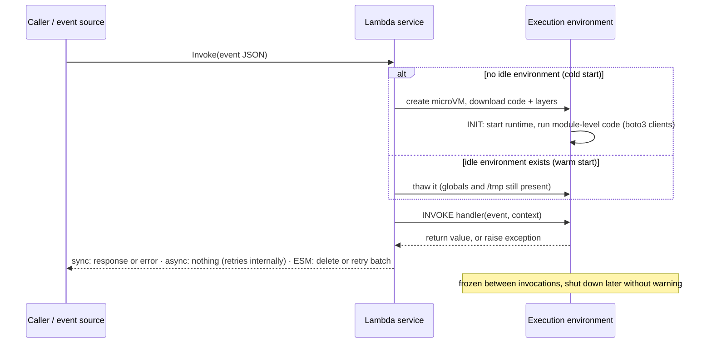
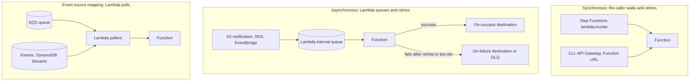

# λ AWS Lambda

> **What it is:** run your code (a *function*) in response to an event without managing servers. You're billed per request and per millisecond of memory × time.
> **GCP equivalent:** **Cloud Run functions** (formerly Cloud Functions) for event-driven functions, **Cloud Run** for container services, **Cloud Run jobs** for longer batch work.
> **In the HLD:** label **F**. `vendor-file-validator` is the Lambda that Step Functions calls to check each vendor CSV before Glue loads it. The learner's Challenge F check failed because the code was edited but **not deployed**. See [Challenge F, Mistake 2](../01_AWS_Data_Lakehouse_Demonstrated/Challenge_F_Vendor_File_Pipeline_EventBridge_StepFunctions_Lambda.md).
> **Related files:** [08 Step Functions](08_AWS_Step_Functions.md) · [01 S3](01_Amazon_S3.md) · [07 EventBridge](07_Amazon_EventBridge.md) · [10 DynamoDB](10_Source_Systems_Aurora_PostgreSQL_And_DynamoDB.md) · [00 Foundations (IAM, CloudWatch)](00_AWS_Foundations_IAM_Regions_CLI_CloudWatch_KMS.md)
> **As of Nov 2026** · ⚠️ = unverified or likely to change, so verify it in the docs.

---

## ⭐ Must-know first (labs + exam)

1. **Edit ≠ live. Click Deploy.** In the console Code tab, edits (even after `Ctrl+S`) live only in the browser editor until you click **Deploy**. A *"Changes not deployed"* label means the running function is still the old code. **This is exactly why the learner's Challenge F check failed.**
2. **The Test button invokes the *deployed* code.** Testing before Deploy tests the old version. Deploy, wait for *"Successfully updated the function…"*, then Test.
3. **The handler is `file.function`**, e.g. `lambda_function.lambda_handler`. Renaming either one without updating *Runtime settings → Handler* gives `Runtime.ImportModuleError` or `Runtime.HandlerNotFound`.
4. **`handler(event, context)`.** `event` is the caller's JSON as a dict, and **its shape depends entirely on the caller** (S3, SQS, Step Functions, a test). `context` gives the request ID, remaining time and function name.
5. **Limits that shape designs:** timeout **3 s by default, 15 min max**. Memory **128 MB–10,240 MB**, with **CPU proportional to memory**. `/tmp` **512 MB–10 GB**. Sync payload **6 MB**.
6. **Three invocation models, and they differ in who retries.** **Synchronous**: the caller handles errors and retries (Step Functions, API Gateway, CLI). **Asynchronous**: Lambda queues the event and **retries twice**, then sends it to a destination or DLQ (S3 notifications, SNS, EventBridge). **Event source mapping**: Lambda *polls* SQS, Kinesis or DynamoDB Streams and retries according to the source's rules.
7. **S3 notification keys are URL-encoded** (`my file.csv` → `my+file.csv`). Decode with `urllib.parse.unquote_plus`.
8. **Code outside the handler runs once per execution environment** (the *init* phase) and is reused on **warm** invocations. Create SDK clients there. The first request on a new environment pays a **cold start**.
9. **Functions are stateless.** Globals and `/tmp` *may* survive between invocations, but nothing guarantees it. Durable state goes in S3, DynamoDB or a database.
10. **Two kinds of permission.** The **execution role** decides what the function can do (S3 read, logs). The **resource-based policy** decides who can invoke it (`s3.amazonaws.com`, `events.amazonaws.com`, another account).
11. **SQS trigger:** enable **`ReportBatchItemFailures`** and return `{"batchItemFailures": [{"itemIdentifier": messageId}]}` so only the failed messages retry. Set the queue's visibility timeout to **≥ 6× the function timeout**. Put the DLQ on the **queue**.
12. **Kinesis / DynamoDB Streams trigger:** records are ordered per shard, so one **poison record blocks the shard** until it expires. Use `BisectBatchOnFunctionError`, `MaximumRetryAttempts`, `MaximumRecordAgeInSeconds` and an on-failure destination.
13. **Concurrency = requests per second × average duration.** The account default is 1,000 per region ⚠️. **Reserved** concurrency caps a function and guarantees it capacity (free). **Provisioned** concurrency keeps environments pre-initialised (paid).
14. **Versions are immutable snapshots. Aliases are movable pointers.** Deploy updates **`$LATEST` only**. Anything that invokes an alias (`:prod`) keeps running the old version until you publish a new version and move the alias.
15. **Everything is at-least-once.** Async retries, SQS and EventBridge can all deliver an event twice, so make handlers **idempotent**. **Never write output where it triggers the same function** (a recursive loop).
16. **Logs go to the CloudWatch log group `/aws/lambda/<function-name>`** (the role needs `AWSLambdaBasicExecutionRole`). Every invocation ends with a `REPORT` line showing duration, billed duration, max memory used and init duration.

---

## 🧱 First principles

### 1. The function as the unit of deployment

Running code on a server means you own provisioning, OS patching, scaling, load balancing and capacity planning. Lambda shrinks what you hand to AWS down to **code + configuration + a trigger**. AWS owns everything below the language runtime.

What that buys you, and what it costs:

| You gain | You give up |
|---|---|
| Scale to zero (no traffic, no bill) | Control of process lifetime: AWS starts, freezes and kills environments |
| Scale out in seconds to thousands of copies | Long-running work (15-minute ceiling) |
| Per-millisecond billing | Local state, sticky sessions, in-memory caches you can rely on |
| No servers to patch | Some latency on cold starts |

### 2. The event-driven execution model

Nothing runs until an **event** arrives. An event is a JSON document: "this S3 object was created", "here are 10 SQS messages", "Step Functions wants this file validated". Lambda finds or creates an **execution environment** (a Firecracker microVM with your runtime and code) and calls your handler with that JSON.

**One environment handles one event at a time.** If 50 events arrive together, Lambda runs 50 environments. That is what **concurrency** means in Lambda. It's a big difference from Cloud Run, where one instance serves many concurrent requests. (Lambda Managed Instances, from late 2025 ⚠️, add multi-concurrency on EC2-backed capacity. It's a niche option for now.)

### 3. Cold vs warm starts

```text
COLD:  [create microVM][download code+layers][start runtime][run init code][run handler]
WARM:                                                                      [run handler]
```

- **Init** runs module-level code: imports, `boto3.client(...)`, loading config. It happens once per environment.
- After an invocation the environment is **frozen** and may be **thawed** for the next event, which is a warm start. AWS reclaims idle environments after an undocumented period (often minutes, never guaranteed).
- **Cold-start cost** grows with package size, heavy imports, the runtime (JVM > Python) and init work. It typically ranges from ~100 ms to a few seconds ⚠️.
- **Mitigations:** smaller packages, lazy imports, provisioned concurrency, and **SnapStart** (Java, plus Python and .NET since Nov 2024 ⚠️), which restores a snapshot of an initialised environment.
- **For data pipelines, cold starts rarely matter.** A 500 ms delay on a file that takes 3 minutes to load into Glue is noise. Don't pay for provisioned concurrency here.
- **INIT billing:** since Aug 2025 the init phase is billed for on-demand functions ⚠️, so heavy init code now costs money as well as latency.

### 4. Statelessness and its consequences

Environments come and go without warning, and many run in parallel with **no shared memory**. So:

- **Persist anything that matters outside the function** (S3, DynamoDB, Step Functions state).
- **Duplicates are your problem.** A retry may run on a different environment that knows nothing about the first attempt, so idempotency must use external state (see Example 5).
- **Connection storms:** 500 concurrent environments each open their own database connection. Aurora's connection limit is hit long before CPU is. Use RDS Proxy, the Data API, or cap concurrency.
- **Caches in globals are an optimisation, never a source of truth.** Give them a TTL so they don't serve stale config forever.

### 5. The 15-minute limit as a design constraint

The ceiling is deliberate. It bounds the blast radius and cost of runaway code, and it lets AWS schedule capacity predictably. Treat it as a forcing function:

- **Work that fits:** validate one file, transform one batch of records, call an API, glue services together.
- **Work that doesn't:** a 2-hour Spark join (use Glue or EMR), a 40 GB file (use Glue, or stream it), waiting for a human (use Step Functions `.waitForTaskToken`).
- **The serverless pattern is to chunk the work and orchestrate the chunks.** Step Functions (Map state) runs many short Lambdas. **Lambda durable functions** (Dec 2025 ⚠️) checkpoint a multi-step function so a single logical run can span up to a year, while each invocation is still capped at 15 minutes.

---

## 🧩 Core concepts

### Runtimes and handlers

| Runtime family | Identifiers (examples ⚠️, the list changes) | Handler format |
|---|---|---|
| Python | `python3.12`, `python3.13` | `lambda_function.lambda_handler` (file `lambda_function.py`, function `lambda_handler`) |
| Node.js | `nodejs20.x`, `nodejs22.x` | `index.handler` |
| Java | `java17`, `java21` | `com.example.Handler::handleRequest` |
| .NET | `dotnet8` | `Assembly::Namespace.Class::Method` |
| OS-only | `provided.al2023` | Your binary implements the Runtime API (Go, Rust) |
| Container image | Any (from ECR) | Set by the image `CMD` |

AWS **deprecates** runtimes when the language version goes out of support. After that you can't create new functions on them, and later you can't update them. Plan upgrades.

### The event and context objects

The **event** is whatever the caller sent. The same function sees very different shapes:

```json
{ "bucket": "anycompany-lakehouse-raw-7db76de0", "key": "raw/vendors/acme.csv" }
```
*From Step Functions (`ValidateFile`), after the EventBridge input transformer.*

```json
{ "Records": [ { "eventSource": "aws:s3", "eventName": "ObjectCreated:Put",
  "s3": { "bucket": { "name": "anycompany-lakehouse-raw-7db76de0" },
          "object": { "key": "raw/vendors/acme+corp.csv", "size": 1024, "eTag": "9b2cf5...", "sequencer": "0055AED6DCD90281E5" } } } ] }
```
*From a classic S3 → Lambda notification. Note the URL-encoded key.*

```json
{ "Records": [ { "messageId": "059f36b4-87a3-44ab-83d2-661975830a7d", "body": "{\"key\": \"raw/vendors/acme.csv\"}",
  "attributes": { "ApproximateReceiveCount": "1" }, "eventSource": "aws:sqs" } ] }
```
*From SQS through an event source mapping. The body is a **string**, so `json.loads` it.*

**Context object (Python):**

| Attribute / method | Use |
|---|---|
| `context.aws_request_id` | Correlate log lines. Echo it in errors |
| `context.get_remaining_time_in_millis()` | Stop gracefully before the timeout, e.g. checkpoint and return |
| `context.function_name`, `context.function_version`, `context.invoked_function_arn` | Which version or alias is actually running. Great for debugging "is my change live?" |
| `context.memory_limit_in_mb` | The configured memory |
| `context.log_group_name`, `context.log_stream_name` | Where this invocation's logs are |

### Invocation types

| | **Synchronous** (`RequestResponse`) | **Asynchronous** (`Event`) | **Event source mapping** (poll) |
|---|---|---|---|
| Typical callers | Step Functions `lambda:invoke`, API Gateway, Function URLs, ALB, `aws lambda invoke` | S3 notifications, SNS, EventBridge rules, CloudWatch Logs subscriptions | SQS, Kinesis Data Streams, DynamoDB Streams, MSK/Kafka, Amazon MQ |
| Who retries on error | **The caller** (Step Functions `Retry`, client code) | **Lambda**: 2 retries by default (configurable 0–2), event kept up to 6 h (configurable 60 s–6 h) | **Lambda's poller**, following the source's rules (below) |
| Where failures go | Back to the caller as an error | **On-failure destination** (SQS, SNS, Lambda, EventBridge, S3 ⚠️) or a **DLQ** (SQS/SNS) | SQS: the queue's own DLQ (redrive policy). Streams: an on-failure destination |
| Payload | 6 MB request and 6 MB response | 256 KB historically. AWS announced 1 MB in 2025 ⚠️ | Batch, up to 6 MB per invocation |

**Destinations vs DLQ (async):** a **DLQ** gets only the original event payload, on failure only. **Destinations** get the event *plus* the response or error context, on success *or* failure, to more target types. Prefer destinations for new designs.

### Event source mappings (ESM) in detail

| Setting | SQS | Kinesis / DynamoDB Streams |
|---|---|---|
| Batch size | 1–10,000 (FIFO: 1–10). Default 10 | 1–10,000. Default 100 |
| Batching window | 0–300 s (needed for batches > 10) | 0–300 s |
| Ordering | None (standard). Per message group (FIFO) | **Strict per shard** |
| On function error | The failed batch becomes visible again after the **visibility timeout**, and goes to the **DLQ** after `maxReceiveCount` | **Retries the same batch until success or expiry, blocking the shard** |
| Partial failure | `FunctionResponseTypes: ["ReportBatchItemFailures"]`, return failed `messageId`s | Same flag. Return the failed record's `sequenceNumber`, and Lambda checkpoints before it |
| Poison-pill tools | DLQ + `maxReceiveCount` | `BisectBatchOnFunctionError` (split the batch in half and retry), `MaximumRetryAttempts`, `MaximumRecordAgeInSeconds`, on-failure destination |
| Scaling control | `ScalingConfig.MaximumConcurrency` (2–1,000) | `ParallelizationFactor` 1–10 concurrent batches per shard |
| Filtering | `FilterCriteria` (EventBridge-style patterns). Filtered-out messages are **deleted** ⚠️ | Same |

### Concurrency

- **Concurrency needed ≈ requests/second × average duration (s).** 200 files/s × 2 s = 400 concurrent environments.
- **Account limit:** 1,000 per region by default (soft, can be raised; brand-new accounts may start lower ⚠️).
- **Scaling rate:** each function can add up to **1,000 concurrent environments every 10 seconds** (since Nov 2023 ⚠️).
- **Throttling** returns `TooManyRequestsException` (429). Sync callers see the error, async events are retried by Lambda for up to 6 h, and ESMs back off.

| | **Reserved concurrency** | **Provisioned concurrency** |
|---|---|---|
| What | Carves N out of the account pool for this function, and **caps** it at N | Keeps N environments **initialised and warm** |
| Cost | Free | Paid per GB-second while configured, plus a lower duration rate |
| Use | Protect a downstream system (cap), guarantee capacity, or set to **0 as a kill switch** | Latency-sensitive APIs that can't tolerate cold starts |
| Applies to | The function (all versions) | **A version or alias only** (not `$LATEST`) |

### Memory, CPU, timeout, /tmp, environment variables

- **Memory 128–10,240 MB** in 1 MB steps. **CPU scales linearly**: about **1 vCPU at 1,769 MB**, up to 6 vCPUs at 10,240 MB ⚠️. Network bandwidth scales too. A CPU-bound function often costs **the same or less** with more memory because it finishes sooner. Measure it with the open-source **AWS Lambda Power Tuning** tool.
- **Architecture:** `arm64` (Graviton) is ~20% cheaper per GB-second ⚠️ and often faster. Compiled dependencies must match the architecture.
- **Timeout:** default **3 s** (too short for most data work), max **900 s**. Align it with the caller: Step Functions `TimeoutSeconds` ≥ the function timeout, SQS visibility timeout ≥ 6× it, and API Gateway's integration timeout (29 s default ⚠️) caps sync APIs.
- **`/tmp` ephemeral storage:** 512 MB default, configurable up to 10,240 MB. It's per environment, can survive warm starts and isn't shared. Clean it up, or a warm environment slowly fills.
- **Environment variables:** up to **4 KB** in total, encrypted at rest with KMS. Use them for config (prefixes, table names, log level), **not for secrets**. Read secrets from Secrets Manager or Parameter Store, optionally via the *Parameters and Secrets Lambda Extension* cache.

### Layers and container images

- **Layer:** a versioned, immutable zip extracted under **`/opt`**. For Python, put packages under `python/` in the zip so they land in `/opt/python`, which is on `sys.path`. A function can have **up to 5 layers**. **Function plus layers must be ≤ 250 MB unzipped.** Use layers for shared libraries (pandas, Powertools) and to keep the deployment zip small enough for the console editor (inline editing is disabled above ~3 MB ⚠️).
- **Container image:** up to **10 GB**, pulled from ECR. Build it from an AWS base image (or add the Runtime Interface Client). **No layers.** Use it for big ML or data libraries, or when your CI already builds containers. It can't be edited in the console.

### Versions, aliases and DEPLOY (the Challenge F lesson)

| Term | Meaning |
|---|---|
| **`$LATEST`** | The single **mutable** copy of code and config. **Deploy and `update-function-code` change only this** |
| **Version** (`:1`, `:2`…) | An **immutable snapshot** of code and config, created by **Publish new version** / `publish-version` |
| **Alias** (`:prod`, `:dev`) | A named **pointer** to a version. It can split traffic between two versions by weight (canary) |
| **Unqualified ARN** | `…:function:vendor-file-validator` invokes `$LATEST` |
| **Qualified ARN** | `…:function:vendor-file-validator:prod` invokes whatever `prod` points to |

**What "Changes not deployed" means in the console editor:**
- Since Oct 2024 the editor is based on **Code-OSS** (VS Code). Typing changes files **in your browser session**. `Ctrl+S` saves them **in the editor workspace only**.
- The **DEPLOY** panel shows *Changes not deployed* and enables **Deploy** (`Ctrl+Shift+U` ⚠️). Deploy zips the files and calls `UpdateFunctionCode` on `$LATEST`. A green banner confirms *"Successfully updated the function …"*, and *Last modified* and `CodeSha256` change.
- **Until then, every invocation runs the old code.** That includes the Test button, Step Functions, the lab's automated **Check**, and the CLI.
- Leaving the page with undeployed edits can lose them ⚠️.
- **Deploy doesn't publish a version.** If the caller uses an alias, you must also *Actions → Publish new version* and then *Aliases → prod → Edit → point to the new version*.

**How to prove a deploy happened (CLI):**
```bash
aws lambda get-function-configuration --function-name "$FN" \
  --query "{modified:LastModified, sha:CodeSha256, status:LastUpdateStatus, state:State}"
# LastUpdateStatus must be Successful (InProgress right after a deploy); CodeSha256 must change
```

### Test events (console)

- **Test tab → Create new event.** Name it and start from a **template** (S3 Put, SQS, EventBridge, API Gateway…) or paste your own JSON, e.g. `{"bucket": "…", "key": "tmp/validation-test.csv"}`.
- **Sharing:** **Private** test events are visible only to you. **Shareable** events are visible to anyone with access to the function, and are stored in the EventBridge **Schema Registry** (`lambda-testevent-schemas`), so the user needs schemas permissions ⚠️.
- **Test** runs a **synchronous invocation of the deployed code**. The result panel shows the response, the **last 4 KB of logs**, the request ID, the duration, the billed duration, max memory used and, on a cold start, **Init duration**.
- **A test event is a real invocation.** If the function writes to S3 or DynamoDB, the test does too. Point tests at a scratch prefix (`tmp/`), outside the trigger prefix.

### Execution role, resource-based policy, VPC

- **Execution role** (trust `lambda.amazonaws.com`) is assumed for every invocation. The minimum is `AWSLambdaBasicExecutionRole` (CloudWatch Logs). Add the specific S3, DynamoDB, SQS or KMS actions. ESMs need the **source** permissions on this role (e.g. `sqs:ReceiveMessage`, `sqs:DeleteMessage`, `sqs:GetQueueAttributes`).
- **Resource-based policy** lists who may call `lambda:InvokeFunction`. Push-style services in the same account need an entry, e.g. `aws lambda add-permission --principal s3.amazonaws.com --source-arn arn:aws:s3:::bucket --source-account 111122223333`. **Step Functions doesn't need one.** It invokes with its *own execution role's* identity permissions.
- **VPC access** is needed only to reach private resources (Aurora, ElastiCache, internal APIs). Lambda attaches **Hyperplane ENIs** in your subnets, shared per subnet and security-group combination, and created when the function is created or updated (state *Pending*), not on each invocation. **Consequences:** the function gets **no public IP**, so reaching S3, Step Functions or the internet needs a **NAT gateway** (hourly plus per-GB cost ⚠️) or **VPC endpoints** (S3 and DynamoDB *gateway* endpoints are free; *interface* endpoints for other services are billed hourly). The role needs `ec2:CreateNetworkInterface`, `ec2:DescribeNetworkInterfaces` and `ec2:DeleteNetworkInterface` (`AWSLambdaVPCAccessExecutionRole`). Subnets need free IPs.

### Logging, Powertools, X-Ray

- **CloudWatch Logs:** stdout, stderr and `logging` go to `/aws/lambda/<name>` (or a custom group). Lambda adds `START`, `END` and **`REPORT`** lines.
- **Advanced logging controls** (Nov 2023 ⚠️): **log format JSON** (each log record becomes a JSON object with `timestamp`, `level`, `message`, `requestId`) plus **application and system log-level filtering**, set in the console without code changes.
- **Structured logging** (one JSON object per event, as the validator does) makes Logs Insights queries trivial:
  ```text
  fields @timestamp, source_key, valid_count, rejected_count
  | filter msg = "validated" and rejected_count > 0
  | sort @timestamp desc
  ```
  ```text
  filter @type = "REPORT"
  | stats max(@maxMemoryUsed / 1000 / 1000) as max_mb, avg(@duration) as avg_ms, count(*) as invocations by bin(1h)
  ```
- **Powertools for AWS Lambda** ⚠️ (open-source, AWS-maintained, Python v3 current): **Logger** (structured JSON with request context), **Metrics** (CloudWatch Embedded Metric Format, no API calls), **Tracer** (X-Ray), **Idempotency** (DynamoDB-backed decorator), **Batch** (partial batch responses), **Parser/Validation** (Pydantic or JSON Schema), **Event source data classes** (typed S3, SQS and EventBridge events, including `unquote_plus` for keys), and **Parameters**. Install it from the AWS-published public layer (look up the current ARN in the Powertools docs) or with `pip install aws-lambda-powertools`.
- **X-Ray:** turn on *Active tracing* (role: `xray:PutTraceSegments` and `xray:PutTelemetryRecords`) to see per-invocation segments, including SDK calls to S3 and DynamoDB. Enable tracing in Step Functions too for an end-to-end trace. ⚠️ AWS is steering new instrumentation toward **OpenTelemetry (ADOT)**. Check the current X-Ray SDK support status.

---

## 🔄 How it works (flow)





**Numbered flow: `vendor-file-validator` inside the lab pipeline:**
1. Step Functions' `ValidateFile` calls `Invoke` **synchronously** with `{"bucket", "key"}`, using the state machine's execution role.
2. Lambda finds a warm environment for `$LATEST` (or the pinned alias) or cold-starts one. Init creates the S3 client.
3. The handler decodes the key, downloads the CSV, strips the BOM, splits valid and rejected rows, and writes `validated/…` and `quarantine/…` objects.
4. It returns `{output_key, valid_count, rejected_count, …}`. Step Functions stores that under `$.validation` (through `ResultSelector`).
5. On an exception, Step Functions receives an error named after the exception type (e.g. `ValidationError`) and applies its Retry and Catch.
6. Logs and the `REPORT` line go to `/aws/lambda/vendor-file-validator-…`.

---

## 🛠️ Hands-on examples

### Example 1 (lab reproduction): a robust `vendor-file-validator`

**Goal:** a complete, production-grade version of the Challenge F validator. It reads the CSV from S3 (decoding URL-encoded keys), handles the BOM, rejects rows whose `vendor_id` is missing, empty or whitespace, writes valid rows to `validated/` and rejects to `quarantine/`, and returns `{output_key, valid_count, rejected_count}`.

> **In the lab:** make the **smallest change** at the TODO and keep the function's existing return format and key names, because `LoadToIceberg` reads `$.validation.output_key`. This full version is for study and real projects.

**Console steps:**
1. **Lambda → Functions →** search `vendor-file-validator`. Note the suffix and the region.
2. **Code tab →** `lambda_function.py` → replace or adapt the code. Check **Runtime settings → Handler** = `lambda_function.lambda_handler`.
3. **Deploy.** Wait for the green *"Successfully updated…"* banner. The *Changes not deployed* label must disappear.
4. **Configuration → General configuration:** timeout **60 s**, memory **512 MB** (the 3 s default is too short for S3 I/O).
5. **Configuration → Environment variables** (optional): `SOURCE_PREFIX=raw/vendors/`, `VALIDATED_PREFIX=validated/vendors/`, `QUARANTINE_PREFIX=quarantine/vendors/`, `LOG_LEVEL=INFO`.
6. **Configuration → Permissions →** role: `s3:GetObject` on `raw/*` and `tmp/*`, `s3:PutObject` on `validated/*` and `quarantine/*`, and **`s3:ListBucket`** on the bucket (so a missing key returns `NoSuchKey` rather than `AccessDenied`).
7. **Test tab →** new event `blank-vendor-id` → `{"bucket": "<raw bucket>", "key": "tmp/validation-test.csv"}` → **Test**.

**Code (`lambda_function.py`, Python 3.12+):**
```python
"""vendor-file-validator: validate one vendor CSV and split it into valid rows and rejects.

Input (from the Step Functions ValidateFile state, after the EventBridge input transformer):
    {"bucket": "anycompany-lakehouse-raw-7db76de0", "key": "raw/vendors/acme.csv"}
Also accepted, for testing: a classic S3 notification ({"Records": [...]}) or a raw
EventBridge "Object Created" event ({"detail": {...}}).

Output (LoadToIceberg reads output_key, so keep these field names stable):
    {"output_key": "...", "valid_count": 98, "rejected_count": 2,
     "rejected_key": "..." or None, "bucket": "...", "source_key": "..."}
"""
import csv
import io
import json
import logging
import os
import urllib.parse

import boto3
from botocore.exceptions import ClientError

logger = logging.getLogger()
logger.setLevel(os.environ.get("LOG_LEVEL", "INFO"))

# Created once per execution environment (init phase) and reused on warm invocations.
s3 = boto3.client("s3")

REQUIRED_FIELD = "vendor_id"
SOURCE_PREFIX = os.environ.get("SOURCE_PREFIX", "raw/vendors/")
VALIDATED_PREFIX = os.environ.get("VALIDATED_PREFIX", "validated/vendors/")
QUARANTINE_PREFIX = os.environ.get("QUARANTINE_PREFIX", "quarantine/vendors/")


class ValidationError(Exception):
    """File-level problem. Step Functions sees the error name 'ValidationError'."""


def _parse_input(event):
    """Return (bucket, raw_key) from any of the three supported event shapes."""
    if "Records" in event:                      # classic S3 -> Lambda notification
        s3_info = event["Records"][0]["s3"]
        return s3_info["bucket"]["name"], s3_info["object"]["key"]
    if "detail" in event:                       # raw EventBridge event (no transformer)
        return event["detail"]["bucket"]["name"], event["detail"]["object"]["key"]
    return event["bucket"], event["key"]        # the pipeline's {bucket, key} contract


def _read_object_text(bucket, raw_key):
    """Download the object as text. Try the URL-decoded key first, then the raw key.

    Classic S3 notifications URL-encode keys ("my file.csv" arrives as "my+file.csv").
    A key that really contains "+" must NOT be decoded, so fall back to the raw key.
    Note: without s3:ListBucket, a missing key returns AccessDenied instead of NoSuchKey,
    and the fallback can't tell the difference. Grant ListBucket on the bucket.
    """
    decoded = urllib.parse.unquote_plus(raw_key)
    candidates = [decoded] if decoded == raw_key else [decoded, raw_key]
    last_error = None
    for key in candidates:
        try:
            obj = s3.get_object(Bucket=bucket, Key=key)
        except ClientError as err:
            if err.response["Error"]["Code"] in ("NoSuchKey", "404"):
                last_error = err
                continue
            raise
        # "utf-8-sig" strips a UTF-8 byte-order mark (Excel CSV exports often start with one).
        # Without it the first header becomes "vendor_id" and every row looks invalid.
        return key, obj["Body"].read().decode("utf-8-sig")
    raise last_error


def _derive_key(source_key, new_prefix, suffix=""):
    """raw/vendors/2026/acme.csv -> validated/vendors/2026/acme.csv (deterministic = idempotent)."""
    relative = source_key[len(SOURCE_PREFIX):] if source_key.startswith(SOURCE_PREFIX) else source_key
    if suffix and relative.lower().endswith(".csv"):
        relative = relative[:-4] + suffix
    out = new_prefix + relative
    # Guard against a recursive trigger: the EventBridge rule matches raw/vendors/*.csv
    # and the * also matches sub-folders, so never write back under the source prefix.
    if out.startswith(SOURCE_PREFIX):
        raise ValidationError(f"Refusing to write {out} under the trigger prefix {SOURCE_PREFIX}")
    return out


def _to_csv(fieldnames, rows):
    buf = io.StringIO()
    writer = csv.DictWriter(buf, fieldnames=fieldnames, extrasaction="ignore", lineterminator="\n")
    writer.writeheader()
    writer.writerows(rows)
    return buf.getvalue().encode("utf-8")


def validate_rows(text):
    """Pure function (no AWS calls), so it is easy to unit test.

    Returns (fieldnames, valid_rows, rejected_rows). Each rejected row gets a reject_reason.
    """
    reader = csv.DictReader(io.StringIO(text, newline=""))
    if reader.fieldnames is None:
        raise ValidationError("File is empty: no header row")
    # Normalise header names: strip spaces and lower-case ("Vendor_ID " -> "vendor_id").
    reader.fieldnames = [(name or "").strip().lower() for name in reader.fieldnames]
    fieldnames = reader.fieldnames
    if REQUIRED_FIELD not in fieldnames:
        raise ValidationError(f"Header has no '{REQUIRED_FIELD}' column: {fieldnames}")

    valid, rejected = [], []
    for row in reader:                          # DictReader skips completely blank lines
        if None in row:                         # more fields than headers -> extras land under key None
            row.pop(None)
            rejected.append({**row, "reject_reason": "extra_columns"})
            continue
        # Missing (short row -> None), empty ("") and whitespace-only ("   ") all become "".
        vendor_id = (row.get(REQUIRED_FIELD) or "").strip()
        if not vendor_id:
            rejected.append({**row, "reject_reason": "missing_vendor_id"})
            continue
        row[REQUIRED_FIELD] = vendor_id         # write the trimmed value
        valid.append(row)
    return fieldnames, valid, rejected


def lambda_handler(event, context):
    bucket, raw_key = _parse_input(event)
    source_key, text = _read_object_text(bucket, raw_key)

    fieldnames, valid, rejected = validate_rows(text)

    # Always write the validated file (header-only if no valid rows) so output_key always exists.
    output_key = _derive_key(source_key, VALIDATED_PREFIX)
    s3.put_object(Bucket=bucket, Key=output_key, Body=_to_csv(fieldnames, valid),
                  ContentType="text/csv")

    rejected_key = None
    if rejected:
        rejected_key = _derive_key(source_key, QUARANTINE_PREFIX, suffix=".rejected.csv")
        s3.put_object(Bucket=bucket, Key=rejected_key,
                      Body=_to_csv(fieldnames + ["reject_reason"], rejected),
                      ContentType="text/csv")

    result = {
        "output_key": output_key,
        "valid_count": len(valid),
        "rejected_count": len(rejected),
        "rejected_key": rejected_key,
        "bucket": bucket,
        "source_key": source_key,
    }
    # One structured log line per file: easy to query with CloudWatch Logs Insights.
    logger.info(json.dumps({"msg": "validated", **result,
                            "request_id": getattr(context, "aws_request_id", None)}))
    return result
```

**Why it's robust:**
- **`unquote_plus` with a fallback to the raw key.** Classic S3 notifications URL-encode keys. A key that genuinely contains `+` must not be decoded. ⚠️ Whether EventBridge-delivered keys are encoded too isn't something to rely on, so the code works either way.
- **`utf-8-sig`** removes the BOM that Excel adds. Without it, the header is `vendor_id`, the column "doesn't exist", and every row would be rejected.
- **Header normalisation** (`strip().lower()`) tolerates `Vendor_ID `.
- **`(row.get(...) or "").strip()`** covers all three bad cases: missing (a short row gives `None`), empty and whitespace-only.
- **File-level problems raise `ValidationError`.** The Step Functions catcher sends them to `NotifyFailure` instead of silently loading nothing.
- **Deterministic output keys** make re-runs idempotent (they overwrite), which is safe under Step Functions Retry and Express at-least-once.
- **The recursion guard** refuses to write under `raw/vendors/`. The EventBridge wildcard `raw/vendors/*.csv` also matches sub-folders, so `raw/vendors/validated/x.csv` would re-trigger the pipeline forever.
- **Memory note:** it reads the whole file into memory, which is fine for vendor files up to a few hundred MB at 512 MB–2 GB of memory. For bigger files, stream the body or route them to Glue. A Step Functions Choice on object size does that well.

**CLI deploy and self-test (CloudShell):**
```bash
FN=$(aws lambda list-functions --query "Functions[?starts_with(FunctionName, 'vendor-file-validator')].FunctionName | [0]" --output text)
BUCKET=$(aws s3api list-buckets --query "Buckets[?starts_with(Name, 'anycompany-lakehouse-raw')].Name | [0]" --output text)

# Deploy from a local file (same effect as the console Deploy button)
zip -j function.zip lambda_function.py
aws lambda update-function-code --function-name "$FN" --zip-file fileb://function.zip
aws lambda wait function-updated --function-name "$FN"
aws lambda get-function-configuration --function-name "$FN" --query "{sha:CodeSha256,status:LastUpdateStatus}"

# Self-test on a scratch prefix (outside raw/vendors/, so the pipeline is NOT triggered)
printf 'vendor_id,vendor_name\nV001,Good Vendor\n,Blank Id\n   ,Spaces Id\nV004,Another Good\n' > test.csv
aws s3 cp test.csv "s3://$BUCKET/tmp/validation-test.csv"
aws lambda invoke --function-name "$FN" --cli-binary-format raw-in-base64-out \
  --payload "{\"bucket\":\"$BUCKET\",\"key\":\"tmp/validation-test.csv\"}" \
  --log-type Tail --query LogResult --output text out.json | base64 -d | tail -5
cat out.json
```

**Expected result:** `out.json` contains `"valid_count": 2, "rejected_count": 2`, an `output_key` under `validated/vendors/` and a `rejected_key` under `quarantine/vendors/`. The tail of the log shows the `validated` JSON line and the `REPORT` line.

**What to check:** **4 valid and 0 rejected means the old code is still live, so Deploy.** `aws s3 cp "s3://$BUCKET/<output_key>" -` shows only V001 and V004. The quarantine file has a `reject_reason` column. Then run the pipeline end to end and confirm that `vendor_catalog` has no blank `vendor_id`.

### Example 2: unit tests with sample events (no AWS account needed)

**Goal:** prove the validation logic locally with pytest, using a tiny fake S3 client. That's faster than Deploy-and-Test loops and catches the "missing vs empty vs whitespace" cases before the lab checker does.

**Steps:** put `lambda_function.py` and `test_lambda_function.py` in one folder → `python -m pip install boto3 pytest` → `python -m pytest -q`.

```python
"""Unit tests for vendor-file-validator. Run: python -m pytest -q
No AWS account needed: a tiny in-memory fake replaces the S3 client.
"""
import csv
import io
import os

os.environ.setdefault("AWS_DEFAULT_REGION", "us-east-1")   # boto3 needs a region at import time

import pytest
from botocore.exceptions import ClientError

import lambda_function as fn

BUCKET = "anycompany-lakehouse-raw-test"


class FakeBody:
    def __init__(self, data):
        self._data = data

    def read(self):
        return self._data


class FakeS3:
    """Implements only the two calls the function makes."""

    def __init__(self, objects):
        self.objects = dict(objects)        # {(bucket, key): bytes}

    def get_object(self, Bucket, Key):
        if (Bucket, Key) not in self.objects:
            raise ClientError({"Error": {"Code": "NoSuchKey", "Message": "not found"}}, "GetObject")
        return {"Body": FakeBody(self.objects[(Bucket, Key)])}

    def put_object(self, Bucket, Key, Body, **kwargs):
        self.objects[(Bucket, Key)] = Body


@pytest.fixture
def fake_s3(monkeypatch):
    fake = FakeS3({})
    monkeypatch.setattr(fn, "s3", fake)     # swap the module-level client
    return fake


def rows_of(fake, key):
    return list(csv.DictReader(io.StringIO(fake.objects[(BUCKET, key)].decode("utf-8"))))


SAMPLE = (
    "vendor_id,vendor_name\n"   # BOM, as written by Excel
    "V001,Good Vendor\n"
    ",Blank Id\n"
    "   ,Spaces Id\n"
    "V004,Another Good\n"
    "\n"                              # blank line: skipped, not counted
    "V005\n"                          # short row: vendor_name missing, vendor_id present -> valid
)


def test_pipeline_event_splits_valid_and_rejected(fake_s3):
    fake_s3.objects[(BUCKET, "raw/vendors/acme.csv")] = SAMPLE.encode("utf-8")

    out = fn.lambda_handler({"bucket": BUCKET, "key": "raw/vendors/acme.csv"}, None)

    assert out["output_key"] == "validated/vendors/acme.csv"
    assert out["rejected_key"] == "quarantine/vendors/acme.rejected.csv"
    assert (out["valid_count"], out["rejected_count"]) == (3, 2)
    assert [r["vendor_id"] for r in rows_of(fake_s3, out["output_key"])] == ["V001", "V004", "V005"]
    assert {r["reject_reason"] for r in rows_of(fake_s3, out["rejected_key"])} == {"missing_vendor_id"}


def test_missing_vendor_id_value_in_short_row_is_rejected(fake_s3):
    # Header has 2 columns, but vendor_id is the SECOND one and the row stops after the first.
    fake_s3.objects[(BUCKET, "raw/vendors/short.csv")] = b"vendor_name,vendor_id\nNo Id Vendor\nOk,V9\n"
    out = fn.lambda_handler({"bucket": BUCKET, "key": "raw/vendors/short.csv"}, None)
    assert (out["valid_count"], out["rejected_count"]) == (1, 1)


def test_url_encoded_key_from_s3_notification(fake_s3):
    # The real object key has a space; the S3 notification sends it as "+".
    fake_s3.objects[(BUCKET, "raw/vendors/acme corp.csv")] = b"vendor_id\nV1\n"
    event = {"Records": [{"s3": {"bucket": {"name": BUCKET},
                                 "object": {"key": "raw/vendors/acme+corp.csv"}}}]}
    out = fn.lambda_handler(event, None)
    assert out["source_key"] == "raw/vendors/acme corp.csv"
    assert out["valid_count"] == 1


def test_literal_plus_in_key_falls_back_to_raw_key(fake_s3):
    fake_s3.objects[(BUCKET, "raw/vendors/a+b.csv")] = b"vendor_id\nV1\n"
    out = fn.lambda_handler({"bucket": BUCKET, "key": "raw/vendors/a+b.csv"}, None)
    assert out["source_key"] == "raw/vendors/a+b.csv"


def test_header_without_vendor_id_fails_the_file(fake_s3):
    fake_s3.objects[(BUCKET, "raw/vendors/bad.csv")] = b"id,name\n1,x\n"
    with pytest.raises(fn.ValidationError):
        fn.lambda_handler({"bucket": BUCKET, "key": "raw/vendors/bad.csv"}, None)


def test_extra_columns_are_quarantined(fake_s3):
    fake_s3.objects[(BUCKET, "raw/vendors/x.csv")] = b"vendor_id,name\nV1,a,EXTRA\nV2,b\n"
    out = fn.lambda_handler({"bucket": BUCKET, "key": "raw/vendors/x.csv"}, None)
    assert (out["valid_count"], out["rejected_count"]) == (1, 1)
    assert rows_of(fake_s3, out["rejected_key"])[0]["reject_reason"] == "extra_columns"


def test_rerun_is_idempotent(fake_s3):
    fake_s3.objects[(BUCKET, "raw/vendors/acme.csv")] = SAMPLE.encode("utf-8")
    first = fn.lambda_handler({"bucket": BUCKET, "key": "raw/vendors/acme.csv"}, None)
    second = fn.lambda_handler({"bucket": BUCKET, "key": "raw/vendors/acme.csv"}, None)
    assert first == second                      # same keys, same counts, objects overwritten
```

**Expected result:** `7 passed`. (These tests were run against the code above with Python 3.14, boto3 1.44 and pytest 9.2.)

**What to check:** the BOM test and the short-row test are the two that catch real-world vendor files. For integration tests against real AWS APIs, `moto` can mock S3, or you can use a sandbox account. Also save `{"bucket": …, "key": …}` and an S3 Put template as **console test events** so anyone can re-run them after a Deploy.

### Example 3 (beyond the lab): an SQS-triggered Lambda with partial batch failures

**Goal:** buffer file events in SQS (to smooth bursts and cap concurrency against Glue or Step Functions quotas), process them in batches, and retry **only** the failed messages.

**Console steps:** SQS → create queue `vendor-file-events-dlq` → create queue `vendor-file-events` with **visibility timeout 180 s** and a **dead-letter queue** set to the DLQ with **maximum receives 5** → Lambda → create function `vendor-sqs-worker` (Python 3.12, timeout **30 s**) → role: add `AWSLambdaSQSQueueExecutionRole` → **Add trigger → SQS** → batch size 10, batch window 5 s, **Report batch item failures: on**, maximum concurrency 10.

**Code (`sqs_handler.py`; set the handler to `sqs_handler.lambda_handler`):**
```python
"""SQS-triggered Lambda with partial batch failure reporting.

The event source mapping must have FunctionResponseTypes = ["ReportBatchItemFailures"].
Only the message IDs returned in batchItemFailures go back to the queue; the rest are deleted.
"""
import json
import logging

logger = logging.getLogger()
logger.setLevel("INFO")


class PermanentError(Exception):
    """Bad message that will never succeed. Don't retry it; park it somewhere instead."""


def process(message: dict) -> None:
    # Replace with real work (e.g. start a Step Functions execution for message["key"]).
    if "key" not in message:
        raise PermanentError("message has no 'key'")
    if not message["key"].endswith(".csv"):
        raise PermanentError(f"not a CSV: {message['key']}")
    logger.info(json.dumps({"msg": "processed", "key": message["key"]}))


def lambda_handler(event, context):
    failures = []
    for record in event["Records"]:
        message_id = record["messageId"]
        try:
            process(json.loads(record["body"]))
        except PermanentError as err:
            # Retrying won't help. Log it and let the message be deleted (or send it to your
            # own "poison" queue here). Returning it as a failure would loop until maxReceiveCount.
            logger.error(json.dumps({"msg": "permanent failure", "messageId": message_id,
                                     "error": str(err)}))
        except Exception:
            # Transient or unknown: report it so only THIS message becomes visible again.
            logger.exception("transient failure for %s", message_id)
            failures.append({"itemIdentifier": message_id})
    # Empty list = whole batch succeeded. Raising an exception instead would retry ALL messages.
    return {"batchItemFailures": failures}
```

**CLI:**
```bash
DLQ_URL=$(aws sqs create-queue --queue-name vendor-file-events-dlq --query QueueUrl --output text)
DLQ_ARN=$(aws sqs get-queue-attributes --queue-url "$DLQ_URL" --attribute-names QueueArn --query Attributes.QueueArn --output text)

# Visibility timeout 180 s = 6 x the 30 s function timeout; after 5 failed receives -> DLQ
cat > queue-attrs.json <<EOF
{"VisibilityTimeout": "180", "RedrivePolicy": "{\"deadLetterTargetArn\":\"$DLQ_ARN\",\"maxReceiveCount\":\"5\"}"}
EOF
QUEUE_URL=$(aws sqs create-queue --queue-name vendor-file-events --attributes file://queue-attrs.json --query QueueUrl --output text)
QUEUE_ARN=$(aws sqs get-queue-attributes --queue-url "$QUEUE_URL" --attribute-names QueueArn --query Attributes.QueueArn --output text)

aws lambda create-event-source-mapping \
  --function-name vendor-sqs-worker \
  --event-source-arn "$QUEUE_ARN" \
  --batch-size 10 \
  --maximum-batching-window-in-seconds 5 \
  --function-response-types ReportBatchItemFailures \
  --scaling-config MaximumConcurrency=10

aws sqs send-message --queue-url "$QUEUE_URL" --message-body '{"key":"raw/vendors/acme.csv"}'
aws sqs send-message --queue-url "$QUEUE_URL" --message-body '{"key":"raw/vendors/readme.txt"}'
```

**Expected result:** both messages leave the queue. The logs show `processed` for the CSV and `permanent failure` for the `.txt`. If `process` raises a *transient* error, only that message reappears after 180 s, `ApproximateReceiveCount` goes up, and after 5 receives it lands in the DLQ.

**What to check and the traps:**
- **Without `ReportBatchItemFailures` on the mapping, the returned list is ignored.** Any exception then retries the **whole batch**, so successful messages get processed again.
- **An invalid `itemIdentifier`**, or raising an exception, makes Lambda treat the **whole batch** as failed.
- **For FIFO queues**, stop at the first failure and report it **and every message after it**, to preserve ordering.
- **For Kinesis or DynamoDB Streams**, the same response uses `sequenceNumber`s, and Lambda resumes from the first reported failure.
- **The Powertools equivalent** is `BatchProcessor(event_type=EventType.SQS)` plus `process_partial_response(...)` ⚠️ (check the current API).

### Example 4: packaging dependencies as a layer with the CLI

**Goal:** ship a third-party library (here `pydantic`, which has a **compiled** core) to a Python 3.12 x86_64 function, without bloating the function zip or breaking the console editor.

```bash
# Run in CloudShell (Amazon Linux, x86_64) or any machine with Python 3 and pip.
set -euo pipefail
FN=vendor-file-validator-7db76de0          # adjust to your function name
WORK=$(mktemp -d)
mkdir -p "$WORK/python"                    # Python layers must have python/ at the zip root

# 1. Download wheels built for Lambda's platform, not your laptop's (matters for compiled code).
#    For arm64 functions use --platform manylinux2014_aarch64.
python3 -m pip install \
  --platform manylinux2014_x86_64 --implementation cp --python-version 3.12 \
  --only-binary=:all: --target "$WORK/python" \
  "pydantic==2.9.2"

# 2. Zip it. Lambda extracts layers to /opt, so this becomes /opt/python (on sys.path).
ZIP="$PWD/vendor-deps-layer.zip"
(cd "$WORK" && zip -qr9 "$ZIP" python)
ls -lh "$ZIP"                              # > 50 MB zipped? upload to S3 and use --content instead

# 3. Publish an immutable layer version.
LAYER_ARN=$(aws lambda publish-layer-version \
  --layer-name vendor-deps \
  --description "pydantic 2.9.2 for python3.12 x86_64" \
  --zip-file "fileb://$ZIP" \
  --compatible-runtimes python3.12 \
  --compatible-architectures x86_64 \
  --query LayerVersionArn --output text)
echo "$LAYER_ARN"

# 4. Attach it. --layers REPLACES the whole list, so keep the layers already attached.
EXISTING=$(aws lambda get-function-configuration --function-name "$FN" --query "Layers[].Arn" --output text)
[ "$EXISTING" = "None" ] && EXISTING=""
aws lambda update-function-configuration --function-name "$FN" --layers $EXISTING "$LAYER_ARN"
aws lambda wait function-updated --function-name "$FN"
```

**Console equivalent:** Lambda → **Layers → Create layer** (upload the zip, choose the runtime and architecture) → function → **Code** tab, scroll to **Layers → Add a layer → Custom layers**.

**Expected result:** `import pydantic` works in the function, and the function's own zip stays tiny and editable.

**What to check:** `Runtime.ImportModuleError: No module named 'pydantic_core._pydantic_core'` (or an *invalid ELF header*) means the wheels were built for the wrong OS, architecture or Python version. Rebuild with the `--platform` flags. Layer versions are immutable, so a new build means a new version number, and functions keep the old one until you update them. Updating the configuration changes `$LATEST`; publish a version or move the alias if callers are pinned.

### Example 5 (beyond the lab): S3 → Lambda → DynamoDB idempotency

**Goal:** S3 notifications and async invocations are **at-least-once**, so the same `ObjectCreated` event can arrive twice, or a retry can follow a partial success. Guarantee that the side effect (registering or processing the file) happens **once per S3 write**.

**Setup (CLI):**
```bash
aws dynamodb create-table --table-name file-idempotency \
  --attribute-definitions AttributeName=pk,AttributeType=S \
  --key-schema AttributeName=pk,KeyType=HASH \
  --billing-mode PAY_PER_REQUEST
aws dynamodb update-time-to-live --table-name file-idempotency \
  --time-to-live-specification "Enabled=true,AttributeName=expires_at"

# Allow S3 to invoke the function (resource-based policy), then add the bucket notification
aws lambda add-permission --function-name file-registrar --statement-id s3-invoke \
  --action lambda:InvokeFunction --principal s3.amazonaws.com \
  --source-arn arn:aws:s3:::anycompany-lakehouse-raw-7db76de0 --source-account 111122223333
# Bucket -> Properties -> Event notifications -> Create: prefix raw/partners/, suffix .csv,
# All object create events, destination = Lambda file-registrar.
# (put-bucket-notification-configuration REPLACES the whole config: merge it as in Challenge F.)
```

The role needs `dynamodb:PutItem`, `GetItem`, `UpdateItem` and `DeleteItem` on the table, plus `s3:GetObject` on the prefix. Set the function timeout ≤ `LEASE_SECONDS`.

**Code (`idempotent_handler.py`):**
```python
"""S3 -> Lambda -> DynamoDB with an idempotency record per S3 object event.

DynamoDB table (env IDEMPOTENCY_TABLE): partition key "pk" (String), TTL attribute "expires_at".
"""
import json
import logging
import os
import time
import urllib.parse

import boto3
from botocore.exceptions import ClientError

logger = logging.getLogger()
logger.setLevel("INFO")

ddb = boto3.client("dynamodb")
s3 = boto3.client("s3")

TABLE = os.environ.get("IDEMPOTENCY_TABLE", "file-idempotency")
LEASE_SECONDS = 15 * 60          # >= function timeout, so a crashed attempt's claim expires
RECORD_TTL_SECONDS = 7 * 24 * 3600


def idempotency_key(record):
    """One key per S3 *write*, identical for duplicate deliveries of the same event.

    versionId (versioned bucket) or sequencer changes on every new PUT of the key,
    so a genuine re-upload is processed again. Use the eTag instead if identical
    content should be skipped.
    """
    obj = record["s3"]["object"]
    marker = obj.get("versionId") or obj["sequencer"]
    return f'{record["s3"]["bucket"]["name"]}/{obj["key"]}#{marker}'


def claim(pk, now):
    """Atomically create an IN_PROGRESS record. Returns False if someone already has it."""
    try:
        ddb.put_item(
            TableName=TABLE,
            Item={
                "pk": {"S": pk},
                "status": {"S": "IN_PROGRESS"},
                "lease_until": {"N": str(now + LEASE_SECONDS)},
                "expires_at": {"N": str(now + RECORD_TTL_SECONDS)},
            },
            # New key, OR a previous attempt crashed and its lease ran out.
            ConditionExpression="attribute_not_exists(pk) OR (#s = :in_progress AND lease_until < :now)",
            ExpressionAttributeNames={"#s": "status"},          # "status" is a reserved word
            ExpressionAttributeValues={":in_progress": {"S": "IN_PROGRESS"}, ":now": {"N": str(now)}},
        )
        return True
    except ClientError as err:
        if err.response["Error"]["Code"] == "ConditionalCheckFailedException":
            return False
        raise


def complete(pk, result):
    ddb.update_item(
        TableName=TABLE,
        Key={"pk": {"S": pk}},
        UpdateExpression="SET #s = :done, #r = :result",
        ExpressionAttributeNames={"#s": "status", "#r": "result"},
        ExpressionAttributeValues={":done": {"S": "COMPLETED"}, ":result": {"S": json.dumps(result)}},
    )


def release(pk):
    """Processing failed: delete the claim so a retry can start immediately."""
    ddb.delete_item(
        TableName=TABLE,
        Key={"pk": {"S": pk}},
        ConditionExpression="#s = :in_progress",
        ExpressionAttributeNames={"#s": "status"},
        ExpressionAttributeValues={":in_progress": {"S": "IN_PROGRESS"}},
    )


def process_object(bucket, key):
    """The side effect we must not repeat. Here: count lines and register the file."""
    body = s3.get_object(Bucket=bucket, Key=key)["Body"].read()
    return {"bucket": bucket, "key": key, "lines": body.count(b"\n")}


def lambda_handler(event, context):
    results = []
    for record in event["Records"]:
        pk = idempotency_key(record)
        now = int(time.time())
        if not claim(pk, now):
            existing = ddb.get_item(TableName=TABLE, Key={"pk": {"S": pk}}, ConsistentRead=True).get("Item", {})
            if existing.get("status", {}).get("S") == "COMPLETED":
                logger.info(json.dumps({"msg": "duplicate event skipped", "pk": pk}))
                results.append(json.loads(existing["result"]["S"]))
                continue
            # Another invocation is working on it right now. Fail so the async retry
            # comes back later and finds COMPLETED (or an expired lease).
            raise RuntimeError(f"{pk} is IN_PROGRESS elsewhere")
        try:
            bucket = record["s3"]["bucket"]["name"]
            key = urllib.parse.unquote_plus(record["s3"]["object"]["key"])
            result = process_object(bucket, key)
        except Exception:
            release(pk)
            raise
        complete(pk, result)
        results.append(result)
    return {"processed": results}
```

**How it works:** the **conditional `PutItem`** is the atomic "claim". DynamoDB guarantees that only one writer creates the item. A duplicate delivery finds `COMPLETED` and returns the stored result. A crash mid-processing leaves `IN_PROGRESS`, which another attempt can take over once `lease_until` passes. A handled failure **releases** the claim so the async retry can start at once. TTL cleans old records up for free.

**Choosing the key is a business decision:** `sequencer` (or `versionId`) gives "once per upload", so a re-upload is processed again. `eTag` gives "once per content", so identical bytes are skipped.

**Powertools equivalent** ⚠️ (less code, same idea):
```python
from aws_lambda_powertools.utilities.idempotency import DynamoDBPersistenceLayer, IdempotencyConfig, idempotent

persistence = DynamoDBPersistenceLayer(table_name="file-idempotency-pt")   # expects key attribute "id" by default
config = IdempotencyConfig(event_key_jmespath="Records[0].s3.object.[key, sequencer]", expires_after_seconds=7 * 24 * 3600)

@idempotent(persistence_store=persistence, config=config)
def lambda_handler(event, context):
    ...
```

**Expected result:** invoking twice with the same S3 Put test event processes once. The second log line says `duplicate event skipped`. **What to check:** the table shows one `COMPLETED` item per upload. (Tests for this handler, covering duplicates, re-uploads and release on failure, passed locally alongside Example 2.)

---

## ⚙️ Key settings, limits & quotas

| Item | Value | Notes |
|---|---|---|
| Timeout | Default **3 s**, max **900 s** | Lambda Managed Instances allow longer ⚠️ |
| Memory | **128–10,240 MB** | CPU ~1 vCPU at 1,769 MB, max 6 vCPU ⚠️ |
| `/tmp` | **512 MB** default, up to **10,240 MB** | Extra storage is billed |
| Environment variables | **4 KB** total | |
| Deployment package | **50 MB** zipped (direct upload), **250 MB** unzipped including layers; container image **10 GB** | Larger zips go via S3. Console editing ≤ ~3 MB ⚠️ |
| Layers | **5** per function | |
| Payload | Sync **6 MB** each way; async **256 KB → 1 MB** (2025 ⚠️) | Response streaming allows more ⚠️ |
| Concurrency | **1,000** per region by default (soft ⚠️); scale **+1,000 per 10 s** per function | |
| Async | Retries **0–2** (default 2); max event age **60 s–6 h** (default 6 h) | |
| SQS ESM | Batch **1–10,000** (FIFO ≤ 10); window ≤ **300 s**; max concurrency **2–1,000** | Visibility timeout ≥ 6× function timeout |
| Stream ESM | Batch ≤ **10,000**; parallelization **1–10**; retries **-1 (infinite) to 10,000**; record age up to 7 days ⚠️ | Default retries are infinite: set them |
| Init phase | ~**10 s** limit on on-demand init ⚠️ | |
| Code storage | **75 GB** per region ⚠️ | Old versions and layers count. Clean them up |

---

## 🔐 Security

**Execution role for the validator** (least privilege, prefix-scoped):
```json
{
  "Version": "2012-10-17",
  "Statement": [
    {
      "Sid": "ReadRawAndScratch",
      "Effect": "Allow",
      "Action": "s3:GetObject",
      "Resource": [
        "arn:aws:s3:::anycompany-lakehouse-raw-7db76de0/raw/vendors/*",
        "arn:aws:s3:::anycompany-lakehouse-raw-7db76de0/tmp/*"
      ]
    },
    {
      "Sid": "WriteValidatedAndQuarantine",
      "Effect": "Allow",
      "Action": "s3:PutObject",
      "Resource": [
        "arn:aws:s3:::anycompany-lakehouse-raw-7db76de0/validated/vendors/*",
        "arn:aws:s3:::anycompany-lakehouse-raw-7db76de0/quarantine/vendors/*"
      ]
    },
    {
      "Sid": "ListForAccurateNoSuchKey",
      "Effect": "Allow",
      "Action": "s3:ListBucket",
      "Resource": "arn:aws:s3:::anycompany-lakehouse-raw-7db76de0",
      "Condition": { "StringLike": { "s3:prefix": ["raw/vendors/*", "tmp/*"] } }
    }
  ]
}
```
Attach **`AWSLambdaBasicExecutionRole`** as well (logs). If the bucket uses **SSE-KMS**, add `kms:Decrypt` (to read) and `kms:GenerateDataKey` (to write) on that key.

- **Resource-based policy:** always add **`--source-arn` and `--source-account`** when granting a service principal. Without them, any bucket (in any account) configured to target your function could invoke it (the *confused deputy* problem).
- **Who can change code:** `lambda:UpdateFunctionCode` is effectively "run code as the execution role". Restrict it like admin access. Creating a function needs **`iam:PassRole`** for its role.
- **Secrets:** Secrets Manager or Parameter Store, not environment variables. Environment variables are visible to anyone with `lambda:GetFunctionConfiguration`.
- **Encryption:** code and environment variables are encrypted at rest (AWS-managed key, or a customer managed KMS key for env vars). Use TLS for everything (the SDK default).
- **Lake Formation:** Lambda doesn't bypass it. Reading governed tables through Athena from a Lambda needs LF grants for the **execution role**. Reading the S3 objects directly with `s3:GetObject` *does* bypass table-level LF controls, which is a governance gap. Keep direct S3 access to raw or landing prefixes and query curated data through Athena with LF.
- **Code signing** (signer profiles) can enforce that only signed artefacts are deployed ⚠️.

---

## 💰 Cost model & optimisation

| Component | Price (us-east-1, ⚠️ check the pricing page) |
|---|---|
| Requests | ~$0.20 per million |
| Duration (x86) | ~$0.0000166667 per GB-second (arm64 ~20% less) |
| Free tier (monthly, ongoing ⚠️) | 1M requests + 400,000 GB-seconds |
| Provisioned concurrency | Per GB-second while configured, plus a lower duration rate |
| Ephemeral storage > 512 MB | Small per GB-second charge |
| Also | CloudWatch Logs ingestion (~$0.50/GB ⚠️), data transfer, NAT gateway if in a VPC |

**Worked estimate (the validator):** 3,000 files/day ≈ 90,000 invocations/month × 2 s × 0.5 GB = 90,000 GB-s.
- Compute ≈ 90,000 × $0.0000166667 ≈ **$1.50**. Requests ≈ 0.09M × $0.20 ≈ **$0.02**. **Free tier covers all of it.**
- Logs at 5 KB/invocation ≈ 0.45 GB ≈ $0.23. Leave **DEBUG logging with row dumps** on (200 KB/invocation ≈ 18 GB) and you pay ≈ **$9, six times the compute**.
- Provisioned concurrency of 5 × 512 MB, always on ≈ 5 × 0.5 GB × 2.6M s ≈ 6.5M GB-s, **~$27/month** ⚠️ to remove cold starts that a batch pipeline doesn't care about.

**Levers:**
- **Right-size memory** with Power Tuning. Doubling memory often halves the duration for the same cost.
- **Use arm64.**
- **Batch** SQS and stream records.
- **Filter events at the source** (EventBridge pattern, ESM `FilterCriteria`) so you don't pay to discard them.
- **Set log retention** (the default is *never expire*) and use the log level.
- **Don't use Lambda as a pipe:** let Step Functions call S3, DynamoDB or Glue directly.
- **Avoid NAT** with gateway endpoints.

---

## 📈 Monitoring & troubleshooting

**Key metrics** (`AWS/Lambda`): `Invocations`, `Errors`, `Throttles`, `Duration` (p99), `ConcurrentExecutions`, `IteratorAge` (streams), `AsyncEventAge` and `AsyncEventsDropped` ⚠️, `DeadLetterErrors`, `DestinationDeliveryFailures`. Alarm on **Errors > 0**, **Throttles > 0**, **IteratorAge rising** and **DLQ depth > 0** (an SQS metric).

| Symptom | Likely cause | How to confirm | Fix |
|---|---|---|---|
| **Lab check: "validation Lambda is not rejecting invalid rows"** (Challenge F) | Code edited but **not deployed**; filter built but not used; only `None` checked | *Changes not deployed* label; CLI self-test returns 4 valid / 0 rejected; `CodeSha256` unchanged | **Deploy**; use the filtered list in the output; `(row.get("vendor_id") or "").strip()` |
| Test shows the old behaviour | Tested before deploying | `LastModified` time | Deploy, then Test |
| Step Functions still runs old code after Deploy | Caller pinned to an alias or version | `ExecutedVersion` in the Step Functions task output; `context.invoked_function_arn` | Publish a version and move the alias |
| `Task timed out after 3.00 seconds` | Default timeout | `REPORT` line duration = timeout | Raise the timeout (e.g. 60 s), and check for slow S3 or VPC paths |
| `Runtime.ImportModuleError: Unable to import module 'lambda_function'` | File or handler name mismatch, or a missing dependency | Runtime settings → Handler; package contents | Fix the handler string; add a layer or package the dependency |
| `Runtime.ImportModuleError` / *invalid ELF header* for a compiled library | Built on Windows or Mac, or the wrong architecture | Layer built without `--platform` | Rebuild for `manylinux2014_<arch>` and the right Python version |
| `AccessDenied` on `GetObject` | Role lacks the action or prefix, or KMS decrypt; **or the key doesn't exist and the role lacks ListBucket** | CloudTrail / error message | Fix the role; add `s3:ListBucket` |
| `NoSuchKey` for files with spaces or special characters | URL-encoded key from the S3 notification | Key in the event contains `+` or `%20` | `urllib.parse.unquote_plus` (with a fallback) |
| Every row rejected, or `KeyError: 'vendor_id'` | **UTF-8 BOM** on the header | `repr(reader.fieldnames)` shows `'vendor_id'` | Decode with `utf-8-sig` |
| `Runtime exited with error: signal: killed` / `Runtime.OutOfMemory` | Memory too small for the file | `Max Memory Used` = `Memory Size` in `REPORT` | More memory, stream the file, or route big files to Glue |
| `TooManyRequestsException` / Throttles > 0 | Reserved concurrency cap or account limit | `Throttles` and `ConcurrentExecutions` metrics | Raise the limits; add SQS buffering; `MaximumConcurrency` |
| Invocations explode, bill spikes | **Recursive trigger** (writing to the triggering prefix) | Same keys keep re-appearing; recursion-detection notice ⚠️ | Write outside the trigger pattern; set reserved concurrency to 0 as an emergency stop |
| SQS messages processed twice | Visibility timeout < processing time, or the whole batch failed | `ApproximateReceiveCount` > 1 | Visibility ≥ 6× timeout; `ReportBatchItemFailures`; idempotency |
| Kinesis `IteratorAge` climbing, one shard stuck | Poison record with infinite retries | Errors on the same sequence numbers | `BisectBatchOnFunctionError`, `MaximumRetryAttempts`, on-failure destination |
| VPC function times out calling S3 or Step Functions | No NAT or VPC endpoint | Works outside the VPC, fails inside | Add an S3 gateway endpoint, interface endpoints or NAT |
| Async events silently missing | Retries exhausted, nothing configured | `AsyncEventsDropped` ⚠️ | Add an on-failure destination or DLQ |

---

## 🧠 Second-order thinking

1. **Leave memory at 128 MB to save money** → CPU-starved, so a 2 s job takes 10 s → it costs *more* GB-seconds, hits timeouts, and SQS visibility expires mid-processing, causing duplicates → **mitigation:** power-tune, and start data functions at 512 MB–1 GB.
2. **Read whole files into memory** → simple code → one vendor sends a 3 GB file → OOM or timeout, and Step Functions retries it 3 times (paying each time) → **mitigation:** a size check (`head_object` or a Choice on `size`), stream the data, and route large files to Glue.
3. **Write validated output under the trigger prefix** → a tidy folder layout → the wildcard matches it, so the pipeline re-triggers itself (an infinite loop and a runaway bill) → **mitigation:** separate prefixes (or buckets) per zone, the guard in the code, recursion detection, and a reserved-concurrency kill switch.
4. **Attach the function to a VPC "for security"** → it can reach Aurora → it loses S3 and Step Functions access until you add a NAT (~$30+/month per AZ ⚠️) or endpoints, and subnet IPs and security groups become things to manage → **mitigation:** VPC only when you need private resources; gateway endpoints for S3 and DynamoDB.
5. **Cap reserved concurrency at 5 to protect Glue or a database** → no more `ConcurrentRunsExceeded` → async events and SQS backlog grow, sync callers get 429s, and latency SLOs slip → **mitigation:** put SQS in front (it absorbs the burst), use `MaximumConcurrency` on the ESM, and alarm on queue age.
6. **Invoke `$LATEST` everywhere** → every Deploy is instantly live (handy in labs) → in production, an untested console edit hits all callers with no rollback → **mitigation:** versions plus aliases, CodeDeploy canary or linear shifting, and IaC (SAM, CDK) so the console isn't the source of truth.
7. **One "do everything" Lambda** (validate + load + notify) → fewer resources → hits 15 minutes, a retry re-runs every step, and you can't see where it failed → **mitigation:** small functions orchestrated by Step Functions, with each step retried independently.
8. **Cache config or clients in globals** → faster warm starts → stale config for hours, credentials or connections that go bad after a rotation, and `/tmp` filling across invocations → **mitigation:** a TTL on caches, reconnect on error, clean `/tmp`.
9. **Rely on Lambda's async retries for durability** → no extra infrastructure → after 2 retries or 6 hours the event is *dropped* unless a destination exists → **mitigation:** an on-failure destination (or SQS in front) plus an alarm.

**When NOT to use Lambda:**
- Jobs longer than 15 minutes.
- Spark-scale joins or aggregations (use Glue or EMR).
- Steady 24/7 high throughput (containers on Fargate or ECS are cheaper).
- GPUs, or more than 10 GB of memory.
- Long-lived connections (a WebSocket server; use API Gateway WebSockets or containers instead).
- Workloads that need hard real-time latency with no budget for provisioned concurrency.

---

## 🔀 Alternatives & comparisons

| Option | Strengths | Limits | Choose it when… |
|---|---|---|---|
| **Lambda** | Event-native, millisecond billing, massive scale-out, zero ops | 15 min, 10 GB memory, one event per environment | Short, bursty, event-driven steps: validate a file, transform a batch, glue services together |
| **Glue Python shell** | Plain Python (pandas etc.) with no 15-minute cap, Glue job features (parameters, bookmarks, connections) | Start-up latency, 1-minute minimum billing ⚠️, older Python versions ⚠️, no direct event trigger | Longer single-node Python data tasks inside a Glue-centric pipeline |
| **Glue Spark** | Distributed processing of GBs to TBs, Iceberg integration | Spin-up time, DPU cost | Anything that's really a data-processing job (the `vendors-ingest` load) |
| **ECS on Fargate** (or AWS Batch) | Any container, no time limit, more memory and CPU | Slower start (tens of seconds), per-second vCPU and GB billing, more setup | Long or heavy jobs, custom binaries, steady services |
| **Step Functions direct integrations** | No code: call S3, DynamoDB, Glue, Athena, SNS or 200+ services straight from a state | Limited transformation logic (JSONata helps) | The Lambda would only *pass data through* to another API. Remove it |
| **Lambda durable functions** (Dec 2025 ⚠️) | Multi-step code with checkpoints and waits up to 1 year | New; Python and Node.js first | Code-first workflows instead of ASL |
| **Lambda Managed Instances** (late 2025 ⚠️) | EC2-backed Lambda with multi-concurrency and longer runs | Capacity planning returns | Steady high-throughput workloads where the Lambda programming model is wanted |

**GCP mapping:**

| AWS Lambda concept | GCP equivalent | Difference to remember |
|---|---|---|
| Lambda function | **Cloud Run functions** (formerly Cloud Functions 2nd gen) | Cloud Run instances serve **many concurrent requests**. A Lambda environment serves **one** |
| Container image function | **Cloud Run** service | |
| Long job (beyond 15 min) | **Cloud Run jobs** | Lambda needs Step Functions, Fargate or Glue |
| S3 / EventBridge trigger | **Eventarc** trigger (GCS finalize events) | GCS → Eventarc ≈ S3 → EventBridge |
| SQS event source mapping | **Pub/Sub push subscription** / Eventarc | Partial batch response has no direct analogue. Pub/Sub acks per message |
| Kinesis / DynamoDB Streams ESM | Pub/Sub, or **Dataflow** for stream processing | |
| Provisioned concurrency | **Minimum instances** | |
| Reserved concurrency (cap) | **Maximum instances** | |
| Execution role | **Runtime service account** | |
| Resource-based policy | **`roles/run.invoker`** IAM binding on the service | |
| Layers | No direct equivalent: build dependencies into the image or source deploy | |
| CloudWatch Logs / X-Ray | **Cloud Logging** / **Cloud Trace** | |
| Env vars + Secrets Manager | Env vars + **Secret Manager** | |

---

## 🎯 Exam angle

**Keywords → Lambda:** "serverless", "event-driven", "run code when an object is uploaded", "lightweight transformation", "completes in under 15 minutes", "pay only when running", "Firehose data transformation", "process Kinesis or DynamoDB stream records".

**Typical patterns (DEA-C01 style):**
- *"Validate or convert small files on upload with the least operational overhead"* → S3 event → Lambda (or EventBridge → Step Functions → Lambda for multi-step work).
- *"Transform records before Firehose delivers them"* → a Firehose **data transformation Lambda** (record in, record out with a `result` of `Ok`, `Dropped` or `ProcessingFailed`) ⚠️. See [06 Firehose](06_Amazon_Data_Firehose.md).
- *"Some SQS messages fail and the whole batch is reprocessed"* → **`ReportBatchItemFailures`**.
- *"A stream consumer is stuck on one bad record"* → **bisect on error + max retries + on-failure destination**.
- *"Downstream database overwhelmed by Lambda"* → **reserved concurrency** / ESM `MaximumConcurrency` / RDS Proxy.
- *"Cold starts hurt API latency"* → **provisioned concurrency** or SnapStart.
- *"ETL takes 2 hours"* → **not Lambda**: Glue, EMR or Fargate.

**Distractors and traps:**
- "Increase the Lambda timeout to 60 minutes" (impossible).
- Storing state in `/tmp`.
- A DLQ on the *function* for an SQS trigger (it belongs on the *queue*).
- Assuming async invocations retry forever.
- Choosing provisioned concurrency for a nightly batch.
- Putting secrets in environment variables.
- Confusing **reserved** (cap and guarantee, free) with **provisioned** (warm, paid).

---

## 🧪 Self-test

1. You edited the validator, pressed `Ctrl+S` and clicked Test. Which code ran, and why?
2. Name the three invocation models and, for each, who retries a failure.
3. An S3 notification delivers `raw/vendors/acme+corp.csv`. What's the real key, and what's the risk of always decoding?
4. Why does a vendor CSV exported from Excel sometimes make *every* row fail a `vendor_id` check?
5. What's the difference between reserved and provisioned concurrency, and which one is a free kill switch?
6. An SQS-triggered function fails on 1 of 10 messages. What must be configured, and what does the function return, so that only that message is retried?
7. Your Kinesis consumer's `IteratorAge` keeps rising and errors repeat on the same records. Name three settings that fix it.
8. Step Functions invokes `vendor-file-validator:prod`. You click Deploy. Does the pipeline use the new code?
9. Why is `/tmp` or a global variable the wrong place to record "files already processed"?
10. A function in a private subnet can reach Aurora but times out calling S3. Why, and what's the cheapest fix?
11. Your function needs a compiled library and you're on Windows. How do you build a working layer?
12. Give two reasons to replace a "pass-through" Lambda in a Step Functions workflow with a direct service integration.

<details><summary>Answers</summary>

1. The **previously deployed** code. `Ctrl+S` only saves in the editor, and Test invokes the deployed `$LATEST`. Click **Deploy** first.
2. **Synchronous**: the caller (e.g. Step Functions Retry). **Asynchronous**: Lambda itself (2 retries by default, then a destination or DLQ). **Event source mapping**: Lambda's poller, following the source's rules (SQS visibility timeout and DLQ; streams retry until success or expiry).
3. `raw/vendors/acme corp.csv` (`+` encodes a space). A key that really contains `+` would be decoded wrongly, so try the decoded key and fall back to the raw one.
4. The file starts with a UTF-8 BOM, so the first header is `vendor_id`. Decode with `utf-8-sig`.
5. **Reserved** caps the function at N and guarantees N, at no cost. Setting it to 0 stops all invocations (the kill switch). **Provisioned** keeps N environments initialised to avoid cold starts, and it's billed.
6. Turn on `ReportBatchItemFailures` on the event source mapping and return `{"batchItemFailures": [{"itemIdentifier": "<messageId>"}]}` for the failed message. Don't raise an exception.
7. `BisectBatchOnFunctionError`, a finite `MaximumRetryAttempts` and/or `MaximumRecordAgeInSeconds`, and an on-failure destination. Also partial batch responses.
8. No. Deploy updates `$LATEST` only. Publish a new version and point `prod` at it.
9. They're per execution environment, not shared across concurrent environments, and lost whenever the environment is recycled. Use DynamoDB or S3.
10. Lambda ENIs in a VPC get no public IP, so there's no route to S3. Add a free **S3 gateway VPC endpoint** (NAT works too but costs money).
11. `pip install --platform manylinux2014_x86_64 --only-binary=:all: --python-version 3.12 --target python/ <pkg>` (or build in CloudShell or Docker), zip `python/`, and publish the layer.
12. No code to maintain or deploy (and no "forgot to Deploy" bugs). Lower cost and latency, since there's no Lambda invocation or cold start. Fewer IAM roles. Native retry and error semantics in the state machine.

</details>

---

## 📚 References

- AWS Lambda Developer Guide: https://docs.aws.amazon.com/lambda/latest/dg/welcome.html
- Lambda quotas: https://docs.aws.amazon.com/lambda/latest/dg/gettingstarted-limits.html
- Lambda pricing: https://aws.amazon.com/lambda/pricing/
- New Code-OSS console editor (Oct 2024): https://aws.amazon.com/about-aws/whats-new/2024/10/aws-lambda-code-editor-based-code-oss
- Lambda durable functions (Dec 2025): https://aws.amazon.com/about-aws/whats-new/2025/12/lambda-durable-multi-step-applications-ai-workflows
- Powertools for AWS Lambda (Python): search *"Powertools for AWS Lambda Python documentation"* (docs are hosted under docs.aws.amazon.com/powertools/python/)
- Using Lambda with Amazon SQS (partial batch responses): search *"Lambda SQS ReportBatchItemFailures partial batch response"*
- Kinesis and DynamoDB Streams error handling: search *"Lambda event source mapping BisectBatchOnFunctionError MaximumRetryAttempts"*
- Asynchronous invocation, destinations and DLQ: search *"Lambda asynchronous invocation destinations"*
- Versions and aliases: search *"Lambda function versions aliases"*
- Testing in the console (private vs shareable test events): search *"Lambda console test events shareable"*
- Layers for Python: search *"Lambda layers Python packaging manylinux"*
- Lambda VPC networking (Hyperplane ENIs): search *"Lambda VPC networking Hyperplane ENI"*
- Recursive loop detection: search *"Lambda recursive loop detection"*
- AWS Lambda Power Tuning (open source): search *"aws-lambda-power-tuning github"*
- Serverless Land patterns and workshops: search *"serverlessland Lambda patterns"*
