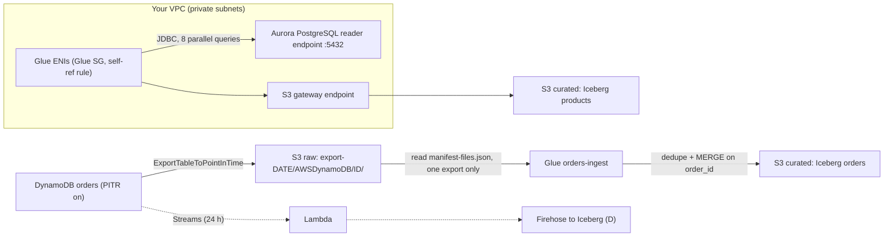

# 🗄️ Source Systems: Aurora PostgreSQL (JDBC into Glue) and DynamoDB (Export to S3, Streams)

> **What they are:** the two operational (OLTP) databases that feed the lakehouse. **Amazon Aurora PostgreSQL** is AWS's PostgreSQL-compatible relational database with a distributed storage layer. The lab reads its `products` table into Glue over **JDBC**. **Amazon DynamoDB** is AWS's serverless key-value/document database. The lab **exports** its `orders` table to S3 and merges it into Iceberg.
> **GCP equivalents:** Aurora PostgreSQL ≈ **AlloyDB for PostgreSQL** (closest) / Cloud SQL for PostgreSQL · DynamoDB ≈ **Firestore** (serverless documents) / **Bigtable** (key-design-driven wide column) · DMS / zero-ETL ≈ **Datastream** / Database Migration Service · DynamoDB export to S3 ≈ Firestore managed export to GCS · DynamoDB Streams ≈ Firestore triggers / Bigtable change streams.
> **Where they appear in the HLD:** **A**: Aurora PostgreSQL *Products* → *Read data (JDBC connection)* → Glue *ingest products* → append to curated ([Challenge A](../01_AWS_Data_Lakehouse_Demonstrated/Challenge_A_Product_Catalog_Schema_Mismatch_And_Partitioning.md): the source column widened from INT to BIGINT). **G**: DynamoDB *orders* → *Export data* → raw S3 → Glue *ingest orders* → merge into curated ([Challenge G](../01_AWS_Data_Lakehouse_Demonstrated/Challenge_G_Orders_Ingest_Duplicates_And_Iceberg_Snapshot_Rollback.md): reading every daily full export gave 3× duplicates).
> **As of:** Nov 2026 · ⚠️ = unverified or likely to change. Verify in the docs.
> **Guide index:** [README](README.md) · Related: [03 Glue](03_AWS_Glue.md) · [02 Iceberg](02_Apache_Iceberg_On_AWS.md) · [01 S3](01_Amazon_S3.md) · [06 Firehose](06_Amazon_Data_Firehose.md) · [09 Lambda](09_AWS_Lambda.md)

---

## ⭐ Must-know first (labs + exam)

1. **Aurora PostgreSQL speaks the PostgreSQL wire protocol.** Glue and Spark read it with the PostgreSQL JDBC driver: `jdbc:postgresql://<endpoint>:5432/<database>`. Point ETL at the **reader endpoint** (`…cluster-ro-…`) so the writer isn't loaded.
2. **A Glue JDBC connection places the job inside your VPC.** Glue creates **ENIs** (elastic network interfaces, virtual NICs) in the connection's **subnet** with its **security groups**. The job must list the connection under **Job details → Connections**, or it isn't in the VPC at all.
3. **The self-referencing security group rule.** The Glue security group needs an inbound rule allowing **all TCP from itself**, because Spark workers talk to each other. The **database's** SG must allow **5432 from the Glue SG**.
4. **The Glue subnet needs a route to S3**, through an **S3 gateway VPC endpoint** (free) or a NAT gateway. Otherwise: *"Could not find S3 endpoint or NAT gateway for subnetId"*. Other APIs (Secrets Manager, CloudWatch Logs) need a NAT gateway or interface endpoints.
5. **Credentials live in Secrets Manager**, referenced by the connection. Never in job parameters.
6. **Parallel reads.** By default one task reads the whole table over one connection (slow, and an out-of-memory risk). In Glue, set **`hashfield`** (a column) or **`hashexpression`** plus **`hashpartitions`** (default **7**). In plain Spark, set `partitionColumn` + `lowerBound` + `upperBound` + `numPartitions`. **Bounds only set the stride. They don't filter rows.**
7. **Push filtering into the database** (a subquery in `dbtable`, or a `query`). Reading the whole table and filtering in Spark wastes database I/O and network.
8. **Type mapping (Challenge A):** PG `integer` → Spark `IntegerType` → Iceberg `int`. PG `bigint` → `LongType` → `long`/`bigint`. When the DBA widened `quantity` INT → BIGINT, appends failed until the Iceberg column was **promoted** (`ALTER COLUMN quantity TYPE bigint`, metadata-only). Allowed promotions: **int → long, float → double, decimal precision up**.
9. **CDC options:** **AWS DMS** (full load + ongoing change capture from the PostgreSQL WAL; needs logical replication), **zero-ETL integrations** ⚠️, or a batch "incremental pull" on an `updated_at` watermark. Only log-based CDC sees **hard deletes**.
10. **DynamoDB data model:** a table of **items** (≤ **400 KB** each) addressed by a **partition key** (hashed to a physical partition) plus an optional **sort key**. Capacity is **on-demand** (pay per request) or **provisioned** (RCUs/WCUs).
11. **Export to S3 needs PITR** (point-in-time recovery, continuous backups). It reads from the backup, so it **consumes no read capacity**. A **full export** is a complete snapshot every time.
12. **Incremental export** covers the changes in a window of **15 minutes to 24 hours** (inside the PITR window). Each record has `Keys`, `NewImage` and optional `OldImage`, plus `Metadata.WriteTimestampMicros`. **Its data files go to a shared `AWSDynamoDB/data/` folder**, so always read the **manifest** for the export you want.
13. **Export layout:** `<prefix>/AWSDynamoDB/<ExportId>/manifest-summary.json`, `manifest-files.json`, checksum files, `_started`, and `data/*.json.gz`. Each data line is `{"Item": {"order_id": {"S": "o-1"}, "total": {"N": "12.50"}}}`.
14. **DynamoDB JSON wraps every value in a type descriptor** (`S`, `N`, `BOOL`, `M`, `L`, `SS`, `NULL`, …), and **numbers are strings** (`"N": "12.50"`). Flatten with `Item.x.S` / `cast(Item.y.N)`, and give Spark an explicit schema.
15. **Challenge G in one line:** each daily export is a **full** copy, so reading the parent prefix after 3 days loads every order 3×. Read **one** export (date-scoped path or manifest), and make the write **idempotent** (dedupe + MERGE on `order_id`).
16. **Streams vs export:** **DynamoDB Streams** is a 24-hour, per-item ordered change log for near-real-time consumers (Lambda). **Export** is for bulk and batch loads. Pick by freshness need and volume.

---

## 🧱 First principles

### Why analytics doesn't query the OLTP database directly
- **OLTP** (online transaction processing) databases are optimised for many small reads and writes by key, using **row-oriented** storage, indexes and transactions. **Analytics** scans a few columns across *all* rows, which suits **columnar** files (Parquet) that can be pruned.
- Heavy scans on the production database steal CPU, I/O and buffer cache from the application. In PostgreSQL, long-running queries also hold back **vacuum**, and on replicas they can be cancelled by replication conflicts ⚠️.
- So data is **copied out** into the lake. There are only three ways to get it out:

| Way | Mechanism | Freshness | Source load | Sees deletes? | Lab |
|---|---|---|---|---|---|
| **Query (pull)** | SQL over JDBC | Batch | Medium–high | Only by full diff | **A** |
| **Snapshot / export** | Bulk files from a backup | Batch | **None** (DynamoDB export, Aurora snapshot export) | Yes, by comparing snapshots | **G** |
| **Change log (CDC)** | Read the transaction log (PG WAL, DynamoDB Streams) | Seconds | Low | **Yes** | (D is the streaming analogue) |

### Why Glue needs ENIs, a self-referencing SG and an S3 endpoint
1. Databases live in **private subnets**, unreachable from outside the VPC by design.
2. Glue is a managed service running **outside** your VPC. To reach the database it must put **network interfaces inside your subnet**, and those ENIs are governed by **security groups** like any instance.
3. A Spark job is a **cluster** (driver + executors), and they shuffle data to each other **through those ENIs**. So the SG must let members talk to each other, which is what the **self-reference** rule does. It's narrower than opening ports to a CIDR.
4. Once Glue is inside your VPC, *everything* it calls (S3 for scripts, temp data and output; CloudWatch Logs; Secrets Manager) must be reachable **from that subnet**. Hence the S3 gateway endpoint or a NAT gateway.

### Why parallel JDBC reads are explicit
JDBC is **one connection = one cursor = one stream of rows**. Spark can only parallelise if it can split the table into **disjoint queries** (`WHERE id >= a AND id < b`). It doesn't know your data's distribution, so you name a column and range (Spark) or a hash column and bucket count (Glue). The trade-off is that **N partitions means N concurrent queries on the database**.

### Why DynamoDB pushes analytics to exports and streams
- DynamoDB guarantees **predictable single-digit-ms latency at any scale** by hashing the **partition key** to a physical partition, with per-partition throughput limits. There are no joins and no secondary-index scans by default. **Scans** read every item and burn capacity.
- An analytics "read everything" would be a full **Scan**, which is costly, throttles the application and isn't a consistent point-in-time view.
- **Export from PITR** solves all three: it reads the **continuous backup** (no RCUs, no throttling) at a consistent timestamp and writes files straight to S3.
- **Streams** solve freshness: an ordered, per-item change log retained for 24 hours.

### Full vs incremental: the core trade-off
- **Full snapshot:** self-contained. Any single export **is** the truth at time T, so loading it with "replace" or "MERGE + delete missing" is naturally idempotent. But cost and time scale with **table size**, and keeping many snapshots under one prefix invites **Challenge G**.
- **Incremental:** cost scales with the **change rate**. But you must apply windows **in order, without gaps or overlaps**, and remember what you applied (a **ledger**).

### Idempotency (the principle behind G)
Delivery in distributed systems is **at-least-once**: retries, re-runs, re-triggers, overlapping windows. You get **exactly-once effects** only if each write is **idempotent**, meaning applying the same input twice leaves the same state:
1. **Deterministic input scope**: a run for date D reads only D.
2. **Keyed upsert** (MERGE on the business key) rather than blind append.
3. **Ordering guard**: only apply a change if it's newer (`s.updated_at > t.updated_at`).
4. **A ledger** of processed inputs (export ARNs, file keys).

---

## 🧩 Core concepts

### Aurora PostgreSQL for data engineers

| Term | Meaning | Why you care |
|---|---|---|
| **Cluster** | 1 **writer** + up to 15 **reader** instances sharing one storage volume | Read from replicas for ETL |
| **Cluster volume** | Distributed storage: **6 copies across 3 AZs**. Auto-grows (to a very large cap ⚠️) | Replicas don't copy data, so replica lag is small (often < 100 ms ⚠️) |
| **Cluster (writer) endpoint** | `<cluster>.cluster-<id>.<region>.rds.amazonaws.com` | Apps write here. Avoid it for ETL |
| **Reader endpoint** | `<cluster>.cluster-ro-<id>.…`. DNS load-balances across readers | **ETL reads** |
| **Instance / custom endpoints** | One instance, or a chosen subset | A dedicated "analytics replica" |
| **Aurora Serverless v2** | Capacity in ACUs that scales up and down | Bursty ETL may trigger scale-ups |
| **Cluster parameter group** | Engine settings, e.g. `rds.logical_replication = 1` for CDC | Needs a reboot ⚠️ |
| **Snapshot export to S3** | Exports a DB snapshot to S3 as **Parquet** | Bulk load with **zero** DB load (hours of latency) |
| **Fast clone** | Copy-on-write clone of the cluster | Run a heavy one-off extraction against a clone |
| **Auth** | Password (in **Secrets Manager**, with rotation) or **IAM DB auth** (15-min tokens) | Glue connections use the secret |
| **TLS** | Newer PG versions on RDS/Aurora may **force SSL** (`rds.force_ssl`) ⚠️ | The JDBC driver negotiates SSL by default |

### Glue connection anatomy

| Field | Value (lab-style) | Notes |
|---|---|---|
| Connection type | **JDBC** (or the native **PostgreSQL** type in newer Glue ⚠️) | |
| JDBC URL | `jdbc:postgresql://<reader-endpoint>:5432/<db>` | Include the database name |
| Credentials | **Secrets Manager** secret (`username`, `password`) | The job role needs `secretsmanager:GetSecretValue` |
| **VPC / Subnet / Security groups** | A private subnet in the DB's VPC + a Glue SG | One subnet (one AZ) per connection |
| Require SSL | Optional | Turn it on for production |
| **Attach to the job** | Job details → **Connections** | Without this the job isn't in the VPC |

### Networking requirements (memorise this table)

| Requirement | Why | Typical error if missing |
|---|---|---|
| Glue SG: **inbound all TCP from itself** | Driver ↔ executor traffic | *"At least one security group must open all ingress ports. To limit traffic, the source security group in your inbound rule can be restricted to the same security group"* |
| Glue SG: outbound allowed (default all) | Reach the DB, endpoints, peers | Timeouts |
| DB SG: **inbound 5432 from the Glue SG** | Let workers reach PostgreSQL | `PSQLException: The connection attempt failed` / connect timed out |
| **S3 gateway endpoint** (or NAT) on the subnet's route table | Scripts, temp dir, output | *"VPC S3 endpoint validation failed … Could not find S3 endpoint or NAT gateway for subnetId"* |
| NAT or **interface endpoints** for Secrets Manager, CloudWatch Logs, Glue, STS, KMS ⚠️ | API calls from inside the VPC | The job hangs, then times out |
| Enough **free IPs** in the subnet | One IP per worker ENI ⚠️ | Not-enough-IP errors at start |
| VPC **DNS hostnames + resolution** enabled | Resolve the RDS endpoint | `UnknownHostException` |
| Public subnet + IGW **doesn't help** | Glue ENIs get no public IP | Internet/API timeouts |

### Read options: Glue DynamicFrame vs Spark JDBC

| Need | Glue (`create_dynamic_frame.from_options` / `from_catalog`) | Spark `spark.read.format("jdbc")` |
|---|---|---|
| Table | `dbtable` | `dbtable` (a table or a `(subquery) AS t`) **or** `query` |
| Parallel by column | **`hashfield`** + **`hashpartitions`** (default 7) | **`partitionColumn`** (numeric/date/timestamp) + **`lowerBound`** + **`upperBound`** + **`numPartitions`** |
| Parallel by expression | **`hashexpression`** (SQL returning a whole number) | `predicates=[…]` list (one WHERE per partition) |
| Pushdown | `sampleQuery` ⚠️ (with `enablePartitioningForSampleQuery`). `push_down_predicate` is for **S3 partitions**, not JDBC | Subquery in `dbtable`. Simple `.filter()`s are pushed automatically (`pushDownPredicate=true`) |
| Incremental | **Job bookmarks** with `jobBookmarkKeys` (monotonic column) | Your own watermark (Example 3) |
| Rows per round trip | — ⚠️ | **`fetchsize`**. The PG driver otherwise **buffers the whole result**. Spark turns off autocommit so the cursor streams |
| Constraint | — | `query` **can't** be combined with `partitionColumn`. Use a `dbtable` subquery |

### Type mapping: PostgreSQL → Spark → Iceberg → Athena

| PostgreSQL | Spark | Iceberg | Athena shows | Notes |
|---|---|---|---|---|
| `smallint` | `ShortType` (newer Spark) / `IntegerType` ⚠️ | `int` | `int` | Iceberg has no 16-bit int |
| `integer`, `serial` | `IntegerType` | `int` | `int` | **Challenge A before the DBA change** |
| `bigint`, `bigserial` | `LongType` | `long` | `bigint` | **Challenge A after**: writing long into int fails |
| `numeric(p,s)` | `DecimalType(p,s)` | `decimal(p,s)` | `decimal(p,s)` | Unbounded `numeric` → `DecimalType(38,18)` ⚠️ (may overflow or lose scale) |
| `real` / `double precision` | `FloatType` / `DoubleType` | `float` / `double` | same | Never use them for money |
| `text`, `varchar`, `char`, `uuid`, `json(b)`, `inet` | `StringType` | `string` | `string` | Parse JSON later |
| `boolean` | `BooleanType` | `boolean` | `boolean` | |
| `date` | `DateType` | `date` | `date` | |
| `timestamp` / `timestamptz` | `TimestampType` | `timestamptz` (from Spark `TimestampType`) ⚠️ | `timestamp(6) with time zone` ⚠️ | Set the session time zone to **UTC** everywhere. Mixing Spark-created and Athena-created timestamp columns is a classic mismatch ⚠️ |
| `bytea` | `BinaryType` | `binary` | `varbinary` | |
| `int[]` etc. | `ArrayType` | `list` | `array` | |

**Iceberg type promotions** (metadata-only, no rewrite): `int → long`, `float → double`, `decimal(P,S) → decimal(P',S)` with `P' > P`. Everything else (narrowing, string → int) needs a new column plus a backfill ([02 Iceberg](02_Apache_Iceberg_On_AWS.md)).

### CDC options for Aurora PostgreSQL (high level)

| Option | How | Latency | Hard deletes | Watch out for |
|---|---|---|---|---|
| Glue JDBC **full reload** | `SELECT *` + overwrite/MERGE | Batch | Yes (overwrite) | Load scales with table size |
| Glue JDBC **incremental** (bookmarks/watermark) | `WHERE updated_at >= wm` | Batch | **No** (unless soft-delete flag) | Needs a reliable, indexed `updated_at` set by the app or a trigger |
| **Aurora snapshot export** | Snapshot → Parquet in S3 | Hours | Yes (by diff) | Slow. No DB load |
| **AWS DMS** full load + CDC | Logical replication slot → targets S3 (CSV/Parquet with an `Op` column I/U/D), Kinesis, Redshift… | Seconds–minutes | **Yes** | `rds.logical_replication=1`, replication instance or DMS Serverless, **WAL growth if the slot stalls**, PK required for updates |
| **Zero-ETL integration** ⚠️ | Managed replication (e.g. Aurora PostgreSQL → Redshift; other targets evolving) | Seconds | Yes | Limited targets and transforms. Verify current support |
| Debezium on MSK Connect | Logical decoding → Kafka topics | Seconds | Yes | You run more of the plumbing |

### DynamoDB concepts

| Term | Meaning | GCP analogue |
|---|---|---|
| **Table / item / attribute** | Schemaless items (≤ 400 KB) in a table. Only the key attributes are required | Firestore collection / document / field |
| **Partition key (PK)** | Hashed to a physical partition. Equality-only access | Bigtable row-key prefix |
| **Sort key (SK)** | Orders items within a PK. Range queries (`begins_with`, `between`) | Bigtable row-key suffix |
| **GSI / LSI** | Global secondary index (any PK/SK, eventually consistent, own capacity) / Local (same PK, different SK, created with the table) | Firestore composite indexes |
| **Query vs Scan** | Query = one PK (efficient). Scan = whole table (expensive) | |
| **Capacity: on-demand** | Pay per read/write request unit. Instant scaling (within limits) | Firestore pricing |
| **Capacity: provisioned** | RCUs/WCUs + auto scaling. Cheaper at steady load | Bigtable nodes (roughly) |
| **RCU / WCU** | 1 RCU = 1 strongly consistent 4 KB read/s (or 2 eventually consistent). 1 WCU = one 1 KB write/s. Transactions cost 2× | |
| **Partition limits** | ~3,000 RCU and ~1,000 WCU per physical partition. A hot key throttles even when the table has spare capacity | Bigtable hotspotting |
| **PITR** | Continuous backups. Restore to any second in the last **35 days** (window configurable ⚠️) | Firestore PITR (7 days) |
| **TTL** | Background expiry of items by an epoch attribute (deletes show up in Streams as service deletes) | Firestore TTL policies |
| **Streams** | Ordered per-item change log, **24 h** retention | Firestore triggers / Bigtable change streams |
| **Global tables** | Multi-region, multi-active replication | Spanner multi-region (different consistency) |

### DynamoDB JSON type descriptors

| Descriptor | Meaning | Example | Spark read (explicit schema) |
|---|---|---|---|
| `S` | String | `{"S": "o-1001"}` | `Item.order_id.S` |
| `N` | Number, **sent as a string** | `{"N": "129.90"}` | `Item.total.N.cast("decimal(12,2)")` |
| `BOOL` | Boolean | `{"BOOL": true}` | `Item.is_gift.BOOL` |
| `NULL` | Explicit null | `{"NULL": true}` | Treat as null |
| `M` | Map (nested object) | `{"M": {"city": {"S": "Pune"}}}` | `Item.shipping.M.city.S` |
| `L` | List (mixed types allowed) | `{"L": [{"M": {...}}]}` | `transform(Item.lines.L, x -> x.M.sku.S)` |
| `SS` / `NS` / `BS` | String / number / binary **set** | `{"SS": ["a","b"]}` | `array<string>` |
| `B` | Binary (base64) | `{"B": "aGVsbG8="}` | `unbase64(...)` |

### Export to S3: full vs incremental

| | **Full export** | **Incremental export** |
|---|---|---|
| Contents | Every item at one point in time | Items **changed** in `[ExportFromTime, ExportToTime)`, compacted to the final state per item |
| Window | Any time within the PITR window | **15 min to 24 h**, inside PITR. Windows must line up with no gaps |
| Record shape | `{"Item": {...}}` | `{"Metadata": {"WriteTimestampMicros": {"N": …}}, "Keys": {...}, "NewImage": {...}, "OldImage": {...}}` |
| Insert / update / delete | n/a | Insert: Keys + NewImage. Update: + OldImage (if NEW_AND_OLD_IMAGES). Delete: Keys (+ OldImage) |
| Data file location | `<prefix>/AWSDynamoDB/<ExportId>/data/` | **Shared** `<prefix>/AWSDynamoDB/data/` across incremental exports |
| Cost driver | Table size ⚠️ | Size of changed data ⚠️ |
| Read capacity used | **None** | **None** |
| Formats | DynamoDB JSON or Amazon Ion, gzip | Same |
| Requires | **PITR enabled** | **PITR enabled** |

```text
s3://<raw-bucket>/raw/orders/export-2025-05-02/          ← the --s3-prefix you chose
└── AWSDynamoDB/
    └── 01746147600000-ab12cd34/                         ← ExportId (unique per export)
        ├── _started                                     ← empty permission-check file
        ├── manifest-summary.json  (+ .md5/.checksum)   ← exportArn, exportTime, itemCount, outputFormat
        ├── manifest-files.json    (+ .checksum)        ← JSON lines: one dataFileS3Key per data file
        └── data/
            ├── 3sjk2...json.gz                          ← JSON lines: {"Item": {...}}
            └── ...
```

> The lab's `raw/orders/export-<date>/` folders behave like one export prefix each. If you point Spark at the **folder** of a real export, it also reads `manifest-*.json`, `.md5` and `_started`, which become junk rows or `_corrupt_record` rows. Read the files listed in `manifest-files.json`, or the `data/` subfolder ⚠️ (in the lab, reading the date folder worked).

### Ways to get data out of DynamoDB

| Option | Freshness | Impact on table | Best for |
|---|---|---|---|
| **Export to S3 (full)** | Snapshot (minutes to hours to run) | None (uses PITR) | Daily batch, backfills (**G**) |
| **Export to S3 (incremental)** | 15 min–24 h windows | None | Cheaper batch CDC for big tables |
| **DynamoDB Streams + Lambda** | Seconds | None (stream reads are separate) | Near-real-time pipelines, fan-out via Firehose |
| **Kinesis Data Streams for DynamoDB** | Seconds | None | Longer retention (up to 365 days ⚠️), many consumers. Records may be **duplicated or out of order** ⚠️ |
| **Zero-ETL** to Redshift / OpenSearch / lakehouse targets ⚠️ | Seconds–minutes | None | Managed SQL analytics without pipelines |
| **Glue direct read (Scan)** | Batch | **Consumes RCUs** (throttle with `dynamodb.throughput.read.percent`) | Small tables only |
| **Athena DynamoDB connector** (federated) | Live | Consumes RCUs | Occasional ad-hoc queries |

### Idempotent ingestion patterns

| Pattern | How | Protects against |
|---|---|---|
| **Scope the input** | Run parameter `--export_date` → read exactly one export | Prefix accumulation (**G**) |
| **Manifest / completion marker** | Read only files listed in the manifest. Require `_SUCCESS` | Half-written folders, stray files |
| **Dedupe within the batch** | `row_number() over (partition by key order by updated_at desc) = 1` | Repeated keys in one batch. MERGE fails on many-to-one matches |
| **MERGE on the business key** | `WHEN MATCHED … UPDATE`, `WHEN NOT MATCHED … INSERT` | Re-runs, overlapping windows |
| **Ordering guard** | `… AND s.updated_at > t.updated_at` (or the DynamoDB write timestamp) | Late or out-of-order replays overwriting newer data |
| **Ledger table** | Record export ARN / window / file keys once committed | Double application. Gives gap detection |
| **Dynamic partition overwrite** | `INSERT OVERWRITE` the partitions in the batch | Re-runs of partition-aligned batches |
| **Write-Audit-Publish** | Write to an Iceberg branch, validate, then fast-forward `main` | Bad data ever becoming visible |
| **Reconciliation gate** | Compare row count and distinct keys with the manifest `itemCount` | Would have caught G before commit |

---

## 🔄 How it works (flow)



**Flow A: Aurora → Glue → Iceberg (numbered)**
1. A job run starts. Glue sees the attached **connection** and creates ENIs in its subnet with the Glue SG. This is why VPC jobs take extra startup time.
2. The driver fetches the secret and opens JDBC connections. With `hashfield=product_id, hashpartitions=8`, Glue issues 8 queries, each covering a hash bucket of the IDs.
3. Rows become a DataFrame with Spark types from the JDBC metadata (`bigint` → `LongType`).
4. The write to `glue_catalog.lakehouse_db.products` checks the incoming schema against the Iceberg schema. `long` into `int` is **rejected** (no silent narrowing). That's Challenge A's failure.
5. On success, Iceberg writes Parquet files to S3 (through the gateway endpoint) and commits a snapshot in the Glue Data Catalog.

**Flow G: DynamoDB → export → Glue → Iceberg (numbered)**
1. A scheduler calls `ExportTableToPointInTime` (needs PITR). DynamoDB writes gzip JSON-lines files + manifests under `<prefix>/AWSDynamoDB/<ExportId>/`.
2. The ingest job is started with `--export_date=D`. It locates **that** export's `manifest-summary.json` → `manifest-files.json` → data file list.
3. It reads with an explicit schema, flattens the type descriptors, and reconciles the count against `itemCount`.
4. It dedupes by `order_id` and MERGEs into the curated table. A re-run of the same date changes nothing (idempotent).

---

## 🛠️ Hands-on examples

> CloudShell in us-east-1 for CLI, Glue 4.0/5.0 ⚠️ for PySpark. Iceberg jobs need `--datalake-formats iceberg` and the `glue_catalog` Spark settings ([03 Glue](03_AWS_Glue.md)). Replace names with your exact (suffixed) resource names.

### Example 1: Build a working Glue → Aurora connection (network, secret, connection)

**Goal:** make `aurora-products-conn` pass **Test connection**, with the minimum network opening.

**Console steps**
1. **RDS → Databases →** your cluster → **Connectivity & security**: note the **reader endpoint**, VPC, subnets and the DB **security group**.
2. **VPC → Security groups → Create** `glue-jdbc-sg` in that VPC → **Inbound: All TCP, source = `glue-jdbc-sg` itself** → keep outbound "all".
3. Edit the **DB SG** → inbound **PostgreSQL 5432**, source = `glue-jdbc-sg`.
4. **VPC → Endpoints → Create** → service `com.amazonaws.us-east-1.s3`, type **Gateway** → select the route table(s) of the Glue subnet.
5. **Secrets Manager → Store a new secret** → *Credentials for Amazon RDS database* → user `etl_reader`.
6. **Glue → Data connections → Create connection** → PostgreSQL/JDBC → URL with the **reader** endpoint → secret → VPC, **private subnet**, `glue-jdbc-sg` → **Create** → **Actions → Test connection** (choose a role with `secretsmanager:GetSecretValue`).

**CLI**
```bash
export AWS_PAGER=""
CLUSTER=$(aws rds describe-db-clusters --query "DBClusters[?Engine=='aurora-postgresql'].DBClusterIdentifier | [0]" --output text)
read READER DB_SG SUBNET_GROUP <<< "$(aws rds describe-db-clusters --db-cluster-identifier "$CLUSTER" \
  --query "DBClusters[0].[ReaderEndpoint, VpcSecurityGroups[0].VpcSecurityGroupId, DBSubnetGroup]" --output text)"
VPC=$(aws rds describe-db-subnet-groups --db-subnet-group-name "$SUBNET_GROUP" --query "DBSubnetGroups[0].VpcId" --output text)
read SUBNET AZ <<< "$(aws rds describe-db-subnet-groups --db-subnet-group-name "$SUBNET_GROUP" \
  --query "DBSubnetGroups[0].Subnets[0].[SubnetIdentifier, SubnetAvailabilityZone.Name]" --output text)"
echo "reader=$READER dbsg=$DB_SG vpc=$VPC subnet=$SUBNET az=$AZ"

# 1) Glue SG with the self-referencing all-TCP inbound rule
GLUE_SG=$(aws ec2 create-security-group --group-name glue-jdbc-sg --description "Glue workers for JDBC" \
  --vpc-id "$VPC" --query GroupId --output text)
aws ec2 authorize-security-group-ingress --group-id "$GLUE_SG" \
  --ip-permissions "IpProtocol=tcp,FromPort=0,ToPort=65535,UserIdGroupPairs=[{GroupId=$GLUE_SG}]"

# 2) DB SG: allow PostgreSQL only from the Glue SG
aws ec2 authorize-security-group-ingress --group-id "$DB_SG" --protocol tcp --port 5432 --source-group "$GLUE_SG"

# 3) S3 gateway endpoint on the subnet's route table (falls back to the VPC main table if not explicitly associated)
RTB=$(aws ec2 describe-route-tables --filters Name=association.subnet-id,Values="$SUBNET" --query "RouteTables[0].RouteTableId" --output text)
[ "$RTB" = "None" ] && RTB=$(aws ec2 describe-route-tables --filters Name=vpc-id,Values="$VPC" Name=association.main,Values=true \
  --query "RouteTables[0].RouteTableId" --output text)
aws ec2 describe-vpc-endpoints --filters Name=vpc-id,Values="$VPC" Name=service-name,Values=com.amazonaws.us-east-1.s3 \
  --query "VpcEndpoints[].VpcEndpointId" --output text | grep -q vpce \
  || aws ec2 create-vpc-endpoint --vpc-id "$VPC" --vpc-endpoint-type Gateway \
       --service-name com.amazonaws.us-east-1.s3 --route-table-ids "$RTB"

# 4) Secret (replace the password; better: let RDS manage the master secret and create a read-only user)
aws secretsmanager create-secret --name lakehouse/aurora/etl-reader \
  --secret-string '{"username":"etl_reader","password":"REPLACE_ME"}'

# 5) Glue connection
cat > conn.json <<EOF
{
  "Name": "aurora-products-conn",
  "ConnectionType": "JDBC",
  "ConnectionProperties": {
    "JDBC_CONNECTION_URL": "jdbc:postgresql://${READER}:5432/anycompany",
    "SECRET_ID": "lakehouse/aurora/etl-reader"
  },
  "PhysicalConnectionRequirements": {
    "SubnetId": "${SUBNET}",
    "SecurityGroupIdList": ["${GLUE_SG}"],
    "AvailabilityZone": "${AZ}"
  }
}
EOF
aws glue create-connection --connection-input file://conn.json
aws glue get-connection --name aurora-products-conn --hide-password \
  --query "Connection.{url:ConnectionProperties.JDBC_CONNECTION_URL,subnet:PhysicalConnectionRequirements.SubnetId}"
```

**Read-only database user** (run once in `psql` as the admin):
```sql
CREATE ROLE etl_reader LOGIN PASSWORD 'REPLACE_ME';
GRANT CONNECT ON DATABASE anycompany TO etl_reader;
GRANT USAGE ON SCHEMA public TO etl_reader;
GRANT SELECT ON ALL TABLES IN SCHEMA public TO etl_reader;
ALTER DEFAULT PRIVILEGES IN SCHEMA public GRANT SELECT ON TABLES TO etl_reader;
ALTER ROLE etl_reader SET statement_timeout = '30min';   -- runaway ETL queries can't hold snapshots forever
```

**Expected result:** **Test connection** succeeds. The connection shows the reader URL and the private subnet.
**What to check:** the exact error text maps to a row in the networking table above. If the subnet is **public** (route to an IGW, no NAT), API calls from the job will still time out. Use a private subnet with a NAT gateway or interface endpoints.

---

### Example 2: Reproduce Challenge A, a parallel read with a schema guard instead of a broken append

**Goal:** read `public.products` in 8 parallel queries, detect the INT → BIGINT widening, apply the **allowed** Iceberg promotion, and append. Refuse anything unsafe.

**The lab fix (what passed):** in the `products-schema-fix` job:
```python
spark.sql("ALTER TABLE glue_catalog.lakehouse_db.products ALTER COLUMN quantity TYPE bigint")
```
then re-run `products-ingest`. The script below is the **production version** of the same idea, built into the ingest itself.

**Console steps:** Glue → ETL jobs → *Script editor (Spark)* → paste → **Job details**: role, Glue version, **Connections: `aurora-products-conn`**, job parameters below → **Save → Run**.

**Job parameters**

| Key | Value |
|---|---|
| `--connection_name` | `aurora-products-conn` |
| `--source_table` | `public.products` |
| `--target_table` | `lakehouse_db.products` |
| `--warehouse` | `s3://anycompany-lakehouse-curated-7db76de0/` |
| `--datalake-formats` | `iceberg` |

```python
"""products-ingest (hardened): Aurora PostgreSQL -> Iceberg append with a type-promotion guard."""
import sys
from awsglue.context import GlueContext
from awsglue.job import Job
from awsglue.utils import getResolvedOptions
from pyspark.conf import SparkConf
from pyspark.context import SparkContext
from pyspark.sql import functions as F
from pyspark.sql.types import DecimalType, DoubleType, FloatType, IntegerType, LongType, ShortType

args = getResolvedOptions(sys.argv, ["JOB_NAME", "connection_name", "source_table", "target_table", "warehouse"])

# Iceberg + Glue Data Catalog as Spark catalog "glue_catalog"
conf = (SparkConf()
        .set("spark.sql.extensions", "org.apache.iceberg.spark.extensions.IcebergSparkSessionExtensions")
        .set("spark.sql.catalog.glue_catalog", "org.apache.iceberg.spark.SparkCatalog")
        .set("spark.sql.catalog.glue_catalog.catalog-impl", "org.apache.iceberg.aws.glue.GlueCatalog")
        .set("spark.sql.catalog.glue_catalog.io-impl", "org.apache.iceberg.aws.s3.S3FileIO")
        .set("spark.sql.catalog.glue_catalog.warehouse", args["warehouse"])
        .set("spark.sql.session.timeZone", "UTC"))
sc = SparkContext(conf=conf)
glue_context = GlueContext(sc)
spark = glue_context.spark_session
job = Job(glue_context)
job.init(args["JOB_NAME"], args)
TARGET = f"glue_catalog.{args['target_table']}"

# 1) Parallel JDBC read: Glue hashes product_id into 8 buckets -> 8 concurrent queries on the reader
src = glue_context.create_dynamic_frame.from_options(
    connection_type="postgresql",
    connection_options={
        "useConnectionProperties": "true",          # URL + secret come from the Glue connection
        "connectionName": args["connection_name"],
        "dbtable": args["source_table"],
        "hashfield": "product_id",
        "hashpartitions": "8",                       # = max concurrent queries you allow on the DB
    },
    transformation_ctx="src_products",
).toDF()

# 2) Schema guard
INT_ORDER = [ShortType, IntegerType, LongType]

def fits(narrow, wide):
    """True if every value of type `narrow` can be stored in type `wide` without loss."""
    if type(narrow) in INT_ORDER and type(wide) in INT_ORDER:
        return INT_ORDER.index(type(narrow)) <= INT_ORDER.index(type(wide))
    if isinstance(narrow, FloatType) and isinstance(wide, DoubleType):
        return True
    if isinstance(narrow, DecimalType) and isinstance(wide, DecimalType):
        return narrow.scale == wide.scale and narrow.precision <= wide.precision
    return narrow == wide

def iceberg_promotion(old, new):
    """DDL type for a metadata-only Iceberg promotion old -> new, or None if not allowed."""
    if isinstance(old, IntegerType) and isinstance(new, LongType):
        return "bigint"
    if isinstance(old, FloatType) and isinstance(new, DoubleType):
        return "double"
    if (isinstance(old, DecimalType) and isinstance(new, DecimalType)
            and new.scale == old.scale and new.precision > old.precision):
        return f"decimal({new.precision},{new.scale})"
    return None

target_types = {f.name.lower(): f.dataType for f in spark.table(TARGET).schema.fields}
for field in src.schema.fields:
    name = field.name.lower()
    if name not in target_types:
        raise ValueError(f"New source column '{name}' ({field.dataType.simpleString()}): "
                         f"add it deliberately with ALTER TABLE {TARGET} ADD COLUMNS")
    tgt = target_types[name]
    if fits(field.dataType, tgt):
        continue                                   # same type, or a safe upcast at write time
    ddl = iceberg_promotion(tgt, field.dataType)
    if ddl is None:
        raise TypeError(f"Unsafe change on '{name}': table {tgt.simpleString()} vs source "
                        f"{field.dataType.simpleString()}. Needs a new column + backfill.")
    print(f"Promoting {name}: {tgt.simpleString()} -> {ddl} (metadata-only)")
    spark.sql(f"ALTER TABLE {TARGET} ALTER COLUMN {name} TYPE {ddl}")

spark.sql(f"REFRESH TABLE {TARGET}")
target_schema = spark.table(TARGET).schema
src_cols = {c.lower() for c in src.columns}
aligned = src.select([
    (F.col(f.name).cast(f.dataType) if f.name.lower() in src_cols else F.lit(None).cast(f.dataType)).alias(f.name)
    for f in target_schema.fields
])

# 3) Append (see second-order note: append + full re-read duplicates; prefer MERGE, Example 3)
aligned.writeTo(TARGET).append()
job.commit()
```

**Expected result:** the first run after the DBA change logs `Promoting quantity: int -> bigint` and succeeds. `DESCRIBE lakehouse_db.products` in Athena shows `quantity bigint`.
**What to check:**
- The **Spark UI / CloudWatch metrics** should show 8 read tasks. Watch database CPU and connections in RDS Performance Insights.
- If you **don't** want ingest jobs changing schemas (separation of duties, like the lab's `products-schema-fix`), replace the `ALTER` with `raise` and alert. That's a policy choice.
- An LF error on ALTER means the job role needs **Alter** on the table ([05 LF](05_AWS_Lake_Formation.md)).

---

### Example 3 (beyond the lab): Spark-native incremental read with computed bounds, then an idempotent MERGE

**Goal:** read only rows changed since the last load, split evenly by `product_id`, and upsert, so re-runs are harmless.

```python
"""products-incremental: watermark pull from Aurora + MERGE into Iceberg (idempotent)."""
import json
import sys
import boto3
from awsglue.utils import getResolvedOptions
from pyspark.sql import SparkSession

args = getResolvedOptions(sys.argv, ["JOB_NAME", "secret_id", "db_host", "db_name", "target_table"])
spark = SparkSession.builder.getOrCreate()       # Iceberg catalog configured via --conf / --datalake-formats
spark.conf.set("spark.sql.session.timeZone", "UTC")
TARGET = f"glue_catalog.{args['target_table']}"

secret = json.loads(boto3.client("secretsmanager").get_secret_value(SecretId=args["secret_id"])["SecretString"])
JDBC = {
    "url": f"jdbc:postgresql://{args['db_host']}:5432/{args['db_name']}",
    "user": secret["username"],
    "password": secret["password"],
    "driver": "org.postgresql.Driver",
    "sessionInitStatement": "SET TIME ZONE 'UTC'",   # same clock on both sides
}

# 1) Watermark: newest updated_at already in the lake (epoch on the first run)
wm = spark.sql(f"SELECT max(updated_at) AS wm FROM {TARGET}").first()["wm"]
wm_sql = wm.strftime("%Y-%m-%d %H:%M:%S.%f") if wm else "1970-01-01 00:00:00"
where = f"updated_at >= TIMESTAMP '{wm_sql}'"     # >= re-reads boundary rows; MERGE makes that harmless

# 2) One cheap aggregate query for bounds and volume (uses the PK / updated_at indexes)
b = (spark.read.format("jdbc").options(**JDBC)
     .option("query", f"SELECT min(product_id) AS lo, max(product_id) AS hi, count(*) AS n "
                      f"FROM public.products WHERE {where}")
     .load().first())

if b["n"] == 0:
    print(f"No changes since {wm_sql}")
else:
    num_parts = max(1, min(8, b["n"] // 250_000 + 1))           # cap concurrency to protect the database
    changed = (spark.read.format("jdbc").options(**JDBC)
               .option("dbtable", f"(SELECT * FROM public.products WHERE {where}) AS src")  # pushdown
               .option("partitionColumn", "product_id")           # numeric, indexed, evenly spread
               .option("lowerBound", str(b["lo"]))
               .option("upperBound", str(b["hi"] + 1))           # bounds = stride only, not a filter
               .option("numPartitions", str(num_parts))
               .option("fetchsize", "10000")                     # stream rows instead of buffering all
               .load())
    changed.createOrReplaceTempView("src_products")
    spark.sql(f"""
        MERGE INTO {TARGET} t
        USING src_products s
        ON t.product_id = s.product_id
        WHEN MATCHED AND s.updated_at >= t.updated_at THEN UPDATE SET *
        WHEN NOT MATCHED THEN INSERT *
    """)
    print(f"Merged {b['n']} changed rows using {num_parts} JDBC partitions")
```

**Expected result:** the first run loads everything. Later runs touch only changed rows. Running twice in a row leaves the table unchanged except for one extra snapshot.
**What to check:**
- An `updated_at` index exists on the source, or the WHERE becomes a full table scan.
- **Hard deletes are invisible** to this pattern. Use soft deletes or DMS CDC.
- Iceberg needs `UPDATE SET *` source and target columns to match by name.
- `Options 'query' and 'partitionColumn' can not be specified together` means you used `query` instead of a `dbtable` subquery.

---

### Example 4: Reproduce Challenge G with a real DynamoDB export, then load it idempotently

**Goal:** export `orders`, read **exactly that export** via its manifest, flatten DynamoDB JSON, reconcile the count, and MERGE. The lab's one-line fix (date-scoped path) becomes a pipeline that **can't** triple-load.

**Console steps:** DynamoDB → Tables → `orders` → **Backups** → *Point-in-time recovery* → **Edit → On**. Then **Exports and streams** → **Export to S3** → destination `s3://<raw>/raw/orders/export-<date>` → **Full export**, DynamoDB JSON → Export. Wait for **Completed**.

**CLI**
```bash
export AWS_PAGER=""
TABLE=orders
RAW=$(aws s3api list-buckets --query "Buckets[?starts_with(Name,'anycompany-lakehouse-raw')].Name | [0]" --output text)
TABLE_ARN=$(aws dynamodb describe-table --table-name "$TABLE" --query Table.TableArn --output text)

# PITR must be on (exports read from the continuous backup, not the table)
aws dynamodb describe-continuous-backups --table-name "$TABLE" \
  --query "ContinuousBackupsDescription.PointInTimeRecoveryDescription.PointInTimeRecoveryStatus"
aws dynamodb update-continuous-backups --table-name "$TABLE" \
  --point-in-time-recovery-specification PointInTimeRecoveryEnabled=true

# Full export into a date-scoped prefix
EXPORT_DATE=$(date -u +%F)
EXPORT_ARN=$(aws dynamodb export-table-to-point-in-time --table-arn "$TABLE_ARN" \
  --s3-bucket "$RAW" --s3-prefix "raw/orders/export-$EXPORT_DATE" \
  --export-format DYNAMODB_JSON --export-type FULL_EXPORT \
  --query ExportDescription.ExportArn --output text)

# Exports take minutes even for small tables; poll until done
while [ "$(aws dynamodb describe-export --export-arn "$EXPORT_ARN" --query ExportDescription.ExportStatus --output text)" = "IN_PROGRESS" ]; do sleep 30; done
aws dynamodb describe-export --export-arn "$EXPORT_ARN" \
  --query "ExportDescription.{status:ExportStatus,items:ItemCount,manifest:ExportManifest,prefix:S3Prefix}"
aws s3 ls "s3://$RAW/raw/orders/export-$EXPORT_DATE/" --recursive | head -20
```

**PySpark job `orders-ingest` (production-grade version)**. Parameters: `--raw_bucket`, `--export_date`.
```python
"""orders-ingest: one DynamoDB export (by manifest) -> flatten -> reconcile -> dedupe -> MERGE."""
import json
import sys
import boto3
from awsglue.utils import getResolvedOptions
from pyspark.sql import SparkSession, functions as F
from pyspark.sql.types import ArrayType, BooleanType, StringType, StructField, StructType
from pyspark.sql.window import Window

args = getResolvedOptions(sys.argv, ["JOB_NAME", "raw_bucket", "export_date"])   # NAMES, not values
spark = SparkSession.builder.getOrCreate()
spark.conf.set("spark.sql.session.timeZone", "UTC")
s3 = boto3.client("s3")
BUCKET = args["raw_bucket"]                              # bucket name only, no s3://
PREFIX = f"raw/orders/export-{args['export_date']}/"     # ONE logical date (the lab fix)
TARGET = "glue_catalog.lakehouse_db.orders_demo"

def find_manifest_summary(bucket: str, prefix: str) -> str:
    """Exactly one completed export per date folder; fail loudly on 0 or >1."""
    keys = [o["Key"]
            for page in s3.get_paginator("list_objects_v2").paginate(Bucket=bucket, Prefix=prefix)
            for o in page.get("Contents", []) if o["Key"].endswith("/manifest-summary.json")]
    if len(keys) != 1:
        raise RuntimeError(f"Expected 1 manifest-summary.json under s3://{bucket}/{prefix}, found {keys}")
    return keys[0]

def data_files(bucket: str, summary_key: str):
    summary = json.loads(s3.get_object(Bucket=bucket, Key=summary_key)["Body"].read())
    export_prefix = (summary.get("s3Prefix") or "").rstrip("/")
    def full_key(k: str) -> str:                         # doc examples show keys with and without the prefix ⚠️
        return k if not export_prefix or k.startswith(export_prefix + "/") else f"{export_prefix}/{k}"
    body = s3.get_object(Bucket=bucket, Key=full_key(summary["manifestFilesS3Key"]))["Body"].read()
    files = [f"s3://{bucket}/{full_key(json.loads(line)['dataFileS3Key'])}"
             for line in body.decode("utf-8").splitlines() if line.strip()]
    return summary, files

# Explicit schema = contract. Missing attributes become null instead of breaking inference.
S = StructType([StructField("S", StringType())])
N = StructType([StructField("N", StringType())])         # DynamoDB numbers are strings
BOOL = StructType([StructField("BOOL", BooleanType())])
LINE = StructType([StructField("M", StructType([StructField("sku", S), StructField("qty", N)]))])
ITEM = StructType([
    StructField("order_id", S), StructField("customer_id", S), StructField("order_status", S),
    StructField("total_amount", N), StructField("item_count", N), StructField("updated_at", S),
    StructField("is_gift", BOOL),
    StructField("shipping", StructType([StructField("M", StructType([StructField("city", S)]))])),
    StructField("lines", StructType([StructField("L", ArrayType(LINE))])),
])
EXPORT_SCHEMA = StructType([StructField("Item", ITEM)])

summary, files = data_files(BUCKET, find_manifest_summary(BUCKET, PREFIX))
raw = spark.read.schema(EXPORT_SCHEMA).json(files)       # .json.gz is decompressed automatically

orders = (raw.where(F.col("Item.order_id.S").isNotNull())
          .select(
              F.col("Item.order_id.S").alias("order_id"),
              F.col("Item.customer_id.S").alias("customer_id"),
              F.col("Item.order_status.S").alias("order_status"),
              F.col("Item.total_amount.N").cast("decimal(12,2)").alias("total_amount"),
              F.col("Item.item_count.N").cast("int").alias("item_count"),
              F.to_timestamp(F.col("Item.updated_at.S")).alias("updated_at"),
              F.coalesce(F.col("Item.is_gift.BOOL"), F.lit(False)).alias("is_gift"),
              F.col("Item.shipping.M.city.S").alias("ship_city"),
              F.expr("transform(Item.lines.L, x -> x.M.sku.S)").alias("skus"),
          ))

# Reconciliation gate: Challenge G's 150,000-vs-50,000 would stop HERE, before any commit
rows = orders.count()
distinct_ids = orders.select("order_id").distinct().count()
expected = int(summary["itemCount"])
if rows != expected or rows != distinct_ids:
    raise RuntimeError(f"Reconciliation failed: manifest itemCount={expected}, rows={rows}, distinct={distinct_ids}")

# Defensive dedupe (MERGE fails if two source rows match one target row)
latest = (orders
          .withColumn("rn", F.row_number().over(
              Window.partitionBy("order_id").orderBy(F.col("updated_at").desc_nulls_last())))
          .where("rn = 1").drop("rn"))
latest.createOrReplaceTempView("src_orders")

spark.sql(f"""
    CREATE TABLE IF NOT EXISTS {TARGET} (
      order_id string, customer_id string, order_status string, total_amount decimal(12,2),
      item_count int, updated_at timestamp, is_gift boolean, ship_city string, skus array<string>)
    USING iceberg
    PARTITIONED BY (bucket(16, order_id))
    TBLPROPERTIES ('format-version'='2', 'write.merge.mode'='merge-on-read')
""")
spark.sql(f"""
    MERGE INTO {TARGET} t
    USING src_orders s
    ON t.order_id = s.order_id
    WHEN MATCHED AND s.updated_at > t.updated_at THEN UPDATE SET *
    WHEN NOT MATCHED THEN INSERT *
""")
print(f"Merged export {summary['exportArn']} ({rows} items)")
```

**Generic flattener for exploration** (when you don't know the attributes yet):
```python
from pyspark.sql import Column

def ddb_to_plain(c: Column, t: StructType) -> Column:
    """Turn one DynamoDB-JSON attribute into a plain Spark value, from the *inferred* schema."""
    kinds = [k for k in t.fieldNames() if k != "NULL"]   # NULL only flags explicit nulls
    if not kinds:
        return F.lit(None).cast("string")
    if len(kinds) > 1:                                    # the attribute changed type between items
        return F.to_json(c)
    k = kinds[0]
    if k == "S":
        return c["S"]
    if k == "N":
        return c["N"].cast("double")                      # exploration only; use DECIMAL for money
    if k == "BOOL":
        return c["BOOL"]
    if k == "B":
        return F.unbase64(c["B"])
    if k in ("SS", "NS", "BS"):
        return c[k]                                       # array<string>
    if k == "M":
        inner = t["M"].dataType
        return F.struct(*[ddb_to_plain(c["M"][f.name], f.dataType).alias(f.name) for f in inner.fields])
    return F.to_json(c[k])                                # L (mixed lists) -> JSON text

inferred = spark.read.json(files)
item_t = inferred.schema["Item"].dataType
flat = inferred.select(*[ddb_to_plain(F.col("Item")[f.name], f.dataType).alias(f.name) for f in item_t.fields])
flat.printSchema()
```

**Expected result:** `Merged export arn:aws:dynamodb:…/export/… (50000 items)`. Re-running the same `--export_date` changes nothing. Pointing it at a folder holding 3 exports **fails the reconciliation** instead of committing 150,000 rows.
**What to check:**
- If the lab folder has **no manifest** (lab-generated files), fall back to `spark.read.schema(EXPORT_SCHEMA).json(f"s3://{BUCKET}/{PREFIX}")` and keep the reconciliation using a known expected count or distinct-key check.
- Full exports also tell you about **deletes**: keys missing from today's export were deleted. Handle them with `WHEN NOT MATCHED BY SOURCE THEN DELETE` (Spark 3.4+/recent Iceberg ⚠️) or a periodic overwrite.

---

### Example 5 (beyond the lab): an incremental export pipeline with a ledger

**Goal:** apply only the day's changes (inserts, updates **and deletes**) in order, with no gaps.

```bash
# Window: [from, to) in epoch seconds, inside the PITR window, 15 min .. 24 h long
FROM=$(date -u -d 'yesterday 00:00' +%s); TO=$(date -u -d 'today 00:00' +%s)
aws dynamodb export-table-to-point-in-time --table-arn "$TABLE_ARN" \
  --s3-bucket "$RAW" --s3-prefix raw/orders-incr \
  --export-format DYNAMODB_JSON --export-type INCREMENTAL_EXPORT \
  --incremental-export-specification ExportFromTime=$FROM,ExportToTime=$TO,ExportViewType=NEW_AND_OLD_IMAGES \
  --query ExportDescription.ExportArn --output text
```

```python
# Re-uses imports, spark, s3, S, N, ITEM and data_files() from Example 4.
# --manifest_key = ExportDescription.ExportManifest from describe-export
# (the S3 key of THIS export's manifest-summary.json ⚠️ confirm it includes your prefix)
args = getResolvedOptions(sys.argv, ["JOB_NAME", "raw_bucket", "manifest_key"])
BUCKET, summary_key = args["raw_bucket"], args["manifest_key"]

spark.sql("""CREATE TABLE IF NOT EXISTS glue_catalog.lakehouse_db.orders_cdc (
               order_id string, order_status string, total_amount decimal(12,2),
               updated_at timestamp, ddb_write_us bigint)
             USING iceberg PARTITIONED BY (bucket(16, order_id)) TBLPROPERTIES ('format-version'='2')""")
spark.sql("""CREATE TABLE IF NOT EXISTS glue_catalog.lakehouse_db.ingest_ledger (
               export_arn string, window_from timestamp, window_to timestamp, applied_at timestamp)
             USING iceberg""")

INCR_SCHEMA = StructType([
    StructField("Metadata", StructType([StructField("WriteTimestampMicros", N)])),
    StructField("Keys", StructType([StructField("order_id", S)])),
    StructField("NewImage", ITEM),
    StructField("OldImage", ITEM),
])
summary, files = data_files(BUCKET, summary_key)      # NEVER read raw/orders-incr/AWSDynamoDB/data/ wholesale:
                                                      # that shared folder holds EVERY incremental export
changes = spark.read.schema(INCR_SCHEMA).json(files).select(
    F.col("Keys.order_id.S").alias("order_id"),
    F.col("Metadata.WriteTimestampMicros.N").cast("long").alias("ddb_write_us"),
    F.col("NewImage").isNull().alias("is_delete"),       # delete = Keys (+ OldImage), no NewImage
    F.col("NewImage.order_status.S").alias("order_status"),
    F.col("NewImage.total_amount.N").cast("decimal(12,2)").alias("total_amount"),
    F.to_timestamp(F.col("NewImage.updated_at.S")).alias("updated_at"),
)                                                         # incremental output is already one row per item
changes.createOrReplaceTempView("chg")

spark.sql("""
  MERGE INTO glue_catalog.lakehouse_db.orders_cdc t
  USING chg s
  ON t.order_id = s.order_id
  WHEN MATCHED AND s.is_delete AND s.ddb_write_us > t.ddb_write_us THEN DELETE
  WHEN MATCHED AND NOT s.is_delete AND s.ddb_write_us > t.ddb_write_us THEN
    UPDATE SET order_status = s.order_status, total_amount = s.total_amount,
               updated_at = s.updated_at, ddb_write_us = s.ddb_write_us
  WHEN NOT MATCHED AND NOT s.is_delete THEN
    INSERT (order_id, order_status, total_amount, updated_at, ddb_write_us)
    VALUES (s.order_id, s.order_status, s.total_amount, s.updated_at, s.ddb_write_us)
""")

# Ledger: record the window so the next run starts exactly at this ExportToTime (no gaps, no overlaps).
# Re-applying an export is already a no-op (ddb_write_us guard); the ledger is for gap detection and audit.
spark.sql(f"""INSERT INTO glue_catalog.lakehouse_db.ingest_ledger
              VALUES ('{summary["exportArn"]}', TIMESTAMP '{summary["exportFromTime"][:19].replace("T", " ")}',
                      TIMESTAMP '{summary["exportToTime"][:19].replace("T", " ")}', current_timestamp())""")
```

**Expected result:** the target matches the source as of `ExportToTime`, including deletions. Re-applying the same export is a no-op thanks to the `ddb_write_us` guard.
**What to check:** seed `orders_cdc` from one **full** export first (set `ddb_write_us` to the export time in microseconds), then chain incrementals from that export time. Alert if the ledger shows a gap.

---

### Example 6 (beyond the lab): DynamoDB Streams → Lambda → Firehose (near real time)

**Goal:** stream order changes within seconds into the Firehose → Iceberg path of [Challenge D](../01_AWS_Data_Lakehouse_Demonstrated/Challenge_D_Firehose_Iceberg_Streaming_Upserts_And_Buffering.md), converting DynamoDB JSON to plain JSON.

```python
"""orders-stream-to-firehose: DynamoDB Streams batch -> plain JSON lines -> Firehose."""
import json
import os
from decimal import Decimal
import boto3
from boto3.dynamodb.types import TypeDeserializer

firehose = boto3.client("firehose")
STREAM = os.environ["FIREHOSE_STREAM"]              # e.g. orders-realtime-stream-<suffix>
_deser = TypeDeserializer()

def plain(image):
    """{'total': {'N': '12.5'}} -> {'total': Decimal('12.5')}"""
    return {k: _deser.deserialize(v) for k, v in (image or {}).items()}

def to_json_safe(o):
    if isinstance(o, Decimal):                     # keep money exact: emit as string
        return str(o)
    if isinstance(o, (set, frozenset)):
        return sorted(o)
    if isinstance(o, (bytes, bytearray)):
        return o.hex()
    raise TypeError(f"not serialisable: {type(o)}")

def handler(event, context):
    records, seqs = [], []
    for rec in event["Records"]:
        ddb = rec["dynamodb"]
        row = plain(ddb.get("NewImage")) if rec["eventName"] != "REMOVE" else plain(ddb["Keys"])
        row["_op"] = rec["eventName"]               # INSERT | MODIFY | REMOVE -> Firehose operation routing
        row["_ddb_ts"] = ddb.get("ApproximateCreationDateTime")
        records.append({"Data": (json.dumps(row, default=to_json_safe) + "\n").encode("utf-8")})
        seqs.append(ddb["SequenceNumber"])

    failures = []
    for i in range(0, len(records), 500):           # PutRecordBatch: <= 500 records and <= 4 MiB per call
        resp = firehose.put_record_batch(DeliveryStreamName=STREAM, Records=records[i:i + 500])
        if resp["FailedPutCount"]:
            failures += [{"itemIdentifier": seq}
                         for seq, r in zip(seqs[i:i + 500], resp["RequestResponses"]) if "ErrorCode" in r]
    # Partial batch response: Lambda retries from the lowest failed sequence number
    return {"batchItemFailures": failures}
```

```bash
STREAM_ARN=$(aws dynamodb update-table --table-name orders \
  --stream-specification StreamEnabled=true,StreamViewType=NEW_AND_OLD_IMAGES \
  --query TableDescription.LatestStreamArn --output text)
aws lambda create-event-source-mapping --function-name orders-stream-to-firehose \
  --event-source-arn "$STREAM_ARN" --starting-position LATEST \
  --batch-size 200 --maximum-batching-window-in-seconds 5 \
  --function-response-types ReportBatchItemFailures \
  --bisect-batch-on-function-error --maximum-retry-attempts 5 \
  --destination-config '{"OnFailure":{"Destination":"arn:aws:sqs:us-east-1:111122223333:orders-stream-dlq"}}'
```

**Expected result:** an order update appears as a JSON line in Firehose within seconds, and lands in Iceberg after the buffer interval (≥ 300 s per Challenge D).
**What to check:** the Lambda role needs `dynamodb:GetRecords`, `GetShardIterator`, `DescribeStream`, `ListStreams` (managed policy `AWSLambdaDynamoDBExecutionRole`), `firehose:PutRecordBatch`, and `sqs:SendMessage` for the DLQ. Streams are **at-least-once to Lambda**, so Firehose needs **unique keys** (`order_id`) to upsert instead of append (D).

---

## ⚙️ Key settings, limits & quotas

| Item | Value | Note |
|---|---|---|
| Aurora readers per cluster | Up to 15 | Reader endpoint balances across them |
| Aurora storage | 6 copies / 3 AZs, auto-grows to a large cap ⚠️ | |
| PostgreSQL port | 5432 | |
| Glue `hashpartitions` default | **7** | Parallel JDBC queries |
| Glue connection | One subnet (one AZ) per connection | Use several connections for AZ resilience ⚠️ |
| Spark JDBC `fetchsize` | Driver default 0 (buffer all) for PG | Set 5k–20k |
| DynamoDB item size | 400 KB (names + values) | Large blobs → S3 + pointer |
| Partition throughput | ~3,000 RCU / ~1,000 WCU per partition | Hot keys throttle |
| GSIs / LSIs per table | 20 GSI (default ⚠️) / 5 LSI | LSI: 10 GB per partition-key value |
| Batch APIs | BatchWriteItem 25 items. BatchGetItem 100 items. TransactWriteItems up to 100 ⚠️ | |
| Query/Scan page | 1 MB per call | Paginate |
| PITR window | Last 35 days (configurable down ⚠️) | Required for exports |
| Full export point in time | Any second in the PITR window | |
| Incremental export window | **15 min – 24 h**. Start inclusive, end exclusive | Chain windows exactly |
| Export formats | DynamoDB JSON, Amazon Ion (gzip) | ⚠️ Filtered exports were reportedly added in late 2026. Verify |
| Concurrent exports | Limited per account ⚠️ | Check Service Quotas |
| Streams retention | 24 h | Process within 24 h or lose data |
| Kinesis Data Streams for DynamoDB | Retention up to 365 days ⚠️ | Duplicates/out-of-order possible ⚠️ |

---

## 🔐 Security

- **Aurora**
  - Use a **read-only DB user** with `statement_timeout` (Example 1). Store credentials in **Secrets Manager** with rotation.
  - Encryption at rest with KMS (set at creation). TLS in transit (`rds.force_ssl` ⚠️).
  - Use **SG-to-SG** rules (never `0.0.0.0/0` on 5432).
- **Glue job role** needs: `secretsmanager:GetSecretValue` on the secret (+ `kms:Decrypt` if it uses a CMK), `glue:GetConnection`, and EC2 network-interface permissions for VPC jobs (`ec2:CreateNetworkInterface`, `DeleteNetworkInterface`, `DescribeNetworkInterfaces`, `DescribeSubnets`, `DescribeSecurityGroups`, `DescribeVpcs`, `DescribeVpcEndpoints`, `DescribeRouteTables`, `CreateTags` ⚠️ compare with the `AWSGlueServiceRole` managed policy). Plus Lake Formation grants on the **target** table.
- **DynamoDB export**
  - The caller needs `dynamodb:ExportTableToPointInTime` (and `DescribeExport`) plus S3 write on the destination (`s3:PutObject`, `s3:AbortMultipartUpload` ⚠️).
  - Encrypt exports with `--s3-sse-algorithm KMS --s3-sse-kms-key-id <key>` if needed.
  - Cross-account destinations need `--s3-bucket-owner` and a bucket policy.
- **DynamoDB** tables are encrypted at rest by default (AWS-owned key, or an AWS managed/customer key). Use **fine-grained IAM** (`dynamodb:LeadingKeys` condition) for per-tenant access in apps.
- **Raw exports hold every attribute, PII included.** Restrict the raw prefix to ingest roles only, set lifecycle expiry, and mask or drop PII in curated. Lake Formation governs the **Iceberg target**, not the source database or the raw export files.
- **DMS:** replication role, KMS for the target, and a source user with replication privileges (`rds_replication` ⚠️).

---

## 💰 Cost model & optimisation

| Component | Price driver (⚠️ approximate, us-east-1. Check the pricing pages) |
|---|---|
| Aurora | Instance-hours (e.g. db.r6g.large ≈ $0.26/h ⚠️) or Serverless v2 ACU-hours. Storage ≈ $0.10/GB-month + I/O (Standard), or I/O-Optimized pricing |
| Glue | ≈ $0.44 per DPU-hour, per-second billing (1-min minimum ⚠️) |
| NAT gateway | ≈ $0.045/h + $0.045/GB processed ⚠️. **An S3 gateway endpoint is free and avoids NAT data charges for S3 traffic** |
| DynamoDB on-demand | ≈ $0.625 per million write units, ≈ $0.125 per million read units ⚠️ (after the late-2024 price cut) |
| DynamoDB storage / PITR | ≈ $0.25/GB-month / ≈ $0.20/GB-month ⚠️ |
| Export to S3 | Full ≈ $0.10 per GB of table size ⚠️. Incremental ≈ per GB of changed data processed ⚠️ |
| Streams | Lambda reads of DynamoDB Streams are free ⚠️. You pay Lambda + Firehose |

**Worked example (rough):** a 200 GB `orders` table, about 2 GB of changes/day, 90-day raw retention, exports compressing about 4:1 ⚠️.

| Approach | Export cost/month | Glue/month | Raw S3 storage/month | Total ≈ |
|---|---|---|---|---|
| **Daily full export** (lab style) | 200 GB × $0.10 × 30 = **$600** | 10 DPU × 0.5 h × $0.44 × 30 ≈ **$66** | 90 exports × 50 GB = 4.5 TB × $0.023 ≈ **$104** | **≈ $770** |
| **Incremental daily** (+ 1 seed full export) | 2 GB × $0.10 × 30 ≈ **$6** (+ $20 once) | 2 DPU × 0.25 h × $0.44 × 30 ≈ **$7** | 90 × 0.5 GB ≈ **$1** | **≈ $15** |
| PITR (needed for both) | 200 GB × $0.20 = **$40** | | | |

**Levers:** incremental exports for large tables · lifecycle on raw exports (Example 1 in [S3](01_Amazon_S3.md)) · read Aurora from a replica at off-peak times with bounded `hashpartitions` · use the S3 gateway endpoint instead of NAT for S3 · right-size Glue DPUs (and use Flex execution for non-urgent jobs ⚠️).

---

## 📈 Monitoring & troubleshooting

| Symptom | Likely cause | How to confirm | Fix |
|---|---|---|---|
| `products-ingest` fails every run after a DBA change (**A**) | Source `bigint` (LongType) vs Iceberg `int`. Iceberg won't narrow | `/aws-glue/jobs/error`: *"Cannot write incompatible data … quantity: cannot safely cast bigint to int"* (wording varies ⚠️). `DESCRIBE` shows `int` | `ALTER TABLE … ALTER COLUMN quantity TYPE bigint` (Glue job), then re-run |
| *"At least one security group must open all ingress ports…"* | No self-referencing inbound rule | SG inbound rules | Add all-TCP inbound from the same SG |
| *"Could not find S3 endpoint or NAT gateway for subnetId"* | Subnet has no route to S3 | Route table of the connection subnet | Add an S3 gateway endpoint (or NAT) |
| `PSQLException: The connection attempt failed` / timeout | DB SG doesn't allow 5432 from the Glue SG, wrong subnet/VPC, or NACLs | Test connection. VPC Reachability Analyzer | SG-to-SG rule on 5432 |
| `password authentication failed for user` | Wrong or rotated secret, wrong DB name | `get-secret-value` (in a sandbox) | Fix the secret. Check the URL's database |
| `no pg_hba.conf entry … no encryption` | Server requires SSL ⚠️ | Parameter `rds.force_ssl` | Enable SSL on the connection / driver |
| Job hangs at start, then times out (VPC job) | No NAT or interface endpoints for Secrets Manager / Logs / Glue APIs | Job never logs past startup | NAT gateway or interface endpoints |
| Executor OOM / "lost nodes" on a big JDBC read | Single partition read (no hashfield), or no `fetchsize` | Spark UI: 1 task holds all rows | `hashfield`/`hashpartitions` or `partitionColumn` + `fetchsize` |
| Database CPU spikes during ETL | Too many parallel JDBC queries on the writer | Performance Insights | Reader endpoint, fewer partitions, off-peak schedule |
| `Options 'query' and 'partitionColumn' can not be specified together` | Spark rule | Error text | Use a `dbtable` subquery |
| `PointInTimeRecoveryUnavailableException` on export | PITR off | `describe-continuous-backups` | Enable PITR (the export can't cover times before it was enabled) |
| Export `FAILED` with S3 access denied | Bucket policy/KMS blocks the caller or the DynamoDB service | `describe-export` → `FailureMessage` | Allow PutObject (+ KMS) for the exporting principal |
| **orders 150,000 rows, 50,000 unique (G)** | Read path = parent prefix of many **full** exports | Group by `input_file_name()`. `orders$snapshots` added-records | Date-scoped path / manifest. Roll back the snapshot ([Challenge G](../01_AWS_Data_Lakehouse_Demonstrated/Challenge_G_Orders_Ingest_Duplicates_And_Iceberg_Snapshot_Rollback.md)) |
| `KeyError: 'export_date'` / argument required | Name missing from `getResolvedOptions` or from job parameters | Script + Job details | Add the **name** to the list and `--export_date` to the parameters |
| Junk rows / `_corrupt_record` column | Read the export folder including manifests, `.md5`, `_started` | `input_file_name()` | Read the manifest's data files or `data/` only |
| `AnalysisException: No such struct field total_amount in Item` | Schema inference: the attribute is absent from the sampled files | `printSchema()` | Use an explicit schema |
| Amounts slightly off | `N` cast to double | Compare with the source | Cast `N` to `decimal(p,s)` |
| MERGE error: *"matched a single row from the target table with multiple rows of the source table"* | Duplicate keys in the source batch | `GROUP BY order_id HAVING count(*) > 1` | Dedupe with `row_number()` first |
| Incremental pipeline misses changes | Gap or overlap between `ExportFromTime`/`ExportToTime` windows, or reading the shared `data/` folder | Ledger windows | Chain windows exactly. Read the manifest per export |
| Stream consumer falls behind > 24 h | Lambda errors, poison record, low concurrency | `IteratorAge` metric (Lambda) | Bisect + DLQ, partial batch response, parallelisation factor ⚠️ |

---

## 🧠 Second-order thinking

1. **Read Aurora with a single JDBC partition** → simple config → one executor pulls everything over one connection: slow, out-of-memory risk, and a long-running query holding a snapshot (vacuum bloat, replica conflicts) → **mitigation:** `hashfield`/`partitionColumn` + `fetchsize` against the **reader endpoint**.
2. **Crank `hashpartitions` to 64 for speed** → faster extraction → 64 concurrent full-range queries saturate DB CPU and `max_connections`, and the **application** slows down → **mitigation:** size partitions to the database's spare capacity, use a dedicated replica or custom endpoint, run off-peak, or use snapshot export or DMS instead.
3. **Auto-promote schema changes inside the ingest job** (Example 2) → no more Challenge A outages → downstream consumers (BI extracts, typed views, ML features) silently receive a wider type, and some break later → **mitigation:** promote automatically **and** emit an event or alert. Version data contracts with the source team. Keep narrowing as a hard failure.
4. **Append-only ingest from a full table read** → simplest write → every run duplicates the whole table (G's twin), and Iceberg grows without bound → **mitigation:** MERGE on the key (Example 3), or overwrite per run, plus a reconciliation gate.
5. **Daily full DynamoDB export into one parent prefix** → each export is self-contained and easy to reason about → export cost scales with **table size** (not change rate), raw storage multiplies (worked example), and any job reading the parent prefix multiplies rows (**G**) → **mitigation:** date-scoped or manifest reads, lifecycle expiry, and switch to incremental exports past roughly tens of GB.
6. **Incremental exports** → cost proportional to change → windows must chain exactly, data files share one folder (easy to over-read), and you need a ledger and gap alerts → **mitigation:** manifest-driven reads, the `ddb_write_us` ordering guard, ledger + reconciliation against a periodic full export.
7. **Streams + Lambda for freshness** → seconds of latency → many tiny Iceberg commits and small files, plus at-least-once duplicates → **mitigation:** Firehose with unique keys and a ≥ 300 s buffer (D) + compaction (B).
8. **Opening the DB SG to `0.0.0.0/0` "to make Glue work"** → the connection test passes → the database is exposed to anything that can route to it, and audits fail → **mitigation:** the self-referencing Glue SG + SG-to-SG on 5432 only.
9. **Using a NAT gateway for everything in the Glue VPC** → it all works → Glue's S3 traffic (often terabytes) is billed per GB through the NAT → **mitigation:** an S3 gateway endpoint (free) and interface endpoints for the chatty APIs.

**When *not* to use these patterns:**
- Don't pull **sub-minute CDC** with scheduled Glue JDBC jobs. Use DMS or zero-ETL ⚠️.
- Don't **Scan** large production DynamoDB tables from Glue. Export instead.
- Don't use DynamoDB itself for **ad-hoc analytics**. Export to Iceberg, or use zero-ETL to an analytics store.
- Don't keep **unbounded full exports** in raw.
- Don't use incremental exports for a tiny table where a full export costs cents and is simpler.

---

## 🔀 Alternatives & comparisons

### AWS alternatives (pick by requirement)

| Requirement | Best fit | Why |
|---|---|---|
| Nightly copy of a moderate RDS/Aurora table | **Glue JDBC** (+ bookmarks or watermark + MERGE) | Simple, serverless, Spark transforms |
| Continuous CDC including deletes from Aurora | **DMS** (full load + CDC) → S3/Kinesis → Glue/Iceberg MERGE | Log-based, low source impact |
| Managed replication into a warehouse with minimal pipeline code | **Zero-ETL** (Aurora/DynamoDB → Redshift, others ⚠️) | No jobs to run. Limited transforms |
| Huge one-off historical load from Aurora | **Snapshot export to S3** (Parquet) | No DB load |
| DynamoDB daily batch to the lake | **Export to S3** (full, then incremental) | No RCUs, consistent point in time |
| DynamoDB near-real-time | **Streams → Lambda → Firehose** (or EventBridge Pipes ⚠️) | Seconds of latency |
| DynamoDB many consumers, long retention | **Kinesis Data Streams for DynamoDB** | Fan-out, replay |
| Ad-hoc SQL on a live DynamoDB or Aurora | **Athena Federated Query** connectors | No copy. Consumes source capacity |

### GCP mapping

| GCP | AWS | Difference worth knowing |
|---|---|---|
| **AlloyDB for PostgreSQL** | **Aurora PostgreSQL** | Both separate compute from distributed storage. AlloyDB has a columnar engine for analytics |
| Cloud SQL for PostgreSQL | **RDS for PostgreSQL** | Classic managed PG |
| Private IP + Serverless VPC Access / Private Service Connect | **Glue connection ENIs + SGs + S3 gateway endpoint** | In AWS the ETL service's workers join *your* subnet |
| Dataflow / Dataproc JDBC reads | **Glue JDBC** (`hashfield`, `partitionColumn`) | Same partitioned-read concepts |
| **Datastream** (CDC to BigQuery/GCS) | **DMS CDC** / **zero-ETL** ⚠️ | Datastream → BigQuery ≈ zero-ETL → Redshift |
| Database Migration Service | **AWS DMS** | |
| BigQuery federated queries (`EXTERNAL_QUERY`) | **Athena Federated Query** | |
| **Firestore** (native mode) | **DynamoDB** | Both serverless, document-ish, pay per op. DynamoDB access is **key-design-first** (PK/SK) |
| **Bigtable** | **DynamoDB** (at scale) | Row-key design and hotspotting ≈ partition-key design and hot partitions |
| Firestore managed export to GCS | **DynamoDB export to S3** | DynamoDB requires PITR. Output is DynamoDB JSON or Ion |
| Firestore PITR (7 days) | **PITR (35 days)** | |
| Firestore triggers (Cloud Functions) / Bigtable change streams | **DynamoDB Streams** + Lambda | 24 h retention |
| Spanner | Aurora DSQL ⚠️ / DynamoDB global tables | Different consistency models |

---

## 🎯 Exam angle

**Patterns**
- *"A Glue job can't connect to an RDS database in a private subnet."* → Attach a **Glue connection** with the VPC subnet + an SG with a **self-referencing** rule. The DB SG allows the Glue SG. An **S3 VPC endpoint** exists.
- *"Incrementally load new rows from RDS with the least effort."* → **Glue job bookmarks** (with `jobBookmarkKeys` on a monotonic column).
- *"Capture inserts, updates and deletes from Aurora PostgreSQL continuously into S3."* → **AWS DMS** full load + CDC (logical replication). "No pipeline to manage, target Redshift" → **zero-ETL** ⚠️.
- *"Speed up a slow Glue read from a large JDBC table."* → **Parallel reads** (`hashfield`/`hashexpression` + `hashpartitions`).
- *"Export DynamoDB to S3 for analytics without affecting production performance."* → **Export to S3** (requires PITR; no RCUs consumed).
- *"Process each DynamoDB change in near real time."* → **DynamoDB Streams + Lambda**. "Multiple consumers / longer retention" → **Kinesis Data Streams for DynamoDB**.
- *"Throttling on DynamoDB despite enough total capacity."* → **Hot partition**: redesign the partition key (add high-cardinality or write sharding).
- *"Duplicates after re-running an ingestion job."* → **Idempotency**: MERGE/upsert on the key, scope the input, job bookmarks.
- *"Source column type widened and the job fails."* → **Schema evolution**: Iceberg type promotion (int → bigint), or a Glue schema-change policy.

**Keywords:** "private subnet, JDBC, security group, VPC endpoint" → Glue connection networking · "CDC, ongoing replication" → DMS · "no impact on table, point-in-time" → DynamoDB export · "item-level changes, trigger" → Streams · "hot key" → partition key design.

**Distractors and traps**
- Making the RDS instance **publicly accessible**. Wrong: use VPC connectivity.
- Using **Scan** for analytics exports.
- **Increasing DynamoDB capacity** to fix a hot key (it won't help).
- Expecting job bookmarks to catch **deletes** (they don't).
- Believing `lowerBound`/`upperBound` **filter** rows (they don't).
- Assuming an incremental export lists files **only for itself** under `data/` (the folder is shared).

---

## 🧪 Self-test

1. Why does Glue need a security group rule that references itself, and what's the error without it?
2. A Glue job in a VPC fails validation with *"Could not find S3 endpoint or NAT gateway"*. What do you add, and why is it usually the better of the two options?
3. What do `hashfield` and `hashpartitions` do, and what's the default number of partitions?
4. With Spark JDBC, `lowerBound=1`, `upperBound=1000`, `numPartitions=4`, and rows with IDs up to 5,000. Are rows above 1,000 lost?
5. Challenge A: why did the append fail after `INT → BIGINT`, and why is `ALTER COLUMN … TYPE bigint` cheap?
6. Name two source changes Iceberg **can't** absorb by promotion, and what you'd do instead.
7. What must be enabled on a DynamoDB table before you can export it to S3, and does the export consume RCUs?
8. Write the PySpark expression to read `{"total":{"N":"129.90"}}` as a decimal.
9. Why did reading `raw/orders/` give 150,000 rows, and name three independent safeguards that each would have prevented a bad commit.
10. Where do incremental-export data files live, and why does that matter?
11. Streams vs incremental export: give one situation for each.
12. Why might a NAT gateway make your Glue bill (indirectly) much larger than expected?

<details><summary>Answers</summary>

1. Spark's driver and executors communicate through the ENIs Glue creates in your subnet, and the SG must allow that intra-cluster traffic. Without it: *"At least one security group must open all ingress ports. To limit traffic, the source security group in your inbound rule can be restricted to the same security group."*
2. An **S3 gateway VPC endpoint** on the subnet's route table (or a NAT gateway). The gateway endpoint is free, keeps traffic private, and avoids NAT per-GB processing charges on heavy S3 traffic.
3. Glue splits the JDBC read into N queries by hashing the column's values. N = `hashpartitions`, default **7**.
4. No. Bounds only set the stride. The first and last partitions are open-ended (`< 251` and `>= 750`), so IDs above 1,000 land in the last partition (which makes it skewed).
5. Spark read `quantity` as `LongType`, and Iceberg refuses to write long into an `int` column (narrowing could lose data). Promotion `int → long` is **metadata-only**: a new schema in `metadata.json`, with old files widened on read and no data rewritten.
6. Narrowing (bigint → int), changing family (string → int, int → string ⚠️ verify v3 rules), and decimal **scale** changes. Add a new column, backfill it, switch readers, and drop the old one, or rewrite the table.
7. **PITR** (point-in-time recovery). No. Exports read the backup and consume no table capacity.
8. `F.col("Item.total.N").cast("decimal(12,2)")`. Numbers are strings in DynamoDB JSON, so never cast money to double.
9. The prefix held 3 daily **full** exports and Spark reads prefixes recursively, so you get 3 copies. Safeguards: (a) a date-scoped or manifest-driven read path; (b) a reconciliation gate (rows = distinct keys = manifest `itemCount`) before commit; (c) dedupe + MERGE on `order_id` (re-reads update rather than insert). Bonus: Write-Audit-Publish with Iceberg branches.
10. In a **shared** `<prefix>/AWSDynamoDB/data/` folder across all incremental exports. Reading the folder reads every increment ever exported. Always use that export's `manifest-files.json`.
11. Streams: notify or update downstream within seconds of an order status change (low latency, 24 h retention). Incremental export: a nightly or hourly batch load of a large table into the lake without running consumers 24/7.
12. A Glue job in a VPC sends its S3 traffic (scripts, shuffle and temp data, and especially data reads and writes) through the NAT, billed per GB processed. An S3 gateway endpoint carries it for free.

</details>

---

## 📚 References

- Aurora User Guide (overview): https://docs.aws.amazon.com/AmazonRDS/latest/AuroraUserGuide/CHAP_AuroraOverview.html
- Glue JDBC connection options: https://docs.aws.amazon.com/glue/latest/dg/aws-glue-programming-etl-connect-jdbc-home.html
- Glue parallel JDBC reads (`hashfield`, `hashexpression`, `hashpartitions`): https://docs.aws.amazon.com/glue/latest/dg/run-jdbc-parallel-read-job.html
- Glue VPC setup for JDBC: search "Setting up a VPC to connect to JDBC data stores AWS Glue self-referencing security group"
- Glue lost nodes on big JDBC reads: https://repost.aws/knowledge-center/glue-lost-nodes-rds-s3-migration
- Spark JDBC data source options: https://spark.apache.org/docs/latest/sql-data-sources-jdbc.html
- Iceberg schema evolution / type promotion: https://iceberg.apache.org/docs/latest/evolution/
- AWS DMS: https://docs.aws.amazon.com/dms/latest/userguide/Welcome.html. Also search "Using a PostgreSQL database as an AWS DMS source"
- Zero-ETL integrations ⚠️: search "Aurora zero-ETL integrations" and "DynamoDB zero-ETL integration"
- DynamoDB Developer Guide: https://docs.aws.amazon.com/amazondynamodb/latest/developerguide/Introduction.html
- DynamoDB export to S3 (requesting): https://docs.aws.amazon.com/amazondynamodb/latest/developerguide/S3DataExport_Requesting.html
- DynamoDB export output format (layout, manifests, incremental records): https://docs.aws.amazon.com/amazondynamodb/latest/developerguide/S3DataExport.Output.html
- Incremental export announcement/blog: search "Introducing incremental export from Amazon DynamoDB to Amazon S3"
- DynamoDB Streams + Lambda: search "DynamoDB Streams and AWS Lambda triggers" and "Lambda partial batch response DynamoDB"
- boto3 `TypeDeserializer`: search "boto3 dynamodb types TypeDeserializer"
- Workshops: search "AWS Glue immersion day JDBC" and "Amazon DynamoDB immersion day export to S3" (Workshop Studio)
