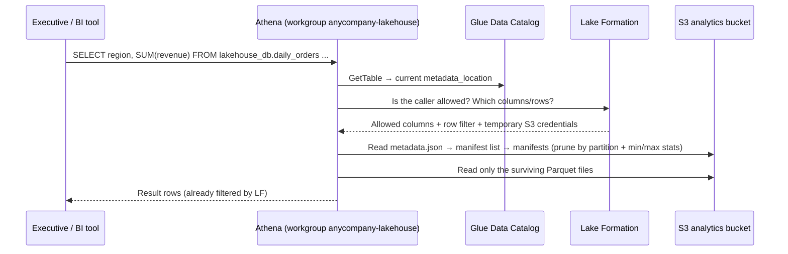
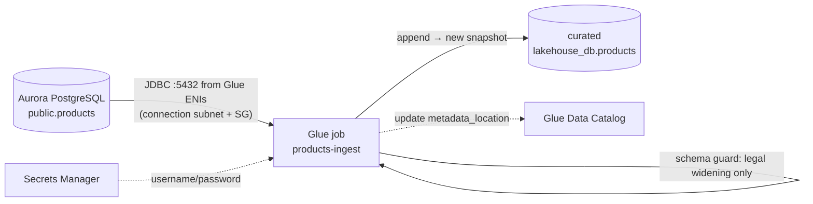
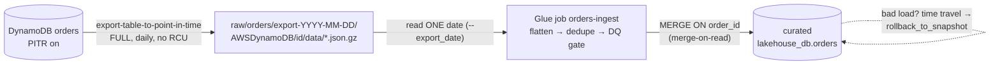
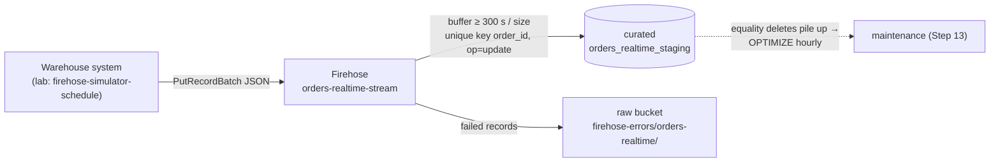
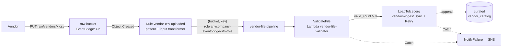
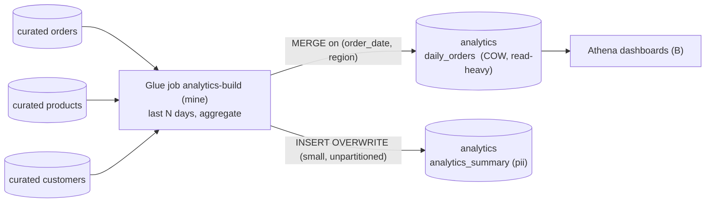

# 🏗️ Walkthrough 1: The AnyCompany lakehouse, built from the HLD

> **What this is:** an end-to-end build of the exam lab's architecture. It follows the data from source to dashboard, explains why each part exists, and gives the build steps in order with real commands. Then it maps every lab challenge (A–G) to the design weakness behind it.
> **GCP mental model:** GCS buckets + BigLake/Iceberg tables + Dataproc/Dataflow jobs + a Pub/Sub → BigQuery subscription + Eventarc → Workflows → Cloud Functions + Dataplex policy tags and row access policies + BigQuery as the SQL engine.
> **HLD labels:** A (products JDBC), B (Athena), C (LF-Tags), D (Firehose), E (cell filters), F (vendor files), G (orders export). See the [lab README](../01_AWS_Data_Lakehouse_Demonstrated/README.md).
> **As of Nov 2026.** ⚠️ = unverified or likely to change, so verify it in the docs. **Names:** lab names are used where the lab showed them (`lakehouse_db`, `anycompany-lakehouse`, `vendor-file-pipeline` …). Lab resources carry a suffix such as `-7db76de0`, written here as `<suffix>`. Names marked *(mine)* are invented for this guide.
> **Back to:** [Study guide index](README.md)

---

## ⭐ Must-know first (if you read only this)

1. **A lakehouse is five layers:** Parquet files in **S3**, plus **Iceberg** metadata that turns the files into tables with commits and snapshots, plus the **Glue Data Catalog**, which holds the pointer to each table's current metadata, plus **Lake Formation**, which decides who can see which rows and columns, plus the **engines**: Glue Spark writes, and Athena reads and maintains.
2. **The HLD has four ingestion shapes plus one transform:** batch pull over JDBC with append (**A**), batch export plus MERGE (**G**), a streaming push with upserts (**D**), and an event-driven file pipeline (**F**). Then curated → analytics (the job beside **C**). Learn these five shapes and you can read most lakehouse diagrams.
3. **Know where code runs.** Athena runs SQL only. PySpark and Spark SQL with `CALL` procedures run in Glue jobs. Always use the workgroup **`anycompany-lakehouse`**, not `primary` ([A][CA]).
4. **Every batch write must be idempotent.** Scope the input to one logical date, and/or MERGE on a key ([G][CG]).
5. **Iceberg schema evolution only allows widening:** `int→bigint`, `float→double`, and a larger decimal precision. Everything else needs a new column ([A][CA]).
6. **Iceberg needs housekeeping.** OPTIMIZE compacts small files, and VACUUM expires snapshots, but **only as far as the table properties allow**. Use merge-on-read for tables that get many upserts ([B][CB], [D][CD]).
7. **Lake Formation needs both IAM and LF to allow access.** TBAC (LF-Tags) decides which **tables** a principal sees ([C][CC]). Data cell filters decide which **rows and columns** ([E][CE]). Grants **add up** (union). To change a tag you need **ASSOCIATE** on it.
8. **Event-driven pipelines need four things:** the bucket switched to *EventBridge: On*, a rule with the pattern, an input transformer that passes `{bucket, key}`, and Retry plus Catch ([F][CF]).
9. **Snapshot retention must be longer than your time-to-detect.** A 60-second VACUUM ([B][CB]) would have made the rollback in [G][CG] impossible.
10. **An edit isn't live until you activate it.** Lambda needs **Deploy**. Step Functions and Glue need **Save**. Firehose has to be back to **Active**.
11. **Look up suffixed names** (`aws ... list-* --query "...starts_with(...)"`) before you type them.
12. **In a timed lab, start long Glue runs first** and edit other tasks while they run.

---

## 🗺️ The HLD


| Label | Component | Flow | Deep dive |
|---|---|---|---|
| **A** | Glue job *ingest products* | Aurora PostgreSQL → JDBC → **append** to curated `products` | [03 Glue](03_AWS_Glue.md), [10 Sources](10_Source_Systems_Aurora_PostgreSQL_And_DynamoDB.md) |
| **B** | Athena | Users → SQL → scans Iceberg files | [04 Athena](04_Amazon_Athena.md), [02 Iceberg](02_Apache_Iceberg_On_AWS.md) |
| **C** | Lake Formation TBAC | LF-Tags decide table access | [05 Lake Formation](05_AWS_Lake_Formation.md) |
| **D** | Firehose (order status) | JSON records → curated `orders_realtime_staging` | [06 Firehose](06_Amazon_Data_Firehose.md) |
| **E** | LF data cell filters | Row/column filters inside `customers` | [05 Lake Formation](05_AWS_Lake_Formation.md) |
| **F** | EventBridge → Step Functions → Lambda → Glue | Vendor CSV → validate → **append** to `vendor_catalog` | [07](07_Amazon_EventBridge.md), [08](08_AWS_Step_Functions.md), [09](09_AWS_Lambda.md) |
| **G** | Glue job *ingest orders* | DynamoDB export → raw S3 → **merge** into curated `orders` | [03 Glue](03_AWS_Glue.md), [10 Sources](10_Source_Systems_Aurora_PostgreSQL_And_DynamoDB.md) |

---

## Part 1 · 📖 The architecture as a story of data

We follow four records from their sources to an executive's dashboard: one **product**, one **order**, one **order-status event** and one **vendor file**.

### 1.1 Product `P-1001` (path A)

1. A merchandiser updates *Trail Runner 2* in **Aurora PostgreSQL**: `quantity = 3,000,000,000`. That value only fits because the DBA widened the column to `BIGINT`.
2. The Glue job **`products-ingest`** starts. Glue creates network interfaces (ENIs) inside the VPC, using the **Glue connection**'s subnet and security group, and opens a **JDBC** session to Aurora on port 5432 with credentials from Secrets Manager.
3. Spark reads the changed rows. It writes new **Parquet** data files to the curated bucket and makes an Iceberg **append commit**: a new manifest, a new snapshot, and a new `metadata.json`. The Glue Data Catalog's `metadata_location` for `lakehouse_db.products` now points at that file.
4. **Where it broke:** the table still said `quantity int`. Iceberg refuses to narrow `long` to `int`, so every append failed ([Challenge A][CA]).

### 1.2 Order `O-50001` (path G)

1. The checkout service writes the order item to **DynamoDB** `orders`.
2. Once a day, a **DynamoDB export to S3** writes the whole table (a full export, using point-in-time recovery, so it consumes no read capacity) to `raw/orders/export-<date>/`.
3. **`orders-ingest`** reads **one** date folder (`--export_date`), flattens the DynamoDB JSON, de-duplicates, and **MERGEs** on `order_id` into curated `orders`. The table is merge-on-read, so updates write small delete files instead of rewriting whole files ([B][CB]).
4. **Where it broke:** the job read *every* export folder, so each order landed 3 times. Iceberg snapshots plus `rollback_to_snapshot` undid the damage ([Challenge G][CG]).

### 1.3 The status event "O-50001 SHIPPED" (path D)

1. The warehouse system sends `{"order_id":"O-50001","status":"SHIPPED","event_time":"…"}` to **Firehose** `orders-realtime-stream` with `PutRecordBatch`. (In the lab, the EventBridge schedule `firehose-simulator-schedule-<suffix>` generates this traffic. Don't touch it.)
2. Firehose **buffers** records for 300 s or up to the size limit, whichever comes first. Then it commits them to the Iceberg table `orders_realtime_staging`.
3. With **unique key `order_id`** and operation *update*, Firehose writes an **equality delete** (`order_id = 'O-50001'`) plus the new row. One order stays one row.
4. **Where it broke:** wrong table, no key (so 4–5 rows per order), and a 60 s buffer (tiny files) ([Challenge D][CD]).

### 1.4 The vendor file `raw/vendors/acme_2026-11-10.csv` (path F)

1. Acme uploads the CSV. The raw bucket has *EventBridge: On*, so S3 publishes an **Object Created** event to the `default` event bus.
2. A **rule** matches the bucket plus `raw/vendors/*.csv`. Its **input transformer** sends only `{"bucket": …, "key": …}` to the state machine **`vendor-file-pipeline`**.
3. The Lambda **`vendor-file-validator`** drops rows with a blank `vendor_id`, writes a clean file and returns `output_key`. Next, **`LoadToIceberg`** runs `vendors-ingest-<suffix>` with `.sync` and a Retry, and the job **appends** to `vendor_catalog`.
4. **Where it broke:** no rule, a validator TODO, and no Retry ([Challenge F][CF]).

### 1.5 From curated to the dashboard (C, E, B)

1. A nightly curated → analytics job *(mine: `analytics-build`)* joins `orders`, `products` and `customers`. It MERGEs the results into analytics tables such as `daily_orders` and `analytics_summary`.
2. **Lake Formation** guards every read. The data-science role sees `zone=curated` tables, and the intern sees `sensitivity=public` ones ([C][CC]). Marketing and the us-east manager see filtered rows and columns ([E][CE]).
3. An executive opens the dashboard, which runs SQL in **Athena**. Athena prunes files using Iceberg metadata and reads a few compacted files, so the query finishes in under 5 s ([B][CB]).



---

## Part 2 · 🧱 First principles: why each component exists

**The constraints:** object storage is cheap and effectively unlimited, but it has **no transactions, no rename and no indexes**. Sources include an OLTP database, a key-value store, a stream and files, and each one changes differently. Many teams need **different slices** of the same data. Queries are billed **per byte scanned**.

| Component | Problem it solves (from first principles) | Why this and not something else | What breaks without it | GCP analogue |
|---|---|---|---|---|
| **S3 zones** (raw / curated / analytics) | Separate untrusted input from cleaned data and from business-ready data, each with its own retention and access | Cheap, durable, and every engine reads it | Bad files mix with good data, and you can't re-run from the original | GCS buckets |
| **Parquet** | Analytics reads a few columns of many rows | Columnar and compressed, with min/max stats per row group | JSON and CSV scans cost 5–20× more ⚠️ | Same |
| **Apache Iceberg** | Atomic multi-file commits, snapshots, schema and partition evolution, and row-level MERGE/DELETE on an object store | An open format that Glue, Athena, Firehose and EMR all write | Partial writes become visible, there's no rollback ([G][CG]), and an `int→bigint` change means a full rewrite ([A][CA]) | BigLake Iceberg tables |
| **Glue Data Catalog** | One place to find "table → current metadata file" | Shared by Athena, Glue, Firehose, EMR and Redshift | Every engine keeps its own catalog, and they drift | BigLake metastore / Dataplex |
| **Lake Formation** | Table-, column-, row- and cell-level permissions that work the same in every engine | Bucket policies only work at object level and can't hide a column | PII leaks, as in [C][CC] and [E][CE], or you end up with one copy of the data per audience | Dataplex + BigQuery policy tags / row access policies |
| **Glue ETL (Spark)** | Heavy transforms, JDBC pulls, MERGE, Iceberg procedures (`CALL …`) | Serverless Spark with the Iceberg libraries built in | Athena SQL can't run `CALL rollback_to_snapshot` or set `write.*.mode` | Dataproc Serverless / Dataflow |
| **Glue connection** | Spark workers have to get inside the VPC to reach Aurora | It creates ENIs in your subnet with your security group | JDBC times out (see QuickBite QB-5 in [Walkthrough 2](21_Walkthrough_2_QuickBite_Food_Delivery_Lakehouse.md)) | Serverless VPC access / Private Service Connect |
| **DynamoDB export to S3** | Bulk-copy a key-value table without consuming read capacity | Uses point-in-time recovery (PITR) and has no effect on the live table | Scanning the table steals capacity from the app | Firestore managed export |
| **Data Firehose** | Turn a stream of small events into well-sized, committed table writes | Fully managed: buffering, retries and an Iceberg upsert mode | You'd write a custom consumer that commits every second and creates millions of tiny files | Pub/Sub → BigQuery subscription |
| **EventBridge** | React to "a file arrived" without polling | Content filtering, many targets, retries, input transformers | Cron polling (slow and wasteful) | Eventarc |
| **Step Functions** | Multi-step workflows with retries, branches and waits, plus an execution history | ASL is declarative, and `.sync` waits for Glue | The retry and error logic is hidden in Lambda code | Workflows |
| **Lambda** | Short validation logic per file | Event-driven, pay per millisecond | Glue would spend ~1 minute and at least 2 DPUs to check a 10 KB file | Cloud Functions / Cloud Run |
| **Athena (+ workgroup)** | Serverless SQL with per-team result locations, limits and saved queries | No cluster, Iceberg-native, and it runs the maintenance commands | You'd need a warehouse cluster to answer ad-hoc questions | BigQuery (on-demand) |
| **CloudWatch + CloudTrail** | Know when pipelines fail and who accessed what | Every service emits to them by default | Failures stay silent, as in [F][CF] where nothing had run "recently" | Cloud Monitoring / Audit Logs |

**Why two engines?** Spark handles **writes and procedures**. Athena handles **interactive reads and SQL maintenance**. Iceberg is what lets them share one table safely: optimistic concurrency means each commit swaps the metadata pointer atomically, and if two writers collide, one of them retries.

**Why a single database with a `zone` tag?** The lab keeps all tables in `lakehouse_db` and expresses zones through S3 location and LF-Tags. That's simple, but **a single wrong tag moves a table into the wrong audience**, which is exactly what happened in [C][CC]. A common alternative is one database per zone, with the tag on the database.

---

## Part 3 · 🛠️ Ordered build plan (your own sandbox account)

> In the exam lab, all of this is pre-built and partly broken. Here's how you would build it from scratch in **us-east-1**. Run the commands in **CloudShell**. Use SQL in Athena (workgroup `anycompany-lakehouse`) and PySpark in Glue jobs.

### Step 0 · Variables

```bash
export AWS_REGION=us-east-1
ACCOUNT=$(aws sts get-caller-identity --query Account --output text)
SUFFIX=7db76de0                                   # lab-style suffix; pick your own
RAW=anycompany-lakehouse-raw-$SUFFIX              # lab name pattern (seen in Challenges F, G)
CURATED=anycompany-lakehouse-curated-$SUFFIX      # (mine) curated bucket name not shown in the lab
ANALYTICS=anycompany-lakehouse-analytics-$SUFFIX  # (mine)
ARTIFACTS=anycompany-lakehouse-artifacts-$SUFFIX  # (mine) Glue scripts + Athena results
```

### Step 1 · IAM roles (accounts and IAM first)

| Role | Trusted service | Used by | Key permissions |
|---|---|---|---|
| `lakehouse-glue-job-role` *(mine)* | `glue.amazonaws.com` | All Glue jobs | `AWSGlueServiceRole` + S3 on lake buckets + `lakeformation:GetDataAccess` + the Aurora secret |
| `lakehouse-firehose-role` *(mine)* | `firehose.amazonaws.com` | `orders-realtime-stream` | `glue:GetTable/GetDatabase/UpdateTable`, S3 on curated + error prefix, `lakeformation:GetDataAccess`, logs |
| `lakehouse-validator-lambda-role` *(mine)* | `lambda.amazonaws.com` | `vendor-file-validator` | `s3:GetObject` on `raw/vendors/*`, `s3:PutObject` on `validated/*` and `rejected/*`, logs |
| `lakehouse-vendor-sfn-role` *(mine)* | `states.amazonaws.com` | `vendor-file-pipeline` | `lambda:InvokeFunction`, `glue:StartJobRun/GetJobRun/BatchStopJobRun`, `sns:Publish` |
| `anycompany-eventbridge-sfn-role` *(lab)* | `events.amazonaws.com` | The EventBridge rule target | `states:StartExecution` on `vendor-file-pipeline` |
| `lakehouse-scheduler-role` *(mine)* | `scheduler.amazonaws.com` | Maintenance schedule (Step 13) | `states:StartExecution` on `lakehouse-maintenance` |

```bash
cat > glue-trust.json <<'EOF'
{ "Version": "2012-10-17",
  "Statement": [{ "Effect": "Allow", "Principal": { "Service": "glue.amazonaws.com" }, "Action": "sts:AssumeRole" }] }
EOF
aws iam create-role --role-name lakehouse-glue-job-role --assume-role-policy-document file://glue-trust.json
aws iam attach-role-policy --role-name lakehouse-glue-job-role \
  --policy-arn arn:aws:iam::aws:policy/service-role/AWSGlueServiceRole

cat > glue-inline.json <<EOF
{ "Version": "2012-10-17",
  "Statement": [
    { "Sid": "LakeBuckets", "Effect": "Allow",
      "Action": ["s3:GetObject","s3:PutObject","s3:DeleteObject","s3:ListBucket"],
      "Resource": ["arn:aws:s3:::anycompany-lakehouse-*-$SUFFIX", "arn:aws:s3:::anycompany-lakehouse-*-$SUFFIX/*"] },
    { "Sid": "LFCredentialVending", "Effect": "Allow", "Action": "lakeformation:GetDataAccess", "Resource": "*" },
    { "Sid": "AuroraSecret", "Effect": "Allow", "Action": "secretsmanager:GetSecretValue",
      "Resource": "arn:aws:secretsmanager:$AWS_REGION:$ACCOUNT:secret:anycompany/aurora/*" } ] }
EOF
aws iam put-role-policy --role-name lakehouse-glue-job-role --policy-name lake-access --policy-document file://glue-inline.json
```

The person who creates jobs also needs **`iam:PassRole`** on this role. Exactly how Glue Spark gets S3 credentials for LF-registered Iceberg tables depends on the Glue version and on whether fine-grained access mode is on, so grant **both** IAM S3 access and LF grants ⚠️. See [00 Foundations](00_AWS_Foundations_IAM_Regions_CLI_CloudWatch_KMS.md) and [05 Lake Formation](05_AWS_Lake_Formation.md).

### Step 2 · S3 layout

```text
anycompany-lakehouse-raw-<suffix>/           (NOT registered in LF; EventBridge: On)
├── raw/orders/export-2025-05-02/...          G: one folder per daily DynamoDB export
├── raw/vendors/*.csv                         F: vendor drops (rule input)
├── validated/vendors/  rejected/vendors/     F: Lambda output (outside raw/vendors/ → no event loop)
└── firehose-errors/orders-realtime/          D: failed records
anycompany-lakehouse-curated-<suffix>/       (registered in LF)
└── products/ orders/ orders_realtime_staging/ vendor_catalog/ customers/ customer_segments/
anycompany-lakehouse-analytics-<suffix>/     (registered in LF)
└── daily_orders/ analytics_summary/
anycompany-lakehouse-artifacts-<suffix>/     scripts/ athena-results/
```

```bash
for B in $RAW $CURATED $ANALYTICS $ARTIFACTS; do
  aws s3api create-bucket --bucket "$B"              # us-east-1: no LocationConstraint
  aws s3api put-public-access-block --bucket "$B" --public-access-block-configuration \
    BlockPublicAcls=true,IgnorePublicAcls=true,BlockPublicPolicy=true,RestrictPublicBuckets=true
done
# New buckets default to SSE-S3 encryption. Switch to SSE-KMS + Bucket Keys if policy requires a CMK.
# Raw bucket → EventBridge (a new bucket has no notification config, so overwriting is safe here;
# on an existing bucket, merge first as in Challenge F step 3b)
aws s3api put-bucket-notification-configuration --bucket "$RAW" \
  --notification-configuration '{"EventBridgeConfiguration": {}}'
# Keep raw exports long enough to rebuild after any VACUUM (see Part 5)
aws s3api put-bucket-lifecycle-configuration --bucket "$RAW" --lifecycle-configuration \
  '{"Rules":[{"ID":"expire-exports","Status":"Enabled","Filter":{"Prefix":"raw/orders/"},"Expiration":{"Days":35}}]}'
```

**Why zones as separate buckets?** Each bucket gets its own LF registration, lifecycle, encryption key and blast radius. **Why is raw not registered?** Raw holds untrusted files that only pipelines read, so IAM is enough there. Deep dive: [01 S3](01_Amazon_S3.md).

### Step 3 · Glue Data Catalog database

```bash
aws glue create-database --database-input '{
  "Name": "lakehouse_db",
  "Description": "AnyCompany curated + analytics Iceberg tables",
  "CreateTableDefaultPermissions": []
}'
```

The empty `CreateTableDefaultPermissions` stops new tables from automatically granting `ALL` to **`IAM_ALLOWED_PRINCIPALS`**. That automatic grant is the classic way people bypass LF ⚠️ (see QB-1 in [Walkthrough 2](21_Walkthrough_2_QuickBite_Food_Delivery_Lakehouse.md)).

### Step 4 · Lake Formation setup (admins → defaults → locations → LF-Tags)

```bash
# 4a. Make yourself a data lake admin and turn off "IAM-only" defaults.
#     put-data-lake-settings REPLACES everything, so read → modify → write.
ADMIN_ARN=arn:aws:iam::$ACCOUNT:role/<YourConsoleRole>     # from the console account menu (Challenge C step 1)
aws lakeformation get-data-lake-settings --query DataLakeSettings > lf.json
jq --arg a "$ADMIN_ARN" '.DataLakeAdmins = ((.DataLakeAdmins // []) + [{"DataLakePrincipalIdentifier":$a}] | unique)
   | .CreateDatabaseDefaultPermissions = [] | .CreateTableDefaultPermissions = []' lf.json > lf-new.json
aws lakeformation put-data-lake-settings --data-lake-settings file://lf-new.json

# 4b. Register the governed locations (LF mode, not hybrid)
for B in $CURATED $ANALYTICS; do
  aws lakeformation register-resource --resource-arn arn:aws:s3:::$B --use-service-linked-role
done

# 4c. LF-Tags used in Challenge C
aws lakeformation create-lf-tag --tag-key zone        --tag-values raw curated analytics
aws lakeformation create-lf-tag --tag-key sensitivity --tag-values public internal pii

# 4d. ASSOCIATE + DESCRIBE on every value, for the role that will tag tables (the Challenge C trap)
aws lakeformation grant-permissions --principal DataLakePrincipalIdentifier=$ADMIN_ARN \
  --resource '{"LFTag":{"TagKey":"zone","TagValues":["raw","curated","analytics"]}}' --permissions ASSOCIATE DESCRIBE
aws lakeformation grant-permissions --principal DataLakePrincipalIdentifier=$ADMIN_ARN \
  --resource '{"LFTag":{"TagKey":"sensitivity","TagValues":["public","internal","pii"]}}' --permissions ASSOCIATE DESCRIBE

# 4e. Pipeline roles: data location access + database rights
GLUE_ROLE_ARN=arn:aws:iam::$ACCOUNT:role/lakehouse-glue-job-role
for B in $CURATED $ANALYTICS; do
  aws lakeformation grant-permissions --principal DataLakePrincipalIdentifier=$GLUE_ROLE_ARN \
    --resource "{\"DataLocation\":{\"ResourceArn\":\"arn:aws:s3:::$B\"}}" --permissions DATA_LOCATION_ACCESS
done
aws lakeformation grant-permissions --principal DataLakePrincipalIdentifier=$GLUE_ROLE_ARN \
  --resource '{"Database":{"Name":"lakehouse_db"}}' --permissions CREATE_TABLE DESCRIBE ALTER
```

After you create the tables (Step 5), grant the job role `SELECT, INSERT, DELETE, ALTER, DESCRIBE` on them. The lab troubleshooting tables list *"Insufficient Lake Formation permission(s)… Alter"* as the symptom when this grant is missing ([A][CA], [B][CB], [G][CG]).

### Step 5 · Iceberg tables (Athena DDL)

First create the workgroup so the DDL has a result location (Step 11 tunes it further):

```bash
aws athena create-work-group --name anycompany-lakehouse --configuration \
  "ResultConfiguration={OutputLocation=s3://$ARTIFACTS/athena-results/},EnforceWorkGroupConfiguration=true,PublishCloudWatchMetricsEnabled=true,BytesScannedCutoffPerQuery=10737418240"
```

Then run each statement **on its own** in Athena. Replace `<suffix>` with your value, because Athena doesn't expand shell variables.

```sql
-- A: products. bigint from day 1 avoids Challenge A; month(updated_at) matches the date-range access pattern
CREATE TABLE lakehouse_db.products (
  product_id string, product_name string, category string,
  price decimal(10,2), quantity bigint, updated_at timestamp)
PARTITIONED BY (category, month(updated_at))
LOCATION 's3://anycompany-lakehouse-curated-<suffix>/products/'
TBLPROPERTIES ('table_type'='ICEBERG', 'format'='parquet', 'write_compression'='zstd');
```

```sql
-- G: orders. ~50k orders/day ≈ a few MB/day of Parquet, so month() partitions, not day() (avoid tiny files)
CREATE TABLE lakehouse_db.orders (
  order_id string, customer_id string, order_ts timestamp, status string,
  total_amount decimal(12,2), region string, updated_at timestamp)
PARTITIONED BY (month(order_ts))
LOCATION 's3://anycompany-lakehouse-curated-<suffix>/orders/'
TBLPROPERTIES ('table_type'='ICEBERG', 'format'='parquet', 'write_compression'='zstd');
```

```sql
-- D: upsert target. Unpartitioned: small, and a key must never "move" between partitions
CREATE TABLE lakehouse_db.orders_realtime_staging (
  order_id string, status string, event_time timestamp, source string)
LOCATION 's3://anycompany-lakehouse-curated-<suffix>/orders_realtime_staging/'
TBLPROPERTIES ('table_type'='ICEBERG', 'format'='parquet');
```

| Other table | Columns (abridged) | Partitioning | Zone / sensitivity (Step 12) |
|---|---|---|---|
| `vendor_catalog` | `vendor_id, vendor_name, product_id, cost, currency, source_file, ingested_at` | `month(ingested_at)` | curated / public |
| `customers` | `customer_id, customer_email, region, signup_date, lifetime_value` | none | curated / pii (Challenge E) |
| `customer_segments` | `customer_id, segment, score` | none | **curated** / internal (Challenge C) |
| `daily_orders` | `order_date date, region, order_count bigint, revenue decimal(14,2)` | `month(order_date)` | analytics / public |
| `analytics_summary` | `customer_id, customer_email, region, total_orders, total_revenue` | none | analytics / **pii** (Challenge C) |

**Spark-only properties.** Athena's `SET TBLPROPERTIES` doesn't accept Iceberg's `write.*.mode` ([B][CB]). Set merge-on-read on the two upsert tables from a Glue job:

```python
for t in ["orders", "orders_realtime_staging"]:
    spark.sql(f"""ALTER TABLE glue_catalog.lakehouse_db.{t} SET TBLPROPERTIES (
        'format-version'='2', 'write.merge.mode'='merge-on-read',
        'write.update.mode'='merge-on-read', 'write.delete.mode'='merge-on-read')""")
```

Deep dive: [02 Iceberg](02_Apache_Iceberg_On_AWS.md), [04 Athena](04_Amazon_Athena.md).

### Step 6 · Path A: products (Aurora PostgreSQL → JDBC → append)



**6a. Networking checklist** (most JDBC failures are network failures; [10 Sources](10_Source_Systems_Aurora_PostgreSQL_And_DynamoDB.md) has the details):
- The Glue connection uses a **private subnet** in the Aurora VPC and a security group with a **self-referencing inbound rule** (all TCP, source = the same SG). Glue workers use it to talk to each other.
- The Aurora security group allows **5432 from the Glue SG**.
- The subnet can reach S3 through an **S3 gateway endpoint**, and reaches Secrets Manager, Glue, STS and CloudWatch Logs through **interface endpoints or a NAT gateway** ⚠️.

```bash
aws glue create-connection --connection-input '{
  "Name": "aurora-products-conn",
  "ConnectionType": "JDBC",
  "ConnectionProperties": {
    "JDBC_CONNECTION_URL": "jdbc:postgresql://<cluster-reader-endpoint>:5432/anycompany",
    "SECRET_ID": "anycompany/aurora/products-reader" },
  "PhysicalConnectionRequirements": {
    "SubnetId": "subnet-0123456789abcdef0", "AvailabilityZone": "us-east-1a",
    "SecurityGroupIdList": ["sg-0glue0000000000000"] } }'
```

**6b. Common header.** Every Glue script below starts like this:

```python
import sys, json, boto3
from awsglue.utils import getResolvedOptions
from awsglue.context import GlueContext
from awsglue.job import Job
from pyspark.conf import SparkConf
from pyspark.context import SparkContext
from pyspark.sql import functions as F, Window

def iceberg_session(warehouse):
    conf = (SparkConf()
        .set("spark.sql.extensions", "org.apache.iceberg.spark.extensions.IcebergSparkSessionExtensions")
        .set("spark.sql.catalog.glue_catalog", "org.apache.iceberg.spark.SparkCatalog")
        .set("spark.sql.catalog.glue_catalog.catalog-impl", "org.apache.iceberg.aws.glue.GlueCatalog")
        .set("spark.sql.catalog.glue_catalog.io-impl", "org.apache.iceberg.aws.s3.S3FileIO")
        .set("spark.sql.catalog.glue_catalog.warehouse", warehouse))
    glue_ctx = GlueContext(SparkContext.getOrCreate(conf=conf))
    return glue_ctx, glue_ctx.spark_session
```

**6c. `products-ingest`** with an incremental read and a schema guard (the guardrail for [A][CA]):

```python
# ... common header ...
args = getResolvedOptions(sys.argv, ["JOB_NAME", "warehouse", "jdbc_url", "secret_id"])  # NAMES, not values
glue_ctx, spark = iceberg_session(args["warehouse"])
job = Job(glue_ctx); job.init(args["JOB_NAME"], args)
TABLE = "glue_catalog.lakehouse_db.products"

creds = json.loads(boto3.client("secretsmanager").get_secret_value(SecretId=args["secret_id"])["SecretString"])
wm = spark.sql(f"SELECT COALESCE(MAX(updated_at), TIMESTAMP '1970-01-01') AS wm FROM {TABLE}").first()["wm"]

src = (spark.read.format("jdbc")
       .option("url", args["jdbc_url"]).option("driver", "org.postgresql.Driver")
       .option("user", creds["username"]).option("password", creds["password"])
       .option("query", f"SELECT product_id, product_name, category, price, quantity, updated_at "
                        f"FROM public.products WHERE updated_at > TIMESTAMP '{wm}'")
       .option("fetchsize", "10000").load())

# Schema guard: apply LEGAL Iceberg promotions automatically, fail loudly on anything else
LEGAL = {("IntegerType", "LongType"): "bigint", ("FloatType", "DoubleType"): "double"}
target = spark.table(TABLE).schema
for f in src.schema.fields:
    if f.name not in target.fieldNames():
        raise ValueError(f"New source column {f.name}: add it to the table deliberately")
    have, want = type(target[f.name].dataType).__name__, type(f.dataType).__name__
    if {have, want} <= {"TimestampType", "TimestampNTZType"}:
        continue                     # tz vs no-tz mapping differs by engine/version ⚠️ check explicitly
    if have != want:
        if (have, want) not in LEGAL:
            raise ValueError(f"Illegal type change {f.name}: {have} -> {want}")
        spark.sql(f"ALTER TABLE {TABLE} ALTER COLUMN {f.name} TYPE {LEGAL[(have, want)]}")

src.writeTo(TABLE).append()       # lab behaviour: append (history of versions)
job.commit()
```

**Append versus MERGE.** Appending is only safe if the read is incremental, as here. Readers must also treat the table as a **version history**, picking the latest row per `product_id`. For a current-state table, use MERGE as in Step 7. Comparing PostgreSQL `numeric` to Spark `decimal` precision is a trap of its own, so pin `price` with `.cast("decimal(10,2)")` ⚠️.

```bash
aws s3 cp products_ingest.py s3://$ARTIFACTS/scripts/
aws glue create-job --name products-ingest --role lakehouse-glue-job-role \
  --glue-version 5.0 --worker-type G.1X --number-of-workers 2 --timeout 30 \
  --command Name=glueetl,ScriptLocation=s3://$ARTIFACTS/scripts/products_ingest.py,PythonVersion=3 \
  --connections Connections=aurora-products-conn \
  --default-arguments "{\"--datalake-formats\":\"iceberg\",\"--warehouse\":\"s3://$CURATED/\",
    \"--jdbc_url\":\"jdbc:postgresql://<cluster-reader-endpoint>:5432/anycompany\",
    \"--secret_id\":\"anycompany/aurora/products-reader\",\"--enable-metrics\":\"true\"}"
aws glue start-job-run --job-name products-ingest
```

**Check:** `SELECT * FROM "lakehouse_db"."products$partitions";` should show `category` and `updated_at_month` values.

### Step 7 · Path G: orders (DynamoDB export → MERGE)



```bash
aws dynamodb update-continuous-backups --table-name orders \
  --point-in-time-recovery-specification PointInTimeRecoveryEnabled=true
TABLE_ARN=$(aws dynamodb describe-table --table-name orders --query Table.TableArn --output text)
EXPORT_DATE=$(date -u +%F)
aws dynamodb export-table-to-point-in-time --table-arn "$TABLE_ARN" \
  --s3-bucket "$RAW" --s3-prefix "raw/orders/export-$EXPORT_DATE" \
  --export-format DYNAMODB_JSON --export-type FULL_EXPORT
```

**Real export layout:** a real export writes `<prefix>/AWSDynamoDB/<exportId>/data/*.json.gz`, plus `manifest-*.json` and `_started` files next to it. Each data line looks like `{"Item":{"order_id":{"S":"O-50001"},…}}`. The lab's export folders contained plain JSON, so the lab script read the folder directly. In a real account, **point Spark at `data/`** so the manifests aren't parsed as orders.

```python
# ... common header ...
args = getResolvedOptions(sys.argv, ["JOB_NAME", "warehouse", "raw_bucket", "export_date"])
glue_ctx, spark = iceberg_session(args["warehouse"])
job = Job(glue_ctx); job.init(args["JOB_NAME"], args)

# Challenge G fix: one logical date only. The trailing '/' means "prefix".
path = f"s3://{args['raw_bucket']}/raw/orders/export-{args['export_date']}/AWSDynamoDB/*/data/"
raw = spark.read.json(path)                          # lab: spark.read.json(".../export-<date>/")

src = raw.select(
    F.col("Item.order_id.S").alias("order_id"),
    F.col("Item.customer_id.S").alias("customer_id"),
    F.to_timestamp("Item.order_ts.S").alias("order_ts"),
    F.col("Item.status.S").alias("status"),
    F.col("Item.total_amount.N").cast("decimal(12,2)").alias("total_amount"),  # DynamoDB numbers arrive as strings
    F.col("Item.region.S").alias("region"),
    F.to_timestamp("Item.updated_at.S").alias("updated_at"))

# MERGE fails if two source rows match one target row, so keep the latest per key
w = Window.partitionBy("order_id").orderBy(F.col("updated_at").desc())
src = src.withColumn("rn", F.row_number().over(w)).where("rn = 1").drop("rn")

# Data-quality gate before publishing (cheap version; Glue Data Quality in Step 14)
n, distinct = src.count(), src.select("order_id").distinct().count()
if n == 0 or n != distinct or not (40_000 <= n <= 60_000):
    raise ValueError(f"DQ gate failed: rows={n} distinct={distinct}; nothing merged")

src.createOrReplaceTempView("src")
spark.sql("""
  MERGE INTO glue_catalog.lakehouse_db.orders t
  USING src s ON t.order_id = s.order_id
  WHEN MATCHED AND s.updated_at > t.updated_at THEN UPDATE SET *
  WHEN NOT MATCHED THEN INSERT *""")
job.commit()
```

Even if someone reads three exports again, this MERGE can't triple the table. That's **defence in depth** on top of the path fix. Note that the lab's bad job appended, which is why `total` reached 150,000.

**Recovery runbook (from [G][CG]):**

```sql
SELECT committed_at, snapshot_id, operation, summary['total-records'] AS total
FROM "lakehouse_db"."orders$snapshots" ORDER BY committed_at;                         -- find the clean one
SELECT COUNT(*), COUNT(DISTINCT order_id) FROM lakehouse_db.orders FOR VERSION AS OF <id>;  -- prove it
```

```python
spark.sql("CALL glue_catalog.system.rollback_to_snapshot('lakehouse_db.orders', <id>)")    # bare number, no quotes
```

### Step 8 · Path D: order status (Firehose → Iceberg upsert)



Grant `lakehouse-firehose-role` **SELECT, INSERT, DELETE, DESCRIBE, ALTER** on the table in LF, plus `DATA_LOCATION_ACCESS` on the curated bucket ([D][CD] troubleshooting). Then save the destination config:

```json
{
  "RoleARN": "arn:aws:iam::<acct>:role/lakehouse-firehose-role",
  "CatalogConfiguration": { "CatalogARN": "arn:aws:glue:us-east-1:<acct>:catalog" },
  "DestinationTableConfigurationList": [{
    "DestinationDatabaseName": "lakehouse_db",
    "DestinationTableName": "orders_realtime_staging",
    "UniqueKeys": ["order_id"],
    "S3ErrorOutputPrefix": "firehose-errors/orders-realtime/" }],
  "ProcessingConfiguration": { "Enabled": true, "Processors": [{ "Type": "MetadataExtraction", "Parameters": [
    { "ParameterName": "MetadataExtractionQuery",
      "ParameterValue": "{destinationDatabaseName: \"lakehouse_db\", destinationTableName: \"orders_realtime_staging\", operation: \"update\"}" },
    { "ParameterName": "JsonParsingEngine", "ParameterValue": "JQ-1.6" } ] }] },
  "BufferingHints": { "IntervalInSeconds": 300, "SizeInMBs": 128 },
  "S3BackupMode": "FailedDataOnly",
  "S3Configuration": { "RoleARN": "arn:aws:iam::<acct>:role/lakehouse-firehose-role",
                       "BucketARN": "arn:aws:s3:::anycompany-lakehouse-raw-<suffix>",
                       "ErrorOutputPrefix": "firehose-errors/orders-realtime/" },
  "CloudWatchLoggingOptions": { "Enabled": true, "LogGroupName": "/aws/kinesisfirehose/orders-realtime-stream",
                                "LogStreamName": "DestinationDelivery" }
}
```

```bash
aws firehose create-delivery-stream --delivery-stream-name orders-realtime-stream \
  --delivery-stream-type DirectPut --iceberg-destination-configuration file://iceberg-dest.json
```

⚠️ Check the field names against the `IcebergDestinationConfiguration` API reference. The console equivalent is in [D][CD]. **Why `operation: "update"`?** The Firehose docs say the operation **defaults to insert** when you don't set one, and update or delete needs unique keys (or Iceberg identifier fields). The lab graded only table, key and buffer, but a real upsert needs the operation too.

```python
# Producer: PutRecordBatch is NOT all-or-nothing → resend only failed entries
import boto3, json, time
fh = boto3.client("firehose", region_name="us-east-1")
events = [{"order_id": "O-50001", "status": "SHIPPED", "event_time": "2026-11-10 09:15:00", "source": "wms"}]
records = [{"Data": json.dumps(e).encode()} for e in events]
for attempt in range(5):
    resp = fh.put_record_batch(DeliveryStreamName="orders-realtime-stream", Records=records)
    if resp["FailedPutCount"] == 0:
        break
    records = [r for r, res in zip(records, resp["RequestResponses"]) if "ErrorCode" in res]
    time.sleep(2 ** attempt)                     # back off on throttling
```

**Check** in Athena: the duplicates query should return 0 rows. Then watch the delete files grow:

```sql
SELECT order_id, COUNT(*) FROM lakehouse_db.orders_realtime_staging GROUP BY order_id HAVING COUNT(*) > 1;
SELECT content, COUNT(*) AS files FROM "lakehouse_db"."orders_realtime_staging$files" GROUP BY content;
-- content: 0 = data, 1 = position deletes, 2 = equality deletes (Firehose upserts create 2s)
```

### Step 9 · Path F: vendor files (S3 → EventBridge → Step Functions → Lambda → Glue)



**9a. Validator Lambda (Python 3.12).** Click **Deploy** after any console edit ([F][CF] Mistake 2).

```python
import csv, io, os, urllib.parse, boto3
s3 = boto3.client("s3")
OUT, REJ = os.environ.get("OUT_PREFIX", "validated/vendors/"), os.environ.get("REJECT_PREFIX", "rejected/vendors/")

def _write(bucket, key, header, rows):
    buf = io.StringIO(); w = csv.DictWriter(buf, fieldnames=header); w.writeheader(); w.writerows(rows)
    s3.put_object(Bucket=bucket, Key=key, Body=buf.getvalue().encode("utf-8"))

def handler(event, context):
    bucket = event["bucket"]
    key = urllib.parse.unquote_plus(event["key"])        # S3 event keys can be URL-encoded ⚠️
    body = s3.get_object(Bucket=bucket, Key=key)["Body"].read().decode("utf-8-sig")
    reader = csv.DictReader(io.StringIO(body))
    if not reader.fieldnames or "vendor_id" not in reader.fieldnames:
        raise ValueError(f"vendor_id column missing in {key}")       # → Catch → NotifyFailure
    valid, rejected = [], []
    for row in reader:                                   # missing, "", "   " → rejected
        (valid if (row.get("vendor_id") or "").strip() else rejected).append(row)
    name = key.rsplit("/", 1)[-1]
    _write(bucket, OUT + name, reader.fieldnames, valid)
    if rejected:
        _write(bucket, REJ + name, reader.fieldnames, rejected)
    return {"output_key": OUT + name, "valid_count": len(valid), "rejected_count": len(rejected)}
```

**Why write to `validated/` and not `raw/vendors/`?** If the output landed under `raw/vendors/*.csv`, it would match the rule again and the pipeline would **re-trigger itself forever**.

**9b. State machine (ASL).** `LoadToIceberg` is the lab's state with its Retry. The Catch and the Choice go beyond the lab.

```json
{
  "Comment": "Vendor CSV -> validate -> load to Iceberg",
  "StartAt": "ValidateFile",
  "States": {
    "ValidateFile": {
      "Type": "Task", "Resource": "arn:aws:states:::lambda:invoke",
      "Parameters": { "FunctionName": "vendor-file-validator-<suffix>", "Payload": { "bucket.$": "$.bucket", "key.$": "$.key" } },
      "ResultSelector": { "output_key.$": "$.Payload.output_key", "valid_count.$": "$.Payload.valid_count",
                          "rejected_count.$": "$.Payload.rejected_count" },
      "ResultPath": "$.validation",
      "Retry": [{ "ErrorEquals": ["Lambda.ServiceException", "Lambda.AWSLambdaException", "Lambda.SdkClientException",
                                  "Lambda.TooManyRequestsException"], "IntervalSeconds": 2, "MaxAttempts": 3, "BackoffRate": 2.0 }],
      "Catch": [{ "ErrorEquals": ["States.ALL"], "ResultPath": "$.error", "Next": "NotifyFailure" }],
      "Next": "AnyValidRows"
    },
    "AnyValidRows": { "Type": "Choice",
      "Choices": [{ "Variable": "$.validation.valid_count", "NumericGreaterThan": 0, "Next": "LoadToIceberg" }],
      "Default": "NothingToLoad" },
    "LoadToIceberg": {
      "Type": "Task", "Resource": "arn:aws:states:::glue:startJobRun.sync",
      "Parameters": { "JobName": "vendors-ingest-<suffix>",
        "Arguments": { "--source_bucket.$": "$.bucket", "--source_key.$": "$.validation.output_key" } },
      "Retry": [
        { "ErrorEquals": ["Glue.ConcurrentRunsExceededException"], "IntervalSeconds": 30, "MaxAttempts": 3, "BackoffRate": 2.0 },
        { "ErrorEquals": ["States.ALL"], "IntervalSeconds": 60, "MaxAttempts": 2, "BackoffRate": 2.0 } ],
      "Catch": [{ "ErrorEquals": ["States.ALL"], "ResultPath": "$.error", "Next": "NotifyFailure" }],
      "End": true
    },
    "NothingToLoad": { "Type": "Succeed" },
    "NotifyFailure": {
      "Type": "Task", "Resource": "arn:aws:states:::sns:publish",
      "Parameters": { "TopicArn": "arn:aws:sns:us-east-1:<acct>:lakehouse-alerts", "Message.$": "States.JsonToString($)" },
      "Next": "Failed" },
    "Failed": { "Type": "Fail", "Error": "VendorFileFailed", "Cause": "See SNS alert and execution history" }
  }
}
```

**9c. EventBridge rule.** Use the exact CloudShell script in [F][CF] steps 3a–3e (pattern `raw/vendors/*.csv`, target role `anycompany-eventbridge-sfn-role`, input transformer `{"bucket": "<bucket>", "key": "<key>"}`). Deep dive: [07 EventBridge](07_Amazon_EventBridge.md), [08 Step Functions](08_AWS_Step_Functions.md), [09 Lambda](09_AWS_Lambda.md).

**9d. `vendors-ingest`: an idempotent append.** A Retry after a partial commit must not insert the same rows twice:

```python
# ... common header ...
args = getResolvedOptions(sys.argv, ["JOB_NAME", "warehouse", "source_bucket", "source_key"])
glue_ctx, spark = iceberg_session(args["warehouse"])
TABLE, src_file = "glue_catalog.lakehouse_db.vendor_catalog", f"s3://{args['source_bucket']}/{args['source_key']}"

already = spark.sql(f"SELECT 1 FROM {TABLE} WHERE source_file = '{src_file}' LIMIT 1").count() > 0
if not already:                                          # load-tracking by file = safe retries
    df = (spark.read.option("header", "true").csv(src_file)
          .select("vendor_id", "vendor_name", "product_id",
                  F.col("cost").cast("decimal(10,2)").alias("cost"), "currency")
          .withColumn("source_file", F.lit(src_file)).withColumn("ingested_at", F.current_timestamp()))
    df.writeTo(TABLE).append()
```

### Step 10 · Curated → analytics (the job beside C)



```python
# ... common header ...
args = getResolvedOptions(sys.argv, ["JOB_NAME", "warehouse", "lookback_days"])
glue_ctx, spark = iceberg_session(args["warehouse"])
days = int(args["lookback_days"])        # recompute a window so late-arriving updates are corrected

spark.sql(f"""
  SELECT CAST(order_ts AS DATE) AS order_date, region,
         COUNT(*) AS order_count, CAST(SUM(total_amount) AS DECIMAL(14,2)) AS revenue
  FROM glue_catalog.lakehouse_db.orders
  WHERE order_ts >= date_sub(current_date(), {days})
  GROUP BY 1, 2""").createOrReplaceTempView("agg")

spark.sql("""
  MERGE INTO glue_catalog.lakehouse_db.daily_orders t
  USING agg s ON t.order_date = s.order_date AND t.region = s.region
  WHEN MATCHED THEN UPDATE SET t.order_count = s.order_count, t.revenue = s.revenue
  WHEN NOT MATCHED THEN INSERT *""")

spark.sql("""
  INSERT OVERWRITE glue_catalog.lakehouse_db.analytics_summary
  SELECT c.customer_id, c.customer_email, c.region, COUNT(o.order_id), SUM(o.total_amount)
  FROM glue_catalog.lakehouse_db.customers c
  LEFT JOIN glue_catalog.lakehouse_db.orders o ON o.customer_id = c.customer_id
  GROUP BY c.customer_id, c.customer_email, c.region""")
```

**The `overwritePartitions()` trap.** `daily_orders` is partitioned by `month(order_date)`. If you dynamically overwrite with only the last 3 days, Iceberg **replaces the whole month partition** and deletes the other ~27 days. MERGE avoids that. `INSERT OVERWRITE` is only safe here because `analytics_summary` is unpartitioned and fully recomputed.

### Step 11 · Athena workgroup and queries

The workgroup came from Step 5. Restrict each team's IAM policy to it:

```json
{ "Effect": "Allow",
  "Action": ["athena:StartQueryExecution", "athena:GetQueryExecution", "athena:GetQueryResults",
             "athena:StopQueryExecution", "athena:GetWorkGroup", "athena:ListNamedQueries", "athena:GetNamedQuery"],
  "Resource": "arn:aws:athena:us-east-1:<acct>:workgroup/anycompany-lakehouse" }
```

Analysts also need `glue:GetDatabase/GetTable`, `lakeformation:GetDataAccess` and S3 access to the results prefix. Re-create the lab's saved queries:

```bash
aws athena create-named-query --work-group anycompany-lakehouse --database lakehouse_db \
  --name daily-orders-snapshot-count \
  --query-string 'SELECT COUNT(*) AS snapshot_count FROM "lakehouse_db"."daily_orders$snapshots"'
aws athena create-named-query --work-group anycompany-lakehouse --database lakehouse_db \
  --name daily-orders-file-sizes \
  --query-string 'SELECT COUNT(*) AS files, ROUND(AVG(file_size_in_bytes)/1024.0,1) AS avg_kb FROM "lakehouse_db"."daily_orders$files"'
```

```sql
-- The executive dashboard query (prunes on month(order_date), reads compacted files)
SELECT region, SUM(revenue) AS revenue, SUM(order_count) AS orders
FROM lakehouse_db.daily_orders
WHERE order_date BETWEEN DATE '2026-10-01' AND DATE '2026-10-31'
GROUP BY region ORDER BY revenue DESC;
```

### Step 12 · Governance: TBAC (C) and data cell filters (E)

```bash
tag() { aws lakeformation add-lf-tags-to-resource --resource "{\"Table\":{\"DatabaseName\":\"lakehouse_db\",\"Name\":\"$1\"}}" \
          --lf-tags TagKey=zone,TagValues=$2 TagKey=sensitivity,TagValues=$3; }
aws lakeformation add-lf-tags-to-resource --resource '{"Database":{"Name":"lakehouse_db"}}' \
  --lf-tags TagKey=zone,TagValues=curated TagKey=sensitivity,TagValues=internal       # defaults that tables inherit
tag products curated public;  tag orders curated internal;  tag orders_realtime_staging curated internal
tag vendor_catalog curated public;  tag customers curated pii;  tag customer_segments curated internal
tag daily_orders analytics public;  tag analytics_summary analytics pii

# TBAC grants (Challenge C): data science → all curated tables; intern → public tables only
DS=arn:aws:iam::$ACCOUNT:role/anycompany-data-science-role; IN=arn:aws:iam::$ACCOUNT:role/anycompany-intern-role
aws lakeformation grant-permissions --principal DataLakePrincipalIdentifier=$DS --permissions SELECT DESCRIBE \
  --resource '{"LFTagPolicy":{"ResourceType":"TABLE","Expression":[{"TagKey":"zone","TagValues":["curated"]}]}}'
aws lakeformation grant-permissions --principal DataLakePrincipalIdentifier=$IN --permissions SELECT DESCRIBE \
  --resource '{"LFTagPolicy":{"ResourceType":"TABLE","Expression":[{"TagKey":"sensitivity","TagValues":["public"]}]}}'
for P in $DS $IN; do   # both need to "see" the database
  aws lakeformation grant-permissions --principal DataLakePrincipalIdentifier=$P --permissions DESCRIBE \
    --resource '{"Database":{"Name":"lakehouse_db"}}'
done
```

**A second-order catch.** The lab's data-science expression is `zone=curated` **only**, so it also matches `customers`, which is tagged `pii`, and data scientists can read emails. In production, AND it with `sensitivity ∈ {public, internal}`, or tag the PII **columns** instead of the whole table ([C][CC] study note 5).

**Data cell filters** (Challenge E). Use an **include** column list, which is safer than exclude, and copy the exact string values:

```bash
aws lakeformation create-data-cells-filter --table-data "{
  \"TableCatalogId\":\"$ACCOUNT\",\"DatabaseName\":\"lakehouse_db\",\"TableName\":\"customers\",
  \"Name\":\"marketing-no-pii\",\"RowFilter\":{\"AllRowsWildcard\":{}},
  \"ColumnNames\":[\"customer_id\",\"region\",\"signup_date\",\"lifetime_value\"]}"
# regional-us-east + its named-resource SELECT grant: exact CLI in Challenge E study note 7
```

**Test as the role.** Never trust a grant you haven't queried through. The role's trust policy must allow you to assume it.

```bash
CREDS=$(aws sts assume-role --role-arn $IN --role-session-name lf-test --query Credentials --output json)
export AWS_ACCESS_KEY_ID=$(echo "$CREDS" | jq -r .AccessKeyId)
export AWS_SECRET_ACCESS_KEY=$(echo "$CREDS" | jq -r .SecretAccessKey)
export AWS_SESSION_TOKEN=$(echo "$CREDS" | jq -r .SessionToken)
QID=$(aws athena start-query-execution --work-group anycompany-lakehouse \
  --query-string "SELECT customer_email FROM lakehouse_db.analytics_summary LIMIT 1" --query QueryExecutionId --output text)
sleep 5; aws athena get-query-execution --query-execution-id $QID --query 'QueryExecution.Status'
# Expect FAILED: "Insufficient Lake Formation permission(s)". Then: unset AWS_ACCESS_KEY_ID AWS_SECRET_ACCESS_KEY AWS_SESSION_TOKEN
```

### Step 13 · Maintenance: OPTIMIZE and VACUUM on a schedule

Production retention is **days**. The lab's 60 seconds was only for grading ([B][CB]).

```sql
ALTER TABLE lakehouse_db.orders_realtime_staging SET TBLPROPERTIES (
  'optimize_rewrite_delete_file_threshold'='2', 'vacuum_max_snapshot_age_seconds'='604800',
  'vacuum_min_snapshots_to_keep'='20');
```

| Table | OPTIMIZE | VACUUM | Why |
|---|---|---|---|
| `orders_realtime_staging` | Hourly | Daily | Firehose commits ~288 times a day and the upserts create equality deletes |
| `orders` | Daily | Daily | MOR MERGE creates delete files |
| `daily_orders`, `products`, `vendor_catalog` | Weekly | Weekly | Few writes, read-heavy |

A state machine `lakehouse-maintenance` *(mine)*, started by **EventBridge Scheduler**:

```json
{
  "StartAt": "ForEachTable",
  "States": {
    "ForEachTable": {
      "Type": "Map", "ItemsPath": "$.tables", "MaxConcurrency": 2,
      "ItemProcessor": { "ProcessorConfig": { "Mode": "INLINE" }, "StartAt": "Optimize", "States": {
        "Optimize": { "Type": "Task", "Resource": "arn:aws:states:::athena:startQueryExecution.sync",
          "Parameters": { "WorkGroup": "anycompany-lakehouse",
            "QueryString.$": "States.Format('OPTIMIZE lakehouse_db.{} REWRITE DATA USING BIN_PACK', $)" },
          "Retry": [{ "ErrorEquals": ["States.ALL"], "IntervalSeconds": 60, "MaxAttempts": 2, "BackoffRate": 2 }],
          "ResultPath": null, "Next": "Vacuum" },
        "Vacuum": { "Type": "Task", "Resource": "arn:aws:states:::athena:startQueryExecution.sync",
          "Parameters": { "WorkGroup": "anycompany-lakehouse", "QueryString.$": "States.Format('VACUUM lakehouse_db.{}', $)" },
          "ResultPath": null, "End": true } } },
      "End": true }
  }
}
```

```bash
aws scheduler create-schedule --name lakehouse-nightly-maintenance \
  --schedule-expression "cron(0 3 * * ? *)" --schedule-expression-timezone UTC \
  --flexible-time-window '{"Mode":"OFF"}' \
  --target "{\"Arn\":\"arn:aws:states:us-east-1:$ACCOUNT:stateMachine:lakehouse-maintenance\",
             \"RoleArn\":\"arn:aws:iam::$ACCOUNT:role/lakehouse-scheduler-role\",
             \"Input\":\"{\\\"tables\\\":[\\\"orders\\\",\\\"daily_orders\\\",\\\"orders_realtime_staging\\\"]}\"}"
```

**Managed alternative:** Glue Data Catalog **table optimizers** handle compaction, snapshot retention and orphan-file deletion per table: `aws glue create-table-optimizer --catalog-id $ACCOUNT --database-name lakehouse_db --table-name orders --type compaction --table-optimizer-configuration '{"roleArn":"<role>","enabled":true}'` ⚠️ (check which optimizer types and settings are current). One OPTIMIZE run may report that more runs are needed. That's what the Retry is for.

### Step 14 · Monitoring and alarms

```bash
SNS=$(aws sns create-topic --name lakehouse-alerts --query TopicArn --output text)
aws sns subscribe --topic-arn $SNS --protocol email --notification-endpoint <you@example.com>
# Topic policy must allow events.amazonaws.com to sns:Publish (console adds it when you pick SNS as a target)

aws events put-rule --name lakehouse-glue-failed --event-pattern \
  '{"source":["aws.glue"],"detail-type":["Glue Job State Change"],"detail":{"state":["FAILED","TIMEOUT"]}}'
aws events put-targets --rule lakehouse-glue-failed --targets "Id"="sns","Arn"="$SNS"

aws events put-rule --name lakehouse-sfn-failed --event-pattern \
  '{"source":["aws.states"],"detail-type":["Step Functions Execution Status Change"],"detail":{"status":["FAILED","TIMED_OUT","ABORTED"]}}'
aws events put-targets --rule lakehouse-sfn-failed --targets "Id"="sns","Arn"="$SNS"

# Firehose failures land as objects in the error prefix → alert on arrival (raw bucket already sends to EventBridge)
aws events put-rule --name lakehouse-firehose-errors --event-pattern "{\"source\":[\"aws.s3\"],\"detail-type\":[\"Object Created\"],
  \"detail\":{\"bucket\":{\"name\":[\"$RAW\"]},\"object\":{\"key\":[{\"prefix\":\"firehose-errors/\"}]}}}"
aws events put-targets --rule lakehouse-firehose-errors --targets "Id"="sns","Arn"="$SNS"
```

| Signal | Source | Alarm when |
|---|---|---|
| Job or execution failed | EventBridge rules above | Any |
| Firehose error object | S3 → EventBridge | Any |
| Duplicate keys | Scheduled Athena check (`HAVING COUNT(*) > 1`) | > 0 |
| Table health | `$files` count, average size, delete-file count; `$snapshots` count | Files > 1,000 or average < 32 MB |
| Athena spend | `AWS/Athena` `ProcessedBytes` by WorkGroup ⚠️ | Over the daily budget |
| Data quality | Glue DQ rules `IsComplete "order_id"`, `Uniqueness "order_id" = 1.0`, `RowCount between 45000 and 55000` on each batch | Any rule fails → the job stops before MERGE |

---

## 🧾 IaC sketch (CloudFormation)

Clicking through the console caused most of the lab's breakages. This sketch creates the buckets, the database, the LF registration and one job:

```yaml
AWSTemplateFormatVersion: '2010-09-09'
Description: AnyCompany lakehouse core (sketch)
Parameters:
  Suffix: { Type: String }
  GlueJobRoleArn: { Type: String }
Resources:
  RawBucket:
    Type: AWS::S3::Bucket
    Properties:
      BucketName: !Sub anycompany-lakehouse-raw-${Suffix}
      NotificationConfiguration:
        EventBridgeConfiguration: { EventBridgeEnabled: true }      # the toggle Challenge F depends on
      LifecycleConfiguration:
        Rules: [{ Id: expire-exports, Status: Enabled, Prefix: raw/orders/, ExpirationInDays: 35 }]
  CuratedBucket:
    Type: AWS::S3::Bucket
    Properties:
      BucketName: !Sub anycompany-lakehouse-curated-${Suffix}
      BucketEncryption:
        ServerSideEncryptionConfiguration:
          - ServerSideEncryptionByDefault: { SSEAlgorithm: 'aws:kms' }
            BucketKeyEnabled: true
  AnalyticsBucket:
    Type: AWS::S3::Bucket
    Properties: { BucketName: !Sub anycompany-lakehouse-analytics-${Suffix} }
  LakehouseDb:
    Type: AWS::Glue::Database
    Properties:
      CatalogId: !Ref AWS::AccountId
      DatabaseInput:
        Name: lakehouse_db
        Description: Curated and analytics Iceberg tables
        CreateTableDefaultPermissions: []                            # no IAM_ALLOWED_PRINCIPALS default ⚠️
  CuratedLocation:
    Type: AWS::LakeFormation::Resource
    Properties: { ResourceArn: !GetAtt CuratedBucket.Arn, UseServiceLinkedRole: true }
  ProductsIngestJob:
    Type: AWS::Glue::Job
    Properties:
      Name: !Sub products-ingest-${Suffix}
      Role: !Ref GlueJobRoleArn
      GlueVersion: '5.0'
      WorkerType: G.1X
      NumberOfWorkers: 2
      Timeout: 30
      ExecutionProperty: { MaxConcurrentRuns: 1 }
      Connections: { Connections: [aurora-products-conn] }
      Command:
        Name: glueetl
        PythonVersion: '3'
        ScriptLocation: !Sub s3://anycompany-lakehouse-artifacts-${Suffix}/scripts/products_ingest.py
      DefaultArguments:
        '--datalake-formats': iceberg
        '--warehouse': !Sub s3://${CuratedBucket}/
        '--enable-metrics': 'true'
```

```bash
aws cloudformation deploy --template-file lakehouse.yaml --stack-name anycompany-lakehouse-core \
  --parameter-overrides Suffix=$SUFFIX GlueJobRoleArn=$GLUE_ROLE_ARN
```

Next steps for a full template: `AWS::LakeFormation::Tag`, `AWS::LakeFormation::TagAssociation` and `AWS::LakeFormation::PrincipalPermissions` (tags and grants in code fix [C][CC] and [E][CE]), `AWS::KinesisFirehose::DeliveryStream`, `AWS::StepFunctions::StateMachine` and `AWS::Events::Rule` ⚠️ (check property names in the CloudFormation reference). In CDK TypeScript the same resources are `new s3.Bucket(this, 'Raw', { eventBridgeEnabled: true })`, `new glue.CfnDatabase(...)` and `new glue.CfnJob(...)`.

---

## Part 4 · 🔥 What broke in the exam lab and why

| Ch. | What you saw | Design weakness underneath | Fix in the lab | Guardrail that would have prevented it |
|---|---|---|---|---|
| [A][CA] | Ingest fails after `INT→BIGINT`; date queries scan everything | **No schema contract** between Aurora and the lake; partitioning chosen without looking at query patterns | `ALTER COLUMN quantity TYPE bigint`; `ADD PARTITION FIELD months(updated_at)` | Schema guard in the job (Step 6c); IDs and counts declared `bigint` from day 1; partitions reviewed against Athena query history; the DBA change process notifies data owners |
| [B][CB] | 90 s queries; OPTIMIZE and VACUUM "do nothing"; MERGE rewrites files | **Maintenance never designed**: permissive thresholds, no schedule, copy-on-write left as the default on a MERGE table | Threshold `2`; retention `2` / `60 s`; MOR via Spark | Scheduled maintenance (Step 13) or table optimizers; table-health alarms; write mode chosen at CREATE time per table |
| [C][CC] | Data science denied; intern sees PII | **Tags applied by hand** and never checked; the admin lacked ASSOCIATE | ASSOCIATE to self; re-tag two tables | Tags and grants in IaC; a nightly audit that compares tags with a declared spec; column-level PII tags; CloudTrail alert on `AddLFTagsToResource` |
| [D][CD] | 4–5 rows per order; tiny files | **Streaming config edited in the console** with no review: wrong table, no key, buffer tuned for freshness nobody needed | Table → staging; unique key `order_id`; buffer 300 s | Firehose config in IaC; a "duplicate keys = 0" alarm; buffer derived from a written freshness SLA |
| [E][CE] | Marketing sees email; manager sees nothing | **Filters maintained by hand**; nobody tested "as role X, can I see column Y?"; a filter was half-deployed | Remove the column; create filter + grant | Include-lists in IaC; automated test-as-role queries (Step 12); exact-value check before writing a row filter |
| [F][CF] | Files never processed; bad rows loaded | **A half-finished pipeline went live**: no trigger, a validator TODO, no Retry, no end-to-end test | Rule + transformer; validator; Retry with `States.ALL` last | IaC creates the bucket toggle, rule and target together; a daily canary file; ASL lint (Retry + Catch on every Task); CI-deployed Lambda (no "forgot to Deploy") |
| [G][CG] | 150k rows for 50k orders | **A non-idempotent batch**: the read path wasn't scoped, it appended instead of merging, and there was no DQ gate | Path uses `--export_date`; rollback to the clean snapshot | Logical-date parameter required; MERGE with source dedupe (Step 7); DQ rules (uniqueness, row count); snapshot retention longer than time-to-detect; write-audit-publish with branches |

**The pattern across all seven:** every failure is **configuration drift or an untested default**, not a missing feature. The cure is the same each time: put the configuration in code, add an automated check that proves the intended behaviour, and set up an alarm for when it stops being true.

---

## Part 5 · 🧠 Second-order risks

1. **MOR on `orders`** → cheap hourly MERGEs → delete files pile up and every read applies them → dashboards slow down over weeks → schedule OPTIMIZE and alarm on delete-file count.
2. **Short VACUUM retention** → small metadata, low storage → bad loads can't be rolled back ([G][CG]) → retention of at least 7 days, longer than time-to-detect, plus raw exports kept for 35 days so the lake can be rebuilt.
3. **Firehose buffer 300 s** → fewer files → dashboards up to 5 min stale → write the SLA down. If someone later asks for 60 s, the price is more files and more snapshots, so compaction must run more often ([D][CD] → [B][CB]).
4. **One database, zones as tags** → simple → one wrong tag moves a table to another audience ([C][CC]) → tags in IaC plus an audit, or one database per zone.
5. **Grants add up (union)** → flexible → a forgotten full-table grant cancels out a careful filter ([E][CE]) → a periodic `list-permissions` audit per principal, and test-as-role in CI.
6. **Event-driven ingestion** → no polling cost → events that never fire (bucket toggle off, rule disabled, files that existed before the rule) are **silent** → a daily reconciliation job: list S3 keys, compare with `source_file` values in `vendor_catalog`, alert on the difference.
7. **Retry on the Glue load** → resilience → a retry after a partial commit duplicates rows → idempotent loads (the `source_file` guard, MERGE).
8. **Full daily DynamoDB exports** → simple → export cost and job time grow with *table size*, not change volume → incremental exports plus MERGE ([Walkthrough 2](21_Walkthrough_2_QuickBite_Food_Delivery_Lakehouse.md)).
9. **JDBC pull from Aurora** → no CDC infrastructure → load on the production database, and hard deletes are invisible to `updated_at` reads → use the **reader endpoint**, read off-peak, and use soft deletes or CDC (DMS) when deletes matter.
10. **Append-only `products`** → full history → "current product" queries need a dedupe window, and the table grows without bound → a current-state MERGE table plus an optional history table.
11. **The lab's 60 s VACUUM copied into production** → looks tidy → time travel for audits disappears → maintenance settings belong in reviewed code, not copied from labs.

**When not to build this:** when the data is under ~50 GB, has one source and needs no fine-grained access, a read replica plus a BI tool is cheaper and simpler. When you need sub-second freshness for operations, use an operational store (DynamoDB or OpenSearch) rather than a lakehouse.

---

## Part 6 · ✅ Go-live checklist and runbook

**Security**
- [ ] LF data lake settings: no `IAM_ALLOWED_PRINCIPALS` defaults; admins listed; curated and analytics registered (LF mode, not hybrid)
- [ ] Every table tagged (`zone`, `sensitivity`); PII columns tagged `pii`; test-as-role passes for each persona
- [ ] Cell filters use include-lists; row-filter values checked against `SELECT DISTINCT`
- [ ] Buckets block public access; SSE-KMS where required; Athena results encrypted
- [ ] Job and stream roles least-privilege; no `s3:*` on lake buckets for analysts

**Correctness**
- [ ] Every batch job takes a logical-date parameter **or** MERGEs on a key; re-running yesterday changes nothing
- [ ] DQ gates (uniqueness, row-count band, completeness) run before MERGE
- [ ] Firehose: right table, unique keys, operation `update`, error prefix set
- [ ] Schema guard in JDBC jobs; legal promotions documented

**Reliability and operations**
- [ ] Bucket EventBridge toggle on; rule enabled; canary file processed end to end
- [ ] Retry (specific errors first, `States.ALL` last) plus Catch → SNS on every Task
- [ ] Alarms: Glue failed, SFN failed, Firehose error objects, duplicates > 0, table health, Athena spend
- [ ] Maintenance schedule live; VACUUM retention ≥ 7 days; raw exports kept ≥ 35 days

**Performance and cost**
- [ ] Partitions match real filters (`month(updated_at)`, `month(order_ts)`); target file size ~128–512 MB
- [ ] Workgroup per-query scan cutoff set; dashboards on analytics tables, not curated

| Incident | First check | Fix | Ref |
|---|---|---|---|
| Glue job failed | Runs tab → error message → CloudWatch `/aws-glue/jobs/error` | Type mismatch → legal promotion; LF permission → grant to the job role | [A][CA] |
| Duplicates in `orders` | `$snapshots` (`added-records` per commit); job parameters | Scope the read path; time travel → `rollback_to_snapshot` | [G][CG] |
| PII visible to the wrong role | `get-resource-lf-tags` (table **and** columns); `list-permissions` for that role | Re-tag; revoke the extra grant | [C][CC], [E][CE] |
| Manager sees 0 rows | `SELECT DISTINCT region` vs the filter expression | Exact-case value in the row filter | [E][CE] |
| Vendor file never processed | Bucket EventBridge toggle; rule metrics (MatchedEvents); SFN executions | Turn the toggle on; fix the pattern; backfill by copying the object | [F][CF] |
| Firehose errors | Error-prefix objects; stream CloudWatch logs | LF grants for the Firehose role; table name; keys | [D][CD] |
| Dashboards slow | `$files` count and size; delete files; `$snapshots` count | OPTIMIZE, then VACUUM; check thresholds | [B][CB] |

---

## Part 7 · 💰 Rough monthly cost (us-east-1, lab-like volumes)

⚠️ **The prices are from memory or the public pricing pages as of late 2026 and change often. Check each service's pricing page.** Assumptions: 100k products, 50k orders/day, 200k status events/day (300 B each), 20 vendor files/day, about 2,000 Athena queries/day averaging 50 MB scanned.

| Item | Calculation | ≈ $/month |
|---|---|---|
| Glue `products-ingest` hourly | 2 DPU × 3 min × 720 runs = 72 DPU-h × $0.44 | 32 |
| Glue `orders-ingest` daily | 5 DPU × 10 min × 30 = 25 DPU-h × $0.44 | 11 |
| Glue `vendors-ingest` | 2 DPU × 2 min × 600 runs = 40 DPU-h × $0.44 | 18 |
| Glue `analytics-build` daily | 5 DPU × 15 min × 30 = 37.5 DPU-h × $0.44 | 17 |
| Athena | 2,000 × 50 MB × 30 ≈ 3 TB × $5/TB | 15 |
| Firehose → Iceberg | 200k × 300 B × 30 ≈ 1.8 GB × ~$0.045/GB (no 5 KB rounding for this destination ⚠️) | < 1 |
| S3 | ~200 GB × $0.023 + requests | 10 |
| DynamoDB export + PITR | ~1.5 GB exported × ~$0.10 + PITR on 50 MB | < 1 |
| Step Functions, Lambda, EventBridge | 600 executions × ~6 transitions; S3 → default-bus events free ⚠️ | < 1 |
| CloudWatch logs and alarms, Secrets Manager | 5 GB logs × $0.50 + 10 alarms + 1 secret | 4 |
| VPC egress for Glue | NAT gateway ~$33 + data, **or** S3 gateway endpoint (free) + a few interface endpoints (~$7 each per AZ ⚠️) | 15–35 |
| **Total** | | **≈ $140–165** |

**Biggest levers:** (1) Glue run count multiplied by minimum workers dominates. Batch the vendor files, run products less often, and consider **Flex** execution (~$0.29/DPU-h ⚠️) for jobs that aren't urgent. (2) Athena cost follows bytes scanned, which compaction and partition pruning cut ([B][CB]). (3) Avoid NAT data charges by using an **S3 gateway endpoint**.

---

## 🧪 Self-test

1. Trace `O-50001` from DynamoDB to `daily_orders`. Which two mechanisms each prevent duplicates?
2. Why is the validator's output written to `validated/vendors/` rather than `raw/vendors/`?
3. `daily_orders` is partitioned by `month(order_date)`. What goes wrong if `analytics-build` uses `overwritePartitions()` on the last 3 days?
4. Which roles need `DATA_LOCATION_ACCESS`, and why don't analysts?
5. Name the guardrail you would add first for each of A, D and F.
6. Why is the operation set explicitly to `update` in the Firehose routing expression?

<details>
<summary>Answers</summary>

1. The `--export_date`-scoped read path (input scoping) and MERGE on `order_id` with a source dedupe (idempotent write). The analytics MERGE on `(order_date, region)` keeps the aggregate idempotent too.
2. Output under `raw/vendors/*.csv` would match the EventBridge rule and re-trigger the pipeline forever.
3. Dynamic overwrite replaces whole **partitions**. A month partition would be replaced by 3 days of data, which deletes the other days of that month.
4. Principals that **create tables or write data** at a registered location (Glue job role, Firehose role). Analysts only read through LF grants (SELECT/DESCRIBE) and credential vending.
5. A: a schema guard (legal promotions only) in the job. D: Firehose config in IaC plus a duplicate-keys alarm. F: create the bucket toggle, rule and target together in IaC, plus a daily canary file.
6. The docs say the operation defaults to `insert`. Update and delete need unique keys, and without `update` you can still get one row per event.

</details>

---

## 🔗 Links

- Lab: [README + HLD](../01_AWS_Data_Lakehouse_Demonstrated/README.md) · [Challenge A][CA] · [B][CB] · [C][CC] · [D][CD] · [E][CE] · [F][CF] · [G][CG]
- Service deep dives: [00 Foundations](00_AWS_Foundations_IAM_Regions_CLI_CloudWatch_KMS.md) · [01 S3](01_Amazon_S3.md) · [02 Iceberg](02_Apache_Iceberg_On_AWS.md) · [03 Glue](03_AWS_Glue.md) · [04 Athena](04_Amazon_Athena.md) · [05 Lake Formation](05_AWS_Lake_Formation.md) · [06 Firehose](06_Amazon_Data_Firehose.md) · [07 EventBridge](07_Amazon_EventBridge.md) · [08 Step Functions](08_AWS_Step_Functions.md) · [09 Lambda](09_AWS_Lambda.md) · [10 Sources](10_Source_Systems_Aurora_PostgreSQL_And_DynamoDB.md)
- Next: [Walkthrough 2: QuickBite](21_Walkthrough_2_QuickBite_Food_Delivery_Lakehouse.md) · [Exam cheat sheet](30_Exam_Cheat_Sheet_And_Practice_Questions.md) · [30-day plan](31_30_Day_Plan_For_FDE_Microcredentials.md)
- Official docs (stable entry points): [What is AWS Glue?](https://docs.aws.amazon.com/glue/latest/dg/what-is-glue.html) · [What is Amazon Athena?](https://docs.aws.amazon.com/athena/latest/ug/what-is.html) · [What is AWS Lake Formation?](https://docs.aws.amazon.com/lake-formation/latest/dg/what-is-lake-formation.html) · [What is Amazon Data Firehose?](https://docs.aws.amazon.com/firehose/latest/dev/what-is-this-service.html) · [Firehose pricing](https://aws.amazon.com/firehose/pricing/) · Search: "Athena optimizing Iceberg tables OPTIMIZE VACUUM", "DynamoDB export to S3 output format", "Glue Data Catalog table optimizers"

[CA]: ../01_AWS_Data_Lakehouse_Demonstrated/Challenge_A_Product_Catalog_Schema_Mismatch_And_Partitioning.md
[CB]: ../01_AWS_Data_Lakehouse_Demonstrated/Challenge_B_Analytics_Query_Performance_Compaction_And_MOR.md
[CC]: ../01_AWS_Data_Lakehouse_Demonstrated/Challenge_C_LF_Tag_Based_Access_Control_Data_Science_And_Intern.md
[CD]: ../01_AWS_Data_Lakehouse_Demonstrated/Challenge_D_Firehose_Iceberg_Streaming_Upserts_And_Buffering.md
[CE]: ../01_AWS_Data_Lakehouse_Demonstrated/Challenge_E_LF_Data_Cell_Filters_Marketing_And_Regional_Manager.md
[CF]: ../01_AWS_Data_Lakehouse_Demonstrated/Challenge_F_Vendor_File_Pipeline_EventBridge_StepFunctions_Lambda.md
[CG]: ../01_AWS_Data_Lakehouse_Demonstrated/Challenge_G_Orders_Ingest_Duplicates_And_Iceberg_Snapshot_Rollback.md
