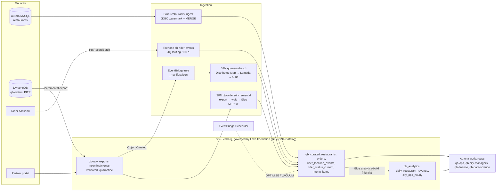
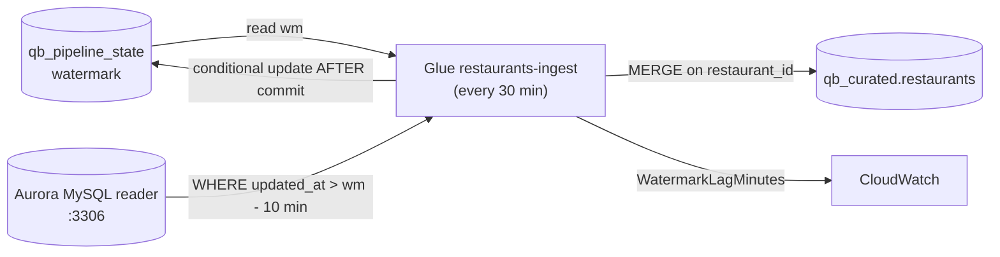
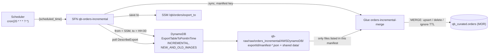
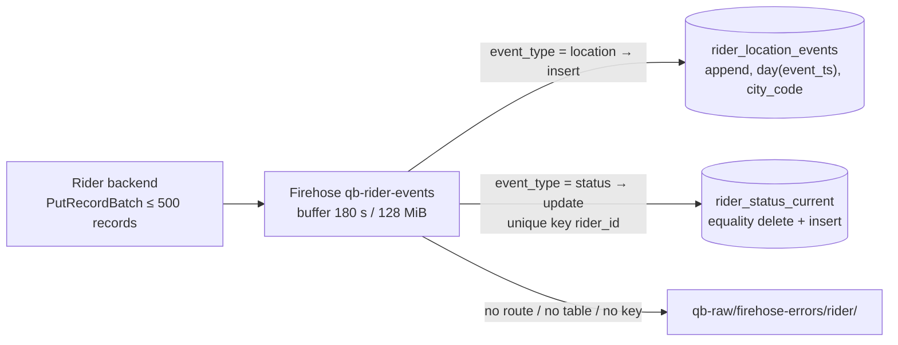
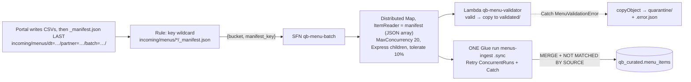

# 🍔 Walkthrough 2: QuickBite food-delivery lakehouse

> **What this is:** a second, independent design that uses the **same service set** as the exam lab but with new twists. It covers incremental JDBC and DynamoDB loads, Firehose routing to two tables, a Distributed Map file pipeline with quarantine, per-city row security, per-team Athena limits and scheduled maintenance. It ends with **7 practice challenges** in the exam-lab format, with failure modes that differ from A–G.
> **GCP mental model:** Cloud SQL (MySQL) → Dataproc JDBC pull · Firestore export → BigQuery MERGE · Pub/Sub → BigQuery subscription with routing · GCS → Eventarc → Workflows (parallel iteration) → Cloud Functions → Dataproc · Dataplex policy tags plus BigQuery row access policies · BigQuery reservations and per-project quotas.
> **Prerequisite:** [Walkthrough 1](20_Walkthrough_1_AnyCompany_Lakehouse_From_The_HLD.md). This file reuses its "common header" for Glue scripts (Step 6b) and its IAM and Lake Formation basics.
> **As of Nov 2026.** ⚠️ = unverified or likely to change, so verify it in the docs. Region **us-east-1**, so the commands match the lab sandbox. Every name here is *(mine)*. `<suffix>` and `<acct>` are placeholders.
> **Back to:** [Study guide index](README.md)

---

## ⭐ Must-know first: what's new compared with the lab

| Lab (AnyCompany) | QuickBite twist | The lesson |
|---|---|---|
| Aurora PostgreSQL, append ([A][CA]) | **Aurora MySQL**, **watermark + overlap + MERGE** | Incremental pulls need a stored watermark, an overlap window and an idempotent write. Hard deletes are invisible |
| Full daily DynamoDB export ([G][CG]) | **Incremental export** every hour + MERGE with **deletes** | Incremental data files share **one** `data/` folder. Read the **manifest**, not the folder. TTL deletes aren't business deletes |
| Firehose → one table ([D][CD]) | **One stream → two tables** with JQ routing: GPS **append**, status **upsert** | Routing expressions are code. Casing and contracts matter. Buffering is per stream, not per table |
| One Step Functions run per file ([F][CF]) | **Distributed Map** over a batch manifest, **Catch → quarantine**, then **one** Glue run | Keep parallel fan-out away from rate-limited services (Glue) |
| LF-Tags `zone` / `sensitivity` ([C][CC]) | LF-Tags **`domain`** / **`sensitivity`** with **column-level PII tags**, LF-only mode | Hybrid mode and `IAMAllowedPrincipals` can bypass every tag |
| Two cell filters ([E][CE]) | **One filter per city manager**, generated from a list | Filters multiply (cities × tables), so automate and test them |
| One workgroup | **One workgroup per team** with per-query scan cutoffs | The cutoff turns a runaway bill into a failed query |
| Manual OPTIMIZE / VACUUM ([B][CB]) | **EventBridge Scheduler** → Step Functions → Athena, with sane retention | Retention must satisfy both rollback and erasure |

---

## 1 · 📋 Requirements (a short PRD)

### 1.1 Problem and goals

QuickBite delivers food in six cities: Bengaluru (BLR), Mumbai (MUM), Delhi (DEL), Hyderabad (HYD), Pune (PUN) and Chennai (CHE). Today every team queries the production databases directly. Dashboards are slow, cities can see one another's data, and nobody can say who saw customer phone numbers.

- **G1** Ops sees live **rider status** per city (freshness ≤ 5 min p95).
- **G2** Finance has **daily restaurant revenue** by 06:00 IST.
- **G3** Each **city manager** sees only their own city, and no customer PII.
- **G4** Data science gets the full history with **no direct PII**.
- **G5** Partner **menus** are live in the lake within 60 min of upload. Bad files are quarantined, never loaded.
- **Non-goals:** real-time dispatch (the app owns it), card data (a payment provider tokenises it, so it's out of PCI scope), an ML feature store.

### 1.2 Personas

| Persona | IAM role | Needs | Access rule | Athena workgroup |
|---|---|---|---|---|
| Ops analyst / ops dashboards | `qb-ops-analyst-role` | Rider status and locations, all cities | `domain ∈ {riders, orders}`, `sensitivity ∈ {public, internal}` | `qb-ops` |
| City manager (×6) | `qb-city-manager-<city>-role` | Orders, restaurants and menus for **their** city | Data cell filter per city, no PII columns | `qb-city-managers` |
| Finance analyst | `qb-finance-role` | Orders and revenue, all cities | `domain ∈ {orders, finance, restaurants}`, not `pii` | `qb-finance` |
| Data scientist | `qb-data-science-role` | Curated history | Every domain, `sensitivity ∈ {public, internal}` | `qb-data-science` |
| Support lead (break-glass) | `qb-support-pii-role` | Customer phone for a ticket | `domain=orders` including `pii`, audited | `qb-ops` |
| Pipelines | `qb-glue-role`, `qb-firehose-role`, `qb-sfn-role` | Write | Named grants + `DATA_LOCATION_ACCESS` | `qb-platform` |

### 1.3 Sources, volumes and change patterns

| Source | System | Volume | Change pattern | Path |
|---|---|---|---|---|
| Restaurants | Aurora MySQL 8, `quickbite.restaurants` | 40,000 rows, ~2,000 updates/day | Updates; soft delete `is_active=0` | **P1** Glue JDBC |
| Orders | DynamoDB `qb-orders` (PK `order_id`) | 600k orders/day; dinner peak ~60/s; ~8 writes per order; 2 KB per item | Insert → many status updates; TTL delete after 90 days; GDPR/DPDP-style erasure deletes | **P2** incremental export |
| Rider events | Rider app → backend → Firehose | 20k riders on shift at peak; a GPS ping every 10 s → **2,000 events/s peak, ~600/s average**; ~50 status changes/s; 350 B each | GPS = append history; status = latest state | **P3** Firehose |
| Partner menus | Partner portal → S3 | ~60 batches/day, 1–200 CSV files per batch, 20–500 KB per file | Full menu replacement per restaurant | **P4** S3 → EventBridge → Step Functions |

### 1.4 SLAs / SLOs

| Dimension | Target |
|---|---|
| Freshness | Rider status ≤ 5 min p95 · restaurants ≤ 60 min · orders ≤ 90 min · menus ≤ 60 min after the manifest |
| Query latency | Ops dashboard tiles p95 < 5 s · finance daily report ready by 06:00 IST |
| Correctness | 0 duplicate `order_id` in curated · menu reject rate > 5% alerts · watermark gaps alert |
| Recovery | RPO 0 for orders (DynamoDB is the source of truth, with PITR for 35 days) · RTO 4 h to rebuild any curated table |
| Availability | Pipelines 99.5% monthly. A missed run is caught up automatically on the next one |

### 1.5 Compliance and data handling

- **PII:** customer name, phone and address. Rider phone and licence number. Precise rider GPS is personal data while a rider is on shift.
- **Least privilege:** PII is tagged at **column** level, cities are isolated by **row filters**, and every grant lives in code.
- **Right to erasure within 30 days:** a delete in DynamoDB → incremental export → MERGE DELETE → **VACUUM physically removes the old files**. So snapshot retention has to be **shorter than 30 days** (see QB-6).
- **Retention:** curated GPS 90 days, aggregates 13 months, raw exports 35 days.
- **Encryption:** SSE-KMS with the CMK `alias/qb-lake` and S3 Bucket Keys. Athena results are encrypted. TLS everywhere.
- **Audit:** CloudTrail records Lake Formation `GetDataAccess` and Athena `StartQueryExecution`, and the trail is kept for a year.
- **Residency:** this practice build uses us-east-1. A real in-country deployment would use a local region and check each feature's regional availability first ⚠️.

### 1.6 Sizing estimate (worked)

| Quantity | Arithmetic | Result |
|---|---|---|
| Rider events/day | 600/s × 86,400 | **≈ 52 M/day** |
| Raw JSON/day | 52 M × 350 B | **≈ 18 GB/day** (≈ 540 GB/month into Firehose) |
| Curated GPS (Parquet + zstd, ~8–10× smaller ⚠️) | 18 GB ÷ 9 | ≈ 2 GB/day → **≈ 180 GB** at 90 days |
| Firehose peak throughput | 2,000/s × 350 B | 0.7 MB/s, well under the Direct PUT defaults (~5 MiB/s, 2,000 requests/s, 500k records/s in us-east-1 ⚠️). With `PutRecordBatch` (≤ 500 records), that's ≈ 4–10 requests/s |
| Firehose flushes | 128 MiB ÷ 0.7 MB/s ≈ 190 s at peak, so the **180 s interval** usually triggers first | ≈ 480 commits/day/table. That means ≈ 480 snapshots/day, so **VACUUM daily** is mandatory |
| Order changes per hour | 600k × 8 writes ÷ 24 | ≈ 200k writes/hour, but the incremental export emits **one record per changed item**, so ≈ 25–60k records ≈ 50–120 MB per export |
| Curated orders | 600k × 365 × ~300 B Parquet ⚠️ | ≈ 65 GB/year |
| Menu files | 60 batches × ~40 files | ≈ 2,400 files/day → 2,400 Lambda invocations; raw ≈ 0.5 GB/day |
| Athena | Ops 2,600 queries/day × 30 MB + managers 1,200 × 200 MB + finance 50 × 5 GB + data science ≈ 100 GB/day | ≈ **23 TB/month** (cost in §7) |

---

## 2 · ⚖️ Design decisions and trade-offs

| # | Decision | Option A vs B | Choice | Why | Second-order effect |
|---|---|---|---|---|---|
| 1 | Restaurants ingestion | DMS CDC vs Glue JDBC pull | **Glue JDBC + watermark** | ~2k changes/day, 60-min SLA, no new service to run | Hard deletes are invisible → require soft deletes plus a weekly full reconcile |
| 2 | Watermark store | Glue job bookmarks vs an explicit control table | **DynamoDB `qb_pipeline_state`** | Transparent, editable for backfills, supports overlap | Must be updated **after** the commit, with a condition, or a crash skips data |
| 3 | Orders capture | DynamoDB Streams → Lambda → Firehose vs incremental export | **Incremental export (hourly)** | No RCUs, no consumer code, one net record per item per window | ≥ 15-min windows, so freshness is ~75–90 min. Manifest-based reads are mandatory |
| 4 | Orders write mode | Copy-on-write vs merge-on-read | **MOR** | Hourly MERGE of ~50k rows into a large table | Delete files pile up → daily OPTIMIZE. MERGE cost grows with the target scanned → add a pruning predicate |
| 5 | Rider streams | Two streams vs one stream with routing | **One stream + JQ routing** | One producer contract, one IAM role, one set of metrics | Buffer hints are shared, so the stricter SLA (status) sets them for GPS too → more small files → hourly OPTIMIZE |
| 6 | GPS vs status tables | Upsert both vs append GPS and upsert status | **Append `rider_location_events`, upsert `rider_status_current` (key `rider_id`)** | ETA models need history. Ops needs the current state | Firehose doesn't keep records in order, so a stale status can overwrite a newer one (see §8) |
| 7 | Raw GPS archive | Second Firehose → S3 vs none | **None** (Iceberg is the system of record; the KDS/app can replay) | A 350 B record is billed as **5 KB** on S3-destination ingest, about 9× the Iceberg-destination bill (§7) | Replay depends on the producer. Iceberg snapshots cover delivery bugs |
| 8 | Menu batching | One execution per file vs one per batch with Distributed Map | **Per batch, driven by `_manifest.json`** | A batch is a business unit. Validation runs in parallel and **one** Glue run loads it | Partners must upload the manifest **last**. A missing manifest means the batch is never processed → stale-batch alarm |
| 9 | Map child type | Standard vs Express | **Express** children (Lambda only) | Cheaper and faster for 1–5 s validations | Express **can't use `.sync`**, which keeps Glue out of the Map by construction (prevents QB-3) |
| 10 | Bad files | Fail the batch vs quarantine the file | **Quarantine via Catch**, `ToleratedFailurePercentage` 10 | One bad restaurant doesn't block 199 good ones | Partial batches load, so per-restaurant atomicity matters: a file loads fully or not at all |
| 11 | Access mode | IAM / hybrid vs LF-only | **LF-only**. Hybrid only during a dated migration window | Tags and filters only protect data if LF is enforced for everyone | Revoke `IAMAllowedPrincipals` and turn off defaults (QB-1) |
| 12 | City isolation | Table per city vs views vs cell filters | **Cell filters**, generated from a city list | One copy of the data, enforced in every engine | 6 cities × 3 tables = 18 filters. A new city = code change + role + grants |
| 13 | PII granularity | Table-level vs column-level `sensitivity` | **Column-level `pii`** on PII columns | Analysts keep the non-PII columns | `SELECT *` may return fewer columns or fail, depending on the engine ⚠️ → publish column lists |
| 14 | Athena isolation | One workgroup vs one per team with cutoffs | **Per team, enforced settings** | Cost attribution plus a hard cap per query | Legitimate big queries fail → an escalation workgroup with an approval step |
| 15 | Maintenance | Glue table optimizers vs Scheduler + Athena | **Scheduler → Step Functions → Athena** (optimizers are a valid alternative) | Explicit timing per table, and it's what the labs test | You own the schedule, the alarms and the retries |
| 16 | Snapshot retention | Long time travel vs erasure | **7 days**, min 50 snapshots. Month-end **tags** only on non-PII aggregates | Covers time-to-detect and meets the 30-day erasure SLA | No time travel beyond 7 days. Audits rely on DynamoDB PITR exports (QB-6) |

---

## 3 · 🗺️ Architecture



| Table | DB | `domain` tag | Partitioning | Write path / mode |
|---|---|---|---|---|
| `restaurants` | `qb_curated` | restaurants | none (40k rows) | P1 MERGE, COW |
| `orders` | `qb_curated` | orders | `day(order_ts), city_code` | P2 MERGE, **MOR** |
| `rider_location_events` | `qb_curated` | riders | `day(event_ts), city_code` | P3 Firehose append |
| `rider_status_current` | `qb_curated` | riders | none (~60k rows) | P3 Firehose upsert on `rider_id` (MOR) |
| `menu_items` | `qb_curated` | menus | `city_code` | P4 MERGE + `NOT MATCHED BY SOURCE` delete |
| `daily_restaurant_revenue` | `qb_analytics` | finance | `month(order_date)` | Nightly MERGE |
| `menu_uploads_raw` (Hive CSV, partition projection) | `qb_raw` | menus | `dt` (projected) | Read-only audit table over `incoming/menus/` |

---

## 4 · 🛠️ Build steps with code

### 4.0 Foundations

```bash
export AWS_REGION=us-east-1; ACCOUNT=$(aws sts get-caller-identity --query Account --output text); SUFFIX=qb01
for B in qb-raw-$SUFFIX qb-curated-$SUFFIX qb-analytics-$SUFFIX qb-athena-results-$SUFFIX; do
  aws s3api create-bucket --bucket $B
  aws s3api put-bucket-encryption --bucket $B --server-side-encryption-configuration \
    '{"Rules":[{"ApplyServerSideEncryptionByDefault":{"SSEAlgorithm":"aws:kms","KMSMasterKeyID":"alias/qb-lake"},"BucketKeyEnabled":true}]}'
done
aws s3api put-bucket-notification-configuration --bucket qb-raw-$SUFFIX --notification-configuration '{"EventBridgeConfiguration":{}}'
for DB in qb_raw qb_curated qb_analytics; do
  aws glue create-database --database-input "{\"Name\":\"$DB\",\"CreateTableDefaultPermissions\":[]}"
done
aws dynamodb create-table --table-name qb_pipeline_state --billing-mode PAY_PER_REQUEST \
  --attribute-definitions AttributeName=pipeline,AttributeType=S --key-schema AttributeName=pipeline,KeyType=HASH
```

Every role that touches the lake needs `kms:Decrypt` and `kms:GenerateDataKey` on `alias/qb-lake`. If one is missing, Firehose sends records to the error prefix and Athena fails to write results. Use a **custom registration role** with KMS rights when you register CMK-encrypted locations in LF ⚠️.

### 4.1 P1: restaurants from Aurora MySQL (JDBC, watermark, MERGE)



**Networking (QB-5 tests this).** Use a dedicated Glue SG with a self-referencing rule, and let the Aurora SG allow only that SG:

```bash
GLUE_SG=$(aws ec2 create-security-group --group-name qb-glue-jdbc --description "Glue JDBC workers" \
  --vpc-id $VPC_ID --query GroupId --output text)
aws ec2 authorize-security-group-ingress --group-id $GLUE_SG --protocol tcp --port 0-65535 --source-group $GLUE_SG
aws ec2 authorize-security-group-ingress --group-id $AURORA_SG --protocol tcp --port 3306 --source-group $GLUE_SG
aws ec2 create-vpc-endpoint --vpc-id $VPC_ID --service-name com.amazonaws.us-east-1.s3 --route-table-ids $RTB_ID
# + interface endpoints (secretsmanager, glue, sts, logs, monitoring) and a gateway endpoint for dynamodb, or a NAT ⚠️
aws glue create-connection --connection-input "{\"Name\":\"qb-aurora-mysql-conn\",\"ConnectionType\":\"JDBC\",
  \"ConnectionProperties\":{\"JDBC_CONNECTION_URL\":\"jdbc:mysql://<reader-endpoint>:3306/quickbite\",\"SECRET_ID\":\"qb/aurora/reader\"},
  \"PhysicalConnectionRequirements\":{\"SubnetId\":\"$SUBNET_ID\",\"AvailabilityZone\":\"us-east-1a\",\"SecurityGroupIdList\":[\"$GLUE_SG\"]}}"
```

```sql
-- Athena (workgroup qb-platform)
CREATE TABLE qb_curated.restaurants (
  restaurant_id string, name string, city_code string, cuisine string, rating decimal(3,2),
  commission_pct decimal(5,2), owner_phone string, is_active boolean, updated_at timestamp)
LOCATION 's3://qb-curated-<suffix>/restaurants/'
TBLPROPERTIES ('table_type'='ICEBERG', 'format'='parquet', 'write_compression'='zstd');
```

```python
# restaurants-ingest  (... common header from Walkthrough 1 Step 6b ...)
args = getResolvedOptions(sys.argv, ["JOB_NAME", "warehouse", "jdbc_url", "secret_id", "state_table"])
glue_ctx, spark = iceberg_session(args["warehouse"])
job = Job(glue_ctx); job.init(args["JOB_NAME"], args)
T, OVERLAP_MIN = "glue_catalog.qb_curated.restaurants", 10

state = boto3.resource("dynamodb").Table(args["state_table"])
wm = state.get_item(Key={"pipeline": "restaurants"}).get("Item", {}).get("watermark", "1970-01-01 00:00:00.000")
creds = json.loads(boto3.client("secretsmanager").get_secret_value(SecretId=args["secret_id"])["SecretString"])

# Overlap: catch rows whose transaction committed late with an older updated_at. MERGE makes re-reads harmless.
query = f"""SELECT restaurant_id, name, city_code, cuisine, rating, commission_pct, owner_phone,
                   is_active = 1 AS is_active, updated_at
            FROM quickbite.restaurants
            WHERE updated_at > TIMESTAMP('{wm}') - INTERVAL {OVERLAP_MIN} MINUTE"""
src = (spark.read.format("jdbc")
       .option("url", args["jdbc_url"] + "?connectionTimeZone=UTC&useCursorFetch=true")  # UTC, honour fetchsize ⚠️
       .option("driver", "com.mysql.cj.jdbc.Driver")
       .option("user", creds["username"]).option("password", creds["password"])
       .option("query", query).option("fetchsize", "5000")
       .option("queryTimeout", "300")             # fail fast instead of hanging (QB-5)
       .load()
       .withColumn("is_active", F.col("is_active").cast("boolean")))

if src.head(1):
    w = Window.partitionBy("restaurant_id").orderBy(F.col("updated_at").desc())
    src = src.withColumn("rn", F.row_number().over(w)).where("rn = 1").drop("rn")
    src.createOrReplaceTempView("src")
    spark.sql(f"""MERGE INTO {T} t USING src s ON t.restaurant_id = s.restaurant_id
                  WHEN MATCHED AND s.updated_at >= t.updated_at THEN UPDATE SET *
                  WHEN NOT MATCHED THEN INSERT *""")
    new_wm = src.select(F.date_format(F.max("updated_at"), "yyyy-MM-dd HH:mm:ss.SSS")).first()[0]
    # Only move forward, and only after the Iceberg commit succeeded
    state.put_item(Item={"pipeline": "restaurants", "watermark": new_wm},
                   ConditionExpression="attribute_not_exists(watermark) OR watermark <= :w",
                   ExpressionAttributeValues={":w": new_wm})
    lag = spark.sql(f"SELECT (unix_timestamp() - unix_timestamp(TIMESTAMP '{new_wm}')) / 60").first()[0]
    boto3.client("cloudwatch").put_metric_data(Namespace="QuickBite/Lakehouse", MetricData=[{
        "MetricName": "WatermarkLagMinutes", "Dimensions": [{"Name": "Pipeline", "Value": "restaurants"}], "Value": float(lag)}])
job.commit()
```

**Notes.** `updated_at` must be `TIMESTAMP(3) ... ON UPDATE CURRENT_TIMESTAMP(3)` and **indexed**, or every run scans the table. Read from the **reader endpoint**. For the weekly full reconcile, use `dbtable` with a subquery plus `partitionColumn=restaurant_id_num`, `lowerBound`, `upperBound` and `numPartitions=4`. Spark doesn't allow `query` together with `partitionColumn`. The job is scheduled with a Glue trigger or EventBridge Scheduler every 30 minutes and `MaxConcurrentRuns=1`.

### 4.2 P2: orders from DynamoDB (incremental export + MERGE with deletes)



**Bootstrap once.** Enable PITR, run a **full** export, MERGE it, and set the SSM parameter to that export's `ExportTime`. After that, every hour exports `[last_to, HH:00)`. The window must be 15 min to 24 h, inside the PITR window ⚠️.

**Key facts from the DynamoDB docs.** Incremental data files for **all** incremental exports share one `AWSDynamoDB/data/` folder, and each export's `manifest-files.json` lists its own files. Each record has `Metadata.WriteTimestampMicros` and `Keys`, plus a `NewImage` (insert or update) and/or an `OldImage`. **A delete has no `NewImage`.** An item inserted and deleted within the same window produces no output.

```json
{
  "Comment": "Hourly DynamoDB incremental export -> Glue MERGE",
  "StartAt": "GetWatermark",
  "States": {
    "GetWatermark": { "Type": "Task", "Resource": "arn:aws:states:::aws-sdk:ssm:getParameter",
      "Parameters": { "Name": "/qb/orders/export_to" }, "ResultSelector": { "from.$": "$.Parameter.Value" },
      "ResultPath": "$.window", "Next": "ComputeTo" },
    "ComputeTo": { "Type": "Pass", "ResultPath": "$.window",
      "Parameters": { "from.$": "$.window.from",
        "to.$": "States.Format('{}:00:00Z', States.ArrayGetItem(States.StringSplit($.scheduled_time, ':'), 0))" },
      "Next": "AlreadyDone" },
    "AlreadyDone": { "Type": "Choice", "Default": "StartExport",
      "Choices": [{ "Variable": "$.window.from", "StringEqualsPath": "$.window.to", "Next": "Done" }] },
    "StartExport": { "Type": "Task", "Resource": "arn:aws:states:::aws-sdk:dynamodb:exportTableToPointInTime",
      "Parameters": { "TableArn": "arn:aws:dynamodb:us-east-1:<acct>:table/qb-orders", "S3Bucket": "qb-raw-<suffix>",
        "S3Prefix": "raw/orders_incremental", "ExportFormat": "DYNAMODB_JSON", "ExportType": "INCREMENTAL_EXPORT",
        "IncrementalExportSpecification": { "ExportFromTime.$": "$.window.from", "ExportToTime.$": "$.window.to",
                                            "ExportViewType": "NEW_AND_OLD_IMAGES" } },
      "ResultSelector": { "arn.$": "$.ExportDescription.ExportArn" }, "ResultPath": "$.export",
      "Catch": [{ "ErrorEquals": ["States.ALL"], "ResultPath": "$.error", "Next": "Notify" }], "Next": "WaitForExport" },
    "WaitForExport": { "Type": "Wait", "Seconds": 120, "Next": "DescribeExport" },
    "DescribeExport": { "Type": "Task", "Resource": "arn:aws:states:::aws-sdk:dynamodb:describeExport",
      "Parameters": { "ExportArn.$": "$.export.arn" }, "ResultSelector": { "d.$": "$.ExportDescription" },
      "ResultPath": "$.status", "Next": "IsExportDone" },
    "IsExportDone": { "Type": "Choice", "Default": "WaitForExport", "Choices": [
      { "Variable": "$.status.d.ExportStatus", "StringEquals": "COMPLETED", "Next": "MergeIntoIceberg" },
      { "Variable": "$.status.d.ExportStatus", "StringEquals": "FAILED", "Next": "Notify" } ] },
    "MergeIntoIceberg": { "Type": "Task", "Resource": "arn:aws:states:::glue:startJobRun.sync",
      "Parameters": { "JobName": "orders-incremental-merge",
        "Arguments": { "--raw_bucket": "qb-raw-<suffix>", "--manifest_summary_key.$": "$.status.d.ExportManifest" } },
      "Retry": [ { "ErrorEquals": ["Glue.ConcurrentRunsExceededException"], "IntervalSeconds": 60, "MaxAttempts": 5,
                   "BackoffRate": 2, "JitterStrategy": "FULL" },
                 { "ErrorEquals": ["States.ALL"], "IntervalSeconds": 120, "MaxAttempts": 1 } ],
      "Catch": [{ "ErrorEquals": ["States.ALL"], "ResultPath": "$.error", "Next": "Notify" }],
      "ResultPath": null, "Next": "SaveWatermark" },
    "SaveWatermark": { "Type": "Task", "Resource": "arn:aws:states:::aws-sdk:ssm:putParameter",
      "Parameters": { "Name": "/qb/orders/export_to", "Value.$": "$.window.to", "Overwrite": true },
      "ResultPath": null, "Next": "Done" },
    "Notify": { "Type": "Task", "Resource": "arn:aws:states:::sns:publish",
      "Parameters": { "TopicArn": "arn:aws:sns:us-east-1:<acct>:qb-alerts", "Message.$": "States.JsonToString($)" },
      "Next": "Failed" },
    "Done": { "Type": "Succeed" },
    "Failed": { "Type": "Fail", "Error": "OrdersIncrementalFailed" }
  }
}
```

Scheduler input: `{"scheduled_time": "<aws.scheduler.scheduled-time>"}`. The `StringSplit` trick turns `2026-11-11T10:20:00Z` into `2026-11-11T10:00:00Z` without a Lambda. ⚠️ Verify that the SDK integration accepts ISO strings for timestamp parameters, and what `ExportManifest` contains (the summary-manifest key). The watermark only advances after the MERGE succeeds, so a failed hour is **retried as a wider window** on the next run. If an outage lasts more than 24 h, the export is rejected: catch up manually in ≤ 24 h chunks.

```python
# orders-incremental-merge  (... common header ...)
from pyspark.sql.types import StructType, StructField, StringType
args = getResolvedOptions(sys.argv, ["JOB_NAME", "warehouse", "raw_bucket", "manifest_summary_key"])
glue_ctx, spark = iceberg_session(args["warehouse"])
job = Job(glue_ctx); job.init(args["JOB_NAME"], args)
s3, B, T = boto3.client("s3"), args["raw_bucket"], "glue_catalog.qb_curated.orders"

# 1. Resolve THIS export's data files from its manifest (never read the shared data/ folder)
summary = json.loads(s3.get_object(Bucket=B, Key=args["manifest_summary_key"])["Body"].read())
assert summary.get("exportType") == "INCREMENTAL_EXPORT", summary
prefix = summary["s3Prefix"].rstrip("/")
lines = s3.get_object(Bucket=B, Key=summary["manifestFilesS3Key"])["Body"].read().decode().splitlines()
keys = [json.loads(l)["dataFileS3Key"] for l in lines if l.strip()]
paths = [f"s3://{B}/{k if k.startswith(prefix + '/') else prefix + '/' + k}" for k in keys]   # ⚠️ key form

# 2. Explicit schema: empty files and missing attributes can't break inference
def ddb(attrs): return StructType([StructField(a, StructType([StructField(t, StringType())])) for a, t in attrs.items()])
A = {"order_id": "S", "restaurant_id": "S", "city_code": "S", "customer_id": "S", "customer_name": "S",
     "customer_phone": "S", "delivery_address": "S", "status": "S", "order_ts": "S", "subtotal": "N",
     "delivery_fee": "N", "total": "N", "updated_at": "S", "expires_at": "N"}
SCHEMA = StructType([StructField("Metadata", ddb({"WriteTimestampMicros": "N"})), StructField("Keys", ddb({"order_id": "S"})),
                     StructField("NewImage", ddb(A)), StructField("OldImage", ddb(A))])
raw = spark.read.schema(SCHEMA).json(paths) if paths else spark.createDataFrame([], SCHEMA)

n, o = lambda c: F.col(f"NewImage.{c}.N"), lambda c: F.col(f"OldImage.{c}")
s = lambda c: F.col(f"NewImage.{c}.S")
write_us = F.col("Metadata.WriteTimestampMicros.N").cast("bigint")
is_delete = F.col("NewImage").isNull()
ttl_expired = (o("expires_at.N").cast("bigint") * 1_000_000) <= write_us     # deleted at/after its TTL → TTL, not erasure
src = raw.select(
    F.col("Keys.order_id.S").alias("order_id"), s("restaurant_id").alias("restaurant_id"), s("city_code").alias("city_code"),
    s("customer_id").alias("customer_id"), s("customer_name").alias("customer_name"),
    s("customer_phone").alias("customer_phone"), s("delivery_address").alias("delivery_address"), s("status").alias("status"),
    F.to_timestamp(F.coalesce(s("order_ts"), o("order_ts.S"))).alias("order_ts"),
    n("subtotal").cast("decimal(10,2)").alias("subtotal"), n("delivery_fee").cast("decimal(10,2)").alias("delivery_fee"),
    n("total").cast("decimal(10,2)").alias("total"), F.to_timestamp(s("updated_at")).alias("updated_at"),
    write_us.alias("ddb_write_ts_us"),
    F.when(is_delete & ttl_expired, "ttl").when(is_delete, "delete").otherwise("upsert").alias("op"))
src = src.where("op <> 'ttl'")       # the lake keeps history after the OLTP TTL removes it
w = Window.partitionBy("order_id").orderBy(F.col("ddb_write_ts_us").desc())
src = src.withColumn("rn", F.row_number().over(w)).where("rn = 1").drop("rn")

if src.head(1):
    src.createOrReplaceTempView("src")
    min_ts = src.agg(F.min("order_ts")).first()[0] or "1970-01-01 00:00:00"   # covers every source row
    cols = spark.table(T).columns                   # explicit lists: src has the extra 'op' column
    upd = ", ".join(f"t.{c} = s.{c}" for c in cols)
    spark.sql(f"""
      MERGE INTO {T} t
      USING src s
      ON t.order_id = s.order_id AND t.order_ts >= TIMESTAMP '{min_ts}' - INTERVAL 1 DAY   -- prune the target scan
      WHEN MATCHED AND s.op = 'delete' THEN DELETE
      WHEN MATCHED AND s.ddb_write_ts_us > t.ddb_write_ts_us THEN UPDATE SET {upd}
      WHEN NOT MATCHED AND s.op = 'upsert' THEN INSERT ({', '.join(cols)}) VALUES ({', '.join('s.' + c for c in cols)})""")
job.commit()
```

The curated table matches those columns: `order_id, restaurant_id, city_code, customer_id, customer_name, customer_phone, delivery_address, status, order_ts timestamp, subtotal, delivery_fee, total decimal(10,2), updated_at timestamp, ddb_write_ts_us bigint`, partitioned `(day(order_ts), city_code)`. Set MOR on it from Spark, as in Walkthrough 1 Step 5. **The pruning predicate** keeps MERGE from scanning a year of partitions every hour. It's safe because `min_ts` comes from the batch itself, including `OldImage.order_ts` for deletes, so every source row's partition is covered. One erasure of a year-old order widens that hour's scan to a year. If erasures are frequent, route deletes to a separate weekly erasure job.

### 4.3 P3: rider events through Firehose (JQ routing, append + upsert)



```sql
CREATE TABLE qb_curated.rider_location_events (
  rider_id string, event_type string, event_ts timestamp, lat double, lon double, speed_kmh double, city_code string)
PARTITIONED BY (day(event_ts), city_code)
LOCATION 's3://qb-curated-<suffix>/rider_location_events/'
TBLPROPERTIES ('table_type'='ICEBERG', 'format'='parquet', 'write_compression'='zstd');

CREATE TABLE qb_curated.rider_status_current (
  rider_id string, status string, order_id string, event_ts timestamp, city_code string)
LOCATION 's3://qb-curated-<suffix>/rider_status_current/'
TBLPROPERTIES ('table_type'='ICEBERG', 'format'='parquet');
```

**Console → Firehose → Create stream** (source *Direct PUT*, destination *Apache Iceberg Tables*):

| Setting | Value | Why |
|---|---|---|
| Inline parsing: database | `"qb_curated"` | Static value |
| Inline parsing: table | `if (.event_type \| ascii_downcase) == "status" then "rider_status_current" else "rider_location_events" end` | Case-insensitive (QB-2) |
| Inline parsing: operation | `if (.event_type \| ascii_downcase) == "status" then "update" else "insert" end` | Upsert only the status table. The default operation is `insert` |
| Unique keys | `rider_status_current` → `rider_id` (none for locations) | Update and delete need keys or Iceberg identifier fields |
| Buffer hints | **180 s**, 128 MiB | 180 s + commit + dashboard refresh fits within 5 min. Size rarely triggers |
| S3 error prefix | `firehose-errors/rider/` | Unroutable and failed records land here |
| Schema evolution / table creation | **Off** | Producers mustn't change table schemas by accident |

The API form puts the same expressions in a `MetadataExtraction` processor (`MetadataExtractionQuery`, `JsonParsingEngine=JQ-1.6`), as in Walkthrough 1 Step 8 ⚠️. Firehose maps JSON fields to columns **by name**. Fields with no matching column are dropped while schema evolution is off ⚠️. Send `event_ts` in a timestamp format Firehose can parse, such as ISO-8601 ⚠️.

**Buffering choices:**

| Interval | Files/day/table | Status freshness | Verdict |
|---|---|---|---|
| 60 s | ~1,440 | ~2 min | Too many snapshots, and compaction can't keep up |
| **180 s** | **~480** | **~4 min** | **Chosen**, with hourly OPTIMIZE |
| 900 s | ~96 | ~16 min | Breaks the G1 SLA |

### 4.4 P4: partner menus (EventBridge → Distributed Map → Lambda → Glue, Catch + quarantine)



The manifest is a JSON array with **full keys**: `[{"key":"incoming/menus/dt=2026-11-11/partner=P0042/batch=B0007/menu_R1001.csv","restaurant_id":"R1001"}, …]`.

Event pattern: `{"source":["aws.s3"],"detail-type":["Object Created"],"detail":{"bucket":{"name":["qb-raw-<suffix>"]},"object":{"key":[{"wildcard":"incoming/menus/*/_manifest.json"}]}}}`. Input transformer: paths `{"bucket":"$.detail.bucket.name","manifest_key":"$.detail.object.key"}` and template `{"bucket": "<bucket>", "manifest_key": "<manifest_key>"}`. The CLI is the same as [F][CF] steps 3c–3d.

```json
{
  "Comment": "Partner menu batch: validate files in parallel, quarantine bad ones, load once",
  "StartAt": "ValidateFiles",
  "States": {
    "ValidateFiles": {
      "Type": "Map", "MaxConcurrency": 20, "ToleratedFailurePercentage": 10,
      "ItemReader": { "Resource": "arn:aws:states:::s3:getObject", "ReaderConfig": { "InputType": "JSON" },
                      "Parameters": { "Bucket.$": "$.bucket", "Key.$": "$.manifest_key" } },
      "ItemSelector": { "bucket.$": "$.bucket", "key.$": "$$.Map.Item.Value.key",
                        "restaurant_id.$": "$$.Map.Item.Value.restaurant_id" },
      "ItemProcessor": {
        "ProcessorConfig": { "Mode": "DISTRIBUTED", "ExecutionType": "EXPRESS" },
        "StartAt": "Validate",
        "States": {
          "Validate": { "Type": "Task", "Resource": "arn:aws:states:::lambda:invoke",
            "Parameters": { "FunctionName": "qb-menu-validator", "Payload.$": "$" }, "OutputPath": "$.Payload",
            "Retry": [{ "ErrorEquals": ["Lambda.TooManyRequestsException", "Lambda.ServiceException"],
                        "IntervalSeconds": 2, "MaxAttempts": 4, "BackoffRate": 2, "JitterStrategy": "FULL" }],
            "Catch": [{ "ErrorEquals": ["MenuValidationError"], "ResultPath": "$.error", "Next": "CopyToQuarantine" }],
            "End": true },
          "CopyToQuarantine": { "Type": "Task", "Resource": "arn:aws:states:::aws-sdk:s3:copyObject",
            "Parameters": { "Bucket.$": "$.bucket", "CopySource.$": "States.Format('{}/{}', $.bucket, $.key)",
                            "Key.$": "States.Format('quarantine/{}', $.key)" },
            "ResultPath": null, "Next": "WriteReason" },
          "WriteReason": { "Type": "Task", "Resource": "arn:aws:states:::aws-sdk:s3:putObject",
            "Parameters": { "Bucket.$": "$.bucket", "Key.$": "States.Format('quarantine/{}.error.json', $.key)",
                            "Body.$": "States.JsonToString($.error)" },
            "ResultSelector": { "status": "QUARANTINED" }, "End": true } } },
      "ResultWriter": { "Resource": "arn:aws:states:::s3:putObject",
                        "Parameters": { "Bucket": "qb-raw-<suffix>", "Prefix": "sfn-results/menus/" } },
      "ResultPath": null, "Next": "LoadBatch" },
    "LoadBatch": { "Type": "Task", "Resource": "arn:aws:states:::glue:startJobRun.sync",
      "Parameters": { "JobName": "menus-ingest",
                      "Arguments": { "--bucket.$": "$.bucket", "--manifest_key.$": "$.manifest_key" } },
      "Retry": [ { "ErrorEquals": ["Glue.ConcurrentRunsExceededException"], "IntervalSeconds": 30, "MaxAttempts": 6,
                   "BackoffRate": 2, "MaxDelaySeconds": 600, "JitterStrategy": "FULL" },
                 { "ErrorEquals": ["States.ALL"], "IntervalSeconds": 60, "MaxAttempts": 2, "BackoffRate": 2 } ],
      "Catch": [{ "ErrorEquals": ["States.ALL"], "ResultPath": "$.error", "Next": "Notify" }], "End": true },
    "Notify": { "Type": "Task", "Resource": "arn:aws:states:::sns:publish",
      "Parameters": { "TopicArn": "arn:aws:sns:us-east-1:<acct>:qb-alerts", "Message.$": "States.JsonToString($)" },
      "Next": "Failed" },
    "Failed": { "Type": "Fail", "Error": "MenuBatchFailed" }
  }
}
```

**Why `ResultWriter`?** It stores per-item results in S3 instead of in the state payload, which is capped at 256 KB ⚠️. **Why `ResultPath: null` on the Map?** It keeps `{bucket, manifest_key}` intact for `LoadBatch`. The `CopySource` value may need URL-encoding for unusual characters ⚠️.

```python
# Lambda qb-menu-validator (Python 3.12). The whole file is rejected on any problem:
# a restaurant's menu loads fully or not at all.
import csv, io, re, boto3
s3 = boto3.client("s3")
REQUIRED = ["restaurant_id", "item_id", "item_name", "price", "currency", "prep_time_min", "is_available"]
class MenuValidationError(Exception):       # Step Functions sees the class name as the error → Catch matches it
    pass

def handler(event, context):
    bucket, key, rid = event["bucket"], event["key"], event["restaurant_id"]
    try:
        body = s3.get_object(Bucket=bucket, Key=key)["Body"].read().decode("utf-8-sig")
    except s3.exceptions.NoSuchKey:
        raise MenuValidationError(f"in manifest but missing: {key}")
    rows = list(csv.DictReader(io.StringIO(body)))
    if not rows or set(REQUIRED) - set(rows[0]):
        raise MenuValidationError(f"bad or empty header; need {REQUIRED}")
    seen, problems = set(), []
    for i, r in enumerate(rows, start=2):                 # line 1 is the header
        if (r["restaurant_id"] or "").strip() != rid:     problems.append(f"L{i}: restaurant_id != {rid}")
        if r["item_id"] in seen:                          problems.append(f"L{i}: duplicate item_id")
        seen.add(r["item_id"])
        if not re.fullmatch(r"\d{1,6}(\.\d{1,2})?", (r["price"] or "").strip()) or float(r["price"]) <= 0:
            problems.append(f"L{i}: bad price {r['price']!r}")
        pt = (r["prep_time_min"] or "").strip()
        if not pt.isdigit() or not 1 <= int(pt) <= 240:   # "15 min" is rejected here (see QB-7)
            problems.append(f"L{i}: prep_time_min must be an integer 1-240, got {pt!r}")
    if problems:
        raise MenuValidationError("; ".join(problems[:20]))
    s3.copy_object(Bucket=bucket, Key="validated/" + key, CopySource={"Bucket": bucket, "Key": key})
    return {"status": "VALID", "rows": len(rows), "key": key}
```

```sql
CREATE TABLE qb_curated.menu_items (
  restaurant_id string, item_id string, item_name string, price decimal(10,2), currency string,
  prep_time_min int, is_available boolean, city_code string, batch_key string, loaded_at timestamp)
PARTITIONED BY (city_code)
LOCATION 's3://qb-curated-<suffix>/menu_items/'
TBLPROPERTIES ('table_type'='ICEBERG', 'format'='parquet', 'write_compression'='zstd');
```

```python
# menus-ingest  (... common header ...)
args = getResolvedOptions(sys.argv, ["JOB_NAME", "warehouse", "bucket", "manifest_key"])
glue_ctx, spark = iceberg_session(args["warehouse"])
job = Job(glue_ctx); job.init(args["JOB_NAME"], args)
vprefix = "validated/" + args["manifest_key"].rsplit("/", 1)[0] + "/"
if boto3.client("s3").list_objects_v2(Bucket=args["bucket"], Prefix=vprefix, MaxKeys=1).get("KeyCount", 0):
    rest = spark.table("glue_catalog.qb_curated.restaurants").select("restaurant_id", "city_code")
    df = (spark.read.option("header", "true").csv(f"s3://{args['bucket']}/{vprefix}")
          .select("restaurant_id", "item_id", "item_name", F.col("price").cast("decimal(10,2)").alias("price"),
                  "currency", F.col("prep_time_min").cast("int").alias("prep_time_min"),
                  (F.lower("is_available") == "true").alias("is_available"))
          .join(F.broadcast(rest), "restaurant_id", "left")
          .withColumn("batch_key", F.lit(args["manifest_key"])).withColumn("loaded_at", F.current_timestamp()))
    df.createOrReplaceTempView("src")
    rids = ",".join(f"'{r[0]}'" for r in df.select("restaurant_id").distinct().collect())  # ≤ 200 per batch
    spark.sql(f"""
      MERGE INTO glue_catalog.qb_curated.menu_items t
      USING src s ON t.restaurant_id = s.restaurant_id AND t.item_id = s.item_id
      WHEN MATCHED THEN UPDATE SET *
      WHEN NOT MATCHED THEN INSERT *
      WHEN NOT MATCHED BY SOURCE AND t.restaurant_id IN ({rids}) THEN DELETE""")   # items dropped from a menu ⚠️
job.commit()
```

`WHEN NOT MATCHED BY SOURCE` needs Spark 3.4+ with a recent Iceberg. Glue 5.0 should have both ⚠️. The fallback is a `DELETE … WHERE restaurant_id IN (…) AND item_id NOT IN (…)` before the MERGE.

**The raw audit table** used by partner-ops dashboards (QB-4 breaks it). Athena ignores files whose names start with `_`, such as the manifests ⚠️.

```sql
CREATE EXTERNAL TABLE qb_raw.menu_uploads_raw (
  restaurant_id string, item_id string, item_name string, price string,
  currency string, prep_time_min string, is_available string)
PARTITIONED BY (dt string)
ROW FORMAT SERDE 'org.apache.hadoop.hive.serde2.OpenCSVSerde'
LOCATION 's3://qb-raw-<suffix>/incoming/menus/'
TBLPROPERTIES ('skip.header.line.count'='1', 'projection.enabled'='true',
  'projection.dt.type'='date', 'projection.dt.format'='yyyy-MM-dd', 'projection.dt.range'='2026-01-01,NOW',
  'projection.dt.interval'='1', 'projection.dt.interval.unit'='DAYS',
  'storage.location.template'='s3://qb-raw-<suffix>/incoming/menus/dt=${dt}/');
```

### 4.5 Lake Formation: LF-Tags `domain` and `sensitivity`, column PII, city filters

```bash
aws lakeformation create-lf-tag --tag-key domain      --tag-values restaurants orders riders menus finance
aws lakeformation create-lf-tag --tag-key sensitivity --tag-values public internal pii
for B in qb-raw qb-curated qb-analytics; do        # LF mode for every human-queried location (no hybrid)
  aws lakeformation register-resource --resource-arn arn:aws:s3:::$B-$SUFFIX --role-arn arn:aws:iam::$ACCOUNT:role/qb-lf-registration-role
done
t() { aws lakeformation add-lf-tags-to-resource --resource "{\"Table\":{\"DatabaseName\":\"$1\",\"Name\":\"$2\"}}" \
        --lf-tags TagKey=domain,TagValues=$3 TagKey=sensitivity,TagValues=internal; }
t qb_curated restaurants restaurants; t qb_curated orders orders; t qb_curated rider_location_events riders
t qb_curated rider_status_current riders; t qb_curated menu_items menus; t qb_analytics daily_restaurant_revenue finance
t qb_raw menu_uploads_raw menus
pii() { aws lakeformation add-lf-tags-to-resource --lf-tags TagKey=sensitivity,TagValues=pii \
          --resource "{\"TableWithColumns\":{\"DatabaseName\":\"qb_curated\",\"Name\":\"$1\",\"ColumnNames\":$2}}"; }
pii orders '["customer_name","customer_phone","delivery_address"]'
pii restaurants '["owner_phone"]'
```

The databases also need `domain` and `sensitivity` tags, or DESCRIBE grants on them. TBAC grants for each persona:

```bash
grant_tbac() {  # principal-role  permissions  expression-json
  aws lakeformation grant-permissions --principal DataLakePrincipalIdentifier=arn:aws:iam::$ACCOUNT:role/$1 \
    --permissions $2 --resource "{\"LFTagPolicy\":{\"ResourceType\":\"TABLE\",\"Expression\":$3}}"; }
grant_tbac qb-ops-analyst-role "SELECT DESCRIBE" '[{"TagKey":"domain","TagValues":["riders","orders"]},{"TagKey":"sensitivity","TagValues":["public","internal"]}]'
grant_tbac qb-finance-role     "SELECT DESCRIBE" '[{"TagKey":"domain","TagValues":["orders","finance","restaurants"]},{"TagKey":"sensitivity","TagValues":["public","internal"]}]'
grant_tbac qb-data-science-role "SELECT DESCRIBE" '[{"TagKey":"sensitivity","TagValues":["public","internal"]}]'
grant_tbac qb-support-pii-role "SELECT DESCRIBE" '[{"TagKey":"domain","TagValues":["orders"]},{"TagKey":"sensitivity","TagValues":["public","internal","pii"]}]'
```

**Column tags override the table tag.** With the expression `sensitivity ∈ {public, internal}`, the ops role matches every `orders` column **except** the three tagged `pii`. ⚠️ Whether `SELECT *` silently drops those columns or fails depends on the engine and version, so test it and give BI users explicit column lists.

**City managers get filters and nothing else.** Don't give them any TBAC grant on these tables, because grants **union** and a TBAC grant would show every city ([E][CE]):

```bash
for C in BLR MUM DEL HYD PUN CHE; do
  c=$(echo $C | tr 'A-Z' 'a-z'); ROLE=arn:aws:iam::$ACCOUNT:role/qb-city-manager-$c-role
  for TBL in orders restaurants menu_items; do
    case $TBL in
      orders)      COLS='["order_id","restaurant_id","city_code","status","order_ts","subtotal","delivery_fee","total"]';;
      restaurants) COLS='["restaurant_id","name","city_code","cuisine","rating","is_active"]';;
      menu_items)  COLS='["restaurant_id","item_id","item_name","price","prep_time_min","is_available","city_code"]';;
    esac
    aws lakeformation create-data-cells-filter --table-data "{\"TableCatalogId\":\"$ACCOUNT\",\"DatabaseName\":\"qb_curated\",
      \"TableName\":\"$TBL\",\"Name\":\"city-$c-$TBL\",\"RowFilter\":{\"FilterExpression\":\"city_code = '$C'\"},\"ColumnNames\":$COLS}"
    aws lakeformation grant-permissions --principal DataLakePrincipalIdentifier=$ROLE --permissions SELECT --resource \
      "{\"DataCellsFilter\":{\"TableCatalogId\":\"$ACCOUNT\",\"DatabaseName\":\"qb_curated\",\"TableName\":\"$TBL\",\"Name\":\"city-$c-$TBL\"}}"
  done
  aws lakeformation grant-permissions --principal DataLakePrincipalIdentifier=$ROLE --permissions DESCRIBE \
    --resource '{"Database":{"Name":"qb_curated"}}'
done
```

**Check the values first:** `SELECT DISTINCT city_code FROM qb_curated.orders`. `'BLR'` and `'blr'` are different strings ([E][CE]). Then **test as each role** (the `assume-role` snippet in Walkthrough 1 Step 12). For `blr`, `SELECT DISTINCT city_code` should return only `BLR`, and `SELECT customer_phone …` should fail.

### 4.6 Athena: one workgroup per team with scan limits

| Workgroup | Users | Per-query cutoff | Daily data-usage alert |
|---|---|---|---|
| `qb-ops` | Ops analysts and dashboards, support | 1 GB | 200 GB |
| `qb-city-managers` | 6 managers | 2 GB | 100 GB |
| `qb-finance` | Finance | 20 GB | 1 TB |
| `qb-data-science` | Data science | 100 GB | 3 TB |
| `qb-platform` | Pipelines, maintenance, canaries | 1 TB | — |

```bash
wg() {  # name cutoff_bytes
  aws athena create-work-group --name $1 --tags Key=team,Value=$1 --configuration "{
    \"ResultConfiguration\":{\"OutputLocation\":\"s3://qb-athena-results-$SUFFIX/$1/\",
      \"EncryptionConfiguration\":{\"EncryptionOption\":\"SSE_KMS\",\"KmsKey\":\"$KMS_KEY_ARN\"}},
    \"EnforceWorkGroupConfiguration\":true, \"PublishCloudWatchMetricsEnabled\":true,
    \"BytesScannedCutoffPerQuery\":$2, \"EngineVersion\":{\"SelectedEngineVersion\":\"Athena engine version 3\"}}"; }
wg qb-ops 1073741824; wg qb-city-managers 2147483648; wg qb-finance 21474836480
wg qb-data-science 107374182400; wg qb-platform 1099511627776
```

Each team's IAM policy allows `athena:StartQueryExecution` (and the Get/List actions) **only** on `arn:aws:athena:us-east-1:<acct>:workgroup/<team-wg>`, plus `s3:GetObject/PutObject` on its own results prefix. The **per-query** cutoff cancels the query, so you're billed only up to the cutoff ⚠️. **Daily** limits are CloudWatch alarms on the workgroup's `ProcessedBytes`, which you set under the workgroup's **Data usage controls** ⚠️. The minimum per-query cutoff is 10 MB ⚠️.

### 4.7 Iceberg maintenance on a schedule (EventBridge Scheduler)

```sql
-- One statement per run (workgroup qb-platform)
ALTER TABLE qb_curated.orders SET TBLPROPERTIES ('vacuum_max_snapshot_age_seconds'='604800', 'vacuum_min_snapshots_to_keep'='50');
ALTER TABLE qb_curated.rider_status_current SET TBLPROPERTIES ('optimize_rewrite_delete_file_threshold'='2',
  'vacuum_max_snapshot_age_seconds'='259200', 'vacuum_min_snapshots_to_keep'='20');
```

| Table | OPTIMIZE | VACUUM | Retention | Note |
|---|---|---|---|---|
| `rider_status_current` | Hourly at :15 | Daily | 3 d | ~60k rows but thousands of equality deletes per hour |
| `rider_location_events` | Hourly, recent data only (`WHERE event_ts >= current_date - interval '1' day` ⚠️ the predicate must line up with partitions) | Daily | 7 d | 480 commits/day |
| `orders` | Daily 03:30 IST | Daily | 7 d, min 50 snapshots | MOR deletes |
| `restaurants`, `menu_items` | Daily | Daily | 7 d | |
| `daily_restaurant_revenue` | Weekly | Weekly | 7 d + month-end **tags** | No PII, so tags are allowed |

One generic runner, `qb-athena-sql-runner`, is a Map over `$.statements` with `MaxConcurrency: 1`. Each item is a `arn:aws:states:::athena:startQueryExecution.sync` Task with `"QueryString.$": "$"` and `"WorkGroup": "qb-platform"`, plus a Retry, so it's Walkthrough 1 Step 13 generalised to a list of statements. Two schedules:

```bash
sched() {  # name cron json-statements
  aws scheduler create-schedule --name $1 --schedule-expression "$2" --schedule-expression-timezone Asia/Kolkata \
    --flexible-time-window '{"Mode":"FLEXIBLE","MaximumWindowInMinutes":10}' \
    --target "{\"Arn\":\"arn:aws:states:us-east-1:$ACCOUNT:stateMachine:qb-athena-sql-runner\",
               \"RoleArn\":\"arn:aws:iam::$ACCOUNT:role/qb-scheduler-role\",\"Input\":$(jq -Rs . <<< "$3")}"; }
sched qb-maint-hourly "cron(15 * * * ? *)" '{"statements":["OPTIMIZE qb_curated.rider_status_current REWRITE DATA USING BIN_PACK"]}'
sched qb-maint-nightly "cron(30 3 * * ? *)" '{"statements":[
  "OPTIMIZE qb_curated.orders REWRITE DATA USING BIN_PACK", "VACUUM qb_curated.orders",
  "VACUUM qb_curated.rider_status_current", "VACUUM qb_curated.rider_location_events"]}'
```

`jq -Rs .` turns the JSON into a quoted string, which is what Scheduler's `Input` field expects. The **managed alternative** is Glue Data Catalog table optimizers for compaction, snapshot retention and orphan deletion ⚠️ (Walkthrough 1 Step 13).

### 4.8 Observability: alarms and dashboard

| Alarm | Signal | Threshold | Catches |
|---|---|---|---|
| Pipeline failed | EventBridge `Glue Job State Change` (FAILED, TIMEOUT) and `Step Functions Execution Status Change` (FAILED, TIMED_OUT, ABORTED) → SNS `qb-alerts` | any | Every hard failure |
| Watermark stalled | `QuickBite/Lakehouse WatermarkLagMinutes` (Pipeline=restaurants), **treat missing data as breaching** | > 60 for 2 periods | Silent stops and network breakage (QB-5) |
| Orders gap | SSM `/qb/orders/export_to` age, checked by a 15-min canary Lambda | > 150 min | Stuck exports and repeated MERGE failures |
| Rider status freshness | Canary: `SELECT to_unixtime(current_timestamp) - to_unixtime(max(event_ts)) FROM qb_curated.rider_status_current` → metric | > 300 s | Routing bugs (QB-2), stopped producers |
| Producer silent | `AWS/Firehose IncomingRecords` (stream) | < 50% of last week | App outage |
| Firehose delivery errors | S3 Object Created under `firehose-errors/` → EventBridge → SNS | any | Missing tables, keys, LF grants or KMS rights |
| Quarantine rate | Count of `quarantine/…` objects vs files per day (Map results) | > 5% | Partner contract drift (QB-7) |
| Scan spend | `AWS/Athena ProcessedBytes` per workgroup ⚠️ | Daily budget | Runaway dashboards (QB-4) |
| Table health | Nightly `$files` / `$snapshots` query → metrics | Files > 2,000, average < 32 MB, snapshots > 1,000 | Maintenance not running |

```bash
aws cloudwatch put-metric-alarm --alarm-name qb-restaurants-watermark-lag --namespace QuickBite/Lakehouse \
  --metric-name WatermarkLagMinutes --dimensions Name=Pipeline,Value=restaurants --statistic Maximum \
  --period 1800 --evaluation-periods 2 --threshold 60 --comparison-operator GreaterThanThreshold \
  --treat-missing-data breaching --alarm-actions arn:aws:sns:us-east-1:$ACCOUNT:qb-alerts
aws cloudwatch put-dashboard --dashboard-name qb-lakehouse --dashboard-body '{"widgets":[
 {"type":"metric","x":0,"y":0,"width":12,"height":6,"properties":{"title":"Watermark lag (min)","region":"us-east-1",
  "metrics":[["QuickBite/Lakehouse","WatermarkLagMinutes","Pipeline","restaurants"]],"stat":"Maximum","period":300}},
 {"type":"metric","x":12,"y":0,"width":12,"height":6,"properties":{"title":"SFN failures","region":"us-east-1","stat":"Sum","period":3600,
  "metrics":[["AWS/States","ExecutionsFailed","StateMachineArn","arn:aws:states:us-east-1:'$ACCOUNT':stateMachine:qb-menu-batch"],
             ["AWS/States","ExecutionsFailed","StateMachineArn","arn:aws:states:us-east-1:'$ACCOUNT':stateMachine:qb-orders-incremental"]]}},
 {"type":"metric","x":0,"y":6,"width":24,"height":6,"properties":{"title":"Firehose incoming records","region":"us-east-1","stat":"Sum","period":300,
  "metrics":[["AWS/Firehose","IncomingRecords","DeliveryStreamName","qb-rider-events"]]}}]}'
```

---

## 5 · 🧪 Practice challenges (exam-lab format)

> Each card follows the lab format. Try it before opening the solution. Use workgroup **`qb-platform`** unless the card says otherwise, and look up suffixed names first.

### 🧩 QB-1 · Close a PII leak caused by hybrid access mode

**Scenario:** QuickBite moved from IAM-based S3 access to Lake Formation last quarter, and `s3://qb-curated-<suffix>` was registered in **hybrid access mode** for the migration. A new table `qb_curated.rider_profiles` (columns `rider_id, city_code, joined_on, rider_phone, licence_no`) has `rider_phone` and `licence_no` tagged `sensitivity=pii`. Even so, a growth analyst using `qb-growth-analyst-role` can run `SELECT rider_phone FROM qb_curated.rider_profiles` and see real phone numbers.

**Prerequisites**
- In the Lake Formation console, confirm the table `rider_profiles` exists in `qb_curated` with column LF-Tags
- Confirm the IAM role `qb-growth-analyst-role` exists and has an inline policy `legacy-lake-read`
- In the Athena console, switch to workgroup **`qb-data-science`**

**Your task:** Stop the growth analyst from reading PII columns without breaking their access to non-PII columns. Make sure new tables can't repeat the leak.

**Main areas to investigate**
- **Data locations**: is the curated bucket registered with hybrid access enabled? Which principals are **opted in**?
- The table's permissions for the virtual principal **`IAMAllowedPrincipals`**
- **Data Catalog settings**: default permissions for new databases and tables
- The analyst's IAM policy (look for broad `s3:GetObject` and `glue:Get*`)

**Success criteria**
- [ ] `SELECT rider_phone FROM qb_curated.rider_profiles` as `qb-growth-analyst-role` fails with a Lake Formation permission error
- [ ] `SELECT rider_id, city_code, joined_on FROM qb_curated.rider_profiles` as the same role succeeds
- [ ] No table in `qb_curated` grants anything to `IAM_ALLOWED_PRINCIPALS`
- [ ] Data lake settings and `qb_curated` have empty `CreateTableDefaultPermissions`
- [ ] `qb-curated-<suffix>` is registered with hybrid access **disabled**

<details>
<summary>💡 Solution and explanation</summary>

**Root cause.** In hybrid mode, **principals that aren't opted in are authorised by IAM only**, as long as `IAMAllowedPrincipals` has permission on the resource. The table was created while the database still had the default "IAM-only for new tables", so `IAMAllowedPrincipals` received **ALL (Super)**. The growth role isn't opted in, and its legacy IAM policy allows `s3:GetObject` on the curated bucket, so Athena read the files directly. LF column tags never applied to it.

```bash
ROLE=arn:aws:iam::$ACCOUNT:role/qb-growth-analyst-role
# 1. Inventory the leak
aws lakeformation describe-resource --resource-arn arn:aws:s3:::qb-curated-$SUFFIX     # HybridAccessEnabled: true
aws lakeformation list-lake-formation-opt-ins --resource '{"Table":{"DatabaseName":"qb_curated","Name":"rider_profiles"}}'
aws lakeformation list-permissions --resource '{"Table":{"DatabaseName":"qb_curated","TableWildcard":{}}}' \
  --query "PrincipalResourcePermissions[?Principal.DataLakePrincipalIdentifier=='IAM_ALLOWED_PRINCIPALS']"
# 2. Give the analyst proper LF access first (non-PII), then opt them in so LF governs them
aws lakeformation grant-permissions --principal DataLakePrincipalIdentifier=$ROLE --permissions SELECT DESCRIBE \
  --resource '{"LFTagPolicy":{"ResourceType":"TABLE","Expression":[{"TagKey":"sensitivity","TagValues":["public","internal"]}]}}'
aws lakeformation create-lake-formation-opt-in --principal DataLakePrincipalIdentifier=$ROLE \
  --resource '{"Table":{"DatabaseName":"qb_curated","Name":"rider_profiles"}}'
# 3. Remove the bypass on every qb_curated table (loop over get-tables output)
for T in $(aws glue get-tables --database-name qb_curated --query 'TableList[].Name' --output text); do
  aws lakeformation revoke-permissions --principal DataLakePrincipalIdentifier=IAM_ALLOWED_PRINCIPALS --permissions ALL \
    --resource "{\"Table\":{\"DatabaseName\":\"qb_curated\",\"Name\":\"$T\"}}" 2>/dev/null || true
done
# 4. Fix the defaults (account-level, as in Walkthrough 1 Step 4a; and database-level)
aws glue update-database --name qb_curated --database-input '{"Name":"qb_curated","CreateTableDefaultPermissions":[]}'
# 5. End the migration: switch the location to LF mode; trim legacy IAM
aws lakeformation update-resource --resource-arn arn:aws:s3:::qb-curated-$SUFFIX \
  --role-arn arn:aws:iam::$ACCOUNT:role/qb-lf-registration-role --no-hybrid-access-enabled      # ⚠️ flag name
aws iam delete-role-policy --role-name qb-growth-analyst-role --policy-name legacy-lake-read
```

`update-database` **replaces** the database input, so include the existing description and location if there are any. Opt in and grant **before** disabling hybrid mode, or you'll cut off active users, which is exactly why hybrid mode exists. **Guardrails:** a nightly Lambda that alerts on any `IAM_ALLOWED_PRINCIPALS` grant, a dated exit plan for hybrid mode, and analysts get S3 data only through LF credential vending.

</details>

### 🧩 QB-2 · Status events routed to the wrong table (JQ casing)

**Scenario:** Since the rider app **v5.3** release at 09:00, the ops dashboard shows riders "stuck" in `PICKED_UP` for hours. `qb_curated.rider_location_events` has thousands of new rows where `lat` and `lon` are null. Firehose reports **no delivery errors**.

**Prerequisites**
- Confirm the Firehose stream `qb-rider-events` exists and is **Active**
- Confirm both tables exist: `rider_location_events`, `rider_status_current`
- In Athena: `SELECT event_type, COUNT(*) FROM qb_curated.rider_location_events WHERE event_ts > current_timestamp - interval '6' hour GROUP BY 1;`

**Your task:** Route status events to `rider_status_current` again, whatever their casing. Remove the misrouted rows and bring the status table up to date.

**Main areas to investigate**
- The stream's **inline parsing** expressions (table name and operation)
- The exact `event_type` values the app now sends
- Why no records reached the S3 error prefix

**Success criteria**
- [ ] The table and operation expressions are case-insensitive (`ascii_downcase`)
- [ ] After the stream is **Active**, new status events appear in `rider_status_current` within 5 minutes
- [ ] `rider_location_events` has no rows with `lower(event_type) = 'status'`
- [ ] Every rider with a status event since 09:00 has their latest status in `rider_status_current`

<details>
<summary>💡 Solution and explanation</summary>

**Root cause.** The expression was `if .event_type == "status" then "rider_status_current" else "rider_location_events" end`. v5.3 sends `"STATUS"`, so status events fell into the **else** branch and were inserted into a table that **exists**. Routing was valid, which is why nothing went to the error prefix. Fields with no matching column (`status`, `order_id`) were dropped, so `lat` and `lon` were null. JQ string comparison is case-sensitive.

**Fix.** Firehose → `qb-rider-events` → Configuration → Destination settings → Edit. Change both expressions to `(.event_type | ascii_downcase) == "status"`, then **Save** and wait for **Active**. Clean up and backfill. The misrouted rows still carry `rider_id`, `event_type`, `event_ts` and `city_code`, but the status itself was dropped, so **take the status from the app's dispatch API or the producer's replay** for the affected window (here, an extract the app team dropped into `qb_raw.rider_status_replay`):

```sql
DELETE FROM qb_curated.rider_location_events
WHERE lower(event_type) = 'status' AND event_ts >= TIMESTAMP '2026-11-11 09:00:00';

MERGE INTO qb_curated.rider_status_current t
USING (SELECT rider_id, max_by(status, event_ts) AS status, max_by(order_id, event_ts) AS order_id,
              max(event_ts) AS event_ts, max_by(city_code, event_ts) AS city_code
       FROM qb_raw.rider_status_replay GROUP BY rider_id) s
ON t.rider_id = s.rider_id
WHEN MATCHED AND s.event_ts > t.event_ts THEN UPDATE SET status = s.status, order_id = s.order_id,
     event_ts = s.event_ts, city_code = s.city_code
WHEN NOT MATCHED THEN INSERT (rider_id, status, order_id, event_ts, city_code)
     VALUES (s.rider_id, s.status, s.order_id, s.event_ts, s.city_code);
```

**Why the `s.event_ts > t.event_ts` guard?** Live Firehose updates may already have landed after the fix, and you don't want to overwrite them with older replay data. **Guardrails:** normalise in the expression (or a Lambda transform), a producer **contract test** that runs on each app release, the per-table freshness canary (§4.8), and route on an enum the platform owns rather than on free text.

</details>

### 🧩 QB-3 · Menu batches fail: Map concurrency versus Glue concurrent runs

**Scenario:** To "speed up" menu loads, an engineer moved the Glue load **inside** the Distributed Map, so each file now starts its own `menus-ingest` run with `.sync`. The Map uses `MaxConcurrency: 0` and **Standard** child executions, because `.sync` needs Standard. Large batches now fail with `States.ExceedToleratedFailureThreshold`, and the Glue console shows dozens of runs failing immediately.

**Prerequisites**
- Confirm the state machine `qb-menu-batch` and Glue job `menus-ingest` exist
- Check **Job details → Advanced → Maximum concurrency** on `menus-ingest`
- Upload the test batch `incoming/menus/dt=2026-11-11/partner=P0042/batch=LOADTEST/` (120 files + `_manifest.json`)

**Your task:** Make a 120-file batch succeed reliably without raising Glue limits blindly.

**Main areas to investigate**
- The failing child executions' error name (Map Run page → failed items)
- Map `MaxConcurrency` versus the job's `MaxConcurrentRuns` and the account's Glue quotas
- Whether the Glue call belongs inside the Map at all

**Success criteria**
- [ ] The LOADTEST batch execution **Succeeds**
- [ ] Exactly **one** `menus-ingest` run per batch (Glue Runs tab)
- [ ] The Map runs only validation (Lambda), with `MaxConcurrency` ≤ 20 and Express children
- [ ] The Glue Task's Retry lists `Glue.ConcurrentRunsExceededException` (with backoff and jitter) **before** `States.ALL`

<details>
<summary>💡 Solution and explanation</summary>

**Root cause.** `MaxConcurrency: 0` means "as many as possible", which can be thousands of children ⚠️. `menus-ingest` allows 3 concurrent runs (the default is 1), so 117 starts failed with **`Glue.ConcurrentRunsExceededException`**. More than 10% of items failed, so the Map failed as a whole. Even if the job allowed 120 concurrent runs, you'd pay for 120 × 2 DPU × ≥ 1 minute of Spark start-up to load 120 tiny files, and you could hit the account-level Glue quotas ⚠️ (check Service Quotas).

**Fix.** Restore the design in §4.4. The Map **validates only** (Lambda, Express children, `MaxConcurrency: 20`), and **one** `LoadBatch` Glue Task runs after the Map with this Retry:

```json
"Retry": [
  { "ErrorEquals": ["Glue.ConcurrentRunsExceededException"], "IntervalSeconds": 30, "MaxAttempts": 6,
    "BackoffRate": 2, "MaxDelaySeconds": 600, "JitterStrategy": "FULL" },
  { "ErrorEquals": ["States.ALL"], "IntervalSeconds": 60, "MaxAttempts": 2, "BackoffRate": 2 } ]
```

Set `menus-ingest` **Maximum concurrency** to about 5 so that several *batches* can overlap. Concurrent MERGEs on different restaurants of `menu_items` can still hit Iceberg commit conflicts, and Iceberg retries them up to a limit ⚠️. **Switching to Express children helps by construction:** Express doesn't support `.sync`, so nobody can put a Glue run inside the Map again without changing the child type. **If you truly need per-item Glue work**, bound the Map's `MaxConcurrency` to at most the job's `MaxConcurrentRuns` and keep the jittered Retry. **The rule:** fan-out width must never exceed the narrowest downstream limit.

</details>

### 🧩 QB-4 · Ops dashboards cancelled by the scan limit after a projection change

**Scenario:** On Tuesday, the platform team moved `qb_raw.menu_uploads_raw` into CloudFormation. Since then, every partner-ops dashboard tile fails in workgroup **`qb-ops`** with a message like *"Query cancelled: bytes scanned limit was exceeded"* ⚠️. One engineer wants to raise the cutoff to 1 TB.

**Prerequisites**
- In Athena, switch to workgroup **`qb-ops`** and confirm its per-query limit is 1 GB
- Run `SHOW CREATE TABLE qb_raw.menu_uploads_raw;`
- Dashboard query: `SELECT COUNT(*) FROM qb_raw.menu_uploads_raw WHERE dt = '2026-11-11';`

**Your task:** Make the dashboard queries scan only the requested day again, without changing the workgroup limit.

**Main areas to investigate**
- Is `dt` a **partition key** or a regular column in the new definition?
- `projection.*` properties and `storage.location.template`, compared with the real S3 paths
- The "Data scanned" value of a dashboard query before and after the fix

**Success criteria**
- [ ] `qb-ops` still has `BytesScannedCutoffPerQuery` = 1 GB
- [ ] `SHOW CREATE TABLE` shows `PARTITIONED BY (dt string)` with date projection
- [ ] The dashboard query returns non-zero rows for today and scans < 1 GB
- [ ] The CloudFormation template declares `dt` under `PartitionKeys`

<details>
<summary>💡 Solution and explanation</summary>

**Root cause (two bugs).** (1) The `AWS::Glue::Table` resource listed `dt` under `StorageDescriptor.Columns` instead of `PartitionKeys`. The table became **unpartitioned** over `incoming/menus/`, so every query read 90 days of CSV (~43 GB). The `projection.*` properties were ignored. The CSV is positional and has no `dt` column, so the filter matched nothing **after** the full scan. (2) The template's `storage.location.template` also lost its literal `dt=`: it was `.../incoming/menus/${dt}/`, while the real folders are `.../dt=2026-11-11/`. So once partitioning is restored, queries return **zero rows**.

**Fix.** A Hive **EXTERNAL** table can be dropped without deleting data. ⚠️ **Never do this to an Iceberg table:** Athena `DROP TABLE` on Iceberg removes its data too.

```sql
DROP TABLE qb_raw.menu_uploads_raw;
-- then run the CREATE EXTERNAL TABLE from §4.4 exactly (PARTITIONED BY (dt string), template ...dt=${dt}/)
```

```yaml
# CloudFormation fragment, corrected
PartitionKeys: [{ Name: dt, Type: string }]
Parameters:
  projection.enabled: 'true'
  projection.dt.type: date
  projection.dt.format: yyyy-MM-dd
  projection.dt.range: 2026-01-01,NOW
  storage.location.template: !Sub s3://qb-raw-${Suffix}/incoming/menus/dt=${!dt}/   # ${!dt} = literal ${dt}
```

Re-run the dashboard query and check **Data scanned** (≈ 0.5 GB for one day). **Why not raise the cutoff?** 2,600 tile refreshes a day × 43 GB ≈ 112 TB a day ≈ **$560 a day** ⚠️. The cutoff turned a five-figure monthly bill into failed tiles, which is exactly its job. **Guardrails:** a CI test that runs `EXPLAIN` or a canary query and asserts the bytes scanned, `${!dt}` escaping in `!Sub`, and moving dashboards to curated Iceberg tables, where hidden partitioning can't be "forgotten".

</details>

### 🧩 QB-5 · JDBC read timeouts after a security-group "hardening"

**Scenario:** A security review flagged the rule *"All TCP from qb-data-sg"* as "too broad" and deleted it. Since then, `restaurants-ingest` runs hang for minutes and fail with `com.mysql.cj.jdbc.exceptions.CommunicationsException: Communications link failure … connect timed out`. `WatermarkLagMinutes` has passed 300.

**Prerequisites**
- Glue connection `qb-aurora-mysql-conn` and job `restaurants-ingest` exist
- Aurora cluster `quickbite-restaurants` and security group `qb-data-sg` exist. The Glue connection and Aurora **both** use `qb-data-sg` (a legacy setup)
- EC2 → Security Groups is reachable from your session

**Your task:** Restore the JDBC ingestion while making the network rules tighter, not looser.

**Main areas to investigate**
- Which inbound rule allowed Glue's network interfaces to reach port 3306, and which allowed Glue workers to talk to each other
- **Glue → Connections → `qb-aurora-mysql-conn` → Test connection**
- Why a security group produces a **timeout** rather than "connection refused"

**Success criteria**
- [ ] The Glue connection uses a dedicated SG `qb-glue-sg` that has a **self-referencing** inbound rule (all TCP, source = `qb-glue-sg`)
- [ ] The Aurora SG `qb-aurora-sg` allows **3306 only from `qb-glue-sg`** (no CIDR rules, no "all TCP")
- [ ] **Test connection** succeeds and `restaurants-ingest` succeeds in under 10 minutes
- [ ] The job sets a JDBC `queryTimeout`, and the watermark-lag alarm returns to OK

<details>
<summary>💡 Solution and explanation</summary>

**Root cause.** Glue runs Spark on workers that get ENIs carrying the connection's security group. The single self-referencing rule did **two** jobs: it let the workers reach each other (Glue requires this ⚠️ and checks it when you test the connection, with a message like *"At least one security group must open all ingress ports…"*), and it let them reach Aurora on 3306, because Aurora shared the SG. Security groups **silently drop** packets that aren't allowed, so the client sees a **connect timeout**, not a refusal.

```bash
GLUE_SG=$(aws ec2 create-security-group --vpc-id $VPC_ID --group-name qb-glue-sg \
  --description "Glue JDBC workers only" --query GroupId --output text)       # SG names may not start with "sg-"
aws ec2 authorize-security-group-ingress --group-id $GLUE_SG --protocol tcp --port 0-65535 --source-group $GLUE_SG
AURORA_SG=$(aws ec2 create-security-group --vpc-id $VPC_ID --group-name qb-aurora-sg \
  --description "Aurora restaurants" --query GroupId --output text)
aws ec2 authorize-security-group-ingress --group-id $AURORA_SG --protocol tcp --port 3306 --source-group $GLUE_SG
aws rds modify-db-cluster --db-cluster-identifier quickbite-restaurants --vpc-security-group-ids $AURORA_SG --apply-immediately
# point the Glue connection at qb-glue-sg only
aws glue update-connection --name qb-aurora-mysql-conn --connection-input "{\"Name\":\"qb-aurora-mysql-conn\",
  \"ConnectionType\":\"JDBC\",\"ConnectionProperties\":{\"JDBC_CONNECTION_URL\":\"jdbc:mysql://<reader-endpoint>:3306/quickbite\",
  \"SECRET_ID\":\"qb/aurora/reader\"},\"PhysicalConnectionRequirements\":{\"SubnetId\":\"$SUBNET_ID\",
  \"AvailabilityZone\":\"us-east-1a\",\"SecurityGroupIdList\":[\"$GLUE_SG\"]}}"
```

**Why this is tighter.** "All TCP from self" only admits members of `qb-glue-sg`, which are Glue ENIs, so it's not open to the VPC. Aurora now accepts 3306 from Glue alone. If outbound rules were restricted too, add a matching self-referencing **egress** rule ⚠️. **Also check** that the subnet still reaches S3 (gateway endpoint) and Secrets Manager (endpoint or NAT), because those produce the same symptom. Keep `queryTimeout` and a job **Timeout**, so a network fault fails within minutes instead of burning DPUs for 48 hours (the default job timeout ⚠️).

</details>

### 🧩 QB-6 · Time travel fails after an over-aggressive VACUUM

**Scenario:** To "clean up snapshots", someone copied the lab's settings onto `qb_curated.orders`: `vacuum_max_snapshot_age_seconds = 3600` and `vacuum_min_snapshots_to_keep = 1`, with VACUUM running hourly. At 02:00, a bad release of `orders-incremental-merge` wrote `delivery_fee = 0` on every updated order. Finance noticed at 10:00. `SELECT … FROM qb_curated.orders FOR TIMESTAMP AS OF TIMESTAMP '2026-11-11 01:00:00 UTC'` fails because no snapshot that old exists ⚠️, and `rollback_to_snapshot` has nothing to go back to.

**Prerequisites**
- `SELECT MIN(committed_at), COUNT(*) FROM "qb_curated"."orders$snapshots";`
- DynamoDB `qb-orders` has **PITR** enabled. Raw incremental exports are kept for 35 days
- The fixed job code is deployed (it adds a `--reprocess` mode that uses `>=` on `ddb_write_ts_us`)

**Your task:** Restore correct `delivery_fee` values, give finance an "as of 01:00" view for their audit, and make sure this can't recur.

**Main areas to investigate**
- What still holds the truth if Iceberg history is gone
- Why simply re-running MERGE on the same exports changes nothing
- Retention that satisfies both rollback (time-to-detect) **and** 30-day erasure

**Success criteria**
- [ ] Orders updated since 02:00 match DynamoDB: `COUNT(*) WHERE delivery_fee = 0 AND updated_at >= TIMESTAMP '2026-11-11 02:00:00'` equals DynamoDB's real count
- [ ] An audit table `qb_audit.orders_asof_20261111_0100` exists
- [ ] `orders` has `vacuum_max_snapshot_age_seconds = 604800` and `vacuum_min_snapshots_to_keep = 50`
- [ ] The finance aggregate table has a month-end **tag** (Spark `.refs` metadata table)

<details>
<summary>💡 Solution and explanation</summary>

**Root cause.** VACUUM expired every snapshot older than one hour and deleted their files, so Iceberg time travel and rollback can't reach 01:00. That's the reverse of the [G][CG] rescue, and it's the trade-off [B][CB] warned about. **DynamoDB is still the truth:** the bad code was in the lake job, not the source.

```bash
# 1. Re-export the damaged window as ONE incremental export (≤ 24 h, inside PITR)
aws dynamodb export-table-to-point-in-time --table-arn $ORDERS_ARN --s3-bucket qb-raw-$SUFFIX \
  --s3-prefix recovery/orders-20261111 --export-format DYNAMODB_JSON --export-type INCREMENTAL_EXPORT \
  --incremental-export-specification ExportFromTime=2026-11-11T02:00:00Z,ExportToTime=2026-11-11T10:00:00Z,ExportViewType=NEW_AND_OLD_IMAGES
# 2. When COMPLETED, MERGE it in reprocess mode (>= so identical write timestamps still overwrite the bad values)
aws glue start-job-run --job-name orders-incremental-merge --arguments \
  '{"--manifest_summary_key":"recovery/orders-20261111/AWSDynamoDB/<exportId>/manifest-summary.json","--reprocess":"true"}'
# 3. Finance audit: a FULL export of the table as it was at 01:00 (PITR export-time)
aws dynamodb export-table-to-point-in-time --table-arn $ORDERS_ARN --s3-bucket qb-raw-$SUFFIX \
  --s3-prefix audit/orders-asof-20261111T0100 --export-format DYNAMODB_JSON --export-time 2026-11-11T01:00:00Z
#    then a small Glue job flattens it into the Iceberg table qb_audit.orders_asof_20261111_0100 (tag it sensitivity=pii)
```

```sql
ALTER TABLE qb_curated.orders SET TBLPROPERTIES ('vacuum_max_snapshot_age_seconds'='604800');
ALTER TABLE qb_curated.orders SET TBLPROPERTIES ('vacuum_min_snapshots_to_keep'='50');
```

```python
# Glue (Spark): keep month-end history on a NON-PII aggregate, independent of VACUUM
spark.sql("ALTER TABLE glue_catalog.qb_analytics.daily_restaurant_revenue CREATE TAG `eom_2026_10` RETAIN 400 DAYS")
spark.sql("SELECT name, type, snapshot_id FROM glue_catalog.qb_analytics.daily_restaurant_revenue.refs").show()
```

**Why 7 days and not 90?** Retention has to be **longer than time-to-detect** (hours to a few days) and **shorter than the 30-day erasure SLA**, because old snapshots keep erased rows readable. Tags pin snapshots too, so never tag tables that contain PII ⚠️ (confirm that Athena VACUUM honours tag and branch retention). Change maintenance properties only through reviewed code.

</details>

### 🧩 QB-7 · Schema drift `string → int` that Iceberg won't allow

**Scenario:** `qb_curated.menu_items` was created a year ago when partners sent `prep_time_min` values like `"15 min"`, so the column is **`string`**. The new partner contract requires integer minutes, and the new `menus-ingest` casts to `int`. An engineer runs `ALTER TABLE glue_catalog.qb_curated.menu_items ALTER COLUMN prep_time_min TYPE int` in Glue, and it fails with an error like *"Cannot change column type: prep_time_min: string -> int"* ⚠️.

**Prerequisites**
- `DESCRIBE qb_curated.menu_items;` shows `prep_time_min string`
- The Glue job `menus-schema-fix` exists (an empty script with the Iceberg common header)
- Some old rows hold non-numeric values: `SELECT prep_time_min, COUNT(*) FROM qb_curated.menu_items GROUP BY 1 ORDER BY 2 DESC LIMIT 20;`

**Your task:** Make `prep_time_min` an integer column that downstream queries can use. Keep the original values and don't rewrite the table by hand.

**Main areas to investigate**
- Iceberg's allowed type promotions ([A][CA] study note 1)
- How Iceberg tracks columns (field IDs), and what that means for rename plus add
- How to backfill safely, and which values can't be parsed

**Success criteria**
- [ ] `DESCRIBE` shows `prep_time_min int` **and** `prep_time_min_raw string`
- [ ] Every parseable legacy value is backfilled. Unparseable ones are listed in `qb_curated.menu_items_prep_time_issues`
- [ ] `menus-ingest` succeeds with the integer contract
- [ ] The Lambda validator rejects non-integer `prep_time_min` (it already does in §4.4)

<details>
<summary>💡 Solution and explanation</summary>

**Root cause.** Iceberg only promotes **widening** types: `int→long`, `float→double` and larger decimal precision (spec v2). `string→int` could fail on any row (`"15 min"`), so it's rejected. It isn't a metadata-only change.

**Fix (in `menus-schema-fix`).** Use a rename and an add. Iceberg tracks columns by **field ID**, so the rename is metadata-only, and the new column gets a fresh ID that old files simply don't contain (they read as null).

```python
T = "glue_catalog.qb_curated.menu_items"
spark.sql(f"ALTER TABLE {T} RENAME COLUMN prep_time_min TO prep_time_min_raw")
spark.sql(f"ALTER TABLE {T} ADD COLUMN prep_time_min int COMMENT 'minutes; parsed from prep_time_min_raw for legacy rows'")
spark.sql(f"""UPDATE {T} SET prep_time_min = CAST(regexp_extract(prep_time_min_raw, '([0-9]+)', 1) AS int)
              WHERE prep_time_min IS NULL AND prep_time_min_raw RLIKE '[0-9]+'""")
spark.sql(f"""CREATE TABLE glue_catalog.qb_curated.menu_items_prep_time_issues USING iceberg AS
              SELECT restaurant_id, item_id, prep_time_min_raw FROM {T}
              WHERE prep_time_min IS NULL AND prep_time_min_raw IS NOT NULL""")
```

**Second-order effects.** The `UPDATE` rewrites every file that has legacy rows (copy-on-write) or writes delete files (merge-on-read), so run OPTIMIZE afterwards. New writes from `menus-ingest` must now also fill `prep_time_min_raw` (with the original text, or leave it null), so update the MERGE's column list. Views and BI tools that referenced the column by **name** keep working, now as integers. **Guardrails:** declare strict types at table creation, enforce the contract at the edge (the Lambda validator), add a schema guard in the job (Walkthrough 1 Step 6c), and evolve only with legal promotions. Anything else is a new column plus a backfill.

</details>

---

## 6 · ✅ Build-order checklist

1. Buckets, KMS, Glue databases (no IAM-only defaults), state table, SNS `qb-alerts`
2. Lake Formation: admins, defaults off, register locations (**LF mode**), LF-Tags, ASSOCIATE for the platform role
3. Tables (Athena DDL), then MOR properties (Spark), then table tags and column `pii` tags
4. P1 networking → connection **Test** → job → watermark alarm
5. P2 PITR → full bootstrap export + MERGE → SSM watermark → hourly schedule
6. P3 Firehose with routing → produce test events of **both casings** → check both tables
7. P4 Lambda (**Deploy**) → state machine (**Save**) → rule → a canary batch with one bad file → check the quarantine
8. TBAC grants → city filters → **test as every persona**
9. Workgroups with cutoffs → IAM scoped to workgroups → data-usage alarms
10. Maintenance schedules → observability dashboard → game day: run QB-1…QB-7 against a staging copy

---

## 7 · 💰 Cost estimate (monthly, us-east-1)

⚠️ **The prices are approximate and change often. Check each pricing page.** The Firehose figures were checked against the Firehose pricing page in Nov 2026: about $0.045/GB for the Iceberg destination with **no 5 KB rounding**, and $0.029/GB in **5 KB increments** for Direct PUT and KDS-sourced ingestion to S3.

| Item | Calculation | ≈ $/month |
|---|---|---|
| Glue `restaurants-ingest` | 48 runs/day × 2 DPU × 3 min = 4.8 DPU-h/day × 30 × $0.44 | 63 |
| Glue `orders-incremental-merge` | 24/day × 4 DPU × 6 min = 9.6 DPU-h/day × 30 × $0.44 | 127 |
| Glue `menus-ingest` | 60 batches/day × 2 DPU × 3 min = 6 DPU-h/day × 30 × $0.44 (**Flex** ≈ $0.29 → ~$52 ⚠️) | 79 |
| Glue `analytics-build` | 10 DPU × 20 min daily = 100 DPU-h × $0.44 | 44 |
| Athena | ≈ 23 TB × $5/TB (ops 2.3 + managers 7.2 + finance 7.5 + data science 3 + maintenance 3) | 115 |
| Firehose → Iceberg | 540 GB × $0.045 | 24 |
| S3 storage + requests | ~520 GB × $0.023 + ~$15 of GET/PUT | 27 |
| DynamoDB PITR + incremental exports | ~108 GB × $0.20 + ~36 GB exported × ~$0.10 ⚠️ | 25 |
| Step Functions + Lambda + Scheduler + EventBridge | ~26k Standard transitions × $0.025/1k + 72k Express children + 72k Lambda runs; S3 events free ⚠️ | 3 |
| KMS (1 CMK, Bucket Keys) | $1 + requests | 4 |
| CloudWatch | 30 GB logs × $0.50 + 25 alarms + dashboard + 10 custom metrics | 24 |
| VPC endpoints for Glue | ~4 interface endpoints × 2 AZ × ~$7.30 (or NAT ~$33 + data) ⚠️ | 58 |
| **Total** | | **≈ $590/month** |

**What the numbers teach**
- **Glue is more than half the bill**, and most of it is start-up and minimum billing on small, frequent jobs. Levers: Flex, fewer runs (restaurants every 60 min if the SLA allows), and merging small loads with Athena `MERGE` from Step Functions (an Athena MERGE of a 6 MB menu batch costs fractions of a cent ⚠️).
- **The raw GPS archive we didn't build** (decision 7): 52 M records/day × 30 × **5 KB billed** ≈ 7.4 TB ≈ **$215/month**, against $24 for the Iceberg stream.
- **QB-4 without a cutoff:** about $560/day. The scan cutoff is a cost control, not just a nicety.

---

## 8 · 🧠 Second-order thinking

1. **Hourly incremental exports** → no RCUs, small exports → ~720 snapshots/month from MERGE and many delete files, and a **watermark** that becomes critical state (lose it and you get a gap or a double load) → SSM watermark advanced only on success, an alarm on watermark age, and daily OPTIMIZE.
2. **TTL in DynamoDB** → a small OLTP table → TTL deletes look exactly like user deletes in the export, so a naive MERGE **erases lake history** after 90 days → the `expires_at ≤ write time` rule in §4.2, plus a weekly erasure job for real deletes.
3. **Erasure SLA (30 days)** → privacy compliance → snapshot retention and tags must not keep erased rows → 7-day retention, no tags on PII tables, and audit copies (QB-6) tagged `pii` with their own expiry.
4. **Firehose upsert on `rider_status_current`** → current state with no job to run → Firehose doesn't keep records in order, so an older status can overwrite a newer one ⚠️ → producers send a per-rider `status_seq`, dashboards flag regressions, and a 15-min reconcile from the dispatch service corrects them.
5. **One stream with JQ routing** → one producer contract → a producer-side enum change silently reroutes data (QB-2) → normalise in the expression, contract tests in the app's CI, and per-table freshness canaries.
6. **Distributed Map fan-out** → fast validation → the bottleneck moves to the narrowest downstream limit (Glue runs, Lambda concurrency of ~1,000 per account by default ⚠️, Iceberg commit conflicts) → bound `MaxConcurrency`, use reserved concurrency on the validator, and keep exactly one writer per table per batch.
7. **Manifest-driven batches** → atomic business units → a partner who never uploads `_manifest.json` leaves a batch invisible forever → a daily "orphan batch" check (CSV prefixes without a manifest older than 2 h) → email the partner.
8. **Per-city cell filters** → strong isolation → every new city or table multiplies the filters, grants and roles, and one stray TBAC grant leaks all cities → generate them from a config list in IaC, and run a nightly test-as-role suite.
9. **Column-level PII tags** → analysts keep useful columns → BI extracts that use `SELECT *` lose columns or fail after a new PII tag → published column lists and views, and tag changes announced like schema changes.
10. **Scan cutoffs per workgroup** → bounded spend → a legitimate quarter-end query fails at 20 GB → an escalation workgroup with approval, and fixing the data layout rather than raising limits.
11. **Hybrid access mode** → a migration without an outage → if it's never exited it becomes a permanent bypass (QB-1) → a dated exit, an alarm on any `IAM_ALLOWED_PRINCIPALS` grant, and analysts with no direct S3 IAM access.
12. **A dedicated Glue SG with self-reference** → a working JDBC path → reviewers will keep flagging "all TCP" → document why it's scoped to the SG itself, and keep the DB on its own SG (QB-5).
13. **A CMK everywhere** → compliance → each new role or service needs KMS permissions, and the failures look like unrelated errors (Firehose error prefix, Athena result errors) → KMS in every role template and S3 Bucket Keys to cut request cost.
14. **When not to use this design:** if dispatch needs second-level freshness, query an operational store (DynamoDB or OpenSearch), not Iceberg. If the total data is a few GB and there's no row or column security, an Aurora read replica plus a BI tool is cheaper.

---

## 🔗 Links

- Lab: [README + HLD](../01_AWS_Data_Lakehouse_Demonstrated/README.md) · [A][CA] · [B][CB] · [C][CC] · [D][CD] · [E][CE] · [F][CF] · [G][CG] · [Walkthrough 1](20_Walkthrough_1_AnyCompany_Lakehouse_From_The_HLD.md)
- Deep dives: [00 Foundations](00_AWS_Foundations_IAM_Regions_CLI_CloudWatch_KMS.md) · [01 S3](01_Amazon_S3.md) · [02 Iceberg](02_Apache_Iceberg_On_AWS.md) · [03 Glue](03_AWS_Glue.md) · [04 Athena](04_Amazon_Athena.md) · [05 Lake Formation](05_AWS_Lake_Formation.md) · [06 Firehose](06_Amazon_Data_Firehose.md) · [07 EventBridge](07_Amazon_EventBridge.md) · [08 Step Functions](08_AWS_Step_Functions.md) · [09 Lambda](09_AWS_Lambda.md) · [10 Sources](10_Source_Systems_Aurora_PostgreSQL_And_DynamoDB.md) · [Exam cheat sheet](30_Exam_Cheat_Sheet_And_Practice_Questions.md)
- Docs used for verification: [DynamoDB export output format](https://docs.aws.amazon.com/amazondynamodb/latest/developerguide/S3DataExport.Output.html) · [Firehose: route records to different Iceberg tables](https://docs.aws.amazon.com/firehose/latest/dev/apache-iceberg-format-input-record-different.html) · [Lake Formation hybrid access mode](https://docs.aws.amazon.com/lake-formation/latest/dg/hybrid-access-mode.html) · [Firehose pricing](https://aws.amazon.com/firehose/pricing/)
- Search: "Step Functions Distributed Map ItemReader ReaderConfig", "Athena partition projection storage.location.template", "Glue connection self-referencing security group", "Iceberg Spark DDL create tag retain", "Athena workgroup data usage controls"

[CA]: ../01_AWS_Data_Lakehouse_Demonstrated/Challenge_A_Product_Catalog_Schema_Mismatch_And_Partitioning.md
[CB]: ../01_AWS_Data_Lakehouse_Demonstrated/Challenge_B_Analytics_Query_Performance_Compaction_And_MOR.md
[CC]: ../01_AWS_Data_Lakehouse_Demonstrated/Challenge_C_LF_Tag_Based_Access_Control_Data_Science_And_Intern.md
[CD]: ../01_AWS_Data_Lakehouse_Demonstrated/Challenge_D_Firehose_Iceberg_Streaming_Upserts_And_Buffering.md
[CE]: ../01_AWS_Data_Lakehouse_Demonstrated/Challenge_E_LF_Data_Cell_Filters_Marketing_And_Regional_Manager.md
[CF]: ../01_AWS_Data_Lakehouse_Demonstrated/Challenge_F_Vendor_File_Pipeline_EventBridge_StepFunctions_Lambda.md
[CG]: ../01_AWS_Data_Lakehouse_Demonstrated/Challenge_G_Orders_Ingest_Duplicates_And_Iceberg_Snapshot_Rollback.md
