# 📘 AWS Data Services Study Guide (Lakehouse stack)

> **Purpose:** a reference I can go to for the AWS services used in the *AWS Data Lakehouse Demonstrated* exam lab. I'll use it for the remaining AWS Partner FDE microcredential labs and for AWS data exams (closest certification: **AWS Certified Data Engineer – Associate, DEA-C01** ⚠️ verify the current exam guide).
> **Written for:** a backend developer who knows **GCP** well and is **new to AWS**. Every file maps AWS concepts to their GCP equivalents.
> **How it's written:** **must-know first**, then **first principles** (why it exists), then depth, then **second-order thinking** (what your choices cause later).
> **As of:** Nov 2026 · **Legend:** ⭐ must-know · ⚠️ verify in docs (numbers, defaults, console labels and new features change often)
> **Back to:** [Vault index](../README.md) · [Lakehouse lab notes](../01_AWS_Data_Lakehouse_Demonstrated/README.md)

---

## 🚀 How to use this guide

| You have… | Do this |
|---|---|
| **20 minutes before a lab** | Read the **⭐ Must-know first** section of each service the lab mentions, plus the *Lab tactics* in [30_Exam_Cheat_Sheet](30_Exam_Cheat_Sheet_And_Practice_Questions.md) |
| **A lab task you're stuck on** | Open that service's **📈 Monitoring & troubleshooting** table, then **🛠️ Hands-on examples** |
| **An evening to learn properly** | Read one service file top to bottom, then do its **🧪 Self-test** |
| **A weekend** | Work through [Walkthrough 1](20_Walkthrough_1_AnyCompany_Lakehouse_From_The_HLD.md), then do the 7 practice challenges in [Walkthrough 2](21_Walkthrough_2_QuickBite_Food_Delivery_Lakehouse.md) without peeking |
| **Exam week** | [30_Exam_Cheat_Sheet_And_Practice_Questions](30_Exam_Cheat_Sheet_And_Practice_Questions.md) + every file's **🎯 Exam angle** |

---

## 🗂️ Files

| # | File | What it covers | Priority |
|---|---|---|---|
| 00 | [AWS Foundations: IAM, Regions, CLI, CloudWatch, KMS](00_AWS_Foundations_IAM_Regions_CLI_CloudWatch_KMS.md) | Accounts, regions, ARNs, **IAM roles and policies**, console/CLI/CloudShell, logs and metrics, encryption | ⭐⭐⭐ read first |
| 01 | [Amazon S3](01_Amazon_S3.md) | Object storage: the foundation of every data lake | ⭐⭐⭐ |
| 02 | [Apache Iceberg on AWS](02_Apache_Iceberg_On_AWS.md) | The table format behind **every** lab challenge: snapshots, evolution, MOR/COW, maintenance | ⭐⭐⭐ |
| 03 | [AWS Glue](03_AWS_Glue.md) | Data Catalog + serverless Spark ETL jobs | ⭐⭐⭐ |
| 04 | [Amazon Athena](04_Amazon_Athena.md) | Serverless SQL on S3; Iceberg DDL/DML and maintenance | ⭐⭐⭐ |
| 05 | [AWS Lake Formation](05_AWS_Lake_Formation.md) | Table, column, row and cell permissions; LF-Tags; data cell filters | ⭐⭐⭐ |
| 06 | [Amazon Data Firehose](06_Amazon_Data_Firehose.md) | Managed streaming delivery to S3 and Iceberg | ⭐⭐ |
| 07 | [Amazon EventBridge](07_Amazon_EventBridge.md) | Event routing: rules, patterns, input transformers, Scheduler, Pipes | ⭐⭐ |
| 08 | [AWS Step Functions](08_AWS_Step_Functions.md) | Workflow orchestration: ASL, Retry/Catch, `.sync` integrations | ⭐⭐ |
| 09 | [AWS Lambda](09_AWS_Lambda.md) | Serverless functions: invocation models, **Deploy**, concurrency | ⭐⭐ |
| 10 | [Source systems: Aurora PostgreSQL & DynamoDB](10_Source_Systems_Aurora_PostgreSQL_And_DynamoDB.md) | The two source DBs in the HLD: JDBC reads, DynamoDB export to S3 | ⭐ |
| 20 | [Walkthrough 1: AnyCompany lakehouse from the HLD](20_Walkthrough_1_AnyCompany_Lakehouse_From_The_HLD.md) | Build the exam-lab architecture end to end, then map Challenges A–G to its design weaknesses | ⭐⭐⭐ |
| 21 | [Walkthrough 2: QuickBite food delivery lakehouse](21_Walkthrough_2_QuickBite_Food_Delivery_Lakehouse.md) | A second, different design using the same services, plus **7 practice challenges** | ⭐⭐ |
| 30 | [Exam cheat sheet & practice questions](30_Exam_Cheat_Sheet_And_Practice_Questions.md) | Decision trees, keyword → service, numbers to remember, practice questions | ⭐⭐⭐ |
| 31 | [30-day plan for the FDE microcredentials](31_30_Day_Plan_For_FDE_Microcredentials.md) | How to clear ~50 labs inside the voucher window | ⭐⭐⭐ |

Every service file has the same layout: ⭐ Must-know → 🧱 First principles → 🧩 Core concepts → 🔄 Flow → 🛠️ Examples → ⚙️ Limits → 🔐 Security → 💰 Cost → 📈 Troubleshooting → 🧠 Second-order thinking → 🔀 Alternatives & GCP map → 🎯 Exam angle → 🧪 Self-test → 📚 References.

---

## 🗺️ The HLD these services come from

| Service | Role in the HLD | Lab challenge(s) |
|---|---|---|
| **S3** | Raw, curated and analytics buckets; vendor CSV drop zone; DynamoDB export landing | F, G |
| **Apache Iceberg** | Table format for every curated/analytics table | A, B, D, G |
| **AWS Glue** | Data Catalog (metadata) + ETL jobs (ingest products/orders/vendor, curated → analytics) | A, B, F, G |
| **Amazon Athena** | How users query the tables; Iceberg maintenance (OPTIMIZE/VACUUM) | A, B, D, E, G (verification) |
| **AWS Lake Formation** | The governance boundary around both zones: LF-Tags (TBAC), data cell filters | C, E |
| **Amazon Data Firehose** | Order-status stream → Iceberg with upserts | D |
| **Amazon EventBridge** | S3 *Object Created* → start the vendor pipeline | F |
| **AWS Step Functions** | Vendor pipeline orchestration (validate → load, with Retry) | F |
| **AWS Lambda** | Vendor file validator | F |
| **Aurora PostgreSQL / DynamoDB** | Source systems (products / orders) | A / G |
| **IAM, CloudWatch, CloudShell** | Permissions, logs and debugging behind everything | all |

Lab notes for each challenge: [A](../01_AWS_Data_Lakehouse_Demonstrated/Challenge_A_Product_Catalog_Schema_Mismatch_And_Partitioning.md) · [B](../01_AWS_Data_Lakehouse_Demonstrated/Challenge_B_Analytics_Query_Performance_Compaction_And_MOR.md) · [C](../01_AWS_Data_Lakehouse_Demonstrated/Challenge_C_LF_Tag_Based_Access_Control_Data_Science_And_Intern.md) · [D](../01_AWS_Data_Lakehouse_Demonstrated/Challenge_D_Firehose_Iceberg_Streaming_Upserts_And_Buffering.md) · [E](../01_AWS_Data_Lakehouse_Demonstrated/Challenge_E_LF_Data_Cell_Filters_Marketing_And_Regional_Manager.md) · [F](../01_AWS_Data_Lakehouse_Demonstrated/Challenge_F_Vendor_File_Pipeline_EventBridge_StepFunctions_Lambda.md) · [G](../01_AWS_Data_Lakehouse_Demonstrated/Challenge_G_Orders_Ingest_Duplicates_And_Iceberg_Snapshot_Rollback.md)

---

## 🧱 First principles: the lakehouse in one page

A lakehouse is **cheap object storage** made to behave like a **database**. Each layer exists because the layer below it is missing something.

| Layer | Question it answers | AWS piece | What breaks without it |
|---|---|---|---|
| **1. Storage** | Where do the bytes live, cheaply and durably? | **S3** | Nothing to build on |
| **2. Table format** | Which files make up "the table" right now, and how do I change them atomically? | **Apache Iceberg** | Readers see half-written data; schema changes break files; no undo |
| **3. Catalog** | What tables exist, and where is each one's current metadata? | **Glue Data Catalog** | Every engine needs its own list of tables; no shared truth |
| **4. Governance** | Who may see which tables, columns, rows and cells? | **Lake Formation** | Bucket-level all-or-nothing access; PII leaks |
| **5. Compute** | How do I transform and query the data? | **Glue (Spark)**, **Athena (SQL)** | Data just sits there |
| **6. Ingestion** | How does data get in, in batches and as streams? | **Glue jobs**, **Firehose**, **Lambda** | Manual uploads |
| **7. Orchestration & events** | What runs when, in what order, and what happens on failure? | **EventBridge**, **Step Functions** | Cron scripts, silent failures, no retries |
| **8. Operations** | Is it working, and who did what? | **CloudWatch**, **CloudTrail**, **IAM** | You find out from angry users |

**Storage and compute are separate.** Every engine (Glue, Athena, Firehose, EMR, Redshift) reads and writes the *same* Iceberg files through the *same* catalog, under the *same* Lake Formation rules. That's the main property of a lakehouse, and it's why one misconfigured table property (Challenge B) or tag (Challenge C) affects every consumer at once.

---

## 🧠 Second-order patterns that repeat across every service

These came up again and again in Challenges A–G. Learn them once and you'll spot them in any lab.

1. **Small files.** Frequent small writes (a 60 s Firehose buffer, micro-batches, many partitions) give you fresh data. They also mean thousands of tiny files and slow, expensive queries, so you need compaction. *(B, D)*
2. **Idempotency.** Pipelines are retried, and full exports overlap. If a re-run can add data twice, eventually it will. Scope inputs, MERGE on keys, and dedupe. *(D, G)*
3. **Two permission layers.** IAM decides whether you may call the API. Lake Formation decides whether you may see the data. "Access denied" means one of them said no, so find out which. *(C, E)*
4. **Metadata-only changes are cheap but reach everyone.** Schema/partition evolution, tag changes, rollback and table properties take seconds, and they change behaviour for every engine immediately. *(A, B, C, G)*
5. **Edit ≠ live.** Lambda needs **Deploy**. Glue and Step Functions need **Save**. Firehose needs to return to **Active**. Event rules only see **new** events. *(F)*
6. **Retention vs recovery.** Aggressive snapshot expiry saves storage and also deletes your undo button. *(B vs G)*
7. **Defaults are tuned for the general case, not yours.** Workgroup `primary`, default thresholds, default operation = insert. Labs are built around wrong defaults. *(A, B, D)*

---

## 🔁 GCP → AWS translation table

| GCP (what you know) | AWS (what the labs use) | Watch out for |
|---|---|---|
| Project | **Account** | AWS accounts are the hard isolation boundary; many companies use dozens |
| Organization / Folder | **AWS Organizations** / **OU** | SCPs ≈ Org Policy constraints |
| Service account | **IAM role** (assumed via **trust policy**) | Roles have *two* policies: who may assume (trust) and what it may do (permissions) |
| IAM role binding on a resource | **Identity policy** or **resource policy** (bucket policy, etc.) | Explicit **Deny** wins everywhere |
| Cloud Storage (GCS) | **S3** | Similar model; event delivery differs (EventBridge toggle) |
| BigQuery (on external / BigLake tables) | **Athena** | Athena has no storage of its own; you pay per TB **scanned** |
| BigLake Iceberg tables | **Iceberg tables in the Glue Data Catalog** (or **S3 Tables** ⚠️) | Table maintenance is often **your** job on AWS |
| Dataproc Metastore / BigLake metastore | **Glue Data Catalog** | One catalog per account per region |
| Dataproc Serverless / Dataflow | **Glue ETL jobs** (Spark) / EMR | Glue = managed Spark with AWS extras (DynamicFrames, bookmarks) |
| Dataplex + BigQuery policy tags + row access policies | **Lake Formation** (LF-Tags, data cell filters) | Lake Formation grants are **separate** from IAM |
| Pub/Sub → BigQuery/GCS subscription | **Amazon Data Firehose** | Batching by buffer size or interval |
| Eventarc / Pub/Sub | **EventBridge** | Content-based pattern matching on the event JSON |
| Cloud Scheduler | **EventBridge Scheduler** | Old "scheduled rules" are labelled legacy |
| Workflows / Cloud Composer | **Step Functions** / MWAA | ASL is JSON; Retry/Catch are built in |
| Cloud Run functions (Cloud Functions) | **Lambda** | **Deploy** after editing in the console |
| Cloud SQL / AlloyDB (PostgreSQL) | **RDS / Aurora PostgreSQL** | Glue reaches it over JDBC **inside the VPC** |
| Firestore / Bigtable | **DynamoDB** | Export to S3 is a **full copy** each time unless incremental |
| Cloud Logging / Monitoring | **CloudWatch Logs / Metrics / Alarms** | Glue logs: `/aws-glue/jobs/output` and `/error` |
| Cloud Audit Logs | **CloudTrail** | Who called which API, when |
| Cloud KMS | **AWS KMS** | Key policies also gate who can decrypt |
| Cloud Shell | **CloudShell** | Pre-authenticated as your console session role |

---

## 🧭 Suggested learning order (dependency-first)

```mermaid
flowchart LR
  F0[00 Foundations<br/>IAM, CLI] --> S3[01 S3]
  S3 --> ICE[02 Iceberg]
  ICE --> GLUE[03 Glue]
  GLUE --> ATH[04 Athena]
  ATH --> LF[05 Lake Formation]
  LF --> FH[06 Firehose]
  FH --> EB[07 EventBridge]
  EB --> SFN[08 Step Functions]
  SFN --> LAM[09 Lambda]
  LAM --> SRC[10 Sources]
  SRC --> W1[20 Walkthrough 1]
  W1 --> W2[21 Walkthrough 2<br/>7 practice challenges]
  W2 --> EX[30 Cheat sheet]
```

**Why this order:**
- IAM explains every "access denied".
- S3 and Iceberg explain every performance and duplicate problem.
- Glue and Athena are where you do the work, and Lake Formation sits on top of them.
- The event and orchestration services glue the pipelines together.
- The walkthroughs and the cheat sheet tie it all together.

---

## 🔗 Related

- Lab notes and lessons: [01_AWS_Data_Lakehouse_Demonstrated](../01_AWS_Data_Lakehouse_Demonstrated/README.md), passed 11 Nov 2026.
- Vault index and cross-lab lessons: [../README.md](../README.md).
