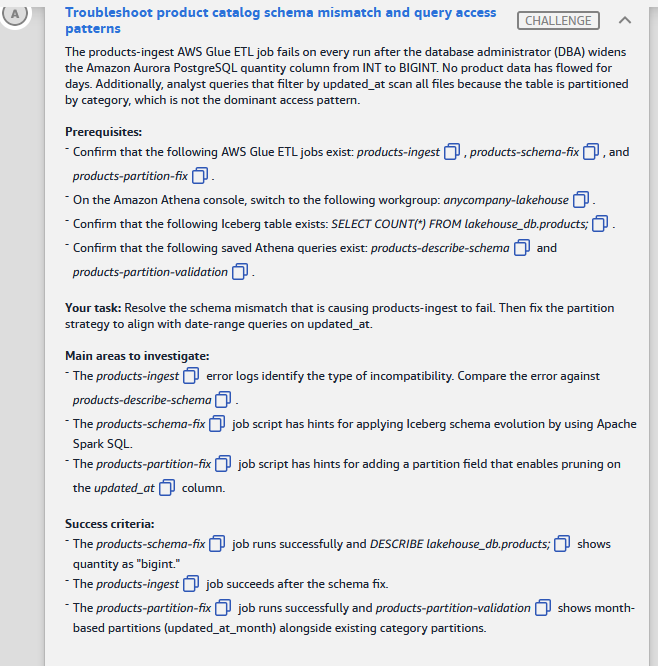
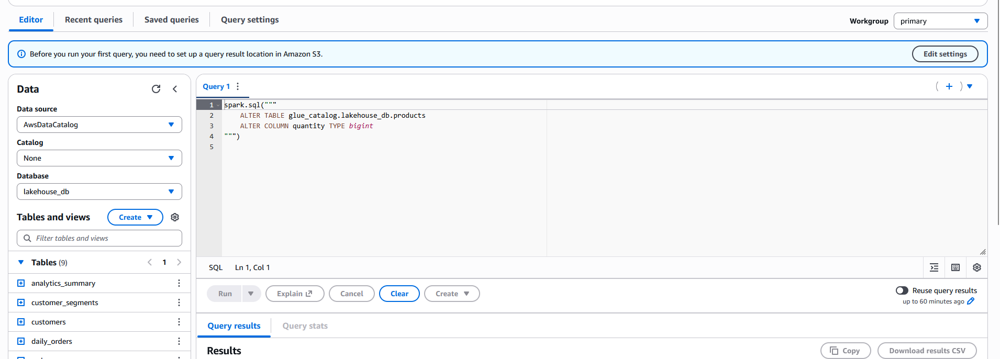

# 🅰️ Challenge A: Troubleshoot product catalog schema mismatch and query access patterns

> **Status:** ✅ Passed, *Meets Requirements* (exam lab, 11 Nov 2026) · **Diagram label:** A (ETL job *ingest products*)
> **Services:** AWS Glue (Spark ETL), Apache Iceberg, Amazon Athena, AWS Lake Formation, Aurora PostgreSQL (JDBC source)
> **Lab:** [AWS Data Lakehouse Demonstrated](README.md) · **Vault:** [index](../README.md)

---

## ✅ Status checklist (success criteria)

- [x] `products-schema-fix` job runs successfully **and** `DESCRIBE lakehouse_db.products;` shows `quantity` as **`bigint`**
- [x] `products-ingest` job succeeds after the schema fix
- [x] `products-partition-fix` job runs successfully **and** the `products-partition-validation` query shows month-based partitions (**`updated_at_month`**) alongside the existing **`category`** partitions

---

## 🖼️ Task card



<details>
<summary>Text copy of the task</summary>

**Scenario:** The `products-ingest` AWS Glue ETL job fails on every run after the database administrator (DBA) widens the Amazon Aurora PostgreSQL `quantity` column from `INT` to `BIGINT`. No product data has flowed for days. Additionally, analyst queries that filter by `updated_at` scan all files because the table is partitioned by `category`, which is not the dominant access pattern.

**Prerequisites**
- Glue ETL jobs exist: `products-ingest`, `products-schema-fix`, `products-partition-fix`
- In the Athena console, switch to workgroup **`anycompany-lakehouse`**
- Iceberg table exists: `SELECT COUNT(*) FROM lakehouse_db.products;`
- Saved Athena queries exist: `products-describe-schema`, `products-partition-validation`

**Your task:** Resolve the schema mismatch that is causing `products-ingest` to fail. Then fix the partition strategy to align with date-range queries on `updated_at`.

**Main areas to investigate**
- The `products-ingest` error logs identify the type of incompatibility. Compare the error against `products-describe-schema`.
- The `products-schema-fix` job script has hints for applying Iceberg schema evolution by using Apache Spark SQL.
- The `products-partition-fix` job script has hints for adding a partition field that enables pruning on the `updated_at` column.

</details>

---

## 🗺️ Where it sits in the architecture


**Flow A:** Aurora PostgreSQL (*Products*) → **JDBC connection** → Glue ETL job *ingest products* → **append** → S3 curated bucket (Iceberg table `lakehouse_db.products`), with metadata in the Glue Data Catalog inside the Lake Formation boundary.

A schema change at the source (Aurora) reaches the Iceberg table at the sink through the append. That's where it breaks.

---

## 🔍 Root cause

| Problem | Why it happens |
|---|---|
| **1. Ingest fails on every run** | The DBA widened `quantity` from `INT` to `BIGINT`. Spark now reads it from JDBC as a 64-bit `LongType`. The Iceberg table still declares `quantity int`. Iceberg will not **narrow** `long` → `int` on write (it could lose data), so the append fails. |
| **2. Date-range queries scan every file** | The table is partitioned only by `identity(category)`. A filter like `WHERE updated_at BETWEEN ...` gives the engine no partition values to prune on, so every data file is read. |

**Key insight:** Iceberg allows *widening* `int` → `bigint` as a **metadata-only** change (no data files are rewritten). So the fix is to evolve the table to match the source, not to cast the source down.

---

## 🛠️ Solution

### Step 1: Confirm the diagnosis

1. **Glue → ETL jobs → `products-ingest` → Runs →** latest failed run → **Error message / CloudWatch logs** (`/aws-glue/jobs/error`).
   Expected: something along the lines of *"Cannot write incompatible data… `quantity`: cannot safely cast / promote `bigint`(long) to `int`"*.
2. **Athena (workgroup `anycompany-lakehouse`) → Saved queries → `products-describe-schema` →** Run.
   Expected: `quantity int`. The source sends `bigint` and the table has `int`, which confirms the mismatch.

### Step 2: Evolve the schema in the `products-schema-fix` Glue job

Edit the script (Glue → ETL jobs → `products-schema-fix` → **Script** tab → Edit) at the TODO/hint:

```python
spark.sql("""
    ALTER TABLE glue_catalog.lakehouse_db.products
    ALTER COLUMN quantity TYPE bigint
""")
```

- Use the **catalog name the script configures** (look for `spark.sql.catalog.<name>`). `glue_catalog` is the usual one.
- **Save → Run →** wait for **Succeeded**.
- Verify in Athena: `DESCRIBE lakehouse_db.products;` should show `quantity bigint`.

### Step 3: Re-run `products-ingest`

You don't need to change the code. The table now accepts `bigint`, so the append succeeds.

### Step 4: Add a month partition in the `products-partition-fix` Glue job

```python
spark.sql("""
    ALTER TABLE glue_catalog.lakehouse_db.products
    ADD PARTITION FIELD months(updated_at)
""")
```

- **Keep** the existing `category` partition. The criteria want both.
- Iceberg auto-names this field **`updated_at_month`**, which is what the validation query checks for.
- **Save → Run →** then run the saved query **`products-partition-validation`** in Athena.

### Order of operations

```text
products-schema-fix  →  products-ingest  →  products-partition-fix  →  products-partition-validation
 (int → bigint)          (succeeds now)       (+ months(updated_at))     (category + updated_at_month)
```

---

## ⚠️ Mistakes & lessons

### Mistake 1: Ran PySpark in the Athena editor, in the wrong workgroup



**What I saw:** *"Before you run your first query, you need to set up a query result location in Amazon S3."*

**Two problems in one screenshot:**

1. **Workgroup was `primary`.** The `primary` workgroup has no S3 output location, hence the banner. The lab's workgroup **`anycompany-lakehouse`** already has one, and it's also where the saved queries live. **Fix:** switch the workgroup (top right). Don't edit `primary`'s settings.
2. **`spark.sql("""...""")` is Python, not SQL.** Athena only accepts SQL. The schema change also has to happen **inside the `products-schema-fix` Glue job**, because a success criterion is that *the job runs successfully*.

**Lesson:** Glue = where the changes happen (PySpark/Spark SQL). Athena = where I verify (plain SQL). Check the workgroup before running anything.

---

## 🧯 Troubleshooting table

| Symptom | Cause | Fix |
|---|---|---|
| Athena banner: *set up a query result location* | Wrong workgroup (`primary`) | Switch to `anycompany-lakehouse` |
| Athena syntax error on `spark.sql(` | PySpark pasted into Athena | Put the code in the Glue job script |
| Glue `ParseException` near `ADD PARTITION FIELD` | Iceberg SQL extensions not enabled | Job needs `--datalake-formats iceberg` and `spark.sql.extensions=org.apache.iceberg.spark.extensions.IcebergSparkSessionExtensions` |
| `Table or view not found` / catalog error | Wrong catalog prefix | Use the catalog name from `spark.sql.catalog.<name>` in the script |
| `Insufficient Lake Formation permission(s)… Alter` | Job role lacks LF permission | Lake Formation → Data permissions → Grant **Alter** + **Describe** on `lakehouse_db.products` to the job's IAM role |
| `Cannot add duplicate partition field` on re-run | Field already added by an earlier run | Skip it, or wrap the call in try/except to make it idempotent |
| Validation shows `updated_at_month` but every value is null | Partition evolution only applies to **new** writes | Re-run `products-ingest`, or `CALL glue_catalog.system.rewrite_data_files(table => 'lakehouse_db.products')` |
| `months` transform rejected | `updated_at` isn't `timestamp`/`date` | Check the type in DESCRIBE output; the transform needs a date/timestamp column |

---

## 📚 Study notes (go deeper later)

### 1. Iceberg schema evolution

- Iceberg tracks columns by **field ID**, not by name or position. That's why renames, reorders, adds and drops are safe and don't rewrite data.
- **Allowed type promotions** (Iceberg spec v2): `int → long`, `float → double`, `decimal(P,S) → decimal(P',S)` where `P' > P`. Anything else (e.g. `long → int`, `string → int`) isn't allowed and needs a new column plus a backfill.
- The change is **metadata-only**: a new `metadata.json` is written with the new schema, and old data files are read with the old type and widened on read.
- Spark SQL forms:
  ```sql
  ALTER TABLE cat.db.t ALTER COLUMN c TYPE bigint;
  ALTER TABLE cat.db.t ADD COLUMNS (new_col string);
  ALTER TABLE cat.db.t RENAME COLUMN a TO b;
  ALTER TABLE cat.db.t DROP COLUMN c;
  ```
- Athena DDL also supports Iceberg column changes (e.g. `ALTER TABLE t CHANGE COLUMN quantity quantity bigint`), but this challenge grades the Glue job.

### 2. Iceberg hidden partitioning & partition evolution

- **Hidden partitioning:** you partition by a *transform* of a column (`months(updated_at)`), and queries filter on the raw column (`WHERE updated_at >= ...`). Iceberg derives the partition values and prunes automatically, so you don't need an extra `month` column and analysts don't have to know the layout.
- **Transforms:** `identity`, `bucket(N, col)`, `truncate(W, col)`, `years`, `months`, `days`, `hours`.
- **Default field names:** `months(updated_at)` becomes `updated_at_month`, `days(ts)` becomes `ts_day`, and `bucket(16, id)` becomes `id_bucket`. You can rename with `... AS my_name`.
- **Partition evolution is metadata-only.** Old files keep the old spec, and new writes use the new spec. Queries plan across both specs. To move old data onto the new layout, run `rewrite_data_files`.
- Spark SQL forms (these need the Iceberg SQL extensions):
  ```sql
  ALTER TABLE cat.db.t ADD PARTITION FIELD months(updated_at);
  ALTER TABLE cat.db.t DROP PARTITION FIELD category;
  ALTER TABLE cat.db.t REPLACE PARTITION FIELD days(ts) WITH hours(ts);
  ```
- ⚠️ *To verify:* whether Athena DDL supports `ADD PARTITION FIELD`. My understanding is that partition evolution has to be done from Spark, not Athena.

### 3. Why `months()` and not `days()`?

- Pick a granularity to match the **query pattern and data volume**. Product catalog updates are low-volume, so daily partitions would create many tiny files (the small-file problem). Monthly partitions still prune well for date-range queries.
- Keeping `category` as well gives two-level pruning: queries on category, on date, or on both all benefit.

### 4. Glue + Iceberg configuration checklist

- Job parameter `--datalake-formats` = `iceberg`
- Spark conf (often set in the script or as a `--conf` job parameter):
  ```text
  spark.sql.extensions=org.apache.iceberg.spark.extensions.IcebergSparkSessionExtensions
  spark.sql.catalog.glue_catalog=org.apache.iceberg.spark.SparkCatalog
  spark.sql.catalog.glue_catalog.catalog-impl=org.apache.iceberg.aws.glue.GlueCatalog
  spark.sql.catalog.glue_catalog.warehouse=s3://<bucket>/<prefix>/
  spark.sql.catalog.glue_catalog.io-impl=org.apache.iceberg.aws.s3.S3FileIO
  ```

### 5. Lake Formation permissions

- With Lake Formation governing the catalog, IAM permissions alone aren't enough. The principal also needs **LF grants** on the database/table.
- DDL changes need **Alter**. Reads need **Select** and **Describe**. Writes need **Insert**.

### 6. Athena workgroups

- A workgroup sets the **query result location**, engine version, encryption, data-scan limits and cost controls, and holds saved queries.
- Labs usually preconfigure a dedicated workgroup. Always switch to it before running anything.

### 7. Useful Athena metadata queries for Iceberg

```sql
DESCRIBE lakehouse_db.products;                       -- columns + partition transforms
SHOW CREATE TABLE lakehouse_db.products;              -- full DDL incl. partitioning
SELECT * FROM "lakehouse_db"."products$partitions";   -- partition values & file counts
SELECT * FROM "lakehouse_db"."products$snapshots";    -- commit history
SELECT * FROM "lakehouse_db"."products$files";        -- data files and their partition
SELECT * FROM "lakehouse_db"."products$history";      -- snapshot lineage
```

### 🧪 Self-test questions

1. Why does Iceberg allow `int → bigint` but not `bigint → int`?
2. After `ADD PARTITION FIELD months(updated_at)`, what happens to files written before the change?
3. An analyst filters `WHERE updated_at >= DATE '2026-10-01'`. Do they need to reference `updated_at_month`? Why or why not?
4. Name two alternatives to evolving the table schema and explain why they're worse here.
5. Which Lake Formation permission does a Glue job need to run `ALTER TABLE`?
6. When would you choose `days()` over `months()`, or `bucket()` over `identity()`?

<details>
<summary>Answers</summary>

1. Widening can't lose information, and old 32-bit values can be read as 64-bit. Narrowing could overflow and lose data, so the spec forbids it.
2. They keep the old spec (category only). Only new writes use `category + updated_at_month`. Queries still work across both. Run `rewrite_data_files` to rewrite old files under the new spec.
3. No. With hidden partitioning, Iceberg maps the `updated_at` predicate to the `months` transform and prunes automatically.
4. (a) Cast `quantity` down to `int` in the ingest job: values above 2³¹−1 would overflow or be silently corrupted. (b) Drop and recreate the table: you lose snapshot history and need a full reload. Both are worse than a metadata-only promotion.
5. **Alter** on the table (plus Describe).
6. `days()` when data volume is high and queries target narrow windows. `bucket()` for high-cardinality keys (e.g. `product_id`) where `identity()` would create too many partitions.

</details>

---

## 📝 Run log (fill in as I go)

| Step | What I ran | Result / output |
|---|---|---|
| 1 | Checked `products-ingest` error | _paste the exact error text here_ |
| 1 | `products-describe-schema` | _paste the output (quantity type)_ |
| 2 | `products-schema-fix` with `ALTER COLUMN quantity TYPE bigint` | _status / error_ |
| 2 | `DESCRIBE lakehouse_db.products;` | _quantity = ?_ |
| 3 | Re-ran `products-ingest` | _status_ |
| 4 | `products-partition-fix` with `ADD PARTITION FIELD months(updated_at)` | _status / error_ |
| 4 | `products-partition-validation` | _paste the output_ |
| — | Attempt 1: pasted PySpark into Athena in workgroup `primary` | Banner: *set up a query result location*. Wrong workgroup, and the code belongs in the Glue job. See Mistake 1 |
