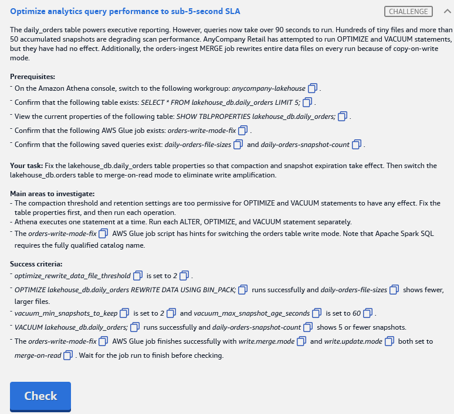

# 🅱️ Challenge B: Optimize analytics query performance to sub-5-second SLA

> **Status:** ✅ Passed, *Meets Requirements* (exam lab, 11 Nov 2026) · **Diagram label:** B (Amazon Athena, users run SQL)
> **Services:** Amazon Athena (Iceberg DDL: OPTIMIZE / VACUUM / table properties), AWS Glue (Spark SQL), Apache Iceberg
> **Lab:** [AWS Data Lakehouse Demonstrated](README.md) · **Vault:** [index](../README.md)

---

## ✅ Status checklist (success criteria)

- [x] `optimize_rewrite_data_file_threshold` is set to **2** on `lakehouse_db.daily_orders`
- [x] `OPTIMIZE lakehouse_db.daily_orders REWRITE DATA USING BIN_PACK;` runs successfully **and** `daily-orders-file-sizes` shows **fewer, larger files**
- [x] `vacuum_min_snapshots_to_keep` is set to **2** **and** `vacuum_max_snapshot_age_seconds` is set to **60**
- [x] `VACUUM lakehouse_db.daily_orders;` runs successfully **and** `daily-orders-snapshot-count` shows **≤ 5 snapshots**
- [x] `orders-write-mode-fix` Glue job finishes successfully with `write.merge.mode` **and** `write.update.mode` both set to **`merge-on-read`** on `lakehouse_db.orders`

---

## 🖼️ Task card



<details>
<summary>Text copy of the task</summary>

**Scenario:** The `daily_orders` table powers executive reporting. However, queries now take over 90 seconds to run. Hundreds of tiny files and more than 50 accumulated snapshots are degrading scan performance. AnyCompany Retail has attempted to run OPTIMIZE and VACUUM statements, but they have had no effect. Additionally, the `orders-ingest` MERGE job rewrites entire data files on every run because of copy-on-write mode.

**Prerequisites**
- In the Athena console, switch to workgroup **`anycompany-lakehouse`**
- Table exists: `SELECT * FROM lakehouse_db.daily_orders LIMIT 5;`
- View current properties: `SHOW TBLPROPERTIES lakehouse_db.daily_orders;`
- Glue job exists: `orders-write-mode-fix`
- Saved queries exist: `daily-orders-file-sizes`, `daily-orders-snapshot-count`

**Your task:** Fix the `lakehouse_db.daily_orders` table properties so that compaction and snapshot expiration take effect. Then switch the `lakehouse_db.orders` table to merge-on-read mode to eliminate write amplification.

**Main areas to investigate**
- The compaction threshold and retention settings are too permissive for OPTIMIZE and VACUUM statements to have any effect. Fix the table properties first, and then run each operation.
- Athena executes one statement at a time. Run each ALTER, OPTIMIZE, and VACUUM statement separately.
- The `orders-write-mode-fix` AWS Glue job script has hints for switching the orders table write mode. Note that Apache Spark SQL requires the fully qualified catalog name.

</details>

---

## 🗺️ Where it sits in the architecture


- **B, the query path:** users → Athena → scans Iceberg data files. Slow queries come from the **physical layout** of `daily_orders`: hundreds of tiny files and 50+ snapshots.
- **The write path for `orders`:** the *ingest orders* job (label **G**) **merges** DynamoDB exports into the curated `orders` table. Under copy-on-write, every MERGE rewrites whole data files.

> ⚠️ Two different tables: the **table-property / OPTIMIZE / VACUUM** work is on **`daily_orders`**, and the **write-mode** change is on **`orders`**.

---

## 🔍 Root cause

| Problem | Why it happens |
|---|---|
| **1. OPTIMIZE "has no effect"** | Athena's `OPTIMIZE ... BIN_PACK` only rewrites a partition's files when the number of files needing compaction is at least `optimize_rewrite_data_file_threshold` (default 5). The lab set it too high, so no partition qualifies and nothing is rewritten. |
| **2. VACUUM "has no effect"** | VACUUM only expires snapshots **older than** `vacuum_max_snapshot_age_seconds` (default 432000 = 5 days) and always keeps at least `vacuum_min_snapshots_to_keep`. With high values, no snapshot is eligible, so all 50+ stay. |
| **3. 90-second queries** | Hundreds of tiny files mean hundreds of S3 GETs and a lot of per-file planning and open overhead, so the query is dominated by I/O latency, not data volume. 50+ snapshots also bloat the metadata and keep old files alive. |
| **4. Write amplification on `orders`** | **Copy-on-write (COW)**: a MERGE that changes one row rewrites the **whole data file** containing it. **Merge-on-read (MOR)** writes small **delete files** plus new rows instead, and readers merge them at query time. |

---

## 🛠️ Solution

> Run everything below in **Athena, workgroup `anycompany-lakehouse`**, **one statement per run**, except step 6, which goes in the Glue job.

### Step 0: Baseline

```sql
SHOW TBLPROPERTIES lakehouse_db.daily_orders;
```
Note the current `optimize_*` and `vacuum_*` values. Then run the saved queries **`daily-orders-file-sizes`** and **`daily-orders-snapshot-count`** and record the "before" numbers in the run log.

**How to run a saved query:** Athena → **Saved queries** tab (top bar, next to *Recent queries*) → search for the name → click the **name link** (it opens in a new editor tab) → **Run** → read the **Results** panel.

**If the saved queries aren't there**, these do the same job using Iceberg metadata tables:

```sql
-- file count and sizes
SELECT COUNT(*)                                       AS file_count,
       ROUND(AVG(file_size_in_bytes) / 1024.0, 1)     AS avg_file_kb,
       ROUND(SUM(file_size_in_bytes) / 1048576.0, 2)  AS total_mb
FROM "lakehouse_db"."daily_orders$files";

-- snapshot count
SELECT COUNT(*) AS snapshot_count FROM "lakehouse_db"."daily_orders$snapshots";
```

**Why take a baseline:** it isn't graded, but it proves the change worked. After OPTIMIZE, the file count should drop and the average size should grow. After VACUUM, the snapshot count should go from 50+ to ≤ 5.

### Step 1: Lower the compaction threshold

```sql
ALTER TABLE lakehouse_db.daily_orders SET TBLPROPERTIES (
  'optimize_rewrite_data_file_threshold' = '2'
);
```

### Step 2: Compact

```sql
OPTIMIZE lakehouse_db.daily_orders REWRITE DATA USING BIN_PACK;
```
Then run **`daily-orders-file-sizes`**. You should see fewer, larger files.

### Step 3: Tighten snapshot retention

```sql
ALTER TABLE lakehouse_db.daily_orders SET TBLPROPERTIES (
  'vacuum_min_snapshots_to_keep'    = '2',
  'vacuum_max_snapshot_age_seconds' = '60'
);
```

### Step 4: Expire snapshots

Wait **at least 60 seconds after OPTIMIZE** finishes, then run:

```sql
VACUUM lakehouse_db.daily_orders;
```
Then run **`daily-orders-snapshot-count`**. It should show ≤ 5.

### Step 5: Why this order (OPTIMIZE → VACUUM)

OPTIMIZE writes a **new snapshot** that points at the compacted files. The old tiny files stay referenced by the **older** snapshots. VACUUM then expires those older snapshots and deletes the files nobody references any more, which also reclaims the storage.

### Step 6: Switch `orders` to merge-on-read (Glue job `orders-write-mode-fix`)

In Glue → ETL jobs → `orders-write-mode-fix` → **Script** tab, at the TODO/hint:

```python
spark.sql("""
    ALTER TABLE glue_catalog.lakehouse_db.orders SET TBLPROPERTIES (
        'write.merge.mode'  = 'merge-on-read',
        'write.update.mode' = 'merge-on-read'
    )
""")

# Optional: prints the properties to the job's CloudWatch log so you can verify
spark.sql("SHOW TBLPROPERTIES glue_catalog.lakehouse_db.orders").show(truncate=False)
```

- **Fully qualified name** is required in Spark: `<catalog>.<database>.<table>`. Use the catalog name configured in the script (`spark.sql.catalog.<name>`).
- `write.delete.mode` can also be set to `merge-on-read`. The criteria don't ask for it.
- **Save → Run → wait for Succeeded**, then press **Check**.

**Why a Glue job and not Athena?** Athena's `SET TBLPROPERTIES` accepts only a fixed list of Athena-managed properties (`optimize_rewrite_*_threshold`, `vacuum_*`, `write_compression`, …; the full list is in [04_Amazon_Athena.md](../00_AWS_Data_Services_Study_Guide/04_Amazon_Athena.md)). Iceberg's native `write.*.mode` properties have to be set from an Iceberg engine like Spark.

---

## ⚠️ Mistakes & lessons

_None yet. Add screenshots of anything that goes wrong here._

---

## 🧯 Troubleshooting table

| Symptom | Cause | Fix |
|---|---|---|
| Athena: *"Only one sql statement is allowed"* | Several statements in one editor run | Put **one** statement in the editor per run |
| OPTIMIZE succeeds but file count barely changes | Threshold still high, or other `optimize_rewrite_*_size_bytes` properties exclude the files | Re-check `SHOW TBLPROPERTIES`. Confirm the threshold is `2` and look for odd min/max file-size properties |
| OPTIMIZE message saying more runs are needed | Athena caps the work per run | Run OPTIMIZE again until it completes |
| VACUUM succeeds but snapshot count still > 5 | Snapshots are newer than 60 s, or retention wasn't applied | Wait > 60 s after the last write/OPTIMIZE and run VACUUM again; confirm both `vacuum_*` properties |
| Glue: `Table or view not found: lakehouse_db.orders` | Missing catalog prefix | Use `glue_catalog.lakehouse_db.orders` |
| Glue: error that merge-on-read needs format v2 | Table is Iceberg format v1 (row-level deletes need v2) | Add `'format-version'='2'` to the same `SET TBLPROPERTIES` |
| Glue: Lake Formation permission error | Job role lacks **Alter** on `orders` | Grant Alter + Describe to the job role in Lake Formation |
| Athena banner about the query result location | Wrong workgroup | Switch to `anycompany-lakehouse` (see Challenge A) |

---

## 📚 Study notes (go deeper later)

### 1. The small-files problem

- Each file costs an S3 request, a footer read and a split, so 500 × 1 MB files is far slower than 4 × 128 MB files holding the same data.
- Causes: frequent small batch writes (streaming or Firehose, micro-batches), high-cardinality partitioning, and MOR delete files piling up.
- Fix: **compaction**. Athena runs it as `OPTIMIZE ... REWRITE DATA USING BIN_PACK`. Spark calls it `CALL cat.system.rewrite_data_files(...)`.

### 2. Athena Iceberg table properties (maintenance)

| Property | Default | Meaning |
|---|---|---|
| `optimize_rewrite_data_file_threshold` | 5 | Minimum number of data files needing optimization (in a partition) before OPTIMIZE rewrites them (allowed values below 50) |
| `optimize_rewrite_delete_file_threshold` | 2 | Same idea for delete files |
| `vacuum_min_snapshots_to_keep` | 1 | Always keep at least this many recent snapshots |
| `vacuum_max_snapshot_age_seconds` | 432000 (5 d) | Snapshots older than this are expired by VACUUM |
| `vacuum_max_metadata_files_to_keep` | 100 | Old `metadata.json` files retained |

✅ *These five defaults were checked against the Athena docs in Nov 2026 (see [04_Amazon_Athena.md](../00_AWS_Data_Services_Study_Guide/04_Amazon_Athena.md)).*

> **Correction:** an earlier version of this table also listed `optimize_rewrite_min_data_file_size_bytes`, `optimize_rewrite_max_data_file_size_bytes` and `write_target_data_file_size_bytes`. These are **not in Athena's current property allow-list** (Nov 2026 docs). Treat them as older-docs-only and don't rely on them in a lab.
>
> **Also learned:** `OPTIMIZE ... WHERE` accepts **partition columns only**. VACUUM needs `s3:DeleteObject` on the table location. Without it, VACUUM reports success but deletes nothing.

### 3. OPTIMIZE vs VACUUM

| | OPTIMIZE (`BIN_PACK`) | VACUUM |
|---|---|---|
| Does | Rewrites small files into bigger ones; folds MOR delete files into data | Expires old snapshots, deletes unreferenced data/metadata files, removes orphan files |
| Creates a snapshot? | Yes (a `replace` operation) | No |
| Helps | Read performance | Storage cost, metadata size, time-travel window |
| Spark equivalent | `rewrite_data_files` | `expire_snapshots` + `remove_orphan_files` |

**Trade-off:** expiring snapshots removes **time travel** to those points. In production you'd keep days, not 60 seconds. The 60 s here is only for the lab.

### 4. Copy-on-write vs merge-on-read

| | Copy-on-write (COW) | Merge-on-read (MOR) |
|---|---|---|
| UPDATE/MERGE/DELETE | Rewrites every data file that has a touched row | Writes **delete files** (position/equality) plus new data files |
| Write cost | High (write amplification) | Low |
| Read cost | Lowest (no merging) | Higher. Readers apply delete files at query time |
| Best for | Read-heavy, rare updates | Frequent upserts/CDC, streaming merges |
| Needs | Any format version | **Format v2** |
| Maintenance | Less | Regular **compaction** to fold deletes back in |

Properties (Spark): `write.delete.mode`, `write.update.mode`, `write.merge.mode`, each set to `copy-on-write` (default) or `merge-on-read`.

**The full picture for this lab:** MOR makes the `orders` MERGE cheap. The resulting delete files would slow reads over time, which is exactly what the OPTIMIZE/VACUUM maintenance from steps 1–4 cleans up. They work as a pair.

### 5. Athena DDL limits worth remembering

- One statement per run in the console.
- Athena's `SET TBLPROPERTIES` covers Athena-managed properties only. Use Spark for native Iceberg `write.*` properties and for partition evolution (Challenge A).

### 🧪 Self-test questions

1. Why did OPTIMIZE "do nothing" before the threshold change?
2. You set `vacuum_max_snapshot_age_seconds = 60` and run VACUUM immediately after OPTIMIZE. Which snapshots survive?
3. When would you **not** switch a table to merge-on-read?
4. What maintenance job becomes more important after switching to MOR, and why?
5. Why does compaction create a new snapshot, and why does that matter for VACUUM ordering?
6. Name the Spark procedures equivalent to Athena OPTIMIZE and VACUUM.

<details>
<summary>Answers</summary>

1. No partition had at least *threshold* candidate files, so BIN_PACK skipped every partition.
2. Every snapshot younger than 60 s, plus the most recent 2 (min-to-keep), whichever set is larger. The OPTIMIZE snapshot is current, so it's always kept.
3. When the table is read-heavy with rare updates and query latency matters most (e.g. an executive dashboard table like `daily_orders`). COW gives the fastest reads.
4. Compaction (OPTIMIZE / `rewrite_data_files`, plus `rewrite_position_delete_files`). Delete files pile up and every read has to apply them, so you need to fold them back into data files.
5. Compaction is a commit like any other: it atomically swaps old files for new ones in a new snapshot. The old files stay referenced by older snapshots until VACUUM expires them, so run VACUUM after OPTIMIZE to reclaim storage.
6. `CALL cat.system.rewrite_data_files(...)`, and `CALL cat.system.expire_snapshots(...)` + `CALL cat.system.remove_orphan_files(...)`.

</details>

---

## 📝 Run log (fill in as I go)

| Step | What I ran | Result / output |
|---|---|---|
| 0 | `SHOW TBLPROPERTIES lakehouse_db.daily_orders;` | _paste the original optimize/vacuum values_ |
| 0 | `daily-orders-file-sizes` (before) | _file count / sizes_ |
| 0 | `daily-orders-snapshot-count` (before) | _count (task says > 50)_ |
| 1 | ALTER threshold = 2 | _status_ |
| 2 | OPTIMIZE ... BIN_PACK | _status_ |
| 2 | `daily-orders-file-sizes` (after) | _file count / sizes_ |
| 3 | ALTER vacuum_min = 2, max_age = 60 | _status_ |
| 4 | VACUUM | _status_ |
| 4 | `daily-orders-snapshot-count` (after) | _count (≤ 5?)_ |
| 6 | `orders-write-mode-fix` Glue job | _status / error_ |
| — | Check button | _result_ |
