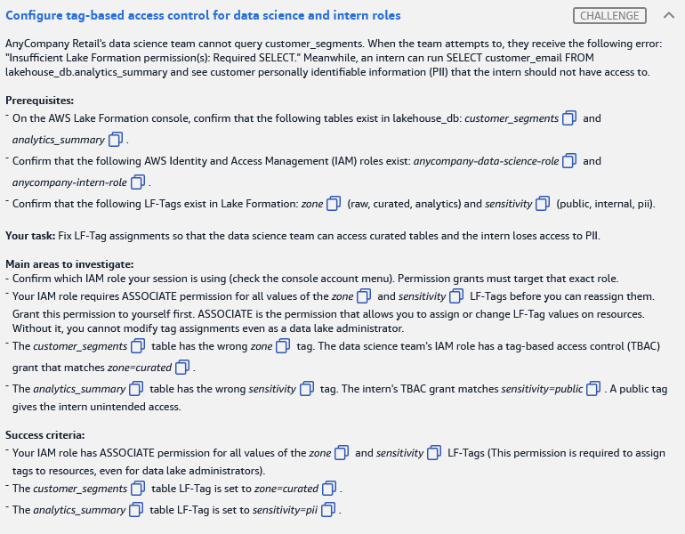
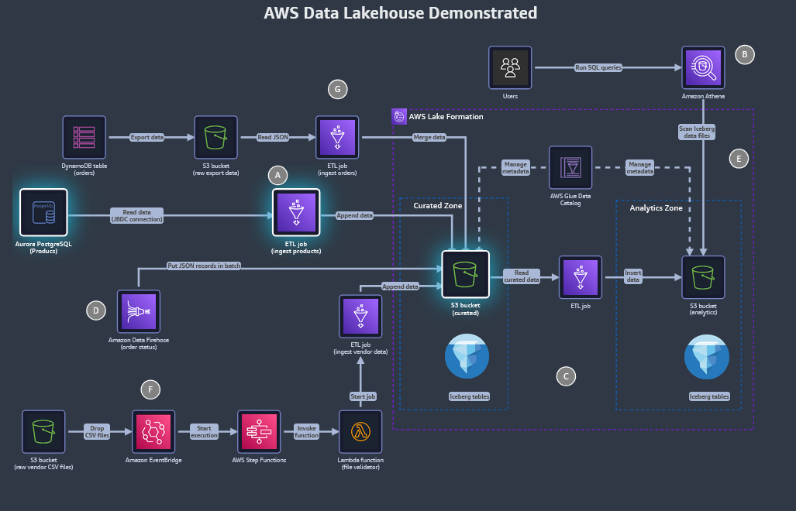

# 🅲 Challenge C: Configure tag-based access control for data science and intern roles

> **Status:** ✅ Lab passed (11 Nov 2026). This task's row was cut off in the report screenshot; fill in its result · **Diagram label:** C (inside the AWS Lake Formation boundary: governance of curated and analytics Iceberg tables)
> **Services:** AWS Lake Formation (LF-Tags, LF-TBAC, LF-Tag permissions), IAM, Glue Data Catalog, Athena
> **Lab:** [AWS Data Lakehouse Demonstrated](README.md) · **Vault:** [index](../README.md)

---

## ✅ Status checklist (success criteria)

- [ ] **Your own IAM role** has **ASSOCIATE** on **all values** of the `zone` and `sensitivity` LF-Tags
- [ ] `lakehouse_db.customer_segments` table LF-Tag is set to **`zone=curated`**
- [ ] `lakehouse_db.analytics_summary` table LF-Tag is set to **`sensitivity=pii`**

---

## 🖼️ Task card



<details>
<summary>Text copy of the task</summary>

**Scenario:** AnyCompany Retail's data science team cannot query `customer_segments`. When the team attempts to, they receive the following error: *"Insufficient Lake Formation permission(s): Required SELECT."* Meanwhile, an intern can run `SELECT customer_email FROM lakehouse_db.analytics_summary` and see customer personally identifiable information (PII) that the intern should not have access to.

**Prerequisites**
- In the AWS Lake Formation console, confirm these tables exist in `lakehouse_db`: `customer_segments` and `analytics_summary`
- Confirm these IAM roles exist: `anycompany-data-science-role` and `anycompany-intern-role`
- Confirm these LF-Tags exist: `zone` (raw, curated, analytics) and `sensitivity` (public, internal, pii)

**Your task:** Fix LF-Tag assignments so that the data science team can access curated tables and the intern loses access to PII.

**Main areas to investigate**
- Confirm which IAM role your session is using (check the console account menu). Permission grants must target that exact role.
- Your IAM role requires ASSOCIATE permission for all values of the `zone` and `sensitivity` LF-Tags before you can reassign them. Grant this permission to yourself first. ASSOCIATE is the permission that allows you to assign or change LF-Tag values on resources. Without it, you cannot modify tag assignments even as a data lake administrator.
- The `customer_segments` table has the wrong `zone` tag. The data science team's IAM role has a tag-based access control (TBAC) grant that matches `zone=curated`.
- The `analytics_summary` table has the wrong `sensitivity` tag. The intern's TBAC grant matches `sensitivity=public`. A public tag gives the intern unintended access.

</details>

---

## 🗺️ Where it sits in the architecture



- **C** sits inside the **AWS Lake Formation** boundary, which governs every table in the curated and analytics zones.
- Athena (**B**) checks Lake Formation permissions on every query. With TBAC, those permissions come from **tags on the table** matched against **tag expressions in the grants**.
- Nothing is wrong with the grants. **The tags on the tables are wrong**, so the grants match the wrong tables.

---

## 🔍 Root cause

| Who | Their TBAC grant | Table's tag (wrong) | Effect | Fix |
|---|---|---|---|---|
| `anycompany-data-science-role` | SELECT where **`zone=curated`** | `customer_segments` has `zone=` *something else* (raw/analytics) | The grant doesn't match, so access is denied: *"Required SELECT"* | Re-tag `customer_segments` → **`zone=curated`** |
| `anycompany-intern-role` | SELECT where **`sensitivity=public`** | `analytics_summary` has **`sensitivity=public`** | The grant matches, so the intern sees `customer_email` (PII) | Re-tag `analytics_summary` → **`sensitivity=pii`** |
| **You** (console session role) | No **ASSOCIATE** on the LF-Tags | — | You can't change tag values on tables, even as a data lake admin | Grant yourself **ASSOCIATE** (+ DESCRIBE) on all values of both tags |

**Key insight:** with TBAC, **access = grant expression ∩ resource tags**. Fix the tags and the permissions follow automatically. No new grants are needed for the data scientist or the intern.

---

## 🛠️ Solution

### Step 1: Find your exact IAM role

Click the **account menu** in the console (top right). It shows something like `Federated user: <RoleName>/<session>` or `Assumed role: <RoleName>`. The **role name is the part before the `/`**. Write it down, because that is the principal you grant to.

### Step 2: Grant yourself ASSOCIATE on both LF-Tags

Lake Formation console → **Permissions → LF-Tags and permissions** → **LF-Tag permissions** tab → **Grant permissions**

| Field | Value |
|---|---|
| Permission type | **LF-Tag key-value pair permissions** |
| Principals | **IAM users and roles** → *your role from Step 1* |
| LF-Tag key 1 | `zone` → values **raw, curated, analytics** (all three) |
| LF-Tag key 2 (*Add LF-Tag key-value pair*) | `sensitivity` → values **public, internal, pii** (all three) |
| Permissions | ✅ **Associate** (✅ **Describe** is included/needed too) |

Click **Grant**. Console labels can differ slightly between versions. The thing to look for is **Associate on the tag keys/values**, which is different from Data permissions on tables.

### Step 3: Re-tag `customer_segments` → `zone=curated`

Lake Formation → **Data Catalog → Tables** → select **`customer_segments`** (database `lakehouse_db`) → **Actions → Edit LF-Tags**
- Change the **`zone`** value to **`curated`** → **Save**.

### Step 4: Re-tag `analytics_summary` → `sensitivity=pii`

**Tables** → select **`analytics_summary`** → **Actions → Edit LF-Tags**
- Change the **`sensitivity`** value from `public` to **`pii`** → **Save**.

### Step 5: Verify

- Open each table and check its **LF-Tags** section: `customer_segments` should show `zone: curated` and `analytics_summary` should show `sensitivity: pii`.
- Also look at the table's **Schema → column LF-Tags**. If a column such as `customer_email` has its **own override** of `sensitivity=public`, the table-level change won't apply to that column. Remove the override or set it to `pii`.
- Press **Check**.

---

## ⚠️ Mistakes & lessons

_None yet. Add screenshots of anything that goes wrong here._

---

## 🧯 Troubleshooting table

| Symptom | Cause | Fix |
|---|---|---|
| *"You don't have permission to associate…"* / Save fails on Edit LF-Tags | ASSOCIATE granted to the wrong principal, or not granted for that value | Re-check the role name in the account menu and grant to **that exact role**, all values of both keys |
| Your role isn't listed in the Principals dropdown | It's a federated/assumed role | Type or paste the role name or ARN; choose **IAM users and roles**, not SAML/IAM Identity Center |
| ASSOCIATE grant fails | Your role isn't a data lake admin or tag creator | Lake Formation → **Administrative roles and tasks** → confirm your role is a **Data lake administrator** |
| Check fails on "all values" | Granted on some values only | Edit the grant to include **raw, curated, analytics** and **public, internal, pii** |
| Table tag changed but intern still sees `customer_email` | Column-level override of `sensitivity=public` | Edit column LF-Tags on the schema; remove the override |
| Data scientist still denied after re-tag | Database-level or column-level tags conflict, or IAM policy lacks `lakeformation:GetDataAccess` | Inspect inherited tags; confirm the role's IAM policy (both IAM **and** LF must allow) |

---

## 📚 Study notes (go deeper later)

### 1. Lake Formation permission model

- Access needs **both**: IAM allows the API call (e.g. `athena:*`, `glue:GetTable`, `lakeformation:GetDataAccess`) **and** Lake Formation grants the data permission (SELECT, DESCRIBE, …).
- *"Insufficient Lake Formation permission(s): Required SELECT"* means IAM was fine but **LF denied the request**.
- Two ways to grant data permissions:
  - **Named-resource grants:** "role X gets SELECT on table Y." Simple, but doesn't scale to hundreds of tables.
  - **LF-TBAC (tag-based):** "role X gets SELECT on any table whose tags match `zone=curated`." New tables are covered automatically once they're tagged.

### 2. LF-Tags

- An LF-Tag is a **key + allowed values** (e.g. `zone ∈ {raw, curated, analytics}`), created by a data lake admin or someone with *Create LF-Tag*.
- Assigned to **databases, tables or columns**. **Inheritance:** database → table → column. A lower level **overrides** a value for the same key.
- One resource holds **one value per key**.

### 3. TBAC grant expressions

- An expression is a set of key = value(s) conditions.
  - **AND across keys:** `zone=curated AND sensitivity=public`
  - **OR within a key:** `zone ∈ {curated, analytics}`
- Grant permissions: on **tables** (SELECT, INSERT, DELETE, DESCRIBE, ALTER, DROP) and on **databases** (CREATE_TABLE, ALTER, DROP, DESCRIBE).

### 4. LF-Tag permissions (permissions *on the tag itself*)

| Permission | Allows |
|---|---|
| **DESCRIBE** | See the tag and its values |
| **ASSOCIATE** | **Assign** the tag/values to resources (and grant TBAC on them) |
| **ALTER** | Add or remove allowed values on the tag |
| **DROP** | Delete the tag |

Data lake admins **don't automatically get ASSOCIATE** on tags they didn't create. They have to grant it to themselves. ⚠️ *Confirm the exact implicit-permission rules for admins and tag creators in the Lake Formation docs.*

### 5. Better PII design (beyond the lab)

- Tagging the **whole table** `sensitivity=pii` cuts the intern off from **every** column, including harmless ones.
- A finer approach: keep the table `sensitivity=public` and tag only the PII **columns** (`customer_email`, phone, address) as `sensitivity=pii`. The intern then sees non-PII columns, and `SELECT customer_email` is denied.
- Other options: **data cell filters** (row/column filters) and **named-resource column grants** that exclude columns.

### 6. CLI equivalents (for reference)

```bash
# Grant yourself ASSOCIATE + DESCRIBE on all values of a tag
aws lakeformation grant-permissions \
  --principal DataLakePrincipalIdentifier=arn:aws:iam::<acct>:role/<YourRole> \
  --resource '{"LFTag":{"TagKey":"zone","TagValues":["raw","curated","analytics"]}}' \
  --permissions ASSOCIATE DESCRIBE

# Set a table's tag value (replaces the existing value for that key)
aws lakeformation add-lf-tags-to-resource \
  --resource '{"Table":{"DatabaseName":"lakehouse_db","Name":"customer_segments"}}' \
  --lf-tags TagKey=zone,TagValues=curated

# Inspect a table's tags (including column-level)
aws lakeformation get-resource-lf-tags \
  --resource '{"Table":{"DatabaseName":"lakehouse_db","Name":"analytics_summary"}}' \
  --show-assigned-lf-tags
```

### 🧪 Self-test questions

1. The data scientist gets *"Required SELECT"*. Why is the fix a tag change and not a new grant?
2. What's the difference between the **ASSOCIATE** LF-Tag permission and the **SELECT** data permission?
3. A table is tagged `sensitivity=pii` but its `customer_email` column is tagged `sensitivity=public`. Can the intern read `customer_email`?
4. Why does TBAC scale better than named-resource grants?
5. How would you let the intern query `analytics_summary` while still hiding `customer_email`?

<details>
<summary>Answers</summary>

1. The data scientist's grant (`zone=curated`) is already correct. The table just didn't carry the matching tag. Fixing the tag makes the existing grant apply, and every future curated table is covered too.
2. ASSOCIATE is a permission **on the tag**: it lets you attach that tag/value to resources. SELECT is a permission **on data**: it lets you read rows. Admins change tags with ASSOCIATE, and users query with SELECT.
3. Yes. A column-level tag overrides the inherited table value, so that column matches the intern's `sensitivity=public` grant.
4. Grants are written once against tag expressions, and new tables are covered as soon as they're tagged. Named grants have to be maintained per table and per principal.
5. Column-level LF-Tags (table `public`, PII columns `pii`), a data cell filter that excludes the column, or a named column-level grant without that column.

</details>

---

## 📝 Run log (fill in as I go)

| Step | What I did | Result / output |
|---|---|---|
| 1 | Checked account menu for my role | _role name_ |
| 2 | Granted ASSOCIATE + DESCRIBE on `zone` (all) and `sensitivity` (all) | _status_ |
| 3 | `customer_segments`: zone _old_ → curated | _old value / status_ |
| 4 | `analytics_summary`: sensitivity public → pii | _status_ |
| 5 | Checked column-level overrides | _any found?_ |
| — | Check button | _result_ |
