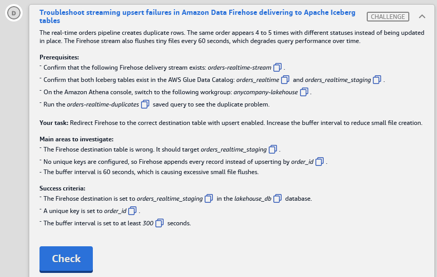

# 🅳 Challenge D: Troubleshoot streaming upsert failures in Amazon Data Firehose delivering to Apache Iceberg tables

> **Status:** ✅ Lab passed (11 Nov 2026). This task's row was cut off in the report screenshot; fill in its result · **Diagram label:** D (Amazon Data Firehose, order status → *Put JSON records in batch* → curated zone)
> **Services:** Amazon Data Firehose (Apache Iceberg Tables destination), Glue Data Catalog, Apache Iceberg, Athena
> **Lab:** [AWS Data Lakehouse Demonstrated](README.md) · **Vault:** [index](../README.md)

---

## ✅ Status checklist (success criteria)

- [ ] Firehose destination is set to **`orders_realtime_staging`** in the **`lakehouse_db`** database
- [ ] A unique key is set to **`order_id`**
- [ ] The buffer interval is set to **≥ 300 seconds**

---

## 🖼️ Task card



<details>
<summary>Text copy of the task</summary>

**Scenario:** The real-time orders pipeline creates duplicate rows. The same order appears 4 to 5 times with different statuses instead of being updated in place. The Firehose stream also flushes tiny files every 60 seconds, which degrades query performance over time.

**Prerequisites**
- Confirm the Firehose delivery stream exists: `orders-realtime-stream`
- Confirm both Iceberg tables exist in the AWS Glue Data Catalog: `orders_realtime` and `orders_realtime_staging`
- In the Athena console, switch to workgroup **`anycompany-lakehouse`**
- Run the `orders-realtime-duplicates` saved query to see the duplicate problem

**Your task:** Redirect Firehose to the correct destination table with upsert enabled. Increase the buffer interval to reduce small file creation.

**Main areas to investigate**
- The Firehose destination table is wrong. It should target `orders_realtime_staging`.
- No unique keys are configured, so Firehose appends every record instead of upserting by `order_id`.
- The buffer interval is 60 seconds, which is causing excessive small file flushes.

</details>

---

## 🗺️ Where it sits in the architecture


**Flow D:** order-status events → **Amazon Data Firehose** (`orders-realtime-stream`) → *Put JSON records in batch* → Iceberg table in the **curated** zone (Glue Data Catalog, inside Lake Formation).

Each order has several status events (placed → paid → shipped → delivered…). Without a key, Firehose **inserts** a new row for every event, so one order becomes 4–5 rows.

---

## 🔍 Root cause

| Problem | Why it happens | Fix |
|---|---|---|
| **1. Wrong table** | The stream writes to `orders_realtime` instead of the lab's intended upsert target `orders_realtime_staging` | Change the destination table to `orders_realtime_staging` (db `lakehouse_db`) |
| **2. Duplicates instead of updates** | No **unique key**, so Firehose can only **append**. It has no way to know which existing row an event replaces | Set unique key **`order_id`**. Firehose then deletes the old row with the same `order_id` and inserts the new one (an upsert) |
| **3. Tiny files** | Buffer interval **60 s**, so a new file is written every minute (per table/partition) | Raise the interval to **≥ 300 s** (max 900 s). Fewer, larger files |

---

## 🛠️ Solution

### Step 0: See the problem

Athena (workgroup **`anycompany-lakehouse`**) → **Saved queries** → **`orders-realtime-duplicates`** → Run. You'll see the same `order_id` repeated with different statuses. Record the count in the run log.

### Step 1: Open the stream's destination settings

**Amazon Data Firehose** console → **Firehose streams** → **`orders-realtime-stream`** → **Configuration** tab → **Destination settings** → **Edit**.

### Step 2: Point at the right table and add the unique key

Change **every place** the old table name appears:

- **Unique key configuration / destination table configuration.** Set database **`lakehouse_db`**, table **`orders_realtime_staging`**, unique keys **`order_id`**. If the console shows a JSON editor, it looks like this:
  ```json
  [
    {
      "DestinationDatabaseName": "lakehouse_db",
      "DestinationTableName": "orders_realtime_staging",
      "UniqueKeys": ["order_id"]
    }
  ]
  ```
- **Inline parsing for routing information** (only if it's enabled): the **table expression** is probably a literal like `"orders_realtime"`. Change it to `"orders_realtime_staging"`. Leave the database expression as `"lakehouse_db"`.

### Step 3: Raise the buffer interval

In the same edit page, under **Buffer hints**, set **Buffer interval** to **300** seconds. The criteria say "at least 300", so anything from 300 to 900 passes. Leave the buffer size alone unless the lab hints otherwise.

### Step 4: Save and wait

Click **Save changes**. The stream status goes **Updating → Active**, which takes a minute or two. Wait for **Active**, check that the Configuration tab shows the new values, then press **Check**.

---

## ⚠️ Mistakes & lessons

_None yet. Add screenshots of anything that goes wrong here._

---

## 🧯 Troubleshooting table

| Symptom | Cause | Fix |
|---|---|---|
| **Edit** is greyed out | Stream isn't **Active** (still creating or updating) | Wait for Active |
| Buffer interval won't accept the value | Allowed range is 0–900 s for Iceberg ⚠️ | Use 300 (or any value up to 900) |
| Check fails right after saving | Stream still **Updating** | Wait for **Active**, then Check |
| Check says the destination is still `orders_realtime` | Old name left in another field (routing expression or a second table config) | Replace **every** occurrence; remove any extra table config for `orders_realtime` |
| Delivery errors after the switch (records go to the S3 error prefix, CloudWatch logs show access denied) | Firehose IAM role lacks Lake Formation/Glue permissions on `orders_realtime_staging` | Grant the Firehose role **SELECT, INSERT, DELETE, DESCRIBE, ALTER** on the table in Lake Formation |
| Error: unique key column not found | `order_id` missing from the table schema or the records | Confirm the column name and case match exactly |
| Still getting duplicates with the unique key set | Operation still resolves to *insert*, or the stream is append-only ⚠️ | See study note 3 on the operation type; make sure AppendOnly isn't enabled |
| `orders-realtime-duplicates` still shows old duplicates | The fix only affects **new** records; old rows are untouched | Expected. Clean up the history separately (study note 6) |

---

## 📚 Study notes (go deeper later)

### 1. Firehose → Apache Iceberg Tables destination

- Firehose can write **directly into Iceberg tables** registered in the **Glue Data Catalog** (and Amazon S3 Tables), without a separate Glue job.
- It supports **insert, update and delete** operations. **Update and delete need unique keys**, which act as the row identity.
- **Routing:** one stream can feed many tables. The destination database, table and operation come from:
  - **Inline parsing** (JQ expressions over each JSON record), or
  - **Record metadata** / a **Lambda** transform that adds routing info, or
  - a single static **destination table configuration**.
- Other options: **schema evolution** (auto-add new columns), **automatic table creation**, an **S3 error output prefix** for failed records.

### 2. How the upsert actually works

- With `UniqueKeys = ["order_id"]`, an *update* is written as an **equality delete** (`order_id = X`) **plus an insert** of the new row. That's merge-on-read.
- So the table needs **Iceberg format v2**, and it collects **delete files** over time. **Compaction** is required, which links back to [Challenge B](Challenge_B_Analytics_Query_Performance_Compaction_And_MOR.md) (OPTIMIZE / VACUUM).

### 3. Operation type (checked against the Firehose docs, Nov 2026)

- **The default operation is `insert`.** Unique keys alone **don't** turn on upserts. The operation has to resolve to **`update`** (or `delete`), either from a **JQ operation expression** in the routing configuration or from **Lambda record metadata**.
- **Unique keys:**
  - If you configure unique keys, the target table must **already exist** when you create the stream.
  - Without them, Firehose falls back to the table's Iceberg **`identifier-field-ids`**.
- **Table requirements:** Firehose writes to **Iceberg v2** tables, as Parquet, using **merge-on-read** (equality deletes).
- **`AppendOnly`** defaults to `false`. Setting it to `true` while sending updates leads to out-of-order or incorrect results.
- **The lab** graded only destination + unique key + buffer. A real upsert pipeline also needs the operation set to `update`.
- Deep dive: [06_Amazon_Data_Firehose.md](../00_AWS_Data_Services_Study_Guide/06_Amazon_Data_Firehose.md).

### 4. Buffering hints: latency vs file size

| Buffer interval | Files per day (one table/partition, if the interval triggers the flush) | Freshness |
|---|---|---|
| 60 s | ~1,440 | ~1 min |
| 300 s | ~288 | ~5 min |
| 900 s | ~96 | ~15 min |

- Firehose flushes when **either** the size **or** the interval threshold is hit first.
- On a low-volume stream, the **interval** decides the file count. Raising it is the cheapest fix for small files.
- Pick the interval from the **freshness SLA**. Executive reporting rarely needs data fresher than 5–15 minutes.

### 5. Why append-only streams duplicate

- Event streams carry **state changes** (status updates), not final rows. Without an identity key, every event becomes a new row.
- Firehose is **at-least-once**, so retries can also add duplicates in append mode. Unique keys make delivery **idempotent** per key.

### 6. Cleaning up the history (beyond the lab)

The duplicates already in `orders_realtime` stay until you clean them up, for example:

```sql
-- Keep only the latest status per order (pattern; adjust column names)
SELECT * FROM (
  SELECT *, ROW_NUMBER() OVER (PARTITION BY order_id ORDER BY event_time DESC) AS rn
  FROM lakehouse_db.orders_realtime
) WHERE rn = 1;
```

Use it to build a CTAS or a MERGE into the staging table, or as a de-duplicating **view** for readers.

### 7. Alternative designs

| Pattern | When |
|---|---|
| Firehose → Iceberg with unique keys (this lab) | Simple CDC/status streams, no custom code |
| Firehose append to raw → scheduled Glue **MERGE** (like the *ingest orders* job, **G**) | Complex merge logic, late-arriving data, batching OK |
| Spark Structured Streaming / Flink with `MERGE INTO` | High volume, exactly-once, custom transforms |
| Append-only table + dedup **view** | Full history needed, readers want the latest state |

### 🧪 Self-test questions

1. Why does the same order appear 4–5 times?
2. What does Firehose write to the table when it upserts a record with `order_id = 42`?
3. Which earlier challenge's maintenance becomes more important after enabling upserts, and why?
4. You need data visible within 2 minutes. What buffer setting, and what trade-off?
5. After the fix, why does `orders-realtime-duplicates` (if it queries `orders_realtime`) still show duplicates?

<details>
<summary>Answers</summary>

1. Each status change is a separate event, and with no unique key Firehose appends each one as a new row.
2. An equality-delete for `order_id = 42` plus a new data row with the latest values (merge-on-read).
3. Challenge B (OPTIMIZE/VACUUM). Upserts generate delete files and many small commits/snapshots, and reads slow down until compaction folds them in.
4. An interval of ≤ 120 s. That means more, smaller files and more snapshots, so schedule compaction more often.
5. Redirecting the stream only changes where **new** records go. The old table's existing duplicates aren't modified.

</details>

---

## 📝 Run log (fill in as I go)

| Step | What I did | Result / output |
|---|---|---|
| 0 | `orders-realtime-duplicates` | _duplicate count / example order_id_ |
| 1 | Opened destination settings: original table / unique keys / buffer | _original values_ |
| 2 | Table → `orders_realtime_staging`, unique key `order_id` | _status_ |
| 3 | Buffer interval 60 → 300 | _status_ |
| 4 | Stream back to Active | _time taken_ |
| — | Check button | _result_ |
