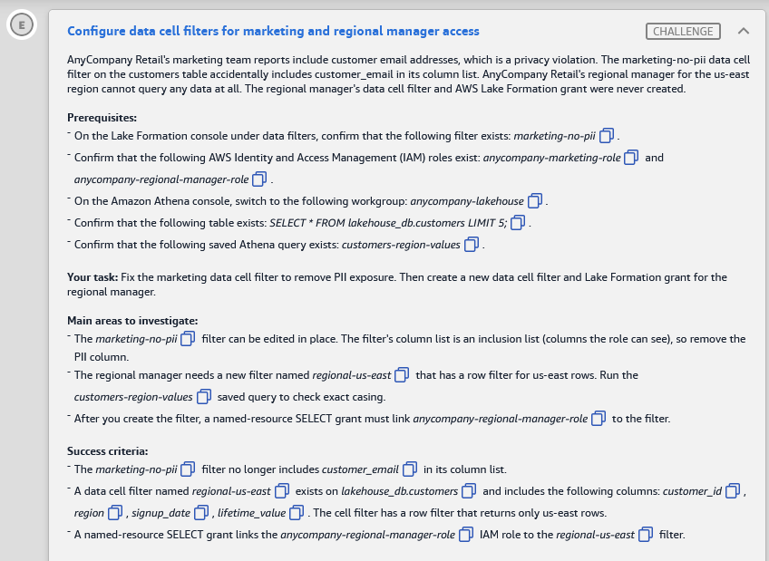

# 🅴 Challenge E: Configure data cell filters for marketing and regional manager access

> **Status:** ✅ Lab passed (11 Nov 2026). This task's row was cut off in the report screenshot; fill in its result · **Diagram label:** E (AWS Lake Formation boundary, fine-grained access to curated/analytics tables)
> **Services:** AWS Lake Formation (data cell filters, named-resource grants), IAM, Athena
> **Lab:** [AWS Data Lakehouse Demonstrated](README.md) · **Vault:** [index](../README.md)

---

## ✅ Status checklist (success criteria)

- [ ] The **`marketing-no-pii`** filter no longer includes **`customer_email`** in its column list
- [ ] A data cell filter named **`regional-us-east`** exists on **`lakehouse_db.customers`** with columns **`customer_id`, `region`, `signup_date`, `lifetime_value`** and a **row filter that returns only us-east rows**
- [ ] A **named-resource SELECT** grant links **`anycompany-regional-manager-role`** to the **`regional-us-east`** filter

---

## 🖼️ Task card



<details>
<summary>Text copy of the task</summary>

**Scenario:** AnyCompany Retail's marketing team reports include customer email addresses, which is a privacy violation. The `marketing-no-pii` data cell filter on the `customers` table accidentally includes `customer_email` in its column list. AnyCompany Retail's regional manager for the us-east region cannot query any data at all. The regional manager's data cell filter and AWS Lake Formation grant were never created.

**Prerequisites**
- In the Lake Formation console under data filters, confirm this filter exists: `marketing-no-pii`
- Confirm these IAM roles exist: `anycompany-marketing-role` and `anycompany-regional-manager-role`
- In the Athena console, switch to workgroup **`anycompany-lakehouse`**
- Confirm the table exists: `SELECT * FROM lakehouse_db.customers LIMIT 5;`
- Confirm this saved Athena query exists: `customers-region-values`

**Your task:** Fix the marketing data cell filter to remove PII exposure. Then create a new data cell filter and Lake Formation grant for the regional manager.

**Main areas to investigate**
- The `marketing-no-pii` filter can be edited in place. The filter's column list is an inclusion list (columns the role can see), so remove the PII column.
- The regional manager needs a new filter named `regional-us-east` that has a row filter for us-east rows. Run the `customers-region-values` saved query to check exact casing.
- After you create the filter, a named-resource SELECT grant must link `anycompany-regional-manager-role` to the filter.

</details>

---

## 🗺️ Where it sits in the architecture


- **E** sits on the **AWS Lake Formation** boundary, where fine-grained access is enforced before Athena (**B**) returns any data.
- [Challenge C](Challenge_C_LF_Tag_Based_Access_Control_Data_Science_And_Intern.md) controlled **which tables** a role sees (TBAC). This challenge controls **which rows and columns inside a table** a role sees (data cell filters).

---

## 🔍 Root cause

| Who | Current state | Effect | Fix |
|---|---|---|---|
| `anycompany-marketing-role` via filter `marketing-no-pii` | The filter's **include** column list contains `customer_email` | Marketing reports show emails (PII leak) | Edit the filter and **remove `customer_email`** from the included columns |
| `anycompany-regional-manager-role` | **No filter and no grant** exist | Lake Formation denies everything, so the manager can't query any data | **Create** filter `regional-us-east` (4 columns + row filter), then **grant SELECT** on it to the role |

---

## 🛠️ Solution

### Step 1: Check the exact region value (casing matters)

Athena (workgroup **`anycompany-lakehouse`**) → **Saved queries** → **`customers-region-values`** → Run.
Note the **exact** spelling and case of the us-east value: `us-east`, `US-EAST`, `us-east-1`, and `US-East` are all different strings. The row filter must match it **exactly**.

### Step 2: Fix `marketing-no-pii` (remove the PII column)

Lake Formation console → **Data Catalog → Data filters** → select **`marketing-no-pii`** → **Edit**
- Column-level access stays on **Include columns**. **Remove `customer_email`** from the list.
- Leave the other columns and the row filter as they are → **Save**.

### Step 3: Create the `regional-us-east` filter

**Data filters** → **Create new filter**

| Field | Value |
|---|---|
| Data filter name | **`regional-us-east`** |
| Target database | **`lakehouse_db`** |
| Target table | **`customers`** |
| Column-level access | **Include columns** → `customer_id`, `region`, `signup_date`, `lifetime_value` |
| Row-level access | **Filter rows** → row filter expression below |

```sql
region = 'us-east'
```
Replace `'us-east'` with the **exact value from Step 1**. Use single quotes for the string literal. Then click **Create filter**.

### Step 4: Grant the regional manager SELECT on the filter

Lake Formation → **Permissions → Data permissions** (called *Data lake permissions* in some console versions) → **Grant**

| Field | Value |
|---|---|
| Principals | **IAM users and roles** → **`anycompany-regional-manager-role`** |
| Resource type | **Named Data Catalog resources** (not LF-Tags) |
| Databases | `lakehouse_db` |
| Tables | `customers` |
| Data filters | **`regional-us-east`** |
| Data filter permissions | ✅ **Select** |

Click **Grant**.

### Step 5: Verify

- **Data filters** list: `marketing-no-pii` columns no longer show `customer_email`. `regional-us-east` shows the 4 columns and the row filter.
- **Data permissions**: filter by the principal `anycompany-regional-manager-role`. You should see **Select** on resource `customers` with filter `regional-us-east`.
- Press **Check**.

---

## ⚠️ Mistakes & lessons

_None yet. Add screenshots of anything that goes wrong here._

---

## 🧯 Troubleshooting table

| Symptom | Cause | Fix |
|---|---|---|
| Filter saved but the manager gets 0 rows | Row filter value doesn't match the data's case/spelling | Re-run `customers-region-values` and copy the value exactly |
| *"Invalid row filter expression"* | Double quotes around the string, or unsupported syntax | Use `region = 'us-east'` with **single** quotes. No functions or subqueries |
| **Data filters** dropdown is empty in the Grant page | Picked LF-Tags instead of named resources, or didn't pick the table first | Choose **Named Data Catalog resources** → database → **table**, and the filter list appears |
| Check fails on the grant | Granted on the **table** instead of the **filter** | The grant must be on the **data filter** `regional-us-east` with **Select** |
| Manager gets *"Database not found"* in Athena | No DESCRIBE on the database | Grant **Describe** on `lakehouse_db` (not graded, but often needed in practice) |
| Can't edit `marketing-no-pii` | Missing permission to update filters, or wrong role | Confirm your session role is a data lake admin (see Challenge C) |
| Marketing still sees email | The marketing role has a **second** grant (on the full table or another filter) | Check Data permissions for the marketing role. Permissions from multiple grants **add up** |

---

## 📚 Study notes (go deeper later)

### 1. What a data cell filter is

A **named, reusable** definition on **one table** that combines:
- **Column-level security:** *include* a list of columns, or *exclude* a list (everything else visible).
- **Row-level security:** a **row filter expression** (a SQL-like predicate), or *all rows*.
- **Cell-level security:** the combination, i.e. specific columns for specific rows.

You grant **SELECT** (or DESCRIBE/DROP) **on the filter** to a principal. When the principal queries the table through an integrated engine (Athena, Redshift Spectrum, EMR, Glue), Lake Formation applies the filter automatically.

### 2. Include vs exclude column lists

| Mode | Behaviour | Risk |
|---|---|---|
| **Include** (allow-list) | Only the listed columns are visible | **Safer**: new columns added later stay hidden by default |
| **Exclude** (deny-list) | Everything except the listed columns is visible | New PII columns added later are **exposed automatically** |

This lab's bug was a mistake in the **allow-list**: someone included a PII column.

### 3. Row filter expression rules ⚠️

- It's the condition you'd write in a `WHERE` clause, without the word `WHERE`: `region = 'us-east'`, `region IN ('us-east','us-west')`, `lifetime_value > 1000 AND region = 'us-east'`.
- String literals use **single quotes**, and the **comparison is case-sensitive**.
- Supports comparison operators, `AND`/`OR`/`NOT`, `IN`, `LIKE`, `BETWEEN`, `IS [NOT] NULL`. **No** subqueries, UDFs or references to other tables.
- *Verify the exact supported grammar in the Lake Formation "data filters" docs.*

### 4. Multiple filters for one principal ⚠️

- If a principal has grants on **several filters** for the same table, Lake Formation returns the **union**: a row is visible if any filter's row predicate matches, and the visible columns for that row are the union of the matching filters' columns.
- Implication: **one over-permissive grant undoes a tight filter**. Always audit **all** of a principal's grants. *Confirm the union semantics in the docs.*

### 5. TBAC (Challenge C) vs data cell filters (this challenge)

| | LF-TBAC | Data cell filters |
|---|---|---|
| Granularity | Database / table / column (via tags) | **Row + column + cell** within one table |
| Scales by | Tags: new tagged tables are covered automatically | Per-table filter objects |
| Grant style | Tag expressions | **Named-resource** grant on the filter |
| Typical use | "Data scientists see all curated tables" | "Regional manager sees only their region's rows, no PII columns" |

They're often **combined**: TBAC for broad table access, filters for row/column restrictions on sensitive tables.

### 6. Other options for fine-grained access

- **Column-level named grants** (SELECT on specific columns, no row filtering).
- **Views** (Athena views / Glue Data Catalog views) that project and filter. These are harder to govern at scale.
- **Separate physical tables** per audience. They duplicate data and are a maintenance burden.

### 7. CLI equivalents (for reference)

```bash
# Create the regional filter
aws lakeformation create-data-cells-filter --table-data '{
  "TableCatalogId": "<acct>",
  "DatabaseName": "lakehouse_db",
  "TableName": "customers",
  "Name": "regional-us-east",
  "RowFilter": { "FilterExpression": "region = '\''us-east'\''" },
  "ColumnNames": ["customer_id", "region", "signup_date", "lifetime_value"]
}'

# Grant SELECT on the filter
aws lakeformation grant-permissions \
  --principal DataLakePrincipalIdentifier=arn:aws:iam::<acct>:role/anycompany-regional-manager-role \
  --resource '{"DataCellsFilter":{"TableCatalogId":"<acct>","DatabaseName":"lakehouse_db","TableName":"customers","Name":"regional-us-east"}}' \
  --permissions SELECT

# Inspect existing filters
aws lakeformation list-data-cells-filter --table '{"CatalogId":"<acct>","DatabaseName":"lakehouse_db","Name":"customers"}'
```

### 🧪 Self-test questions

1. Why did the lab tell you to run `customers-region-values` before creating the row filter?
2. Why is an **include** column list safer than an **exclude** list for PII?
3. The manager's filter is correct, but they can still see `customer_email`. What would you check first?
4. When would you use a data cell filter instead of LF-TBAC?
5. Write a row filter for us-east customers with lifetime value above 5,000.

<details>
<summary>Answers</summary>

1. Row filters compare strings exactly and are case-sensitive. A wrong case like `'US-East'` vs `'us-east'` silently returns zero rows.
2. With include, new columns are hidden by default. With exclude, any new column (possibly PII) is exposed until someone updates the filter.
3. Other grants for the same role (a full-table SELECT or a second filter). Lake Formation unions them.
4. When you need row-level or cell-level restrictions inside one table (by region, tenant or customer). TBAC can't filter rows.
5. `region = 'us-east' AND lifetime_value > 5000` (use the exact region string from the data).

</details>

---

## 📝 Run log (fill in as I go)

| Step | What I did | Result / output |
|---|---|---|
| 1 | `customers-region-values` | _exact us-east value + casing_ |
| 2 | Removed `customer_email` from `marketing-no-pii` | _original column list / status_ |
| 3 | Created `regional-us-east` (4 cols + row filter) | _row filter expression used_ |
| 4 | Granted SELECT on filter to `anycompany-regional-manager-role` | _status_ |
| — | Check button | _result_ |
