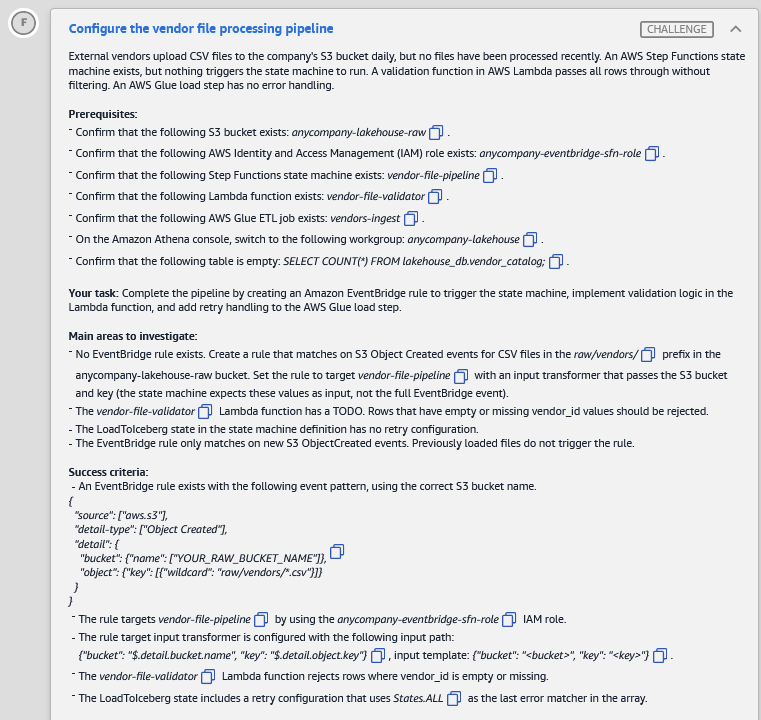
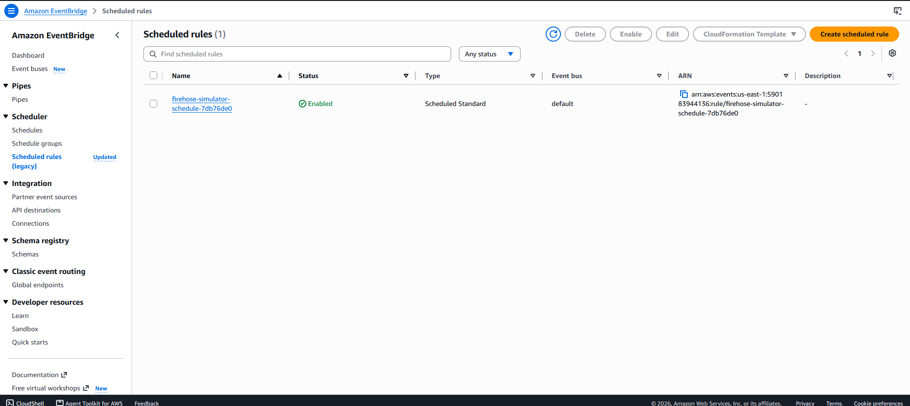

# 🅵 Challenge F: Configure the vendor file processing pipeline

> **Status:** ✅ Passed, *Meets Requirements* (exam lab, 11 Nov 2026) · **Diagram label:** F (S3 raw vendor CSV → EventBridge → Step Functions → Lambda validator → Glue *ingest vendor data* → curated)
> **Services:** Amazon S3, Amazon EventBridge (rules, event patterns, input transformer), AWS Step Functions (ASL Retry), AWS Lambda, AWS Glue, Athena
> **Lab:** [AWS Data Lakehouse Demonstrated](README.md) · **Vault:** [index](../README.md)

---

## ✅ Status checklist (success criteria)

- [x] An **EventBridge rule** exists with the required event pattern (correct raw bucket name, `raw/vendors/*.csv`)
- [x] The rule **targets `vendor-file-pipeline`** using the **`anycompany-eventbridge-sfn-role`** IAM role
- [x] The target **input transformer** uses input path `{"bucket": "$.detail.bucket.name", "key": "$.detail.object.key"}` and template `{"bucket": "<bucket>", "key": "<key>"}`
- [x] The **`vendor-file-validator`** Lambda rejects rows where **`vendor_id` is empty or missing**
- [x] The **`LoadToIceberg`** state has a **Retry** configuration with **`States.ALL`** as the **last** error matcher

---

## 🖼️ Task card



<details>
<summary>Text copy of the task</summary>

**Scenario:** External vendors upload CSV files to the company's S3 bucket daily, but no files have been processed recently. An AWS Step Functions state machine exists, but nothing triggers the state machine to run. A validation function in AWS Lambda passes all rows through without filtering. The AWS Glue load step has no error handling.

**Prerequisites**
- S3 bucket exists: `anycompany-lakehouse-raw`
- IAM role exists: `anycompany-eventbridge-sfn-role`
- Step Functions state machine exists: `vendor-file-pipeline`
- Lambda function exists: `vendor-file-validator`
- Glue ETL job exists: `vendors-ingest`
- In the Athena console, switch to workgroup **`anycompany-lakehouse`**
- Confirm the table is empty: `SELECT COUNT(*) FROM lakehouse_db.vendor_catalog;`

**Your task:** Complete the pipeline by creating an Amazon EventBridge rule to trigger the state machine, implement validation logic in the Lambda function, and add retry handling to the AWS Glue load step.

**Main areas to investigate**
- No EventBridge rule exists. Create a rule that matches on S3 Object Created events for CSV files in the `raw/vendors/` prefix in the `anycompany-lakehouse-raw` bucket. Set the rule to target `vendor-file-pipeline` with an input transformer that passes the S3 bucket and key (the state machine expects these values as input, not the full EventBridge event).
- The `vendor-file-validator` Lambda function has a TODO. Rows that have empty or missing `vendor_id` values should be rejected.
- The `LoadToIceberg` state in the state machine definition has no retry configuration.
- The EventBridge rule only matches on new ObjectCreated events. Previously loaded files do not trigger the rule.

**Success criteria (event pattern as given)**
```json
{
  "source": ["aws.s3"],
  "detail-type": ["Object Created"],
  "detail": {
    "bucket": {"name": ["YOUR_RAW_BUCKET_NAME"]},
    "object": {"key": [{"wildcard": "raw/vendors/*.csv"}]}
  }
}
```

</details>

---

## 🗺️ Where it sits in the architecture


**Flow F:** vendor drops a CSV into **S3 raw** → S3 emits *Object Created* to **EventBridge** → rule matches → **Step Functions** `vendor-file-pipeline` starts with `{bucket, key}` → **Lambda** `vendor-file-validator` checks rows → **Glue** `vendors-ingest` (state `LoadToIceberg`) appends to the curated Iceberg table `vendor_catalog`.

**Three broken links:** nothing triggers the pipeline (no rule), the validator lets bad rows through (TODO), and the load step has no retry.

---

## 🔍 Root cause

| Gap | Effect | Fix |
|---|---|---|
| **No EventBridge rule** | Uploads produce events but nothing listens, so the state machine never runs | Create a rule with the S3 pattern, target the state machine, use an input transformer |
| **Validator TODO** | Rows with blank/missing `vendor_id` reach the lakehouse | Reject rows where `vendor_id` is missing or blank after trimming |
| **No Retry on `LoadToIceberg`** | One transient Glue error (concurrency limit, throttling) fails the whole execution | Add a `Retry` array ending in `States.ALL` |

---

## 🛠️ Solution

> **Order matters:** fix the Lambda and the state machine **first**, then create the rule, then upload a test file. That way the first triggered run already uses the fixed code.

### Step 0: Get the exact bucket name and make sure S3 sends events to EventBridge

1. **S3 console → Buckets.** Copy the **exact** raw bucket name. It may have a suffix (for example an account ID), so don't assume it is exactly `anycompany-lakehouse-raw`.
2. **Bucket → Properties → Event notifications → Amazon EventBridge.** It must be **On** ("Send notifications to Amazon EventBridge for all events in this bucket"). If it's Off, click **Edit → On → Save**. If this is Off, **no rule will ever fire**.

### Step 1: Implement the validator (Lambda `vendor-file-validator`)

Lambda console → `vendor-file-validator` → **Code** tab → find the TODO. The general shape of the fix (Python, adapted to the function's own variable names):

```python
for row in reader:                       # csv.DictReader over the file
    vendor_id = (row.get("vendor_id") or "").strip()
    if not vendor_id:                    # missing column, None, "" or "   "
        rejected.append(row)             # or rejected_count += 1, whatever the TODO expects
        continue
    valid.append(row)
```

- It handles **missing** (`row.get` returns `None`), **empty** (`""`) and **whitespace-only** (`"  "`) values.
- **Don't change the function's return format.** The next state depends on it.
- Click **Deploy** (code changes aren't live until you deploy).
- Optional: **Test** with a small event and confirm the bad rows are rejected.

### Step 2: Add Retry to `LoadToIceberg` (Step Functions `vendor-file-pipeline`)

Step Functions → `vendor-file-pipeline` → **Edit** → **Code** view (ASL JSON). Inside the `"LoadToIceberg": { ... }` object, next to `"Type"`, `"Resource"`, `"Next"`/`"End"`, add:

```json
"Retry": [
  {
    "ErrorEquals": ["Glue.ConcurrentRunsExceededException"],
    "IntervalSeconds": 30,
    "MaxAttempts": 3,
    "BackoffRate": 2.0
  },
  {
    "ErrorEquals": ["States.ALL"],
    "IntervalSeconds": 60,
    "MaxAttempts": 2,
    "BackoffRate": 2.0
  }
]
```

- **`States.ALL` must be the last retrier** and must be **alone** in its `ErrorEquals`. Retriers are evaluated **top to bottom**, so the specific ones go first.
- The simplest version that passes is the `States.ALL` block on its own.
- Watch the **commas** between properties. The editor flags invalid JSON.
- In the **Workflow Studio** (visual) editor instead: select `LoadToIceberg` → **Error handling** tab → **Add new retrier** → Errors `States.ALL` → set interval, attempts and backoff.
- **Save.** If it warns about IAM role permissions, choose **Save anyway**.

**The lab's actual `LoadToIceberg` state, with the Retry added:**

```json
"LoadToIceberg": {
  "Type": "Task",
  "Resource": "arn:aws:states:::glue:startJobRun.sync",
  "Parameters": {
    "JobName": "vendors-ingest-7db76de0",
    "Arguments": {
      "--source_bucket.$": "$.bucket",
      "--source_key.$": "$.validation.output_key"
    }
  },
  "Retry": [
    {
      "ErrorEquals": ["Glue.ConcurrentRunsExceededException"],
      "IntervalSeconds": 30,
      "MaxAttempts": 3,
      "BackoffRate": 2.0
    },
    {
      "ErrorEquals": ["States.ALL"],
      "IntervalSeconds": 60,
      "MaxAttempts": 2,
      "BackoffRate": 2.0
    }
  ],
  "End": true
}
```

**Things to notice in the real definition:**
- `glue:startJobRun.sync` means Step Functions **waits** for the Glue job to finish, so a Glue failure fails this state and the Retry can catch it.
- `"--source_bucket.$": "$.bucket"`: the `.$` suffix means "take the value from the state input at this JSONPath". `$.bucket` comes straight from the EventBridge input transformer (`{"bucket": ..., "key": ...}`).
- `"--source_key.$": "$.validation.output_key"`: the Glue job loads the **validated** file written by the Lambda, not the raw upload. The Lambda's result is stored under `$.validation` (via `ResultPath`), so **its return value must keep `output_key`**.
- The job name has a **suffix** (`-7db76de0`). Lab resources are suffixed, so the raw **bucket name probably has one too**. Copy it exactly from S3 for the EventBridge pattern.

### Step 3: Create the EventBridge rule

**Finding Rules in the console**, if it isn't obvious:
- **Region first.** The region selector (top right) must match the lab region, the one where `vendor-file-pipeline` lives. In the wrong region, the state machine won't appear as a target.
- Open **Amazon EventBridge**. In the console search bar, pick *Amazon EventBridge*, **not** *EventBridge Scheduler*.
- **New console layout (seen in this lab, Nov 2026):** there's **no "Rules" item** in the left menu. Rules live **inside the event bus**: **Event buses** → click **`default`** → **Rules** tab → **Create rule**.
- **Older console layout:** left menu (open it with the **☰** icon top left if it's collapsed) → section **Buses** → **Rules**.
- **Not** *Scheduler → Scheduled rules (legacy)*: that page only lists cron/rate rules (see Mistake 1).
- Or, on the EventBridge **home page**, the *Get started* box: select **EventBridge Rule** → **Create rule**.
- Direct URL: `https://<region>.console.aws.amazon.com/events/home?region=<region>#/rules`

EventBridge console → **Rules** → **Create rule**

**Builder mode:** the Create rule page opens in **Enhanced builder** (visual drag-and-drop) by default. Switch to **Advanced builder** (step-by-step), which is the classic wizard this table follows.

> 📷 *The screenshot of this page (Enhanced builder: Events/Targets palette on the left, Build/Configure tabs on the right) didn't come through as a file. To keep it, save it as `assets/challenge_F/03_eventbridge_create_rule_enhanced_builder.png` and embed it here.*

| Field | Value |
|---|---|
| Name | e.g. `vendor-csv-uploaded` |
| Event bus | `default` |
| Rule type | **Rule with an event pattern** |
| Event source | **AWS events or EventBridge partner events** |
| Creation method | **Custom pattern (JSON editor)** |

**Event pattern** (replace the bucket name with the exact name from Step 0):

```json
{
  "source": ["aws.s3"],
  "detail-type": ["Object Created"],
  "detail": {
    "bucket": { "name": ["anycompany-lakehouse-raw"] },
    "object": { "key": [{ "wildcard": "raw/vendors/*.csv" }] }
  }
}
```

**Target**

| Field | Value |
|---|---|
| Target type | **AWS service** |
| Target | **Step Functions state machine** → **`vendor-file-pipeline`** |
| Execution role | **Use existing role** → **`anycompany-eventbridge-sfn-role`** |
| Additional settings → Configure target input | **Input transformer** → *Configure input transformer* |

**Input path:**
```json
{"bucket": "$.detail.bucket.name", "key": "$.detail.object.key"}
```

**Input template:**
```json
{"bucket": "<bucket>", "key": "<key>"}
```

Click **Confirm**, then **Next → Next → Create rule**.

### Step 3 (easier alternative): create the rule from CloudShell

The console wizard was hard to navigate, so this uses the AWS CLI instead. Open **CloudShell** from the console footer (bottom left) or the terminal icon in the top bar. It starts in the console's region (**us-east-1**) with your session's permissions. When it asks about pasting multi-line text, choose **Paste**.

**3a. Look up the exact names (lab resources carry a suffix):**
```bash
ACCOUNT=$(aws sts get-caller-identity --query Account --output text)
BUCKET=$(aws s3api list-buckets --query "Buckets[?starts_with(Name, 'anycompany-lakehouse-raw')].Name | [0]" --output text)
SFN_ARN=$(aws stepfunctions list-state-machines --query "stateMachines[?starts_with(name, 'vendor-file-pipeline')].stateMachineArn | [0]" --output text)
ROLE_ARN=$(aws iam list-roles --query "Roles[?starts_with(RoleName, 'anycompany-eventbridge-sfn-role')].Arn | [0]" --output text 2>/dev/null)
if [ -z "$ROLE_ARN" ] || [ "$ROLE_ARN" = "None" ]; then ROLE_ARN="arn:aws:iam::${ACCOUNT}:role/anycompany-eventbridge-sfn-role"; fi
echo "BUCKET=$BUCKET"; echo "SFN_ARN=$SFN_ARN"; echo "ROLE_ARN=$ROLE_ARN"
```
All three must print real values (not `None`) before you continue.

**3b. Make sure the bucket sends events to EventBridge. This merges with the existing config and doesn't overwrite it:**
```bash
aws s3api get-bucket-notification-configuration --bucket "$BUCKET" > notif.json
[ -s notif.json ] || echo '{}' > notif.json
if jq -e 'has("EventBridgeConfiguration")' notif.json >/dev/null; then
  echo "EventBridge notifications already ON"
else
  jq '. + {"EventBridgeConfiguration": {}}' notif.json > notif-new.json
  aws s3api put-bucket-notification-configuration --bucket "$BUCKET" --notification-configuration file://notif-new.json
  echo "EventBridge notifications turned ON"
fi
```
> `put-bucket-notification-configuration` **replaces** the whole config, which is why the script reads the existing one and merges into it first.

**3c. Create the rule with the event pattern:**
```bash
cat > pattern.json <<EOF
{
  "source": ["aws.s3"],
  "detail-type": ["Object Created"],
  "detail": {
    "bucket": { "name": ["$BUCKET"] },
    "object": { "key": [{ "wildcard": "raw/vendors/*.csv" }] }
  }
}
EOF
aws events put-rule --name vendor-csv-uploaded --event-bus-name default --state ENABLED --event-pattern file://pattern.json
```

**3d. Attach the target (state machine + role + input transformer):**
```bash
cat > targets.json <<EOF
[
  {
    "Id": "vendor-file-pipeline",
    "Arn": "$SFN_ARN",
    "RoleArn": "$ROLE_ARN",
    "InputTransformer": {
      "InputPathsMap": {
        "bucket": "\$.detail.bucket.name",
        "key": "\$.detail.object.key"
      },
      "InputTemplate": "{\"bucket\": \"<bucket>\", \"key\": \"<key>\"}"
    }
  }
]
EOF
aws events put-targets --rule vendor-csv-uploaded --event-bus-name default --targets file://targets.json
```
Expected output: `"FailedEntryCount": 0`.

**3e. Verify:**
```bash
aws events describe-rule --name vendor-csv-uploaded --query "{State:State, Pattern:EventPattern}"
aws events list-targets-by-rule --rule vendor-csv-uploaded
```

**Bash notes for later study:**
- `<<EOF` (unquoted) **expands** `$BUCKET`, `$SFN_ARN` and `$ROLE_ARN` inside the heredoc. `\$` keeps a literal `$` for the JSONPath (`$.detail...`).
- Inside an unquoted heredoc, `\"` is left as-is, which gives the escaped quotes the `InputTemplate` JSON string needs.
- `file://x.json` tells the AWS CLI to read the parameter from a file, which avoids quoting problems.
- `put-rule` and `put-targets` are **idempotent**. Re-running them updates the same rule or target.

### Step 4: Test end to end (not graded, but proves the pipeline works)

The rule only fires on **new** uploads, so files already in the bucket won't start anything.
1. S3 → raw bucket → `raw/vendors/` → **download** one of the existing CSVs → **upload** it back (same name or a new `.csv` name). This produces a fresh *Object Created* event.
   CloudShell version (copies an existing CSV to a new name, which also creates an event):
   ```bash
   KEY=$(aws s3api list-objects-v2 --bucket "$BUCKET" --prefix raw/vendors/ --query "Contents[?ends_with(Key, '.csv')].Key | [0]" --output text)
   aws s3 cp "s3://$BUCKET/$KEY" "s3://$BUCKET/raw/vendors/retest-$(date +%s).csv"
   sleep 20; aws stepfunctions list-executions --state-machine-arn "$SFN_ARN" --max-items 3 --query "executions[].{name:name,status:status}"
   ```
2. Step Functions → `vendor-file-pipeline` → **Executions**. A new run should appear and go to **Succeeded**. The input should be just `{"bucket": ..., "key": ...}`.
3. Athena: `SELECT COUNT(*) FROM lakehouse_db.vendor_catalog;` should now be **> 0**. Optionally check that no rows have a blank `vendor_id`.

### Step 5: Press Check

---

## ⚠️ Mistakes & lessons

### Mistake 1: Looked for the rule under "Scheduled rules (legacy)"



**What I saw:** *Scheduled rules (1)*, listing only `firehose-simulator-schedule-7db76de0` (type *Scheduled Standard*), and no way to create an event-pattern rule.

**Why it's the wrong page:** EventBridge has two kinds of rules:
- **Scheduled rules** fire on a **timer** (cron/rate). This page lists only those.
- **Event pattern rules** fire when a **matching event** arrives (e.g. S3 *Object Created*). This challenge needs one of these.

In the new console layout, event-pattern rules sit under **Event buses → `default` → Rules**.

**Also learned from this screenshot:**
- The lab region is **us-east-1** (from the rule's ARN).
- `firehose-simulator-schedule-7db76de0` is the lab's **traffic generator** for the Firehose stream in [Challenge D](Challenge_D_Firehose_Iceberg_Streaming_Upserts_And_Buffering.md). **Don't edit, disable or delete it.**
- AWS now recommends **EventBridge Scheduler** for new scheduled jobs. That's why scheduled *rules* are labelled "legacy".

### Mistake 2: Check failed on the validator

**Check message:** *"The validation Lambda function is not rejecting invalid rows. Ensure that rows with empty vendor_id are filtered out."*

**Likely causes, most common first:**
1. Code edited but **not deployed**. The editor shows *"Changes not deployed"*, and the live version still passes everything.
2. Filter added in the wrong place: e.g. a `valid_rows` list is built, but the function still writes or returns the **original** `rows`. Or the TODO lives in a helper such as `validate_row(row)` / `is_valid(row)` that still does `return True`.
3. The check only handles `None` and misses `""` or whitespace (`"   "`). Use `(row.get("vendor_id") or "").strip()`.
4. The function name has a suffix (`vendor-file-validator-7db76de0`). Make sure the right function was edited.

**How the checker probably tests it:** it invokes the function on a CSV that contains rows with empty or missing `vendor_id`, then checks that those rows aren't in the output file (`output_key`) or counts.

**✅ Actual root cause (my case): I edited the code but never clicked Deploy.** It was my first time using Lambda, and saving or editing in the code editor doesn't update the running function.

#### Fix checklist

**1. Deploy the code**
- Lambda → function → **Code** tab. A *"Changes not deployed"* banner, or a highlighted **Deploy** button, means the live function is still the old code.
- Click **Deploy** and wait for *"Successfully updated the function …"*, then press **Check** again.
- Make sure you edited the right function. Lab names carry a suffix (`vendor-file-validator-7db76de0`).

**2. If it's deployed and still failing, look at how the TODO is written.** The three usual patterns:

*A helper that still returns `True`.* Replace its body:
```python
def validate_row(row):          # or is_valid(row) – whatever it's called
    vendor_id = (row.get("vendor_id") or "").strip()
    return vendor_id != ""
```

*A filtered list that's never used.* You build `valid_rows`, but the code that writes the output file or builds the return value still uses the original `rows`. Change it to use `valid_rows`.

*Only checking for `None`.* `if row["vendor_id"] is None` misses `""` and `"   "`. Use `(row.get("vendor_id") or "").strip()`, which handles missing, empty and whitespace-only values.

In every case, **keep the return format unchanged**, especially `output_key`, because `LoadToIceberg` reads `$.validation.output_key`.

**3. Self-test in CloudShell.** It uploads to `tmp/`, outside `raw/vendors/`, so it won't trigger the pipeline:
```bash
BUCKET=$(aws s3api list-buckets --query "Buckets[?starts_with(Name, 'anycompany-lakehouse-raw')].Name | [0]" --output text)
FN=$(aws lambda list-functions --query "Functions[?starts_with(FunctionName, 'vendor-file-validator')].FunctionName | [0]" --output text)
printf 'vendor_id,vendor_name\nV001,Good Vendor\n,Blank Id\n   ,Spaces Id\nV004,Another Good\n' > test.csv
aws s3 cp test.csv "s3://$BUCKET/tmp/validation-test.csv"
aws lambda invoke --function-name "$FN" --cli-binary-format raw-in-base64-out \
  --payload "{\"bucket\":\"$BUCKET\",\"key\":\"tmp/validation-test.csv\"}" out.json && cat out.json
```
- **Expected:** 2 valid and 2 rejected (or equivalent). 4 valid means the filter isn't live or isn't applied.
- To see the cleaned file the function wrote: `aws s3 cp "s3://$BUCKET/<output_key from out.json>" -`
- `--cli-binary-format raw-in-base64-out` lets you pass the payload as plain JSON with AWS CLI v2.
- If the function errors because it expects other columns, adjust the test CSV header to match the real vendor files.

**Lesson:** in AWS consoles, **edit ≠ live**. Each service has its own "make it live" action. See *First-time console gotchas* below.

#### 🧭 First-time console gotchas: "edit" vs "live"

| Service | Where you edit | What makes it live | How to confirm |
|---|---|---|---|
| **Lambda** | Code tab editor | **Deploy** (`Ctrl+S` only saves the draft in the editor) | Banner gone; *Last modified* updated; **Test** shows new behaviour |
| **Step Functions** | Edit → Code / Workflow Studio | **Save** (new executions use the new definition; running ones keep the old) | Definition tab shows your change |
| **Glue job** | Script tab | **Save**, then **Run** (a new run picks up the script) | Runs tab → new run → Succeeded |
| **EventBridge rule** | Create/Edit wizard | **Create rule** / **Update rule** at the end of the wizard | Rule listed as **Enabled**; Targets tab shows the target |
| **Firehose stream** | Configuration → Edit | **Save changes**, then wait for status **Active** | Configuration tab shows new values |
| **Lake Formation** | Grant / Edit LF-Tags / Data filters | **Grant** / **Save** (immediate) | Data permissions / LF-Tags list |
| **Athena DDL** | Query editor | **Run** (immediate) | `SHOW TBLPROPERTIES`, `DESCRIBE` |

---

## 🧯 Troubleshooting table

| Symptom | Cause | Fix |
|---|---|---|
| Can't find **Rules** in the EventBridge console | New console layout puts rules inside the bus; or the menu is collapsed; or you're in Scheduler; or the wrong region | **Event buses → `default` → Rules tab**. Older layout: ☰ → **Buses → Rules**. Check the region (top right) |
| Only see *Scheduled rules (legacy)* | That page lists cron/rate rules only | Use **Event buses → `default` → Rules** for event-pattern rules |
| `vendor-file-pipeline` not in the target dropdown | Console is in a different region from the lab | Switch to the lab region |
| Uploaded a file, no execution started | Bucket's **EventBridge notifications are Off** | S3 bucket → Properties → Amazon EventBridge → **On** |
| Still no execution | Bucket name in the pattern doesn't match exactly, or the key isn't under `raw/vendors/` / doesn't end in `.csv` | Copy the bucket name from S3; check the object path and extension (`.CSV` ≠ `.csv`) |
| Rule matches (see rule **Monitoring** metrics) but no execution starts | Target role can't `states:StartExecution` | Confirm `anycompany-eventbridge-sfn-role` is selected; check its policy and trust (`events.amazonaws.com`) |
| Execution starts but the first state fails reading input | Full event passed instead of `{bucket,key}`, or template quoting is wrong | Recheck the input transformer: template values `"<bucket>"`, `"<key>"` **in quotes** |
| Lambda can't find the object when the key has spaces | S3 event keys are **URL-encoded** (`my file.csv` → `my+file.csv`) | Decode with `urllib.parse.unquote_plus(key)` in Lambda |
| Lambda change has no effect | Code not **deployed** | Click **Deploy** |
| Check: *"validation Lambda is not rejecting invalid rows"* | Not deployed, filter not applied to what's written/returned, helper still `return True`, or blank/whitespace not handled | See Mistake 2. Self-test in CloudShell: upload a CSV with a blank `vendor_id` row and invoke the function with `{"bucket","key"}`, then check the output |
| ASL save error: *States.ALL must be last* | `States.ALL` placed before specific retriers or combined with other errors | Move it to the **last** retrier, on its own |
| Glue step fails with *ConcurrentRunsExceededException* | Too many concurrent job runs | The Retry handles it; you could also raise the job's max concurrency |
| Old files never processed | Rule only sees **new** events | Re-upload/copy them, or start executions manually for each existing key |

---

## 📚 Study notes (go deeper later)

### 1. S3 → EventBridge vs classic S3 event notifications

| | S3 event notifications (classic) | S3 → EventBridge |
|---|---|---|
| Targets | Lambda, SQS, SNS only | 20+ targets incl. **Step Functions**, API destinations, other buses |
| Filtering | Prefix + suffix only | Full **content filtering** (wildcard, prefix, suffix, numeric, anything-but, …) |
| Multiple consumers | One config per event type/prefix (overlaps not allowed) | Many rules on the same events |
| Extras | — | **Archive & replay**, cross-account, schema registry |
| Setup | Per-notification config | One bucket toggle (**EventBridge: On**) + rules |

S3 event `detail` fields: `bucket.name`, `object.key`, `object.size`, `object.etag`, `reason` (`PutObject`, `CopyObject`, `CompleteMultipartUpload`).

### 2. Event pattern matching

- Arrays mean **OR**: `"detail-type": ["Object Created", "Object Deleted"]`.
- Separate fields mean **AND**.
- Content operators:
  ```json
  {"prefix": "raw/vendors/"}            {"suffix": ".csv"}
  {"wildcard": "raw/vendors/*.csv"}     {"anything-but": ["test"]}
  {"numeric": [">", 0, "<=", 5242880]}  {"exists": true}
  {"equals-ignore-case": "CSV"}
  ```
- `wildcard` here is one condition doing both prefix and suffix. The `*` matches any characters, so files in sub-folders are matched too.

### 3. Input transformer

- **Input path** (InputPathsMap): pulls values out of the event with JSONPath into named variables.
- **Input template:** builds the target's input with `<variable>` placeholders.
- **Quoting rule:** for string values, put quotes **around the placeholder** in the template (`"<key>"`). For JSON objects or numbers, leave them unquoted.
- **Why:** the state machine's input contract is `{bucket, key}`. Passing the whole event would mean every state digs through `$.detail...`, which couples the workflow to the event format.

### 4. Step Functions error handling

**Retrier fields:**

| Field | Default | Meaning |
|---|---|---|
| `ErrorEquals` | required | Error names to match |
| `IntervalSeconds` | 1 | Wait before the first retry |
| `MaxAttempts` | 3 | Retries (0 = never retry) |
| `BackoffRate` | 2.0 | Multiplier per attempt |
| `MaxDelaySeconds` | — | Cap on the wait |
| `JitterStrategy` | `NONE` | `FULL` randomises waits (avoids thundering herd) |

- **Backoff math:** 30 s, ×2, 3 attempts gives waits of **30 s → 60 s → 120 s**.
- **Evaluation:** retriers are checked **in order**, and the **first match wins**. `States.ALL` must be **last** and **alone**.
- **Predefined errors:** `States.ALL`, `States.TaskFailed`, `States.Timeout`, `States.HeartbeatTimeout`, `States.Permissions`, `States.DataLimitExceeded`, `States.Runtime`. ⚠️ *Check which of these `States.ALL` does **not** match (I believe `States.Runtime` and `States.DataLimitExceeded` aren't retriable).*
- **Retry vs Catch:** `Retry` re-runs the same state. `Catch` routes to a fallback state (notify, quarantine, mark failed) after retries are used up. Production pipelines use **both**:
  ```json
  "Catch": [{ "ErrorEquals": ["States.ALL"], "ResultPath": "$.error", "Next": "NotifyFailure" }]
  ```

### 5. Glue in Step Functions

- `arn:aws:states:::glue:startJobRun.sync` = **Run a Job (.sync)**. Step Functions **waits** for the Glue job to finish and fails the state if the job fails.
- Without `.sync`, the state only **starts** the job and succeeds immediately, so job failures go unnoticed.
- **Idempotency:** a retried load can double-insert if the first attempt partly committed. Use MERGE/upsert on a key, Glue job bookmarks, or load-tracking by `key`.

### 6. Validation patterns

- **Reject vs fail:** this lab drops bad rows and keeps going. Alternatives are failing the whole file if the reject rate is above a threshold, or writing rejects to a **quarantine** prefix (`raw/vendors/_rejected/`) with a reason column.
- Validate **required fields, types, ranges, duplicates and schema/header** before loading. Fixing bad data after it lands costs far more.

### 7. Backfilling files that existed before the rule

- **Re-upload or copy** the object (creates a new event).
- **Start executions manually** with `{"bucket": "...", "key": "..."}` for each key (script over `aws s3 ls`).
- **S3 Batch Operations** invoking a Lambda that starts executions.
- **EventBridge archive replay** only works if an archive existed when the events happened.

### 🧪 Self-test questions

1. A vendor uploads `raw/vendors/acme.CSV`. Does the rule fire? Why or why not?
2. Why use an input transformer instead of passing the whole event?
3. Why must `States.ALL` be the last retrier?
4. With `IntervalSeconds: 10`, `BackoffRate: 3`, `MaxAttempts: 3`, what are the waits?
5. A row has `vendor_id = "   "`. Should it be rejected? How does the code handle it?
6. Name two ways to process files uploaded before the rule existed.

<details>
<summary>Answers</summary>

1. No. Wildcard matching is case-sensitive, and `.CSV` doesn't match `*.csv`. You could add a second pattern value or normalise the extension at upload.
2. It decouples the workflow from the event format and gives a clean, minimal `{bucket, key}` input contract that the state machine expects.
3. Retriers are evaluated in order. A catch-all placed earlier would swallow specific errors that need different handling, and the ASL spec requires it to be last and alone.
4. 10 s → 30 s → 90 s.
5. Yes. `.strip()` turns it into `""`, which is falsy, so the row is rejected.
6. Re-upload/copy the objects, or start executions manually (or via a script or S3 Batch Operations) with `{bucket, key}`.

</details>

---

## 📝 Run log (fill in as I go)

| Step | What I did | Result / output |
|---|---|---|
| 0 | Exact raw bucket name / EventBridge toggle | _name, On/Off_ |
| 1 | Lambda TODO implemented + deployed | 1st Check failed (*"not rejecting invalid rows"*): code edited but **not deployed**. Clicked **Deploy** → re-check: _result_ |
| 2 | Retry added to `LoadToIceberg` (job `vendors-ingest-7db76de0`, `.sync`, input `$.bucket` + `$.validation.output_key`) | _save status_ |
| 3 | EventBridge rule created | _rule name_ |
| 4 | Test upload → execution → `vendor_catalog` count | _execution status / row count_ |
| — | Check button | _result_ |
