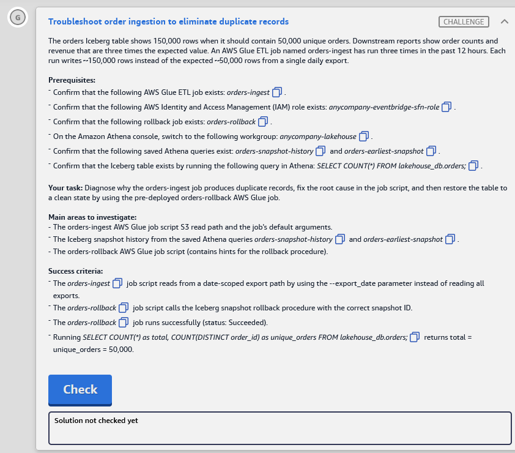

# 🅶 Challenge G: Troubleshoot order ingestion to eliminate duplicate records

> **Status:** ⚠️ Not completed (ran out of time). Exam report: *Needs Improvement*. Lab passed overall on 11 Nov 2026 · **Diagram label:** G (DynamoDB *orders* → export to raw S3 → Glue *ingest orders* → merge into curated)
> **Services:** AWS Glue (Spark ETL, job parameters), Apache Iceberg (snapshots, time travel, rollback), Amazon S3, Athena
> **Lab:** [AWS Data Lakehouse Demonstrated](README.md) · **Vault:** [index](../README.md)

---

## ✅ Status checklist (success criteria)

- [ ] The **`orders-ingest`** job script reads from a **date-scoped export path** using the **`--export_date`** parameter instead of reading all exports
- [ ] The **`orders-rollback`** job script calls the **Iceberg snapshot rollback procedure** with the **correct snapshot ID**
- [ ] The **`orders-rollback`** job runs successfully (status **Succeeded**)
- [ ] `SELECT COUNT(*) AS total, COUNT(DISTINCT order_id) AS unique_orders FROM lakehouse_db.orders;` returns **total = unique_orders = 50,000**

---

## 🔁 Complete solution (to finish on a retake, or to study)

> I ran out of time in the exam, so this is the full answer in one place. Retake or renewal opens **8 Aug 2027**.

### Part 1: Fix `orders-ingest` (Glue → Script tab → **Save**, don't Run after the rollback)

**1a. Top of the script.** `getResolvedOptions` must list the parameter **name** `export_date` (keep the existing names):
```python
args = getResolvedOptions(sys.argv, ["JOB_NAME", "raw_bucket", "export_date"])
```

**1b. Read block.** Replace the read-all path with the date-scoped one:
```python
# Read export data from S3 (DynamoDB JSON format)
# FIX: read only the export for the date passed in --export_date
export_path = f"s3://{args['raw_bucket']}/raw/orders/export-{args['export_date']}/"
df = spark.read.json(export_path)
```

**1c. Job parameters** (Job details → Advanced properties):

| Key | Value |
|---|---|
| `--export_date` | `2025-05-02` |
| `--raw_bucket` | `anycompany-lakehouse-raw-7db76de0` (bucket name only, no `s3://`) |

Resolved path: `s3://anycompany-lakehouse-raw-7db76de0/raw/orders/export-2025-05-02/`

### Part 2: Find the clean snapshot (Athena, workgroup `anycompany-lakehouse`)

Run the saved queries **`orders-snapshot-history`** and **`orders-earliest-snapshot`**, then confirm with time travel:
```sql
SELECT COUNT(*) AS total, COUNT(DISTINCT order_id) AS unique_orders
FROM lakehouse_db.orders FOR VERSION AS OF <earliest_snapshot_id>;
-- expect 50000 | 50000
```

### Part 3: Roll back (`orders-rollback` → Script tab → **Save → Run** → wait for Succeeded)

```python
spark.sql("CALL glue_catalog.system.rollback_to_snapshot('lakehouse_db.orders', <earliest_snapshot_id>)")
```
- The ID is a bare number (no quotes), copied in full from Athena.
- Use the catalog name configured in the script.
- If you get *"not an ancestor"*, use `set_current_snapshot` with the same arguments.

### Part 4: Verify, then press Check

```sql
SELECT COUNT(*) AS total, COUNT(DISTINCT order_id) AS unique_orders FROM lakehouse_db.orders;
-- must be 50000 | 50000
```

### Where I got to before time ran out
- ✅ Diagnosed the root cause (read path `raw/orders/` picks up every daily full export).
- ✅ Worked out the correct read-path fix (above), after a first wrong attempt (Mistake 1).
- ⬜ Saving the fixed script, the snapshot lookup, the rollback run and the final count weren't finished.

**Time lesson:** G was the last task and needed two Glue edits, an Athena lookup and a job run that takes minutes. On a retake, **start the long-running job runs early** (or do G first), and edit other tasks while the jobs run.

---

## 🖼️ Task card



<details>
<summary>Text copy of the task</summary>

**Scenario:** The orders Iceberg table shows 150,000 rows when it should contain 50,000 unique orders. Downstream reports show order counts and revenue that are three times the expected value. An AWS Glue ETL job named `orders-ingest` has run three times in the past 12 hours. Each run writes ~150,000 rows instead of the expected ~50,000 rows from a single daily export.

**Prerequisites**
- Glue ETL job exists: `orders-ingest`
- IAM role exists: `anycompany-eventbridge-sfn-role`
- Rollback job exists: `orders-rollback`
- In the Athena console, switch to workgroup **`anycompany-lakehouse`**
- Saved Athena queries exist: `orders-snapshot-history` and `orders-earliest-snapshot`
- Confirm the Iceberg table exists: `SELECT COUNT(*) FROM lakehouse_db.orders;`

**Your task:** Diagnose why the orders-ingest job produces duplicate records, fix the root cause in the job script, and then restore the table to a clean state by using the pre-deployed orders-rollback AWS Glue job.

**Main areas to investigate**
- The orders-ingest AWS Glue job script S3 read path and the job's default arguments.
- The Iceberg snapshot history from the saved Athena queries `orders-snapshot-history` and `orders-earliest-snapshot`.
- The orders-rollback AWS Glue job script (contains hints for the rollback procedure).

</details>

---

## 🗺️ Where it sits in the architecture


**Flow G:** DynamoDB `orders` → **daily export** to the raw S3 bucket (one folder per day) → Glue **`orders-ingest`** reads JSON → writes into the curated Iceberg table `lakehouse_db.orders`.

Each daily export is a **full copy** of ~50,000 orders. The script reads the **whole export prefix**, which now holds **3 days** of exports, so it loads 3 × 50,000 = **150,000** rows, and every order appears 3 times.

---

## 🔍 Root cause

| Problem | Why it happens | Fix |
|---|---|---|
| **1. Every run reads every export** | The S3 read path points at the **export root** (e.g. `s3://…/exports/`). S3 prefixes accumulate, so each new daily export makes the read bigger. The job has an **`--export_date`** argument, but the script **ignores it** | Build the path from `--export_date` so a run reads **one day's** folder only |
| **2. The table already holds 150k rows** | Bad runs have committed snapshots with triplicated data | Use Iceberg **time travel**: find the clean snapshot (50,000 rows) and **roll back** to it with `orders-rollback` |

**Key insight:** fixing the script stops **new** duplicates, and the rollback removes the **existing** ones. You need both. Iceberg keeps every commit as a snapshot, so you can restore the table without reloading any data.

---

## 🛠️ Solution

> **Order:** baseline → fix the ingest script (**Save only, don't Run**) → find the clean snapshot → fix and **Run** the rollback job → verify. Don't run `orders-ingest` after the rollback (see Step 6).

### Step 0: Baseline (Athena, workgroup `anycompany-lakehouse`)

```sql
SELECT COUNT(*) AS total, COUNT(DISTINCT order_id) AS unique_orders FROM lakehouse_db.orders;
```
Expected now: `total = 150000`, `unique_orders = 50000`.

### Step 1: Investigate `orders-ingest`

1. **Glue → ETL jobs → `orders-ingest` → Job details → Advanced properties → Job parameters.** Note the keys and values, especially **`--export_date`** (e.g. `2026-11-10`) and any `--source_bucket` / `--source_path`.
2. **Script tab:** find the S3 read (`spark.read.json(...)`, `create_dynamic_frame.from_options(... "paths": [...])`). It probably reads the root export prefix with no date in it.
3. **S3 console:** browse that prefix and note the **exact** folder naming. Is it `exports/2026-11-10/`, `exports/export_date=2026-11-10/`, `exports/dt=2026-11-10/`…? The new path must match it exactly.

### Step 2: Fix the read path in `orders-ingest` (Save only)

Make sure `export_date` is resolved from the job arguments, then build the path from it. The shape (adapt the names to the script):

```python
import sys
from awsglue.utils import getResolvedOptions

# add "export_date" to the list of resolved options (keep the ones already there)
args = getResolvedOptions(sys.argv, ["JOB_NAME", "source_bucket", "export_date"])

# BEFORE: reads every export ever written
# input_path = f"s3://{args['source_bucket']}/exports/"

# AFTER: reads only the export for one day
input_path = f"s3://{args['source_bucket']}/exports/{args['export_date']}/"
```

- If `export_date` isn't in `getResolvedOptions(...)`, the job fails with a `KeyError` or *"argument --export_date is required"*.
- If **Job parameters** has no `--export_date`, add it (key `--export_date`, value = the export date folder).
- **Save.** Don't run it yet.

#### ✅ The lab's actual script and fix

The script's hints:
```text
# TODO: This path reads ALL exports. The --export_date parameter is available but unused.
# HINT 1: Each DynamoDB export lands at a date-specific prefix under raw/orders/.
# HINT 2: The export_date argument contains the target date (e.g., "2025-05-02").
# HINT 3: The prefix for each export is /export- followed by the date value from the job argument.
# HINT 4: The S3 path must end with '/' to indicate a prefix (folder), not a file.
```

**Before** (reads every export → 3× rows):
```python
export_path = f"s3://{args['raw_bucket']}/raw/orders/"
df = spark.read.json(export_path)
```

**After** (reads one day's export):
```python
export_path = f"s3://{args['raw_bucket']}/raw/orders/export-{args['export_date']}/"
df = spark.read.json(export_path)
```

- The bucket comes from **`raw_bucket`** (not `source_bucket`), and the layout is `raw/orders/export-<date>/`.
- Job parameter: **`--export_date` = `2025-05-02`**, so the path becomes `s3://anycompany-lakehouse-raw-7db76de0/raw/orders/export-2025-05-02/`.
- The script's **own** `getResolvedOptions(...)` near the top must list `"export_date"` (the **name**, not the date). Add it there if it's missing. Don't add a second `args = …` line.
- `--raw_bucket` must be the **bucket name only** (`anycompany-lakehouse-raw-7db76de0`). The f-string already adds `s3://`.
- S3 check: `raw/orders/` should contain `export-2025-05-01/`, `export-2025-05-02/`, … Confirm that `export-2025-05-02/` exists.
- **Optional safe test:** running `orders-ingest` **before** the rollback is harmless (the rollback to the earliest snapshot discards that run) and proves the new path works. Never run it **after** the rollback.

### Step 3: Find the clean snapshot

Athena → **Saved queries**:
1. **`orders-snapshot-history`** lists every commit (time, snapshot ID, operation, records added/total).
2. **`orders-earliest-snapshot`** returns the first snapshot's ID.

Cross-check that the snapshot really holds 50,000 unique rows **before** you roll back, using time travel:

```sql
SELECT committed_at, snapshot_id, operation,
       summary['added-records'] AS added, summary['total-records'] AS total
FROM "lakehouse_db"."orders$snapshots"
ORDER BY committed_at;
```
```sql
SELECT COUNT(*) AS total, COUNT(DISTINCT order_id) AS unique_orders
FROM lakehouse_db.orders FOR VERSION AS OF <snapshot_id>;
```
Expected: `50000 / 50000`. Copy the **full** snapshot ID (usually 18–19 digits) straight from the Athena results. Don't round-trip it through Excel, which corrupts long numbers.

### Step 4: Fix and run `orders-rollback`

Glue → `orders-rollback` → **Script** tab, at the hint:

```python
spark.sql("""
    CALL glue_catalog.system.rollback_to_snapshot('lakehouse_db.orders', 1234567890123456789)
""")
```

- Replace `1234567890123456789` with **your** snapshot ID. It's a number, so **no quotes**.
- Use the catalog name configured in the script (`spark.sql.catalog.<name>`).
- If the script reads the ID from a job parameter (e.g. `--snapshot_id`), still put the correct ID in, since the criteria check the **script**. Set the parameter too if the code uses it.
- **Save → Run →** Runs tab → wait for **Succeeded**.

### Step 5: Verify

```sql
SELECT COUNT(*) AS total, COUNT(DISTINCT order_id) AS unique_orders FROM lakehouse_db.orders;
```
It must return `50000 | 50000`. Then press **Check**.

### Step 6: Don't re-run `orders-ingest` now

The fix is checked in the **script**, and you don't need a run. If the job **appends**, another run would add 50,000 more rows on top of the restored data and break the count. If something re-triggers it (a schedule or trigger), re-check the count afterwards.

---

## ⚠️ Mistakes & lessons

### Mistake 1: Pasted the generic template into the script without adapting it

What I first put in the script:
```python
args = getResolvedOptions(sys.argv, ["JOB_NAME", "source_bucket", "2025-05-02"])  # ❌
input_path = f"s3://{args['source_bucket']}/exports/{args['export_date']}/"      # ❌ never used
export_path = f"s3://{args['raw_bucket']}/raw/orders/"                            # ❌ still reads ALL exports
df = spark.read.json(export_path)
```

**What was wrong:**
1. **`getResolvedOptions` takes parameter *names*, not values.** `"2025-05-02"` makes Glue look for an argument called `--2025-05-02`, so the job fails. The name is `"export_date"`, and its **value** (`2025-05-02`) lives in Job parameters as `--export_date`.
2. **The template's names didn't match the script.** This script uses `raw_bucket` and `raw/orders/export-<date>/`, not `source_bucket` and `exports/<date>/`.
3. **`input_path` was never used.** `spark.read.json(export_path)` still read the old path, so nothing would have changed.
4. **A duplicate `args = …` line** would replace the script's original `args` (which holds `raw_bucket` and others), so later lookups fail.

**Lesson:** sample code is a **shape**, not a paste. Read the script's own hints and variable names, edit the line that's actually used, and keep names vs values straight: the **name** goes in code (`export_date`) and the **value** goes in the job parameters (`2025-05-02`).

---

## 🧯 Troubleshooting table

| Symptom | Cause | Fix |
|---|---|---|
| `orders-ingest` fails: `KeyError: 'export_date'` / argument required | `export_date` not in `getResolvedOptions`, or no `--export_date` job parameter | Add it to the resolved list **and** to Job parameters |
| Job reads 0 rows / path not found | Folder naming in the path doesn't match S3 (`2026-11-10/` vs `export_date=2026-11-10/`) | Copy the exact prefix from the S3 console |
| Rollback: *"Cannot roll back to snapshot … not an ancestor of the current state"* | Target snapshot isn't in the current lineage (e.g. after a previous rollback) | Use `CALL glue_catalog.system.set_current_snapshot('lakehouse_db.orders', <id>)` |
| Rollback: snapshot ID not found | ID truncated or rounded while copying | Copy again directly from the Athena results; no quotes |
| Rollback: type error | ID passed as a quoted string | Pass it as a bare number |
| Lake Formation permission error in the rollback job | Job role lacks **Alter** on `orders` | Grant Alter + Describe in Lake Formation |
| Count after rollback ≠ 50,000 | Wrong snapshot (not the clean one), or `orders-ingest` ran again after the rollback | Re-check with `FOR VERSION AS OF`; roll back again; don't re-run ingest |
| `FOR VERSION AS OF` syntax error in Athena | Wrong form | `SELECT … FROM lakehouse_db.orders FOR VERSION AS OF 123…;` (the ID is a bare number) |

---

## 📚 Study notes (go deeper later)

### 1. Idempotent batch ingestion

A re-run of the same job for the same input should leave the table **unchanged**. Techniques:

| Technique | How |
|---|---|
| **Scope the input** (this lab) | Read only `exports/<export_date>/` |
| **MERGE on the business key** | `MERGE INTO orders t USING src s ON t.order_id = s.order_id WHEN MATCHED THEN UPDATE … WHEN NOT MATCHED THEN INSERT …`. Re-runs update rather than duplicate |
| **Dynamic partition overwrite** | `INSERT OVERWRITE` only the partitions present in the batch |
| **Glue job bookmarks** | Glue tracks processed S3 files and skips them next run (`--job-bookmark-option job-bookmark-enable`) |
| **Dedupe the source** | `ROW_NUMBER() OVER (PARTITION BY order_id ORDER BY updated_at DESC) = 1` before writing |

Full daily exports (like DynamoDB export-to-S3) contain **every** item each day, so reading more than one day **always** duplicates.

### 2. Glue job parameters

- **Default arguments** (Job details → Job parameters) apply to every run. **Run-time arguments** (Run with parameters, a trigger, Step Functions `Arguments`) override them for one run.
- Keys start with `--` in the job config and are read **without** the dashes: `getResolvedOptions(sys.argv, ["export_date"])` → `args["export_date"]`.
- Every name in `getResolvedOptions` is **required**. A missing one fails the job at start.
- Typical production pattern: a scheduler or Step Functions passes `--export_date` = the logical run date, which makes backfills easy (run the job with an older date).

### 3. Iceberg snapshots and time travel

- Every commit (append, overwrite, delete, replace) creates an immutable **snapshot**. The table's `metadata.json` points at the **current** one.
- Metadata tables (Athena):
  ```sql
  SELECT * FROM "lakehouse_db"."orders$snapshots";  -- committed_at, snapshot_id, parent_id, operation, summary
  SELECT * FROM "lakehouse_db"."orders$history";    -- made_current_at, snapshot_id, is_current_ancestor
  ```
- `summary` map keys worth knowing: `added-records`, `deleted-records`, `total-records`, `added-data-files`, `total-data-files`.
- Time travel (Athena):
  ```sql
  SELECT * FROM lakehouse_db.orders FOR VERSION AS OF 1234567890123456789;
  SELECT * FROM lakehouse_db.orders FOR TIMESTAMP AS OF TIMESTAMP '2026-11-10 06:00:00 UTC';
  ```

### 4. Iceberg rollback procedures (Spark)

| Procedure | Use |
|---|---|
| `rollback_to_snapshot('db.t', id)` | Make an **ancestor** snapshot current again (this lab) |
| `rollback_to_timestamp('db.t', TIMESTAMP '…')` | Roll back to the snapshot current at that time |
| `set_current_snapshot('db.t', id)` | Make **any** snapshot current (not only ancestors) |
| `cherrypick_snapshot('db.t', id)` | Apply one snapshot's changes onto the current state |

- Rollback is **metadata-only**: no data is rewritten, so it takes seconds even on huge tables.
- The bad snapshots **stay** in history (and keep their data files) until they're **expired** (VACUUM / `expire_snapshots`, see [Challenge B](Challenge_B_Analytics_Query_Performance_Compaction_And_MOR.md)). VACUUM with short retention would make rollback **impossible**, so keep snapshot retention longer than your "time to notice a bad load".
- ⚠️ *Athena has no `CALL` procedures, so rollback is a Spark (Glue/EMR) job. Confirm whether Athena has added an equivalent.*

### 5. Preventing this in future

- **Data quality gate** before publish: Glue Data Quality rules such as `Uniqueness "order_id" = 1.0` and `RowCount between 45000 and 55000`. Fail the job if they break.
- **Write-Audit-Publish (WAP)** with Iceberg **branches**: write to an `audit` branch, validate the counts and uniqueness, then fast-forward `main`. Readers never see bad data.
- **Alarm on row-count drift:** a CloudWatch metric per run, alerting when it's more than ±10% from expected.

### 🧪 Self-test questions

1. Why does reading `exports/` cause 3× duplicates after 3 days, but not on day 1?
2. Why fix the script **and** roll back, rather than only one?
3. What's the difference between `rollback_to_snapshot` and `set_current_snapshot`?
4. Why might running VACUUM with 60-second retention (Challenge B) have made this recovery impossible?
5. How would MERGE on `order_id` have limited the damage even with the wrong read path?
6. How do you confirm a snapshot is clean **before** rolling back?

<details>
<summary>Answers</summary>

1. On day 1 only one export folder exists. Each new full daily export adds another complete copy under the same prefix, so after 3 days the job reads 3 copies.
2. The script fix stops new duplicates but doesn't remove existing ones. The rollback removes existing ones, but the next run with the old script would duplicate again.
3. `rollback_to_snapshot` only accepts an ancestor of the current snapshot. `set_current_snapshot` can jump to any snapshot in the table's metadata.
4. VACUUM would have expired the old clean snapshot and deleted its data files, leaving nothing to roll back to.
5. MERGE matches on `order_id`, so repeated orders would update existing rows instead of inserting copies. (Within one batch the source would still need deduplicating, because MERGE fails if several source rows match one target row.)
6. Time travel: `SELECT COUNT(*), COUNT(DISTINCT order_id) FROM lakehouse_db.orders FOR VERSION AS OF <id>;` should return 50,000 / 50,000.

</details>

---

## 📝 Run log (fill in as I go)

| Step | What I did | Result / output |
|---|---|---|
| 0 | Baseline count | _total / unique_ |
| 1 | `orders-ingest` job parameters | `--export_date` = `2025-05-02`; raw bucket `anycompany-lakehouse-raw-7db76de0` |
| 1 | Original read path in script | `export_path = f"s3://{args['raw_bucket']}/raw/orders/"` |
| 1 | S3 export folder naming | `raw/orders/export-<date>/` (per script hints) |
| 2 | New read path | `export_path = f"s3://{args['raw_bucket']}/raw/orders/export-{args['export_date']}/"` (first attempt wrong, see Mistake 1) |
| 3 | `orders-snapshot-history` / `orders-earliest-snapshot` | _snapshot IDs + total-records_ |
| 3 | `FOR VERSION AS OF` check | _total / unique_ |
| 4 | `orders-rollback` run | _status_ |
| 5 | Final count | _total / unique (50000 / 50000?)_ |
| — | Check button | _result_ |
