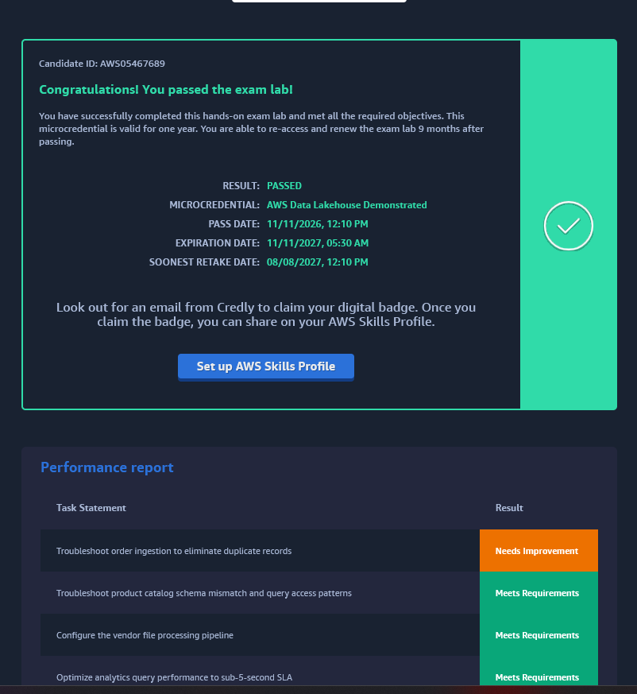

# 🏞️ AWS Data Lakehouse Demonstrated

> **Lab:** "AWS Data Lakehouse Demonstrated", one of the challenge sets for the AWS Partner FDE credential.
> **Theme:** Aurora, DynamoDB, Firehose and vendor CSV sources feed Iceberg tables in S3, governed by Lake Formation and queried with Athena.
> **Lab resources:** Athena workgroup `anycompany-lakehouse` · Glue database `lakehouse_db`
> **Started:** 11 Nov 2026 · **Status legend:** ✅ passed · 🟡 in progress · ⬜ not started · ⚠️ needs improvement
> **Back to:** [Vault index](../README.md)

---

## 🏆 Result: PASSED

| | |
|---|---|
| **Microcredential** | AWS Data Lakehouse Demonstrated |
| **Result** | ✅ **PASSED** |
| **Pass date** | 11 Nov 2026, 12:10 PM |
| **Valid until** | 11 Nov 2027 (valid for one year) |
| **Renew / retake from** | 8 Aug 2027 (9 months after passing) |
| **Badge** | Claim it from the **Credly** email, then add it to the **AWS Skills Profile** |



**Performance report (visible rows):** A, B and F *Meets Requirements*. G *Needs Improvement* (not finished in time). The C, D and E rows were cut off in the screenshot. Fill them in from the full report.

**Before renewing:** re-read [Challenge G's complete solution](Challenge_G_Orders_Ingest_Duplicates_And_Iceberg_Snapshot_Rollback.md#-complete-solution-to-finish-on-a-retake-or-to-study), and start the slow Glue job runs early.

---

## 🗺️ Lab architecture (HLD)


The lettered circles on the diagram mark where each challenge happens.

| Label | Component on the diagram | Data flow |
|---|---|---|
| **A** | Glue ETL job *ingest products* | Aurora PostgreSQL (products) → JDBC read → **append** to the curated Iceberg table |
| **B** | Amazon Athena | Users run SQL → Athena scans Iceberg data files in the analytics zone |
| **C** | Lake Formation governance of the curated/analytics tables (sits beside the curated → analytics Glue job) | LF-Tags + tag-based grants decide who can read which tables *(confirmed by Challenge C)* |
| **D** | Amazon Data Firehose (order status) | Puts JSON records in batches → curated S3 bucket |
| **E** | Lake Formation fine-grained access (data cell filters) | Row/column/cell filters on tables such as `customers` decide what each role sees inside a table *(confirmed by Challenge E)* |
| **F** | EventBridge → Step Functions → Lambda | Vendor CSV dropped in raw S3 → EventBridge starts a Step Functions run → Lambda validates the file → starts the *ingest vendor data* Glue job → **append** to curated |
| **G** | Glue ETL job *ingest orders* | DynamoDB (orders) → export to raw S3 → read JSON → **merge** into curated |

**Zones:** *Curated* (S3 curated bucket, Iceberg tables) → *Analytics* (S3 analytics bucket, Iceberg tables). Both zones sit inside the **AWS Lake Formation** boundary, and the **Glue Data Catalog** holds the metadata for both.

---

## 📋 Challenge tracker

| # | Challenge | Key services | Status | Notes |
|---|---|---|---|---|
| A | Troubleshoot product catalog schema mismatch and query access patterns | Glue (Spark), Iceberg, Athena, Lake Formation | ✅ Meets Requirements | [Challenge_A](Challenge_A_Product_Catalog_Schema_Mismatch_And_Partitioning.md) |
| B | Optimize analytics query performance to sub-5-second SLA | Athena (OPTIMIZE / VACUUM / TBLPROPERTIES), Glue (Spark), Iceberg COW → MOR | ✅ Meets Requirements | [Challenge_B](Challenge_B_Analytics_Query_Performance_Compaction_And_MOR.md) |
| C | Configure tag-based access control for data science and intern roles | Lake Formation (LF-Tags, TBAC, ASSOCIATE), IAM | ✅ (lab passed; result not in screenshot) | [Challenge_C](Challenge_C_LF_Tag_Based_Access_Control_Data_Science_And_Intern.md) |
| D | Troubleshoot streaming upsert failures in Amazon Data Firehose delivering to Apache Iceberg tables | Data Firehose (Iceberg destination, unique keys, buffering) | ✅ (lab passed; result not in screenshot) | [Challenge_D](Challenge_D_Firehose_Iceberg_Streaming_Upserts_And_Buffering.md) |
| E | Configure data cell filters for marketing and regional manager access | Lake Formation (data cell filters, named-resource grants) | ✅ (lab passed; result not in screenshot) | [Challenge_E](Challenge_E_LF_Data_Cell_Filters_Marketing_And_Regional_Manager.md) |
| F | Configure the vendor file processing pipeline | S3 → EventBridge (pattern + input transformer), Step Functions (Retry), Lambda, Glue | ✅ Meets Requirements | [Challenge_F](Challenge_F_Vendor_File_Pipeline_EventBridge_StepFunctions_Lambda.md) |
| G | Troubleshoot order ingestion to eliminate duplicate records | Glue (job parameters, S3 read path), Iceberg snapshots, time travel, rollback | ⚠️ Needs Improvement (not finished in time) | [Challenge_G](Challenge_G_Orders_Ingest_Duplicates_And_Iceberg_Snapshot_Rollback.md) |

_Rows B–G are placeholders keyed to the diagram labels. I'll rename each one when I see its task card._

---

## 🧭 Folder layout

```text
01_AWS_Data_Lakehouse_Demonstrated/
├── README.md ................................. you are here (HLD + tracker)
├── Challenge_A_Product_Catalog_Schema_Mismatch_And_Partitioning.md
├── Challenge_B_Analytics_Query_Performance_Compaction_And_MOR.md
├── Challenge_C_LF_Tag_Based_Access_Control_Data_Science_And_Intern.md
├── Challenge_D_Firehose_Iceberg_Streaming_Upserts_And_Buffering.md
├── Challenge_E_LF_Data_Cell_Filters_Marketing_And_Regional_Manager.md
├── Challenge_F_Vendor_File_Pipeline_EventBridge_StepFunctions_Lambda.md
├── Challenge_G_Orders_Ingest_Duplicates_And_Iceberg_Snapshot_Rollback.md
└── assets/
    ├── 00_lakehouse_architecture_hld.png ..... shared architecture diagram
    ├── challenge_A/ .......................... screenshots for Challenge A
    ├── challenge_B/ .......................... screenshots for Challenge B
    ├── challenge_C/ .......................... screenshots for Challenge C
    ├── challenge_D/ .......................... screenshots for Challenge D
    ├── challenge_E/ .......................... screenshots for Challenge E
    ├── challenge_F/ .......................... screenshots for Challenge F
    └── challenge_G/ .......................... screenshots for Challenge G
```

---

## 🧠 Lessons from this lab (running list)

- **Athena runs SQL. Glue jobs run PySpark.** `spark.sql("...")` goes in the Glue job script. Athena is for checking results. *(A)*
- **Check the Athena workgroup first.** The saved queries and query-result location are in `anycompany-lakehouse`, not `primary`. *(A)*
- **When the success criteria say "job X runs successfully", make the change inside job X**, even if the same DDL could run somewhere else. *(A)*
- **Athena runs one statement per execution.** Run each ALTER / OPTIMIZE / VACUUM on its own. *(B)*
- **Maintenance commands obey table properties.** If OPTIMIZE or VACUUM "does nothing", check the `optimize_*` and `vacuum_*` thresholds first. *(B)*
- **Athena vs Spark for Iceberg DDL:** Athena handles `optimize_*`/`vacuum_*` properties, column changes, OPTIMIZE and VACUUM. Spark handles `write.*.mode`, partition evolution and other native Iceberg properties. *(A, B)*
- **With LF-TBAC, check the resource tags before touching the grants.** Access = grant expression ∩ resource tags. Wrong tags give the wrong access. *(C)*
- **To change tags you need ASSOCIATE on the tag itself**, granted to the exact console session role. Being a data lake admin isn't enough. *(C)*
- **Streaming into Iceberg needs an identity key to update rows.** Without unique keys, Firehose only appends, and status events turn into duplicate rows. *(D)*
- **Small files come from flushing too often.** Fix them at the source (bigger buffer interval) as well as with compaction afterwards (B). *(B, D)*
- **Row filters compare strings exactly.** Query the actual values (casing, suffixes) before writing a filter expression. *(E)*
- **Lake Formation access control has two layers:** TBAC decides which tables a role sees (C), and data cell filters decide which rows and columns inside a table (E). Grants add up, so audit all of a role's grants. *(C, E)*
- **Event-driven pipelines only see new events.** S3 must have *EventBridge: On*, and files that existed before the rule need a backfill. *(F)*
- **Pass a minimal input contract between services** (input transformer → `{bucket, key}`) rather than raw events. *(F)*
- **Retry transient failures, specific errors first and `States.ALL` last**, and use Catch to route anything that still fails after the retries. *(F)*
- **Batch jobs must be idempotent.** Scope reads to one logical date (or MERGE on a key). Reading a whole S3 prefix of full exports multiplies the data. *(G)*
- **Iceberg snapshots are your undo button.** Check with time travel (`FOR VERSION AS OF`), then `rollback_to_snapshot`. Aggressive VACUUM (B) deletes old snapshots and removes that option. *(B, G)*
