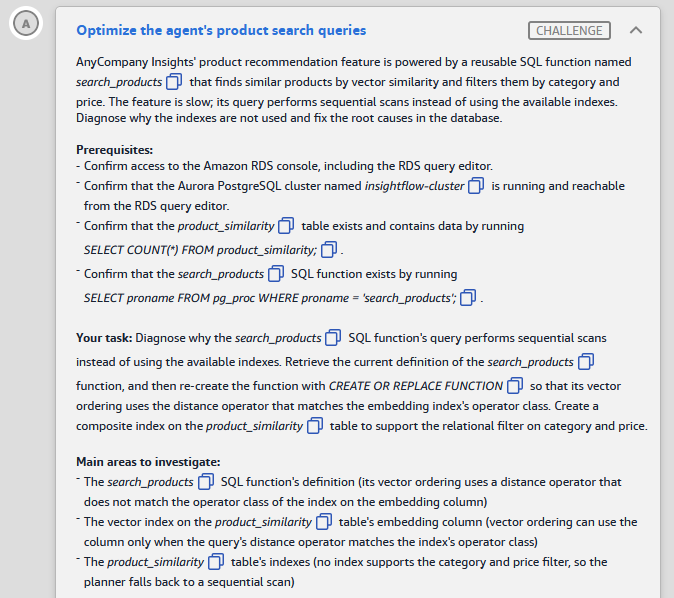
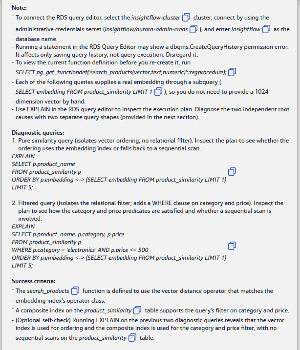
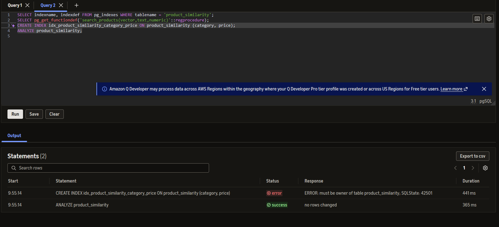

# 🅰️ Challenge A: Optimize the agent's product search queries

> **Status:** ✅ Passed, *Meets Requirements* (exam lab, 12 Nov 2026) · **Diagram label:** A (Amazon Aurora pgvector, on the *Query data* arrow)
> **Services:** Aurora PostgreSQL, the **pgvector** extension (HNSW/IVFFlat vector index, distance operators), PostgreSQL B-tree composite index, the planner (`EXPLAIN`), RDS Query Editor (Data API)
> **Lab:** [AWS Databases for Agentic AI Demonstrated](README.md) · **Vault:** [index](../README.md)

---

## ✅ Status checklist (success criteria)

- [x] The `search_products` function uses the **vector distance operator that matches the embedding index's operator class**
- [x] A **composite index** on `product_similarity` supports the query's filter on **category and price**
- [ ] *(Optional self-check)* `EXPLAIN` on the two diagnostic queries shows the **vector index** used for ordering and the **composite index** used for the category/price filter, with **no sequential scan** on `product_similarity`

---

## 🖼️ Task card





<details>
<summary>Text copy of the task</summary>

**Scenario:** AnyCompany Insights' product recommendation feature runs on a reusable SQL function named `search_products`. It finds similar products by vector similarity and filters them by category and price. The feature is slow: its query does sequential scans instead of using the available indexes. Diagnose why the indexes aren't used, and fix the root causes in the database.

**Prerequisites**
- Confirm access to the Amazon RDS console, including the RDS query editor.
- Confirm that the Aurora PostgreSQL cluster named `insightflow-cluster` is running and reachable from the RDS query editor.
- Confirm that the `product_similarity` table exists and has data: `SELECT COUNT(*) FROM product_similarity;`
- Confirm that the `search_products` SQL function exists: `SELECT proname FROM pg_proc WHERE proname = 'search_products';`

**Your task:** Diagnose why the `search_products` SQL function's query does sequential scans instead of using the available indexes. Get the current definition of the `search_products` function, then re-create it with `CREATE OR REPLACE FUNCTION` so that its vector ordering uses the distance operator that matches the embedding index's operator class. Create a composite index on the `product_similarity` table to support the relational filter on category and price.

**Main areas to investigate**
- The `search_products` function's definition. Its vector ordering uses a distance operator that doesn't match the operator class of the index on the embedding column.
- The vector index on the `product_similarity` table's embedding column. Vector ordering can use the index only when the query's distance operator matches the index's operator class.
- The `product_similarity` table's indexes. No index supports the category and price filter, so the planner falls back to a sequential scan.

**Notes**
- To connect the RDS query editor: select the `insightflow-cluster` cluster, connect with the **administrative credentials secret** (`insightflow/aurora-admin-creds`), and enter **`insightflow`** as the database name.
- Running a statement in the RDS Query Editor may show a `dbqms:CreateQueryHistory` permission error. It only affects saving query history, not running the query. Ignore it.
- To see the current function definition before you re-create it, run: `SELECT pg_get_functiondef('search_products(vector,text,numeric)'::regprocedure);`
- Each diagnostic query below supplies a real embedding through a subquery (`SELECT embedding FROM product_similarity LIMIT 1`), so you don't need to type a 1024-dimension vector.
- Use `EXPLAIN` in the RDS query editor to inspect the execution plan. Diagnose the two independent root causes with the two separate query shapes below.

**Diagnostic queries**

1. Pure similarity query. It isolates the vector ordering, with no relational filter. Check whether the ordering uses the embedding index or falls back to a sequential scan.
   ```sql
   EXPLAIN
   SELECT p.product_name
   FROM product_similarity p
   ORDER BY p.embedding <-> (SELECT embedding FROM product_similarity LIMIT 1)
   LIMIT 5;
   ```
2. Filtered query. It isolates the relational filter by adding a WHERE clause on category and price. Check how the category and price predicates are satisfied, and whether there's a sequential scan.
   ```sql
   EXPLAIN
   SELECT p.product_name, p.category, p.price
   FROM product_similarity p
   WHERE p.category = 'electronics' AND p.price <= 500
   ORDER BY p.embedding <-> (SELECT embedding FROM product_similarity LIMIT 1)
   LIMIT 5;
   ```

**Success criteria**
- The `search_products` function uses the vector distance operator that matches the embedding index's operator class.
- A composite index on the `product_similarity` table supports the query's filter on category and price.
- (Optional self-check) Running EXPLAIN on the two diagnostic queries shows that the vector index is used for ordering and the composite index is used for the category and price filter, with no sequential scans on the `product_similarity` table.

</details>

---

## 🗺️ Where it sits in the architecture


**Flow A:** LangGraph agent → *Query customers* / product tool Lambda (`insightflow-aurora-query-tool-…`) → **Query data** → Aurora PostgreSQL → `search_products(query_embedding, category, max_price)` → `product_similarity` table (1024-dimension `embedding` column + `category` + `price`).

The agent calls a **database function** rather than writing raw SQL. That's good practice: one tested query, one place to grant `EXECUTE`. It also means one wrong operator inside the function slows down every recommendation the agent makes.

---

## 🔍 Root cause

There are **two independent causes**, and each diagnostic query shows one of them.

| # | Problem | Why the planner does a sequential scan |
|---|---|---|
| **1** | **Operator / operator class mismatch** (diagnostic query 1) | A pgvector index is built for **one** distance function, set by its **operator class** (`vector_l2_ops`, `vector_cosine_ops`, `vector_ip_ops`, …). PostgreSQL can only use the index for `ORDER BY embedding <op> $q LIMIT n` when `<op>` belongs to that operator class. The function orders with a different operator, so the index isn't eligible, and Postgres computes the distance to **every row** and sorts. |
| **2** | **No index for the relational filter** (diagnostic query 2) | `WHERE category = 'electronics' AND price <= 500` has no B-tree index to satisfy it, so the predicate is checked row by row on a sequential scan. |

### ✔️ Confirmed in the lab (Steps 1 and 3)

| What | Found | Meaning |
|---|---|---|
| Vector index (Step 1) | **`idx_product_similarity_hnsw`**, method **`hnsw`**, opclass **`vector_cosine_ops`** | The index can only serve ordering by **`<=>`** (cosine distance) |
| Other indexes (Step 1) | `product_similarity_pkey`, `btree`, `int4_ops` (primary key only) | **No index on `category`/`price`**, which is root cause 2 |
| Function's `ORDER BY` (Step 3) | `ORDER BY p.embedding <-> query_embedding` | Uses **`<->`** (L2), which doesn't match `vector_cosine_ops`. That's root cause 1 |

**Fix:** change `<->` to `<=>` in the function, and add a `(category, price)` B-tree.

> My guess before checking was the reverse (an L2 index and a cosine function). The lab's diagnostic queries use `<->` because they're meant to **show the sequential scan**, not because `<->` is correct. Lesson: **read the opclass, don't guess it from the sample queries.**

### Operator ↔ operator class (memorise this)

| Operator | Distance | Index operator class | Notes |
|---|---|---|---|
| `<->` | L2 / Euclidean | `vector_l2_ops` | The default if no opclass is given ⚠️ |
| `<=>` | Cosine distance (1 − cosine similarity) | `vector_cosine_ops` | The usual choice for text embeddings |
| `<#>` | **Negative** inner product | `vector_ip_ops` | Negative so that `ORDER BY … ASC` still gives the closest first |
| `<+>` | L1 / taxicab | `vector_l1_ops` | HNSW only (pgvector 0.7+) ⚠️ |
| `<~>` | Hamming (`bit` vectors) | `bit_hamming_ops` | Binary quantisation |
| `<%>` | Jaccard (`bit` vectors) | `bit_jaccard_ops` | HNSW only ⚠️ |

---

## 🛠️ Solution

### Where each step happens

| Step | AWS service → console page | What I do there |
|---|---|---|
| 0.1 | Any console page → **Region selector** (top right) | Confirm **US East (N. Virginia) us-east-1** |
| 0.2 | **Amazon RDS** → *Databases* | Confirm `insightflow-cluster-…` is **Available** |
| 0.3 | **AWS Secrets Manager** → *Secrets* | Copy the **ARN** of the admin secret `insightflow/aurora-admin-creds` |
| 0.4 | **Amazon RDS** → *Query editor* | Connect to the cluster as admin, database `insightflow` |
| 1–6 | **Amazon RDS** → *Query editor* (the SQL runs on the Aurora **PostgreSQL** engine) | All diagnosis and all fixes are SQL statements |
| 7 *(optional)* | **Chat app** (`ChatAppURL`) + **CloudWatch** → *Log groups* | End-to-end check |

> **RDS Query Editor vs "Postgres":** The database engine is **PostgreSQL** (Aurora PostgreSQL-compatible). The **RDS Query Editor** is a page in the RDS console that sends your SQL to that engine over HTTPS through the **RDS Data API**. You click in the RDS console and write PostgreSQL SQL. You don't need `psql`, pgAdmin, CloudShell or an EC2 host. They couldn't reach the cluster anyway, because it sits in private VPC subnets ⚠️.

---

### Step 0: Get connected

#### 0.1 Check the Region (any console page)

1. Look at the Region name at the top right of the console bar.
2. If it isn't **N. Virginia**, open it and choose **US East (N. Virginia) us-east-1**. If you're in the wrong Region, the cluster won't appear in the RDS lists.

#### 0.2 Check the cluster (Amazon RDS)

1. Console search bar (top) → type **RDS** → open **Aurora and RDS** (the console's current name for RDS ⚠️).
2. Left navigation → **Databases**.
3. Find **`insightflow-cluster-b55df330`**. Its role is *Regional cluster*, with one or more *Writer/Reader instance* rows under it.
4. **Status** must be **Available** for the cluster and its instances. If it's *Stopped* or *Starting*, wait. The Query Editor can't connect until it's Available.
5. *(Optional)* Click the cluster name → **Configuration** tab → check that **RDS Data API** is **Enabled** ⚠️ (the label may differ slightly). If the cluster is missing from the Query editor dropdown in 0.4, this is usually why.

#### 0.3 Copy the admin secret's ARN (AWS Secrets Manager)

The Solution Resources panel only has the **agent** secret's ARN (`AuroraAgentSecretARN`). This task needs the **admin** secret, because the agent user probably can't run `CREATE OR REPLACE FUNCTION` or `CREATE INDEX`.

1. Console search bar → type **Secrets Manager** → open it (middle-click or Ctrl-click opens a new tab, so the RDS tab stays open).
2. Left navigation → **Secrets**.
3. In the filter box, type `aurora-admin-creds`.
4. Click **`insightflow/aurora-admin-creds`** (with the lab's suffix).
5. On the **Secret details** card, click the copy icon next to **Secret ARN**. It looks like
   `arn:aws:secretsmanager:us-east-1:<account>:secret:insightflow/aurora-admin-creds-<suffix>-XXXXXX`
6. **Don't edit or rotate the secret.** *(Optional:* **Retrieve secret value** shows the admin username. Read it but don't change anything.)

#### 0.4 Connect the Query editor (Amazon RDS)

1. Back in the **Aurora and RDS** tab → left navigation → **Query editor**.
2. The **Connect to database** dialog opens. Fill it in:

   | Field | Value |
   |---|---|
   | **Database instance or cluster** | `insightflow-cluster-b55df330` |
   | **Database username** | **Connect with a Secrets Manager ARN** |
   | **Secrets Manager ARN** | paste the **admin** ARN from 0.3 |
   | **Enter the name of the database** | `insightflow` |

3. Click **Connect to database**.
4. The editor opens: a SQL box at the top, a **Run** button and the **Output** results pane below.
5. **Smoke test.** Paste the line below and click **Run**. Expect the admin username, `insightflow` and a PostgreSQL version string:
   ```sql
   SELECT current_user, current_database(), version();
   ```
   A red `dbqms:CreateQueryHistory` banner may appear. **Ignore it.** It's about saving query history, and the results are still in **Output**.
6. **Prerequisite checks.** Run each one on its own:
   ```sql
   SELECT COUNT(*) FROM product_similarity;                          -- expect > 0 rows
   SELECT proname FROM pg_proc WHERE proname = 'search_products';    -- expect 1 row
   SELECT extversion FROM pg_extension WHERE extname = 'vector';     -- pgvector version (0.8.x = iterative scans available)
   ```

> **How the Query editor runs SQL (from my screenshot):** it accepts several statements. **Highlight** the lines you want and click **Run**, and only the highlighted statements run. **Output → Statements (n)** then lists each statement with its **Status** (*success*/*error*) and **Response** (the error text or the row count). It's still easiest to highlight **one** statement at a time, so each result is easy to read and a function body is never split on its internal `;`. If the session drops, reconnect with the same four values from 0.4.
>
> ⚠️ **Status *success* doesn't always mean the work was done.** For example, `ANALYZE` run by a non-owner *skips* the table with only a warning, and still shows *success / no rows changed*.

#### 0.5 Confirm you're connected as the table owner (do this before any DDL)

`CREATE INDEX`, `CREATE OR REPLACE FUNCTION` and `ANALYZE` all require you to **own** the object (or be a superuser). Check who you are and who owns what:

```sql
SELECT current_user,
       (SELECT tableowner FROM pg_tables WHERE tablename = 'product_similarity') AS table_owner,
       (SELECT proowner::regrole FROM pg_proc WHERE proname = 'search_products')  AS function_owner;
```

| Result | Meaning | What to do |
|---|---|---|
| `current_user` = `table_owner` = `function_owner` | You're the owner | Continue to Step 1 |
| `current_user` looks like the **agent** user (name contains *agent*, matching the panel's `aurora-agent-creds`) | You connected with the **agent** secret | Reconnect with the **admin** secret ARN (0.3 → 0.4) |
| `current_user` is the admin, but the owner is a **different** role | The tables belong to a third role | Check `SELECT pg_has_role(current_user, '<table_owner>', 'MEMBER');`. If it's `true`, highlight `SET ROLE <table_owner>;` and your DDL statement together and run them in one go ⚠️ |

---

### Step 1: Find the embedding index's operator class

**Where:** Amazon RDS → Query editor (connected as admin)

1. Run:
   ```sql
   SELECT indexname, indexdef
   FROM pg_indexes
   WHERE tablename = 'product_similarity';
   ```
2. In **Output**, find the row whose `indexdef` contains **`USING hnsw`** or **`USING ivfflat`**. That's the vector index.
3. Read the word right after `(embedding `. **That's the operator class.** Example: `… USING hnsw (embedding vector_l2_ops) …` means the class is `vector_l2_ops`.
4. Note the other rows too. You'll probably see only the primary key (`…_pkey`), which confirms there's **no** index on `category`/`price` yet.
5. Choose the operator the function must use:

   | Opclass in `indexdef` | Operator the function must use |
   |---|---|
   | `vector_l2_ops` | `<->` |
   | `vector_cosine_ops` | `<=>` |
   | `vector_ip_ops` | `<#>` |
   | `vector_l1_ops` | `<+>` |

   **If `indexdef` is cut off in the grid**, widen the column, or run this to get the opclass on its own:
   ```sql
   SELECT i.relname AS index_name, am.amname AS method, opc.opcname AS opclass
   FROM pg_index x
   JOIN pg_class i     ON i.oid = x.indexrelid
   JOIN pg_class t     ON t.oid = x.indrelid
   JOIN pg_am am       ON am.oid = i.relam
   JOIN pg_opclass opc ON opc.oid = ANY (x.indclass)
   WHERE t.relname = 'product_similarity';
   ```

---

### Step 2: Run both diagnostic queries (the "before" plans)

**Where:** Amazon RDS → Query editor

1. Paste **diagnostic query 1** from the task card, starting with the word `EXPLAIN`, and click **Run**.
2. **Output** shows one column, **`QUERY PLAN`**, with one row per plan line. Indentation and `->` show child steps.
3. Find the line that mentions **`product_similarity p`** (alias `p`). Is it `Seq Scan` or `Index Scan`?
4. Screenshot it and save it as `assets/challenge_A/04_explain_q1_before.png`.
5. Do the same with **diagnostic query 2** → `05_explain_q2_before.png`.

**A bad plan looks like this** (illustrative; costs and parameter names vary by PostgreSQL version):

```text
Limit
  InitPlan 1 (returns $0)
    ->  Limit
          ->  Seq Scan on product_similarity product_similarity_1    ← ignore: fetches the 1-row probe vector
  ->  Sort
        Sort Key: ((p.embedding <-> $0))
        ->  Seq Scan on product_similarity p                         ← the problem: every row read and sorted
              Filter: ((category = 'electronics') AND (price <= 500))
```

**How to read query 1's result:**
- **Index Scan on `p` already:** `<->` *matches* the index. So the function's **different** operator is the mismatch, and the function must use `<->`.
- **Seq Scan on `p`:** the index isn't L2. The function must use the index's operator from Step 1. To prove that's right, re-run query 1 with that operator in place of `<->`. You should see `Index Scan`.

---

### Step 3: Get the function definition

**Where:** Amazon RDS → Query editor

1. Run:
   ```sql
   SELECT pg_get_functiondef('search_products(vector,text,numeric)'::regprocedure);
   ```
2. **Output** has one row and one cell holding the whole `CREATE OR REPLACE FUNCTION …` statement. Copy the cell's text.
3. **If the cell is truncated or the line breaks collapse**, run this instead. It returns one numbered row per line, so you can read and copy it all:
   ```sql
   SELECT n, line
   FROM regexp_split_to_table(
          pg_get_functiondef('search_products(vector,text,numeric)'::regprocedure), E'\n')
        WITH ORDINALITY AS t(line, n)
   ORDER BY n;
   ```
4. Paste the definition into a **scratch text editor** (Notepad or VS Code), not the Query editor yet.
5. Search the scratch copy for **`<->`**, **`<=>`**, **`<#>`** and **`<+>`**. Write down each place the operator appears (usually the `ORDER BY`, and often a `distance` expression in the `SELECT` list).

---

### Step 4: Re-create the function with the matching operator

**Where:** scratch text editor → Amazon RDS → Query editor

1. In the scratch copy, **change only the distance operator** to the one from Step 1, everywhere it appears (`ORDER BY`, plus any `SELECT … AS distance` the `ORDER BY` alias points to). Keep the name, parameter names, parameter types, `RETURNS`, `LANGUAGE` and everything else **exactly** the same.
2. Clear the Query editor and paste the **entire** edited statement, from `CREATE OR REPLACE FUNCTION` to the closing `$function$`. Click **Run**.
3. Expect a success message with no result rows.
4. **Verify:** re-run the Step 3 query and confirm the new operator is in the definition. Screenshot → `06_function_after.png`.

**The actual statement for this lab.** It's built from the Step 3 output, and the **only** change is `<->` → `<=>` in the `ORDER BY`:

```sql
CREATE OR REPLACE FUNCTION public.search_products(query_embedding vector, target_category text, max_price numeric)
RETURNS TABLE(product_name text, category text, price numeric)
LANGUAGE sql STABLE
AS $function$
  SELECT p.product_name, p.category, p.price
  FROM product_similarity p
  WHERE p.category = target_category AND p.price <= max_price
  ORDER BY p.embedding <=> query_embedding
  LIMIT 5;
$function$;
```

| | Before (from Step 3) | After |
|---|---|---|
| `ORDER BY` | `p.embedding <-> query_embedding` (L2) | `p.embedding <=> query_embedding` (cosine) |
| Parameters | `query_embedding vector, target_category text, max_price numeric` | unchanged |
| `RETURNS` | `TABLE(product_name text, category text, price numeric)` | unchanged |
| `LANGUAGE` / volatility | `sql STABLE` | unchanged |

**Run it as admin** (step 0.5 check first): highlight the whole statement, from `CREATE` to the final `$function$;`, and click **Run**. Status should be **success**.

**Verify** (highlight and run each on its own):

```sql
-- 1. Returns true once the function uses the cosine operator
SELECT pg_get_functiondef('search_products(vector,text,numeric)'::regprocedure) LIKE '%<=>%' AS uses_cosine,
       pg_get_functiondef('search_products(vector,text,numeric)'::regprocedure) LIKE '%<->%' AS still_uses_l2;
```
Expected: `uses_cosine = true`, `still_uses_l2 = false`.

```sql
-- 2. The function still works and returns up to 5 rows
SELECT * FROM search_products((SELECT embedding FROM product_similarity LIMIT 1), 'electronics', 500);
```

- **Don't `DROP` the function.** `CREATE OR REPLACE` keeps its owner and its `GRANT EXECUTE` to the agent's DB user. `DROP` + `CREATE` loses the grant, and the agent then gets *permission denied*.

---

### Step 5: Create the composite index for the filter

**Where:** Amazon RDS → Query editor

1. Run:
   ```sql
   CREATE INDEX idx_product_similarity_category_price
       ON product_similarity (category, price);
   ```
2. Run (this refreshes the planner's statistics so it considers the new index):
   ```sql
   ANALYZE product_similarity;
   ```
3. **Verify:** re-run the Step 1 query. You should see a new row:
   `CREATE INDEX idx_product_similarity_category_price ON public.product_similarity USING btree (category, price)`.

- **Why equality first, then range:** `category = …` narrows the B-tree to one contiguous slice, and `price <= …` is then a range scan inside that slice. With `(price, category)` the index would walk every price ≤ 500 across *all* categories.

---

### Step 6: Re-run the diagnostic queries (the "after" plans)

**Where:** Amazon RDS → Query editor

⚠️ **The task card's diagnostic queries use `<->`, but this lab's index is `vector_cosine_ops`.** Run as written, query 1 will **still** show `Seq Scan … p` after the fix. That's expected, because `<->` can never use a cosine index. For the self-check, run the same two queries with **`<=>`**, the operator the function now uses.

1. Run the **cosine version of query 1** → screenshot `07_explain_q1_after.png`:
   ```sql
   EXPLAIN
   SELECT p.product_name
   FROM product_similarity p
   ORDER BY p.embedding <=> (SELECT embedding FROM product_similarity LIMIT 1)
   LIMIT 5;
   ```
2. Run the **cosine version of query 2** → screenshot `08_explain_q2_after.png`:
   ```sql
   EXPLAIN
   SELECT p.product_name, p.category, p.price
   FROM product_similarity p
   WHERE p.category = 'electronics' AND p.price <= 500
   ORDER BY p.embedding <=> (SELECT embedding FROM product_similarity LIMIT 1)
   LIMIT 5;
   ```
3. Check: **no `Seq Scan … p`** in either plan. The only `Seq Scan` left should be the one-row InitPlan subquery (`product_similarity_1`).
4. *(Optional)* Look at the plan of the function itself. A simple `LANGUAGE sql STABLE` set-returning function can be **inlined**, so `EXPLAIN` may show the inner plan instead of just `Function Scan` ⚠️:
   ```sql
   EXPLAIN SELECT * FROM search_products((SELECT embedding FROM product_similarity LIMIT 1), 'electronics', 500);
   ```

**Expected shapes** (illustrative; costs and `$0` naming vary by version):

```text
Query 1 (pure similarity, <=>)
Limit
  InitPlan 1 (returns $0)
    ->  Limit
          ->  Seq Scan on product_similarity product_similarity_1                 ← fine (1 row)
  ->  Index Scan using idx_product_similarity_hnsw on product_similarity p         ← vector index
        Order By: (embedding <=> $0)

Query 2 (filtered, <=>): either of these is fine (no Seq Scan on p)
Limit
  InitPlan 1 (returns $0) ...
  ->  Sort
        Sort Key: ((p.embedding <=> $0))
        ->  Bitmap Heap Scan on product_similarity p
              Recheck Cond: ((category = 'electronics') AND (price <= 500))
              ->  Bitmap Index Scan on idx_product_similarity_category_price      ← composite index
                    Index Cond: ((category = 'electronics') AND (price <= 500))
  -- or --
  ->  Index Scan using idx_product_similarity_hnsw on product_similarity p
        Order By: (embedding <=> $0)
        Filter: ((category = 'electronics') AND (price <= 500))
```

Which plan query 2 gets depends on how selective `electronics AND price <= 500` is. The planner compares "filter first, then sort exactly" with "walk the HNSW graph, then filter" (see Study note 4).

---

### Step 7 (optional): End-to-end check

**Where:** Query editor → chat app → CloudWatch

1. **Query editor.** Pick a real product to ask about:
   ```sql
   SELECT product_name, category, price FROM product_similarity LIMIT 10;
   ```
2. **Chat app.** Open `ChatAppURL` in a new tab (sign in if prompted ⚠️) and ask something like *"Recommend electronics under $500 similar to <product_name>"*.
3. **If the reply fails, open CloudWatch** → *Log groups* → `/aws/lambda/insightflow-aurora-query-tool-…` → latest log stream, and read the error.

⚠️ Other challenges (B–G) may still be broken, so a chat failure here doesn't by itself mean Challenge A is wrong. Challenge A is graded on the function definition and the index.

---

### Order of operations

```text
0.1 Region (console bar) → 0.2 cluster Available (RDS › Databases) → 0.3 copy admin secret ARN (Secrets Manager)
  → 0.4 connect (RDS › Query editor: cluster + admin ARN + db "insightflow")
  → 1 pg_indexes (opclass) → 2 EXPLAIN ×2 (before) → 3 pg_get_functiondef
  → 4 CREATE OR REPLACE (operator = opclass) → 5 CREATE INDEX (category, price) + ANALYZE
  → 6 EXPLAIN ×2 (after: no Seq Scan on p) → 7 optional chat-app check
```

---

## ⚠️ Mistakes & lessons

### Mistake 1: `CREATE INDEX` failed with *must be owner of table product_similarity*



**What I saw** (Statements (2) in the Output pane):

| Statement | Status | Response |
|---|---|---|
| `CREATE INDEX idx_product_similarity_category_price ON product_similarity (category, price)` | ❌ error | `ERROR: must be owner of table product_similarity; SQLState: 42501` |
| `ANALYZE product_similarity` | ✅ success | `no rows changed` |

**Why:**
- In PostgreSQL, **only the owner of a table** (or a superuser) can create an index on it. The **`GRANT`** privileges SELECT/INSERT/UPDATE aren't enough. `42501` is PostgreSQL's *insufficient_privilege* code.
- The connection was most likely made with the **agent** secret (`AuroraAgentSecretARN` from the Solution Resources panel). The agent's user can read the table but doesn't own it. The task note says to connect with the **admin** secret `insightflow/aurora-admin-creds`, whose ARN is **not** in the panel.
- The ANALYZE *success* is misleading. As a non-owner it most likely **skipped** the table with a warning, so it has to be re-run as the owner.

**Fix:**
1. Run the ownership check from **step 0.5** to confirm `current_user` ≠ `table_owner`.
2. **Secrets Manager** → *Secrets* → `insightflow/aurora-admin-creds` → copy **Secret ARN**.
3. **RDS Query editor** → reconnect: the same cluster, *Connect with a Secrets Manager ARN* → the **admin** ARN → database `insightflow`. (Use **Change database** at the top of the Query editor, or reopen *Query editor* from the left navigation ⚠️.)
4. Re-run step 0.5. `current_user` should now match `table_owner`.
5. Re-run **Step 4** (if `CREATE OR REPLACE FUNCTION` was run as the agent, it failed with *must be owner of function*), then **Step 5** (`CREATE INDEX` + `ANALYZE`).

**Lesson:** before any DDL, check **`current_user` against the object's owner**. In PostgreSQL, DDL rights come from **ownership**, not from `GRANT`s. Least-privilege agent users are *meant* to be unable to change the schema, which is the point of a separate agent secret.

---

## 🧯 Troubleshooting table

| Symptom | Cause | Fix |
|---|---|---|
| `dbqms:CreateQueryHistory` access denied | Query history can't be saved (expected in this lab) | Ignore it. The statement still ran |
| Query editor can't connect / *database does not exist* | Wrong secret or database name | Admin secret `insightflow/aurora-admin-creds`, database `insightflow` |
| Cluster missing from the Query editor dropdown | Wrong Region, cluster not *Available*, or RDS Data API not enabled | Switch to `us-east-1`. Check *RDS › Databases* status and the cluster's *Configuration* tab |
| *Invalid ARN* / secret not found when connecting | Pasted the secret **name** instead of the full **ARN**, or a truncated ARN | Copy **Secret ARN** with the copy icon in Secrets Manager (step 0.3) |
| `ERROR: must be owner of table product_similarity; SQLState: 42501` on `CREATE INDEX` (or *must be owner of function* on `CREATE OR REPLACE`) | Connected as a non-owner, most likely with the **agent** secret from the panel | Run the step 0.5 check, then reconnect with the **admin** secret ARN. See Mistake 1 |
| `ANALYZE` shows *success / no rows changed*, but plans don't change | A non-owner's `ANALYZE` skips the table with only a warning | Re-run `ANALYZE product_similarity;` as the owner |
| `unterminated dollar-quoted string` / syntax error at end of input | Only part of the function was pasted, or other statements were in the editor too | Clear the editor and paste the whole statement, from `CREATE OR REPLACE` to `$function$;`, on its own |
| `function search_products(vector, text, numeric) does not exist` | The signature is different | `SELECT oid::regprocedure FROM pg_proc WHERE proname = 'search_products';` and use the exact signature |
| `cannot change name of input parameter "…"` | Parameter names were changed in `CREATE OR REPLACE` | Keep the original names exactly (copy from `pg_get_functiondef`) |
| `cannot change return type of existing function` | The `RETURNS` clause was changed | Keep it identical. Only the operator should change |
| `operator does not exist: vector <=> vector` | pgvector isn't in the `search_path`, or it's an old version | `SELECT extversion FROM pg_extension WHERE extname = 'vector';`, then schema-qualify if needed |
| A `Seq Scan on product_similarity product_similarity_1` remains | It's the `LIMIT 1` subquery in the InitPlan | Expected. Only the scan on alias **`p`** matters |
| Query 2 still shows `Seq Scan … p` after creating the index | Stale statistics, or the table is tiny enough that a seq scan really is cheaper | `ANALYZE product_similarity;` then re-run `EXPLAIN`. Confirm the index exists in `pg_indexes` |
| `EXPLAIN SELECT * FROM search_products(…)` shows only `Function Scan` | PL/pgSQL (and non-inlinable SQL) functions hide their inner plan | Use the two diagnostic queries, which repeat the function's query shape. That's why the lab provides them |
| Agent gets `permission denied for function search_products` | The function was dropped and re-created, which lost `GRANT EXECUTE` | `GRANT EXECUTE ON FUNCTION search_products(vector,text,numeric) TO <agent_user>;` (user name from the agent secret) |

---

## 📚 Study notes (go deeper later)

### 1. pgvector in one page

- **What it is:** a PostgreSQL extension (`CREATE EXTENSION vector;`) that adds the `vector(n)` type, distance operators and approximate-nearest-neighbour (ANN) indexes. On Aurora/RDS PostgreSQL it's a supported extension. **Bedrock Knowledge Bases** use Aurora + pgvector as a vector store, which is label F in this lab.
- **Types:** `vector` (float32, indexable up to **2,000** dims), `halfvec` (float16, indexable up to **4,000** dims), `bit` (binary, for Hamming/Jaccard), `sparsevec` ⚠️. The 1024-dim embedding here (probably Amazon Titan Text Embeddings V2's default size ⚠️) fits `vector` comfortably.
- **Exact vs approximate:** with no index (or a mismatched one), pgvector does **exact** k-NN, computing the distance to every row. That's always correct and O(n). An index gives **approximate** results, much faster, tuned by recall parameters.

### 2. HNSW vs IVFFlat

| | **HNSW** | **IVFFlat** |
|---|---|---|
| Structure | Multi-layer proximity graph | k-means clusters (`lists`), scan the nearest `probes` clusters |
| Build | Slower, more memory; can be built on an empty table | Fast; needs representative data **before** building |
| Query speed / recall | Better speed-recall trade-off | Lower recall unless `probes` is raised |
| Build params | `m` (default 16), `ef_construction` (default 64) | `lists` (≈ rows/1000 for up to 1M rows ⚠️) |
| Query param | `SET hnsw.ef_search = 40` (default) | `SET ivfflat.probes = 1` (default) |
| Pick when | Default choice for most RAG/agent workloads | Very large tables where build time or memory matters |

```sql
CREATE INDEX ON product_similarity USING hnsw (embedding vector_cosine_ops) WITH (m = 16, ef_construction = 64);
CREATE INDEX ON product_similarity USING ivfflat (embedding vector_l2_ops) WITH (lists = 100);
```

### 3. What makes the planner use a vector index

All of these must be true:
1. `ORDER BY <vector_col> <op> <constant or parameter>`, with the **operator in the index's opclass**.
2. **Ascending** order (closest first). `<#>` is negated for exactly this reason.
3. A **`LIMIT`**. Without one, the index has nothing to cut short.
4. The query vector must be known when the plan is built or executed: a literal, a parameter, or an InitPlan like the diagnostic queries' subquery.

### 4. Filtered vector search (the second-order problem)

- **HNSW + WHERE = post-filtering.** The index returns about `ef_search` (40) nearest candidates, *then* the WHERE clause removes rows. A selective filter can return **fewer than LIMIT rows**, or even none.
- Two plans the planner chooses between:
  - **Filter first:** a B-tree (your composite index) finds matching rows, then pgvector computes exact distances and sorts. This is exact, and fast when the filter is selective.
  - **Vector first:** HNSW index scan plus a filter. Fast when the filter is broad, but recall can drop.
- **pgvector 0.8.0 adds iterative index scans:** `SET hnsw.iterative_scan = relaxed_order;` keeps scanning the graph until LIMIT rows pass the filter ⚠️ (check that the Aurora engine version includes 0.8.0).
- Other options: **partial indexes** per hot category (`CREATE INDEX … USING hnsw (embedding vector_l2_ops) WHERE category = 'electronics'`), or **partitioning** by category.

### 5. Composite B-tree index design

- **Column order:** equality columns first, then **one** range column. Anything after the first range column can't narrow the scan.
- `(category, price)` serves `category = ?`, `category = ? AND price <= ?` and `ORDER BY category, price`. It does **not** efficiently serve `price <= ?` alone.
- **Covering index:** `CREATE INDEX … (category, price) INCLUDE (product_name);` allows index-only scans. That doesn't help here, because the embedding must be read from the heap anyway.
- **In production**, use `CREATE INDEX CONCURRENTLY` (no write lock). It can't run inside a transaction block ⚠️.

### 6. Changing functions safely

- `CREATE OR REPLACE FUNCTION` keeps the OID, owner, grants and dependent objects. It **can't** change the return type or parameter names. For those you need `DROP` + `CREATE` + re-`GRANT`.
- `pg_get_functiondef(oid)` returns the full DDL, so copy, edit and run it. `'name(argtypes)'::regprocedure` turns a signature into the OID.
- `LANGUAGE sql` functions can be **inlined** into the caller's plan. `plpgsql` functions are planned separately and cached, and `EXPLAIN` on the call only shows `Function Scan`. Inspect the inner query on its own (as the diagnostic queries do) or use `auto_explain` (parameter group setting on Aurora ⚠️).

### 7. Reading EXPLAIN quickly

| Node | Meaning |
|---|---|
| `Seq Scan` | Reads every row of the table |
| `Index Scan … Order By:` | Vector index (or B-tree) gives rows already in distance order |
| `Bitmap Index Scan` → `Bitmap Heap Scan` | B-tree finds matching row locations, then fetches them in page order |
| `Sort` above a scan | Rows had to be sorted after fetching (no index gave the order) |
| `InitPlan 1 (returns $0)` | A subquery run once before the main query. Its value is `$0` |

`EXPLAIN` shows the plan and cost estimates only. `EXPLAIN (ANALYZE, BUFFERS)` actually runs the query and shows real timings and rows.

### 8. Cosine vs L2: does switching the operator change results?

- For **unit-normalised** embeddings (Titan V2 normalises by default ⚠️), L2 distance and cosine distance give the **same ranking**: ‖a−b‖² = 2 − 2·cos(a,b). So matching the operator to the index here doesn't change which products are recommended. It only changes the distance *values*.
- For non-normalised vectors the rankings differ. Choose the metric the embedding model was trained for, build the index with that opclass, and use that operator everywhere.

### 9. GCP mapping

| AWS | GCP |
|---|---|
| Aurora PostgreSQL + pgvector | **AlloyDB** / Cloud SQL for PostgreSQL + pgvector (same extension and operators) |
| HNSW / IVFFlat | Same in pgvector. AlloyDB also has the **ScaNN** index |
| Bedrock Knowledge Bases on Aurora | Vertex AI RAG Engine / Vertex AI Search on AlloyDB or Vector Search |
| RDS Query Editor (Data API) | AlloyDB Studio / Cloud SQL Studio |

### 🧪 Self-test questions

1. An HNSW index is built with `vector_cosine_ops`. Which operator must the `ORDER BY` use, and what happens with `<->`?
2. Why does `<#>` return the *negative* inner product?
3. In diagnostic query 1's plan you see `Seq Scan on product_similarity product_similarity_1`. Is the fix incomplete?
4. Why `(category, price)` and not `(price, category)`?
5. Why use `CREATE OR REPLACE` instead of `DROP FUNCTION` + `CREATE FUNCTION`?
6. A filtered HNSW query with `LIMIT 5` returns only 2 rows. Why, and name two fixes.
7. When is a sequential scan actually the right plan?

<details>
<summary>Answers</summary>

1. `<=>`. With `<->` the index isn't eligible, so Postgres does a sequential scan and computes the exact L2 distance to every row, then sorts.
2. Indexes return rows in **ascending** order. A larger inner product means more similar, so negating it makes "most similar" the smallest value.
3. No. That's the `LIMIT 1` InitPlan subquery fetching the probe vector. Check the scan on alias `p`.
4. Equality-then-range. `category =` fixes one contiguous slice of the B-tree, and `price <=` scans a range inside it. With price first, the scan covers every category.
5. `CREATE OR REPLACE` keeps the owner, `GRANT EXECUTE` to the agent's user and dependencies. `DROP` loses the grants, so the agent breaks.
6. HNSW post-filters its ~`ef_search` candidates, and most of them failed `WHERE`. Fixes: raise `hnsw.ef_search`, enable `hnsw.iterative_scan` (pgvector 0.8+), use a B-tree filter-first plan, or use a partial index or partitioning per category.
7. Small tables, or filters matching a large fraction of rows. Reading everything sequentially then beats random index lookups.

</details>

---

## 📝 Run log (fill in as I go)

| Step | What I ran | Result / output |
|---|---|---|
| 0 | `SELECT COUNT(*) FROM product_similarity;` | _row count_ |
| 1 | Index + opclass query for `product_similarity` | `product_similarity_pkey` · btree · `int4_ops`. **`idx_product_similarity_hnsw` · hnsw · `vector_cosine_ops`** → the function must use `<=>`. No index on category/price |
| 2 | Diagnostic query 1 (before) | _scan node on p_ |
| 2 | Diagnostic query 2 (before) | _scan node on p_ |
| 3 | `pg_get_functiondef(...)` | `search_products(query_embedding vector, target_category text, max_price numeric) RETURNS TABLE(product_name text, category text, price numeric) LANGUAGE sql STABLE`. Body: `… WHERE p.category = target_category AND p.price <= max_price ORDER BY p.embedding <-> query_embedding LIMIT 5`. **Mismatch: `<->` vs `vector_cosine_ops`** |
| 4 | `CREATE OR REPLACE FUNCTION` with `<=>` (as admin) | _status_ · `uses_cosine` = ? |
| 5 | `CREATE INDEX idx_product_similarity_category_price` + `ANALYZE` (attempt 1) | ❌ `ERROR: must be owner of table product_similarity; SQLState: 42501`. ANALYZE "success / no rows changed" (probably skipped). See Mistake 1 |
| 0.5 | Ownership check (`current_user` vs `table_owner`) | _current_user = ?, table_owner = ?_ |
| 5 | Re-ran as admin (attempt 2) | _status_ |
| 6 | Diagnostic queries 1 & 2 (after) | _plans_ |
