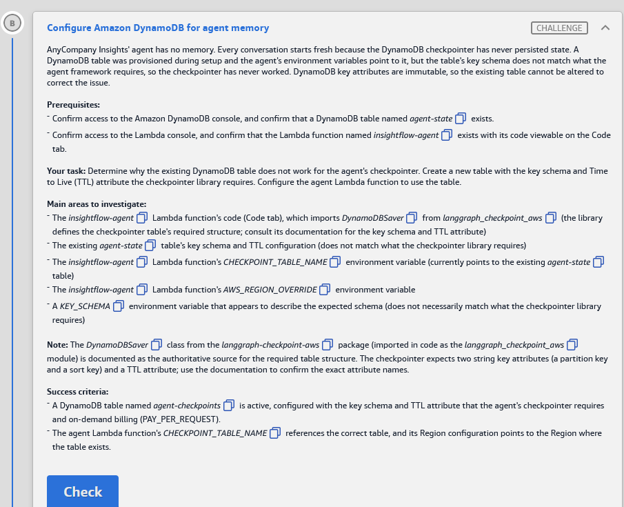
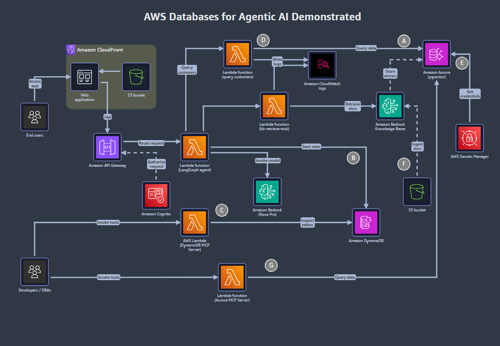

# 🅱️ Challenge B: Configure Amazon DynamoDB for agent memory

> **Status:** ✅ Passed, *Meets Requirements* (exam lab, 12 Nov 2026) · **Diagram label:** B (Amazon DynamoDB, on the *Save state* arrow from the LangGraph agent)
> **Services:** Amazon DynamoDB (key schema, TTL, on-demand capacity), AWS Lambda (environment variables, Code tab), LangGraph checkpointer `DynamoDBSaver` from `langgraph-checkpoint-aws`, CloudWatch Logs
> **Lab:** [AWS Databases for Agentic AI Demonstrated](README.md) · **Vault:** [index](../README.md)

---

## ✅ Status checklist (success criteria)

- [x] A DynamoDB table named **`agent-checkpoints`** is **Active**, with the key schema and TTL attribute the agent's checkpointer requires, and **on-demand** billing (`PAY_PER_REQUEST`)
- [x] The agent Lambda's **`CHECKPOINT_TABLE_NAME`** references the correct table, and its **Region configuration** points to the Region where the table exists

---

## 🖼️ Task card



<details>
<summary>Text copy of the task</summary>

**Scenario:** AnyCompany Insights' agent has no memory. Every conversation starts fresh because the DynamoDB checkpointer has never persisted state. A DynamoDB table was provisioned during setup and the agent's environment variables point to it, but the table's key schema doesn't match what the agent framework requires, so the checkpointer has never worked. DynamoDB key attributes are immutable, so the existing table can't be altered to fix the issue.

**Prerequisites**
- Confirm access to the Amazon DynamoDB console, and confirm that a DynamoDB table named `agent-state` exists.
- Confirm access to the Lambda console, and confirm that the Lambda function named `insightflow-agent` exists and its code is viewable on the Code tab.

**Your task:** Determine why the existing DynamoDB table doesn't work for the agent's checkpointer. Create a new table with the key schema and Time to Live (TTL) attribute that the checkpointer library requires. Configure the agent Lambda function to use the table.

**Main areas to investigate**
- The `insightflow-agent` Lambda function's code (Code tab). It imports `DynamoDBSaver` from `langgraph_checkpoint_aws`. The library defines the checkpointer table's required structure, so consult its documentation for the key schema and TTL attribute.
- The existing `agent-state` table's key schema and TTL configuration, which don't match what the checkpointer library requires.
- The `insightflow-agent` Lambda function's `CHECKPOINT_TABLE_NAME` environment variable, which currently points to the existing `agent-state` table.
- The `insightflow-agent` Lambda function's `AWS_REGION_OVERRIDE` environment variable.
- A `KEY_SCHEMA` environment variable that appears to describe the expected schema. It doesn't necessarily match what the checkpointer library requires.

**Note:** The `DynamoDBSaver` class from the `langgraph-checkpoint-aws` package (imported in code as the `langgraph_checkpoint_aws` module) is documented as the authoritative source for the required table structure. The checkpointer expects two string key attributes (a partition key and a sort key) and a TTL attribute. Use the documentation to confirm the exact attribute names.

**Success criteria**
- A DynamoDB table named `agent-checkpoints` is active, configured with the key schema and TTL attribute that the agent's checkpointer requires, and on-demand billing (PAY_PER_REQUEST).
- The agent Lambda function's `CHECKPOINT_TABLE_NAME` references the correct table, and its Region configuration points to the Region where the table exists.

</details>

---

## 🗺️ Where it sits in the architecture



**Flow B:** chat app → API Gateway → **Lambda `insightflow-agent-…` (LangGraph agent)** → after each graph step, `DynamoDBSaver` writes a **checkpoint** (the conversation state) → **DynamoDB**. On the next message with the same `thread_id`, the agent loads the latest checkpoint, so it "remembers" the conversation.

If the table's keys are wrong, every checkpoint write fails, and the agent starts each turn with empty state. That's the "no memory" symptom.

---

## 🔍 Root cause

| # | Problem | Why it breaks |
|---|---|---|
| **1** | **`agent-state` has the wrong key schema** | `DynamoDBSaver` writes and reads items keyed by **`PK`** (String) + **`SK`** (String). `agent-state` was built with different key names or types (see the `KEY_SCHEMA` decoy), so every `PutItem`/`Query` is rejected (`ValidationException … Missing the key …` / *key element does not match the schema*). |
| **2** | **Keys can't be changed** | DynamoDB partition and sort keys are fixed at table creation, so the only fix is a **new table**: `agent-checkpoints`. |
| **3** | **TTL is on the wrong attribute** | The library writes expiry timestamps to an attribute named **`ttl`**. `agent-state` has TTL **On** but on a different attribute ⚠️ (name not recorded yet), so checkpoint items would never expire. The criteria require TTL on `ttl`. |
| **4** | **Lambda config points at the wrong place** | `CHECKPOINT_TABLE_NAME = agent-state` (the wrong table), and probably `AWS_REGION_OVERRIDE` is set to a Region other than `us-east-1` ⚠️ (confirm in Step 2). The code passes this to `DynamoDBSaver(region_name=…)`, so it would look for the table in the wrong Region (`ResourceNotFoundException`). |

### ✔️ Confirmed in the lab (Step 1)

| | `agent-state` (existing) | Required by `DynamoDBSaver` | Match? |
|---|---|---|---|
| Partition key | `session_id` (String) | `PK` (String) | ❌ name |
| Sort key | `timestamp` (String) | `SK` (String) | ❌ name |
| TTL | On (attribute _?_) | On, attribute `ttl` | ⚠️ check the attribute name |

The key **types** are right (both String). The key **names** are wrong. The table uses a hand-designed "session + time" model, while the library uses generic single-table `PK`/`SK`. DynamoDB can't rename key attributes, so **create `agent-checkpoints`**.

### ✔️ Confirmed from the agent code (`insightflow-agent` handler)

The handler is copied to [assets/challenge_B/code/original_agent_langgraph_orchestrator.py](assets/challenge_B/code/original_agent_langgraph_orchestrator.py). It came from the vault root after the lab.

| Code fact | What it means |
|---|---|
| `CHECKPOINT_TABLE = os.environ.get("CHECKPOINT_TABLE_NAME", "agent-checkpoints")` | The env var **overrides** the right default. Setup set it to `agent-state`, which broke memory |
| `REGION = os.environ.get("AWS_REGION_OVERRIDE", "us-east-1")` → `DynamoDBSaver(table_name=CHECKPOINT_TABLE, region_name=REGION)` | Both env vars go straight into the saver, so the fix was two env var values |
| No `ttl_seconds` passed to `DynamoDBSaver` | Items are written **without** a `ttl` value, so they never expire, even though TTL is enabled on `ttl`. Enabling TTL (the task criterion) only takes effect if the code passes `ttl_seconds=…`. That's a good design-review point |
| `thread_id = body.get("thread_id") or f"thread_{int(time.time())}"` | Memory only works if the **client sends the same `thread_id`** each turn. Without one, every message gets a new thread, so it looks like "no memory" even when the table is right |
| The code comment links the AWS docs page `ddb-langgraph-checkpoint.html` (DynamoDB Developer Guide) | The authoritative schema source the task meant. The library's CloudFormation template agrees: `PK`/`SK`/`ttl` |
| `graph.compile(checkpointer=checkpointer)` with `config = {"configurable": {"thread_id": thread_id}}` | The standard LangGraph persistence pattern (Study note 1) |
| Other env vars: `MODEL_ID` (default `us.amazon.nova-pro-v1:0`), `AURORA_TOOL_FUNCTION`, `KB_RETRIEVE_FUNCTION` | The agent calls the D and F tool Lambdas by name. Nova Pro through a **cross-Region inference profile** (`us.` prefix) |

### The required table, from the library's docs

Source: `langgraph-checkpoint-aws` **1.2.7** README → linked CloudFormation template `samples/memory/cfn/langgraph-ddb-cfn-template.yaml` (checked 12 Nov 2026):

| Setting | Value |
|---|---|
| Partition key | **`PK`**, type **String** (`S`), `HASH` |
| Sort key | **`SK`**, type **String** (`S`), `RANGE` |
| TTL attribute | **`ttl`**, all lowercase. TTL **enabled** |
| Billing | **`PAY_PER_REQUEST`** (on-demand) |
| GSIs | None |
| PITR | Enabled in the sample template. Not required by this task's criteria |

```yaml
# Excerpt of the library's CloudFormation template (verbatim key parts)
BillingMode: PAY_PER_REQUEST
AttributeDefinitions:
  - AttributeName: PK
    AttributeType: S
  - AttributeName: SK
    AttributeType: S
KeySchema:
  - AttributeName: PK
    KeyType: HASH
  - AttributeName: SK
    KeyType: RANGE
TimeToLiveSpecification:
  Enabled: true
  AttributeName: ttl
```

**Case matters.** `pk`/`sk`, `Pk`, `thread_id`/`checkpoint_id`, `TTL` and `expires_at` are all wrong.

---

## 🛠️ Solution

### Where each step happens

| Step | AWS service → console page | What I do there |
|---|---|---|
| 0 | Console bar → **Region** | Confirm **us-east-1** |
| 1 | **DynamoDB** → *Tables* → `agent-state` | Record the current (wrong) key schema and TTL, the "before" evidence |
| 2 | **Lambda** → *Functions* → `insightflow-agent-…` → **Code** tab + **Configuration → Environment variables** | See how the code builds `DynamoDBSaver`, and record the env var values |
| 3 | **DynamoDB** → *Tables* → **Create table** | Create `agent-checkpoints` with `PK`/`SK` (String), on-demand |
| 4 | **DynamoDB** → `agent-checkpoints` → **Additional settings** tab → *Time to Live (TTL)* | Turn on TTL with attribute `ttl` |
| 5 | **Lambda** → `insightflow-agent-…` → **Configuration → Environment variables → Edit** | `CHECKPOINT_TABLE_NAME = agent-checkpoints`, `AWS_REGION_OVERRIDE = us-east-1` |
| 6 | **DynamoDB** console + **Lambda** console | Verify both success criteria, then click **Check** |
| 7 *(optional)* | **Chat app** + **DynamoDB → Explore items** + **CloudWatch Logs** | Prove the agent now remembers |

---

### Step 0: Region

1. Console bar, top right → **US East (N. Virginia) us-east-1**. **The new table must be created in us-east-1.** A table made in another Region won't be found by the Lambda or by the grader.

### Step 1: Inspect the existing `agent-state` table (DynamoDB)

**Where:** DynamoDB console

1. Console search → **DynamoDB** → left navigation → **Tables**.
2. Click **`agent-state`**.
3. **Overview** tab → **General information**: write down the **Partition key** and **Sort key** names and types (for example `thread_id (String)` / `checkpoint_id (String)`, or something similar that isn't `PK`/`SK`).
4. **Additional settings** tab → **Time to Live (TTL)**: write down whether it's *Off* or *On*, and the attribute name.
5. Also note **Capacity mode** (Overview → *Capacity mode*, or the *Additional settings* → *Read/write capacity* section).
6. Screenshot → `assets/challenge_B/02_agent_state_wrong_schema.png`.

**Don't delete or modify `agent-state`.** It's not needed, and the grader may look at it.

### Step 2: Read the agent's code and env vars (Lambda)

**Where:** Lambda console → function `insightflow-agent-b55df330` (the `OrchestratorFunctionName` from the panel)

1. Console search → **Lambda** → left navigation → **Functions** → click **`insightflow-agent-b55df330`**.
2. **Code** tab → in the file tree, open the handler file (for example `lambda_function.py`, `app.py` or `handler.py`). Use Ctrl+F to search for **`DynamoDBSaver`**.
3. Find how it's built. Expect something like this ⚠️ (the real code may differ):
   ```python
   from langgraph_checkpoint_aws import DynamoDBSaver
   checkpointer = DynamoDBSaver(
       table_name=os.environ["CHECKPOINT_TABLE_NAME"],
       region_name=os.environ.get("AWS_REGION_OVERRIDE", ...),
       ttl_seconds=...,
   )
   ```
   Note **which env vars it reads** and whether it uses `ttl_seconds`. **Don't change the code.** The lab is configuration-only.
4. **Configuration** tab → left list → **Environment variables**. Write down every key and value, in particular:

   | Key | Value now (fill in) | Expected after the fix |
   |---|---|---|
   | `CHECKPOINT_TABLE_NAME` | `agent-state` | **`agent-checkpoints`** |
   | `AWS_REGION_OVERRIDE` | _?_ | **`us-east-1`** |
   | `KEY_SCHEMA` | _?_ (decoy) | Leave as is |

5. Screenshot → `03_lambda_env_before.png`.

> **Why `AWS_REGION_OVERRIDE` and not `AWS_REGION`?** Lambda sets **`AWS_REGION`** itself (it's a *reserved* variable you can't change), so the code reads a custom variable for the region instead. Whatever that custom variable says wins, even if the function runs in us-east-1.

### Step 3: Create the `agent-checkpoints` table (DynamoDB)

**Where:** DynamoDB console → Tables → **Create table**

1. DynamoDB → left navigation → **Tables** → **Create table** (orange button, top right).
2. **Table details:**

   | Field | Value |
   |---|---|
   | **Table name** | `agent-checkpoints` |
   | **Partition key** | `PK`, type **String** |
   | **Sort key - optional** | `SK`, type **String** |

3. **Table settings** → choose **Customize settings**, so you can set the capacity mode explicitly.
4. **Table class:** DynamoDB Standard (default).
5. **Read/write capacity settings → Capacity mode:** **On-demand**. *(Not provisioned. The criteria require `PAY_PER_REQUEST`.)*
6. Leave secondary indexes empty. Leave encryption at the default (*Owned by Amazon DynamoDB*). Add no tags.
7. Click **Create table**.
8. The table list shows **Status: Creating**, then **Active** (usually under a minute). Wait for **Active** before Step 4.

### Step 4: Turn on TTL on attribute `ttl` (DynamoDB)

**Where:** DynamoDB → Tables → `agent-checkpoints` → **Additional settings** tab

1. Click **`agent-checkpoints`** → **Additional settings** tab.
2. Scroll to **Time to Live (TTL)** → click **Turn on**.
3. **TTL attribute name:** `ttl` (all lowercase, nothing else).
4. *(Optional preview: skip it.)* Click **Turn on TTL**.
5. The TTL section should now show **Status: On** (or *Enabling* for a short while ⚠️), with attribute **`ttl`**.
6. Screenshot → `04_agent_checkpoints_keys_ttl.png`.

> TTL doesn't need the attribute to exist yet. It only tells DynamoDB "if an item has a Number attribute called `ttl` holding an epoch-seconds time in the past, delete it".

### Step 5: Point the agent Lambda at the new table (Lambda)

**Where:** Lambda → `insightflow-agent-b55df330` → **Configuration** → **Environment variables**

1. Click **Edit**.
2. Change only these values:

   | Key | New value |
   |---|---|
   | `CHECKPOINT_TABLE_NAME` | `agent-checkpoints` |
   | `AWS_REGION_OVERRIDE` | `us-east-1` |

3. **Leave `KEY_SCHEMA` and all other variables unchanged.** `KEY_SCHEMA` is a distraction. The library, not this variable, decides the key schema.
4. Click **Save**. The banner should say *Successfully updated the function …*.
5. Screenshot → `05_lambda_env_after.png`.

> **No Deploy needed for env vars.** Saving configuration takes effect for the next invocation, because Lambda starts fresh execution environments. **Deploy** is only for **code** edits in the Code tab, the Lab 01 Challenge F lesson.
>
> Watch for typos and trailing spaces: `agent-checkpoints` (plural), `us-east-1` (hyphens, no spaces).

### Step 6: Verify, then Check

1. **DynamoDB → Tables → `agent-checkpoints` → Overview:**
   - Status **Active**
   - Partition key **PK (String)**, Sort key **SK (String)**
   - Capacity mode **On-demand**
2. **Additional settings** → TTL **On**, attribute **`ttl`**.
3. **Lambda → Configuration → Environment variables:** `CHECKPOINT_TABLE_NAME = agent-checkpoints`, `AWS_REGION_OVERRIDE = us-east-1`.
4. Back in the lab → **Check**.

### Step 7 (optional): Prove the agent remembers

1. **Chat app** (`ChatAppURL`): send *"My name is Alex and I manage the electronics category."* Then, in the **same** conversation, send *"What's my name and which category do I manage?"* If it answers correctly, state is persisting.
2. **DynamoDB → Tables → `agent-checkpoints` → Explore table items:** you should now see items, with `PK`/`SK` values made from the thread and checkpoint IDs (the exact formats are internal to the library ⚠️), and a numeric **`ttl`** if the code sets `ttl_seconds`.
3. **CloudWatch → Log groups → `/aws/lambda/insightflow-agent-b55df330`** → latest stream: there should be no `ValidationException` or `ResourceNotFoundException` from DynamoDB.

⚠️ Other unfixed challenges (C–G) can still make chat replies fail. Judge B by the table and the env vars.

### Order of operations

```text
0 Region us-east-1 → 1 DynamoDB: inspect agent-state (wrong keys/TTL) → 2 Lambda: read code + env vars
  → 3 DynamoDB: create agent-checkpoints (PK S / SK S, On-demand) → wait Active
  → 4 DynamoDB: TTL On, attribute "ttl" → 5 Lambda: CHECKPOINT_TABLE_NAME + AWS_REGION_OVERRIDE → Save
  → 6 verify → Check → 7 optional chat-memory test
```

---

## ⚠️ Mistakes & lessons

_Fill in as I go. Screenshots go in `assets/challenge_B/`._

---

## 🧯 Troubleshooting table

| Symptom (CloudWatch log of `insightflow-agent-…`) | Cause | Fix |
|---|---|---|
| `ValidationException: One or more parameter values were invalid: Missing the key <x> in the item` | `PutItem` with `PK`/`SK` into a table keyed on other names (`agent-state`) | Use the new `agent-checkpoints` table with `PK`/`SK` |
| `ValidationException: The provided key element does not match the schema` / *Query condition missed key schema element* | Key names or types don't match (e.g. `pk` lowercase, or a Number type) | Recreate with exactly `PK` (S) + `SK` (S). Keys can't be edited |
| `ResourceNotFoundException: Requested resource not found` | Table name typo, or `AWS_REGION_OVERRIDE` points to a Region where the table doesn't exist | `CHECKPOINT_TABLE_NAME = agent-checkpoints`, `AWS_REGION_OVERRIDE = us-east-1`. The table must be in us-east-1 |
| Check fails on billing | Created with **Default settings** or provisioned capacity | Table → **Additional settings** → *Read/write capacity* → **Edit** → **On-demand** (billing mode *can* be changed, keys can't) ⚠️ |
| Check fails on TTL | TTL off, or the attribute isn't exactly `ttl` | **Additional settings** → TTL → **Turn off**, then **Turn on** with `ttl` ⚠️ (switching TTL back on soon after can be rate-limited for up to an hour) |
| Table created but the Lambda still uses `agent-state` | Env var edit not **saved**, or saved on a different function | Re-open **Configuration → Environment variables**. Check that the function name is `insightflow-agent-…`, not one of the tool or MCP functions |
| `AccessDeniedException` on `agent-checkpoints` | The IAM policy is scoped to a table name | The lab says IAM is preconfigured. Check that the table name is **exactly** `agent-checkpoints` (the policy probably names it) |
| The agent still forgets between messages | Chat app sends a new `thread_id` each time, or other challenges still broken | Check items appear in the table. If they do, B is fixed |

---

## 📚 Study notes (go deeper later)

### 1. What a LangGraph checkpointer does

- A **LangGraph** agent is a state graph (nodes = LLM calls or tools, edges = control flow). A **checkpointer** saves the graph's **state** after every *super-step*, keyed by `thread_id` (one conversation), `checkpoint_ns` (subgraph namespace) and `checkpoint_id` (one snapshot).
- The calling code passes `config={"configurable": {"thread_id": session_id}}`. Same thread_id, same memory. A new thread_id gives a fresh conversation.
- What it enables: **multi-turn memory**, **human-in-the-loop** (pause and resume), **time travel** (replay from an older checkpoint) and **fault tolerance** (resume after a crash).
- **This is short-term memory (per thread).** Long-term, cross-thread memory (user facts, preferences) is a **store** (`DynamoDBStore`, `BedrockAgentCore` memory, a vector store), which is a different component.

### 2. Why generic `PK`/`SK` key names (single-table design)

- The saver stores **more than one item type** in one table: checkpoints, plus pending writes per checkpoint. Generic attribute names let each item type put its own **prefixed** values in the same key slots (e.g. `PK = <thread scope>`, `SK = CHECKPOINT#<id>` or `WRITES#<id>…` ⚠️ illustrative).
- With the thread as the partition key, **"get the latest checkpoint for this thread"** is one `Query` on `PK` with the sort key ordered descending and `Limit 1`, so no scans.
- This is the classic DynamoDB **single-table design**: model the access patterns first, then choose keys.

### 3. DynamoDB keys: must-know

| Fact | Detail |
|---|---|
| Primary key | Partition key alone, or partition + sort key (composite). Key attribute types: **S, N or B** |
| **Immutable** | Key names and types can't change after creation. To change them, create a new table and migrate (scan + write, or export/import) |
| What you *can* change | Billing mode, GSIs (add/delete), TTL, streams, PITR, table class, tags |
| Partition key → physical partition | Hashed. Choose high cardinality (thread IDs are ideal) to avoid hot partitions |
| Sort key | Orders items in a partition. Supports `begins_with`, `between`, `<`, `>` in `Query` |
| Item size limit | **400 KB**. That's why the saver offers **S3 offload** (payloads > 350 KB) and compression |

### 4. TTL: must-know

- TTL deletes items whose TTL attribute (a **Number**, epoch **seconds**) is in the past. It's **free**: no write capacity is consumed.
- Deletion is **background and delayed** (typically within a few days ⚠️), so filter `ttl > now` in reads if expired data must never appear.
- One TTL attribute per table. Items without the attribute (or with a non-Number value) never expire.
- TTL deletes appear in **DynamoDB Streams** as service deletions (`userIdentity.principalId = dynamodb.amazonaws.com`), which is useful for archiving expired sessions.
- The saver's `ttl_seconds=86400*7` writes `ttl = now + 7 days` on each item.

### 5. On-demand vs provisioned

| | **On-demand (`PAY_PER_REQUEST`)** | **Provisioned** |
|---|---|---|
| Pay for | Each read/write request | Reserved RCU/WCU per second (plus auto scaling) |
| Pick when | Spiky or unknown traffic, new apps, agents (bursty conversations) | Steady, predictable traffic at scale |
| Switching | Allowed, with limits on how often ⚠️ | Same |

### 6. Lambda environment variables

- Edit under **Configuration → Environment variables**. **Save** applies to `$LATEST` immediately. Published **versions** are immutable, so aliases pointing at a version won't see the change until you publish a new one ⚠️.
- **Reserved keys** (`AWS_REGION`, `AWS_LAMBDA_FUNCTION_NAME`, `AWS_ACCESS_KEY_ID`, …) can't be set, so apps use custom names like `AWS_REGION_OVERRIDE`.
- Total env var size is limited to **4 KB**. Use Secrets Manager or Parameter Store for secrets and anything large.
- ⚠️ CLI trap: `aws lambda update-function-configuration --environment Variables={…}` **replaces the whole map**. Leave out a key and it's deleted.

### 7. CLI equivalent (study only; the lab says console only)

```bash
aws dynamodb create-table --region us-east-1 --table-name agent-checkpoints \
  --attribute-definitions AttributeName=PK,AttributeType=S AttributeName=SK,AttributeType=S \
  --key-schema AttributeName=PK,KeyType=HASH AttributeName=SK,KeyType=RANGE \
  --billing-mode PAY_PER_REQUEST
aws dynamodb wait table-exists --region us-east-1 --table-name agent-checkpoints
aws dynamodb update-time-to-live --region us-east-1 --table-name agent-checkpoints \
  --time-to-live-specification "Enabled=true,AttributeName=ttl"
aws dynamodb describe-table --region us-east-1 --table-name agent-checkpoints \
  --query "Table.{Keys:KeySchema,Billing:BillingModeSummary.BillingMode,Status:TableStatus}"
aws dynamodb describe-time-to-live --region us-east-1 --table-name agent-checkpoints
```

### 8. GCP mapping

| AWS | GCP |
|---|---|
| DynamoDB (PK/SK, TTL, on-demand) | **Firestore** (document TTL policies, serverless) or **Bigtable** (row-key design, GC policies) |
| LangGraph `DynamoDBSaver` | LangGraph checkpointers on **Postgres (AlloyDB/Cloud SQL)**, Firestore or Redis (**Memorystore**) |
| Lambda env vars | Cloud Run / Cloud Run functions env vars (+ Secret Manager references) |
| Long-term agent memory (AgentCore Memory / DynamoDBStore) | **Vertex AI Agent Engine** Sessions + Memory Bank |

### 🧪 Self-test questions

1. Why can't you fix `agent-state` in place?
2. What exact keys and TTL attribute does `DynamoDBSaver` need, and where did you confirm them?
3. Why does the code use `AWS_REGION_OVERRIDE` instead of `AWS_REGION`?
4. After saving env vars, do you need to click **Deploy**? Why or why not?
5. A checkpoint item is 600 KB. What happens, and which saver option helps?
6. TTL is on, but expired checkpoints are still visible for a day. Bug or expected?
7. Short-term vs long-term agent memory: which one is the checkpointer?

<details>
<summary>Answers</summary>

1. Key schema (names and types) is immutable in DynamoDB, so you need a new table.
2. `PK` (String, HASH) + `SK` (String, RANGE), TTL attribute `ttl`, on-demand billing. Confirmed from the `langgraph-checkpoint-aws` 1.2.7 README's linked CloudFormation template.
3. `AWS_REGION` is a reserved, Lambda-set variable that you can't override, so the app reads a custom variable for its target Region.
4. No. Env var changes apply to `$LATEST` on save. **Deploy** is for code edits.
5. It goes over the 400 KB item limit and the write fails. Use `s3_offload_config` (payloads > 350 KB go to S3) and/or `enable_checkpoint_compression=True`.
6. Expected. TTL deletion is asynchronous. Filter on `ttl` in reads if it matters.
7. The checkpointer is **short-term** memory (per thread). Long-term memory is a store or memory service shared across threads.

</details>

---

## 📝 Run log (fill in as I go)

| Step | What I ran / looked at | Result / output |
|---|---|---|
| 1 | `agent-state` keys + TTL | Partition key **`session_id` (String)** · Sort key **`timestamp` (String)** · TTL **On** (attribute: _?_). Keys ≠ `PK`/`SK` → the checkpointer can't write |
| 2 | Agent code: how `DynamoDBSaver` is built | _env vars read, ttl_seconds?_ |
| 2 | Env vars before | `CHECKPOINT_TABLE_NAME = agent-state` · `AWS_REGION_OVERRIDE = ?` · `KEY_SCHEMA = ?` |
| 3 | Created `agent-checkpoints` (PK S / SK S, On-demand) | _status_ |
| 4 | TTL on `ttl` | _status_ |
| 5 | Env vars after | _values_ |
| 6 | Check | _result_ |
