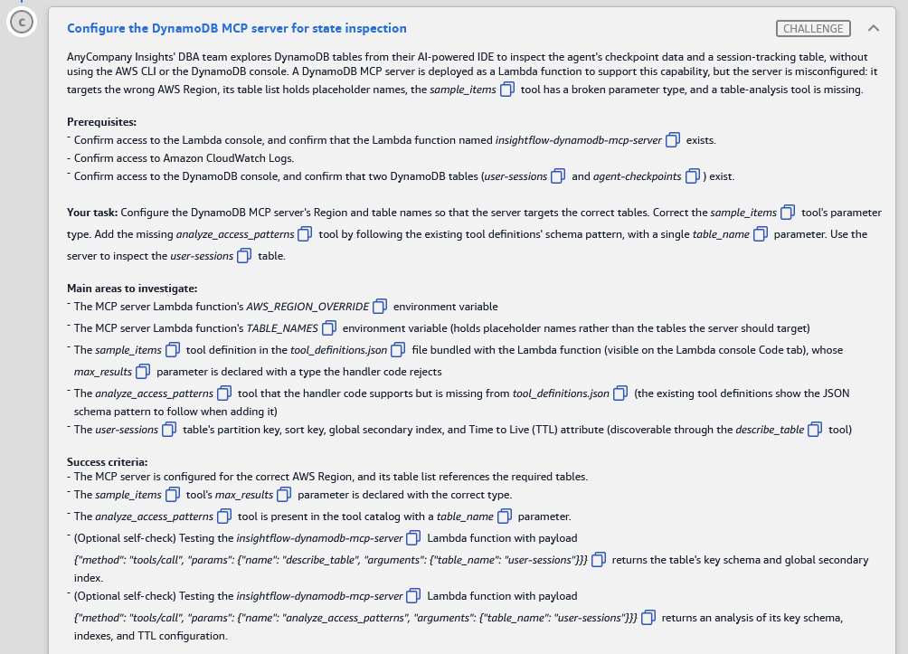

# 🅲 Challenge C: Configure the DynamoDB MCP server for state inspection

> **Status:** 🟡 In progress · **Diagram label:** C (AWS Lambda *DynamoDB MCP Server*, on Developers/DBAs → *Invoke tools* → *Inspect tables* → DynamoDB)
> **Services:** AWS Lambda (env vars, Code tab, **Deploy**, test events), Model Context Protocol (MCP) tool catalog (`tool_definitions.json`, JSON Schema), Amazon DynamoDB (`DescribeTable`, GSIs, TTL), CloudWatch Logs
> **Lab:** [AWS Databases for Agentic AI Demonstrated](README.md) · **Vault:** [index](../README.md)

---

## ✅ Status checklist (success criteria)

- [ ] The MCP server is configured for the **correct AWS Region**, and its **table list** references the required tables (`user-sessions`, `agent-checkpoints`)
- [ ] The `sample_items` tool's **`max_results`** parameter is declared with the **correct type**
- [ ] The **`analyze_access_patterns`** tool is in the tool catalog, with a **`table_name`** parameter
- [ ] *(Optional self-check)* Test payload `describe_table` on `user-sessions` returns its key schema + GSI
- [ ] *(Optional self-check)* Test payload `analyze_access_patterns` on `user-sessions` returns an analysis of its key schema, indexes and TTL

---

## 🖼️ Task card



<details>
<summary>Text copy of the task</summary>

**Scenario:** AnyCompany Insights' DBA team explores DynamoDB tables from their AI-powered IDE. They inspect the agent's checkpoint data and a session-tracking table without using the AWS CLI or the DynamoDB console. A DynamoDB MCP server is deployed as a Lambda function to support this, but the server is misconfigured: it targets the wrong AWS Region, its table list holds placeholder names, the `sample_items` tool has a broken parameter type, and a table-analysis tool is missing.

**Prerequisites**
- Confirm access to the Lambda console, and confirm that the Lambda function named `insightflow-dynamodb-mcp-server` exists.
- Confirm access to Amazon CloudWatch Logs.
- Confirm access to the DynamoDB console, and confirm that two DynamoDB tables (`user-sessions` and `agent-checkpoints`) exist.

**Your task:** Configure the DynamoDB MCP server's Region and table names so that the server targets the correct tables. Correct the `sample_items` tool's parameter type. Add the missing `analyze_access_patterns` tool by following the existing tool definitions' schema pattern, with a single `table_name` parameter. Use the server to inspect the `user-sessions` table.

**Main areas to investigate**
- The MCP server Lambda function's `AWS_REGION_OVERRIDE` environment variable.
- The MCP server Lambda function's `TABLE_NAMES` environment variable, which holds placeholder names rather than the tables the server should target.
- The `sample_items` tool definition in the `tool_definitions.json` file bundled with the Lambda function (visible on the Lambda console Code tab). Its `max_results` parameter is declared with a type the handler code rejects.
- The `analyze_access_patterns` tool, which the handler code supports but which is missing from `tool_definitions.json`. The existing tool definitions show the JSON schema pattern to follow when adding it.
- The `user-sessions` table's partition key, sort key, global secondary index and Time to Live (TTL) attribute, which you can discover through the `describe_table` tool.

**Success criteria**
- The MCP server is configured for the correct AWS Region, and its table list references the required tables.
- The `sample_items` tool's `max_results` parameter is declared with the correct type.
- The `analyze_access_patterns` tool is present in the tool catalog with a `table_name` parameter.
- (Optional self-check) Testing the `insightflow-dynamodb-mcp-server` Lambda function with payload `{"method": "tools/call", "params": {"name": "describe_table", "arguments": {"table_name": "user-sessions"}}}` returns the table's key schema and global secondary index.
- (Optional self-check) Testing the `insightflow-dynamodb-mcp-server` Lambda function with payload `{"method": "tools/call", "params": {"name": "analyze_access_patterns", "arguments": {"table_name": "user-sessions"}}}` returns an analysis of its key schema, indexes and TTL configuration.

</details>

---

## 🗺️ Where it sits in the architecture


**Flow C:** DBA's AI IDE (the MCP **client**) → *Invoke tools* → **Lambda `insightflow-dynamodb-mcp-server-…`** (the MCP **server**) → reads `tool_definitions.json` (the tool catalog) and env vars (`AWS_REGION_OVERRIDE`, `TABLE_NAMES`) → calls DynamoDB `DescribeTable` / `Scan` / … → *Inspect tables* → `user-sessions`, `agent-checkpoints`.

This is the **debugging path**, separate from the agent's runtime path. It lets humans (and their AI assistants) look at what the agent wrote, such as B's checkpoints, without console access.

---

## 🔍 Root cause

There are four independent misconfigurations, two in **env vars** and two in the **tool catalog file**:

| # | Where | What's wrong | Effect |
|---|---|---|---|
| **1** | Env var `AWS_REGION_OVERRIDE` | Points to a Region other than `us-east-1` ⚠️ (confirm the value) | The boto3 DynamoDB client looks in the wrong Region, so `ResourceNotFoundException` for every table |
| **2** | Env var `TABLE_NAMES` | Placeholder names (e.g. `table1,table2` ⚠️) | The server's **allow-list** doesn't include the real tables, so tools refuse or list the wrong ones |
| **3** | `tool_definitions.json` → `sample_items` → `max_results` | Declared with the wrong JSON Schema `type` (e.g. `"string"` or a non-type like `"int"` ⚠️) | The handler validates arguments against the declared type and rejects calls, and clients send the wrong type |
| **4** | `tool_definitions.json` | No entry for `analyze_access_patterns` | `tools/list` doesn't show it, and `tools/call` returns *unknown tool*, even though the handler has the code |

### ✔️ Confirmed from the handler code and `tool_definitions.json`

Copies are in [assets/challenge_C/code/](assets/challenge_C/code/): `original_handler_dynamo_db_mcp_server.py`, `original_tool_definitions.json`, `fixed_tool_definitions.json`.

| Code fact (line) | What it means for the fix |
|---|---|
| `region = os.environ.get("AWS_REGION_OVERRIDE", "us-east-1")` (L6) | The env var **overrides** the safe default, so a wrong value breaks every DynamoDB call. Set it to `us-east-1` |
| The client is built once at **import time** (L7) | A new value only applies in a fresh execution environment. **Save** on env vars gives you that |
| `os.environ.get("TABLE_NAMES", "").split(",")` (L38) | **Comma-separated, and no `.strip()`**: `user-sessions,agent-checkpoints`. **No spaces**, because `", agent-checkpoints"` would never match |
| `TABLE_NAMES` is used **only by `list_tables`** (L74) | It filters what `list_tables` shows. `describe_table`/`sample_items`/`analyze_access_patterns` accept *any* table name (see Study note 3) |
| `tool = next((t for t in tools if t["name"] == tool_name), None)` → `"Tool not found"` (L34–36) | `tools/call` **refuses any tool missing from the catalog**, even though the code for `analyze_access_patterns` exists (L77) |
| `if not isinstance(max_results, int)` → `'max_results' must be integer, got …` (L64–65) | The correct JSON Schema type is **`"integer"`**. The catalog had **`"string"`** (original L29) |
| The catalog is a **bare JSON array** with key **`inputSchema`** (camelCase) | The new tool must use the same shape: `name`, `description`, `inputSchema.{type, properties, required}` |
| `analyze_access_patterns` reads only `arguments["table_name"]` and calls `describe_table` + `describe_time_to_live` (L78–98) | One parameter, `table_name` (string, required). It's the same input schema as `describe_table` |
| Errors are **returned** as `{"error": "…"}`, not raised (L36, L117, L130) | A Lambda test shows **Succeeded** even when the tool failed. **Read the response body** |
| `tools/list` returns `{"tools": [...]}`, and the handler needs only `method` (L122–125) | The test event `{"method": "tools/list"}` is enough. No `jsonrpc`/`id` needed |

**Key idea:** in MCP, the **tool catalog** (name + description + input JSON Schema) is the contract the client sees. Code that isn't declared in the catalog is invisible, and a wrong schema type breaks every call.

---

## 🛠️ Solution

### Where each step happens

| Step | AWS service → console page | What I do there |
|---|---|---|
| 0 | Console bar → **Region** | Confirm **us-east-1** |
| 1 | **DynamoDB** → *Tables* | Confirm `user-sessions` and `agent-checkpoints` exist (B must be done) |
| 2 | **Lambda** → `insightflow-dynamodb-mcp-server-…` → **Code** tab | Read the handler: env var parsing, type check for `max_results`, `analyze_access_patterns` support, catalog shape |
| 3 | **Lambda** → **Configuration → Environment variables → Edit** | Fix `AWS_REGION_OVERRIDE` and `TABLE_NAMES` → **Save** |
| 4 | **Lambda** → **Code** tab → `tool_definitions.json` | Fix the `max_results` type and add `analyze_access_patterns` → **Deploy** |
| 5 | **Lambda** → **Test** tab | Run `tools/list`, `describe_table`, `analyze_access_patterns` and `sample_items` test events |
| 6 | **CloudWatch** → *Log groups* → `/aws/lambda/insightflow-dynamodb-mcp-server-…` | Read errors if a test fails |
| 7 | Lab → **Check** | |

---

### Step 0: Region

Console bar → **US East (N. Virginia) us-east-1**.

### Step 1: Confirm the tables exist (DynamoDB)

1. **DynamoDB** → left navigation → **Tables**.
2. Check that both are listed and **Active**:
   - **`user-sessions`** (pre-built by the lab)
   - **`agent-checkpoints`** (created by me in [Challenge B](Challenge_B_DynamoDB_Agent_Memory_LangGraph_Checkpointer_Table.md)). If it's missing, finish B first.

### Step 2: Read the handler code first (Lambda → Code tab)

**Where:** Lambda → **Functions** → `insightflow-dynamodb-mcp-server-b55df330` (the panel's `DynamoDBMCPFunctionName`) → **Code** tab

The Code tab is a browser VS Code editor. The **Explorer** file tree is on the left, and the **Deploy** button is in the left panel.

1. Open the handler file (e.g. `lambda_function.py` / `handler.py` / `app.py`). Use **Ctrl+F** to find each of these and note what they say:

   | Search for | Why | What to note |
   |---|---|---|
   | `TABLE_NAMES` | How the list is parsed | `.split(",")` means **comma-separated**. `json.loads` means a **JSON array** |
   | `AWS_REGION_OVERRIDE` | How the Region is set | e.g. `boto3.client("dynamodb", region_name=os.environ.get("AWS_REGION_OVERRIDE"))` |
   | `max_results` | The type check the handler does | `isinstance(x, int)` / `"integer"` means JSON Schema **`integer`** |
   | `analyze_access_patterns` | Confirms the handler supports it | The function name and the argument it reads (`table_name`) |
   | `tool_definitions` | How the catalog is loaded and used | Does `tools/call` reject tools missing from the file? |

2. Open **`tool_definitions.json`**. Look at the **shape** of one entry, especially **`describe_table`**, which already takes a single `table_name`. You'll copy it in Step 4. Note the exact key names (`inputSchema` vs `input_schema` vs `parameters`) and whether there's a top-level `{"tools": [...]}` wrapper or a bare array.
3. Screenshot the original `sample_items` entry → `assets/challenge_C/02_tool_definitions_before.png`.

### Step 3: Fix the Region and the table list (Lambda → env vars)

**Where:** Lambda → `insightflow-dynamodb-mcp-server-…` → **Configuration** tab → **Environment variables** → **Edit**

1. Note the current values (for the run log), then set:

   | Key | New value |
   |---|---|
   | `AWS_REGION_OVERRIDE` | `us-east-1` |
   | `TABLE_NAMES` | `user-sessions,agent-checkpoints`, **in the same format as the placeholder** |

   - ✔️ **Confirmed format** (handler L38, `.split(",")` with no strip): exactly `user-sessions,agent-checkpoints`, comma-separated with **no spaces** and no quotes or brackets.
2. Leave every other variable as it is → **Save**. Wait for the green *Successfully updated* banner.
3. Screenshot → `03_mcp_env_after.png`.

### Step 4: Fix the tool catalog (Lambda → Code tab → `tool_definitions.json`)

**Where:** Lambda → **Code** tab → `tool_definitions.json`

#### 4a. Fix `max_results`'s type

Find the `sample_items` entry → its `max_results` property → change the `"type"` to what the handler expects (almost certainly **`"integer"`**):

```json
"max_results": {
  "type": "integer",
  "description": "Maximum number of items to return"
}
```

Change only the `"type"` value. Keep the existing description, and keep `default`/`minimum`/`maximum` if they're present.

#### 4b. Add `analyze_access_patterns` by copying `describe_table`

1. Select the whole `describe_table` object, from its `{` to its matching `}`, and copy it.
2. Paste it as a **new array element**: put a **comma** after the previous entry's closing `}`, then paste.
3. In the pasted copy, change **only** `name` and `description`. Keep the `table_name` property and the `required` list exactly as they are.

#### ✔️ The complete fixed `tool_definitions.json` (validated as JSON)

Easiest route: in the Code tab, open **`tool_definitions.json`** (keep that exact filename, because the handler opens it by name). Press **Ctrl+A**, paste the block below, then **Ctrl+S** → **Deploy**. Same file: [fixed_tool_definitions.json](assets/challenge_C/code/fixed_tool_definitions.json).

```json
[
  {
    "name": "describe_table",
    "description": "Get schema details for a DynamoDB table",
    "inputSchema": {
      "type": "object",
      "properties": {
        "table_name": {
          "type": "string",
          "description": "Name of the table"
        }
      },
      "required": [
        "table_name"
      ]
    }
  },
  {
    "name": "sample_items",
    "description": "Scan a few items from a DynamoDB table",
    "inputSchema": {
      "type": "object",
      "properties": {
        "table_name": {
          "type": "string",
          "description": "Name of the table"
        },
        "max_results": {
          "type": "integer",
          "description": "Maximum items to return"
        }
      },
      "required": [
        "table_name"
      ]
    }
  },
  {
    "name": "list_tables",
    "description": "List configured DynamoDB tables",
    "inputSchema": {
      "type": "object",
      "properties": {}
    }
  },
  {
    "name": "analyze_access_patterns",
    "description": "Analyze a DynamoDB table's key schema, global secondary indexes, and TTL configuration",
    "inputSchema": {
      "type": "object",
      "properties": {
        "table_name": {
          "type": "string",
          "description": "Name of the table"
        }
      },
      "required": [
        "table_name"
      ]
    }
  }
]
```

**Diff against the original**: only two changes.

```diff
         "max_results": {
-          "type": "string",
+          "type": "integer",
           "description": "Maximum items to return"
         }
 ...
       "properties": {}
     }
-  }
+  },
+  {
+    "name": "analyze_access_patterns",
+    "description": "Analyze a DynamoDB table's key schema, global secondary indexes, and TTL configuration",
+    "inputSchema": { "type": "object",
+      "properties": { "table_name": { "type": "string", "description": "Name of the table" } },
+      "required": [ "table_name" ] }
+  }
 ]
```

**JSON pitfalls that break the whole catalog:**
- missing comma between array elements
- a **trailing comma** after the last element
- smart quotes
- unbalanced `{}`/`[]`

The editor underlines errors in red, so check the **Problems** count before deploying.

#### 4c. Deploy

1. **Ctrl+S** (save the file in the editor).
2. Click **Deploy** (left panel). Wait for *Successfully updated the function insightflow-dynamodb-mcp-server-…*.
3. **Without Deploy, the running function still uses the old file.** This is the same lesson as Lab 01 Challenge F.
4. Screenshot → `04_tool_definitions_after.png`.

### Step 5: Test with Lambda test events (Lambda → Test tab)

**Where:** Lambda → `insightflow-dynamodb-mcp-server-…` → **Test** tab

For each payload: **Create new event** → **Event name** → paste the JSON into **Event JSON** → **Save** → **Test**. Then expand **Details** in the green or red result box.

| Event name | Event JSON | Expected |
|---|---|---|
| `toolsList` | `{"method": "tools/list"}` | `{"tools": [...]}` with **4** tools, including **`analyze_access_patterns`**, and `max_results` of type `integer` |
| `listTables` | `{"method": "tools/call", "params": {"name": "list_tables", "arguments": {}}}` | `{"tables": ["agent-checkpoints", "user-sessions"]}`. **This proves `TABLE_NAMES` and the Region are right** (an empty list means a wrong Region or a malformed `TABLE_NAMES`) |
| `describeUserSessions` | `{"method": "tools/call", "params": {"name": "describe_table", "arguments": {"table_name": "user-sessions"}}}` | `user-sessions` **key schema** (partition + sort key), **GSI**, TTL |
| `analyzeUserSessions` | `{"method": "tools/call", "params": {"name": "analyze_access_patterns", "arguments": {"table_name": "user-sessions"}}}` | An analysis of the key schema, indexes and **TTL** |
| `sampleUserSessions` | `{"method": "tools/call", "params": {"name": "sample_items", "arguments": {"table_name": "user-sessions", "max_results": 3}}}` | Up to 3 items. Note that `3` is a JSON **number**, not `"3"` |

- ✔️ The handler only reads `method` and `params` (L122–128), so no `jsonrpc`/`id` is needed.
- ⚠️ **A green "Succeeded" isn't enough.** The handler *returns* errors as `{"error": "..."}` (it doesn't raise), so check the **response body** for an `error` key.
- **Expected response shapes**, from the code:
  - `describe_table` → `{"content":[{"type":"text","text":"{\"table_name\":\"user-sessions\",\"key_schema\":[{\"name\":…,\"type\":\"HASH\"},{…\"RANGE\"}],\"attribute_definitions\":[…],\"item_count\":…,\"status\":\"ACTIVE\",\"billing_mode\":…,\"gsi\":[{\"name\":…,\"key_schema\":[…]}]}"}]}`
  - `analyze_access_patterns` → `text` holds `{"table_name", "partition_key", "sort_key", "billing_mode", "ttl_attribute", "ttl_status", "global_secondary_indexes":[{"name","partition_key","sort_key"}]}`
- Record the `user-sessions` schema from the `describe_table` result in the run log: partition key, sort key, GSI name and keys, TTL attribute.
- Screenshot each result → `05_test_describe_table.png`, `06_test_analyze_access_patterns.png`.

> The task says *"Use the server to inspect the `user-sessions` table"*, so **run at least the `describe_table` and `analyze_access_patterns` tests**. The grader may look for these invocations in CloudWatch ⚠️.

### Step 6: If a test fails, read the logs (CloudWatch)

**CloudWatch** → **Log groups** → `/aws/lambda/insightflow-dynamodb-mcp-server-b55df330` → newest **log stream** → find the `ERROR` / traceback. Or use the Lambda **Monitor** tab → **View CloudWatch logs**.

### Step 7: Check

Back in the lab → **Check**.

### Order of operations

```text
0 Region → 1 DynamoDB: both tables exist → 2 Lambda Code: read handler + tool_definitions.json
  → 3 Lambda env vars: AWS_REGION_OVERRIDE=us-east-1, TABLE_NAMES=user-sessions,agent-checkpoints → Save
  → 4 tool_definitions.json: max_results "integer" + add analyze_access_patterns (copy describe_table) → Ctrl+S → Deploy
  → 5 Test events: tools/list, describe_table, analyze_access_patterns (+ sample_items) → 6 logs if needed → 7 Check
```

---

## ⚠️ Mistakes & lessons

_Fill in as I go. Screenshots go in `assets/challenge_C/`._

---

## 🧯 Troubleshooting table

| Symptom | Cause | Fix |
|---|---|---|
| `ResourceNotFoundException: Requested resource not found` | Wrong Region (`AWS_REGION_OVERRIDE`) or a table name typo | `us-east-1`. The table names must match exactly |
| `list_tables` returns `{"tables": []}` or misses a table | `TABLE_NAMES` still placeholders, has spaces (`split(",")` doesn't strip), or wrong Region | `TABLE_NAMES=user-sessions,agent-checkpoints` exactly, and `AWS_REGION_OVERRIDE=us-east-1` |
| `{"error": "Tool not found: analyze_access_patterns"}` | Not added to `tool_definitions.json`, or added but **not deployed** (handler L34–36) | Add it, then **Ctrl+S → Deploy** |
| `{"error": "'max_results' must be integer, got str"}` | The test sent `"max_results": "3"` (handler L64) | Send `3` unquoted. The schema fix makes AI clients send integers |
| Test shows **Succeeded** but the body is `{"error": …}` | The handler returns errors instead of raising them | Read the body. The error text is the real diagnosis |
| `FileNotFoundError: …tool_definitions.json` | The file was renamed (e.g. to `tools_definition.json`) | The handler opens exactly **`tool_definitions.json`** (L16) |
| Every tool fails / `JSONDecodeError` at init | `tool_definitions.json` is now invalid JSON (missing or trailing comma) | Fix the syntax (check the editor's Problems panel) → Deploy |
| `max_results` rejected: *must be integer* | Schema still `"string"`, or the test sends `"3"` (a string) | Schema `"type": "integer"`, and send `3` unquoted |
| `analyze_access_patterns` listed but fails on `table_name` | Parameter renamed (e.g. `tableName`) or missing from `required` | Exactly `table_name`, as in `describe_table` |
| Test result unchanged after the edit | Edited in the editor but didn't **Deploy** | Deploy, then re-test |
| `AccessDeniedException` on `agent-checkpoints` | IAM scoped to the exact table name (IAM is preconfigured) | Check the table is named exactly `agent-checkpoints` (Challenge B) |

---

## 📚 Study notes (go deeper later)

### 1. MCP in one page

- **Model Context Protocol** is an open standard (introduced by Anthropic, Nov 2024) for connecting AI applications (**clients**: IDEs, chat apps, agents) to **servers** that expose **tools**, **resources** and **prompts**.
- **Wire format:** JSON-RPC 2.0. Core methods: `initialize`, `tools/list`, `tools/call`, `resources/list`, `resources/read`, `prompts/list`.
- **Transports:** `stdio` (a local process) and **Streamable HTTP** (remote, which replaced the older HTTP+SSE ⚠️). A Lambda MCP server is usually fronted by a **Function URL** or **API Gateway**. This lab invokes it directly with a simplified `{method, params}` payload.
- **A tool definition** has three parts:
  - **`name`**: unique and stable, because clients call it by this name
  - **`description`**: the LLM reads this to decide *when* to call the tool, so write it for a model
  - **`inputSchema`**: JSON Schema for the arguments. The LLM uses it to build the call, and the server uses it to validate
- **Tool result:** `{"content": [{"type": "text", "text": "…"}], "isError": false}`.

### 2. JSON Schema types (the `max_results` bug)

| `type` | Accepts | Rejects |
|---|---|---|
| `"integer"` | `3`, `10` | `3.5`, `"3"` |
| `"number"` | `3`, `3.5` | `"3"` |
| `"string"` | `"3"` | `3` |
| `"boolean"` | `true` | `"true"` |
| `"array"` / `"object"` / `"null"` | | |

`"int"`, `"Integer"` and `"long"` are **not** JSON Schema types. Validators either reject them or ignore them. Use constraints like `"minimum": 1, "maximum": 100, "default": 10` to bound a limit parameter.

### 3. Why an allow-list (`TABLE_NAMES`) on top of IAM

- **Defence in depth:** IAM limits what the Lambda *can* touch. The allow-list limits what the MCP server *will expose* to an AI client. An LLM given a tool can be prompted or injected into probing other tables, so the server should only accept known names.
- Read-only tools (`describe_table`, `sample_items` with a capped `max_results`) and no write tools keep the debugging path safe.
- **Second-order effect:** when someone adds a table (like `agent-checkpoints` in B), the allow-list must be updated too. Config drift between the two is exactly the bug in this challenge.
- ⚠️ **What this lab's code actually does:** `TABLE_NAMES` only **filters the output of `list_tables`** (L74). `describe_table`, `sample_items` and `analyze_access_patterns` pass any `table_name` straight to DynamoDB. So it's a *discovery* filter, not an enforcement boundary. IAM is the only real limit. A hardened server would check `table_name in table_names` in **every** tool and also `strip()` each name. Good to mention in a design review.

### 4. What `describe_table` / `analyze_access_patterns` reveal

- `DescribeTable` returns `KeySchema`, `AttributeDefinitions`, `GlobalSecondaryIndexes` (each with its own key schema and projection), `LocalSecondaryIndexes`, `BillingModeSummary`, `TableStatus` and `ItemCount` (approximate).
- TTL is **not** in `DescribeTable`. It needs a separate `DescribeTimeToLive` call, so an "analysis" tool has to combine both.
- **Access-pattern reasoning** (what the analysis tool automates):

  | Table design | The query it serves |
  |---|---|
  | Partition key (e.g. `session_id`) | "get everything for one session" |
  | Sort key (e.g. a timestamp) | "the latest N events" or "events between t1 and t2" |
  | **GSI** with a different partition key (e.g. `user_id`) | "all sessions for a user", which the base key can't answer without a Scan |
  | TTL | Items expire automatically (session hygiene, data retention) |

### 5. Lambda: edit vs deploy vs save (recap)

| Change | How it goes live |
|---|---|
| Code or bundled files (`.py`, `tool_definitions.json`) in the Code tab | **Deploy** |
| Environment variables | **Save** in Configuration (immediate for `$LATEST`) |
| Test events | **Save** stores the event. **Test** invokes the function synchronously and shows the response + logs |

### 6. Related AWS offering

- **AWS Labs DynamoDB MCP server** (`awslabs.dynamodb-mcp-server`, open source) and other AWS MCP servers (Aurora/Postgres, CloudWatch, docs) ⚠️. The lab's Lambda server is a simplified, custom version of the same idea.
- **Bedrock AgentCore Gateway** can turn Lambda functions and APIs into MCP tools centrally, with auth ⚠️.

### 7. GCP mapping

| AWS | GCP |
|---|---|
| MCP server on Lambda | MCP server on **Cloud Run** (Streamable HTTP) |
| DynamoDB `DescribeTable` / GSIs / TTL | Firestore indexes + TTL policies; Bigtable table/column-family metadata |
| AgentCore Gateway | **Vertex AI Agent Builder** tools / API hub ⚠️ |
| Google's MCP Toolbox for Databases (AlloyDB, Cloud SQL, Spanner…) | The same pattern as this lab's DB MCP servers |

### 🧪 Self-test questions

1. The handler has an `analyze_access_patterns` function, but clients can't see it. Why?
2. What's the difference between JSON Schema `"integer"` and `"number"`, and which fits `max_results`?
3. You edited `tool_definitions.json` and the test still shows the old catalog. What did you forget?
4. Why keep an allow-list of tables when IAM already restricts the Lambda?
5. Which DynamoDB API returns the TTL attribute, and why does it matter for an analysis tool?
6. When does a table need a GSI? Give an example from `user-sessions`.

<details>
<summary>Answers</summary>

1. Tools exist for a client only if they're in the **catalog** (`tools/list`, from `tool_definitions.json`). Code without a declaration is invisible.
2. `integer` accepts whole numbers only. `number` accepts any numeric value. `max_results` is a count, so `integer`, ideally with `minimum`/`maximum`.
3. **Deploy**. Edits in the Code tab aren't live until deployed.
4. Defence in depth: it limits what the AI-facing server exposes even if IAM is broader, and it narrows prompt-injection blast radius.
5. `DescribeTimeToLive`. `DescribeTable` doesn't include TTL, so the analysis tool needs both calls to report retention.
6. When you query by an attribute that isn't the base partition key, e.g. "all sessions for user X" needs a GSI on `user_id` (if `user-sessions` is keyed by `session_id`).

</details>

---

## 📝 Run log (fill in as I go)

| Step | What I ran / looked at | Result / output |
|---|---|---|
| 2 | Handler: `TABLE_NAMES` parsing / `max_results` check | `split(",")` with no strip (L38), used only by `list_tables` (L74) · `isinstance(max_results, int)` (L64) · catalog lookup before dispatch → `Tool not found` (L34) |
| 2 | `sample_items.max_results` type before | `"string"` (original L29) → fix to `"integer"` |
| 2 | Catalog shape | Bare JSON array: `describe_table`, `sample_items`, `list_tables`. Keys `name`/`description`/`inputSchema`. `analyze_access_patterns` missing |
| 3 | Env vars before → after | `AWS_REGION_OVERRIDE`: _?_ → `us-east-1` · `TABLE_NAMES`: _?_ → `user-sessions,agent-checkpoints` |
| 4 | `max_results` → `integer`, added `analyze_access_patterns`, Deploy | _status_ |
| 5 | `tools/list` | _analyze_access_patterns present?_ |
| 5 | `describe_table` `user-sessions` | _PK, SK, GSI name/keys_ |
| 5 | `analyze_access_patterns` `user-sessions` | _TTL attribute, summary_ |
| 7 | Check | _result_ |
