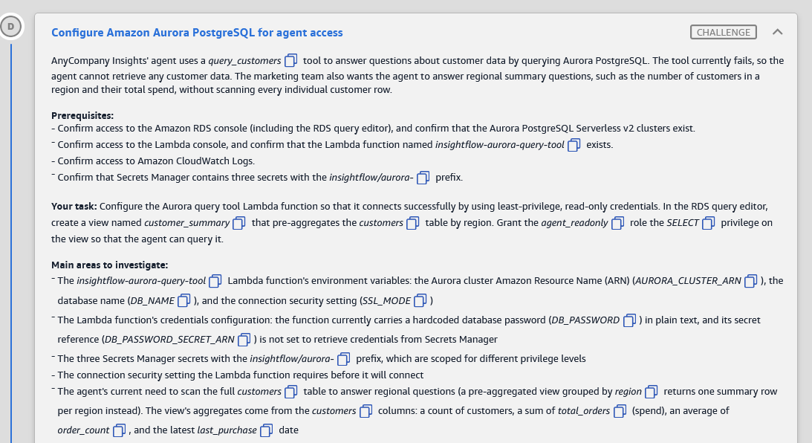
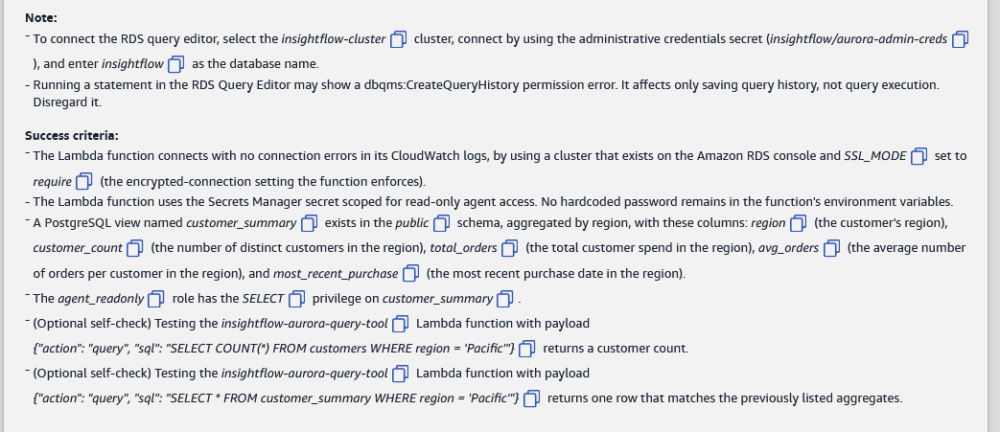
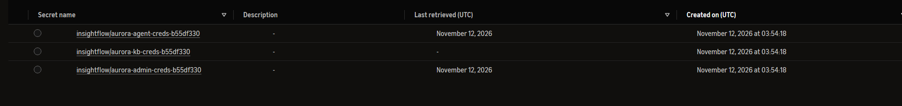
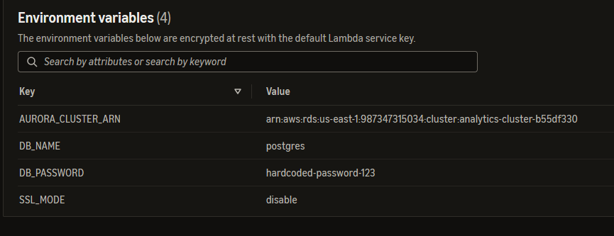
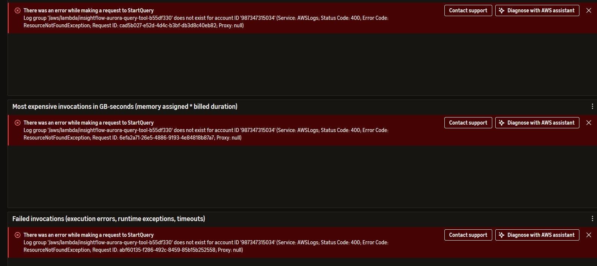

# 🅳 Challenge D: Configure Amazon Aurora PostgreSQL for agent access

> **Status:** 🟡 In progress · **Diagram label:** D (Lambda function *query customers*, on LangGraph agent → *Query customers* → Lambda → *Query data* → Aurora, plus *Write logs* → CloudWatch)
> **Services:** AWS Lambda (env vars, test events), AWS Secrets Manager (least-privilege DB credentials), Amazon Aurora PostgreSQL Serverless v2 (cluster ARN, RDS Data API, SSL), PostgreSQL views + `GRANT`, RDS Query Editor, CloudWatch Logs
> **Lab:** [AWS Databases for Agentic AI Demonstrated](README.md) · **Vault:** [index](../README.md)

---

## ✅ Status checklist (success criteria)

- [ ] The Lambda connects with **no connection errors** in CloudWatch, using a **cluster that exists** on the RDS console and **`SSL_MODE = require`**
- [ ] The Lambda uses the **Secrets Manager secret scoped for read-only agent access**. **No hardcoded password** remains in its env vars
- [ ] View **`public.customer_summary`** exists, aggregated by region, with columns `region`, `customer_count`, `total_orders`, `avg_orders`, `most_recent_purchase`
- [ ] Role **`agent_readonly`** has **`SELECT`** on `customer_summary`
- [ ] *(Optional)* Lambda test `SELECT COUNT(*) FROM customers WHERE region = 'Pacific'` returns a count
- [ ] *(Optional)* Lambda test `SELECT * FROM customer_summary WHERE region = 'Pacific'` returns one matching row

---

## 🖼️ Task card





<details>
<summary>Text copy of the task</summary>

**Scenario:** AnyCompany Insights' agent uses a `query_customers` tool to answer questions about customer data by querying Aurora PostgreSQL. The tool currently fails, so the agent can't retrieve any customer data. The marketing team also wants the agent to answer regional summary questions, such as the number of customers in a region and their total spend, without scanning every individual customer row.

**Prerequisites**
- Confirm access to the Amazon RDS console (including the RDS query editor), and confirm that the Aurora PostgreSQL Serverless v2 clusters exist.
- Confirm access to the Lambda console, and confirm that the Lambda function named `insightflow-aurora-query-tool` exists.
- Confirm access to Amazon CloudWatch Logs.
- Confirm that Secrets Manager contains three secrets with the `insightflow/aurora-` prefix.

**Your task:** Configure the Aurora query tool Lambda function so that it connects successfully using least-privilege, read-only credentials. In the RDS query editor, create a view named `customer_summary` that pre-aggregates the `customers` table by region. Grant the `agent_readonly` role the `SELECT` privilege on the view so that the agent can query it.

**Main areas to investigate**
- The `insightflow-aurora-query-tool` Lambda function's environment variables: the Aurora cluster Amazon Resource Name (ARN) (`AURORA_CLUSTER_ARN`), the database name (`DB_NAME`), and the connection security setting (`SSL_MODE`).
- The Lambda function's credentials configuration. The function currently carries a hardcoded database password (`DB_PASSWORD`) in plain text, and its secret reference (`DB_PASSWORD_SECRET_ARN`) isn't set to retrieve credentials from Secrets Manager.
- The three Secrets Manager secrets with the `insightflow/aurora-` prefix, which are scoped for different privilege levels.
- The connection security setting the Lambda function requires before it will connect.
- The agent's current need to scan the full `customers` table to answer regional questions. A pre-aggregated view grouped by `region` returns one summary row per region instead. The view's aggregates come from the `customers` columns: a count of customers, a sum of `total_orders` (spend), an average of `order_count`, and the latest `last_purchase` date.

**Notes**
- To connect the RDS query editor, select the `insightflow-cluster` cluster, connect with the administrative credentials secret (`insightflow/aurora-admin-creds`), and enter `insightflow` as the database name.
- Running a statement in the RDS Query Editor may show a `dbqms:CreateQueryHistory` permission error. It affects only saving query history, not query execution. Disregard it.

**Success criteria**
- The Lambda function connects with no connection errors in its CloudWatch logs, using a cluster that exists on the Amazon RDS console and `SSL_MODE` set to `require` (the encrypted-connection setting the function enforces).
- The Lambda function uses the Secrets Manager secret scoped for read-only agent access. No hardcoded password remains in the function's environment variables.
- A PostgreSQL view named `customer_summary` exists in the `public` schema, aggregated by region, with these columns: `region` (the customer's region), `customer_count` (the number of distinct customers in the region), `total_orders` (the total customer spend in the region), `avg_orders` (the average number of orders per customer in the region), and `most_recent_purchase` (the most recent purchase date in the region).
- The `agent_readonly` role has the `SELECT` privilege on `customer_summary`.
- (Optional self-check) Testing the `insightflow-aurora-query-tool` Lambda function with payload `{"action": "query", "sql": "SELECT COUNT(*) FROM customers WHERE region = 'Pacific'"}` returns a customer count.
- (Optional self-check) Testing the `insightflow-aurora-query-tool` Lambda function with payload `{"action": "query", "sql": "SELECT * FROM customer_summary WHERE region = 'Pacific'"}` returns one row that matches the previously listed aggregates.

</details>

---

## 🗺️ Where it sits in the architecture


**Flow D:** LangGraph agent → *Query customers* → **Lambda `insightflow-aurora-query-tool-…`** → reads env vars (`AURORA_CLUSTER_ARN`, `DB_NAME`, `SSL_MODE`, `DB_PASSWORD_SECRET_ARN`) → fetches credentials from **Secrets Manager** → runs SQL on **Aurora** (`insightflow` DB) → *Write logs* → CloudWatch.

This is the agent's **SQL tool**. Whatever DB user this Lambda connects as is the limit on what an LLM-generated query can do. So it must be **read-only** (the `agent_readonly` role), never admin.

---

## 🔍 Root cause

| # | Setting | What's wrong (per the task card) | Fix |
|---|---|---|---|
| **1** | `AURORA_CLUSTER_ARN` | Points to a cluster that **doesn't exist** ⚠️ (confirm) | The ARN of the real cluster `insightflow-cluster-…` (panel `AuroraClusterARN`) |
| **2** | `DB_NAME` | Probably wrong ⚠️ (confirm) | `insightflow` |
| **3** | `SSL_MODE` | Not `require`, and the function refuses to connect without it | `require` |
| **4** | `DB_PASSWORD` | A **plaintext password** in env vars (a security finding) | **Remove** the variable |
| **5** | `DB_PASSWORD_SECRET_ARN` | Empty or a placeholder, so no Secrets Manager lookup | The ARN of the **read-only agent** secret (most likely `insightflow/aurora-agent-creds`, panel `AuroraAgentSecretARN`, but **verify**) |
| **6** | Database | No pre-aggregated view, so regional questions scan every customer row and send them to the LLM | `CREATE VIEW public.customer_summary …` + `GRANT SELECT … TO agent_readonly` |

**Three secrets, three privilege levels** (✔️ confirmed names from the Secrets Manager list):



| Secret | Used by | Privilege | Last retrieved | Use for this Lambda? |
|---|---|---|---|---|
| `insightflow/aurora-admin-creds-b55df330` | Me, in the Query Editor (DDL: Challenges A and D) | **Admin** (owns tables, can `CREATE`/`ALTER`/`GRANT`) | 12 Nov 2026 | ❌ Never for an agent tool |
| **`insightflow/aurora-agent-creds-b55df330`** | The agent's SQL tool (this Lambda) and the Aurora MCP server ⚠️ | **Read-only** (`agent_readonly`) | 12 Nov 2026 (my Query Editor connection in Challenge A, Mistake 1) | ✅ **Yes. This is the read-only secret** |
| `insightflow/aurora-kb-creds-b55df330` | **Bedrock Knowledge Base** (label F), writing embeddings into its pgvector table | **Read-write** on the KB vector table (Bedrock needs `INSERT`/`UPDATE`/`DELETE` to sync) | **Never** | ❌ Too much privilege, and the wrong purpose |

**How to tell without guessing:**
- the **name** (`agent` = the agent's read-only tool user)
- the panel output **`AuroraAgentSecretARN`**, which points to it
- in Challenge A, connecting with it gave *must be owner of table*, which proves it can't run DDL

To prove it's `SELECT`-only, run the Step 2.4 queries with its username.

> **Clue for Challenge F:** `aurora-kb-creds` shows **Last retrieved: –**. Bedrock Knowledge Bases has **never** fetched its credentials, which means the KB has never synced successfully. Expect F to involve the KB's data source or sync.

### ✔️ Confirmed in the lab (Lambda env vars before the fix)



| Key | Found | Problem | Fix |
|---|---|---|---|
| `AURORA_CLUSTER_ARN` | `arn:aws:rds:us-east-1:987347315034:cluster:`**`analytics-cluster`**`-b55df330` | Wrong cluster. The `customers` table and the view live in **`insightflow-cluster`** | `arn:aws:rds:us-east-1:987347315034:cluster:insightflow-cluster-b55df330` |
| `DB_NAME` | **`postgres`** | The default maintenance DB, not the app DB | `insightflow` |
| `DB_PASSWORD` | **`hardcoded-password-123`** (plaintext) | A secret in env vars | **Remove** |
| `SSL_MODE` | **`disable`** | Unencrypted, and the function refuses to connect | `require` |
| `DB_PASSWORD_SECRET_ARN` | **Missing**: only 4 variables exist | No Secrets Manager lookup at all | **Add** it with the read-only secret's ARN |

So there are **five** fixes: 3 values changed, 1 variable removed and 1 variable **added**.

---

## 🛠️ Solution

### Where each step happens

| Step | AWS service → console page | What I do there |
|---|---|---|
| 0 | Console bar → **Region** | **us-east-1** |
| 1 | **Lambda** → `insightflow-aurora-query-tool-…` → **Configuration → Environment variables** + **Code** tab | Record current values. Read how the code uses them |
| 2 | **Secrets Manager** → *Secrets* (filter `insightflow/aurora-`) | Identify the **read-only** secret and copy its ARN |
| 3 | **RDS** → *Databases* → `insightflow-cluster-…` → **Configuration** tab | Copy the real **cluster ARN** |
| 4 | **Lambda** → **Configuration → Environment variables → Edit** | Change 3 values, **remove `DB_PASSWORD`**, **add `DB_PASSWORD_SECRET_ARN`** → **Save** |
| 5 | **RDS** → **Query editor** (admin secret, DB `insightflow`) | Check the `customers` columns, `CREATE VIEW`, `GRANT`, verify |
| 6 | **Lambda** → **Test** tab | Run the two self-check payloads |
| 7 | **CloudWatch** → *Log groups* → `/aws/lambda/insightflow-aurora-query-tool-…` | Confirm no connection errors |
| 8 | Lab → **Check** | |

---

### Step 0: Region

Console bar → **US East (N. Virginia) us-east-1**.

### Step 1: Inspect the Lambda (Lambda console)

**Where:** Lambda → Functions → **`insightflow-aurora-query-tool-b55df330`** (panel `AuroraToolFunctionName`)

1. **Configuration** tab → **Environment variables**. Write down every key and value:

   | Key | Current (fill in) | Target |
   |---|---|---|
   | `AURORA_CLUSTER_ARN` | _?_ | ARN of `insightflow-cluster-b55df330` |
   | `DB_NAME` | _?_ | `insightflow` |
   | `SSL_MODE` | _?_ | `require` |
   | `DB_PASSWORD` | _(plaintext)_ | **removed** |
   | `DB_PASSWORD_SECRET_ARN` | _?_ | ARN of the read-only secret |

2. **Code** tab → open the handler and search (Ctrl+F) for:
   - **`SSL_MODE`**: the exact value it accepts (e.g. `if ssl_mode != "require": raise …`)
   - **`DB_PASSWORD_SECRET_ARN`** / **`DB_PASSWORD`**: which one takes priority if both are set
   - **`rds-data`** / **`execute_statement`**: whether it uses the RDS Data API (`resourceArn` + `secretArn` + `database`) or a direct driver (`psycopg`/`pg8000`)
   - **`action`**: the payload format (`{"action": "query", "sql": …}`)

   *(Optional: paste the handler here, as I did for Challenge C, so the fix can be checked line by line.)*
3. **Monitor** tab → **View CloudWatch logs** → newest stream. Note the current error (e.g. cluster not found, SSL required, authentication failed). Screenshot → `assets/challenge_D/04_monitor_log_group_does_not_exist.png`.
   - ✔️ **In this lab:** the Monitor widgets showed *Log group '/aws/lambda/insightflow-aurora-query-tool-b55df330' does not exist*. **The function has never been invoked**, so there are no logs yet (see Observation 1). That isn't a config error.
   - ⚠️ **Don't run a test until Step 4 is done.** The log group is empty now, and the criteria look for *no connection errors* in it. A test with the broken config would write exactly those errors.

### Step 2: Pick the read-only secret (Secrets Manager)

**Where:** Secrets Manager → Secrets

1. In the filter box, type `insightflow/aurora-`. You should see **three** secrets.
2. Open each one and note:
   - **Secret ARN** (copy icon)
   - **Description** and **Tags**, if any
   - **Retrieve secret value** → the **username** (don't change anything)
3. Fill in:

   | Secret name | Username | Privilege level |
   |---|---|---|
   | `insightflow/aurora-admin-creds` | _?_ | admin |
   | `insightflow/aurora-agent-creds` | _?_ | read-only? |
   | `insightflow/aurora-_?_` | _?_ | _?_ |

4. **Prove which user is read-only** (RDS Query editor as admin; see Step 5.1 for how to connect). Replace the names with the usernames from the table:
   ```sql
   SELECT r.rolname, r.rolsuper, r.rolcreaterole, r.rolcreatedb,
          pg_has_role(r.rolname, 'agent_readonly', 'MEMBER') AS is_agent_readonly
   FROM pg_roles r
   WHERE r.rolname IN ('<user_1>', '<user_2>', '<user_3>', 'agent_readonly');
   ```
   ```sql
   SELECT grantee, table_name, string_agg(privilege_type, ', ') AS privileges
   FROM information_schema.role_table_grants
   WHERE table_schema = 'public' AND table_name = 'customers'
   GROUP BY grantee, table_name;
   ```
   Choose the secret whose user is (or is a member of) **`agent_readonly`** and has **only `SELECT`**.
5. Copy that secret's **full ARN**, including the 6-character suffix (e.g. `…:secret:insightflow/aurora-agent-creds-b55df330-lR5jK1`).

> The lab says IAM is preconfigured. The Lambda's role can probably read **only** the read-only secret. If you pick another one, you'll see `AccessDeniedException … secretsmanager:GetSecretValue` in the logs, which is also a hint.

### Step 3: Copy the real cluster ARN (RDS)

**Where:** RDS (Aurora and RDS) → Databases

1. The prerequisite says *clusters* (plural), so there may be more than one. Pick **`insightflow-cluster-b55df330`** (the one with the `insightflow` DB, used in Challenge A).
2. Click it → **Configuration** tab → copy **Amazon Resource Name (ARN)**. It should equal the panel's `AuroraClusterARN`:
   `arn:aws:rds:us-east-1:987347315034:cluster:insightflow-cluster-b55df330`
3. Compare with the Lambda's current `AURORA_CLUSTER_ARN`. ✔️ **In this lab it was `analytics-cluster-b55df330`.** Check whether that cluster appears in the Databases list:
   - **Not listed:** that's the "cluster that exists" failure.
   - **Listed** (the *clusters*, plural): it's a decoy. It's the wrong database for the agent, with no `insightflow` DB or `customers` table.

   Either way, use **`insightflow-cluster-b55df330`**.

### Step 4: Fix the Lambda env vars (Lambda)

**Where:** Lambda → `insightflow-aurora-query-tool-…` → **Configuration** → **Environment variables** → **Edit**

1. **Change** the three existing values:

   | Key | Old value | New value |
   |---|---|---|
   | `AURORA_CLUSTER_ARN` | `…:cluster:analytics-cluster-b55df330` | `arn:aws:rds:us-east-1:987347315034:cluster:insightflow-cluster-b55df330` |
   | `DB_NAME` | `postgres` | `insightflow` |
   | `SSL_MODE` | `disable` | `require` |

2. **Remove** `DB_PASSWORD`: click **Remove** next to that row. The criteria say no hardcoded password may remain, so an empty value isn't enough.
3. **Add** the missing variable: click **Add environment variable**, then:

   | Key | Value |
   |---|---|
   | `DB_PASSWORD_SECRET_ARN` | the read-only secret's **full** ARN from Step 2 (likely `arn:aws:secretsmanager:us-east-1:987347315034:secret:insightflow/aurora-agent-creds-b55df330-lR5jK1`, but verify in Step 2) |

   The key name must be **exact**: `DB_PASSWORD_SECRET_ARN` (all caps, underscores).
4. You should end with **4** variables: `AURORA_CLUSTER_ARN`, `DB_NAME`, `SSL_MODE`, `DB_PASSWORD_SECRET_ARN`. Click **Save** and wait for *Successfully updated*.
5. Screenshot → `06_lambda_env_after.png`. Check for typos: lowercase `require`, no trailing spaces in the ARNs.

> No **Deploy** is needed, because env vars take effect on **Save**.

### Step 5: Create the view and grant access (RDS Query editor)

**Where:** RDS → **Query editor** → cluster `insightflow-cluster-…` → *Connect with a Secrets Manager ARN* → **admin** secret (`insightflow/aurora-admin-creds`) → database **`insightflow`**. Highlight **one statement at a time** → **Run**.

#### 5.1 Confirm you're admin and look at the `customers` columns

```sql
SELECT current_user, current_database();
```

```sql
SELECT column_name, data_type
FROM information_schema.columns
WHERE table_schema = 'public' AND table_name = 'customers'
ORDER BY ordinal_position;
```

Note the **customer ID column** (e.g. `customer_id` or `id`) and confirm that `region`, `total_orders`, `order_count` and `last_purchase` exist.

Check whether the view already exists:

```sql
SELECT schemaname, viewname FROM pg_views WHERE viewname = 'customer_summary';
```

#### 5.2 Create the view

Use the real ID column name from 5.1 (`customer_id` is assumed here):

```sql
CREATE OR REPLACE VIEW public.customer_summary AS
SELECT
    region,
    COUNT(DISTINCT customer_id) AS customer_count,
    SUM(total_orders)           AS total_orders,
    AVG(order_count)            AS avg_orders,
    MAX(last_purchase)          AS most_recent_purchase
FROM public.customers
GROUP BY region;
```

**Column mapping** (the names are a trap: the view's `total_orders` is **spend**, not an order count):

| View column | Source | Meaning |
|---|---|---|
| `region` | `customers.region` | Group key |
| `customer_count` | `COUNT(DISTINCT customer_id)` | Distinct customers in the region |
| `total_orders` | `SUM(customers.total_orders)` | **Total spend** in the region |
| `avg_orders` | `AVG(customers.order_count)` | Average **number of orders** per customer |
| `most_recent_purchase` | `MAX(customers.last_purchase)` | Latest purchase date in the region |

- Keep exactly these **five** columns, **in this order**, with **these names**.
- **Don't `ROUND`** the average. The grader probably compares against the raw aggregate ⚠️.
- It must be a **regular view** (`CREATE VIEW`), **not** `CREATE MATERIALIZED VIEW`. Materialized views aren't in `pg_views`, so the check would fail ⚠️.
- If `CREATE OR REPLACE` fails with *cannot change name of view column*, an old view with different columns exists. Run `DROP VIEW public.customer_summary;`, then the `CREATE VIEW` (and redo the GRANT).

#### 5.3 Grant `SELECT` to `agent_readonly`

```sql
GRANT SELECT ON public.customer_summary TO agent_readonly;
```

#### 5.4 Verify

```sql
SELECT has_table_privilege('agent_readonly', 'public.customer_summary', 'SELECT') AS can_select_view,
       has_schema_privilege('agent_readonly', 'public', 'USAGE')                 AS can_use_schema;
```
Both should be `true`. If `can_use_schema` is `false`, run `GRANT USAGE ON SCHEMA public TO agent_readonly;`.

```sql
SELECT * FROM public.customer_summary ORDER BY region;
```
There should be one row per region.

```sql
-- Cross-check Pacific against the raw table
SELECT COUNT(DISTINCT customer_id), SUM(total_orders), AVG(order_count), MAX(last_purchase)
FROM public.customers WHERE region = 'Pacific';
```
This must match the `Pacific` row of the view. Screenshot → `07_view_and_grant.png`.

### Step 6: Test the Lambda (Lambda → Test tab)

**Where:** Lambda → `insightflow-aurora-query-tool-…` → **Test** tab → **Create new event** → name → paste JSON → **Save** → **Test**

| Event name | Event JSON | Expected |
|---|---|---|
| `countPacific` | `{"action": "query", "sql": "SELECT COUNT(*) FROM customers WHERE region = 'Pacific'"}` | A count, which proves the connection, secret, SSL and cluster ARN all work |
| `summaryPacific` | `{"action": "query", "sql": "SELECT * FROM customer_summary WHERE region = 'Pacific'"}` | **One row**, matching the Step 5.4 cross-check. This proves the view + GRANT work **as the agent's user** |

- If `countPacific` works but `summaryPacific` gives *permission denied for view customer_summary*, the GRANT is missing or went to the wrong role (Step 5.3).
- ⚠️ A green *Succeeded* can still hold an `"error"` in the body (as in Challenge C). Read the response.
- Screenshots → `08_test_count.png`, `09_test_summary.png`.

### Step 7: Check the logs (CloudWatch)

**CloudWatch** → *Log groups* → `/aws/lambda/insightflow-aurora-query-tool-b55df330` → newest stream (after your tests): **no** connection, SSL, secret or authentication errors. The criteria check these logs.

### Step 8: Check

Back in the lab → **Check**.

### Order of operations

```text
0 Region → 1 Lambda: record env vars + read code + logs → 2 Secrets Manager: find read-only secret ARN
  → 3 RDS: copy real cluster ARN → 4 Lambda env: cluster ARN, DB_NAME=insightflow, SSL_MODE=require,
    DB_PASSWORD_SECRET_ARN=<read-only>, REMOVE DB_PASSWORD → Save
  → 5 Query editor (admin): columns → CREATE VIEW customer_summary → GRANT SELECT TO agent_readonly → verify
  → 6 Lambda tests (count, summary) → 7 CloudWatch: no errors → 8 Check
```

---

## ⚠️ Mistakes & lessons

### Observation 1: *Log group … does not exist* on the Lambda Monitor tab (not a bug)



**What I saw:** every Monitor widget (*Most expensive invocations*, *Failed invocations*, …) showed *There was an error while making a request to StartQuery. Log group '/aws/lambda/insightflow-aurora-query-tool-b55df330' does not exist … ResourceNotFoundException*.

**Why:**
- Those widgets are **CloudWatch Logs Insights** queries (`StartQuery`) over the function's log group.
- Lambda creates **`/aws/lambda/<function-name>`** the **first time the function runs** and writes a log line. This tool has **never been invoked**: the agent couldn't use it, and nobody had tested it yet. So there's no log group.
- This isn't a configuration error, and there's nothing to fix here.

**What to do:**
1. Fix all the env vars first (Step 4) **without** testing. That keeps the log group free of connection errors, which the criteria check.
2. Run the Step 6 tests. The first invocation creates the log group.
3. Then open **CloudWatch → Log groups → `/aws/lambda/insightflow-aurora-query-tool-b55df330`**.
4. If the group **still** doesn't appear after a test, check **Configuration → Monitoring and operations tools → Logging configuration**. The function may log to a **custom log group** name ⚠️.

**Lesson:** "log group does not exist" means **never invoked** (or a custom log group), not "logging is broken". It's also a clue that the tool has never worked end to end.

---

## 🧯 Troubleshooting table

| Symptom (Lambda response / CloudWatch) | Cause | Fix |
|---|---|---|
| Cluster *not found* / `DBClusterNotFoundFault` / Data API `BadRequestException` about the resource ARN ⚠️ | `AURORA_CLUSTER_ARN` names a nonexistent cluster | The ARN from RDS → cluster → Configuration (Step 3) |
| *SSL required* / *SSL_MODE must be require* (custom check) ⚠️ | `SSL_MODE` missing, wrong value or wrong case | `require` (lowercase) |
| `database "…" does not exist`, or `relation "customers" does not exist` | `DB_NAME` wrong (it was `postgres`, the default maintenance DB) | `insightflow` |
| Monitor tab: *Log group '/aws/lambda/…' does not exist* (`StartQuery`, `ResourceNotFoundException`) | The function has never been invoked, so no log group yet | Not a bug. Run a test **after** fixing the env vars. See Observation 1 |
| The secret ARN is ignored / the code still asks for a password | `DB_PASSWORD_SECRET_ARN` was never **added** (it didn't exist), or the key name has a typo | **Add environment variable** → key exactly `DB_PASSWORD_SECRET_ARN` |
| `AccessDeniedException … secretsmanager:GetSecretValue` | Secret ARN points to a secret the Lambda role can't read (e.g. admin) | Use the read-only agent secret's ARN |
| `ResourceNotFoundException` from Secrets Manager | Partial ARN (missing the `-XXXXXX` suffix) or a typo | Copy the full ARN with the copy icon |
| `password authentication failed for user …` | The code still used `DB_PASSWORD`, or the secret is wrong | Remove `DB_PASSWORD`. Check the secret ARN |
| `permission denied for view customer_summary` | No GRANT, or granted to the wrong role | `GRANT SELECT ON public.customer_summary TO agent_readonly;` |
| `permission denied for schema public` | No `USAGE` on the schema | `GRANT USAGE ON SCHEMA public TO agent_readonly;` |
| `must be owner of …` / `permission denied` on `CREATE VIEW` | Query editor connected with a non-admin secret | Reconnect with `insightflow/aurora-admin-creds` (Challenge A, Mistake 1) |
| `cannot change name of view column` | An old `customer_summary` exists with different columns | `DROP VIEW public.customer_summary;` → `CREATE VIEW …` → re-`GRANT` |
| `column "customer_id" does not exist` | The ID column has another name | Use the name from Step 5.1 |
| The view's Pacific row ≠ the raw cross-check | Wrong aggregate (e.g. `SUM(order_count)` for `total_orders`) | Recheck the column mapping table |
| The check fails on "view exists" | Created as `MATERIALIZED VIEW`, or in a non-`public` schema | A regular `CREATE VIEW public.customer_summary` |

---

## 📚 Study notes (go deeper later)

### 1. Least privilege for an AI agent's SQL tool

- An LLM writes the SQL, so assume it can be **prompted or injected** into anything the DB user is allowed to do. The DB role *is* the guardrail.
- **Layers:**
  1. A read-only DB role (`agent_readonly`: `SELECT` only, no DDL, no `INSERT`/`UPDATE`/`DELETE`)
  2. Expose curated **views**, not raw tables, where possible
  3. `statement_timeout` / row limits
  4. Statement allow-listing in the tool (e.g. reject anything that isn't `SELECT`)
  5. IAM scoping (the Lambda can read only *its* secret)
- **Role pattern in PostgreSQL:** create a group role (`agent_readonly`, `NOLOGIN`) that holds the grants, and a login user (`agent_user`) that's a **member**. Rotate the login without touching the grants.
  ```sql
  CREATE ROLE agent_readonly NOLOGIN;
  GRANT USAGE ON SCHEMA public TO agent_readonly;
  GRANT SELECT ON ALL TABLES IN SCHEMA public TO agent_readonly;
  ALTER DEFAULT PRIVILEGES IN SCHEMA public GRANT SELECT ON TABLES TO agent_readonly;  -- future tables
  CREATE ROLE agent_user LOGIN PASSWORD '…' IN ROLE agent_readonly;
  ```
- `ALTER DEFAULT PRIVILEGES` only covers objects created **later** by the role that ran it. That's why a new view (like `customer_summary`) often needs an explicit `GRANT`.

### 2. Why a secret instead of `DB_PASSWORD`

| Plaintext env var | Secrets Manager |
|---|---|
| Visible to anyone with `lambda:GetFunctionConfiguration` (console, CLI, IaC diffs) | Only principals with `secretsmanager:GetSecretValue` on **that** secret (+ KMS decrypt) |
| Rotation = redeploy every consumer | **Automatic rotation** (Lambda rotation functions for RDS/Aurora) without code changes |
| No audit trail of reads | **CloudTrail** logs every `GetSecretValue` |
| Easy to leak into logs or tickets | Fetched at runtime and cached in memory |

- **RDS-managed master secrets** (`ManageMasterUserPassword`) let RDS create and rotate the admin secret itself ⚠️.
- **Caching:** fetch once per execution environment (outside the handler, or with the AWS Parameters and Secrets Lambda Extension), not on every call.
- **IAM database authentication** is the other credential-free option: short-lived tokens from `rds:connect` ⚠️. With the **RDS Data API**, you pass `secretArn`, and IAM controls `rds-data:ExecuteStatement`.

### 3. RDS Data API vs a direct driver

| | **RDS Data API** (`rds-data`) | **Direct driver** (psycopg / pg8000 / JDBC) |
|---|---|---|
| Connection | HTTPS API call, no persistent connection | TCP 5432 from inside the VPC |
| Needs | `resourceArn` (cluster ARN) + `secretArn` + `database` | Endpoint, port, user, password, SSL mode, VPC networking |
| Lambda fit | No VPC config, no connection-pool exhaustion | Needs VPC ENIs, and many Lambdas can exhaust connections, so use **RDS Proxy** |
| Limits | Result size limits (1 MB per response ⚠️), API latency | Full PostgreSQL feature set |
| Used by | RDS Query Editor, this lab's tools (likely) | Glue JDBC (Lab 01 Challenge A) |

### 4. `sslmode` levels (libpq)

| `sslmode` | Encrypted? | Verifies the server certificate? |
|---|---|---|
| `disable` | No | No |
| `allow` / `prefer` | Only if the server offers it | No |
| **`require`** | **Yes, always** | No (encryption only) |
| `verify-ca` | Yes | CA chain |
| `verify-full` | Yes | CA chain + hostname (strongest) |

- **Server side:** the cluster parameter `rds.force_ssl = 1` rejects non-TLS connections ⚠️ (newer PostgreSQL versions on RDS default to 1).
- For `verify-full`, bundle the **RDS CA certificates** (`global-bundle.pem`) with the Lambda.

### 5. Views for agents: what "pre-aggregate" really buys you

- A **regular view** is a stored query. Postgres still scans `customers` each time it's queried. The win is that the **agent gets 1 row per region instead of N customer rows**: fewer tokens, lower latency, less PII exposed to the LLM, and simpler, safer SQL for the model to write.
- A **materialized view** stores the result: a true pre-computation. But it needs `REFRESH MATERIALIZED VIEW [CONCURRENTLY]` (scheduled), it's stale between refreshes, and it isn't listed in `pg_views`. This task asks for a *view*.
- **Privileges:** by default a view runs with its **owner's** privileges. `agent_readonly` needs `SELECT` on the **view** only, not on `customers`. That allows *"aggregates yes, raw rows no"* (you could `REVOKE SELECT ON customers FROM agent_readonly`). PostgreSQL 15+ `WITH (security_invoker = true)` switches to the caller's privileges.
- **Speeding up the base scan:** an index on `customers(region)` helps `WHERE region = 'Pacific'` on the view, because the predicate is pushed down into the aggregate query.

### 6. Aggregate gotchas

- `COUNT(*)` counts rows. `COUNT(DISTINCT customer_id)` counts unique customers (they're equal only if there's one row per customer).
- `SUM`/`AVG` ignore NULLs. `AVG` of an integer column returns `numeric` with many decimals.
- `GROUP BY region` gives a separate group for `NULL` regions.

### 7. GCP mapping

| AWS | GCP |
|---|---|
| Secrets Manager + rotation | **Secret Manager** (+ rotation via Cloud Functions) |
| RDS Data API | No direct equivalent for Cloud SQL. AlloyDB/Cloud SQL use the **Cloud SQL Auth Proxy / connectors** with IAM DB auth ⚠️ |
| `agent_readonly` role + view | Same in AlloyDB/Cloud SQL Postgres. In BigQuery: **authorized views** |
| `rds.force_ssl` / `sslmode=require` | Cloud SQL "require SSL/TLS" (`ssl_mode = ENCRYPTED_ONLY`) |

### 🧪 Self-test questions

1. Why is putting `DB_PASSWORD` in Lambda env vars a problem even if the value is right?
2. What's the difference between `sslmode=require` and `verify-full`?
3. The agent can read `customer_summary` but not `customers`. How is that possible?
4. Does a regular view stop Postgres from scanning `customers`? What does it improve?
5. You created the view but the agent gets *permission denied*. Name two possible missing grants.
6. Why does a new view often need an explicit GRANT even when `ALTER DEFAULT PRIVILEGES` exists?
7. Data API or a direct driver for a high-concurrency Lambda tool, and why?

<details>
<summary>Answers</summary>

1. Anyone who can read the function config sees it. There's no rotation without a redeploy, and no per-read audit. A secret plus IAM gives scoped access, rotation and a CloudTrail trail.
2. `require` encrypts but doesn't check who you're talking to. `verify-full` also validates the CA chain and the hostname, which stops man-in-the-middle attacks.
3. Views run with the owner's privileges by default (`security_invoker = false`), so `SELECT` on the view is enough.
4. No. A regular view re-runs the aggregate each time. It reduces what's **returned** to the agent (rows, tokens, PII). A materialized view would avoid the scan at the cost of staleness.
5. `SELECT` on the view, and `USAGE` on schema `public`.
6. Default privileges apply only to objects created afterwards **by the role that set them**. The admin creating the view may not be that role.
7. The Data API (or a direct driver with **RDS Proxy**). It has no VPC ENIs and no connection-pool exhaustion from many concurrent Lambdas.

</details>

---

## 📝 Run log (fill in as I go)

| Step | What I ran / looked at | Result / output |
|---|---|---|
| 1 | Env vars before (4 vars) | `AURORA_CLUSTER_ARN` = `…:cluster:analytics-cluster-b55df330` · `DB_NAME` = `postgres` · `DB_PASSWORD` = `hardcoded-password-123` · `SSL_MODE` = `disable` · `DB_PASSWORD_SECRET_ARN` = **missing** |
| 1 | CloudWatch before | Monitor: *Log group '/aws/lambda/insightflow-aurora-query-tool-b55df330' does not exist*, so the function was never invoked (Observation 1) |
| 2 | Three secrets | `aurora-admin-creds-b55df330` (admin) · **`aurora-agent-creds-b55df330` (read-only, so use this one)** · `aurora-kb-creds-b55df330` (Bedrock KB, never retrieved) |
| 3 | Real cluster ARN | `arn:aws:rds:us-east-1:987347315034:cluster:insightflow-cluster-b55df330` (panel) |
| 4 | Env vars after | _values_ |
| 5 | `customers` columns | _id column = ?_ |
| 5 | `CREATE VIEW` + `GRANT` | _status_ |
| 5 | Pacific row vs raw cross-check | _match?_ |
| 6 | `countPacific` / `summaryPacific` tests | _results_ |
| 8 | Check | _result_ |
