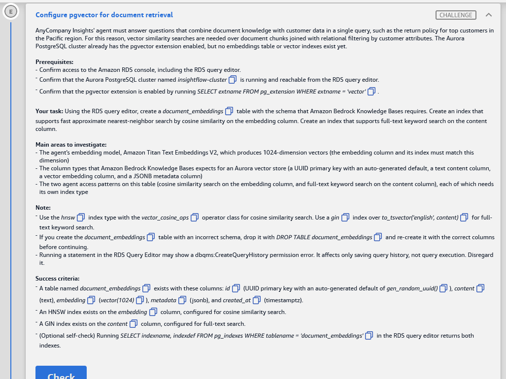

# 🅴 Challenge E: Configure pgvector for document retrieval

> **Status:** ✅ Passed, *Meets Requirements* (exam lab, 12 Nov 2026) · **Diagram label:** E (Amazon Aurora pgvector, the *Store vectors* target of Bedrock Knowledge Bases)
> **Services:** Aurora PostgreSQL + **pgvector** (`vector(1024)`, HNSW `vector_cosine_ops`), PostgreSQL full-text search (GIN on `to_tsvector`), the Amazon Bedrock Knowledge Bases Aurora vector-store schema, Amazon Titan Text Embeddings V2, RDS Query Editor
> **Lab:** [AWS Databases for Agentic AI Demonstrated](README.md) · **Vault:** [index](../README.md)

---

## ✅ Status checklist (success criteria)

- [x] Table **`document_embeddings`** exists with columns:

  | Column | Type | Notes |
  |---|---|---|
  | `id` | `uuid` | Primary key, default `gen_random_uuid()` |
  | `content` | `text` | |
  | `embedding` | `vector(1024)` | |
  | `metadata` | `jsonb` | |
  | `created_at` | `timestamptz` | |

- [x] An **HNSW** index on `embedding`, configured for **cosine** similarity (`vector_cosine_ops`)
- [x] A **GIN** index on `content`, configured for **full-text** search (`to_tsvector('english', content)`)
- [ ] *(Optional)* `SELECT indexname, indexdef FROM pg_indexes WHERE tablename = 'document_embeddings';` returns both indexes

---

## 🖼️ Task card



<details>
<summary>Text copy of the task</summary>

**Scenario:** AnyCompany Insights' agent must answer questions that combine document knowledge with customer data in a single query, such as the return policy for top customers in the Pacific region. For this reason, vector similarity searches are needed over document chunks joined with relational filtering by customer attributes. The Aurora PostgreSQL cluster already has the pgvector extension enabled, but no embeddings table or vector indexes exist yet.

**Prerequisites**
- Confirm access to the Amazon RDS console, including the RDS query editor.
- Confirm that the Aurora PostgreSQL cluster named `insightflow-cluster` is running and reachable from the RDS query editor.
- Confirm that the pgvector extension is enabled by running `SELECT extname FROM pg_extension WHERE extname = 'vector';`.

**Your task:** Using the RDS query editor, create a `document_embeddings` table with the schema that Amazon Bedrock Knowledge Bases requires. Create an index that supports fast approximate nearest-neighbor search by cosine similarity on the embedding column. Create an index that supports full-text keyword search on the content column.

**Main areas to investigate**
- The agent's embedding model, Amazon Titan Text Embeddings V2, which produces 1024-dimension vectors. The embedding column and its index must match this dimension.
- The column types that Amazon Bedrock Knowledge Bases expects for an Aurora vector store: a UUID primary key with an auto-generated default, a text content column, a vector embedding column, and a JSONB metadata column.
- The two agent access patterns on this table: cosine similarity search on the embedding column, and full-text keyword search on the content column. Each needs its own index type.

**Note**
- Use the `hnsw` index type with the `vector_cosine_ops` operator class for cosine similarity search. Use a `gin` index over `to_tsvector('english', content)` for full-text keyword search.
- If you create the `document_embeddings` table with an incorrect schema, drop it with `DROP TABLE document_embeddings` and re-create it with the correct columns before continuing.
- Running a statement in the RDS Query Editor may show a `dbqms:CreateQueryHistory` permission error. It affects only saving query history, not query execution. Disregard it.

**Success criteria**
- A table named `document_embeddings` exists with these columns: `id` (UUID primary key with an auto-generated default of `gen_random_uuid()`), `content` (text), `embedding` (`vector(1024)`), `metadata` (jsonb) and `created_at` (timestamptz).
- An HNSW index exists on the `embedding` column, configured for cosine similarity search.
- A GIN index exists on the `content` column, configured for full-text search.
- (Optional self-check) Running `SELECT indexname, indexdef FROM pg_indexes WHERE tablename = 'document_embeddings'` in the RDS query editor returns both indexes.

</details>

---

## 🗺️ Where it sits in the architecture


**Flow E (and what it enables):**

```text
S3 docs ──(F: ingest/sync)──▶ Bedrock Knowledge Base ──Titan Embeddings V2 (1024-d)──▶ INSERT into
                                                                                   public.document_embeddings  ◀── this challenge
Agent ──▶ kb-retrieve-tool ──▶ Bedrock KB Retrieve ──▶ SELECT … ORDER BY embedding <=> $q (HNSW)
                                                    └─▶ hybrid: … to_tsvector('english', content) @@ query (GIN)
Agent SQL tool (D) ──▶ JOIN document chunks with customers (relational filter)
```

This challenge builds the **storage contract** that Challenge F's Knowledge Base will write into. If the column names, types or dimension are wrong, the KB sync fails. That's probably why `aurora-kb-creds` showed *Last retrieved: –* in Challenge D.

---

## 🔍 Root cause / what's missing

| Need | Why | What to create |
|---|---|---|
| A table Bedrock KB can write to | KB stores one row per **chunk**: id, text, vector, metadata | `document_embeddings` with the 5 columns |
| Dimension = model output | Titan Text Embeddings V2 → **1024** floats. Inserting a different length fails (`expected 1024 dimensions, not N`) | `embedding vector(1024)` |
| Fast semantic search | Without an ANN index, every query computes the distance to every chunk (exact, O(n)) | **HNSW** with **`vector_cosine_ops`**, so queries must use `<=>` (Challenge A's lesson) |
| Fast keyword search | `LIKE '%return policy%'` can't use a B-tree. Full-text needs an inverted index on lexemes | **GIN** on `to_tsvector('english', content)` |
| Auto IDs | KB (and humans) insert without supplying ids | `id uuid PRIMARY KEY DEFAULT gen_random_uuid()` (built into PostgreSQL 13+, no extension needed) |

---

## 🛠️ Solution

### Where each step happens

| Step | AWS service → console page | What I do there |
|---|---|---|
| 0 | Console bar → **Region** | **us-east-1** |
| 1 | **RDS** → **Query editor** → `insightflow-cluster-…` → **admin** secret → DB `insightflow` | Connect as the owner/admin |
| 2–6 | **RDS** → **Query editor** | Prerequisite checks, `CREATE TABLE`, two `CREATE INDEX` statements, verify |
| 7 | Lab → **Check** | |

Everything is SQL in the RDS Query editor. **Highlight one statement at a time → Run.**

### Step 0: Region

Console bar → **US East (N. Virginia) us-east-1**.

### Step 1: Connect as admin (RDS Query editor)

RDS → **Query editor** → cluster **`insightflow-cluster-b55df330`** → **Connect with a Secrets Manager ARN** → ARN of **`insightflow/aurora-admin-creds-b55df330`** → database **`insightflow`** → **Connect to database**.

```sql
SELECT current_user, current_database();
```
Expect the admin user and `insightflow`. **Not** the agent user: that one can't run `CREATE TABLE` (Challenge A, Mistake 1).

### Step 2: Prerequisite checks

```sql
SELECT extname, extversion FROM pg_extension WHERE extname = 'vector';
```
Expect one row. HNSW needs pgvector **0.5.0 or later**.

```sql
SELECT to_regclass('public.document_embeddings') AS existing_table;
```
Expect `NULL` (no table yet). If it isn't `NULL`, inspect it in Step 5 and drop it if it's wrong: `DROP TABLE document_embeddings;`.

### Step 3: Create the table

```sql
CREATE TABLE public.document_embeddings (
    id          uuid         PRIMARY KEY DEFAULT gen_random_uuid(),
    content     text,
    embedding   vector(1024),
    metadata    jsonb,
    created_at  timestamptz  DEFAULT now()
);
```

| Column | Type | Why |
|---|---|---|
| `id` | `uuid` PK, default `gen_random_uuid()` | The KB's primary-key field. The default lets inserts omit it |
| `content` | `text` | The chunk text (KB **text field**) |
| `embedding` | `vector(1024)` | Titan Text Embeddings V2 output (KB **vector field**) |
| `metadata` | `jsonb` | Source URI, page, custom attributes (KB **metadata field**). `jsonb` is indexable |
| `created_at` | `timestamptz` (default `now()`) | Audit / freshness. The default isn't required by the criteria, but it's harmless |

Use the exact names and types. `vector` without `(1024)`, `json` instead of `jsonb`, or `timestamp` without a time zone would all fail the check.

### Step 4: Create the two indexes

**HNSW for cosine similarity:**

```sql
CREATE INDEX idx_document_embeddings_embedding_hnsw
    ON public.document_embeddings
    USING hnsw (embedding vector_cosine_ops);
```

**GIN for full-text search:**

```sql
CREATE INDEX idx_document_embeddings_content_gin
    ON public.document_embeddings
    USING gin (to_tsvector('english', content));
```

- The index names are my choice. The criteria check the **type and configuration**, not the name.
- These are fast on an empty table. An HNSW build on millions of rows takes minutes and memory (`maintenance_work_mem`).
- Leave the HNSW parameters at their defaults (`m = 16`, `ef_construction = 64`). Tune them only with a reason.

### Step 5: Verify the columns

`information_schema` shows `vector` only as `USER-DEFINED`, so use the catalog to see the real types and defaults:

```sql
SELECT a.attname                               AS column_name,
       format_type(a.atttypid, a.atttypmod)    AS data_type,
       pg_get_expr(d.adbin, d.adrelid)         AS column_default,
       a.attnotnull                            AS not_null
FROM pg_attribute a
LEFT JOIN pg_attrdef d ON d.adrelid = a.attrelid AND d.adnum = a.attnum
WHERE a.attrelid = 'public.document_embeddings'::regclass
  AND a.attnum > 0 AND NOT a.attisdropped
ORDER BY a.attnum;
```

Expected:

| column_name | data_type | column_default | not_null |
|---|---|---|---|
| `id` | `uuid` | `gen_random_uuid()` | `true` (it's the PK) |
| `content` | `text` | | `false` |
| `embedding` | `vector(1024)` | | `false` |
| `metadata` | `jsonb` | | `false` |
| `created_at` | `timestamp with time zone` | `now()` | `false` |

Screenshot → `assets/challenge_E/02_columns.png`.

### Step 6: Verify the indexes (the optional self-check)

```sql
SELECT indexname, indexdef FROM pg_indexes WHERE tablename = 'document_embeddings';
```

Expected **3** rows:

| indexname | indexdef |
|---|---|
| `document_embeddings_pkey` | `CREATE UNIQUE INDEX … USING btree (id)` |
| `idx_document_embeddings_embedding_hnsw` | `CREATE INDEX … USING hnsw (embedding vector_cosine_ops)` |
| `idx_document_embeddings_content_gin` | `CREATE INDEX … USING gin (to_tsvector('english'::regconfig, content))` |

Screenshot → `03_indexes.png`.

### Step 7: Check

Back in the lab → **Check**.

> **Don't insert test rows.** Challenge F's Knowledge Base sync will own this table's contents, and a stray hand-made row would show up in agent answers.

### ⏭️ Heads-up for Challenge F (don't do it unless F asks)

- The KB connects with **`insightflow/aurora-kb-creds`**. That DB user will need `SELECT, INSERT, UPDATE, DELETE` on `public.document_embeddings`, because the table is owned by admin.
- The KB's **field mapping** must match these column names: primary key `id`, vector field `embedding`, text field **`content`** (the AWS docs' example uses `chunks`), metadata field `metadata`.
- The agent's read-only user may need `SELECT` on it for the "documents + customers in one query" pattern.

### Order of operations

```text
0 Region → 1 Query editor as ADMIN (db insightflow) → 2 vector ext present, table absent
  → 3 CREATE TABLE document_embeddings (id uuid PK default gen_random_uuid(), content text,
       embedding vector(1024), metadata jsonb, created_at timestamptz)
  → 4 CREATE INDEX … USING hnsw (embedding vector_cosine_ops)
      CREATE INDEX … USING gin (to_tsvector('english', content))
  → 5 verify columns → 6 pg_indexes (pkey + hnsw + gin) → 7 Check
```

---

## ⚠️ Mistakes & lessons

_Fill in as I go. Screenshots go in `assets/challenge_E/`._

---

## 🧯 Troubleshooting table

| Symptom | Cause | Fix |
|---|---|---|
| `must be owner of …` / `permission denied for schema public` on `CREATE TABLE` | Connected with the agent or KB secret | Reconnect with **`insightflow/aurora-admin-creds`** |
| `type "vector" does not exist` | The extension isn't installed in this DB, or you're in the wrong DB (`postgres`) | Database **`insightflow`**. Check `pg_extension` |
| `access method "hnsw" does not exist` | pgvector older than 0.5.0 | Check `extversion`. Upgrade with `ALTER EXTENSION vector UPDATE;` (or ask, in a lab) |
| `relation "document_embeddings" already exists` | It was created earlier | Inspect it (Step 5). If it's wrong: `DROP TABLE document_embeddings;` → re-create |
| Check fails on columns | `vector` without `(1024)`, `json` not `jsonb`, `timestamp` not `timestamptz`, or a missing default | `DROP TABLE` → re-create exactly as in Step 3 → re-create both indexes |
| Check fails on the HNSW index | Built with `vector_l2_ops` (the default when the opclass is omitted) or as `ivfflat` | `DROP INDEX idx_document_embeddings_embedding_hnsw;` → re-create `USING hnsw (embedding vector_cosine_ops)` |
| Check fails on the GIN index | GIN on raw `content` (fails: text has no default GIN opclass), or missing the `'english'` config | `USING gin (to_tsvector('english', content))` |
| `functions in index expression must be marked IMMUTABLE` | Used `to_tsvector(content)` without the config argument (that one-argument form isn't immutable) | Always pass the config: `to_tsvector('english', content)` |
| Later (F): KB sync fails with *dimension mismatch* | The model isn't Titan V2 at 1024 dims, or the column has a different size | Model and column must agree: `vector(1024)` |

---

## 📚 Study notes (go deeper later)

### 1. The Bedrock Knowledge Bases → Aurora contract

- When you create a KB with an **Aurora PostgreSQL** vector store, you give it the cluster ARN, a **Secrets Manager secret** (the KB DB user), the database name, the **table name**, and a **field mapping**:

  | KB field | This lab's column |
  |---|---|
  | Primary key | `id` (uuid) |
  | Vector field | `embedding` (`vector(n)`, n = the model's dimension) |
  | Text field | `content` (text) |
  | Metadata field | `metadata` (json/jsonb) |
  | Custom metadata field (optional) | e.g. `custom_metadata jsonb`. It lets you filter by attributes at retrieval time ⚠️ |

- The KB needs the cluster's **RDS Data API** enabled, and its DB user needs `INSERT/UPDATE/DELETE/SELECT` on the table.
- **The AWS docs' sample** creates a `bedrock_integration` schema, a `bedrock_user` role and a table with `chunks text, metadata json` ⚠️. The names are free as long as the mapping matches.
- **Sync** = read S3 docs → chunk (fixed-size, semantic, hierarchical or none) → embed each chunk → upsert rows. Deleted S3 files are deleted from the table on the next sync.

### 2. Embedding model ↔ column dimension

| Model | Dimensions |
|---|---|
| **Titan Text Embeddings V2** | **1024** (default). Also 512 or 256, selectable |
| Titan Text Embeddings G1 | 1536 |
| Cohere Embed v3 (English/Multilingual) | 1024 |

- A dimension is fixed per column. **Changing the model means a new column or table plus re-embedding everything.**
- `vector` (float32) indexes up to **2,000 dims**. `halfvec` (float16) up to **4,000**, at half the storage.
- Storage per row ≈ 4 × dims bytes + 8: 1024-d is about **4 KB per chunk**, before the index.

### 3. HNSW choices for this table

- **`vector_cosine_ops`** suits text embeddings. (Titan V2 normalises by default, so cosine and L2 give the same ranking, but the **operator still has to match the opclass**: `<=>`.)
- Build: `m` (graph degree, default 16) and `ef_construction` (default 64). Query: `SET hnsw.ef_search = 40` (default). Raise it for recall.
- **Filtered search** (e.g. `WHERE metadata->>'region' = 'Pacific'`) post-filters HNSW results. See Challenge A, Study note 4: iterative scans (pgvector 0.8+) and partial indexes.

### 4. PostgreSQL full-text search in one page

- `to_tsvector('english', text)` turns text into lexemes: lowercased, **stemmed** ("returns" → "return") and **stop words removed** ("the", "for").
- The query side is `plainto_tsquery`, `phraseto_tsquery` or **`websearch_to_tsquery('english', 'return policy -electronics')`** (Google-like syntax). Match with `@@`. Rank with `ts_rank` / `ts_rank_cd`.
- **GIN** is an inverted index, lexeme → rows, so it's fast for `@@`. The query expression **must match the index expression exactly** to use it:
  ```sql
  SELECT id, content
  FROM document_embeddings
  WHERE to_tsvector('english', content) @@ websearch_to_tsquery('english', 'return policy');
  ```
- **Alternative:** a stored generated column `content_tsv tsvector GENERATED ALWAYS AS (to_tsvector('english', content)) STORED` plus GIN on it. Simpler queries, more storage.
- ⚠️ **Second-order:** if Bedrock KB **hybrid search** builds its own tsvector query with a different config (the docs' sample index uses `'simple'` ⚠️), an `'english'` index might not be used by the KB's queries. The agent's own SQL keyword search would still use it.

### 5. Hybrid search: why both indexes

| | Vector (HNSW, `<=>`) | Keyword (GIN, `@@`) |
|---|---|---|
| Finds | *Meaning*: "refund rules" ≈ "return policy" | *Exact terms*: SKUs, error codes, names, "Pacific" |
| Misses | Rare tokens, exact IDs | Synonyms and paraphrases |
| Combine | **Hybrid** = run both, merge scores (e.g. Reciprocal Rank Fusion), then re-rank | |

The scenario ("return policy for top customers in the Pacific region") also needs a **relational filter**: join chunks with `customers` (Challenge D) by region or tier. That's the reason to keep vectors in **Aurora** rather than a separate vector DB: one SQL query can do the vector + keyword + relational filtering.

### 6. Why `uuid` + `gen_random_uuid()`

- Writers (KB sync, multiple workers) can generate keys without coordination. No sequence contention.
- `gen_random_uuid()` is built in from PostgreSQL 13 (earlier versions needed `pgcrypto`). Random UUIDv4 keys fragment B-tree inserts slightly, which is fine at this scale. PostgreSQL 18 adds `uuidv7()` (time-ordered) ⚠️.

### 7. GCP mapping

| AWS | GCP |
|---|---|
| Aurora + pgvector + HNSW | **AlloyDB** / Cloud SQL + pgvector (HNSW/IVFFlat) or AlloyDB **ScaNN** index |
| Bedrock Knowledge Bases (Aurora store) | **Vertex AI RAG Engine** (with AlloyDB / Vector Search), or LangChain `PGVector` on AlloyDB |
| Titan Text Embeddings V2 (1024-d) | `text-embedding-005` / `gemini-embedding-001` on Vertex AI (768–3072-d ⚠️) |
| PostgreSQL FTS + GIN | Same in AlloyDB/Cloud SQL. BigQuery `SEARCH()` with search indexes |

### 🧪 Self-test questions

1. Why must the column be `vector(1024)` and not just `vector`?
2. You create `USING hnsw (embedding)` without an opclass. What happens to cosine queries?
3. Why does `CREATE INDEX … USING gin (to_tsvector(content))` fail, and what's the fix?
4. A keyword query doesn't use the GIN index. What's the most likely mismatch?
5. Why keep document vectors in Aurora instead of a dedicated vector database, for this scenario?
6. Which DB privileges will the Knowledge Base's user need on this table, and why isn't that the admin?
7. You switch to an embedding model with 1536 dims. What must change?

<details>
<summary>Answers</summary>

1. The index needs a fixed dimension, and inserts are validated against it. Without `(1024)` you can't build an HNSW index (the column has no dimensions), and the criteria require `vector(1024)`.
2. It defaults to `vector_l2_ops`, so `<=>` (cosine) queries can't use it and fall back to a sequential scan.
3. The one-argument `to_tsvector(text)` depends on the `default_text_search_config` setting, so it isn't IMMUTABLE. Pass the config: `to_tsvector('english', content)`.
4. The query's expression differs from the index's: a different config (`'simple'` vs `'english'`) or no `to_tsvector` at all (`LIKE`).
5. One SQL query can combine vector similarity, keyword search and relational joins/filters (customers by region) with transactions and existing security (roles, views).
6. `SELECT`, `INSERT`, `UPDATE`, `DELETE` (sync upserts and deletes chunks). Least privilege: the KB shouldn't own the schema or be able to drop tables.
7. A new `vector(1536)` column or table, new HNSW index, re-embed all documents (full KB re-sync), and update the KB config.

</details>

---

## 📝 Run log (fill in as I go)

| Step | What I ran | Result / output |
|---|---|---|
| 1 | `current_user, current_database()` | _admin user? insightflow?_ |
| 2 | pgvector version / table absent | _extversion = ?_ · _to_regclass = NULL?_ |
| 3 | `CREATE TABLE document_embeddings` | _status_ |
| 4 | HNSW cosine index · GIN FTS index | _status_ |
| 5 | Column check | _types/defaults_ |
| 6 | `pg_indexes` | _pkey + hnsw + gin?_ |
| 7 | Check | _result_ |
