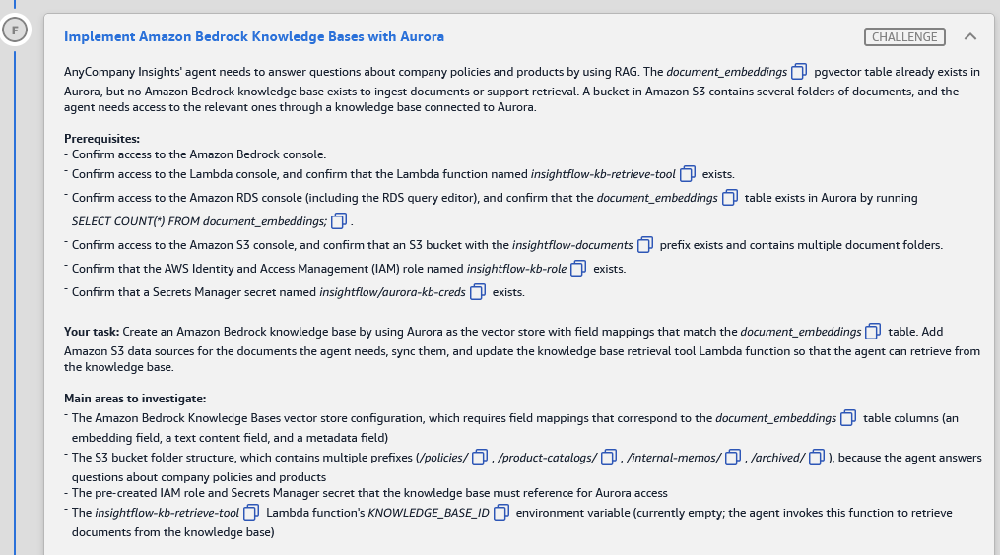
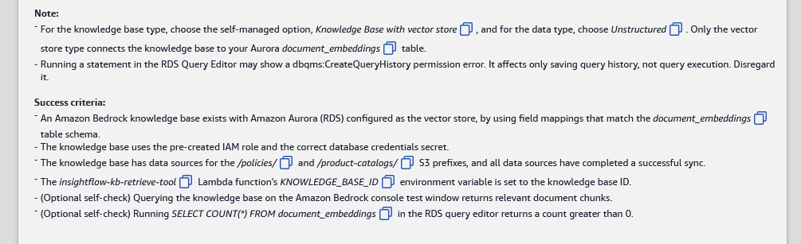

# 🅵 Challenge F: Implement Amazon Bedrock Knowledge Bases with Aurora

> **Status:** 🟡 In progress · **Diagram label:** F (S3 bucket → *Ingest docs* → Amazon Bedrock Knowledge Bases → *Store vectors* → Aurora pgvector; agent → kb-retrieve-tool → *Retrieve docs*)
> **Services:** Amazon Bedrock Knowledge Bases (vector store = Aurora, field mapping, data sources, sync), Amazon Titan Text Embeddings V2, Amazon S3 (prefixes), IAM service role, Secrets Manager, Aurora PostgreSQL (RDS Data API), AWS Lambda (env var)
> **Lab:** [AWS Databases for Agentic AI Demonstrated](README.md) · **Vault:** [index](../README.md)

---

## ✅ Status checklist (success criteria)

- [ ] A Bedrock **knowledge base** exists with **Amazon Aurora (RDS)** as the vector store, with **field mappings matching `document_embeddings`**
- [ ] It uses the **pre-created IAM role** (`insightflow-kb-role`) and the **correct DB credentials secret** (`insightflow/aurora-kb-creds`)
- [ ] It has data sources for the **`/policies/`** and **`/product-catalogs/`** S3 prefixes, and **every data source has completed a successful sync**
- [ ] Lambda `insightflow-kb-retrieve-tool`'s **`KNOWLEDGE_BASE_ID`** is set to the KB ID
- [ ] *(Optional)* The Bedrock console **Test** window returns relevant chunks
- [ ] *(Optional)* `SELECT COUNT(*) FROM document_embeddings;` returns **> 0**

---

## 🖼️ Task card





<details>
<summary>Text copy of the task</summary>

**Scenario:** AnyCompany Insights' agent needs to answer questions about company policies and products by using RAG. The `document_embeddings` pgvector table already exists in Aurora, but no Amazon Bedrock knowledge base exists to ingest documents or support retrieval. A bucket in Amazon S3 contains several folders of documents, and the agent needs access to the relevant ones through a knowledge base connected to Aurora.

**Prerequisites**
- Confirm access to the Amazon Bedrock console.
- Confirm access to the Lambda console, and confirm that the Lambda function named `insightflow-kb-retrieve-tool` exists.
- Confirm access to the Amazon RDS console (including the RDS query editor), and confirm that the `document_embeddings` table exists in Aurora by running `SELECT COUNT(*) FROM document_embeddings;`.
- Confirm access to the Amazon S3 console, and confirm that an S3 bucket with the `insightflow-documents` prefix exists and contains multiple document folders.
- Confirm that the AWS Identity and Access Management (IAM) role named `insightflow-kb-role` exists.
- Confirm that a Secrets Manager secret named `insightflow/aurora-kb-creds` exists.

**Your task:** Create an Amazon Bedrock knowledge base, using Aurora as the vector store, with field mappings that match the `document_embeddings` table. Add Amazon S3 data sources for the documents the agent needs, sync them, and update the knowledge base retrieval tool Lambda function so that the agent can retrieve from the knowledge base.

**Main areas to investigate**
- The Amazon Bedrock Knowledge Bases vector store configuration. It requires field mappings that correspond to the `document_embeddings` table columns (an embedding field, a text content field and a metadata field).
- The S3 bucket folder structure, which contains multiple prefixes (`/policies/`, `/product-catalogs/`, `/internal-memos/`, `/archived/`), because the agent answers questions about company policies and products.
- The pre-created IAM role and Secrets Manager secret that the knowledge base must reference for Aurora access.
- The `insightflow-kb-retrieve-tool` Lambda function's `KNOWLEDGE_BASE_ID` environment variable. It's currently empty, and the agent invokes this function to retrieve documents from the knowledge base.

**Note**
- For the knowledge base type, choose the self-managed option, **Knowledge Base with vector store**, and for the data type, choose **Unstructured**. Only the vector store type connects the knowledge base to your Aurora `document_embeddings` table.
- Running a statement in the RDS Query Editor may show a `dbqms:CreateQueryHistory` permission error. It affects only saving query history, not query execution. Disregard it.

**Success criteria**
- An Amazon Bedrock knowledge base exists with Amazon Aurora (RDS) configured as the vector store, using field mappings that match the `document_embeddings` table schema.
- The knowledge base uses the pre-created IAM role and the correct database credentials secret.
- The knowledge base has data sources for the `/policies/` and `/product-catalogs/` S3 prefixes, and all data sources have completed a successful sync.
- The `insightflow-kb-retrieve-tool` Lambda function's `KNOWLEDGE_BASE_ID` environment variable is set to the knowledge base ID.
- (Optional self-check) Querying the knowledge base in the Amazon Bedrock console test window returns relevant document chunks.
- (Optional self-check) Running `SELECT COUNT(*) FROM document_embeddings` in the RDS query editor returns a count greater than 0.

</details>

---

## 🗺️ Where it sits in the architecture


```text
INGEST (this challenge)
S3 insightflow-documents-…/policies/          ─┐
S3 insightflow-documents-…/product-catalogs/  ─┴▶ Bedrock KB data sources ──Sync──▶ parse → chunk → Titan Embeddings V2 (1024-d)
                                                    (role: insightflow-kb-role)          │
                                                                                         ▼ RDS Data API (secret: aurora-kb-creds)
                                                                        Aurora insightflow.public.document_embeddings  (built in E)
RETRIEVE
LangGraph agent ──▶ Lambda insightflow-kb-retrieve-tool (env KNOWLEDGE_BASE_ID) ──▶ bedrock-agent-runtime Retrieve ──▶ chunks
```

Two credentials are involved:
- **`insightflow-kb-role`** (IAM) lets *Bedrock* read S3, call the embedding model, and call the RDS Data API and Secrets Manager.
- **`aurora-kb-creds`** (DB user) lets those Data API calls *write rows* into the table.

The *Last retrieved: –* on `aurora-kb-creds` in Challenge D showed that no KB had ever used it.

---

## 🔍 What's missing / design decisions

| # | Gap | Decision |
|---|---|---|
| 1 | No knowledge base | Create **Knowledge Base with vector store** → **Unstructured**, with vector store **Aurora**, using the existing table from E |
| 2 | Field mapping | Must match E's columns: **`id` / `embedding` / `content` / `metadata`** (the AWS docs' sample uses `chunks`, but this lab uses **`content`**) |
| 3 | Which documents | **Only `/policies/` and `/product-catalogs/`**. Exclude `/internal-memos/` (internal, shouldn't reach customer answers) and `/archived/` (stale and contradictory). Never point a data source at the bucket root |
| 4 | Identity | Use the **existing** role `insightflow-kb-role` (not "create a new role") and the secret **`insightflow/aurora-kb-creds`** (not agent/admin) |
| 5 | Ingestion | Each data source must be **synced** (sync is per data source) |
| 6 | Retrieval wiring | `KNOWLEDGE_BASE_ID` on `insightflow-kb-retrieve-tool` = the **KB ID** (the short ID, not the name or ARN) |

### Field mapping (verified against the Bedrock docs' Aurora tab)

| Console label | API field | Value for this lab |
|---|---|---|
| Amazon Aurora DB Cluster ARN | `resourceArn` | `arn:aws:rds:us-east-1:987347315034:cluster:insightflow-cluster-b55df330` |
| Database name | `databaseName` | `insightflow` |
| Table name | `tableName` | `public.document_embeddings` (the docs recommend a **schema-qualified** name) |
| Secret ARN | `credentialsSecretArn` | ARN of `insightflow/aurora-kb-creds-b55df330` |
| Primary key | `primaryKeyField` | `id` |
| Vector field | `vectorField` | `embedding` |
| Text field | `textField` | **`content`** |
| Bedrock-managed metadata field | `metadataField` | `metadata` |
| Custom metadata field *(optional)* | `customMetadataField` | **leave empty** (no such column) |

> The docs warn: *"You must provide these fields before creating the knowledge base. **They cannot be updated after the knowledge base is created.**"* A wrong mapping means deleting the KB and creating it again, so double-check before **Create**.

---

## 🛠️ Solution

### Where each step happens

| Step | AWS service → console page | What I do there |
|---|---|---|
| 0 | Console bar → **Region** | **us-east-1** |
| 1 | **S3** → *Buckets* → `insightflow-documents-…` | Confirm the folder names (exact spelling) |
| 2 | **Secrets Manager** → `insightflow/aurora-kb-creds` | Copy the **Secret ARN**. Note the **username** |
| 3 | **RDS** → **Query editor** (admin, DB `insightflow`) | Pre-flight: the table and indexes exist, and the KB user has privileges on the table |
| 4 | **Amazon Bedrock** → *Knowledge Bases* → **Create → Knowledge Base with vector store** | The wizard: details + role → S3 data source `policies/` → Titan V2 + Aurora mapping → Create |
| 5 | **Bedrock** → the KB → *Data source* section → **Add** | Second data source `product-catalogs/` |
| 6 | **Bedrock** → the KB → *Data source* section → **Sync** (each one) | Ingest. Wait for success |
| 7 | **RDS Query editor** + **Bedrock** → **Test knowledge base** | Verify the rows and retrieval |
| 8 | **Lambda** → `insightflow-kb-retrieve-tool-…` → **Configuration → Environment variables** | `KNOWLEDGE_BASE_ID` = KB ID → Save (+ optional Test) |
| 9 | Lab → **Check** | |

---

### Step 0: Region

Console bar → **US East (N. Virginia) us-east-1**. The KB, the cluster and the bucket must all be in this Region and account.

### Step 1: Look at the bucket (S3)

1. **S3** → **Buckets** → **`insightflow-documents-b55df330`** (panel `DocsBucketName`).
2. Confirm the four folders and their **exact** names: `policies/`, `product-catalogs/`, `internal-memos/`, `archived/`. Open `policies/` and `product-catalogs/` to check they contain files (PDF/TXT/MD/DOCX/HTML/CSV…).
3. Note any `*.metadata.json` files next to the documents. They add custom metadata (see Troubleshooting).
4. Screenshot → `assets/challenge_F/03_s3_folders.png`.

### Step 2: Get the KB secret (Secrets Manager)

1. **Secrets Manager** → **Secrets** → **`insightflow/aurora-kb-creds-b55df330`**.
2. Copy the **Secret ARN** (full, with the 6-character suffix).
3. **Retrieve secret value** → note the **username** (needed for Step 3's privilege check). Don't change anything.

### Step 3: Pre-flight in Aurora (RDS Query editor, as admin)

**Where:** RDS → Query editor → `insightflow-cluster-…` → **admin** secret → DB **`insightflow`**. Highlight one statement → **Run**.

```sql
SELECT COUNT(*) FROM document_embeddings;                     -- expect 0 (it exists, it's empty)
```

```sql
SELECT indexname, indexdef FROM pg_indexes WHERE tablename = 'document_embeddings';
-- expect pkey + hnsw (vector_cosine_ops) + gin (to_tsvector('english', content)). Bedrock requires both HNSW and GIN.
```

**Can the KB's DB user write to the table?** Replace `<kb_user>` with the username from Step 2:

```sql
SELECT has_schema_privilege('<kb_user>', 'public', 'USAGE')                               AS schema_usage,
       has_table_privilege('<kb_user>', 'public.document_embeddings', 'SELECT')           AS can_select,
       has_table_privilege('<kb_user>', 'public.document_embeddings', 'INSERT')           AS can_insert,
       has_table_privilege('<kb_user>', 'public.document_embeddings', 'UPDATE')           AS can_update,
       has_table_privilege('<kb_user>', 'public.document_embeddings', 'DELETE')           AS can_delete;
```

**If any value is `false`,** grant least-privilege DML. Admin created the table in E, so the KB user doesn't own it:

```sql
GRANT USAGE ON SCHEMA public TO <kb_user>;
```
```sql
GRANT SELECT, INSERT, UPDATE, DELETE ON public.document_embeddings TO <kb_user>;
```

Sync **upserts and deletes** chunks, which is why it needs all four. It doesn't need DDL or ownership.

### Step 4: Create the knowledge base (Amazon Bedrock console)

**Where:** Console search → **Amazon Bedrock** → left navigation → **Knowledge Bases** (under *Build*) → **Create** ▾ → **Knowledge Base with vector store**

⚠️ The wizard labels below follow the docs and recent consoles. Small wording differences are possible.

#### 4.1 Provide Knowledge Base details

| Field | Value |
|---|---|
| Knowledge Base name | e.g. `insightflow-kb` |
| Description | *(optional)* `Company policies and product catalogs for the InsightFlow agent` |
| **IAM permissions** | **Use an existing service role** → **`insightflow-kb-role`**. *Not* "Create and use a new service role" |
| Data type *(per the task note)* | **Unstructured** |
| Data source | **Amazon S3** |

→ **Next**

#### 4.2 Configure data source (the first one: policies)

| Field | Value |
|---|---|
| Data source name | `policies` |
| Data source location | This AWS account |
| **S3 URI** | **Browse S3** → `insightflow-documents-b55df330` → select the **`policies/`** folder → **Choose**, which gives `s3://insightflow-documents-b55df330/policies/` |
| Parsing strategy | Amazon Bedrock default parser |
| Chunking strategy | Default chunking |

→ **Next**

#### 4.3 Configure data storage and processing

**Embeddings model:**

| Field | Value |
|---|---|
| Embeddings model | **Select model** → Amazon → **Titan Text Embeddings V2** → Apply |
| *Additional configurations* → Embeddings type | **Floating-point vector embeddings** (float32). Aurora doesn't support binary |
| *Additional configurations* → Vector dimensions | **1024**, which must match `vector(1024)` |

**Vector database:**

| Field | Value |
|---|---|
| Vector store creation method | **Choose a vector store you have created** (*not* "Quick create a new vector store") |
| Vector store | **Amazon Aurora PostgreSQL Serverless** (Amazon Aurora / RDS) |
| Amazon Aurora DB Cluster ARN | `arn:aws:rds:us-east-1:987347315034:cluster:insightflow-cluster-b55df330` |
| Database name | `insightflow` |
| Table name | `public.document_embeddings` |
| Secret ARN | ARN of `insightflow/aurora-kb-creds-b55df330` (from Step 2) |
| **Metadata field mapping** → Primary key | `id` |
| → Vector field | `embedding` |
| → Text field | `content` |
| → Bedrock-managed metadata field | `metadata` |
| → Custom metadata field | *(leave blank)* |

→ **Next**

#### 4.4 Review and create

Check every value against the field-mapping table above, because the mappings **can't be edited later**. Then **Create Knowledge Base** and wait for the green banner. Creation validates the cluster, secret, table, columns and indexes.

Screenshot the KB overview → `04_kb_overview.png`. **Copy the Knowledge Base ID**, shown on the KB details page under *Knowledge Base overview* (a short uppercase alphanumeric ID, e.g. `ABCDE12345` ⚠️ format not stated in the docs).

### Step 5: Add the second data source (product-catalogs)

**Where:** Bedrock → **Knowledge Bases** → your KB → **Data source** section → **Add** ⚠️ (button label may vary: *Add data source*)

| Field | Value |
|---|---|
| Data source type | Amazon S3 |
| Data source name | `product-catalogs` |
| S3 URI | **Browse S3** → `insightflow-documents-b55df330` → **`product-catalogs/`** → `s3://insightflow-documents-b55df330/product-catalogs/` |
| Parsing / chunking | defaults (same as `policies`) |

→ **Add data source**.

You now have **exactly two** data sources: `policies` and `product-catalogs`. **No** data source for `internal-memos/`, `archived/` or the bucket root.

### Step 6: Sync both data sources

**Where:** Bedrock → your KB → **Data source** section

1. Select **`policies`** → **Sync**. Status goes *Syncing* → *Available*. Open the data source → **Sync history**: the latest job should be **Complete**, with *Source files* / *Added* counts > 0.
2. Select **`product-catalogs`** → **Sync**, and check the same way.
3. If a job shows **Failed** or **Complete with warnings**, open **View warnings** for the reason (see Troubleshooting).
4. Screenshot the sync history → `05_sync_history.png`.

Sync is **incremental** and **per data source**. Re-sync after documents change. For Aurora, new vectors are visible right away (the docs exclude Aurora from the "few minutes" delay).

### Step 7: Verify the data and retrieval

**7a. Rows in Aurora** (Query editor, admin):

```sql
SELECT COUNT(*) FROM document_embeddings;              -- expect > 0
```
```sql
SELECT id, left(content, 120) AS snippet, metadata
FROM document_embeddings
LIMIT 5;                                                -- see the metadata keys Bedrock wrote
```

Use a key from the `metadata` you just saw (Bedrock reserves keys prefixed `x-amz-bedrock…`, likely `x-amz-bedrock-kb-source-uri` ⚠️) to confirm that **only** `policies/` and `product-catalogs/` were ingested:

```sql
SELECT metadata->>'x-amz-bedrock-kb-source-uri' AS source_uri, COUNT(*) AS chunks
FROM document_embeddings
GROUP BY 1 ORDER BY 1;
```

**7b. Test in the console:** Bedrock → your KB → **Test knowledge base** (right panel) → turn **off** *Generate responses* (retrieval only, so no model choice is needed) → ask *"What is the return policy?"* → **Run**. The results should be chunks whose source is under `policies/`. Try *"What products are in the catalog?"* for `product-catalogs/`. Screenshot → `06_kb_test.png`.

### Step 8: Wire the retrieval tool (Lambda)

**Where:** Lambda → **`insightflow-kb-retrieve-tool-b55df330`** (panel `KBRetrieveToolFunctionName`)

1. **Configuration** → **Environment variables** → **Edit**.
2. `KNOWLEDGE_BASE_ID` = the **KB ID** from Step 4.4. Paste only the ID: no ARN, no name, no spaces.
3. **Save**. No Deploy needed.
4. *(Optional)* **Code** tab: search for `KNOWLEDGE_BASE_ID` and for how `event` is read (e.g. `event["query"]`). Then **Test** tab → **Create new event** with that shape, e.g. `{"query": "What is the return policy?"}` ⚠️. Expect chunks in the response. A green *Succeeded* can still hold an `error` key, so read the body (lesson from C/D).
5. Screenshot → `07_lambda_kb_id.png`.

### Step 9: Check

Back in the lab → **Check**.

### Order of operations

```text
0 Region → 1 S3: folder names → 2 Secrets Manager: kb-creds ARN + username
  → 3 Query editor (admin): table/indexes OK, KB user has USAGE + SELECT/INSERT/UPDATE/DELETE (grant if not)
  → 4 Bedrock: Create → KB with vector store → role insightflow-kb-role, Unstructured, S3 "policies/"
       → Titan V2, float32, 1024 → "Choose a vector store you have created" → Aurora: cluster ARN, insightflow,
         public.document_embeddings, kb-creds ARN, id/embedding/content/metadata → Create → copy KB ID
  → 5 Add data source "product-catalogs/" → 6 Sync both → Complete
  → 7 COUNT(*) > 0 + Test KB → 8 Lambda KNOWLEDGE_BASE_ID = KB ID → Save → 9 Check
```

---

## ⚠️ Mistakes & lessons

_Fill in as I go. Screenshots go in `assets/challenge_F/`._

---

## 🧯 Troubleshooting table

| Symptom | Cause | Fix |
|---|---|---|
| Create fails: *table/column not found* or *invalid storage configuration* | Wrong table name or a field-mapping typo (`chunks` instead of `content`, `vector` instead of `embedding`) | Table `public.document_embeddings`. Mapping `id/embedding/content/metadata`. Mappings can't be edited later, so delete and re-create the KB |
| Create fails: *dimension mismatch* | Titan V2 set to 512/256, or the wrong model | Titan Text Embeddings **V2**, **1024**, float32 |
| Create or sync fails: *index … required* / hybrid-search error | HNSW or GIN index missing | Re-check Challenge E's indexes (both are required by Bedrock) |
| Sync **Failed**: `permission denied for table document_embeddings` | The KB DB user has no DML on the admin-owned table | Step 3 grants: `USAGE` on schema + `SELECT, INSERT, UPDATE, DELETE` |
| Create fails: *AccessDenied … secretsmanager:GetSecretValue* or `rds-data` | Wrong secret (agent/admin) or a new role instead of `insightflow-kb-role` | The existing role + `aurora-kb-creds`. IAM is preconfigured for exactly these |
| `DatabaseResumingException` / timeout on first create or sync | Aurora Serverless v2 resuming from 0 ACU (auto-pause) ⚠️ | Wait 30–60 s and retry |
| *You don't have access to the model* | The Titan V2 model isn't enabled for the account ⚠️ | Bedrock → **Model access** (if present) → enable Titan Text Embeddings V2 |
| Sync **Complete with warnings**: files skipped | Unsupported or oversized files, or bad `.metadata.json` | **View warnings**. A bad metadata file only skips that document |
| Metadata filter errors / custom metadata not stored | `.metadata.json` attributes but no custom metadata column | Leave *Custom metadata field* blank. (Docs: add a `custom_metadata jsonb` column + GIN if you need filtering) |
| `COUNT(*)` still 0 after "Complete" | Synced the wrong prefix (an empty folder) or the wrong KB | Check the data source's S3 URI. Re-sync |
| Answers cite `internal-memos/` or `archived/` | A data source points at the bucket root or the wrong prefix | Delete that data source and re-sync the correct ones. Deleting a data source removes its vectors ⚠️ (depends on the data deletion policy) |
| Lambda returns `ResourceNotFoundException` / *knowledge base not found* | `KNOWLEDGE_BASE_ID` is the name or ARN, or has a trailing space | The short KB ID only |
| Lambda returns `ValidationException` on `knowledgeBaseId` | Still empty (not saved) | **Save** the env var |

---

## 📚 Study notes (go deeper later)

### 1. Bedrock Knowledge Bases: the moving parts

| Part | What it is | In this lab |
|---|---|---|
| **Knowledge base** | Config: embedding model + vector store + role | `insightflow-kb` |
| **Data source** | Where the documents come from (S3 bucket/prefix, web crawler, …) + parsing/chunking settings | `policies`, `product-catalogs` |
| **Ingestion job (sync)** | Read → parse → chunk → embed → write vectors. Incremental | Run per data source |
| **Vector store** | Where chunks + vectors live | Aurora `public.document_embeddings` |
| **Retrieve / RetrieveAndGenerate** | Runtime APIs: chunks only / chunks + LLM answer with citations | The Lambda calls `Retrieve` (likely) |

**KB types (console *Create* menu):**

| Type | When to use |
|---|---|
| **with vector store** | The RAG pattern used here |
| **with structured data store** | Natural language → SQL over Redshift etc. |
| **with Kendra GenAI index** | |

The task's note: only *vector store* connects to your own Aurora table.

### 2. Chunking strategies

| Strategy | How it works | Good for |
|---|---|---|
| **Default / fixed-size** | ~300 tokens with overlap | General documents |
| **Hierarchical** | Parent/child chunks: retrieve the small child, return the larger parent context | Long structured documents |
| **Semantic** | Split where meaning shifts (uses an embedding model at ingest, so it costs more) | Narrative text |
| **None** | One chunk per file (you pre-chunked) | |

Parsing: the default parser handles text-based formats. A **foundation-model parser** or **Bedrock Data Automation** extracts tables and figures from PDFs and images (it costs more) ⚠️.

### 3. Retrieval at runtime

- `Retrieve(knowledgeBaseId, retrievalQuery.text, retrievalConfiguration.vectorSearchConfiguration{numberOfResults, overrideSearchType: SEMANTIC|HYBRID, filter})` → chunks + scores + source location + metadata.
- **HYBRID** search on Aurora uses the **GIN** full-text index plus the vector index. That's why Bedrock *requires* both (Challenge E).
- **Metadata filtering** (`filter: {equals: {key, value}}`) needs custom metadata (`.metadata.json` files + a custom metadata column). With pgvector 0.8+, set `hnsw.iterative_scan = relaxed_order` so filtered searches still return enough rows (setup page tip).

### 4. Why only two prefixes (data scoping = a security control)

- RAG turns **every ingested document into something the agent may quote**. Ingesting `internal-memos/` could leak confidential content into customer answers. Ingesting `archived/` returns **stale, contradictory** policy versions (the "old return policy" problem).
- Scope at ingest (data sources per prefix), and also at query time (metadata filters) if needed.
- **Second-order:** a new folder added later (e.g. `faqs/`) isn't searchable until someone adds a data source **and syncs**. Treat KB config like code.

### 5. Two identities, two layers (again)

| Layer | Principal | Grants |
|---|---|---|
| AWS API (IAM) | `insightflow-kb-role` (trusted by `bedrock.amazonaws.com`) | `s3:GetObject/ListBucket` on the bucket, `bedrock:InvokeModel` on Titan V2, `rds-data:ExecuteStatement/BatchExecuteStatement`, `rds:DescribeDBClusters`, `secretsmanager:GetSecretValue` on `aurora-kb-creds` ⚠️ |
| Database (PostgreSQL) | the user in `aurora-kb-creds` | `USAGE` on schema, `SELECT/INSERT/UPDATE/DELETE` on `document_embeddings` |

This is the same lesson as Lab 01's IAM vs Lake Formation: **"access denied" means one of the two layers said no, so find out which.**

### 6. Aurora vs other KB vector stores

| Store | Pick when |
|---|---|
| **Aurora PostgreSQL (pgvector)** | You need SQL joins with business data (customers), transactions, existing DB skills. Hybrid search via GIN |
| OpenSearch Serverless | The default "quick create". Strong text search, binary vectors |
| S3 Vectors | Cheapest at large scale, with higher latency ⚠️ |
| Neptune Analytics | GraphRAG (entities and relationships) |
| Pinecone / Redis / MongoDB Atlas | Existing investments |

### 7. GCP mapping

| AWS | GCP |
|---|---|
| Bedrock Knowledge Bases | **Vertex AI RAG Engine** (corpora, data imports, retrieval) / Vertex AI Search |
| Data source sync from S3 | RAG Engine `ImportRagFiles` from **GCS** / Drive |
| Aurora pgvector as the store | AlloyDB / Cloud SQL pgvector, or Vertex AI Vector Search as the RAG Engine backend |
| Titan Text Embeddings V2 | `text-embedding-005` / `gemini-embedding-001` |
| `Retrieve` API | `retrieveContexts` |

### 🧪 Self-test questions

1. Why can't you fix a wrong *Text field* mapping after creating the KB, and what do you do instead?
2. The sync job fails with `permission denied for table document_embeddings`, but IAM is fine. Which layer is it, and what's the fix?
3. Why not add one data source for the whole bucket?
4. What do you put in `KNOWLEDGE_BASE_ID`: the name, the ARN or the ID?
5. Why does Bedrock require a GIN index on the text column for Aurora?
6. After adding `faqs/` to S3, the agent can't find FAQ content. Name two missing steps.
7. Why choose float32 rather than binary embeddings here?

<details>
<summary>Answers</summary>

1. Field mappings are fixed at creation (per the docs). Delete the KB and re-create it with the correct mapping, then re-add the data sources and re-sync.
2. The database layer. The KB's PostgreSQL user lacks DML on the admin-owned table. `GRANT USAGE ON SCHEMA public` + `GRANT SELECT, INSERT, UPDATE, DELETE ON public.document_embeddings TO <kb_user>`.
3. It would ingest `internal-memos/` (confidential) and `archived/` (stale). Scope data sources to the prefixes the agent should quote.
4. The ID (the short identifier). The `Retrieve` API takes `knowledgeBaseId`.
5. For **hybrid** search: Bedrock combines vector similarity with full-text keyword matching on the text column.
6. Add a data source for `faqs/` (or widen the prefixes), then **sync** it.
7. Aurora doesn't support binary vectors in Bedrock KBs (only OpenSearch does), and the column is `vector(1024)` float32.

</details>

### 📚 References (checked 12 Nov 2026)

- Bedrock KB vector store prerequisites (Aurora tab: fields, required indexes): https://docs.aws.amazon.com/bedrock/latest/userguide/knowledge-base-setup.html
- Create a KB (console flow): https://docs.aws.amazon.com/bedrock/latest/userguide/knowledge-base-create.html
- Aurora as a KB for Bedrock (Data API prerequisite, SQL setup): https://docs.aws.amazon.com/AmazonRDS/latest/AuroraUserGuide/AuroraPostgreSQL.VectorDB.html
- Sync / ingestion: https://docs.aws.amazon.com/bedrock/latest/userguide/kb-data-source-sync-ingest.html
- Titan Text Embeddings V2 parameters: https://docs.aws.amazon.com/bedrock/latest/userguide/model-parameters-titan-embed-text.html

---

## 📝 Run log (fill in as I go)

| Step | What I ran / looked at | Result / output |
|---|---|---|
| 1 | S3 folders | _exact names_ |
| 2 | kb-creds username | _?_ |
| 3 | KB user privileges on `document_embeddings` | _true/false ×5; grants run?_ |
| 4 | KB created | _name, ID = ?_ |
| 5 | Data sources | `policies` → `s3://…/policies/` · `product-catalogs` → `s3://…/product-catalogs/` |
| 6 | Sync results | _policies: ? files · product-catalogs: ? files_ |
| 7 | `COUNT(*)` / source_uri breakdown / console test | _?_ |
| 8 | `KNOWLEDGE_BASE_ID` set | _value_ |
| 9 | Check | _result_ |
