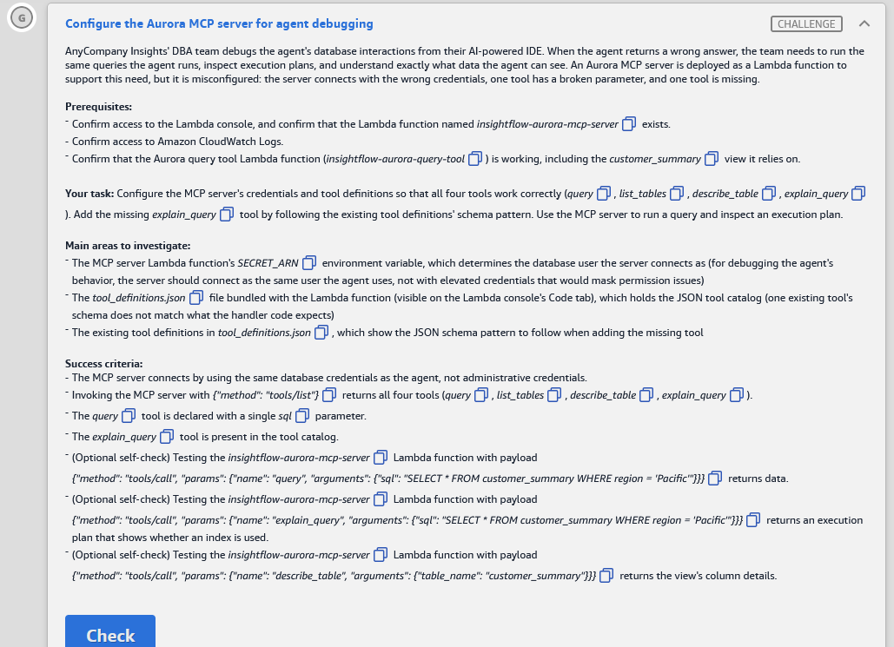

# 🅶 Challenge G: Configure the Aurora MCP server for agent debugging

> **Status:** ✅ Passed, *Meets Requirements* (exam lab, 12 Nov 2026) · **Diagram label:** G (Lambda function *Aurora MCP Server*, on Developers/DBAs → *Invoke tools* → MCP server → *Query data* → Aurora)
> **Services:** AWS Lambda (env vars, Code tab, **Deploy**, test events), MCP tool catalog (`tool_definitions.json`, JSON Schema), Secrets Manager (agent vs admin credentials), Aurora PostgreSQL (`EXPLAIN`, `information_schema`), CloudWatch Logs
> **Lab:** [AWS Databases for Agentic AI Demonstrated](README.md) · **Vault:** [index](../README.md)

---

## ✅ Status checklist (success criteria)

- [x] The MCP server connects with the **same DB credentials as the agent** (`aurora-agent-creds`), **not admin**
- [x] `{"method": "tools/list"}` returns **all four tools**: `query`, `list_tables`, `describe_table`, `explain_query`
- [x] The **`query`** tool is declared with a **single `sql`** parameter
- [x] The **`explain_query`** tool is in the tool catalog
- [ ] *(Optional)* `query` → `SELECT * FROM customer_summary WHERE region = 'Pacific'` returns data
- [ ] *(Optional)* `explain_query` → the same SQL returns an execution plan showing whether an index is used
- [ ] *(Optional)* `describe_table` → `customer_summary` returns the view's column details

---

## 🖼️ Task card



<details>
<summary>Text copy of the task</summary>

**Scenario:** AnyCompany Insights' DBA team debugs the agent's database interactions from their AI-powered IDE. When the agent returns a wrong answer, the team needs to run the same queries the agent runs, inspect execution plans, and understand exactly what data the agent can see. An Aurora MCP server is deployed as a Lambda function to support this need, but it's misconfigured: the server connects with the wrong credentials, one tool has a broken parameter, and one tool is missing.

**Prerequisites**
- Confirm access to the Lambda console, and confirm that the Lambda function named `insightflow-aurora-mcp-server` exists.
- Confirm access to Amazon CloudWatch Logs.
- Confirm that the Aurora query tool Lambda function (`insightflow-aurora-query-tool`) is working, including the `customer_summary` view it relies on.

**Your task:** Configure the MCP server's credentials and tool definitions so that all four tools work correctly (`query`, `list_tables`, `describe_table`, `explain_query`). Add the missing `explain_query` tool by following the existing tool definitions' schema pattern. Use the MCP server to run a query and inspect an execution plan.

**Main areas to investigate**
- The MCP server Lambda function's `SECRET_ARN` environment variable, which determines the database user the server connects as. For debugging the agent's behavior, the server should connect as the same user the agent uses, not with elevated credentials that would mask permission issues.
- The `tool_definitions.json` file bundled with the Lambda function (visible on the Lambda console's Code tab), which holds the JSON tool catalog. One existing tool's schema doesn't match what the handler code expects.
- The existing tool definitions in `tool_definitions.json`, which show the JSON schema pattern to follow when adding the missing tool.

**Success criteria**
- The MCP server connects using the same database credentials as the agent, not administrative credentials.
- Invoking the MCP server with `{"method": "tools/list"}` returns all four tools (`query`, `list_tables`, `describe_table`, `explain_query`).
- The `query` tool is declared with a single `sql` parameter.
- The `explain_query` tool is present in the tool catalog.
- (Optional self-check) Testing the `insightflow-aurora-mcp-server` Lambda function with payload `{"method": "tools/call", "params": {"name": "query", "arguments": {"sql": "SELECT * FROM customer_summary WHERE region = 'Pacific'"}}}` returns data.
- (Optional self-check) Testing the `insightflow-aurora-mcp-server` Lambda function with payload `{"method": "tools/call", "params": {"name": "explain_query", "arguments": {"sql": "SELECT * FROM customer_summary WHERE region = 'Pacific'"}}}` returns an execution plan that shows whether an index is used.
- (Optional self-check) Testing the `insightflow-aurora-mcp-server` Lambda function with payload `{"method": "tools/call", "params": {"name": "describe_table", "arguments": {"table_name": "customer_summary"}}}` returns the view's column details.

</details>

---

## 🗺️ Where it sits in the architecture


**Flow G:** DBA's AI IDE (MCP client) → *Invoke tools* → **Lambda `insightflow-aurora-mcp-server-…`** → reads `SECRET_ARN` (which DB user) + `tool_definitions.json` (the catalog) → RDS Data API → Aurora `insightflow` → `customer_summary` (built in D), `customers`, `document_embeddings` (E/F).

The C ↔ G parallel:

| | **C: DynamoDB MCP server** | **G: Aurora MCP server** |
|---|---|---|
| Misconfiguration in config | Region + table list | **Credentials (`SECRET_ARN`)** |
| Broken schema | `sample_items.max_results` type | **`query` parameter** (must be a single `sql`) |
| Missing tool | `analyze_access_patterns` | **`explain_query`** |
| Go-live step | Ctrl+S → **Deploy** | Ctrl+S → **Deploy** |

---

## 🔍 Root cause

| # | Where | What's wrong | Why it matters |
|---|---|---|---|
| **1** | Env var `SECRET_ARN` | Points to the **admin** secret (`aurora-admin-creds`) ⚠️ (confirm) | Admin can see everything, so a missing `GRANT` that breaks the agent (e.g. D's `GRANT SELECT ON customer_summary`) would **work for the DBA and fail for the agent**. Debugging with admin **masks permission bugs**. It's also unsafe: an AI IDE holding admin creds can run DDL and DML |
| **2** | `tool_definitions.json` → `query` | The input schema doesn't match the handler (e.g. the parameter is named `query`/`statement`, or there are extra or wrongly typed parameters) ⚠️ (confirm) | The client sends arguments under the wrong key, so the handler finds no `sql` and fails |
| **3** | `tool_definitions.json` | No `explain_query` entry | Not in `tools/list`, so clients can't see it, and `tools/call` returns *tool not found*, even though the handler supports it (same pattern as C) |

**Fix:** `SECRET_ARN` = the agent secret · `query` → `{sql: string}` · add `explain_query` → `{sql: string}` · **Deploy**.

### ✔️ Confirmed from the handler code and `tool_definitions.json`

Copies are in [assets/challenge_G/code/](assets/challenge_G/code/): `original_handler_aurora_mcp_server.py`, `original_tool_definitions.json`, `fixed_tool_definitions.json`.

| Code fact (line) | What it means for the fix |
|---|---|
| `execute_sql` reads **`AURORA_CLUSTER_ARN`**, **`DB_NAME`**, **`SECRET_ARN`** and calls `rds_data.execute_statement(resourceArn, secretArn, database, sql)` (L22–32) | It uses the **RDS Data API**. The DB user is whoever is in the `SECRET_ARN` secret, so set it to the **agent** secret. Also check that the other two vars aren't the D decoys (`analytics-cluster`, `postgres`) |
| `query`: `sql_param_name = list(schema_props.keys())[0]` → `arguments.get(sql_param_name)` (L72–74) | **The handler takes the argument name from the catalog's first property.** The catalog says **`query_text`** (original L8), so a call sending `"sql"` gives `Missing 'query_text' parameter`. Rename it to **`sql`** |
| `explain_query` exists in the handler and reads its argument name the same way, then runs `f"EXPLAIN {sql}"` (L93–101) | Add a catalog entry whose **first and only property is `sql`**. Plain `EXPLAIN` (no `ANALYZE`) only plans, so it's safe |
| `tool = next(... if t["name"] == tool_name)` → `Tool not found` (L65–67) | A missing catalog entry means the tool can't be called, as in Challenge C |
| `describe_table` → `information_schema.columns WHERE table_name = '{table_name}'` (L84) | Works for **views** too (`customer_summary`), but only shows columns the **current user** has privileges on, which is another reason to run as the agent. ⚠️ It's an f-string, so it's **SQL-injectable** (see Study note 4) |
| `list_tables` → `information_schema.tables WHERE table_schema = 'public'` (L89) | Includes **views**, and only objects the agent user can access. That's exactly "what the agent can see" |
| Errors are returned as `{"error": "…"}` (L67, L76, L107) | A Lambda test shows **Succeeded** even when the tool failed, so read the body |
| The catalog is a **bare JSON array** with **`inputSchema`** (camelCase) | The new tool follows the same shape |

---

## 🛠️ Solution

### Where each step happens

| Step | AWS service → console page | What I do there |
|---|---|---|
| 0 | Console bar → **Region** | **us-east-1** |
| 1 | **Lambda** → `insightflow-aurora-query-tool-…` → **Test** | Prerequisite: D works (the `customer_summary` test returns a row) |
| 2 | **Lambda** → `insightflow-aurora-mcp-server-…` → **Configuration → Environment variables** | Record `SECRET_ARN` + other vars. Set `SECRET_ARN` = agent secret → **Save** |
| 3 | **Lambda** → MCP server → **Code** tab | Read the handler: which argument each tool reads. Read `tool_definitions.json` |
| 4 | **Lambda** → **Code** tab → `tool_definitions.json` | Fix the `query` schema, add `explain_query` → Ctrl+S → **Deploy** |
| 5 | **Lambda** → **Test** tab | `tools/list`, `query`, `explain_query`, `describe_table` (+ `list_tables`) |
| 6 | **CloudWatch** → `/aws/lambda/insightflow-aurora-mcp-server-…` | Read errors if needed |
| 7 | Lab → **Check** | |

---

### Step 0: Region

Console bar → **US East (N. Virginia) us-east-1**.

### Step 1: Prerequisite: Challenge D works

**Lambda** → **`insightflow-aurora-query-tool-b55df330`** → **Test** tab → run the saved `summaryPacific` event from D:
`{"action": "query", "sql": "SELECT * FROM customer_summary WHERE region = 'Pacific'"}`. It should return one row.

If it fails, finish [Challenge D](Challenge_D_Aurora_Query_Tool_Least_Privilege_Secret_SSL_And_Summary_View.md) first. G's `query` test runs **as the same agent user**, so it fails for the same reasons.

### Step 2: Point the MCP server at the agent's credentials (Lambda → env vars)

**Where:** Lambda → **`insightflow-aurora-mcp-server-b55df330`** (panel `AuroraMCPFunctionName`) → **Configuration** → **Environment variables**

1. Record all the variables (for the run log). ✔️ The handler reads exactly **`AURORA_CLUSTER_ARN`**, **`DB_NAME`** and **`SECRET_ARN`** (L22–24). **Check all three**: the cluster must be `…:cluster:insightflow-cluster-b55df330` and the DB `insightflow` (D had the decoys `analytics-cluster` and `postgres`). The task card only names `SECRET_ARN` as wrong, but a decoy in the other two would break every tool.
2. **Edit** → set:

   | Key | New value |
   |---|---|
   | `SECRET_ARN` | **The same ARN as the agent uses.** Copy it from the query tool's `DB_PASSWORD_SECRET_ARN` (Challenge D): `arn:aws:secretsmanager:us-east-1:987347315034:secret:insightflow/aurora-agent-creds-b55df330-lR5jK1` |

   Copying from the query tool's env var guarantees it's *identical* to what the agent uses, which is exactly what the criteria check.
3. **Save** → wait for *Successfully updated*.
4. Screenshot → `assets/challenge_G/02_mcp_env_after.png`.

### Step 3: Read the handler and the catalog (Lambda → Code tab)

**Where:** MCP server → **Code** tab (browser VS Code: Explorer on the left, **Deploy** in the left panel)

1. Open the handler `.py`. Use **Ctrl+F** to find each item and note it:

   | Search for | What to note |
   |---|---|
   | `SECRET_ARN` | How it's used, e.g. `rds-data execute_statement(resourceArn=…, secretArn=os.environ["SECRET_ARN"], database=…)` |
   | `"query"` (the tool branch) | ✔️ It reads the argument named by the **first property in the catalog schema** (L72–74), so the schema must be `{sql}` |
   | `explain_query` | It should exist in the handler (the task says the tool is only missing from the catalog). Note the argument it reads (likely `sql`) and whether it runs `EXPLAIN` or `EXPLAIN ANALYZE` |
   | `describe_table` / `list_tables` | Arguments: `table_name` / none |
   | `tool_definitions` | It's loaded from the bundled file. Does `tools/call` reject tools not in the catalog? (In C it did) |

2. Open **`tool_definitions.json`**:
   - Note its shape (bare array? `inputSchema`?).
   - Find the **`query`** entry and compare its `properties` with what the handler reads. That's the mismatch.
   - Screenshot → `03_tool_definitions_before.png`.

> ✔️ **Done:** handler + catalog reviewed. Copies are in [assets/challenge_G/code/](assets/challenge_G/code/). Findings are under *Confirmed from the handler code* in Root cause.

### Step 4: Fix the catalog (Lambda → Code tab → `tool_definitions.json`)

#### ✔️ The complete fixed `tool_definitions.json` (validated as JSON)

In the Code tab, open **`tool_definitions.json`**. Keep that exact name, because the handler opens it at L15. Press **Ctrl+A** → paste → **Ctrl+S** → **Deploy**. Same file: [fixed_tool_definitions.json](assets/challenge_G/code/fixed_tool_definitions.json).

```json
[
  {
    "name": "query",
    "description": "Execute a SQL query against the Aurora PostgreSQL database",
    "inputSchema": {
      "type": "object",
      "properties": {
        "sql": {
          "type": "string",
          "description": "The SQL query to execute"
        }
      },
      "required": [
        "sql"
      ]
    }
  },
  {
    "name": "describe_table",
    "description": "Get column details for a specific table",
    "inputSchema": {
      "type": "object",
      "properties": {
        "table_name": {
          "type": "string",
          "description": "Name of the table to describe"
        }
      },
      "required": [
        "table_name"
      ]
    }
  },
  {
    "name": "list_tables",
    "description": "List all tables in the public schema",
    "inputSchema": {
      "type": "object",
      "properties": {}
    }
  },
  {
    "name": "explain_query",
    "description": "Show the PostgreSQL execution plan (EXPLAIN) for a SQL query, including whether indexes are used",
    "inputSchema": {
      "type": "object",
      "properties": {
        "sql": {
          "type": "string",
          "description": "The SQL query to explain"
        }
      },
      "required": [
        "sql"
      ]
    }
  }
]
```

**Diff against the original**: only two changes.

```diff
       "properties": {
-        "query_text": {
+        "sql": {
           "type": "string",
           "description": "The SQL query to execute"
         }
       },
       "required": [
-        "query_text"
+        "sql"
       ]
 ...
       "properties": {}
     }
-  }
+  },
+  {
+    "name": "explain_query",
+    "description": "Show the PostgreSQL execution plan (EXPLAIN) for a SQL query, including whether indexes are used",
+    "inputSchema": { "type": "object",
+      "properties": { "sql": { "type": "string", "description": "The SQL query to explain" } },
+      "required": [ "sql" ] }
+  }
 ]
```

- **Why `sql` and not `query_text`:** the handler takes the argument name from the **first property in the schema** (L72–74 for `query`, L94–96 for `explain_query`). With `query_text`, the task's payload `{"sql": …}` gives `{"error": "Missing 'query_text' parameter"}`.
- **Why `explain_query` must also use `sql`, as its first and only property:** for the same reason. The test payload sends `"sql"`, and the handler would look for whatever key comes first in the schema.

**JSON pitfalls** (from C):
- a missing comma between elements
- a trailing comma after the last element
- unbalanced braces

Check that the editor's **Problems** count is 0.

#### 4c. Deploy

**Ctrl+S** → **Deploy** → wait for *Successfully updated the function insightflow-aurora-mcp-server-…*. Screenshot → `04_tool_definitions_after.png`.

### Step 5: Test with Lambda test events (Lambda → Test tab)

For each one: **Create new event** → name → paste the JSON → **Save** → **Test** → expand **Details** and **read the body**. A green *Succeeded* can still hold an `"error"` (lesson from C/D).

| Event name | Event JSON | Expected |
|---|---|---|
| `toolsList` | `{"method": "tools/list"}` | **4** tools: `query`, `list_tables`, `describe_table`, `explain_query`. `query` has only `sql` |
| `queryPacific` | `{"method": "tools/call", "params": {"name": "query", "arguments": {"sql": "SELECT * FROM customer_summary WHERE region = 'Pacific'"}}}` | One row (region, customer_count, total_orders, avg_orders, most_recent_purchase) |
| `explainPacific` | `{"method": "tools/call", "params": {"name": "explain_query", "arguments": {"sql": "SELECT * FROM customer_summary WHERE region = 'Pacific'"}}}` | Rows like `[{"QUERY PLAN": "GroupAggregate …"}, {"QUERY PLAN": "  ->  Seq Scan on customers …"}, {"QUERY PLAN": "        Filter: (region = 'Pacific'::text)"}]`. That's **Seq Scan** (no index on `region`), or an `Index Scan` if one exists |
| `describeSummary` | `{"method": "tools/call", "params": {"name": "describe_table", "arguments": {"table_name": "customer_summary"}}}` | Columns + types: `region` (text/varchar), `customer_count` (bigint), `total_orders` (numeric), `avg_orders` (numeric), `most_recent_purchase` (date/timestamp) |
| `listTables` | `{"method": "tools/call", "params": {"name": "list_tables", "arguments": {}}}` | The tables (and maybe views) the **agent user** can see |

Screenshots → `05_test_tools_list.png`, `06_test_explain.png`.

**Prove it's running as the agent** (optional):
`{"method": "tools/call", "params": {"name": "query", "arguments": {"sql": "SELECT current_user"}}}` should return the agent's username, not admin.

> The task says *"Use the MCP server to run a query and inspect an execution plan"*, so **run `queryPacific` and `explainPacific` at least**. The grader may look for these calls in CloudWatch ⚠️.

### Step 6: Logs if something fails (CloudWatch)

**CloudWatch** → **Log groups** → `/aws/lambda/insightflow-aurora-mcp-server-b55df330` → newest stream. Or use the Lambda **Monitor** tab → **View CloudWatch logs**.

### Step 7: Check

Back in the lab → **Check**.

### Order of operations

```text
0 Region → 1 D's query tool still works → 2 MCP env: SECRET_ARN = agent secret (copy from the query tool) → Save
  → 3 Code: handler args per tool + tool_definitions.json → 4 query → {sql} only, add explain_query {sql}
  → Ctrl+S → Deploy → 5 Tests: tools/list (4), query, explain_query, describe_table → 6 logs → 7 Check
```

---

## ⚠️ Mistakes & lessons

_Fill in as I go. Screenshots go in `assets/challenge_G/`._

---

## 🧯 Troubleshooting table

| Symptom | Cause | Fix |
|---|---|---|
| `tools/list` shows 3 tools | `explain_query` not added, or added but **not deployed** | Add it → Ctrl+S → **Deploy** |
| Every tool fails / JSON parse error at load | Invalid `tool_definitions.json` (comma) | Fix the syntax → Deploy |
| `{"error": "Missing 'query_text' parameter"}` | The catalog still declares `query_text`. The handler reads the **first schema property** as the argument name (L72–74) | Rename it to `sql` → **Deploy** |
| `{"error": "Missing '<x>' parameter"}` on `explain_query` | The `explain_query` schema's first property isn't `sql` (L94–96) | Its only property must be `sql` |
| `{"error": "Tool not found: explain_query"}` | Not in the catalog, or not deployed (L65–67) | Add it → **Deploy** |
| `query` → `permission denied for view customer_summary` **after** switching to the agent secret | **That's the point of G:** the agent user lacks the GRANT (Challenge D, Step 5.3) | `GRANT SELECT ON public.customer_summary TO agent_readonly;` (as admin in the Query editor) |
| `AccessDeniedException … secretsmanager:GetSecretValue` | `SECRET_ARN` is a secret this Lambda's role can't read, or a partial ARN | The full agent secret ARN (copy it from the query tool's env var) |
| `BadRequestException` / *database does not exist* | The MCP server's cluster/DB env vars point to the decoy (`analytics-cluster`, `postgres`) ⚠️ | `insightflow-cluster-b55df330`, `insightflow` |
| `describe_table customer_summary` returns no columns | `information_schema` only shows objects the current user has privileges on | Same GRANT as above. Also check that the name is lowercase and unquoted |
| `explain_query` returns an error for a valid SELECT | The handler builds `EXPLAIN <sql>`. A trailing `;` or several statements break it ⚠️ | Send a single statement without a trailing semicolon |
| The plan shows `Seq Scan on customers` | No index on `customers(region)`. That's a correct, honest answer | Not required to fix. See Study note 3 |

---

## 📚 Study notes (go deeper later)

### 1. Debug with the agent's identity, not admin

- **Reproducibility:** an agent's wrong answer is often a **permission** problem: a missing `GRANT`, a row-level-security policy, a view the role can't see, a `search_path` difference. An admin session bypasses all of these, so the DBA sees "it works" while the agent fails. Use the **same user** to see the **same data**.
- **Safety:** an AI IDE that holds admin credentials can be prompted (or prompt-injected through data it reads) into `DROP`, `UPDATE` or `GRANT`. Give the MCP server the **lowest** privilege that still answers debugging questions.
- **Where to go for elevated access:** a separate, human-only, audited path (the Query editor with the admin secret, as in A/D/E), not the AI tool.

### 2. What the four tools give a DBA

| Tool | Question it answers | Backed by |
|---|---|---|
| `list_tables` | What can the agent see? | `information_schema.tables` / `pg_catalog` (filtered by privileges) |
| `describe_table` | Which columns and types does the agent see? | `information_schema.columns` |
| `query` | What does the agent's exact SQL return? | `ExecuteStatement` as the agent user |
| `explain_query` | **Why** is it slow, and is an index used? | `EXPLAIN <sql>` |

### 3. Reading the `explain_query` result for the view

- A regular view is **expanded inline**: `SELECT * FROM customer_summary WHERE region='Pacific'` becomes the aggregate query with `WHERE region='Pacific'` **pushed down** before the `GROUP BY`.
- **Without an index on `customers(region)`:** `Seq Scan on customers` + `Filter`. Every customer row is read, then aggregated. Fine for small tables.
- **With `CREATE INDEX ON customers (region);`:** `Bitmap Index Scan` / `Index Scan` on that index. That would be the tuning step if the DBA saw slow regional queries (not required here).
- **`EXPLAIN` vs `EXPLAIN ANALYZE`:**
  - `EXPLAIN` only **plans**: safe and quick.
  - `ANALYZE` **executes** the statement. On `UPDATE`/`DELETE` that changes data, so only allow it for `SELECT`, or wrap it in a transaction that's rolled back.
  - `EXPLAIN (ANALYZE, BUFFERS, FORMAT JSON)` is the richest form.

### 4. Hardening a "run any SQL" MCP tool

- A **read-only DB role** (done via the agent secret) plus **`SET default_transaction_read_only = on`** for that role.
- **`statement_timeout`** (e.g. 5 s) and row limits, so an LLM can't run a 20-minute cross join.
- **Single statement only.** Reject `;`-chained input, and reject anything that isn't `SELECT`/`WITH`/`EXPLAIN`.
- **Audit:** log every tool call (the SQL + the caller) to CloudWatch. With the Data API, CloudTrail can record `ExecuteStatement` calls ⚠️.
- **AWS Labs Aurora/Postgres MCP server** (open source) supports a **read-only mode** and Data API connections ⚠️, the same ideas as this lab.

### 4b. Code-review findings in this lab's handler (design-review material)

| Finding | Risk | Better |
|---|---|---|
| **Argument name taken from the schema's first property** (L73, L95) | Reordering or adding properties silently changes which argument is read. That's this challenge's bug | Hard-code `arguments["sql"]` in the handler, and validate `arguments` against `inputSchema` |
| **`describe_table` builds SQL with an f-string** (L84): `WHERE table_name = '{table_name}'` | SQL injection: `table_name = "x' OR '1'='1"` or worse. An LLM can be prompted into sending that | The Data API's **`parameters=[{"name": "t", "value": {"stringValue": table_name}}]`** with `WHERE table_name = :t` |
| **`query` runs any SQL** as whatever user `SECRET_ARN` holds | With admin creds: DDL/DML from an AI IDE | A read-only user (the fix), `default_transaction_read_only`, `statement_timeout`, allow only `SELECT`/`WITH` |
| **`explain_query` concatenates `EXPLAIN {sql}`** | Multi-statement strings, and `EXPLAIN ANALYZE DELETE …` *would execute* the DELETE | Reject `;` and `ANALYZE`, run it in a read-only transaction |
| No schema filter in `describe_table` | Same-named tables in other schemas return mixed columns | Add `AND table_schema = 'public'` |

### 5. Lambda MCP server pattern recap (C and G)

1. **Config in env vars** (Region, tables, secret), live on **Save**.
2. **Tool catalog in a bundled JSON file**, live on **Deploy**. The catalog is the client contract: name, description and **input schema must match the handler's argument names and types**.
3. **Handler code** contains more tools than the catalog exposes. **Undeclared means invisible.**
4. **Test with Lambda test events** using `{"method": "tools/list"}` / `{"method": "tools/call", "params": {...}}`, and **read the body for `error`**.

### 6. GCP mapping

| AWS | GCP |
|---|---|
| Aurora MCP server on Lambda (Data API + secret) | **MCP Toolbox for Databases** (AlloyDB/Cloud SQL/Spanner) on Cloud Run, with IAM DB auth |
| Agent secret vs admin secret | Separate service accounts / IAM DB users per role |
| `EXPLAIN` via tool | Same in AlloyDB. **Query Insights** for plans and history |

### 🧪 Self-test questions

1. Why is connecting the debugging MCP server as admin worse than useless for permission bugs?
2. The handler reads `arguments["sql"]`, but the catalog declares `query`. What does an AI client send, and what happens?
3. You added `explain_query`, but `tools/list` still shows 3 tools. What did you skip?
4. `explain_query` on the view shows `Seq Scan on customers`. Is something broken? How would you change the plan?
5. Why should an `explain_query` tool avoid `EXPLAIN ANALYZE` on arbitrary input?
6. After switching to the agent secret, `query` on `customer_summary` gives *permission denied*. Is G's fix wrong?

<details>
<summary>Answers</summary>

1. Admin bypasses grants, RLS and ownership, so queries succeed for the DBA while failing for the agent. You can't reproduce the bug, and the AI tool holds dangerous privileges.
2. The client follows the schema and sends `{"query": "…"}`. The handler looks for `sql`, finds nothing, and errors or runs empty SQL.
3. **Deploy** (or the JSON is invalid). Catalog edits only go live after Deploy.
4. Not broken. There's just no index on `customers(region)`. `CREATE INDEX ON customers (region);` would allow an index or bitmap scan for the pushed-down filter.
5. `ANALYZE` **executes** the statement. For DML it changes data, and for heavy queries it costs real time and resources.
6. No. G's fix is correct, and it just **revealed** a real agent permission bug (the missing `GRANT SELECT ON customer_summary TO agent_readonly` from D). That's exactly why you debug as the agent.

</details>

---

## 📝 Run log (fill in as I go)

| Step | What I ran / looked at | Result / output |
|---|---|---|
| 1 | D's `summaryPacific` test | _row returned?_ |
| 2 | MCP env vars before → after | `SECRET_ARN`: _?_ → agent secret ARN · other vars: _?_ |
| 3 | Handler argument names | `query` and `explain_query` both read the **first schema property** (L73, L95). `describe_table` → `table_name`. `list_tables` → none. The handler uses env vars `AURORA_CLUSTER_ARN`, `DB_NAME`, `SECRET_ARN` (L22–24) |
| 3 | `query` schema before | Property **`query_text`** (original L8), so the `{"sql": …}` payload fails with *Missing 'query_text' parameter*. Fix: `sql` |
| 3 | Catalog before | 3 tools (`query`, `describe_table`, `list_tables`). `explain_query` missing |
| 4 | Fixed `query`, added `explain_query`, Deploy | _status_ |
| 5 | `tools/list` | _4 tools?_ |
| 5 | `query` / `explain_query` / `describe_table` | _row / plan (Seq Scan or Index?) / columns_ |
| 7 | Check | _result_ |
