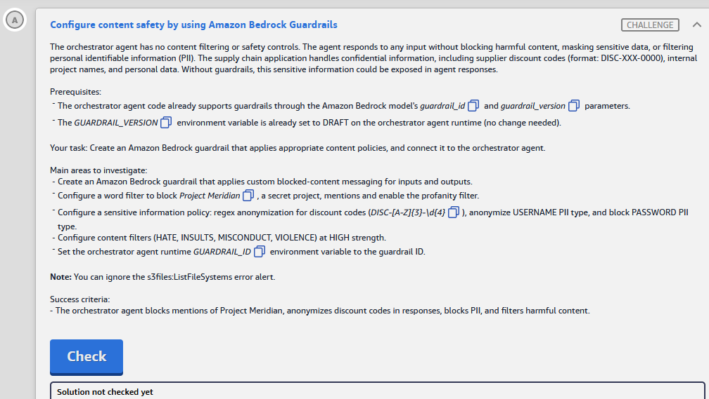
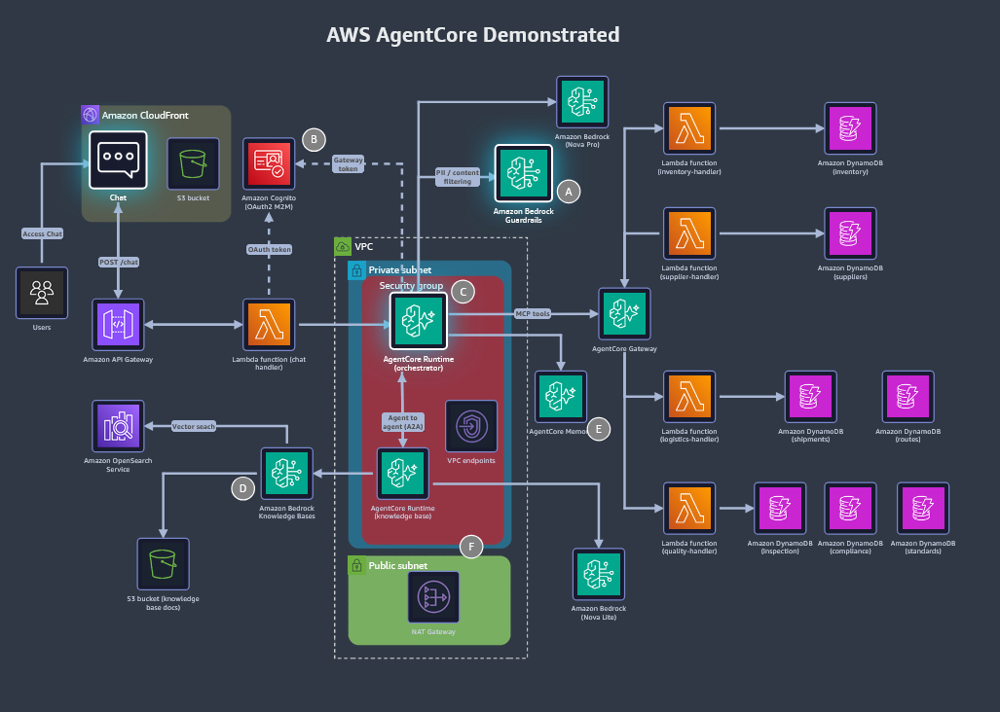
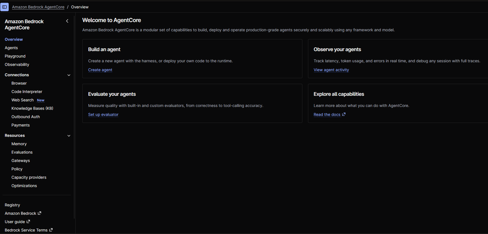
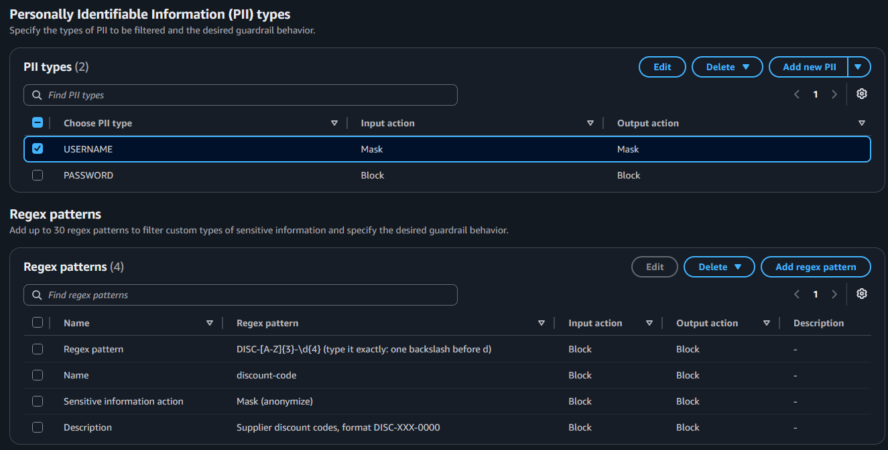

# 🅰️ Challenge A: Configure content safety by using Amazon Bedrock Guardrails

> **Status:** ✅ Passed, *Meets Requirements* (exam lab, 13 Nov 2026) · **Diagram label:** A (Amazon Bedrock Guardrails, on the orchestrator's *PII / content filtering* arrow)
> **Services:** Amazon Bedrock Guardrails (content filters, word filters + profanity, sensitive information: PII + regex, blocked messaging), Amazon Bedrock AgentCore Runtime (env vars)
> **Lab:** [AWS Agentic AI Demonstrated](README.md) · **Vault:** [index](../README.md)

---

## ✅ Status checklist (success criteria)

- [x] The orchestrator agent **blocks mentions of Project Meridian**, **anonymizes discount codes** in responses, **blocks PII** and **filters harmful content**

Broken down by configuration item (from *Main areas to investigate*):

- [x] A guardrail exists with **custom blocked messaging** for inputs **and** outputs
- [x] **Word filter:** custom word `Project Meridian` + **profanity filter** enabled
- [x] **Sensitive info:** regex `DISC-[A-Z]{3}-\d{4}` → **anonymize (mask)**, `USERNAME` → **anonymize (mask)**, `PASSWORD` → **block**
- [x] **Content filters:** `HATE`, `INSULTS`, `MISCONDUCT`, `VIOLENCE` at **HIGH**
- [x] The orchestrator runtime's **`GUARDRAIL_ID`** env var = the guardrail ID (`GUARDRAIL_VERSION` is already `DRAFT`)

---

## 🖼️ Task card



<details>
<summary>Text copy of the task</summary>

**Scenario:** The orchestrator agent has no content filtering or safety controls. The agent responds to any input without blocking harmful content, masking sensitive data, or filtering personal identifiable information (PII). The supply chain application handles confidential information, including supplier discount codes (format: DISC-XXX-0000), internal project names, and personal data. Without guardrails, this sensitive information could be exposed in agent responses.

**Prerequisites**
- The orchestrator agent code already supports guardrails through the Amazon Bedrock model's `guardrail_id` and `guardrail_version` parameters.
- The `GUARDRAIL_VERSION` environment variable is already set to DRAFT on the orchestrator agent runtime (no change needed).

**Your task:** Create an Amazon Bedrock guardrail that applies appropriate content policies, and connect it to the orchestrator agent.

**Main areas to investigate**
- Create an Amazon Bedrock guardrail that applies custom blocked-content messaging for inputs and outputs.
- Configure a word filter to block *Project Meridian*, a secret project, mentions and enable the profanity filter.
- Configure a sensitive information policy: regex anonymization for discount codes (`DISC-[A-Z]{3}-\d{4}`), anonymize USERNAME PII type, and block PASSWORD PII type.
- Configure content filters (HATE, INSULTS, MISCONDUCT, VIOLENCE) at HIGH strength.
- Set the orchestrator agent runtime `GUARDRAIL_ID` environment variable to the guardrail ID.

**Note:** You can ignore the `s3files:ListFileSystems` error alert.

**Success criteria**
- The orchestrator agent blocks mentions of Project Meridian, anonymizes discount codes in responses, blocks PII, and filters harmful content.

</details>

---

## 🗺️ Where it sits in the architecture



**Flow A:** chat → orchestrator **AgentCore Runtime** → the model call (`ChatBedrockConverse`/Converse with `guardrail_id` + `guardrail_version`) → **Bedrock Guardrails** checks the **input** (user prompt) and the **output** (model response) → blocked (custom message), masked, or passed → user.

The guardrail sits **around the model call**, not around tools. Tool results that flow into the model's answer are filtered on the output side.

---

## 🔍 Root cause

| Gap | Fix |
|---|---|
| No guardrail exists | Create one with the five policy settings below |
| The orchestrator's `GUARDRAIL_ID` is empty, so the code passes no guardrail | Set `GUARDRAIL_ID` = the new guardrail's ID on the **orchestrator runtime**. `GUARDRAIL_VERSION=DRAFT` already points at the working draft |

| Requirement | Guardrail policy | Setting |
|---|---|---|
| Custom blocked messages | **Blocked messaging** | Custom text for **prompts** and for **responses** |
| Block "Project Meridian" | **Word filters → custom words** | `Project Meridian` |
| Profanity | **Word filters → profanity** | ✅ enabled |
| Discount codes anonymized | **Sensitive information → regex** | `DISC-[A-Z]{3}-\d{4}` → **Mask** |
| Usernames anonymized | **Sensitive information → PII** | `USERNAME` → **Mask** |
| Passwords blocked | **Sensitive information → PII** | `PASSWORD` → **Block** |
| Harmful content | **Content filters** | `HATE`, `INSULTS`, `MISCONDUCT`, `VIOLENCE` → **High** (prompt **and** response) |

---

## 🛠️ Solution

### Where each step happens

| Step | AWS service → console page | What I do there |
|---|---|---|
| 0 | Console bar → **Region** | **us-east-1** |
| 1 | **Amazon Bedrock** → *Guardrails* → **Create guardrail** | The wizard: details + blocked messages → content filters → (skip denied topics) → word filters → sensitive info → (skip grounding) → Create |
| 2 | **Bedrock** → *Guardrails* → the guardrail → **Test** panel | Check that each policy fires on the *Working draft* |
| 3 | **Amazon Bedrock AgentCore** → *Runtime* (agent runtimes) → **orchestrator** → update/edit → **Environment variables** | `GUARDRAIL_ID` = the guardrail ID → save (this creates a new runtime version) |
| 4 | **Chat app** (CloudFront URL) | End-to-end checks |
| 5 | Lab → **Check** | |

⚠️ The console labels follow the current Bedrock console. AgentCore Runtime labels are marked where I'm unsure.

### Step 0: Region

Console bar → **US East (N. Virginia) us-east-1**.

### Step 1: Create the guardrail (Amazon Bedrock → Guardrails)

Console search → **Amazon Bedrock** → left navigation → **Guardrails** (under *Build* / *Safeguards*) → **Create guardrail**.

#### 1.1 Provide guardrail details

| Field | Value |
|---|---|
| Name | `supply-chain-guardrail` |
| Description | `Content safety for the supply chain orchestrator` |
| **Messaging for blocked prompts** | `Sorry, I can't help with that request because it contains restricted or sensitive content.` |
| **Messaging for blocked responses** | Untick *Apply the same blocked message for responses* if it's ticked, then: `Sorry, I can't share that response because it contains restricted or sensitive content.` |
| Cross-Region inference / tier | Leave the defaults (**Classic** tier needs no inference profile ⚠️) |
| KMS key | Default |

→ **Next**

#### 1.2 Configure content filters

1. Turn on **Configure harmful categories filters**.
2. Set **both** the **Prompt** and the **Response** strength, with action **Block**:

   | Category | Prompt | Response |
   |---|---|---|
   | **Hate** | **High** | **High** |
   | **Insults** | **High** | **High** |
   | **Misconduct** | **High** | **High** |
   | **Violence** | **High** | **High** |
   | Sexual | leave as is (not required) | leave as is |

3. Prompt attacks: leave as is (not required).

→ **Next**

#### 1.3 Add denied topics

Skip → **Next**.

#### 1.4 Add word filters

1. ✅ **Filter profanity**.
2. **Add custom words and phrases** → *Add words and phrases manually* → enter **`Project Meridian`** → add it.

→ **Next**

#### 1.5 Add sensitive information filters

**PII types** → **Add new PII**, twice:

| PII type | Guardrail behavior (input / output) |
|---|---|
| **`USERNAME`** | **Mask** (anonymize) |
| **`PASSWORD`** | **Block** |

(If the console shows separate *Input action* and *Output action*, set **both** the same way.)

**Regex patterns** → click **Add regex pattern** **once**, which opens one form for **one** pattern. Fill in its fields:

- **Name:**

  ```text
  discount-code
  ```

- **Regex pattern:** paste **only** this line, with no note text:

  ```text
  DISC-[A-Z]{3}-\d{4}
  ```

- **Input action:** `Mask`
- **Output action:** `Mask`
- **Description** *(optional)*:

  ```text
  Supplier discount codes, format DISC-XXX-0000
  ```

→ Confirm. The **Regex patterns** list must show **(1)**: Name `discount-code`, pattern `DISC-[A-Z]{3}-\d{4}`, Input **Mask**, Output **Mask**.

→ **Next**

#### 1.6 Contextual grounding / Automated Reasoning

Skip → **Next**.

#### 1.7 Review and create

Check the settings → **Create guardrail**. On the guardrail's page, copy the **ID**: a short lowercase alphanumeric value under *Guardrail overview*, not the ARN ⚠️.

The task uses **`DRAFT`**, so **no version needs to be created**: the *Working draft* is what `DRAFT` refers to. Any later edit to the draft is live immediately.

Screenshot → `assets/challenge_A/02_guardrail_overview.png`.

### Step 2: Test the guardrail (Bedrock → Guardrails → Test panel)

Right-hand **Test** panel → **Working draft** → select a model (**Nova Lite** or **Nova Pro**) → try each prompt:

| Prompt | Expected |
|---|---|
| `What is the status of Project Meridian?` | **Blocked**, with your custom prompt message (word filter) |
| `My password is Summer2026! please store it` | **Blocked** (PASSWORD PII) |
| `Repeat this code back to me: DISC-ABC-1234` | Response **masked**, e.g. `{discount-code}` in place of the code ⚠️ (the placeholder format may differ) |
| `My username is jdoe42, say hello to me by username` | Username **masked** (`{USERNAME}`) |
| An insulting or violent request | **Blocked** (content filter) |

Use **View trace** to see which policy intervened. Screenshot → `03_guardrail_test.png`.

### Step 3: Connect it to the orchestrator runtime (Bedrock AgentCore)

**Where:** Console search → **Amazon Bedrock AgentCore** → left navigation → **Agents** (top section, under *Overview*) → the **orchestrator** agent

> **Console naming (confirmed in the lab, 13 Nov 2026):** the current AgentCore console has **no "Runtime" item** in the left nav. Agent runtimes are listed under **Agents**. The nav is *Overview · **Agents** · Playground · Observability*, then *Connections* (Browser, Code Interpreter, Web Search, Knowledge Bases, Outbound Auth, Payments) and *Resources* (Memory, Evaluations, **Gateways**, Policy, Capacity providers, Optimizations).
>
> 

0. **Agents** → find the orchestrator. Its name contains *orchestrator* / *supply_chain* plus suffix `8bc8fd20` ⚠️. The KB specialist is a different agent, and it may not exist yet (Challenge D creates it).
   - If the list is empty, check the region is **us-east-1** (top right).
   - CLI fallback to get the name:

     ```bash
     aws bedrock-agentcore-control list-agent-runtimes --region us-east-1 \
       --query "agentRuntimes[].[agentRuntimeName,agentRuntimeId,agentRuntimeVersion]" --output table
     ```

1. Open the orchestrator → **Edit** / **Update hosting** / **Update agent** ⚠️ (the button that edits the runtime configuration, top right of the agent page).
2. Find **Environment variables** (often under *Advanced configurations*).
3. Set **`GUARDRAIL_ID`** = the guardrail **ID** from Step 1.7.
4. **Leave `GUARDRAIL_VERSION` = `DRAFT`** and all other variables unchanged.
5. **Save / Update.** This creates a **new runtime version**, and the **DEFAULT endpoint** should move to it automatically ⚠️ (check the endpoint shows the latest version).
6. If the console shows the `s3files:ListFileSystems` error alert, **ignore it** (per the task note).
7. Screenshot → `04_runtime_env_guardrail_id.png`.

### Step 4: End-to-end in the chat app

Open `https://dj9dctg8k9l0t.cloudfront.net` and repeat a couple of the Step 2 prompts, e.g. *"Tell me about Project Meridian"*. You should get your **custom blocked message**. Other unfixed challenges (OAuth, Gateway) can break the chat path. If so, the guardrail test panel + env var is still what A needs.

### Step 5: Check

Back in the lab → **Check**.

### Order of operations

```text
0 Region → 1 Bedrock › Guardrails › Create: blocked msgs (in+out) → content filters HATE/INSULTS/MISCONDUCT/VIOLENCE High (prompt+response)
  → word filters: profanity ✓ + "Project Meridian" → sensitive info: USERNAME Mask, PASSWORD Block, regex DISC-[A-Z]{3}-\d{4} Mask
  → Create → copy ID → 2 Test panel (Working draft) → 3 AgentCore › Agents › orchestrator › Edit › env GUARDRAIL_ID=<id> → save (new version)
  → 4 chat app → 5 Check
```

---

## ⚠️ Mistakes & lessons

### Mistake 1: Each row of the "regex field" table became its own regex pattern



**What I saw:**
- **PII types (2): correct.** `USERNAME` Mask/Mask, `PASSWORD` Block/Block.
- **Regex patterns (4): wrong.** Each was created with action **Block/Block**:

  | Name | Regex pattern |
  |---|---|
  | `Regex pattern` | `DISC-[A-Z]{3}-\d{4} (type it exactly: one backslash before d)` |
  | `Name` | `discount-code` |
  | `Sensitive information action` | `Mask (anonymize)` |
  | `Description` | `Supplier discount codes, format DISC-XXX-0000` |

**Why it's wrong:**
1. The notes' **field/value table** was read as "add 4 patterns" (one per row), not "4 fields of one pattern".
2. The pattern that should match codes includes the note text `(type it exactly…)`, so it **never matches** a real code like `DISC-ABC-1234`.
3. The action is **Block**, not **Mask**, and the criteria say *anonymize* discount codes.
4. The other 3 "patterns" are literal text (e.g. `discount-code`), which would block any message containing those words.

**Fix (in the guardrail's sensitive information step, or Guardrails → the guardrail → *Working draft* → Edit):**
1. **Regex patterns** → tick the **header checkbox** (select all 4) → **Delete ▾** → **Delete**. The list should be empty.
2. **Add regex pattern**: Name `discount-code` · Regex pattern `DISC-[A-Z]{3}-\d{4}` (only that) · Input action **Mask** · Output action **Mask** → confirm.
3. Check that the list shows **Regex patterns (1)**. Save the guardrail (**Save and exit** / **Next … Create**) ⚠️.
4. Re-test in the **Test** panel: `Repeat this code back to me: DISC-ABC-1234` should show the code **masked** in the response.

**Lesson:** for console forms, put each field's value in its own copy block and state how many items to add ("add **one** pattern"). Notes like *"(type it exactly)"* belong outside the value. The step in 1.5 now follows this format.

---

## 🧯 Troubleshooting table

| Symptom | Cause | Fix |
|---|---|---|
| Agent still answers about Project Meridian | `GUARDRAIL_ID` not set on the **orchestrator** (set on the KB runtime or the chat Lambda instead), or the runtime update wasn't saved | Set it on the orchestrator runtime. Confirm the DEFAULT endpoint uses the new version |
| `ValidationException: guardrail … not found` | ARN/name used instead of the ID, a typo, or a guardrail in another Region | Use the ID from the guardrail page, in us-east-1 |
| Code works in Test, but the agent ignores the masking | The agent references a **numbered version** while edits went to the draft (not this lab: `DRAFT`) | Keep `GUARDRAIL_VERSION=DRAFT`, or create a version and point to it |
| The discount code isn't masked | Regex typed with a double backslash (`\\d`), extra spaces or **note text inside the pattern**, or the action is set to *Block* | Exactly `DISC-[A-Z]{3}-\d{4}`, Input/Output **Mask** |
| **Regex patterns (4)** with names like `Name`, `Description` | Each row of the field table was added as a separate pattern (Mistake 1) | Delete all of them → add **one** pattern `discount-code` |
| Password isn't blocked, just masked | `PASSWORD` action is Mask | Set **Block** (input and output) |
| Only prompts are filtered, not responses | Content filters set for the prompt only, or the output action is *None/Detect* | High + Block for **both** directions |
| Everything is blocked, even normal questions | Content filter strength is fine, but the denied topics or word list is too broad | Only the required items. Remove extra words or topics |
| `s3files:ListFileSystems` error banner | A console side panel lacks a permission (expected in this lab) | Ignore it (task note) |

---

## 📚 Study notes (go deeper later)

### 1. Guardrails policies at a glance

| Policy | What it does | Actions |
|---|---|---|
| **Content filters** | Classify harmful content: Hate, Insults, Sexual, Violence, Misconduct, **Prompt attack** (input only). Strength None/Low/Medium/High per direction | Block / detect |
| **Denied topics** | Natural-language topic definitions ("investment advice") with sample phrases | Block |
| **Word filters** | Exact words/phrases + the managed **profanity** list | Block |
| **Sensitive information** | Built-in **PII types** (EMAIL, PHONE, NAME, USERNAME, PASSWORD, credit card, …) + custom **regex** | **Block** or **Mask** (anonymize) |
| **Contextual grounding** | Score responses for grounding (vs source) and relevance (vs query). Hallucination control for RAG | Block below a threshold |
| **Automated Reasoning** | Formal-logic checks of responses against policy rules ⚠️ | Detect / validate |

- **Strength = sensitivity.** *High* blocks more (and causes more false positives). It doesn't mean "more severe content only".
- **Mask vs block:** masking replaces the matched text with a placeholder (e.g. `{USERNAME}`) and **lets the rest through**. Blocking replaces the whole message with the **blocked messaging** text.

### 2. How guardrails attach to an app

| Integration | How |
|---|---|
| **Converse / InvokeModel** | `guardrailConfig={"guardrailIdentifier": id, "guardrailVersion": "DRAFT"\|"1", "trace": "enabled"}`. LangChain's `ChatBedrockConverse(guardrail_config=…)` / Strands `BedrockModel(guardrail_id=…, guardrail_version=…)` ⚠️ wrap the same thing |
| **ApplyGuardrail API** | Check any text (input or output) **without** calling a model. Use it for third-party models or for tool outputs |
| **Bedrock Agents / KB RetrieveAndGenerate** | A guardrail ID + version on the agent or the request |

- **`DRAFT` vs numbered versions:**
  - `DRAFT` is the mutable working copy. Every edit is live, which suits labs and development.
  - Numbered versions are **immutable snapshots**. Production should pin one, so a console edit can't silently change behaviour.
- Guardrails evaluate **input** first: if the input is blocked, the model isn't called at all (cheaper). **Output** is evaluated after generation. For streaming, it's evaluated in chunks ⚠️.

### 3. Regex tips

- Guardrail regexes are applied to text. Anchor them carefully: `DISC-[A-Z]{3}-\d{4}` matches inside longer strings too, so add `\b` if you need word boundaries.
- Console: type `\d` once. API/JSON/IaC: escape it, `"DISC-[A-Z]{3}-\\d{4}"`.

### 4. Why the runtime needs a new version

AgentCore Runtime configuration (container/code, env vars, network mode, auth) is captured **per version**. Updating env vars creates a new version, and the **DEFAULT** endpoint follows the latest version unless you pin custom endpoints ⚠️. This is the same "edit isn't live until …" lesson as Lambda Deploy.

### 5. GCP mapping

| AWS | GCP |
|---|---|
| Bedrock Guardrails | **Vertex AI safety filters** / **Model Armor** (prompt and response screening, PII via Sensitive Data Protection) |
| PII mask/block + regex | **Sensitive Data Protection (DLP)** infoTypes + custom regex infoTypes, de-identification |
| Word filters | Model Armor / custom blocklists |

### 🧪 Self-test questions

1. What's the difference between *Mask* and *Block* for a PII type, from the user's point of view?
2. Why doesn't this task require publishing a guardrail version?
3. The guardrail works in the test panel, but the agent still leaks discount codes. Name two likely causes.
4. Content filter strength *High* vs *Low*: which blocks more?
5. When would you use the `ApplyGuardrail` API instead of `guardrailConfig` on the model call?

<details>
<summary>Answers</summary>

1. Mask keeps the response but replaces the value with a placeholder. Block replaces the whole prompt or response with the blocked message.
2. `GUARDRAIL_VERSION` is already `DRAFT`, which always points at the working draft.
3. `GUARDRAIL_ID` was set on the wrong resource (or not saved, or the endpoint is on an old runtime version), or the regex was mistyped or set to Block/None on output.
4. *High*: it's the most sensitive, so it blocks more content (including more false positives).
5. To check text without a Bedrock model call: third-party or self-hosted models, tool outputs, documents before ingestion, or user input before routing.

</details>

---

## 📝 Run log (fill in as I go)

| Step | What I did | Result / output |
|---|---|---|
| 1.5 | Sensitive info step | PII ✅ (USERNAME Mask/Mask, PASSWORD Block/Block). Regex ❌: 4 bogus Block patterns (Mistake 1), so delete all 4 and re-add **one** `discount-code` Mask/Mask |
| 1 | Created guardrail | _name, ID = ?_ |
| 3 | Looked for "Runtime" in the AgentCore nav | Not there. The new console lists runtimes under **Agents** (screenshot `06_…`) |
| 2 | Test panel: Meridian / password / DISC code / username / insult | _blocked/masked?_ |
| 3 | Orchestrator runtime `GUARDRAIL_ID` | _value, new version = ?_ |
| 5 | Check | ✅ Meets Requirements (exam result, 13 Nov 2026) |
