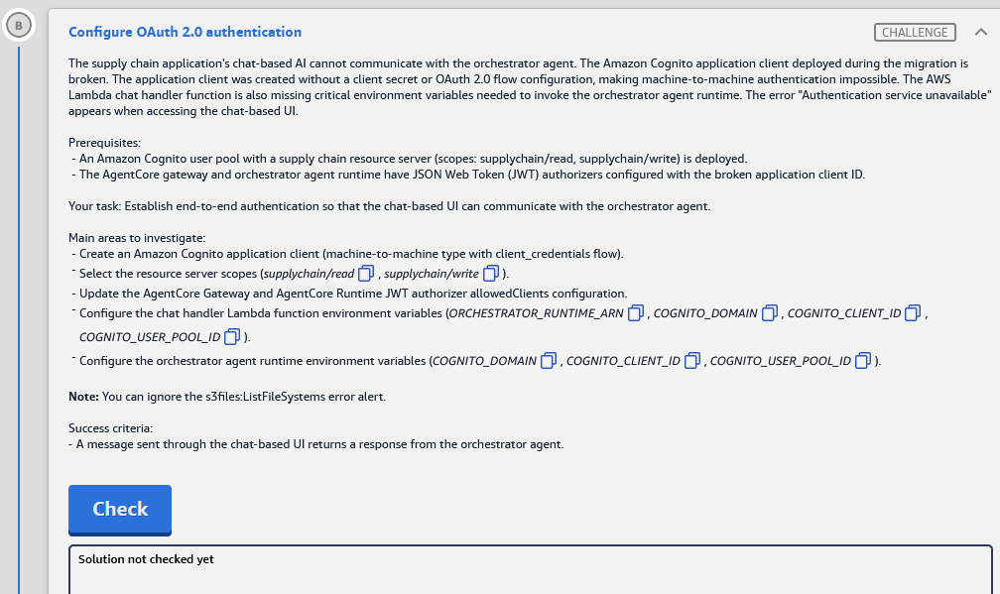

# Challenge B: Configure OAuth 2.0 authentication (Cognito M2M, JWT authorizers)

> **Lab:** [03 · AWS Agentic AI Demonstrated](README.md) · **Services:** Amazon Cognito (user pool, app client, resource server, OAuth 2.0 client credentials), Amazon Bedrock AgentCore (Gateway + Runtime **inbound JWT authorizer**), AWS Lambda (chat handler env vars)
> **HLD label:** **B**, the dashed *OAuth token* (chat Lambda → orchestrator runtime) and *Gateway token* (orchestrator → Gateway) arrows. See [HLD](README.md#-high-level-design-hld).

---

## ✅ Status checklist

- [ ] 1 · Cognito: create a **machine-to-machine** app client (client secret + `client_credentials` + scopes `supplychain/read`, `supplychain/write`). Copy the **client ID**.
- [ ] 2 · (Optional, 1 min) Test the token endpoint returns an `access_token`
- [ ] 3 · AgentCore **Gateway** → inbound JWT authorizer → **Allowed clients** = new client ID
- [ ] 4 · AgentCore **orchestrator runtime** → inbound JWT authorizer → **Allowed clients** = new client ID, **plus** env vars `COGNITO_DOMAIN`, `COGNITO_CLIENT_ID`, `COGNITO_USER_POOL_ID` (keep `GUARDRAIL_ID` from A)
- [ ] 5 · Lambda **chat handler** → env vars `ORCHESTRATOR_RUNTIME_ARN`, `COGNITO_DOMAIN`, `COGNITO_CLIENT_ID`, `COGNITO_USER_POOL_ID`
- [ ] 6 · Chat UI returns a response from the orchestrator
- [ ] 7 · **Check**

---

## 🧾 Task card



> **Configure OAuth 2.0 authentication**
>
> The supply chain application's chat-based AI cannot communicate with the orchestrator agent. The Amazon Cognito application client deployed during the migration is broken. The application client was created without a client secret or OAuth 2.0 flow configuration, making machine-to-machine authentication impossible. The AWS Lambda chat handler function is also missing critical environment variables needed to invoke the orchestrator agent runtime. The error "Authentication service unavailable" appears when accessing the chat-based UI.
>
> **Prerequisites:**
> - An Amazon Cognito user pool with a supply chain resource server (scopes: supplychain/read, supplychain/write) is deployed.
> - The AgentCore gateway and orchestrator agent runtime have JSON Web Token (JWT) authorizers configured with the broken application client ID.
>
> **Your task:** Establish end-to-end authentication so that the chat-based UI can communicate with the orchestrator agent.
>
> **Main areas to investigate:**
> - Create an Amazon Cognito application client (machine-to-machine type with client_credentials flow).
> - Select the resource server scopes (`supplychain/read`, `supplychain/write`).
> - Update the AgentCore Gateway and AgentCore Runtime JWT authorizer allowedClients configuration.
> - Configure the chat handler Lambda function environment variables (`ORCHESTRATOR_RUNTIME_ARN`, `COGNITO_DOMAIN`, `COGNITO_CLIENT_ID`, `COGNITO_USER_POOL_ID`).
> - Configure the orchestrator agent runtime environment variables (`COGNITO_DOMAIN`, `COGNITO_CLIENT_ID`, `COGNITO_USER_POOL_ID`).
>
> **Note:** You can ignore the s3files:ListFileSystems error alert.
>
> **Success criteria:**
> - A message sent through the chat-based UI returns a response from the orchestrator agent.

---

## 🏗️ Architecture (what B touches)

```text
Browser → CloudFront chat UI → API Gateway POST /chat → Lambda chat handler
   │  env: COGNITO_USER_POOL_ID + COGNITO_CLIENT_ID → (secret via DescribeUserPoolClient ⚠️)
   │  POST {COGNITO_DOMAIN}/oauth2/token  grant_type=client_credentials  scope=supplychain/read supplychain/write
   │  ← access_token (JWT, claim client_id = NEW client)
   ▼
AgentCore Runtime: ORCHESTRATOR   ← inbound JWT authorizer: discovery URL + allowedClients [NEW client]
   │  (Lambda invokes ORCHESTRATOR_RUNTIME_ARN with  Authorization: Bearer <token>)
   │  env: COGNITO_DOMAIN, COGNITO_CLIENT_ID, COGNITO_USER_POOL_ID → gets its own token the same way
   ▼
AgentCore Gateway (MCP)           ← inbound JWT authorizer: discovery URL + allowedClients [NEW client]
   └→ Lambda targets (inventory / supplier / logistics / quality) → DynamoDB
```

**One app client serves both hops.** The task names a single client, and both authorizers and both env-var sets use the same `COGNITO_CLIENT_ID`.

### Where each step happens

| Step | Service / console | Exact place |
|---|---|---|
| 1 | **Amazon Cognito** | User pools → `us-east-1_6yHDtJ0jv` → *Applications* → **App clients** → **Create app client** |
| 2 | **CloudShell** (or your terminal) | `curl` to `https://supply-chain-8bc8fd20.auth.us-east-1.amazoncognito.com/oauth2/token` |
| 3 | **Amazon Bedrock AgentCore** | Left nav *Resources* → **Gateways** → the gateway → inbound auth → **Edit** |
| 4 | **Amazon Bedrock AgentCore** | Left nav → **Agents** → orchestrator → **Edit / Update hosting** (inbound auth + env vars) |
| 5 | **AWS Lambda** | Functions → chat handler → **Configuration** → **Environment variables** → **Edit** |
| 6 | **Chat UI** (CloudFront) | `https://dj9dctg8k9l0t.cloudfront.net` |
| 7 | Lab page | **Check** |

---

## 🔍 Root cause

| Broken piece | Why it fails |
|---|---|
| App client has **no client secret** | `client_credentials` grant **requires** a confidential client (ID + secret). Cognito rejects the token request (`invalid_client`). |
| App client has **no OAuth flow / scopes** | Without *Client credentials* enabled and custom scopes allowed, Cognito returns `unauthorized_client` / `invalid_scope`. |
| Gateway + runtime JWT authorizers allow **only the broken client ID** | Even a valid token from a new client is rejected unless its `client_id` claim is in **allowedClients**. |
| Chat Lambda **missing env vars** | It can't find the Cognito domain/client to get a token, or the runtime ARN to call. The handler surfaces this as *"Authentication service unavailable"*. |
| Orchestrator **missing Cognito env vars** | It can't get the *Gateway token*, so MCP tool calls to the Gateway would fail. |

---

## 🛠️ Solution

### Values you'll reuse (from the Solution Resources panel)

| Name | Value |
|---|---|
| User pool ID → `COGNITO_USER_POOL_ID` | `us-east-1_6yHDtJ0jv` |
| Domain → `COGNITO_DOMAIN` | `https://supply-chain-8bc8fd20.auth.us-east-1.amazoncognito.com` ⚠️ (see note) |
| Discovery URL (JWT authorizers) | `https://cognito-idp.us-east-1.amazonaws.com/us-east-1_6yHDtJ0jv/.well-known/openid-configuration` |
| Scopes | `supplychain/read`, `supplychain/write` |
| New client ID → `COGNITO_CLIENT_ID` | _from Step 1_ |
| Orchestrator ARN → `ORCHESTRATOR_RUNTIME_ARN` | _from Step 4: `arn:aws:bedrock-agentcore:us-east-1:574897117640:runtime/<id>`_ |

> ⚠️ **`COGNITO_DOMAIN` format:** use the full URL from the panel by default. If the handler code builds the URL as `f"https://{COGNITO_DOMAIN}/oauth2/token"`, use the host only, `supply-chain-8bc8fd20.auth.us-east-1.amazoncognito.com`. Check: Lambda → **Code** tab → search `COGNITO_DOMAIN`.

### Step 1: Create the M2M app client (Amazon Cognito)

**Where:** Console search → **Cognito** → **User pools** → `us-east-1_6yHDtJ0jv` (supply chain pool) → left nav *Applications* → **App clients** → **Create app client**

1. **Application type:** **Machine-to-machine application**. This type always gets a **client secret** and uses the client credentials flow.
2. **Name:**

   ```text
   supply-chain-m2m-client
   ```

3. If the wizard asks for **custom scopes / resource server**, tick **`supplychain/read`** and **`supplychain/write`** ⚠️.
4. **Create app client.**
5. On the new client's page, check **Login pages** tab → *Managed login pages configuration* → **Edit** ⚠️:
   - **OAuth 2.0 grant types:** **Client credentials** only
   - **Custom scopes:** `supplychain/read` ✓, `supplychain/write` ✓
   - **Save changes**
6. *App client information*: copy the **Client ID**. Click **Show client secret** to confirm a secret exists. You only need the secret for the Step 2 test.

> **Old console layout:** *App integration* tab → *App clients and analytics* → **Create app client** → **Confidential client** → ✓ *Generate a client secret* → *Hosted UI settings*: OAuth grant types **Client credentials**, custom scopes ✓ both.

**CLI equivalent (CloudShell, ~10 s):**

```bash
# confirm the resource server identifier/scopes (expect identifier "supplychain", scopes read/write)
aws cognito-idp list-resource-servers --user-pool-id us-east-1_6yHDtJ0jv --max-results 10 --region us-east-1

aws cognito-idp create-user-pool-client --region us-east-1 \
  --user-pool-id us-east-1_6yHDtJ0jv \
  --client-name supply-chain-m2m-client \
  --generate-secret \
  --allowed-o-auth-flows client_credentials \
  --allowed-o-auth-flows-user-pool-client \
  --allowed-o-auth-scopes supplychain/read supplychain/write \
  --supported-identity-providers COGNITO \
  --query "UserPoolClient.[ClientId,ClientSecret]" --output text
```

Screenshot → `assets/challenge_B/02_app_client.png`.

### Step 2 (optional): Prove the client works (CloudShell)

```bash
CID='<client id>'; CSECRET='<client secret>'
curl -s -X POST "https://supply-chain-8bc8fd20.auth.us-east-1.amazoncognito.com/oauth2/token" \
  -u "$CID:$CSECRET" \
  -H "Content-Type: application/x-www-form-urlencoded" \
  --data-urlencode "grant_type=client_credentials" \
  --data-urlencode "scope=supplychain/read supplychain/write"
```

✅ `{"access_token":"eyJ…","expires_in":3600,"token_type":"Bearer"}`
❌ `invalid_client` = no secret or wrong secret · `unauthorized_client` = client credentials not enabled · `invalid_scope` = scopes not allowed on the client

### Step 3: Gateway JWT authorizer (AgentCore → Gateways)

**Where:** **Amazon Bedrock AgentCore** → left nav *Resources* → **Gateways** → the supply-chain gateway (suffix `8bc8fd20`) → inbound auth / *Inbound Identity* section → **Edit** ⚠️

1. Authorizer type stays **JWT / Custom JWT**.
2. **Discovery URL:** keep it, or set it to the discovery URL above.
3. **Allowed clients:** **remove the broken client ID** and add the **new client ID**.
4. **Allowed audiences:** leave empty. Cognito client-credentials access tokens have **no `aud` claim**, so an audience rule would reject them ⚠️.
5. **Save.**

### Step 4: Orchestrator runtime (AgentCore → Agents)

**Where:** **Amazon Bedrock AgentCore** → left nav **Agents** → the **orchestrator** → **Edit** / **Update hosting** ⚠️

1. **Copy the agent's ARN** from the agent page for Step 5: `arn:aws:bedrock-agentcore:us-east-1:574897117640:runtime/<id>`. Use the **runtime** ARN, not the endpoint ARN (`…/runtime-endpoint/DEFAULT`).
2. **Inbound auth** → **JWT** (not IAM):
   - Discovery URL: as above
   - **Allowed clients:** replace the broken ID with the **new client ID**
3. **Environment variables.** Add or update these, and **keep every existing variable**, especially `GUARDRAIL_ID` / `GUARDRAIL_VERSION` from Challenge A:

   | Key | Value |
   |---|---|
   | `COGNITO_DOMAIN` | `https://supply-chain-8bc8fd20.auth.us-east-1.amazoncognito.com` (⚠️ see format note) |
   | `COGNITO_CLIENT_ID` | _new client ID_ |
   | `COGNITO_USER_POOL_ID` | `us-east-1_6yHDtJ0jv` |

4. **Save / Update.** This creates a new version, and the **DEFAULT** endpoint should point to it.
5. Ignore the `s3files:ListFileSystems` alert.

> 💡 If Challenge A's `GUARDRAIL_ID` is not saved yet, do both in **this one edit**.

### Step 5: Chat handler Lambda env vars (AWS Lambda)

**Where:** Console search → **Lambda** → **Functions** → **`supply-chain-chat-8bc8fd20`** (search `chat`) → **Configuration** tab → **Environment variables** → **Edit**

| Key | Value |
|---|---|
| `ORCHESTRATOR_RUNTIME_ARN` | _orchestrator runtime ARN from Step 4.1_ |
| `COGNITO_DOMAIN` | _same value as the runtime_ |
| `COGNITO_CLIENT_ID` | _new client ID_ |
| `COGNITO_USER_POOL_ID` | `us-east-1_6yHDtJ0jv` |

→ **Save.** Env-var changes apply **immediately**, so no *Deploy* is needed. *Deploy* is only for code edits (Lab 02 lesson).

### Step 6: Test in the chat UI

Open `https://dj9dctg8k9l0t.cloudfront.net` → send `Hello, what can you help me with?` → you should get an orchestrator reply, not *"Authentication service unavailable"*. The first call can be slow (runtime cold start).

If it fails: **CloudWatch** → Log groups → `/aws/lambda/<chat-handler>` → latest stream (see troubleshooting).

### Step 7: Check

### Order of operations

```text
1 Cognito › pool › App clients › Create (M2M, secret, client_credentials, scopes read+write) → copy CLIENT ID
2 (opt) curl /oauth2/token → access_token
3 AgentCore › Gateways › gateway › inbound JWT › allowedClients = NEW id → Save
4 AgentCore › Agents › orchestrator › copy ARN › Edit › JWT allowedClients = NEW id + env COGNITO_DOMAIN/CLIENT_ID/USER_POOL_ID (keep GUARDRAIL_*) → Save (new version)
5 Lambda › chat handler › Configuration › Env vars: ORCHESTRATOR_RUNTIME_ARN + 3 COGNITO_* → Save
6 Chat UI "Hello" → 7 Check
```

---

## ⚠️ Mistakes & lessons

_Fill in as I go. Screenshots go in `assets/challenge_B/`._

---

## 🧯 Troubleshooting

| Symptom | Likely cause | Fix |
|---|---|---|
| Chat UI: *"Authentication service unavailable"* | Lambda can't get a token: env vars missing or misspelled, wrong `COGNITO_DOMAIN` format, or client has no secret / client credentials | Recheck the Step 5 keys exactly. Try the host-only domain. Check the client in Step 2 |
| Token call `invalid_client` | Client has no secret (public client), or wrong secret | Create the client as **M2M / confidential** with a secret |
| `unauthorized_client` | *Client credentials* grant not enabled on the client | Login pages → Edit → grant types: Client credentials |
| `invalid_scope` | Scopes not allowed on the client, or a typo (`supplychain/read`) | Tick both custom scopes |
| Runtime returns **401/403** (e.g. *claim client_id mismatch*) | Runtime `allowedClients` still has the broken ID | Step 4.2 |
| Runtime 403 *"Authorization method mismatch"* | Runtime set to **IAM** auth but Lambda sends a bearer token (or vice versa) | Inbound auth = **JWT** |
| Chat replies, but tool answers fail with 401 | Gateway `allowedClients` still old, or orchestrator missing `COGNITO_*` env vars | Steps 3 and 4.3 |
| `AccessDenied … cognito-idp:DescribeUserPoolClient` | Lambda/runtime role can't read the client secret ⚠️ | Unlikely to be part of the lab. Send the log line |
| Lambda timeout / runtime not ready | Cold start, or the orchestrator in VPC can't reach Cognito (Challenge F) | Retry once, then check F (NAT / endpoints) |
| `GUARDRAIL_ID` vanished after the edit | The runtime update replaced the env-var set | Re-add it and save again |

---

## 📚 Study notes

### OAuth 2.0 client credentials (M2M)

- **Who:** service to service, with **no user**. The client authenticates with **client ID + client secret** at the **token endpoint** `https://<domain>/oauth2/token` (HTTP Basic auth header) and gets an **access token** (JWT).
- **Scopes** come from a Cognito **resource server**: identifier `supplychain` plus scopes `read`/`write`, written as **`supplychain/read`**. M2M tokens can only carry **custom** scopes, never `openid`/`email`/`profile`.
- **Cognito access token claims:** `iss` (user-pool URL), **`client_id`**, `scope`, `token_use: access`, `exp`. There is **no `aud`**, which is why authorizers match on **allowedClients**, not audiences.
- **Discovery URL** `…/.well-known/openid-configuration` tells the verifier the issuer and the **JWKS** (public keys) used to verify the token signature.

### AgentCore inbound vs outbound auth

| | Inbound (who may call me) | Outbound (how I call others) |
|---|---|---|
| **Runtime** | **IAM SigV4** *or* **JWT bearer** (discovery URL + allowedClients/allowedAudience). Pick **one** per runtime | Agent code gets tokens (here via the `COGNITO_*` env vars) or uses **AgentCore Identity** credential providers |
| **Gateway** | JWT authorizer (Cognito / any OIDC IdP), or IAM | To targets: IAM role (`GatewayRoleArn`) for Lambda, API keys / OAuth for OpenAPI targets |

- Calling a **JWT-protected runtime** means HTTPS `POST https://bedrock-agentcore.<region>.amazonaws.com/runtimes/<url-encoded ARN>/invocations?qualifier=DEFAULT` with `Authorization: Bearer <token>`. You can't use the boto3 SigV4 `invoke_agent_runtime` for a JWT runtime.
- Editing a runtime creates a **new version**, and the **DEFAULT** endpoint tracks the latest.

### Self-test

1. Why does a client-credentials app client *need* a secret? <details><summary>Answer</summary>The client proves its identity with ID + secret at the token endpoint. A public client (no secret) can't use client_credentials.</details>
2. Why use `allowedClients` and not `allowedAudience` with Cognito M2M tokens? <details><summary>Answer</summary>Cognito access tokens carry `client_id`, not `aud`.</details>
3. What's the token endpoint path? <details><summary>Answer</summary>`<cognito domain>/oauth2/token`</details>
4. Do Lambda env-var edits need *Deploy*? <details><summary>Answer</summary>No. *Save* applies them. Deploy is for code.</details>
5. Runtime ARN vs endpoint ARN? <details><summary>Answer</summary>`…:runtime/<id>` vs `…:runtime/<id>/runtime-endpoint/DEFAULT`. The handler wants the runtime ARN (it passes `qualifier=DEFAULT` itself).</details>

---

## 📝 Run log (fill in as I go)

| Step | What I did | Result / output |
|---|---|---|
| 1 | Created M2M client | _client ID = ?_ |
| 2 | curl token | _access_token?_ |
| 3 | Gateway allowedClients | _saved?_ |
| 4 | Runtime allowedClients + env | _ARN = ?, new version = ?_ |
| 5 | Lambda env vars | _saved?_ |
| 6 | Chat UI | _reply?_ |
| 7 | Check | _result_ |
