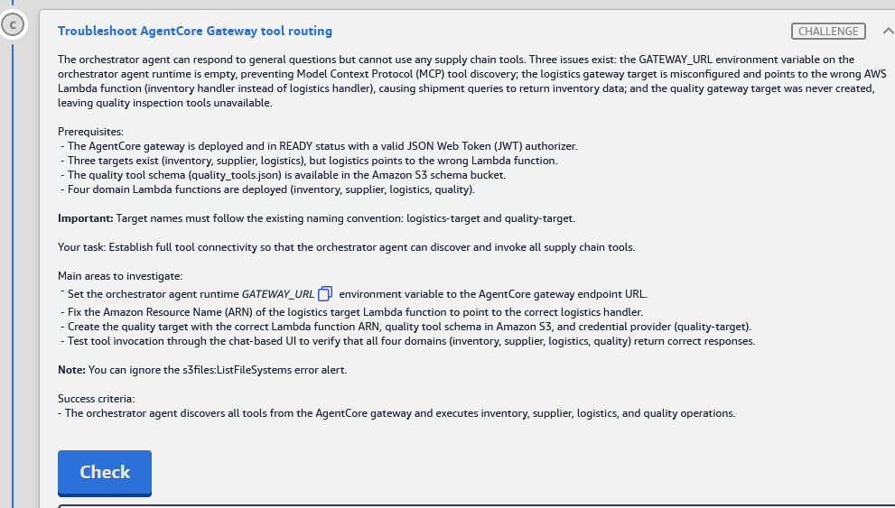

# Challenge C: Troubleshoot AgentCore Gateway tool routing

> **Status:** ✅ Passed, *Meets Requirements* (exam lab, 13 Nov 2026)
> **Lab:** [03 · AWS Agentic AI Demonstrated](README.md) · **Services:** Amazon Bedrock AgentCore (**Gateway**, gateway **targets**, Runtime env vars), AWS Lambda (domain handlers), Amazon S3 (tool schemas), IAM (gateway service role)
> **HLD label:** **C**, the orchestrator's *MCP tools* arrow → **AgentCore Gateway** → 4 Lambda targets → DynamoDB. See [HLD](README.md#-high-level-design-hld).

---

## ✅ Status checklist

- [x] 1 · Gateway page: copy the **gateway URL** (`https://…gateway.bedrock-agentcore.us-east-1.amazonaws.com/mcp`) and look at the existing targets' settings
- [x] 2 · Orchestrator runtime → env var **`GATEWAY_URL`** = gateway URL (keep `GUARDRAIL_*`, `COGNITO_*`)
- [x] 3 · **`logistics-target`** → Lambda ARN = `logistics-handler-8bc8fd20` (it currently points at the inventory handler)
- [x] 4 · **Create `quality-target`**: Lambda `quality-handler-8bc8fd20` + S3 schema `quality_tools.json` + IAM-role credential provider
- [x] 5 · Chat UI: inventory, supplier, logistics and quality questions each answered from the right domain
- [x] 6 · **Check**

---

## 🧾 Task card



> **Troubleshoot AgentCore Gateway tool routing**
>
> The orchestrator agent can respond to general questions but cannot use any supply chain tools. Three issues exist: the GATEWAY_URL environment variable on the orchestrator agent runtime is empty, preventing Model Context Protocol (MCP) tool discovery; the logistics gateway target is misconfigured and points to the wrong AWS Lambda function (inventory handler instead of logistics handler), causing shipment queries to return inventory data; and the quality gateway target was never created, leaving quality inspection tools unavailable.
>
> **Prerequisites:**
> - The AgentCore gateway is deployed and in READY status with a valid JSON Web Token (JWT) authorizer.
> - Three targets exist (inventory, supplier, logistics), but logistics points to the wrong Lambda function.
> - The quality tool schema (quality_tools.json) is available in the Amazon S3 schema bucket.
> - Four domain Lambda functions are deployed (inventory, supplier, logistics, quality).
>
> **Important:** Target names must follow the existing naming convention: logistics-target and quality-target.
>
> **Your task:** Establish full tool connectivity so that the orchestrator agent can discover and invoke all supply chain tools.
>
> **Main areas to investigate:**
> - Set the orchestrator agent runtime `GATEWAY_URL` environment variable to the AgentCore gateway endpoint URL.
> - Fix the Amazon Resource Name (ARN) of the logistics target Lambda function to point to the correct logistics handler.
> - Create the quality target with the correct Lambda function ARN, quality tool schema in Amazon S3, and credential provider (quality-target).
> - Test tool invocation through the chat-based UI to verify that all four domains (inventory, supplier, logistics, quality) return correct responses.
>
> **Note:** You can ignore the s3files:ListFileSystems error alert.
>
> **Success criteria:**
> - The orchestrator agent discovers all tools from the AgentCore gateway and executes inventory, supplier, logistics, and quality operations.

---

## 🏗️ Architecture (what C touches)

```text
Orchestrator runtime ── env GATEWAY_URL (EMPTY ❌) ──► MCP client: tools/list, tools/call
        │  Authorization: Bearer <Cognito M2M token>   (Challenge B)
        ▼
AgentCore Gateway  (READY, inbound JWT)   https://<gateway-id>.gateway.bedrock-agentcore.us-east-1.amazonaws.com/mcp
   ├─ inventory-target ─► inventory-handler-8bc8fd20 ─► DynamoDB inventory      ✅
   ├─ supplier-target  ─► supplier-handler-8bc8fd20  ─► DynamoDB suppliers      ✅
   ├─ logistics-target ─► inventory-handler ❌  → should be logistics-handler-8bc8fd20
   └─ quality-target   ─► (MISSING ❌)  → quality-handler-8bc8fd20 + s3://agent-schema-bucket-8bc8fd20/…/quality_tools.json
        outbound auth to Lambda = gateway IAM role  AgentCoreGatewayRole-8bc8fd20
```

**Tool names the agent sees:** `<target-name>___<tool-name>` (three underscores), e.g. `quality-target___get_inspection_results` ⚠️. That's why the target names must be exactly `logistics-target` / `quality-target`: the handlers and agent prompt depend on that prefix.

### Where each step happens

| Step | Service / console | Exact place |
|---|---|---|
| 1 | **Amazon Bedrock AgentCore** | Left nav *Resources* → **Gateways** → the gateway → *Gateway details* (**Gateway resource URL**) + **Targets** list |
| 2 | **Amazon Bedrock AgentCore** | Left nav **Agents** → orchestrator → **Edit / Update hosting** → Environment variables |
| 3 | **Amazon Bedrock AgentCore** | Gateway → **Targets** → `logistics-target` → **Edit** |
| 4a | **Amazon S3** | `agent-schema-bucket-8bc8fd20` → find `quality_tools.json` → **Copy S3 URI** |
| 4b | **Amazon Bedrock AgentCore** | Gateway → **Targets** → **Add target** |
| 5 | **Chat UI** (CloudFront) | `https://dj9dctg8k9l0t.cloudfront.net` |
| 6 | Lab page | **Check** |

---

## 🔍 Root cause

| # | Broken piece | Symptom |
|---|---|---|
| 1 | Orchestrator `GATEWAY_URL` is **empty** | Its MCP client has no endpoint, so it sees **zero tools** and answers only from the model ("general questions work, no tools") |
| 2 | `logistics-target` Lambda ARN = **inventory handler** | Gateway sends logistics tool calls to the inventory Lambda, so shipment questions return inventory data or errors |
| 3 | `quality-target` **doesn't exist** | No quality tools appear in `tools/list`, so quality questions can't be answered |

---

## 🛠️ Solution

### Values (from the Solution Resources panel)

| Name | Value |
|---|---|
| Logistics Lambda | `arn:aws:lambda:us-east-1:574897117640:function:logistics-handler-8bc8fd20` |
| Quality Lambda | `arn:aws:lambda:us-east-1:574897117640:function:quality-handler-8bc8fd20` |
| Schema bucket | `agent-schema-bucket-8bc8fd20` |
| Gateway role (outbound to Lambda) | `arn:aws:iam::574897117640:role/AgentCoreGatewayRole-8bc8fd20` |
| Gateway URL | _from Step 1_ |

### Step 1: Read the gateway (AgentCore → Gateways)

**Where:** **Amazon Bedrock AgentCore** → left nav *Resources* → **Gateways** → the supply-chain gateway (suffix `8bc8fd20`, status **READY**)

1. In *Gateway details*, copy the **Gateway resource URL** ⚠️. It looks like `https://<gateway-id>.gateway.bedrock-agentcore.us-east-1.amazonaws.com/mcp`, and it **ends in `/mcp`**.
2. Scroll to **Targets**. You should see `inventory-target`, `supplier-target` and `logistics-target`.
3. Open **`inventory-target`** and note how it's built. `quality-target` should be built the same way:
   - target type **Lambda ARN**
   - schema **from S3** (note its folder path, e.g. `s3://agent-schema-bucket-8bc8fd20/schemas/inventory_tools.json` ⚠️)
   - outbound auth **IAM role**

**CLI equivalent:**

```bash
aws bedrock-agentcore-control list-gateways --region us-east-1 --query "items[].[name,gatewayId,status]" --output table
GW=<gatewayId>
aws bedrock-agentcore-control get-gateway --gateway-identifier $GW --region us-east-1 --query gatewayUrl --output text
aws bedrock-agentcore-control list-gateway-targets --gateway-identifier $GW --region us-east-1 --query "items[].[name,targetId,status]" --output table
aws bedrock-agentcore-control get-gateway-target --gateway-identifier $GW --target-id <inventory-target-id> --region us-east-1
aws s3 ls s3://agent-schema-bucket-8bc8fd20/ --recursive | grep -i tools
```

### Step 2: Set `GATEWAY_URL` on the orchestrator (AgentCore → Agents)

**Where:** **Amazon Bedrock AgentCore** → **Agents** → orchestrator → **Edit / Update hosting** ⚠️ → **Environment variables**

| Key | Value |
|---|---|
| `GATEWAY_URL` | _the gateway URL from Step 1, including `https://` and `/mcp`_ ⚠️ |

**Keep every other variable** (`GUARDRAIL_ID`, `GUARDRAIL_VERSION`, `COGNITO_*` from A and B), then **Save / Update** to create a new version. Ignore the `s3files:ListFileSystems` alert.

> ⚠️ If the existing orchestrator code appends `/mcp` itself, use the URL **without** `/mcp`. The task says "gateway endpoint URL", and the console's URL already includes `/mcp`, so use it as shown unless the code proves otherwise.

### Step 3: Fix `logistics-target` (AgentCore → Gateway → Targets)

**Where:** Gateway page → **Targets** → select **`logistics-target`** → **Edit** ⚠️

1. **Lambda ARN:** change `…:function:inventory-handler-8bc8fd20` to

   ```text
   arn:aws:lambda:us-east-1:574897117640:function:logistics-handler-8bc8fd20
   ```

2. **Keep the name** `logistics-target`, its **schema** (should be `logistics_tools.json`; if it's the inventory schema, point it at `logistics_tools.json` ⚠️) and the **IAM role** credential provider.
3. **Save**, and wait for the target status to show **READY** ⚠️.

### Step 4: Create `quality-target`

**4a · S3:** **S3** → `agent-schema-bucket-8bc8fd20` → find **`quality_tools.json`** (it may be in a folder next to the other `*_tools.json` files) → select → **Copy S3 URI**.

**4b · AgentCore:** Gateway page → **Targets** → **Add target** ⚠️

| Field | Value |
|---|---|
| **Target name** | `quality-target` (exactly) |
| Description | optional, e.g. `Quality inspection tools` |
| **Target type** | **Lambda ARN** |
| **Lambda ARN** | `arn:aws:lambda:us-east-1:574897117640:function:quality-handler-8bc8fd20` |
| **Tool schema** | **Use S3** / *Define with S3 resource* → the `quality_tools.json` URI from 4a |
| **Outbound auth / credential provider** | **IAM role**, the gateway service role (`GATEWAY_IAM_ROLE`), same as the other targets |

→ **Add target / Create.** Wait until it shows **READY** ⚠️. If it shows **FAILED**, open it and read the status reason (usually a bad S3 URI or schema).

**CLI fallback (create):**

```bash
aws bedrock-agentcore-control create-gateway-target --region us-east-1 \
  --gateway-identifier $GW --name quality-target \
  --target-configuration '{"mcp":{"lambda":{"lambdaArn":"arn:aws:lambda:us-east-1:574897117640:function:quality-handler-8bc8fd20","toolSchema":{"s3":{"uri":"s3://agent-schema-bucket-8bc8fd20/<path>/quality_tools.json"}}}}}' \
  --credential-provider-configurations '[{"credentialProviderType":"GATEWAY_IAM_ROLE"}]'
```

### Step 5: Test all four domains in the chat UI

Open `https://dj9dctg8k9l0t.cloudfront.net` and ask one question per domain. Exact wording depends on the tool schemas ⚠️:

| Domain | Example prompt | Good sign |
|---|---|---|
| Inventory | `What are the current inventory levels? Any items low on stock?` | SKUs / quantities |
| Supplier | `List our suppliers and their performance ratings.` | Supplier names / ratings |
| Logistics | `What's the status of our recent shipments?` | Shipment IDs / carriers / ETAs, **not** inventory rows |
| Quality | `Show me recent quality inspection results.` | Inspection / batch / defect data |

A **tool error** for one domain means that target's Lambda ARN or schema is wrong. **No tools at all** means `GATEWAY_URL` is wrong or the Gateway JWT is wrong (Challenge B).

### Step 6: Check

### Order of operations

```text
1 AgentCore › Gateways › gateway: copy URL (…/mcp) + look at inventory-target (Lambda + S3 schema + IAM role)
2 AgentCore › Agents › orchestrator › Edit › env GATEWAY_URL=<url> (keep GUARDRAIL_*/COGNITO_*) → Save (new version)
3 Gateway › Targets › logistics-target › Edit › Lambda = logistics-handler-8bc8fd20 → Save → READY
4 S3 › copy quality_tools.json URI → Gateway › Targets › Add: quality-target, Lambda quality-handler-8bc8fd20, S3 schema, IAM role → READY
5 Chat UI: inventory / supplier / logistics / quality → 6 Check
```

> 💡 Steps 3 and 4 (gateway) and Step 2 (runtime) are independent. Do the targets while the runtime version deploys.

---

## ⚠️ Mistakes & lessons

_None recorded during the lab. Passed, Meets Requirements._

---

## 🧯 Troubleshooting

| Symptom | Likely cause | Fix |
|---|---|---|
| Agent still answers without tools | `GATEWAY_URL` missing `/mcp` or `https://`, a typo, or the runtime env edit not saved / DEFAULT not on the new version | Re-copy the URL from the gateway page and check the agent's DEFAULT endpoint version |
| All tool calls 401 / "Unauthorized" | Gateway inbound JWT `allowedClients` doesn't include the client the orchestrator uses | Challenge B Step 3 |
| Shipment questions still return inventory data | `logistics-target` save didn't stick, or the schema also points to inventory | Re-open the target and check both the ARN and the schema |
| `quality-target` **FAILED** | Wrong S3 URI (path/folder), invalid JSON schema, or the gateway role can't read the bucket | Copy the URI from the S3 console. Compare with the inventory target's URI |
| Quality tools listed but the call errors | Wrong Lambda ARN, or the gateway role lacks `lambda:InvokeFunction` on the quality Lambda ⚠️ | The lab says IAM is pre-set, so recheck the ARN first |
| Tool name mismatch / "unknown tool" in Lambda logs | Target named differently (e.g. `quality_target`, `QualityTarget`) | Delete it and recreate it as `quality-target` |
| Check fails but chat works | Runtime version not deployed yet, or the checker calls tools directly | Wait about 1 min and Check again |

Logs: **CloudWatch** → `/aws/lambda/logistics-handler-8bc8fd20`, `/aws/lambda/quality-handler-8bc8fd20` (did the call arrive?), and the orchestrator runtime log group `/aws/bedrock-agentcore/runtimes/<id>-DEFAULT` ⚠️.

---

## 📚 Study notes

### AgentCore Gateway in one page

- **What:** a managed **MCP server** that turns APIs and Lambdas into **MCP tools**. Agents call `tools/list` (discovery) and `tools/call` (invoke) at the gateway URL `…/mcp`. Semantic tool search is optional.
- **Inbound auth:** who may call the gateway. A **JWT authorizer** (Cognito discovery URL + allowedClients) or IAM.
- **Targets:** what the tools run on. Types: **Lambda ARN** (with a tool schema, inline or from **S3**), **OpenAPI** schema, **Smithy** model, or an existing **MCP server**.
- **Outbound auth (credential provider) per target:** **Gateway IAM role** for Lambda/AWS targets; API key or OAuth (AgentCore Identity) for external APIs.
- **Tool naming:** the gateway prefixes each tool with its target name, `target-name___tool-name`, so names must be unique and **stable**. The Lambda receives the tool name in `context.client_context.custom["bedrockAgentCoreToolName"]` and usually strips the prefix.
- **Lambda tool schema:** a JSON array of `{ "name", "description", "inputSchema": { "type": "object", "properties": {…}, "required": [...] } }`, the same `inputSchema` idea as the Lab 02 MCP catalogs.

### Self-test

1. What does an empty `GATEWAY_URL` do to the agent? <details><summary>Answer</summary>The MCP client discovers no tools, so the model answers from its own knowledge only.</details>
2. Why must the target be named exactly `quality-target`? <details><summary>Answer</summary>Tool names are `<target>___<tool>`, and the handler/agent match that prefix (plus the lab checker looks for it).</details>
3. Which credential provider does a Lambda target use? <details><summary>Answer</summary>The gateway's IAM service role (`GATEWAY_IAM_ROLE`).</details>
4. Two places a Lambda target's tool schema can come from? <details><summary>Answer</summary>Inline JSON or an S3 URI.</details>

---

## 📝 Run log (fill in as I go)

| Step | What I did | Result / output |
|---|---|---|
| 1 | Gateway URL / inventory-target settings | _URL = ?, schema path = ?_ |
| 2 | Orchestrator `GATEWAY_URL` | _saved, version = ?_ |
| 3 | logistics-target ARN | _READY?_ |
| 4 | quality-target created | _READY?_ |
| 5 | Chat: 4 domains | _?_ |
| 6 | Check | ✅ Meets Requirements (exam result, 13 Nov 2026) |
