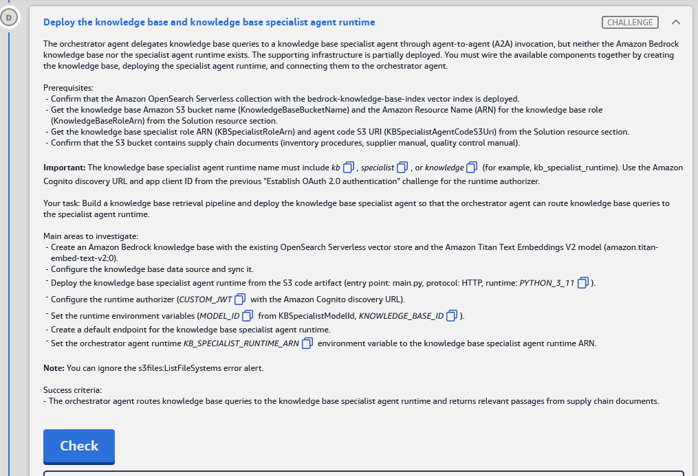
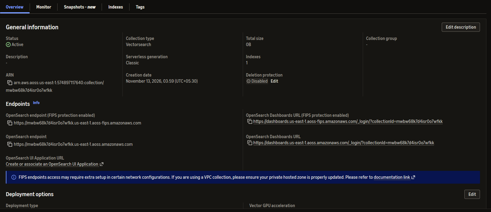
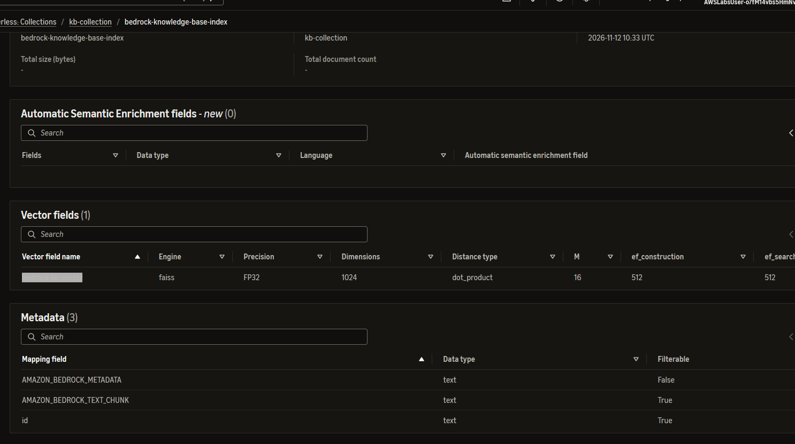
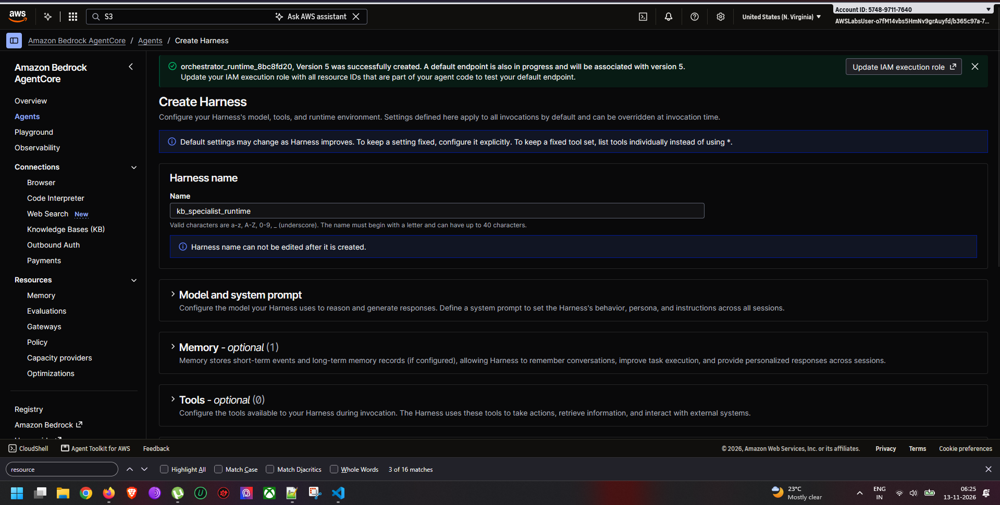
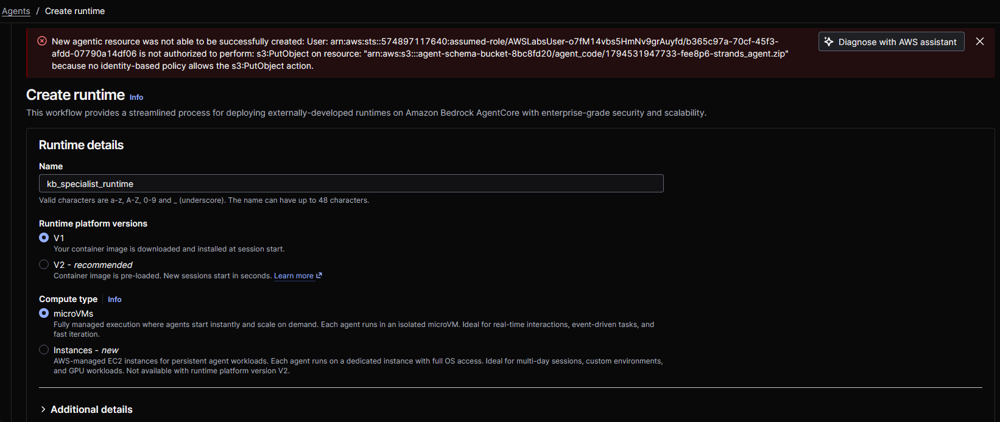

# Challenge D: Deploy the knowledge base and knowledge base specialist agent runtime

> **Status:** ✅ Passed, *Meets Requirements* (exam lab, 13 Nov 2026)
> **Lab:** [03 · AWS Agentic AI Demonstrated](README.md) · **Services:** Amazon Bedrock **Knowledge Bases** (OpenSearch Serverless vector store, Titan Text Embeddings V2), Amazon S3, Amazon OpenSearch Serverless, Amazon Bedrock **AgentCore Runtime** (direct code deploy from S3, CUSTOM_JWT authorizer, endpoint), A2A
> **HLD label:** **D**, the **KB specialist runtime** (Nova Lite) → **Bedrock KB** → **OpenSearch Serverless**, plus the orchestrator → specialist **A2A** arrow. See [HLD](README.md#-high-level-design-hld).

---

## ✅ Status checklist

- [x] 0 · Gather: `KnowledgeBaseRoleArn` (panel / IAM), OpenSearch index `bedrock-knowledge-base-index` **field names**, B's **client ID**
- [x] 1 · Bedrock → **Create KB**: S3 `supply-chain-knowledge-8bc8fd20`, Titan Text Embeddings **V2**, existing **OpenSearch Serverless** collection + index → copy **KB ID**
- [x] 2 · Data source → **Sync** (start early, it runs while you do Step 3)
- [x] 3 · AgentCore → **create runtime** `kb_specialist_runtime` from S3 zip (`main.py`, HTTP, `PYTHON_3_11`, role `KBSpecialistRuntimeRole-8bc8fd20`, **CUSTOM_JWT**, env `MODEL_ID` + `KNOWLEDGE_BASE_ID`)
- [x] 4 · Specialist **endpoint** (DEFAULT) is **READY**
- [x] 5 · Orchestrator env **`KB_SPECIALIST_RUNTIME_ARN`** = specialist runtime ARN (keep the other vars)
- [x] 6 · Chat UI: a KB question returns passages from the supply chain docs
- [x] 7 · **Check**

---

## 🧾 Task card



> **Deploy the knowledge base and knowledge base specialist agent runtime**
>
> The orchestrator agent delegates knowledge base queries to a knowledge base specialist agent through agent-to-agent (A2A) invocation, but neither the Amazon Bedrock knowledge base nor the specialist agent runtime exists. The supporting infrastructure is partially deployed. You must wire the available components together by creating the knowledge base, deploying the specialist agent runtime, and connecting them to the orchestrator agent.
>
> **Prerequisites:**
> - Confirm that the Amazon OpenSearch Serverless collection with the bedrock-knowledge-base-index vector index is deployed.
> - Get the knowledge base Amazon S3 bucket name (KnowledgeBaseBucketName) and the Amazon Resource Name (ARN) for the knowledge base role (KnowledgeBaseRoleArn) from the Solution resource section.
> - Get the knowledge base specialist role ARN (KBSpecialistRoleArn) and agent code S3 URI (KBSpecialistAgentCodeS3Uri) from the Solution resource section.
> - Confirm that the S3 bucket contains supply chain documents (inventory procedures, supplier manual, quality control manual).
>
> **Important:** The knowledge base specialist agent runtime name must include `kb`, `specialist`, or `knowledge` (for example, kb_specialist_runtime). Use the Amazon Cognito discovery URL and app client ID from the previous "Establish OAuth 2.0 authentication" challenge for the runtime authorizer.
>
> **Your task:** Build a knowledge base retrieval pipeline and deploy the knowledge base specialist agent so that the orchestrator agent can route knowledge base queries to the specialist agent runtime.
>
> **Main areas to investigate:**
> - Create an Amazon Bedrock knowledge base with the existing OpenSearch Serverless vector store and the Amazon Titan Text Embeddings V2 model (amazon.titan-embed-text-v2:0).
> - Configure the knowledge base data source and sync it.
> - Deploy the knowledge base specialist agent runtime from the S3 code artifact (entry point: main.py, protocol: HTTP, runtime: `PYTHON_3_11`).
> - Configure the runtime authorizer (`CUSTOM_JWT` with the Amazon Cognito discovery URL).
> - Set the runtime environment variables (`MODEL_ID` from KBSpecialistModelId, `KNOWLEDGE_BASE_ID`).
> - Create a default endpoint for the knowledge base specialist agent runtime.
> - Set the orchestrator agent runtime `KB_SPECIALIST_RUNTIME_ARN` environment variable to the knowledge base specialist agent runtime ARN.
>
> **Note:** You can ignore the s3files:ListFileSystems error alert.
>
> **Success criteria:**
> - The orchestrator agent routes knowledge base queries to the knowledge base specialist agent runtime and returns relevant passages from supply chain documents.

---

## 🏗️ Architecture (what D builds)

```text
Chat UI → chat Lambda → ORCHESTRATOR runtime (Nova Pro)
                          │ env KB_SPECIALIST_RUNTIME_ARN (EMPTY ❌ → specialist ARN)
                          │ A2A call: HTTPS invoke + Bearer <Cognito M2M token>  (same client as B)
                          ▼
              KB SPECIALIST runtime  "kb_specialist_runtime"  (NEW)
                code: s3://agent-schema-bucket-8bc8fd20/agent_code/kb_specialist_agent.zip  → main.py, PYTHON_3_11, HTTP
                role: KBSpecialistRuntimeRole-8bc8fd20   inbound: CUSTOM_JWT (Cognito discovery URL + allowedClients)
                env:  MODEL_ID=amazon.nova-lite-v1:0   KNOWLEDGE_BASE_ID=<KB id>
                          │ bedrock-agent-runtime:Retrieve(KnowledgeBaseId)
                          ▼
              Bedrock Knowledge Base (NEW)   embeddings: amazon.titan-embed-text-v2:0 (1024 dims)
                ├─ data source: s3://supply-chain-knowledge-8bc8fd20/  (inventory procedures, supplier manual, QC manual)
                └─ vector store: OpenSearch Serverless collection mwbw68k7d4isr0o7wfkk, index bedrock-knowledge-base-index
```

### Where each step happens

| Step | Service / console | Exact place |
|---|---|---|
| 0a | **Lab page** / **IAM** | Solution resources → `KnowledgeBaseRoleArn` (or IAM → Roles → search `8bc8fd20`) |
| 0b | **Amazon OpenSearch Service** | *Serverless* → **Collections** → `mwbw68k7d4isr0o7wfkk` → **Indexes** → `bedrock-knowledge-base-index` (field names) |
| 0c | **Amazon S3** | `supply-chain-knowledge-8bc8fd20` (confirm the 3 docs exist) |
| 1–2 | **Amazon Bedrock** | Left nav *Build* → **Knowledge Bases** → **Create** → *Knowledge Base with vector store*, then data source → **Sync** |
| 3–4 | **Amazon Bedrock AgentCore** | Left nav **Agents** → **Create agent** → *deploy your own code* (Runtime) ⚠️, then the agent's **Endpoints** |
| 5 | **Amazon Bedrock AgentCore** | **Agents** → orchestrator → **Edit / Update hosting** → Environment variables |
| 6 | **Chat UI** | `https://dj9dctg8k9l0t.cloudfront.net` |

---

## 🔍 Root cause

Nothing is "broken". The pieces were **never created or wired up**:

| Missing | Effect |
|---|---|
| Bedrock **knowledge base** | Nothing turns the S3 docs into vectors in the OpenSearch index, so there's nothing to retrieve |
| **KB specialist runtime** | The orchestrator has no agent to delegate KB questions to over A2A |
| Specialist **endpoint** | No invokable address (qualifier) for the runtime |
| Orchestrator **`KB_SPECIALIST_RUNTIME_ARN`** | The orchestrator doesn't know where to send KB questions, so it skips them or errors |

---

## 🛠️ Solution

### Values

| Name | Value |
|---|---|
| KB S3 bucket | `supply-chain-knowledge-8bc8fd20` (S3 URI `s3://supply-chain-knowledge-8bc8fd20/`) |
| KB role | `KnowledgeBaseRoleArn` from the panel. Not in my saved copy: check the panel or IAM ⚠️ |
| OpenSearch Serverless collection | `arn:aws:aoss:us-east-1:574897117640:collection/mwbw68k7d4isr0o7wfkk` |
| Vector index | `bedrock-knowledge-base-index` |
| Embeddings | **Titan Text Embeddings V2**, `amazon.titan-embed-text-v2:0`, 1024 dims, float |
| Specialist code | `s3://agent-schema-bucket-8bc8fd20/agent_code/kb_specialist_agent.zip` |
| Specialist role | `arn:aws:iam::574897117640:role/KBSpecialistRuntimeRole-8bc8fd20` |
| `MODEL_ID` | `amazon.nova-lite-v1:0` |
| Discovery URL | `https://cognito-idp.us-east-1.amazonaws.com/us-east-1_6yHDtJ0jv/.well-known/openid-configuration` |
| Allowed client | B's new M2M **client ID** |

### Step 0: Field names in the vector index (OpenSearch Serverless) ⚠️ do this first

**Where:** Console search → **Amazon OpenSearch Service** → left nav *Serverless* → **Collections** → the collection (`mwbw68k7d4isr0o7wfkk`) → **Indexes** tab → **`bedrock-knowledge-base-index`**

> **Seen in the lab (13 Nov 2026):** the collection page opens on **Overview** (Status *Active*, type *Vectorsearch*, **Indexes 1**, Total size 0 B). The field names are **not** on Overview. Click the **Indexes** tab (*Overview · Monitor · Snapshots · **Indexes** · Tags*), then the index name.
>
> 

Note the three fields. The usual Bedrock names are:

| KB field mapping | Typical name in the index | Type |
|---|---|---|
| **Vector field name** | `bedrock-knowledge-base-default-vector` ⚠️ | `knn_vector`, **dimension 1024** |
| **Text field name** | `AMAZON_BEDROCK_TEXT_CHUNK` ⚠️ | text |
| **Bedrock-managed metadata field name** | `AMAZON_BEDROCK_METADATA` ⚠️ | text (not indexed) |

**✔️ Confirmed for this launch (13 Nov 2026), collection `kb-collection` → index `bedrock-knowledge-base-index`:**



| KB field mapping | **Value to enter** | From the index |
|---|---|---|
| **Vector field name** | **`bedrock-kb-vector`** ⚠️ (the cell was highlighted in the screenshot, so copy it from the console) | faiss · **FP32** · **1024** dims · **dot_product** · M 16 · ef 512 |
| **Text field name** | **`AMAZON_BEDROCK_TEXT_CHUNK`** | text, filterable |
| **Bedrock-managed metadata field name** | **`AMAZON_BEDROCK_METADATA`** | text, not filterable |

So it is **not** the default `bedrock-knowledge-base-default-vector`. The `id` field is just the document ID and isn't mapped. **1024 + FP32** means Titan V2 with **1024 dimensions, Floating-point**.

Use **whatever the index actually shows**. A mismatch is the #1 cause of KB creation failures. Also confirm the vector dimension is **1024**, which matches Titan V2's default.

### Step 1: Create the knowledge base (Amazon Bedrock)

**Where:** Console search → **Amazon Bedrock** → left nav *Build* → **Knowledge Bases** → **Create** → **Knowledge Base with vector store**

*(The AgentCore nav item **Connections → Knowledge Bases (KB)** leads to the same KBs ⚠️.)*

> **"Structured" vs "Unstructured" data (confirmed in the lab on 13 Nov 2026): choose Unstructured.** The sources are **documents** in S3 (inventory procedures, supplier manual, QC manual), which get chunked, embedded and put in a **vector store**. *Structured* is for **SQL data stores** (e.g. Amazon Redshift, queried by natural language → SQL), with no embeddings or OpenSearch.
>
> **"Managed" vs "Self-managed" (the console asks this, confirmed in the lab on 13 Nov 2026): choose Self-managed.**
> - **Managed:** Bedrock creates and runs a **new** vector store for you, so it would **not** use the lab's OpenSearch Serverless collection or the `bedrock-knowledge-base-index` index.
> - **Self-managed:** **you bring an existing vector store**. That is what the task requires ("Create an Amazon Bedrock knowledge base with the **existing OpenSearch Serverless vector store**"), and it's the option that shows the collection ARN / index / field-mapping fields below.
> - The pre-made `KnowledgeBaseRoleArn` is scoped to the existing collection, so a managed store could also fail on permissions.

**1.1 Knowledge base details**

| Field | Value |
|---|---|
| Name | `supply-chain-kb` |
| IAM permissions | **Use an existing service role** → the **KnowledgeBaseRoleArn** role |
| Data source type | **Amazon S3** |

→ **Next**

**1.2 Data source**

| Field | Value |
|---|---|
| Data source name | `supply-chain-docs` |
| S3 URI | `s3://supply-chain-knowledge-8bc8fd20/` (**Browse S3** → pick the bucket) |
| Parsing / chunking | defaults (*Default chunking*) |

→ **Next**

**1.3 Embeddings model + vector store**

| Field | Value |
|---|---|
| Embeddings model | **Titan Text Embeddings V2**, embedding type **Floating-point**, dimensions **1024** |
| Vector database | **Use an existing vector store** → **Amazon OpenSearch Serverless** |
| Collection ARN | `arn:aws:aoss:us-east-1:574897117640:collection/mwbw68k7d4isr0o7wfkk` |
| Vector index name | `bedrock-knowledge-base-index` |
| Vector field name | _from Step 0_ |
| Text field name | _from Step 0_ |
| Bedrock-managed metadata field name | _from Step 0_ |

→ **Next** → review → **Create knowledge base** (takes about 1 min).

**1.4** On the KB page, copy the **Knowledge base ID**, a 10-character uppercase value such as `ABCDE12345`.

### Step 2: Sync the data source (Amazon Bedrock)

**Where:** the KB page → **Data source** section → select `supply-chain-docs` → **Sync**

- Status goes from *Syncing* to **Available / Completed**. Check *Sync history* shows **3 documents** (or more) **added**, 0 failed.
- **Don't wait.** Start Step 3 while it syncs.
- Quick test: KB page → **Test knowledge base** → pick any model (or *Retrieval only*) → ask `What are the steps in the quality control inspection process?` and you should see chunks from the QC manual.

### Step 3: Deploy the KB specialist runtime (AgentCore → Agents)

**Where:** **Amazon Bedrock AgentCore** → left nav **Agents** → **Create agent** → choose **deploy your own code / Runtime** (not the harness) ⚠️

| Field | Value |
|---|---|
| **Name** | `kb_specialist_runtime`. Must include `kb`, `specialist` or `knowledge`. **Letters, digits and underscores only, no hyphens** |
| **Source / artifact** | **S3** (direct code upload / *ZIP from S3*) → `s3://agent-schema-bucket-8bc8fd20/agent_code/kb_specialist_agent.zip` |
| **Runtime** | `PYTHON_3_11` |
| **Entry point** | `main.py` |
| **Protocol** | **HTTP** |
| **IAM role** | **Use existing** → `KBSpecialistRuntimeRole-8bc8fd20` |
| **Inbound auth** | **JWT** (`CUSTOM_JWT`) → Discovery URL above → **Allowed clients** = B's **client ID** (leave audiences empty) |
| **Environment variables** | `MODEL_ID` = `amazon.nova-lite-v1:0` · `KNOWLEDGE_BASE_ID` = _KB ID from 1.4_ |
| Network | **Public** for now, unless the Challenge F card says otherwise ⚠️ |

→ **Create / Host agent**. Wait for status **READY** (about 1–3 min). **Copy the runtime ARN**: `arn:aws:bedrock-agentcore:us-east-1:574897117640:runtime/kb_specialist_runtime-<suffix>`.

**CLI fallback** ⚠️ (direct code deploy fields):

```bash
aws bedrock-agentcore-control create-agent-runtime --region us-east-1 \
  --agent-runtime-name kb_specialist_runtime \
  --agent-runtime-artifact '{"codeConfiguration":{"code":{"s3":{"bucket":"agent-schema-bucket-8bc8fd20","prefix":"agent_code/kb_specialist_agent.zip"}},"runtime":"PYTHON_3_11","entryPoint":["main.py"]}}' \
  --role-arn arn:aws:iam::574897117640:role/KBSpecialistRuntimeRole-8bc8fd20 \
  --network-configuration '{"networkMode":"PUBLIC"}' \
  --protocol-configuration '{"serverProtocol":"HTTP"}' \
  --authorizer-configuration '{"customJWTAuthorizer":{"discoveryUrl":"https://cognito-idp.us-east-1.amazonaws.com/us-east-1_6yHDtJ0jv/.well-known/openid-configuration","allowedClients":["<CLIENT_ID>"]}}' \
  --environment-variables MODEL_ID=amazon.nova-lite-v1:0,KNOWLEDGE_BASE_ID=<KB_ID> \
  --query "[agentRuntimeArn,agentRuntimeId,status]"
```

### Step 4: Default endpoint

**Where:** the specialist agent's page → **Endpoints** tab

- AgentCore usually creates a **`DEFAULT`** endpoint automatically, pointing at the latest version. Confirm it's **READY**.
- If **no endpoint is listed**, click **Create endpoint** → name `default_endpoint` (underscores, no hyphens) → version **1** (latest) → Create ⚠️.

```bash
aws bedrock-agentcore-control list-agent-runtime-endpoints --agent-runtime-id <id> --region us-east-1
# only if empty:
aws bedrock-agentcore-control create-agent-runtime-endpoint --agent-runtime-id <id> --name default_endpoint --region us-east-1
```

### Step 5: Wire the orchestrator (AgentCore → Agents)

**Where:** **Agents** → **orchestrator** → **Edit / Update hosting** → **Environment variables**

| Key | Value |
|---|---|
| `KB_SPECIALIST_RUNTIME_ARN` | the **specialist runtime ARN** from Step 3 (`…:runtime/kb_specialist_runtime-xxxx`, **not** `…/runtime-endpoint/…`) |

**Keep all existing variables** (`GUARDRAIL_*`, `COGNITO_*`, `GATEWAY_URL`) → **Save** (new version).

### Step 6: Test in the chat UI

| Prompt | Should cite |
|---|---|
| `What is our procedure for handling damaged inventory?` | inventory procedures doc |
| `According to the supplier manual, how are new suppliers onboarded?` | supplier manual |
| `What are the quality control inspection steps?` | QC manual |

The answer should quote or paraphrase **passages from the documents**, not a generic model answer. The first call may be slow (two cold starts: orchestrator, then specialist).

### Step 7: Check

### Order of operations

```text
0 Panel/IAM: KnowledgeBaseRoleArn · AOSS › collection › Indexes › bedrock-knowledge-base-index: vector/text/metadata field names
1 Bedrock › Knowledge Bases › Create (vector store): role, S3 supply-chain-knowledge-8bc8fd20, Titan V2 1024, existing AOSS + index + fields → copy KB ID
2 Data source › Sync  (runs in background)
3 AgentCore › Agents › Create (own code): kb_specialist_runtime, S3 zip, PYTHON_3_11, main.py, HTTP, KBSpecialistRuntimeRole, CUSTOM_JWT (discovery + B client), env MODEL_ID + KNOWLEDGE_BASE_ID → READY → copy ARN
4 Specialist › Endpoints: DEFAULT READY (create one if none)
5 Orchestrator › Edit › env KB_SPECIALIST_RUNTIME_ARN (keep others) → Save
6 Chat KB question → 7 Check
```

---

## ⚠️ Mistakes & lessons

### Mistake 1: Opened **Create Harness** instead of the code-deploy (Runtime) flow



- **What happened:** Agents → Create led to **Create Harness**: *Harness name*, *Model and system prompt*, *Memory*, *Tools*.
- **Why it's wrong:** a **harness** is AgentCore's **config-only managed agent**. You pick a model, prompt and tools, and AgentCore runs the loop. It has **no fields** for the S3 code zip, `main.py`, `PYTHON_3_11` or HTTP, and the task says *"deploy … from the S3 code artifact"*.
- **Fix:** **Cancel without creating**, because a harness name can't be edited later and could take up the name. Go back to **Agents** and choose the **deploy your own code / host agent (Runtime)** option ⚠️. The right form asks for the **agent source (S3 / ECR)**, **runtime**, **entry point**, **protocol**, **IAM role**, **inbound auth** and **environment variables**.
- **Side info from the same screen:** the banner confirmed the orchestrator is **`orchestrator_runtime_8bc8fd20`**, now at **Version 5**, with the DEFAULT endpoint moving to v5. The *"Update IAM execution role"* banner prompt can be ignored, because the lab pre-sets IAM.
- **Lesson:** Overview says *"Create a new agent with the **harness**, or **deploy your own code** to the runtime"*. These are two different creation paths.

### Mistake 2: `s3:PutObject` AccessDenied: the console tried to **upload** code instead of using the existing S3 zip



```text
New agentic resource was not able to be successfully created: User: arn:aws:sts::574897117640:assumed-role/AWSLabsUser-…
is not authorized to perform: s3:PutObject on resource:
"arn:aws:s3:::agent-schema-bucket-8bc8fd20/agent_code/1794531947733-fee8p6-strands_agent.zip"
because no identity-based policy allows the s3:PutObject action.
```

- **Right page:** **Create runtime** (*"deploying externally-developed runtimes"*). Name `kb_specialist_runtime`, *Runtime platform versions* V1/V2, *Compute type* microVMs/Instances.
- **Why it failed:** the object name `…-strands_agent.zip` shows the code-source option was a **sample/template or upload** (the console zips code and **uploads** it to S3). The lab user has **no `s3:PutObject`**, by design: you must **point at the zip that already exists**.
- **Fix:** in the code / agent source section, choose **existing S3 location / S3 URI** (*Browse S3*) → `s3://agent-schema-bucket-8bc8fd20/agent_code/kb_specialist_agent.zip`. **Not** "upload", "start from sample/template" or "Strands starter" ⚠️.
- **Defaults kept:** Runtime platform **V1** (pre-selected) and Compute **microVMs**. The task doesn't specify these.
- **Lesson:** an `s3:PutObject` denial on a *timestamped* key means the console is trying to upload. In labs, always choose the *existing artifact* option.

---

## 🧯 Troubleshooting

| Symptom | Likely cause | Fix |
|---|---|---|
| KB create fails: *"field … not found / mapping"* | Vector/text/metadata field names don't match the index | Step 0: copy the names exactly |
| KB create fails: *dimension mismatch* | Index `knn_vector` dimension ≠ embedding dims | Titan V2 at **1024** (or match the index) |
| KB create fails: **403** / *no permission to the index* | KB role not in the collection's **data access policy**, or the wrong role picked | Use the panel's `KnowledgeBaseRoleArn`. The lab says IAM is pre-set |
| Sync **0 documents** / failed | Wrong S3 URI, or a prefix with no files | Point at the bucket root. Check the files in S3 |
| Runtime name rejected | Hyphens or spaces | `kb_specialist_runtime` |
| Runtime **CREATE_FAILED** | Wrong S3 URI or zip, entry point not `main.py`, or wrong runtime version | Re-check the panel values. Read the failure reason on the agent page |
| Orchestrator answers KB questions generically | `KB_SPECIALIST_RUNTIME_ARN` not saved / wrong ARN type, or the specialist JWT rejects the orchestrator's token | Runtime ARN (not endpoint). Specialist `allowedClients` = **same client as B** |
| Specialist returns *"no results"* | Sync not finished, or the wrong `KNOWLEDGE_BASE_ID` | Wait for the sync. Check the ID (10 chars) |
| Specialist logs: `AccessDenied bedrock:Retrieve` / `InvokeModel` | Wrong role, or the env `MODEL_ID` has a typo | `KBSpecialistRuntimeRole-8bc8fd20`, `amazon.nova-lite-v1:0` |

Logs: **CloudWatch** → `/aws/bedrock-agentcore/runtimes/kb_specialist_runtime-<id>-DEFAULT` ⚠️.

---

## 📚 Study notes

### Bedrock Knowledge Bases (RAG pipeline)

- **Ingestion (sync):** S3 docs → parse → **chunk** (default about 300 tokens, 20% overlap) → **embed** (Titan V2: 256/512/**1024** dims) → write vectors + text + metadata to the **vector store**. A sync is incremental: only new, changed or deleted files are processed.
- **Vector stores:** OpenSearch Serverless (this lab), Aurora PostgreSQL pgvector (Lab 02 F), Neptune Analytics, Pinecone, Redis, MongoDB Atlas, S3 Vectors. With an **existing** store you must give the index name and the **field mapping** yourself.
- **OpenSearch Serverless:** a *vector search* collection, `knn_vector` field (FAISS/HNSW), plus 3 policy types: **encryption**, **network**, and a **data access policy** (which principals can read/write the index).
- **Query APIs:** `Retrieve` (chunks + scores) vs `RetrieveAndGenerate` (chunks + an LLM answer with citations).

### AgentCore Runtime direct code deploy + A2A

- Two artifact types: a **container** (ECR image) or **code from S3** (a zip with `runtime` such as `PYTHON_3_11` and an **entry point** such as `main.py`).
- **Protocols:** `HTTP` (the `/invocations` + `/ping` contract), `MCP`, `A2A`. This specialist uses HTTP, and the orchestrator calls it like any JWT-protected runtime (agent-to-agent delegation).
- **Endpoint** = a named pointer to a version (`DEFAULT` follows the latest). Callers pass `qualifier=<endpoint>`.
- **Runtime/endpoint names:** `[a-zA-Z][a-zA-Z0-9_]{0,47}`, so **no hyphens**.

### Self-test

1. What three field names do you map when using an existing OpenSearch index? <details><summary>Answer</summary>Vector field, text field, Bedrock-managed metadata field.</details>
2. Titan Text Embeddings V2 default dimension? <details><summary>Answer</summary>1024 (also 512, 256).</details>
3. Why does the specialist authorizer use the *same* Cognito client as B? <details><summary>Answer</summary>The orchestrator gets a token with that client and presents it when it calls the specialist. `allowedClients` must include it.</details>
4. Which ARN goes in `KB_SPECIALIST_RUNTIME_ARN`? <details><summary>Answer</summary>The runtime ARN (`…:runtime/<id>`), not the endpoint ARN.</details>
5. `Retrieve` vs `RetrieveAndGenerate`? <details><summary>Answer</summary>Chunks only vs chunks + a generated answer with citations.</details>

---

## 📝 Run log (fill in as I go)

| Step | What I did | Result / output |
|---|---|---|
| 0 | KB role / index field names | Collection `kb-collection`, index `bedrock-knowledge-base-index`: vector **`bedrock-kb-vector`** (faiss FP32 1024 dot_product), text `AMAZON_BEDROCK_TEXT_CHUNK`, metadata `AMAZON_BEDROCK_METADATA`. KB role = _?_ |
| 1 | Console asked **Structured vs Unstructured** | Chose **Unstructured** (S3 documents → vector store) |
| 1 | Console asked **Managed vs Self-managed** | Chose **Self-managed** (existing AOSS collection + index) |
| 1 | KB created | _KB ID = ?_ |
| 2 | Sync | _docs added = ?_ |
| 3 | Specialist runtime | _ARN = ?, READY?_ |
| 4 | Endpoint | _DEFAULT READY?_ |
| 5 | Orchestrator `KB_SPECIALIST_RUNTIME_ARN` | _saved?_ |
| 6 | Chat KB question | _passages?_ |
| 7 | Check | ✅ Meets Requirements (exam result, 13 Nov 2026) |
