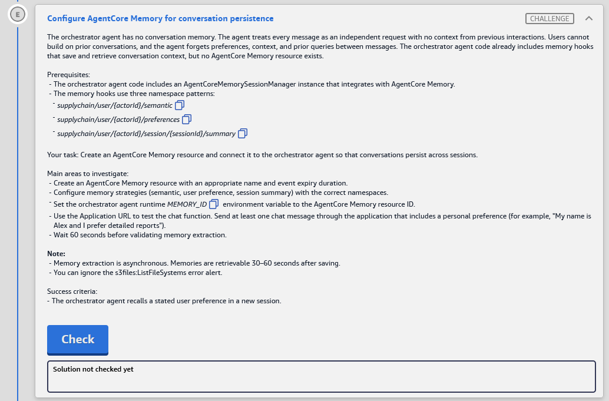

# Challenge E: Configure AgentCore Memory for conversation persistence

> **Lab:** [03 · AWS Agentic AI Demonstrated](README.md) · **Services:** Amazon Bedrock **AgentCore Memory** (short-term events + long-term strategies: semantic, user preference, summary), AgentCore Runtime (env var), Strands `AgentCoreMemorySessionManager`
> **HLD label:** **E**, the orchestrator ↔ **AgentCore Memory** arrow. See [HLD](README.md#-high-level-design-hld).

---

## ✅ Status checklist

- [ ] 1 · AgentCore → **Memory** → create `supply_chain_memory` (event expiry, e.g. **30 days**)
- [ ] 2 · Add 3 long-term strategies with the **exact** namespaces: **Semantic** `supplychain/user/{actorId}/semantic` · **User preference** `supplychain/user/{actorId}/preferences` · **Summary** `supplychain/user/{actorId}/session/{sessionId}/summary`
- [ ] 3 · Wait for **Active** → copy the **Memory ID**
- [ ] 4 · Orchestrator `orchestrator_runtime_8bc8fd20` → env **`MEMORY_ID`** = memory ID (keep the other vars)
- [ ] 5 · Chat: `My name is Alex and I prefer detailed reports.` → **wait 60 s** → **new session** → `What do you know about my preferences?`
- [ ] 6 · **Check** (at least 60 s after step 5's first message)

---

## 🧾 Task card



> **Configure AgentCore Memory for conversation persistence**
>
> The orchestrator agent has no conversation memory. The agent treats every message as an independent request with no context from previous interactions. Users cannot build on prior conversations, and the agent forgets preferences, context, and prior queries between messages. The orchestrator agent code already includes memory hooks that save and retrieve conversation context, but no AgentCore Memory resource exists.
>
> **Prerequisites:**
> - The orchestrator agent code includes an AgentCoreMemorySessionManager instance that integrates with AgentCore Memory.
> - The memory hooks use three namespace patterns:
>   - `supplychain/user/{actorId}/semantic`
>   - `supplychain/user/{actorId}/preferences`
>   - `supplychain/user/{actorId}/session/{sessionId}/summary`
>
> **Your task:** Create an AgentCore Memory resource and connect it to the orchestrator agent so that conversations persist across sessions.
>
> **Main areas to investigate:**
> - Create an AgentCore Memory resource with an appropriate name and event expiry duration.
> - Configure memory strategies (semantic, user preference, session summary) with the correct namespaces.
> - Set the orchestrator agent runtime `MEMORY_ID` environment variable to the AgentCore Memory resource ID.
> - Use the Application URL to test the chat function. Send at least one chat message through the application that includes a personal preference (for example, "My name is Alex and I prefer detailed reports").
> - Wait 60 seconds before validating memory extraction.
>
> **Note:**
> - Memory extraction is asynchronous. Memories are retrievable 30–60 seconds after saving.
> - You can ignore the s3files:ListFileSystems error alert.
>
> **Success criteria:**
> - The orchestrator agent recalls a stated user preference in a new session.

---

## 🏗️ Architecture (what E touches)

```text
Chat UI → chat Lambda → ORCHESTRATOR runtime (orchestrator_runtime_8bc8fd20)
                          │ env MEMORY_ID (EMPTY ❌ → memory ID)
                          │ AgentCoreMemorySessionManager(memory_id, actor_id, session_id)
                          ▼
AgentCore Memory  "supply_chain_memory"  (NEW)
  ├─ SHORT-TERM: raw conversation events (CreateEvent / ListEvents), kept for eventExpiryDuration (e.g. 30 days)
  └─ LONG-TERM (async extraction, ~30–60 s after events are saved):
       ├─ Semantic strategy        → supplychain/user/{actorId}/semantic                      (facts: "name is Alex")
       ├─ User-preference strategy → supplychain/user/{actorId}/preferences                   ("prefers detailed reports")
       └─ Summary strategy         → supplychain/user/{actorId}/session/{sessionId}/summary   (per-session summary)
New session (new sessionId, same actorId) → RetrieveMemoryRecords(namespace …/{actorId}/preferences) → agent recalls the preference
```

**Why the namespaces must match exactly:** the orchestrator's session manager **retrieves by namespace**. If a strategy writes to a different namespace, extraction works but retrieval finds nothing, so the agent "forgets".

### Where each step happens

| Step | Service / console | Exact place |
|---|---|---|
| 1–3 | **Amazon Bedrock AgentCore** | Left nav *Resources* → **Memory** → **Create memory** |
| 4 | **Amazon Bedrock AgentCore** | **Agents** → `orchestrator_runtime_8bc8fd20` → **Edit / Update hosting** → Environment variables |
| 5 | **Chat UI** | `https://dj9dctg8k9l0t.cloudfront.net` |
| 6 | Lab page | **Check** |

---

## 🔍 Root cause

| Missing | Effect |
|---|---|
| **AgentCore Memory resource** | The code's memory hooks have nowhere to save or load, so every message is stateless |
| **Strategies + namespaces** | Without long-term strategies only raw events exist (per session). Nothing carries across sessions |
| Orchestrator **`MEMORY_ID`** | The session manager isn't wired to any memory, so the hooks no-op or error |

---

## 🛠️ Solution

### Step 1–2: Create the memory with 3 strategies (AgentCore → Memory)

**Where:** **Amazon Bedrock AgentCore** → left nav *Resources* → **Memory** → **Create memory**

**Memory details**

| Field | Value |
|---|---|
| **Name** | `supply_chain_memory` (letters, digits, underscores; **no hyphens**) |
| Description | `Orchestrator conversation memory` (optional) |
| **Short-term memory (raw event) expiration** | **30 days** ⚠️ (any reasonable value between 7 and 365 works. The task only says "appropriate") |
| Encryption | default (AWS-owned key) |
| Execution role | not needed for built-in strategies, so leave it empty / default ⚠️ |

**Long-term memory strategies:** add **three built-in** strategies. Tick or add each, then set its **name** and **namespace**:

| Strategy type (console label) | Strategy name | **Namespace** (copy exactly, including `{ }`) |
|---|---|---|
| **Semantic memory** (*facts*) | `SemanticFacts` | `supplychain/user/{actorId}/semantic` |
| **User preferences** | `UserPreferences` | `supplychain/user/{actorId}/preferences` |
| **Summarization** (*session summaries*) | `SessionSummaries` | `supplychain/user/{actorId}/session/{sessionId}/summary` |

- The console may pre-fill namespaces such as `/strategies/{memoryStrategyId}/actors/{actorId}`. **Replace them** with the values above ⚠️.
- Use built-in strategies, **not** "custom/override" (that needs a model and an execution role).

→ **Create memory.** Status goes **Creating → Active** (about 2–3 min). Copy the **Memory ID**, e.g. `supply_chain_memory-AbCdEf1234`. Use the **ID, not the ARN**.

**CLI fallback** ⚠️:

```bash
aws bedrock-agentcore-control create-memory --region us-east-1 \
  --name supply_chain_memory \
  --description "Orchestrator conversation memory" \
  --event-expiry-duration 30 \
  --memory-strategies '[
    {"semanticMemoryStrategy":{"name":"SemanticFacts","namespaces":["supplychain/user/{actorId}/semantic"]}},
    {"userPreferenceMemoryStrategy":{"name":"UserPreferences","namespaces":["supplychain/user/{actorId}/preferences"]}},
    {"summaryMemoryStrategy":{"name":"SessionSummaries","namespaces":["supplychain/user/{actorId}/session/{sessionId}/summary"]}}
  ]' \
  --query "memory.[id,status]"

# poll until ACTIVE
aws bedrock-agentcore-control get-memory --region us-east-1 --memory-id <MEMORY_ID> --query "memory.[status,strategies[].[name,type,namespaces]]"
```

### Step 3: Wire it to the orchestrator (AgentCore → Agents)

**Where:** **Agents** → **`orchestrator_runtime_8bc8fd20`** → **Edit / Update hosting** → **Environment variables**

| Key | Value |
|---|---|
| `MEMORY_ID` | _the memory ID from Step 1–2_ |

**Keep all existing variables** (`GUARDRAIL_*`, `COGNITO_*`, `GATEWAY_URL`, `KB_SPECIALIST_RUNTIME_ARN`) → **Save** (new version). Ignore the `s3files:ListFileSystems` alert.

> 💡 Only edit once the memory is **Active** (a wrong or not-ready ID makes the hooks fail on cold start).

### Step 4: Test persistence in the chat UI

1. Open `https://dj9dctg8k9l0t.cloudfront.net` and send:

   ```text
   My name is Alex and I prefer detailed reports.
   ```

2. Optionally send one more message in the same chat (e.g. `Show me inventory levels.`). More events give extraction more to work with.
3. **Wait 60 seconds.** Extraction is asynchronous.
4. Start a **new session**: the app's **New chat** button, or a browser **refresh** ⚠️ (a new `sessionId`, same user/`actorId`).
5. Ask:

   ```text
   What do you know about me and my report preferences?
   ```

   ✅ It mentions **Alex** and **detailed reports**.

Optional proof in the console: **Memory** → `supply_chain_memory` → **Memory records** / long-term memory tab ⚠️. After about 60 s there should be records under `supplychain/user/<actorId>/preferences` and `/semantic`.

### Step 5: Check

Click **Check** at least **60 s** after the preference message.

### Order of operations

```text
1 AgentCore › Memory › Create: supply_chain_memory, expiry 30 d,
    strategies: Semantic → supplychain/user/{actorId}/semantic
                UserPreference → supplychain/user/{actorId}/preferences
                Summary → supplychain/user/{actorId}/session/{sessionId}/summary
  → wait ACTIVE → copy Memory ID
2 Agents › orchestrator_runtime_8bc8fd20 › Edit › env MEMORY_ID=<id> (keep others) → Save
3 Chat: "My name is Alex and I prefer detailed reports." → wait 60 s → new chat → "What do you know about my preferences?"
4 Check
```

---

## ⚠️ Mistakes & lessons

_Fill in as I go. Screenshots go in `assets/challenge_E/`._

---

## 🧯 Troubleshooting

| Symptom | Likely cause | Fix |
|---|---|---|
| Agent recalls within the same chat but not in a new one | Long-term strategies missing, or namespaces don't match the code's | Check each strategy's namespace character for character |
| New session recalls nothing, even after 60 s | Extraction not finished, `MEMORY_ID` not saved, or DEFAULT endpoint not on the new version | Wait another 30 s. Check the env var and the endpoint version |
| Memory **CREATE_FAILED** / strategy rejected | Hyphen in a name, duplicate strategy type, or a custom strategy with no role | Underscore names, one of each built-in type |
| Runtime logs: `ResourceNotFoundException` memory | ARN used instead of ID, or a typo | Use the **Memory ID** |
| Runtime logs: `AccessDenied bedrock-agentcore:CreateEvent / RetrieveMemoryRecords` | Orchestrator role can't use this memory (the "Update IAM execution role" banner) ⚠️ | The lab says IAM is pre-set. Send the log line |
| Chat errors right after the env edit | Memory not Active yet, or a cold start | Wait for Active, then retry |
| Check fails, chat works | Checked before extraction finished, or in the same session | Send the preference message again, wait 60 s, Check |

Logs: **CloudWatch** → `/aws/bedrock-agentcore/runtimes/<orchestrator-id>-DEFAULT` ⚠️ (search `memory`).

---

## 📚 Study notes

### AgentCore Memory

- **Short-term memory = events.** Raw turns written with `CreateEvent` (actorId + sessionId + payload) and read with `ListEvents`. They expire after **eventExpiryDuration** (days).
- **Long-term memory = records** extracted **asynchronously** from events by **strategies**, and fetched with `RetrieveMemoryRecords` (semantic search inside a **namespace**).
- **Built-in strategies:**

  | Strategy | Extracts | Typical namespace |
  |---|---|---|
  | **Semantic** | facts / knowledge ("user's name is Alex") | `…/{actorId}/semantic` |
  | **User preference** | likes, settings, styles ("prefers detailed reports") | `…/{actorId}/preferences` |
  | **Summary** | a running summary per session | `…/{actorId}/session/{sessionId}/summary` |
  | **Custom / override** | your own prompt + model (needs an execution role) | any |

- **Namespace variables:** `{actorId}`, `{sessionId}`, `{memoryStrategyId}`. Namespaces scoped per actor let a **new session** of the same user read memories from older sessions.
- **Strands integration:** `AgentCoreMemorySessionManager(AgentCoreMemoryConfig(memory_id, actor_id, session_id, retrieval_config={namespace: RetrievalConfig(top_k, relevance_score)}))`. It writes events after each turn and injects retrieved records into the prompt.

### Self-test

1. Short-term vs long-term memory in AgentCore? <details><summary>Answer</summary>Events (raw turns, expire) vs records extracted by strategies (durable, searchable by namespace).</details>
2. Why wait 60 s before checking? <details><summary>Answer</summary>Strategy extraction runs asynchronously, about 30–60 s after events are saved.</details>
3. Which namespace part lets a *new session* see the preference? <details><summary>Answer</summary>`{actorId}` without `{sessionId}`. Preference/semantic namespaces are per user, not per session.</details>
4. `MEMORY_ID`: ID or ARN? <details><summary>Answer</summary>ID (e.g. `supply_chain_memory-AbCdEf1234`).</details>

---

## 📝 Run log (fill in as I go)

| Step | What I did | Result / output |
|---|---|---|
| 1–2 | Created memory + 3 strategies | _ID = ?, Active?_ |
| 3 | Orchestrator `MEMORY_ID` | _saved, version = ?_ |
| 4 | Chat preference → 60 s → new session | _recalled?_ |
| 5 | Check | _result_ |
