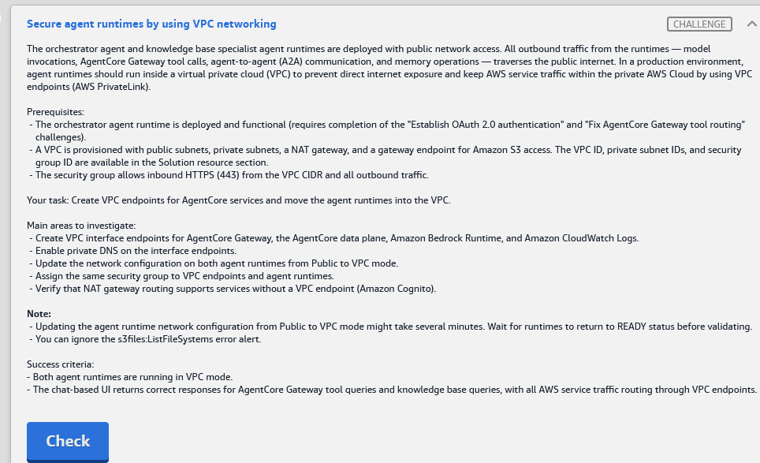

# Challenge F: Secure agent runtimes by using VPC networking

> **Status:** ✅ Passed, *Meets Requirements* (exam lab, 13 Nov 2026)
> **Lab:** [03 · AWS Agentic AI Demonstrated](README.md) · **Services:** Amazon VPC (**interface endpoints / AWS PrivateLink**, private DNS, NAT gateway, route tables, security groups), Amazon Bedrock AgentCore Runtime (**network mode PUBLIC → VPC**)
> **HLD label:** **F**, the **VPC** box: private subnets (both runtimes + SG + VPC endpoints) and the public subnet (NAT gateway). See [HLD](README.md#-high-level-design-hld).

---

## ✅ Status checklist

- [x] 0 · Check: VPC **DNS hostnames + DNS resolution = enabled**. Private subnets' route table has **`0.0.0.0/0 → nat-…`** (+ the S3 gateway endpoint)
- [x] 1 · Create **4 interface endpoints** in `vpc-0fa96be71c8360660`, private subnets, SG `sg-032a9b8fca027374f`, **private DNS on**:
  - `bedrock-agentcore.gateway`
  - `bedrock-agentcore` (data plane)
  - `bedrock-runtime`
  - `logs`
- [ ] 1b · (Optional, recommended) `bedrock-agent-runtime` endpoint for KB `Retrieve`
- [x] 2 · Wait for the endpoints to show **Available**
- [x] 3 · `orchestrator_runtime_8bc8fd20` → **Edit** → network **VPC** (VPC, **both private subnets**, same SG) → Save → **READY**
- [x] 4 · `kb_specialist_runtime` → same → **READY**
- [x] 5 · Chat UI: a tool question (inventory/logistics) **and** a KB question both answer
- [x] 6 · **Check**

---

## 🧾 Task card



> **Secure agent runtimes by using VPC networking**
>
> The orchestrator agent and knowledge base specialist agent runtimes are deployed with public network access. All outbound traffic from the runtimes (model invocations, AgentCore Gateway tool calls, agent-to-agent (A2A) communication, and memory operations) traverses the public internet. In a production environment, agent runtimes should run inside a virtual private cloud (VPC) to prevent direct internet exposure and keep AWS service traffic within the private AWS Cloud by using VPC endpoints (AWS PrivateLink).
>
> **Prerequisites:**
> - The orchestrator agent runtime is deployed and functional (requires completion of the "Establish OAuth 2.0 authentication" and "Fix AgentCore Gateway tool routing" challenges).
> - A VPC is provisioned with public subnets, private subnets, a NAT gateway, and a gateway endpoint for Amazon S3 access. The VPC ID, private subnet IDs, and security group ID are available in the Solution resource section.
> - The security group allows inbound HTTPS (443) from the VPC CIDR and all outbound traffic.
>
> **Your task:** Create VPC endpoints for AgentCore services and move the agent runtimes into the VPC.
>
> **Main areas to investigate:**
> - Create VPC interface endpoints for AgentCore Gateway, the AgentCore data plane, Amazon Bedrock Runtime, and Amazon CloudWatch Logs.
> - Enable private DNS on the interface endpoints.
> - Update the network configuration on both agent runtimes from Public to VPC mode.
> - Assign the same security group to VPC endpoints and agent runtimes.
> - Verify that NAT gateway routing supports services without a VPC endpoint (Amazon Cognito).
>
> **Note:**
> - Updating the agent runtime network configuration from Public to VPC mode might take several minutes. Wait for runtimes to return to READY status before validating.
> - You can ignore the s3files:ListFileSystems error alert.
>
> **Success criteria:**
> - Both agent runtimes are running in VPC mode.
> - The chat-based UI returns correct responses for AgentCore Gateway tool queries and knowledge base queries, with all AWS service traffic routing through VPC endpoints.

---

## 🏗️ Architecture (what F changes)

```text
VPC vpc-0fa96be71c8360660
 ├─ PUBLIC subnet:  NAT gateway ──► Internet (Cognito token endpoint *.auth.us-east-1.amazoncognito.com)
 └─ PRIVATE subnets subnet-0cc618905e0d7f861, subnet-058393ef0a4303ad2   (route 0.0.0.0/0 → NAT, S3 prefix list → S3 gateway endpoint)
      ├─ ENIs: orchestrator_runtime_8bc8fd20  (VPC mode, SG sg-032a9b8fca027374f)
      ├─ ENIs: kb_specialist_runtime          (VPC mode, same SG)
      └─ Interface endpoints (same SG, private DNS ON):
           com.amazonaws.us-east-1.bedrock-agentcore.gateway → Gateway MCP calls  (*.gateway.bedrock-agentcore…)
           com.amazonaws.us-east-1.bedrock-agentcore         → data plane: A2A invoke of specialist, Memory events/records
           com.amazonaws.us-east-1.bedrock-runtime           → Nova Pro / Nova Lite InvokeModel/Converse + Guardrails
           com.amazonaws.us-east-1.logs                      → CloudWatch Logs from both runtimes
           (optional) com.amazonaws.us-east-1.bedrock-agent-runtime → KB Retrieve from the specialist
SG rules: inbound 443 from VPC CIDR (runtime ENI → endpoint ENI), outbound all.
```

**Why private DNS matters:** the agent code calls the normal public hostnames (`bedrock-runtime.us-east-1.amazonaws.com`, etc.). With **private DNS enabled**, those names resolve inside the VPC to the **endpoint ENIs**, so no code change is needed. Without it, traffic goes out through NAT, or fails if there's no route.

**Why NAT is still needed:** **Cognito's OAuth token endpoint** (`supply-chain-8bc8fd20.auth.us-east-1.amazoncognito.com`) has **no PrivateLink endpoint**. The orchestrator gets its Gateway/A2A token from it, so the private subnets **must route `0.0.0.0/0` to the NAT gateway**.

### Where each step happens

| Step | Service / console | Exact place |
|---|---|---|
| 0 | **VPC** | *Your VPCs* → `vpc-0fa96be71c8360660` → **Actions → Edit VPC settings** (DNS). *Route tables* (private subnets' routes) |
| 1–2 | **VPC** | Left nav *PrivateLink and Lattice* → **Endpoints** → **Create endpoint** (×4), or CloudShell loop |
| 3–4 | **Amazon Bedrock AgentCore** | **Agents** → runtime → **Edit / Update hosting** → **Network configuration** |
| 5 | **Chat UI** | `https://dj9dctg8k9l0t.cloudfront.net` |

---

## 🔍 Root cause

| Issue | Why it matters |
|---|---|
| Runtimes in **PUBLIC** network mode | All outbound traffic (model, Gateway, A2A, Memory, Logs) goes out over the public internet |
| **No interface endpoints** for AgentCore / Bedrock / Logs | Once in VPC mode, AWS API traffic would leave through NAT instead of PrivateLink, which doesn't meet "all AWS service traffic through VPC endpoints" |
| Endpoints need **private DNS** + the **same SG** | Without private DNS the SDK hostnames don't resolve to the endpoints. Without the SG rule (443 from the VPC CIDR) the connections are blocked |
| Cognito has no endpoint | It depends on **NAT routing** from the private subnets |

---

## 🛠️ Solution

### Values

| Name | Value |
|---|---|
| VPC | `vpc-0fa96be71c8360660` |
| Private subnets | `subnet-0cc618905e0d7f861`, `subnet-058393ef0a4303ad2` |
| Security group | `sg-032a9b8fca027374f` |
| Runtimes | `orchestrator_runtime_8bc8fd20`, `kb_specialist_runtime` |

### Step 0: Quick pre-checks (VPC), about 1 min

**DNS:** **VPC** → *Your VPCs* → `vpc-0fa96be71c8360660` → *Details*: **DNS hostnames = Enabled**, **DNS resolution = Enabled**. If either is off: **Actions → Edit VPC settings** → tick both → Save. Private DNS on endpoints **requires** both.

**NAT route:** **VPC** → *Route tables* → filter by the VPC → the table(s) associated with the **private** subnets → **Routes** tab:

| Destination | Target | Needed for |
|---|---|---|
| `10.x.0.0/16` (VPC CIDR) | `local` | everything inside the VPC |
| **`0.0.0.0/0`** | **`nat-…`** | **Cognito** token endpoint and any other service without an endpoint |
| `pl-…` (com.amazonaws.us-east-1.s3) | `vpce-…` | S3 gateway endpoint |

If `0.0.0.0/0 → nat-…` is **missing**: **Edit routes** → **Add route** → `0.0.0.0/0` → *NAT Gateway* → the lab's NAT → **Save changes**.

**CLI:**

```bash
VPC=vpc-0fa96be71c8360660
aws ec2 describe-vpc-attribute --vpc-id $VPC --attribute enableDnsHostnames --query EnableDnsHostnames.Value
aws ec2 describe-vpc-attribute --vpc-id $VPC --attribute enableDnsSupport  --query EnableDnsSupport.Value
aws ec2 describe-route-tables --filters Name=association.subnet-id,Values=subnet-0cc618905e0d7f861,subnet-058393ef0a4303ad2 \
  --query "RouteTables[].{rt:RouteTableId,routes:Routes[].[DestinationCidrBlock||DestinationPrefixListId,NatGatewayId||GatewayId]}" --output json
```

### Step 1: Create the interface endpoints (VPC → Endpoints)

**Fastest: CloudShell loop** (creates all 4 with the same settings, about 10 s):

```bash
VPC=vpc-0fa96be71c8360660
SG=sg-032a9b8fca027374f
# confirm the exact service names first
aws ec2 describe-vpc-endpoint-services --region us-east-1 \
  --query "ServiceNames[?contains(@,'bedrock') || ends_with(@,'.logs')]" --output text

for svc in bedrock-agentcore.gateway bedrock-agentcore bedrock-runtime logs; do
  aws ec2 create-vpc-endpoint --region us-east-1 --vpc-id $VPC --vpc-endpoint-type Interface \
    --service-name com.amazonaws.us-east-1.$svc \
    --subnet-ids subnet-0cc618905e0d7f861 subnet-058393ef0a4303ad2 \
    --security-group-ids $SG --private-dns-enabled \
    --tag-specifications "ResourceType=vpc-endpoint,Tags=[{Key=Name,Value=agentcore-$svc}]" \
    --query "VpcEndpoint.[VpcEndpointId,ServiceName,State]" --output text
done
# optional 5th (KB Retrieve from the specialist):
#   repeat with svc=bedrock-agent-runtime

aws ec2 describe-vpc-endpoints --region us-east-1 --filters Name=vpc-id,Values=$VPC \
  --query "VpcEndpoints[].[ServiceName,VpcEndpointType,State,PrivateDnsEnabled]" --output table
```

**Console (one endpoint at a time, ×4):** **VPC** → left nav *PrivateLink and Lattice* → **Endpoints** → **Create endpoint**

| Field | Value |
|---|---|
| Name tag | `agentcore-gateway` / `agentcore-dataplane` / `bedrock-runtime` / `cloudwatch-logs` |
| **Type** | **AWS services** |
| **Services** | search and pick (Type = **Interface**): `com.amazonaws.us-east-1.bedrock-agentcore.gateway` · `com.amazonaws.us-east-1.bedrock-agentcore` · `com.amazonaws.us-east-1.bedrock-runtime` · `com.amazonaws.us-east-1.logs` |
| **VPC** | `vpc-0fa96be71c8360660` |
| **Additional settings** | ✓ **Enable DNS name** (private DNS) · IP address type IPv4 |
| **Subnets** | tick both AZs → choose the **private** subnets `subnet-0cc618905e0d7f861`, `subnet-058393ef0a4303ad2` |
| **Security groups** | **only** `sg-032a9b8fca027374f` (untick `default`) |
| Policy | **Full access** |

→ **Create endpoint**. Status **Pending → Available** (about 1–2 min).

> ⚠️ Don't pick `bedrock-agentcore-control` (control plane, used by the console/CLI to *manage* runtimes) instead of `bedrock-agentcore` (data plane: invoke, memory). Don't pick `bedrock` (control plane) instead of **`bedrock-runtime`**.

### Step 2: Move both runtimes into the VPC (AgentCore → Agents)

Do this **after the endpoints are Available**.

**Where:** **Agents** → **`orchestrator_runtime_8bc8fd20`** → **Edit / Update hosting** → **Network configuration** ⚠️

| Field | Value |
|---|---|
| Network mode | **VPC** (was Public) |
| VPC | `vpc-0fa96be71c8360660` |
| Subnets | **`subnet-0cc618905e0d7f861`**, **`subnet-058393ef0a4303ad2`** (private only, **not** the public subnets) |
| Security group | `sg-032a9b8fca027374f` |

**Leave everything else** (env vars, JWT authorizer) unchanged → **Save**. Wait until the runtime and its DEFAULT endpoint are **READY** (several minutes).

Repeat for **`kb_specialist_runtime`**. You can start the second edit while the first is updating.

### Step 3: Test

| Prompt | Path tested |
|---|---|
| `What's the status of our recent shipments?` | Cognito via NAT → **Gateway endpoint** → logistics Lambda |
| `Show me recent quality inspection results.` | Gateway → quality target |
| `What are the quality control inspection steps?` | **data-plane endpoint** (A2A) → specialist → KB → **bedrock-runtime endpoint** |
| `What do you know about my report preferences?` | **data-plane endpoint** (Memory) |

### Step 4: Check (after both runtimes are READY)

### Order of operations

```text
0 VPC: DNS hostnames+resolution ON; private RT has 0.0.0.0/0 → nat-… (+ S3 pl → vpce)
1 VPC › Endpoints › Create ×4 (Interface, private subnets, SG sg-032a9b8fca027374f, private DNS ✓):
    bedrock-agentcore.gateway · bedrock-agentcore · bedrock-runtime · logs   (+ optional bedrock-agent-runtime)
2 wait Available
3 Agents › orchestrator_runtime_8bc8fd20 › Edit › Network = VPC (vpc, 2 private subnets, same SG) → Save → READY
4 Agents › kb_specialist_runtime › same → READY
5 Chat: tool query + KB query → 6 Check
```

---

## ⚠️ Mistakes & lessons

_None recorded during the lab. Passed, Meets Requirements._

---

## 🧯 Troubleshooting

| Symptom | Likely cause | Fix |
|---|---|---|
| Endpoint create: *"private DNS can't be enabled because enableDnsHostnames / enableDnsSupport…"* | VPC DNS attributes off | Step 0: Edit VPC settings |
| Endpoint create: *"private DNS name conflict / already exists"* | An endpoint for that service already exists in the VPC | Use the existing one. Check it has the same SG + private DNS |
| Runtime update fails / stuck | Public subnet chosen, a subnet in an AZ AgentCore doesn't support ⚠️, or the SG/subnet IDs are wrong | Use only the 2 private subnets from the panel |
| After VPC mode: chat *"Authentication service unavailable"* or the agent can't reach tools | The orchestrator can't reach the **Cognito token endpoint**: no NAT route | Step 0: add `0.0.0.0/0 → nat-…` to the private route table |
| Tool calls time out | No `bedrock-agentcore.gateway` endpoint / private DNS off / SG missing 443 from the VPC CIDR | Check the endpoint is Available with private DNS ✓ and SG `sg-032a9b8fca027374f` |
| KB answers fail but tools work | The A2A call to the specialist (`bedrock-agentcore` data plane) blocked, or the specialist can't reach Bedrock | Data-plane + bedrock-runtime endpoints. Optionally `bedrock-agent-runtime` |
| Memory recall broke | Data-plane endpoint missing | `bedrock-agentcore` endpoint |
| No logs in CloudWatch after the move | `logs` endpoint missing or private DNS off | Create it / enable DNS |
| Check fails right after the save | Runtimes still updating | Wait for READY on **both**, then Check |

---

## 📚 Study notes

### VPC endpoints (AWS PrivateLink)

| | **Gateway endpoint** | **Interface endpoint** |
|---|---|---|
| Services | **S3, DynamoDB** only | Most AWS services (Bedrock, AgentCore, Logs, STS, ECR, …) |
| How | a route-table entry (prefix list → `vpce-…`) | **ENIs** with private IPs in your subnets, plus a **security group** |
| DNS | none needed | **Private DNS** makes the public service hostname resolve to the ENI IPs |
| Cost | free | per hour per AZ + per GB |

- Private DNS requires the VPC's **`enableDnsSupport`** and **`enableDnsHostnames`**.
- The endpoint SG must allow **inbound 443** from the clients (here: the VPC CIDR). The client SG must allow outbound 443.
- Services **without** an endpoint (here **Cognito's hosted OAuth domain**) need **NAT** (private subnet → NAT in the public subnet → IGW).

### AgentCore Runtime networking

- **Network modes:** **PUBLIC** (managed internet egress) vs **VPC** (AgentCore places **ENIs** in your subnets with your SG, so the agent's **outbound** traffic follows *your* routing). **Inbound** invocations still arrive through the AgentCore service endpoint, so callers don't change.
- AgentCore service names: `bedrock-agentcore` (**data plane**: InvokeAgentRuntime, Memory, Identity), `bedrock-agentcore.gateway` (**Gateway MCP**), `bedrock-agentcore-control` (**control plane**: create/update resources).
- Use **private subnets in at least 2 AZs**, and the same SG on runtimes and endpoints keeps the rules simple.

### Self-test

1. Why does the lab still need a NAT gateway after adding endpoints? <details><summary>Answer</summary>Cognito's OAuth token endpoint has no PrivateLink endpoint, so token requests go out through NAT.</details>
2. What does "Enable private DNS" do? <details><summary>Answer</summary>Resolves the standard service hostname (e.g. bedrock-runtime.us-east-1.amazonaws.com) to the endpoint's private IPs inside the VPC, so the code needs no changes.</details>
3. Gateway vs interface endpoint: which one does S3 use here? <details><summary>Answer</summary>Gateway endpoint (a route table entry). The four new ones are interface endpoints (ENIs + SG).</details>
4. Which AgentCore endpoint carries Memory and A2A traffic? <details><summary>Answer</summary>`com.amazonaws.<region>.bedrock-agentcore` (data plane).</details>
5. Which subnets go on the runtime? <details><summary>Answer</summary>The private ones only.</details>

---

## 📝 Run log (fill in as I go)

| Step | What I did | Result / output |
|---|---|---|
| 0 | DNS attrs / NAT route | _?_ |
| 1 | 4 endpoints | _IDs, Available?_ |
| 3 | Orchestrator → VPC | _READY?_ |
| 4 | Specialist → VPC | _READY?_ |
| 5 | Chat: tool + KB | _?_ |
| 6 | Check | ✅ Meets Requirements (exam result, 13 Nov 2026) |
