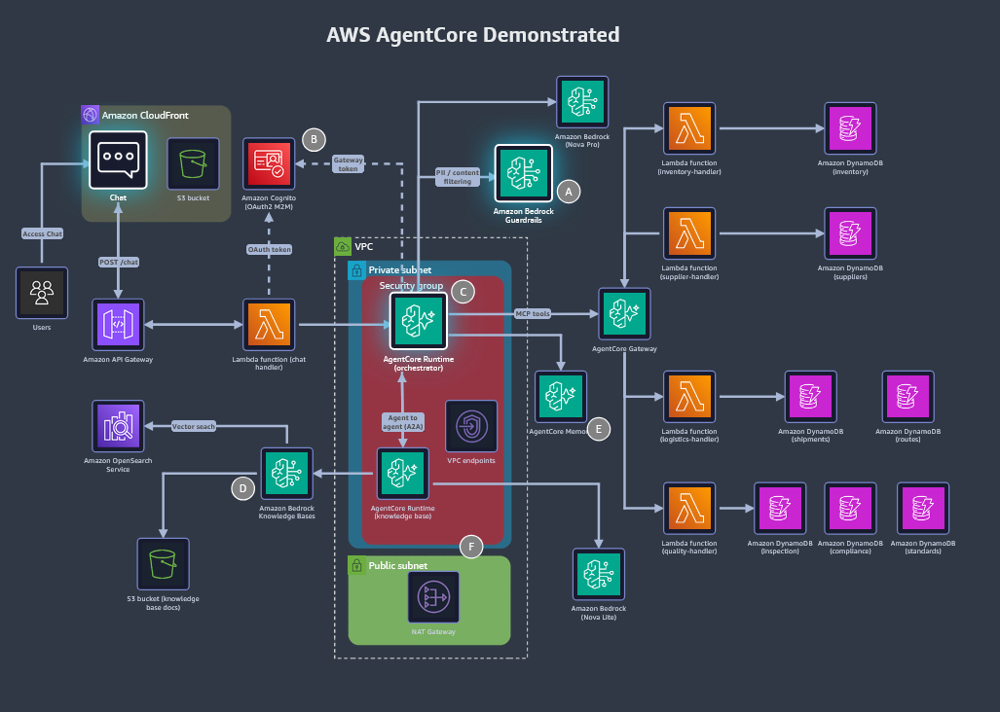

# 🧠 AWS Agentic AI Demonstrated

> **Lab:** "AWS Agentic AI Demonstrated", one of the challenge sets for the AWS Partner FDE credential.
> **Theme:** finish a **half-done migration to Amazon Bedrock AgentCore** for *AnyCompany Logistics'* supply chain app. The work covers OAuth 2.0 (Cognito), AgentCore Gateway tool routing, a knowledge base on OpenSearch Serverless, a KB-specialist **AgentCore Runtime**, **AgentCore Memory**, **Bedrock Guardrails** and **VPC networking** for runtimes.
> **Region:** `us-east-1` only · **Time limit:** **130 minutes** (no pause, no restart) · **Retake wait if failed:** **25 days**
> **Started:** 13 Nov 2026 · **Status legend:** ✅ passed · 🟡 in progress · ⬜ not started · ⚠️ needs improvement
> **Back to:** [Vault index](../README.md) · Previous lab: [02 Databases for Agentic AI](../02_AWS_Databases_For_Agentic_AI_Demonstrated/README.md)

---

## 🏆 Result: _pending_

| | |
|---|---|
| **Microcredential** | AWS Agentic AI Demonstrated |
| **Result** | 🟡 In progress |
| **Pass date** | _—_ |
| **Valid until** | _—_ (Labs 01/02 were valid for one year from the pass date) |
| **Renew / retake from** | _—_ (Labs 01/02: 9 months after passing) |
| **Badge** | Claim it from the **Credly** email, then add it to the **AWS Skills Profile** |

_Add the result screenshot as `assets/00_exam_result_passed.png` when I have it._

---

## 📄 Lab brief (verbatim, as given in the lab, 13 Nov 2026)

### Introduction

> AWS Agentic AI Demonstrated is a hands-on exam lab that validates your AWS skills in the agentic AI domain. In this timed assessment, you work in a live, AWS-provisioned environment to complete a system migration to Amazon Bedrock AgentCore. If you previously passed an earlier version of the assessment, your credential remains valid and can be verified on CertMetrics and/or Credly.
>
> After you begin, you have 130 minutes to complete all challenges. The exam lab provides necessary guidance but not step-by-step solutions. To pass, you must demonstrate proficiency in agentic AI services, including Amazon Bedrock AgentCore, Amazon Bedrock Guardrails, Amazon Cognito, AWS Lambda, and Amazon OpenSearch Service.
>
> **Important:** Each exam lab is continuously tested for reliability. If something appears broken during your attempt, revisit the challenge guidance carefully; most issues stem from a missed configuration step rather than a technical fault.
>
> **Tip:** Participants who carefully read all provided guidance before acting are significantly more likely to pass. Take time to understand each challenge fully, even under time pressure.
>
> **Before you begin:**
> - Challenges are randomized and might not reflect the sequence of real-life scenarios.
> - This exam lab cannot be paused or restarted. If you exit, you will need to start again from the beginning.
> - If you fail the exam lab, you will need to wait 25 days before attempting it again.
>
> To prepare for this assessment, we recommend practicing with AWS SimuLearn: Generative AI Practitioner for foundational skills, and AWS SimuLearn: Generative AI Architect for more training relevant to this assessment.

### Problem Description

> AnyCompany Logistics' supply chain management application is in crisis. While the company was in the process of migrating the application to Amazon Bedrock AgentCore, the application's lead engineer departed the company. The agentic AI architecture is only partially configured and is currently in a failed state. You must establish OAuth 2.0 authentication, fix AgentCore Gateway tool routing, deploy a knowledge base and a knowledge base specialist agent runtime, configure AgentCore Memory, establish content safety by using Amazon Bedrock Guardrails, and secure agent runtimes by configuring appropriate VPC networking.

### Solution Resources

> To access the supply chain management application, use the following steps:
> 1. Copy the application URL value (this is the Amazon CloudFront URL).
> 2. In a new browser tab, paste the application URL into the address bar.
> 3. To load the application, press Enter.
> 4. For Region, confirm that US East (N. Virginia) us-east-1 is selected. If a different Region appears, switch to US East (N. Virginia) us-east-1. The lab infrastructure is deployed in that Region.
>
> **Reference information:**
> - The OpenAPI schema for agent tools is in the Amazon S3 bucket named agent-schema-bucket.
> - Knowledge base documents for the supply chain domain are in the S3 bucket named supply-chain-knowledge.
> - Use Amazon Nova Lite as the Amazon Bedrock foundation model for agents.
>
> **Important:** This AWS microcredential assessment has been preconfigured with the required AWS Identity and Access Management (IAM) permissions. IAM roles and policies are set up to provide the permissions needed for the hands-on challenges. You do not need to modify IAM settings to complete any task.

| Name | Value |
|---|---|
| AgentSchemaBucketName | `agent-schema-bucket-8bc8fd20` |
| Application URL | `dj9dctg8k9l0t.cloudfront.net` |
| ChatLambdaArn | `arn:aws:lambda:us-east-1:574897117640:function:supply-chain-chat-8bc8fd20` |
| CognitoDiscoveryUrl | `https://cognito-idp.us-east-1.amazonaws.com/us-east-1_6yHDtJ0jv/.well-known/openid-configuration` |
| CognitoDomainUrl | `https://supply-chain-8bc8fd20.auth.us-east-1.amazoncognito.com` |
| CognitoUserPoolId | `us-east-1_6yHDtJ0jv` |
| GatewayRoleArn | `arn:aws:iam::574897117640:role/AgentCoreGatewayRole-8bc8fd20` |
| KBSpecialistAgentCodeS3Uri | `s3://agent-schema-bucket-8bc8fd20/agent_code/kb_specialist_agent.zip` |
| KBSpecialistModelId | `amazon.nova-lite-v1:0` |
| KBSpecialistRoleArn | `arn:aws:iam::574897117640:role/KBSpecialistRuntimeRole-8bc8fd20` |
| KnowledgeBaseBucketName | `supply-chain-knowledge-8bc8fd20` |
| LogisticsLambdaArn | `arn:aws:lambda:us-east-1:574897117640:function:logistics-handler-8bc8fd20` |
| OpenSearchServerlessCollectionARN | `arn:aws:aoss:us-east-1:574897117640:collection/mwbw68k7d4isr0o7wfkk` |
| PrivateSubnetIds | `subnet-0cc618905e0d7f861,subnet-058393ef0a4303ad2` |
| QualityLambdaArn | `arn:aws:lambda:us-east-1:574897117640:function:quality-handler-8bc8fd20` |
| SecurityGroupId | `sg-032a9b8fca027374f` |
| VpcId | `vpc-0fa96be71c8360660` |

> ⚠️ These values are for **this launch** (suffix `8bc8fd20`). A new launch gets new values, so paste the new panel here and keep this one as history.

---

## 🎯 Scope

**From the lab introduction** (full text in *📄 Lab brief* above):

> "In this timed assessment, you work in a live, AWS-provisioned environment to complete a **system migration to Amazon Bedrock AgentCore** … you have **130 minutes** to complete all challenges … you must demonstrate proficiency in agentic AI services, including **Amazon Bedrock AgentCore, Amazon Bedrock Guardrails, Amazon Cognito, AWS Lambda, and Amazon OpenSearch Service**."

**Rules that matter:**
- Challenges are **randomized**: the order on screen isn't the dependency order.
- The lab **can't be paused or restarted**, and failing means a **25-day** wait.
- *"Most issues stem from a missed configuration step rather than a technical fault"*, so re-read the guidance before assuming a bug.
- *"Participants who carefully read all provided guidance before acting are significantly more likely to pass."*
- IAM is **preconfigured**. Don't modify IAM.
- Use **Amazon Nova Lite** as the foundation model for agents (`amazon.nova-lite-v1:0`).

The Credly badge text for the *earlier* version of this lab describes "troubleshooting, repairing, integrating, and enhancing **Bedrock Agents and Bedrock Guardrails**". The current version is AgentCore-based.

### Problem description → expected challenges

The verbatim problem description is in *📄 Lab brief* above. Each phrase in it maps to a likely challenge:

| # | Problem phrase | Likely work (confirm from the task card ⚠️) | Panel resources it uses |
|---|---|---|---|
| 1 | **Establish OAuth 2.0 authentication** | Cognito user pool **app client** (client credentials), **resource server + scopes**, domain. AgentCore Gateway **inbound auth = custom JWT** (discovery URL, allowed clients/audiences) | `CognitoUserPoolId`, `CognitoDomainUrl`, `CognitoDiscoveryUrl` |
| 2 | **Fix AgentCore Gateway tool routing** | Gateway **targets** → the right Lambda (`logistics` vs `quality`), with an **OpenAPI/tool schema** from S3 whose tool names and parameters match each Lambda | `GatewayRoleArn`, `LogisticsLambdaArn`, `QualityLambdaArn`, `AgentSchemaBucketName` |
| 3 | **Deploy a knowledge base** | A Bedrock KB on **OpenSearch Serverless** (existing collection: index name, vector/text/metadata fields), with an S3 data source and a **sync** | `OpenSearchServerlessCollectionARN`, `KnowledgeBaseBucketName` |
| 4 | **Deploy a KB specialist agent runtime** | An **AgentCore Runtime** from the code zip in S3, with execution role, model `amazon.nova-lite-v1:0`, and env vars (e.g. KB ID) | `KBSpecialistAgentCodeS3Uri`, `KBSpecialistRoleArn`, `KBSpecialistModelId` |
| 5 | **Configure AgentCore Memory** | A memory resource (short-term events + long-term **strategies**: semantic / summary / user preference), with the memory ID wired into the runtime or chat env | — (probably the chat Lambda or runtime env vars) |
| 6 | **Content safety with Guardrails** | A guardrail (content filters, denied topics, PII, word filters), a **version**, and attaching it (guardrail ID + version) to the model calls | — |
| 7 | **Secure agent runtimes with VPC networking** | Runtime **network mode = VPC**: private subnets + security group (+ VPC endpoints for Bedrock/S3/etc. ⚠️) | `VpcId`, `PrivateSubnetIds`, `SecurityGroupId` |

### Study guide coverage today

| Service | Coverage |
|---|---|
| AgentCore Runtime / Gateway / Memory / Identity | ⬜ not yet |
| Bedrock Guardrails | ⬜ not yet |
| Amazon Cognito (OAuth 2.0 client credentials, JWT) | ⬜ not yet |
| OpenSearch Serverless (vector collection / index) | ⬜ not yet. KB concepts are in Lab 02 [Challenge F](../02_AWS_Databases_For_Agentic_AI_Demonstrated/Challenge_F_Bedrock_Knowledge_Base_On_Aurora_S3_Data_Sources_Sync.md) |
| Lambda | [09 Lambda](../00_AWS_Data_Services_Study_Guide/09_AWS_Lambda.md) |
| IAM / VPC basics | [00 Foundations](../00_AWS_Data_Services_Study_Guide/00_AWS_Foundations_IAM_Regions_CLI_CloudWatch_KMS.md) |

---

## 🔑 Lab resources (Solution Resources panel, annotated)

> The raw panel, word for word, is in *📄 Lab brief → Solution Resources* above. This table adds what each value is for.
>
> ⚠️ **These values change with every lab launch.** The suffix (`8bc8fd20` here), the account ID and the URLs are all new each time.

| Output | Value (this launch) | Used for (expected) |
|---|---|---|
| `Application URL` | `dj9dctg8k9l0t.cloudfront.net` (open as `https://…`) | The supply chain chat app: the end-to-end check |
| `ChatLambdaArn` | `arn:aws:lambda:us-east-1:574897117640:function:supply-chain-chat-8bc8fd20` | The app's backend. It probably calls the AgentCore runtime/gateway and holds IDs in env vars |
| `CognitoUserPoolId` | `us-east-1_6yHDtJ0jv` | OAuth 2.0 (#1) |
| `CognitoDomainUrl` | `https://supply-chain-8bc8fd20.auth.us-east-1.amazoncognito.com` | Token endpoint = `<domain>/oauth2/token` (#1) |
| `CognitoDiscoveryUrl` | `https://cognito-idp.us-east-1.amazonaws.com/us-east-1_6yHDtJ0jv/.well-known/openid-configuration` | Gateway inbound **JWT authorizer** discovery URL (#1) |
| `GatewayRoleArn` | `arn:aws:iam::574897117640:role/AgentCoreGatewayRole-8bc8fd20` | The AgentCore Gateway service role (#2) |
| `LogisticsLambdaArn` | `arn:aws:lambda:us-east-1:574897117640:function:logistics-handler-8bc8fd20` | Gateway target: logistics tools (#2) |
| `QualityLambdaArn` | `arn:aws:lambda:us-east-1:574897117640:function:quality-handler-8bc8fd20` | Gateway target: quality tools (#2) |
| `AgentSchemaBucketName` | `agent-schema-bucket-8bc8fd20` | **OpenAPI schema for agent tools** (#2) + the KB-specialist code zip (#4) |
| `KnowledgeBaseBucketName` | `supply-chain-knowledge-8bc8fd20` | KB documents (#3) |
| `OpenSearchServerlessCollectionARN` | `arn:aws:aoss:us-east-1:574897117640:collection/mwbw68k7d4isr0o7wfkk` | The KB vector store (#3) |
| `KBSpecialistAgentCodeS3Uri` | `s3://agent-schema-bucket-8bc8fd20/agent_code/kb_specialist_agent.zip` | The AgentCore Runtime code package (#4) |
| `KBSpecialistRoleArn` | `arn:aws:iam::574897117640:role/KBSpecialistRuntimeRole-8bc8fd20` | The runtime execution role (#4) |
| `KBSpecialistModelId` | `amazon.nova-lite-v1:0` | The model for the KB specialist (#4) |
| `VpcId` | `vpc-0fa96be71c8360660` | Runtime VPC networking (#7) |
| `PrivateSubnetIds` | `subnet-0cc618905e0d7f861`, `subnet-058393ef0a4303ad2` | Runtime VPC networking (#7) |
| `SecurityGroupId` | `sg-032a9b8fca027374f` | Runtime VPC networking (#7) |

### Lab rules (from the panel)

- **Region `us-east-1`** for everything.
- **IAM is preconfigured.** *"You do not need to modify IAM settings to complete any task."* So "access denied" usually means the wrong role was selected, a resource policy is missing, or a resource name doesn't match the policy.
- **Model:** **Amazon Nova Lite** for agents.
- The OpenAPI schema is in `agent-schema-bucket-…`, and the KB documents are in `supply-chain-knowledge-…`.

### Testing toolkit (expected ⚠️, confirm in the console)

| Tool | How | What it tells me |
|---|---|---|
| **AgentCore console** | Bedrock AgentCore → **Runtime** / **Gateways** / **Memory** / **Identity** | Status of each resource, its endpoint, auth config, targets, network mode |
| **Runtime test / playground** | AgentCore → **Agents** (= runtimes; no "Runtime" nav item) → agent → **Test**, or the **Playground** nav item ⚠️ | Invoke the runtime directly with a JSON payload |
| **Gateway targets** | AgentCore → Gateways → gateway → **Targets** | Which Lambda each target routes to, its schema, and the target status |
| **Guardrail test** | Bedrock → **Guardrails** → guardrail → **Test** | Which policy blocks or masks a prompt or response |
| **KB test** | Bedrock → **Knowledge Bases** → KB → **Test knowledge base** | Retrieval works after sync |
| **Lambda test events** | Lambda → `logistics-handler-…` / `quality-handler-…` / `supply-chain-chat-…` → **Test** | Tools and the chat backend on their own |
| **CloudWatch** | `/aws/lambda/<fn>`, AgentCore runtime log groups (`/aws/bedrock-agentcore/runtimes/…` ⚠️), **GenAI Observability** | The real errors (401s, tool-not-found, timeouts) |
| **Chat app** | `https://dj9dctg8k9l0t.cloudfront.net` | The end-to-end check |

---

## 🗺️ Lab architecture (HLD)



_Diagram saved 13 Nov 2026 (titled "AWS AgentCore Demonstrated"). Each label links to its challenge file once that challenge is posted._

The lettered circles on the diagram mark where each challenge happens. I read **six** labels (A–F).

| Label | Component on the diagram | Data flow | Likely challenge (confirm from the task card) |
|---|---|---|---|
| **[A](Challenge_A_Bedrock_Guardrails_Content_Safety_Word_PII_Regex_Filters.md)** | **Amazon Bedrock Guardrails**, on the orchestrator's *PII / content filtering* arrow | Orchestrator runtime → guardrail → (Nova Pro) | ✔️ **Confirmed:** create a guardrail (blocked messages, content filters High, word filter `Project Meridian` + profanity, PII USERNAME mask / PASSWORD block, regex `DISC-[A-Z]{3}-\d{4}` mask) and set the orchestrator runtime's `GUARDRAIL_ID` |
| **[B](Challenge_B_Cognito_OAuth2_M2M_Client_Credentials_JWT_Authorizers.md)** | **Amazon Cognito (OAuth2 M2M)**, with dashed *OAuth token* (from the chat Lambda) and *Gateway token* (from the orchestrator) arrows | Chat Lambda gets a token to call the runtime. Orchestrator gets a token to call the Gateway | **OAuth 2.0**: Cognito app client(s) for the **client-credentials** (M2M) flow, resource server/scopes, plus JWT authorizer settings on the runtime and gateway |
| **[C](Challenge_C_AgentCore_Gateway_Tool_Routing_GATEWAY_URL_Lambda_Targets.md)** | **AgentCore Runtime (orchestrator)** inside the **security group** in the **private subnet**, and its *MCP tools* arrow to the **AgentCore Gateway** | Orchestrator → MCP → Gateway → 4 Lambda targets → DynamoDB tables | **Gateway tool routing** (most likely): targets and schemas for `inventory`, `supplier`, `logistics` and `quality` handlers. Possibly also orchestrator runtime config |
| **[D](Challenge_D_Bedrock_KB_OpenSearch_Serverless_KB_Specialist_Runtime_A2A.md)** | **Amazon Bedrock Knowledge Bases**, between the **KB runtime** and **OpenSearch Service** + the **S3 KB docs** bucket | KB specialist runtime → KB `Retrieve` → OpenSearch vector search. Ingest from S3 | **Deploy the KB** (OpenSearch Serverless collection) **and the KB-specialist runtime** (code zip in S3, Nova Lite) |
| **[E](Challenge_E_AgentCore_Memory_Strategies_Namespaces_MEMORY_ID.md)** | **AgentCore Memory**, on the orchestrator → memory arrow | Orchestrator saves and loads conversation events and long-term memories | **Configure Memory**: memory resource + strategies, memory ID wired into the orchestrator |
| **[F](Challenge_F_VPC_Networking_Interface_Endpoints_PrivateLink_Runtimes.md)** | The **VPC**: **private subnet** (both runtimes, security group, **VPC endpoints**) + **public subnet** (**NAT Gateway**) | Runtimes reach AWS APIs through VPC endpoints, or through the internet via NAT | **VPC networking**: runtime network mode = VPC with the private subnets + SG. Endpoint/NAT reachability |

### Data flows on the diagram

```text
1. Request path
   Users → CloudFront (Chat UI on S3) → POST /chat → API Gateway ↔ Lambda (chat handler)
        ─(OAuth token from Cognito M2M [B])→ AgentCore Runtime: ORCHESTRATOR  [C]  (VPC private subnet, security group [F])
             ├─ Amazon Bedrock (Nova Pro)                      ← orchestrator's model
             ├─ PII / content filtering → Bedrock Guardrails  [A]
             ├─ AgentCore Memory  [E]
             ├─ MCP tools ─(Gateway token from Cognito [B])→ AgentCore Gateway ─┬→ Lambda inventory-handler → DynamoDB inventory
             │                                                                   ├→ Lambda supplier-handler  → DynamoDB suppliers
             │                                                                   ├→ Lambda logistics-handler → DynamoDB shipments, routes
             │                                                                   └→ Lambda quality-handler   → DynamoDB inspection, compliance, standards
             └─ Agent-to-agent (A2A) ↔ AgentCore Runtime: KNOWLEDGE BASE specialist (same private subnet)
                    ├─ Bedrock Knowledge Bases [D] ─ vector search → Amazon OpenSearch Service ; docs ← S3 (KB docs)
                    └─ Amazon Bedrock (Nova Lite)              ← KB specialist's model

2. Networking [F]
   VPC ─ private subnet: both runtimes + security group + VPC endpoints
       └ public subnet: NAT Gateway (internet egress for the private subnet)
```

**What the diagram adds to the panel:**
- **Four Gateway targets.** There are four Lambda targets behind the Gateway (`inventory`, `supplier`, `logistics`, `quality`), but the panel lists only **logistics** and **quality**. That hints those two are the misrouted or missing targets in the "tool routing" fix ⚠️.
- **Two runtimes, two models.** The **orchestrator** uses **Nova Pro**, and the **KB specialist** uses **Nova Lite** (the panel's `KBSpecialistModelId`).
- **Agents talk to agents.** The orchestrator calls the KB specialist over **A2A** (agent-to-agent), so the specialist runtime must exist and be reachable before KB questions work end to end.
- **Two separate OAuth tokens** come from Cognito M2M: one for **chat Lambda → runtime** and one for **orchestrator → Gateway**. They probably use different app clients or scopes ⚠️.

---

## 📋 Challenge tracker

| # | Challenge | Key services | Status | Notes |
|---|---|---|---|---|
| A | Configure content safety by using Amazon Bedrock Guardrails | Guardrails (content filters High, word filter + profanity, PII USERNAME mask / PASSWORD block, regex DISC mask), orchestrator runtime `GUARDRAIL_ID` | 🟡 In progress | [Challenge_A](Challenge_A_Bedrock_Guardrails_Content_Safety_Word_PII_Regex_Filters.md) |
| B | Configure OAuth 2.0 authentication | Cognito M2M app client (secret, client_credentials, `supplychain/read`+`write`), Gateway + orchestrator runtime JWT `allowedClients`, chat Lambda env (`ORCHESTRATOR_RUNTIME_ARN`, `COGNITO_*`), runtime env `COGNITO_*` | 🟡 In progress | [Challenge_B](Challenge_B_Cognito_OAuth2_M2M_Client_Credentials_JWT_Authorizers.md) |
| C | Troubleshoot AgentCore Gateway tool routing | Orchestrator env `GATEWAY_URL` (gateway `…/mcp` URL), `logistics-target` → `logistics-handler-8bc8fd20`, create `quality-target` (quality Lambda + S3 `quality_tools.json` + gateway IAM role) | 🟡 In progress | [Challenge_C](Challenge_C_AgentCore_Gateway_Tool_Routing_GATEWAY_URL_Lambda_Targets.md) |
| D | Deploy the knowledge base and KB specialist agent runtime | Bedrock KB (S3 `supply-chain-knowledge-8bc8fd20`, Titan V2, existing AOSS index `bedrock-knowledge-base-index`) + sync, runtime `kb_specialist_runtime` (S3 zip, `main.py`, HTTP, `PYTHON_3_11`, CUSTOM_JWT, env `MODEL_ID`/`KNOWLEDGE_BASE_ID`), DEFAULT endpoint, orchestrator `KB_SPECIALIST_RUNTIME_ARN` | 🟡 In progress | [Challenge_D](Challenge_D_Bedrock_KB_OpenSearch_Serverless_KB_Specialist_Runtime_A2A.md) |
| E | Configure AgentCore Memory for conversation persistence | Memory `supply_chain_memory` (event expiry), strategies Semantic `supplychain/user/{actorId}/semantic`, UserPreference `…/preferences`, Summary `…/session/{sessionId}/summary`, orchestrator `MEMORY_ID`, test preference → 60 s → new session | 🟡 In progress | [Challenge_E](Challenge_E_AgentCore_Memory_Strategies_Namespaces_MEMORY_ID.md) |
| F | Secure agent runtimes by using VPC networking | Interface endpoints (`bedrock-agentcore.gateway`, `bedrock-agentcore`, `bedrock-runtime`, `logs`; private DNS, private subnets, SG `sg-032a9b8fca027374f`), both runtimes Public → VPC, NAT route for Cognito | 🟡 In progress | [Challenge_F](Challenge_F_VPC_Networking_Interface_Endpoints_PrivateLink_Runtimes.md) |

_Rows A–F are placeholders keyed to the diagram labels. I'll rename each one when I see its task card._

Each challenge file uses the same layout as Labs 01/02:
1. status checklist
2. task card
3. where it sits in the architecture
4. root cause
5. solution, with a **"Where each step happens"** service table and click-paths
6. mistakes & lessons
7. troubleshooting table
8. study notes and self-test
9. run log

---

## 🧭 Folder layout

```text
03_AWS_Agentic_AI_Demonstrated/
├── README.md ................................. you are here (scope + resources + HLD + tracker)
├── Challenge_A_Bedrock_Guardrails_Content_Safety_Word_PII_Regex_Filters.md
├── Challenge_B_Cognito_OAuth2_M2M_Client_Credentials_JWT_Authorizers.md
├── Challenge_C_AgentCore_Gateway_Tool_Routing_GATEWAY_URL_Lambda_Targets.md
├── Challenge_D_Bedrock_KB_OpenSearch_Serverless_KB_Specialist_Runtime_A2A.md
├── Challenge_E_AgentCore_Memory_Strategies_Namespaces_MEMORY_ID.md
├── Challenge_F_VPC_Networking_Interface_Endpoints_PrivateLink_Runtimes.md
├── Challenge_<X>_<Short_Title>.md ............ one file per challenge, added as I post them
└── assets/
    ├── 00_architecture_hld.png ............... shared architecture diagram
    ├── challenge_A/ .......................... screenshots for Challenge A
    ├── challenge_B/ .......................... screenshots for Challenge B
    ├── challenge_C/ .......................... screenshots for Challenge C
    ├── challenge_D/ .......................... screenshots for Challenge D
    ├── challenge_E/ .......................... screenshots for Challenge E
    ├── challenge_F/ .......................... screenshots for Challenge F
    └── challenge_<X>/ ........................ screenshots (+ code/ for handler and schema files)
```

---

## ⏱️ Time plan (130 min)

| When | Do |
|---|---|
| First ~10 min | Read **every** challenge card before touching anything (the lab's own tip). Note the dependencies |
| Then | Do the **long-running** steps early: KB **sync** and runtime **deployment** take minutes. Start them, then work on something else |
| Dependency order (probably) | **B** Cognito OAuth → **C** Gateway auth + targets · **D** KB (start the sync early) → KB-specialist runtime (needs the KB ID) → **F** VPC networking (a runtime setting) · **E** Memory and **A** Guardrails are mostly independent |
| Last ~10 min | Press **Check** on everything. Re-check anything that changed after its first Check |

---

## 🔁 Carry-over from Labs 01–02 (likely to matter here)

- **Edit isn't live until you deploy or save.** A Lambda code change needs **Deploy**. An AgentCore runtime change creates a new **version**, and the endpoint may need updating ⚠️. A **Guardrail** draft needs a published **version** if a version number is referenced. A **KB** needs a **Sync**.
- **The schema is the contract** (Lab 02, C/G). Gateway OpenAPI or tool schemas must match each Lambda's expected tool names and parameters. Read the Lambda handler to see what it routes on.
- **Read the handler and the config before changing anything** (Lab 02, B/C/D/G): exact env var names, decoy values, and errors returned under a green "Succeeded".
- **Look for missing settings, not just wrong ones** (Lab 02, D): a missing scope, allowed client, target, env var or subnet.
- **KB field mappings can't be edited after creation** (Lab 02, F). Get the OpenSearch index name and fields right the first time.
- **Two auth layers** (Lab 01 IAM vs LF, Lab 02 IAM vs DB). Here it's **OAuth/JWT (who the caller is)** vs **IAM roles (what the service may do)**. A 401/403 means one of the two said no.

---

## 🧠 Lessons from this lab (running list)

_Added as I finish each challenge._
