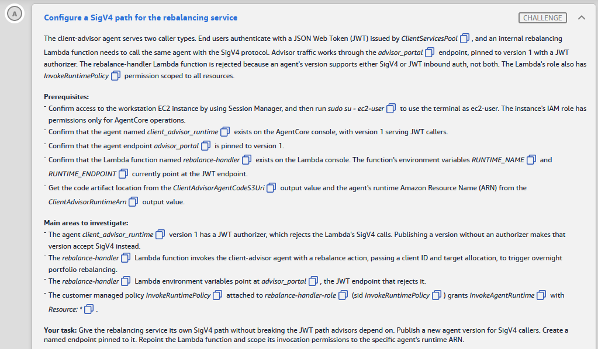
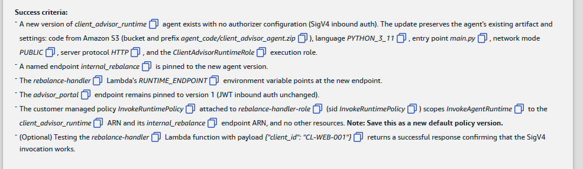

# 🅰️ Challenge A: Configure a SigV4 path for the rebalancing service

> **Status:** 🟡 In progress · **Diagram label:** A (the **client advisor agent**, with JWT callers through the client services Cognito pool and the `rebalance-handler` Lambda through `rebalance-handler-role`)
> **Services:** Amazon Bedrock **AgentCore Runtime** (versions, named **endpoints**, inbound auth: JWT vs IAM SigV4), AWS Lambda (env vars), IAM (customer managed policy **versions**), EC2 + Systems Manager Session Manager (workstation CLI)
> **Lab:** [AWS Securing Agent Identities Demonstrated](README.md) · **Vault:** [index](../README.md)

---

## ✅ Status checklist (success criteria)

- [ ] A **new version** of `client_advisor_runtime` with **no authorizer configuration** (SigV4 inbound auth) that **keeps** the existing artifact and settings:
  - S3 code `agent_code/client_advisor_agent.zip`
  - `PYTHON_3_11`, entry point `main.py`
  - network mode `PUBLIC`, protocol `HTTP`
  - role `ClientAdvisorRuntimeRole`
- [ ] A named endpoint **`internal_rebalance`** is pinned to the new version
- [ ] Lambda `rebalance-handler` → **`RUNTIME_ENDPOINT`** = the new endpoint
- [ ] **`advisor_portal`** is still pinned to **version 1** (JWT inbound auth unchanged)
- [ ] `InvokeRuntimePolicy` (attached to `rebalance-handler-role`, sid `InvokeRuntimePolicy`) scopes `InvokeAgentRuntime` to the **runtime ARN** and the **`internal_rebalance` endpoint ARN** only, saved as a **new default policy version**
- [ ] *(Optional)* Testing `rebalance-handler` with `{"client_id": "CL-WEB-001"}` returns success

---

## 🖼️ Task card





<details>
<summary>Text copy of the task</summary>

**Configure a SigV4 path for the rebalancing service**

The client-advisor agent serves two caller types. End users authenticate with a JSON Web Token (JWT) issued by *ClientServicesPool*, and an internal rebalancing Lambda function needs to call the same agent with the SigV4 protocol. Advisor traffic works through the *advisor_portal* endpoint, pinned to version 1 with a JWT authorizer. The rebalance-handler Lambda function is rejected because an agent's version supports either SigV4 or JWT inbound auth, not both. The Lambda's role also has *InvokeRuntimePolicy* permission scoped to all resources.

**Prerequisites:**
- Confirm access to the workstation EC2 instance by using Session Manager, and then run `sudo su - ec2-user` to use the terminal as ec2-user. The instance's IAM role has permissions only for AgentCore operations.
- Confirm that the agent named *client_advisor_runtime* exists on the AgentCore console, with version 1 serving JWT callers.
- Confirm that the agent endpoint *advisor_portal* is pinned to version 1.
- Confirm that the Lambda function named *rebalance-handler* exists on the Lambda console. The function's environment variables *RUNTIME_NAME* and *RUNTIME_ENDPOINT* currently point at the JWT endpoint.
- Get the code artifact location from the *ClientAdvisorAgentCodeS3Uri* output value and the agent's runtime Amazon Resource Name (ARN) from the *ClientAdvisorRuntimeArn* output value.

**Main areas to investigate:**
- The agent *client_advisor_runtime* version 1 has a JWT authorizer, which rejects the Lambda's SigV4 calls. Publishing a version without an authorizer makes that version accept SigV4 instead.
- The *rebalance-handler* Lambda function invokes the client-advisor agent with a rebalance action, passing a client ID and target allocation, to trigger overnight portfolio rebalancing.
- The *rebalance-handler* Lambda environment variables point at *advisor_portal*, the JWT endpoint that rejects it.
- The customer managed policy *InvokeRuntimePolicy* attached to *rebalance-handler-role* (sid *InvokeRuntimePolicy*) grants *InvokeAgentRuntime* with *Resource: \**.

**Your task:** Give the rebalancing service its own SigV4 path without breaking the JWT path advisors depend on. Publish a new agent version for SigV4 callers. Create a named endpoint pinned to it. Repoint the Lambda function and scope its invocation permissions to the specific agent's runtime ARN.

**Success criteria:**
- A new version of *client_advisor_runtime* agent exists with no authorizer configuration (SigV4 inbound auth). The update preserves the agent's existing artifact and settings: code from Amazon S3 (bucket and prefix *agent_code/client_advisor_agent.zip*), language *PYTHON_3_11*, entry point *main.py*, network mode *PUBLIC*, server protocol *HTTP*, and the *ClientAdvisorRuntimeRole* execution role.
- A named endpoint *internal_rebalance* is pinned to the new agent version.
- The *rebalance-handler* Lambda's *RUNTIME_ENDPOINT* environment variable points at the new endpoint.
- The *advisor_portal* endpoint remains pinned to version 1 (JWT inbound auth unchanged).
- The customer managed policy *InvokeRuntimePolicy* attached to *rebalance-handler-role* (sid *InvokeRuntimePolicy*) scopes *InvokeAgentRuntime* to the *client_advisor_runtime* ARN and its *internal_rebalance* endpoint ARN, and no other resources. **Note: Save this as a new default policy version.**
- (Optional) Testing the *rebalance-handler* Lambda function with payload `{"client_id": "CL-WEB-001"}` returns a successful response confirming that the SigV4 invocation works.

</details>

---

## 🗺️ Where it sits in the architecture

```text
BEFORE
  Client ─(JWT, ClientServicesPool)→ advisor_portal ─→ client_advisor_runtime v1 [JWT authorizer]   ✅
  rebalance-handler ─(SigV4, role)→ advisor_portal ─→ v1 [JWT authorizer]                          ❌ rejected
                     policy: InvokeAgentRuntime on "*"                                               ❌ too broad

AFTER
  Client ─(JWT)→ advisor_portal ──────→ v1 [JWT authorizer]       (unchanged)
  rebalance-handler ─(SigV4)→ internal_rebalance ─→ v2 [no authorizer = IAM/SigV4]
                     policy: InvokeAgentRuntime on runtime ARN + internal_rebalance endpoint ARN only
  (DEFAULT endpoint follows the latest version → v2. That's harmless here, because JWT callers use advisor_portal.)
```

**Key idea:** inbound auth belongs to a runtime **version**, and a version takes **one** type. **Named endpoints** pin versions, so a single runtime can serve both types through two endpoints: `advisor_portal` → v1 (JWT) and `internal_rebalance` → v2 (SigV4).

### Where each step happens

| Step | Service / place | What |
|---|---|---|
| 1 | **Workstation** (EC2 → Connect → Session Manager), as `ec2-user` | Read v1's config (`get-agent-runtime`) and its endpoints |
| 2 | **Workstation CLI** → AgentCore control plane | `update-agent-runtime` without an authorizer → new version |
| 3 | **Workstation CLI** | `create-agent-runtime-endpoint internal_rebalance` → new version. Copy the endpoint ARN |
| 4 | **AWS Lambda** console → `rebalance-handler` → Configuration → Environment variables | `RUNTIME_ENDPOINT` = `internal_rebalance` |
| 5 | **IAM** console → Roles → `rebalance-handler-role` → `InvokeRuntimePolicy` | Narrow `Resource` → **Save changes** = new default version |
| 6 | **AWS Lambda** console → Test | `{"client_id": "CL-WEB-001"}` |

---

## 🔍 Root cause

1. **Wrong auth type for the caller.** `rebalance-handler` signs with **SigV4** (its IAM role), but the only endpoint it can use (`advisor_portal` → v1) has a **JWT authorizer**, so the call is rejected.
2. **The fix can't be "switch v1 to IAM".** That would break every advisor using JWT through `advisor_portal`. The rebalancer needs its **own** version and endpoint.
3. **Over-broad permission.** `InvokeRuntimePolicy` allows `InvokeAgentRuntime` on `*`, which means any runtime in the account. PCI DSS-style least privilege means naming exactly the runtime and endpoint.

---

## 🛠️ Solution

### Values (from the Solution Resources panel)

| Name | Value |
|---|---|
| Runtime ID | `client_advisor_runtime_b4183f00-jD0mCRBx4b` |
| Runtime ARN | `arn:aws:bedrock-agentcore:us-east-1:987347315034:runtime/client_advisor_runtime_b4183f00-jD0mCRBx4b` |
| Code | bucket `agent-code-bucket-b4183f00`, prefix `agent_code/client_advisor_agent.zip` |
| Role | `arn:aws:iam::987347315034:role/ClientAdvisorRuntimeRole-b4183f00` |
| Expected endpoint ARN ⚠️ | `…:runtime/client_advisor_runtime_b4183f00-jD0mCRBx4b/runtime-endpoint/internal_rebalance` (copy the real one from step 3) |

### Step 1: Read version 1 (workstation)

EC2 console → instance `i-019262426d5ae9111` → **Connect** → **Session Manager** tab → **Connect**.

```bash
sudo su - ec2-user
export AWS_DEFAULT_REGION=us-east-1
RID=client_advisor_runtime_b4183f00-jD0mCRBx4b
aws bedrock-agentcore-control get-agent-runtime --agent-runtime-id $RID > v1.json; cat v1.json
aws bedrock-agentcore-control list-agent-runtime-endpoints --agent-runtime-id $RID
```

Look for:
- `agentRuntimeArtifact.codeConfiguration` (bucket, prefix, `PYTHON_3_11`, `main.py`)
- `networkConfiguration` (`PUBLIC`) and `protocolConfiguration` (`HTTP`)
- `roleArn`
- **`environmentVariables`**: if any are present, they must be passed again in step 2
- `authorizerConfiguration.customJWTAuthorizer`, which is what v2 must **not** have

### Step 2: Publish a version without an authorizer

`update-agent-runtime` replaces the whole configuration. Every setting must be passed again, and **leaving out `--authorizer-configuration`** gives a SigV4 version.

```bash
aws bedrock-agentcore-control update-agent-runtime \
  --agent-runtime-id $RID \
  --agent-runtime-artifact '{"codeConfiguration":{"code":{"s3":{"bucket":"agent-code-bucket-b4183f00","prefix":"agent_code/client_advisor_agent.zip"}},"runtime":"PYTHON_3_11","entryPoint":["main.py"]}}' \
  --role-arn arn:aws:iam::987347315034:role/ClientAdvisorRuntimeRole-b4183f00 \
  --network-configuration '{"networkMode":"PUBLIC"}' \
  --protocol-configuration '{"serverProtocol":"HTTP"}'
  # + --environment-variables '{...}'   only if v1.json had environmentVariables (copy them exactly)
```

Wait for **READY**, and confirm the new version has no authorizer:

```bash
aws bedrock-agentcore-control get-agent-runtime --agent-runtime-id $RID \
  --query "[status,agentRuntimeVersion,authorizerConfiguration]"
# expect: ["READY", "2", null]
```

**Console alternative ⚠️:** AgentCore → **Agents** → `client_advisor_runtime…` → **Edit / Update** → Inbound auth = **IAM permissions** (not JWT) → keep everything else → Save. The code source must stay the **existing S3 location**. "Upload" fails with `s3:PutObject` denied (Lab 03 D).

### Step 3: Create the `internal_rebalance` endpoint

```bash
aws bedrock-agentcore-control create-agent-runtime-endpoint \
  --agent-runtime-id $RID --name internal_rebalance --agent-runtime-version 2
aws bedrock-agentcore-control list-agent-runtime-endpoints --agent-runtime-id $RID
```

The list should show:
- `internal_rebalance` → version **2**, status **READY**. **Copy its `agentRuntimeEndpointArn`.**
- `advisor_portal` → version **1**. Don't change it.
- `DEFAULT` → latest (2). That's expected.

### Step 4: Repoint the Lambda (Lambda console)

`rebalance-handler` → **Configuration** → **Environment variables** → **Edit**:
- `RUNTIME_ENDPOINT` = `internal_rebalance`
- `RUNTIME_NAME`: leave it as it is. The criteria only check `RUNTIME_ENDPOINT`.

→ **Save**.

### Step 5: Scope the policy (IAM console)

IAM → **Roles** → `rebalance-handler-role` → **Permissions** → `InvokeRuntimePolicy` (customer managed) → **Edit** → **JSON**. Change **only** the `Resource` of the statement with `"Sid": "InvokeRuntimePolicy"`, and keep its `Action` and any other statements as they are:

```json
{
  "Sid": "InvokeRuntimePolicy",
  "Effect": "Allow",
  "Action": "bedrock-agentcore:InvokeAgentRuntime",
  "Resource": [
    "arn:aws:bedrock-agentcore:us-east-1:987347315034:runtime/client_advisor_runtime_b4183f00-jD0mCRBx4b",
    "arn:aws:bedrock-agentcore:us-east-1:987347315034:runtime/client_advisor_runtime_b4183f00-jD0mCRBx4b/runtime-endpoint/internal_rebalance"
  ]
}
```

→ **Next** → **Save changes**. Then open the **Policy versions** tab: the new version should be **(Default)**. If Save fails on the **5-version** limit, delete an old non-default version first.

**Why both ARNs:** invoking with an endpoint qualifier is authorized against the **runtime** and the **endpoint** resource. If either is missing, the call gets `AccessDenied`.

### Step 6: Test (optional) and Check

Lambda → `rebalance-handler` → **Test** → event `{"client_id": "CL-WEB-001"}` → expect a successful rebalance response. Then press **Check**.

### Order of operations

```text
1 read v1 → 2 update (new version, no authorizer) → wait READY → 3 create internal_rebalance → copy endpoint ARN
→ 4 Lambda RUNTIME_ENDPOINT → 5 policy new default version → 6 test → Check
```

---

## ⚠️ Mistakes & lessons

_Fill in as I go. Screenshots go in `assets/challenge_A/`._

---

## 🧯 Troubleshooting table

| Symptom | Likely cause | Fix |
|---|---|---|
| `update-agent-runtime` → `ValidationException` about a missing field | Update is a full replace | Pass artifact, role, network and protocol again (step 2) |
| New version is missing env vars or the agent errors | `--environment-variables` left out | Update again, this time with v1's env vars |
| `get-agent-runtime` still shows `customJWTAuthorizer` | Looked at v1, or the update didn't apply | Check `agentRuntimeVersion` in the output, then re-run step 2 |
| Lambda test → 401 / "authorization method mismatch" | `RUNTIME_ENDPOINT` still `advisor_portal`, or the endpoint points at v1 | Step 4, and `list-agent-runtime-endpoints` |
| Lambda test → `AccessDenied … InvokeAgentRuntime` | Policy is missing the endpoint ARN, or the ARN has a typo | Paste the exact `agentRuntimeEndpointArn` from step 3 |
| Endpoint shows CREATING / UPDATING | Still provisioning | Wait for READY before testing |
| Check fails on the policy criterion | Extra resources left, or the new version isn't the default | Exactly 2 ARNs. Policy versions tab → new version = Default |
| `advisor_portal` moved to v2 | It was edited by mistake | `update-agent-runtime-endpoint --name advisor_portal --agent-runtime-version 1` |

---

## 📚 Study notes

### Versions, endpoints and inbound auth

| Concept | What it is |
|---|---|
| **Version** | Every create or update of a runtime makes a new, immutable version (1, 2, …) with its own artifact, role, network and **authorizer** config |
| **Endpoint** | A named, stable pointer to a version. **`DEFAULT`** follows the latest version automatically. **Named endpoints** stay pinned until you update them, which makes them the safe way to run blue/green or two auth modes |
| **Inbound auth** | Per version: **IAM SigV4** (no authorizer, the default) **or** **Custom JWT** (discovery URL + allowed clients/audiences). Not both |
| **Invoke permission** | `bedrock-agentcore:InvokeAgentRuntime`, checked against the runtime ARN **and** the endpoint ARN (`…/runtime-endpoint/<name>`) |

### IAM policy versions

| Fact | Detail |
|---|---|
| Version limit | A customer managed policy keeps up to **5 versions**, and one of them is the **default** (the one in effect) |
| Console save | Edit → **Save changes** creates a new version and sets it as the default |
| CLI save | `aws iam create-policy-version --set-as-default` |
| Rollback | Set an older version as the default |

### 🧪 Self-test

1. Why not just remove the JWT authorizer from v1?
2. What happens to `DEFAULT` after `update-agent-runtime`, and why doesn't it matter here?
3. Which two ARNs must the invoke policy name, and why both?
4. What does `update-agent-runtime` do to settings you leave out?

---

## 📝 Run log (fill in as I go)

| Step | What I did | Result / output |
|---|---|---|
| 1 | v1 config + endpoints | _env vars? endpoints = ?_ |
| 2 | update-agent-runtime | _new version = ?, READY?, authorizer null?_ |
| 3 | internal_rebalance | _endpoint ARN = ?_ |
| 4 | Lambda RUNTIME_ENDPOINT | _saved?_ |
| 5 | InvokeRuntimePolicy | _new default version = v?_ |
| 6 | Lambda test / Check | _result_ |
