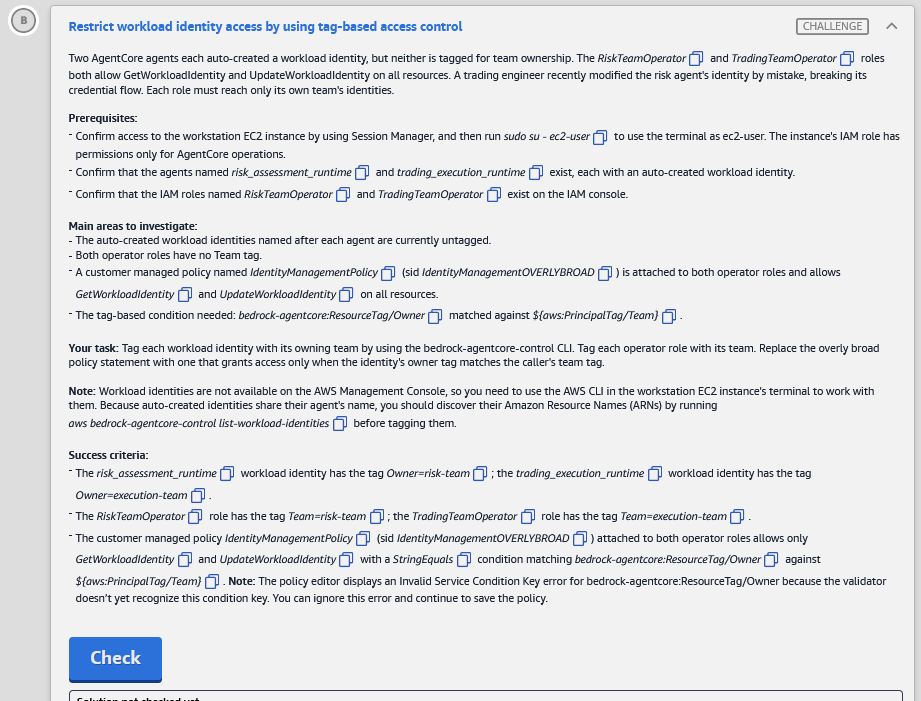

# 🅱️ Challenge B: Restrict workload identity access by using tag-based access control

> **Status:** 🟡 In progress · **Diagram label:** B (**Risk / Trading IT teams** → *Assume role* → **IAM roles** → *Manage agent identities* → **AgentCore agent identity**)
> **Services:** Amazon Bedrock **AgentCore Identity** (workload identities, resource tags, `bedrock-agentcore-control` CLI), **IAM** (role tags, customer managed policy versions, ABAC conditions), EC2 + Session Manager (workstation), CloudShell (IAM CLI)
> **Lab:** [AWS Securing Agent Identities Demonstrated](README.md) · **Vault:** [index](../README.md)

---

## ✅ Status checklist (success criteria)

- [ ] `risk_assessment_runtime` workload identity has tag **`Owner=risk-team`**
- [ ] `trading_execution_runtime` workload identity has tag **`Owner=execution-team`**
- [ ] Role **`RiskTeamOperator`** has tag **`Team=risk-team`**
- [ ] Role **`TradingTeamOperator`** has tag **`Team=execution-team`**
- [ ] `IdentityManagementPolicy` (sid `IdentityManagementOVERLYBROAD`, attached to both roles) allows **only** `GetWorkloadIdentity` + `UpdateWorkloadIdentity` with **`StringEquals`** `bedrock-agentcore:ResourceTag/Owner` = **`${aws:PrincipalTag/Team}`**. Saved as a **new default version**. Ignore the editor's *Invalid Service Condition Key* error

---

## 🖼️ Task card



<details>
<summary>Text copy of the task</summary>

**Restrict workload identity access by using tag-based access control**

Two AgentCore agents each auto-created a workload identity, but neither is tagged for team ownership. The *RiskTeamOperator* and *TradingTeamOperator* roles both allow GetWorkloadIdentity and UpdateWorkloadIdentity on all resources. A trading engineer recently modified the risk agent's identity by mistake, breaking its credential flow. Each role must reach only its own team's identities.

**Prerequisites:**
- Confirm access to the workstation EC2 instance by using Session Manager, and then run `sudo su - ec2-user` to use the terminal as ec2-user. The instance's IAM role has permissions only for AgentCore operations.
- Confirm that the agents named *risk_assessment_runtime* and *trading_execution_runtime* exist, each with an auto-created workload identity.
- Confirm that the IAM roles named *RiskTeamOperator* and *TradingTeamOperator* exist on the IAM console.

**Main areas to investigate:**
- The auto-created workload identities named after each agent are currently untagged.
- Both operator roles have no Team tag.
- A customer managed policy named *IdentityManagementPolicy* (sid *IdentityManagementOVERLYBROAD*) is attached to both operator roles and allows *GetWorkloadIdentity* and *UpdateWorkloadIdentity* on all resources.
- The tag-based condition needed: *bedrock-agentcore:ResourceTag/Owner* matched against *${aws:PrincipalTag/Team}*.

**Your task:** Tag each workload identity with its owning team by using the bedrock-agentcore-control CLI. Tag each operator role with its team. Replace the overly broad policy statement with one that grants access only when the identity's owner tag matches the caller's team tag.

**Note:** Workload identities are not available on the AWS Management Console, so you need to use the AWS CLI in the workstation EC2 instance's terminal to work with them. Because auto-created identities share their agent's name, you should discover their Amazon Resource Names (ARNs) by running `aws bedrock-agentcore-control list-workload-identities` before tagging them.

**Success criteria:**
- The *risk_assessment_runtime* workload identity has the tag *Owner=risk-team*; the *trading_execution_runtime* workload identity has the tag *Owner=execution-team*.
- The *RiskTeamOperator* role has the tag *Team=risk-team*; the *TradingTeamOperator* role has the tag *Team=execution-team*.
- The customer managed policy *IdentityManagementPolicy* (sid *IdentityManagementOVERLYBROAD*) attached to both operator roles allows only *GetWorkloadIdentity* and *UpdateWorkloadIdentity* with a *StringEquals* condition matching *bedrock-agentcore:ResourceTag/Owner* against *${aws:PrincipalTag/Team}*. **Note:** The policy editor displays an Invalid Service Condition Key error for bedrock-agentcore:ResourceTag/Owner because the validator doesn't yet recognize this condition key. You can ignore this error and continue to save the policy.

</details>

---

## 🗺️ Where it sits in the architecture

```text
BEFORE
  RiskTeamOperator    ─┐                                   ┌─ risk_assessment_runtime identity   (no tags)
                       ├─ IdentityManagementPolicy: Get/Update WorkloadIdentity on "*" ─┤
  TradingTeamOperator ─┘   (no Team tags on roles)         └─ trading_execution_runtime identity (no tags)
  → a trading engineer could (and did) update the risk identity ❌

AFTER (ABAC: attribute-based access control)
  RiskTeamOperator    [Team=risk-team]      ──✅──▶ risk identity    [Owner=risk-team]
  TradingTeamOperator [Team=execution-team] ──✅──▶ trading identity [Owner=execution-team]
  TradingTeamOperator ──❌ (execution-team ≠ risk-team)──▶ risk identity
  Rule: allow only if  bedrock-agentcore:ResourceTag/Owner  ==  ${aws:PrincipalTag/Team}
```

**Why ABAC:** one policy serves every team. A new team needs only **tags** (role `Team=x`, identity `Owner=x`), with no policy edit for each identity ARN.

### Where each step happens

| Step | Where | UI path | CLI alternative |
|---|---|---|---|
| 1 | **Workstation** (EC2 + Session Manager) | EC2 → Instances → `workstation-b4183f00` → **Connect ▾** → **Session Manager** → Connect | — |
| 2 | **AgentCore Identity** (workstation CLI **only**; no console page) | *n/a* | `list-workload-identities`, `tag-resource`, `list-tags-for-resource` |
| 3 | **IAM → Roles → Tags** | IAM → Roles → search `TeamOperator` → role → **Tags** → Manage tags | CloudShell: `aws iam tag-role` |
| 4 | **IAM → Policies** | IAM → Roles → RiskTeamOperator → **Permissions** → `IdentityManagementPolicy` → **Edit** → JSON → Next → Save changes | CloudShell: `aws iam create-policy-version --set-as-default` |

---

## 🔍 Root cause

1. **No ownership attributes.** The auto-created identities and the operator roles carry no tags, so nothing could tell "risk" from "trading".
2. **Over-broad policy.** `IdentityManagementOVERLYBROAD` allowed `Get/UpdateWorkloadIdentity` on `*` for both roles. That's how a trading engineer could change the **risk** agent's identity and break its credential flow.
3. **The fix needs both halves.** Tags with no condition do nothing, and a condition with no tags denies everything. Tag both the **resources** (`Owner`) and the **principals** (`Team`), then add the condition that compares them.

---

## 🛠️ Solution

### Values

| Thing | Value |
|---|---|
| Identity tag key / values | `Owner` = `risk-team` / `execution-team` |
| Role tag key / values | `Team` = `risk-team` / `execution-team` |
| Policy / sid | `IdentityManagementPolicy` / `IdentityManagementOVERLYBROAD` |
| Condition | `StringEquals` → `"bedrock-agentcore:ResourceTag/Owner": "${aws:PrincipalTag/Team}"` |

⚠️ The trading team's value is **`execution-team`**, not `trading-team`. Keys and values are **case-sensitive**.

### Step 1: Open the workstation

**UI:** EC2 → **Instances** → `workstation-b4183f00` (`i-019262426d5ae9111`) → **Connect ▾** (the arrow, *not* the Connect ↗ button) → **Session Manager** → **Connect**. Or reuse the tab from Challenge A.

```bash
sudo su - ec2-user
export AWS_DEFAULT_REGION=us-east-1
```

### Step 2: Find and tag the workload identities (CLI only)

```bash
aws bedrock-agentcore-control list-workload-identities --output table

export RISK_ARN=$(aws bedrock-agentcore-control list-workload-identities \
  --query "workloadIdentities[?starts_with(name,'risk_assessment_runtime')].workloadIdentityArn | [0]" --output text)
export TRADE_ARN=$(aws bedrock-agentcore-control list-workload-identities \
  --query "workloadIdentities[?starts_with(name,'trading_execution_runtime')].workloadIdentityArn | [0]" --output text)
echo "$RISK_ARN"; echo "$TRADE_ARN"      # both must print an ARN (not None / empty)

aws bedrock-agentcore-control tag-resource --resource-arn "$RISK_ARN"  --tags '{"Owner":"risk-team"}'
aws bedrock-agentcore-control tag-resource --resource-arn "$TRADE_ARN" --tags '{"Owner":"execution-team"}'

aws bedrock-agentcore-control list-tags-for-resource --resource-arn "$RISK_ARN"
aws bedrock-agentcore-control list-tags-for-resource --resource-arn "$TRADE_ARN"
```

Expected ARN shape (from Challenge A's client advisor): `arn:aws:bedrock-agentcore:us-east-1:987347315034:workload-identity-directory/default/workload-identity/<agent>_b4183f00-<id>`.

### Step 3: Tag the operator roles

**UI (IAM console):**
1. Top search bar → **IAM** → left nav **Roles** → search box: `TeamOperator`.
2. **RiskTeamOperator** → **Tags** tab → **Manage tags** / **Add new tag** → Key `Team`, Value `risk-team` → **Save changes**.
3. **Roles** → **TradingTeamOperator** → **Tags** → Key `Team`, Value `execution-team` → **Save changes**.

**CLI (CloudShell**, the `>_` icon in the console top bar. The workstation role has AgentCore permissions only):
```bash
aws iam list-roles --query "Roles[?contains(RoleName,'TeamOperator')].RoleName" --output text
aws iam tag-role --role-name RiskTeamOperator    --tags Key=Team,Value=risk-team
aws iam tag-role --role-name TradingTeamOperator --tags Key=Team,Value=execution-team
aws iam list-role-tags --role-name RiskTeamOperator
aws iam list-role-tags --role-name TradingTeamOperator
```

### Step 4: Replace the over-broad statement (new default policy version)

**UI (IAM console):**
1. IAM → **Roles** → **RiskTeamOperator** → **Permissions** tab → click **IdentityManagementPolicy** (*Customer managed*). Or go to IAM → **Policies** → filter type *Customer managed* → search `IdentityManagement`.
2. **Edit** → **JSON**.
3. Replace **only** the statement with `"Sid": "IdentityManagementOVERLYBROAD"`. Keep every other statement, especially any lab **Deny** statements:

   ```json
   {
     "Sid": "IdentityManagementOVERLYBROAD",
     "Effect": "Allow",
     "Action": [
       "bedrock-agentcore:GetWorkloadIdentity",
       "bedrock-agentcore:UpdateWorkloadIdentity"
     ],
     "Resource": "*",
     "Condition": {
       "StringEquals": {
         "bedrock-agentcore:ResourceTag/Owner": "${aws:PrincipalTag/Team}"
       }
     }
   }
   ```

   **What the real policy looked like:** three statements:

   | Sid | Effect | Action | Resource |
   |---|---|---|---|
   | `IdentityManagementOVERLYBROAD` | Allow | `GetWorkloadIdentity`, `UpdateWorkloadIdentity` | `*`, **no condition** |
   | _(none)_ | Deny | `*` | the lab monitoring Lambda, its role and its EventBridge rules |
   | _(none)_ | Deny | `lambda:PutProvisionedConcurrencyConfig` | `*` |

   The fix **adds only a `Condition`** to the first statement. Its sid, both actions, `Resource: "*"` and both Deny statements stay exactly as they were. The final first statement:

   ```json
   {
     "Action": ["bedrock-agentcore:GetWorkloadIdentity", "bedrock-agentcore:UpdateWorkloadIdentity"],
     "Resource": "*",
     "Effect": "Allow",
     "Sid": "IdentityManagementOVERLYBROAD",
     "Condition": { "StringEquals": { "bedrock-agentcore:ResourceTag/Owner": "${aws:PrincipalTag/Team}" } }
   }
   ```

4. Ignore **"Invalid Service Condition Key"**. The validator doesn't know this key yet, as the card says. Then **Next** → **Save changes**.
5. **Policy versions** tab → the new version should be **(Default)**. The policy is attached to both roles, so one edit covers both.

**CLI (CloudShell):** edit the existing statement in place and publish a new default version.
```bash
P=$(aws iam list-policies --scope Local --query "Policies[?starts_with(PolicyName,'IdentityManagementPolicy')].Arn | [0]" --output text); echo $P
V=$(aws iam get-policy --policy-arn $P --query Policy.DefaultVersionId --output text)
aws iam get-policy-version --policy-arn $P --version-id $V --query PolicyVersion.Document > cur.json
python3 - <<'EOF'
import json
d = json.load(open('cur.json'))
for s in d['Statement']:
    if s.get('Sid') == 'IdentityManagementOVERLYBROAD':
        s['Action'] = ['bedrock-agentcore:GetWorkloadIdentity', 'bedrock-agentcore:UpdateWorkloadIdentity']
        s['Resource'] = '*'
        s['Condition'] = {'StringEquals': {'bedrock-agentcore:ResourceTag/Owner': '${aws:PrincipalTag/Team}'}}
json.dump(d, open('new.json','w'), indent=2); print(json.dumps(d, indent=2))
EOF
aws iam create-policy-version --policy-arn $P --policy-document file://new.json --set-as-default
aws iam list-policy-versions --policy-arn $P
```
`LimitExceeded` means the policy already has 5 versions. Run `aws iam delete-policy-version --policy-arn $P --version-id <old non-default>` and try again.

### Step 5: Check

Press **Check**.

### Order of operations

```text
1 workstation → 2 tag identities (Owner) → 3 tag roles (Team) → 4 policy new default version → Check
(3 and 4 are console/CloudShell work. They can run while the workstation session is opening.)
```

---

## ⚠️ Mistakes & lessons

_Fill in as I go. Screenshots go in `assets/challenge_B/`._

---

## 🧯 Troubleshooting table

| Symptom | Likely cause | Fix |
|---|---|---|
| `echo $RISK_ARN` prints `None` or nothing | Identity name doesn't start with the agent name, or the variable was lost after `sudo su -` | Copy the ARN from `list-workload-identities --output table`. Re-run `export` in the current shell |
| `tag-resource` → `AccessDenied` | Ran as `ssm-user` / the wrong shell, or the wrong Region | `sudo su - ec2-user`, `export AWS_DEFAULT_REGION=us-east-1` |
| `tag-resource` → `ParamValidation` on `--tags` | Shorthand parsing | Use JSON: `--tags '{"Owner":"risk-team"}'` |
| `aws iam …` from the workstation → `AccessDenied` | The workstation role is AgentCore-only | Use the **IAM console** or **CloudShell** |
| Policy editor shows *Invalid Service Condition Key* | Validator doesn't know `bedrock-agentcore:ResourceTag/Owner` | Expected. Ignore it and save |
| Save fails: "limit of 5 versions" | IAM keeps at most 5 versions | Delete an old **non-default** version, then save |
| Check fails on tags | Wrong key or value case, or `trading-team` used | `Owner` / `Team`, values `risk-team` and `execution-team` exactly |
| Check fails on the policy | Sid changed, an extra action left in, `StringLike` used, or the new version isn't the default | Keep sid `IdentityManagementOVERLYBROAD`, exactly 2 actions, `StringEquals`, and make the new version Default |

---

## 📚 Study notes

### ABAC (attribute-based access control) in one table

| Piece | Here | Condition key |
|---|---|---|
| **Resource tag** | Workload identity `Owner=risk-team` | `bedrock-agentcore:ResourceTag/Owner` (service-specific form), or the global `aws:ResourceTag/Owner` |
| **Principal tag** | Role `Team=risk-team` | `aws:PrincipalTag/Team`, used as a **policy variable** `${aws:PrincipalTag/Team}` |
| **Comparison** | Allow only when they're equal | `StringEquals` |
| **Request tags** *(not used here)* | Tags sent on create / tag calls | `aws:RequestTag/<k>`, `aws:TagKeys` |

**Why it scales:** RBAC needs a policy per team that lists each resource ARN. ABAC uses one policy, and access follows the tags.

**Watch out:** whoever can **change tags** can change access. In production, also restrict `TagResource` / `UntagResource` (and `iam:TagRole`), or a trading engineer could re-tag the risk identity as `execution-team`.

### Workload identities (AgentCore Identity)
- **Created automatically** for each Runtime and Gateway agent, and named after the agent (Challenge A: `client_advisor_runtime_b4183f00-jD0mCRBx4b`).
- ARN: `arn:aws:bedrock-agentcore:<region>:<acct>:workload-identity-directory/default/workload-identity/<name>`.
- **Not shown in the console** (as of this lab). Use `aws bedrock-agentcore-control list/get/create/update/delete-workload-identity`, `tag-resource`, `list-tags-for-resource`.
- `UpdateWorkloadIdentity` changes things like the allowed OAuth2 return URLs. A wrong update **breaks the agent's credential flow**, which is the incident in this card.

### 🧪 Self-test
1. Why does the condition compare `ResourceTag/Owner` with `${aws:PrincipalTag/Team}` instead of a fixed value?
2. What happens to both roles if you add the condition but forget to tag the roles?
3. Why must `TagResource` also be restricted in a real deployment?
4. Why use CloudShell (or the console) for the IAM steps, and not the workstation?

---

## 📝 Run log (fill in as I go)

| Step | What I did | Result / output |
|---|---|---|
| 2 | list-workload-identities | ✅ 7 identities (below). Risk = `…/workload-identity/risk_assessment_runtime_b4183f00-icCH7oBUFo`, trading = `…/workload-identity/trading_execution_runtime_b4183f00-EuAcruGnOa` |
| 2 | tag-resource ×2 | ✅ `list-tags-for-resource`: risk `Owner=risk-team`, trading `Owner=execution-team` (plus the CloudFormation `aws:cloudformation:*` tags already there) |
| 3 | Role tags | _Team tags saved?_ |
| 4 | Policy new version | Policy had 3 statements (OVERLYBROAD + 2 lab Denies). Added `Condition StringEquals bedrock-agentcore:ResourceTag/Owner = ${aws:PrincipalTag/Team}` to OVERLYBROAD only. _New default version = v?_ |
| 5 | Check | _result_ |

### Raw output: step 2 (13 Nov 2026)

**`list-workload-identities`.** Every identity in the account. Useful for the other challenges:

| Name | Owner agent (diagram) | Relevant to |
|---|---|---|
| `regulatory_reporting_runtime_b4183f00-97rzpCB6D8` | Regulatory reporting agent | F |
| `trading-gateway-b4183f00-n4xfo3fdjk` | Trading gateway (partners) | D |
| `portfolio-gateway-b4183f00-bevenwcrox` | A second gateway, maybe for portfolio tools ⚠️ | D? |
| `client_advisor_runtime_b4183f00-jD0mCRBx4b` | Client advisor | A |
| `portfolio_advisor_runtime_b4183f00-JSJfwQA6Al` | Portfolio advisor (log source on the diagram) | E |
| `risk_assessment_runtime_b4183f00-icCH7oBUFo` | Risk team agent | **B** |
| `trading_execution_runtime_b4183f00-EuAcruGnOa` | Trading/execution team agent | **B** |

All ARNs follow `arn:aws:bedrock-agentcore:us-east-1:987347315034:workload-identity-directory/default/workload-identity/<name>`. There's **no compliance-agent identity yet**, which is what Challenge C creates. Gateway identities use **hyphens** (`trading-gateway-…`), runtime identities use underscores.

```text
$ echo "$RISK_ARN"; echo "$TRADE_ARN"
arn:aws:bedrock-agentcore:us-east-1:987347315034:workload-identity-directory/default/workload-identity/risk_assessment_runtime_b4183f00-icCH7oBUFo
arn:aws:bedrock-agentcore:us-east-1:987347315034:workload-identity-directory/default/workload-identity/trading_execution_runtime_b4183f00-EuAcruGnOa

$ aws bedrock-agentcore-control list-tags-for-resource --resource-arn "$RISK_ARN"
{
    "tags": {
        "aws:cloudformation:stack-name": "LabStack-b365c97a-70cf-45f3-afdd-07790a14df06-q3CQE9t75dyCr3XLH7AdbJ-0",
        "aws:cloudformation:logical-id": "RiskAssessmentRuntime",
        "Owner": "risk-team",
        "aws:cloudformation:stack-id": "arn:aws:cloudformation:us-east-1:987347315034:stack/LabStack-…/b4183f00-df58-11f1-b9bb-0affc7ccc753"
    }
}
$ aws bedrock-agentcore-control list-tags-for-resource --resource-arn "$TRADE_ARN"
{
    "tags": {
        "aws:cloudformation:stack-name": "LabStack-b365c97a-70cf-45f3-afdd-07790a14df06-q3CQE9t75dyCr3XLH7AdbJ-0",
        "aws:cloudformation:logical-id": "TradingExecutionRuntime",
        "Owner": "execution-team",
        "aws:cloudformation:stack-id": "arn:aws:cloudformation:us-east-1:987347315034:stack/LabStack-…/b4183f00-df58-11f1-b9bb-0affc7ccc753"
    }
}
```

**Note:** the identities already carried `aws:cloudformation:*` tags. "Untagged" in the card means *no ownership tag*. `tag-resource` **adds or merges** tags, so the CloudFormation tags stay.
