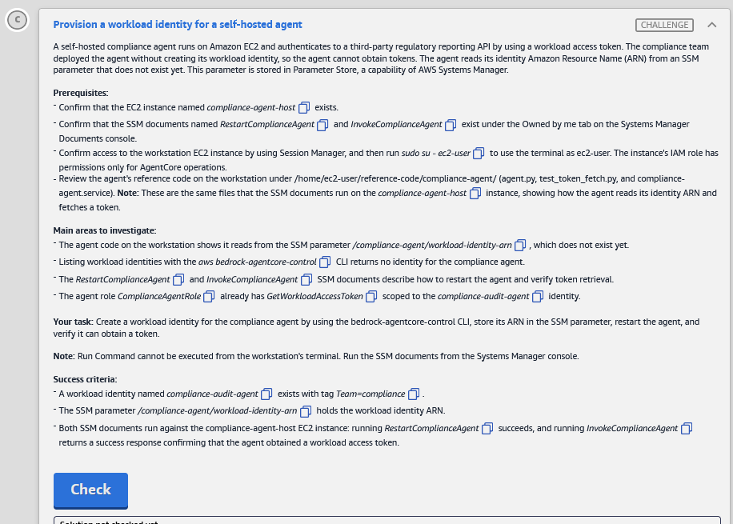

# 🅲 Challenge C: Provision a workload identity for a self-hosted agent

> **Status:** 🟡 In progress · **Diagram label:** C (**AWS Systems Manager** → *Manage* → **EC2 `compliance-agent-host`** → *Retrieve workload access token* → **Compliance audit agent**)
> **Services:** Amazon Bedrock **AgentCore Identity** (`create-workload-identity`, tags, `GetWorkloadAccessToken`), **Systems Manager** (Parameter Store, Documents, Run Command, Session Manager), EC2, IAM (pre-created `ComplianceAgentRole`)
> **Lab:** [AWS Securing Agent Identities Demonstrated](README.md) · **Vault:** [index](../README.md)

---

## ✅ Status checklist (success criteria)

- [ ] Workload identity **`compliance-audit-agent`** exists with tag **`Team=compliance`**
- [ ] SSM parameter **`/compliance-agent/workload-identity-arn`** holds that identity's **ARN**
- [ ] On **`compliance-agent-host`**: **`RestartComplianceAgent`** succeeds, and **`InvokeComplianceAgent`** returns success (the agent obtained a workload access token)

---

## 🖼️ Task card



<details>
<summary>Text copy of the task</summary>

**Provision a workload identity for a self-hosted agent**

A self-hosted compliance agent runs on Amazon EC2 and authenticates to a third-party regulatory reporting API by using a workload access token. The compliance team deployed the agent without creating its workload identity, so the agent cannot obtain tokens. The agent reads its identity Amazon Resource Name (ARN) from an SSM parameter that does not exist yet. This parameter is stored in Parameter Store, a capability of AWS Systems Manager.

**Prerequisites:**
- Confirm that the EC2 instance named *compliance-agent-host* exists.
- Confirm that the SSM documents named *RestartComplianceAgent* and *InvokeComplianceAgent* exist under the Owned by me tab on the Systems Manager Documents console.
- Confirm access to the workstation EC2 instance by using Session Manager, and then run `sudo su - ec2-user` to use the terminal as ec2-user. The instance's IAM role has permissions only for AgentCore operations.
- Review the agent's reference code on the workstation under `/home/ec2-user/reference-code/compliance-agent/` (agent.py, test_token_fetch.py, and compliance-agent.service). **Note:** These are the same files that the SSM documents run on the *compliance-agent-host* instance, showing how the agent reads its identity ARN and fetches a token.

**Main areas to investigate:**
- The agent code on the workstation shows it reads from the SSM parameter */compliance-agent/workload-identity-arn*, which does not exist yet.
- Listing workload identities with the *aws bedrock-agentcore-control* CLI returns no identity for the compliance agent.
- The *RestartComplianceAgent* and *InvokeComplianceAgent* SSM documents describe how to restart the agent and verify token retrieval.
- The agent role *ComplianceAgentRole* already has *GetWorkloadAccessToken* scoped to the *compliance-audit-agent* identity.

**Your task:** Create a workload identity for the compliance agent by using the bedrock-agentcore-control CLI, store its ARN in the SSM parameter, restart the agent, and verify it can obtain a token.

**Note:** Run Command cannot be executed from the workstation's terminal. Run the SSM documents from the Systems Manager console.

**Success criteria:**
- A workload identity named *compliance-audit-agent* exists with tag *Team=compliance*.
- The SSM parameter */compliance-agent/workload-identity-arn* holds the workload identity ARN.
- Both SSM documents run against the compliance-agent-host EC2 instance: running *RestartComplianceAgent* succeeds, and running *InvokeComplianceAgent* returns a success response confirming that the agent obtained a workload access token.

</details>

---

## 🗺️ Where it sits in the architecture

```text
BEFORE
  compliance-agent-host (EC2, role ComplianceAgentRole)
    agent.py → ssm:GetParameter /compliance-agent/workload-identity-arn   ❌ ParameterNotFound
             → (never reaches) bedrock-agentcore:GetWorkloadAccessToken(compliance-audit-agent)  ❌ identity doesn't exist

AFTER
  workstation CLI ──create-workload-identity──▶ compliance-audit-agent [Team=compliance]
  Parameter Store  /compliance-agent/workload-identity-arn = …/workload-identity/compliance-audit-agent
  SSM Run Command ─RestartComplianceAgent─▶ host: agent restarts and reads the parameter
                  ─InvokeComplianceAgent──▶ host: GetWorkloadAccessToken ✅ token
```

**Key idea:** Runtime and Gateway agents get a workload identity **automatically** (see the list in Challenge B: `client_advisor_runtime_…`, `trading-gateway-…`). A **self-hosted** agent, here on EC2, needs one **created by hand**. It then calls `GetWorkloadAccessToken` itself, using its own IAM role (`ComplianceAgentRole`, already scoped to this identity name).

### Where each step happens

| Step | Where | UI path | CLI alternative |
|---|---|---|---|
| 1 | **Workstation** (AgentCore CLI only) | EC2 → Instances → `workstation-b4183f00` → **Connect ▾** → **Session Manager** | `create-workload-identity`, `tag-resource`, `get-workload-identity` |
| 2 | **Systems Manager → Parameter Store** | Top search **Parameter Store** → **Create parameter** | CloudShell: `aws ssm put-parameter` |
| 3 | **Systems Manager → Documents / Run Command** (console only, *not* the workstation) | Top search **Documents** → **Owned by me** → document → **Run command** → target `compliance-agent-host` → **Run** | CloudShell: `aws ssm send-command` + `get-command-invocation` |

---

## 🔍 Root cause

1. **No identity.** Nobody created the compliance agent's workload identity, so `GetWorkloadAccessToken` has nothing to issue a token for.
2. **No pointer.** The agent finds its identity through the SSM parameter `/compliance-agent/workload-identity-arn`, which didn't exist.
3. **Stale process.** Even after both exist, the running agent needs a **restart** to read the new parameter.

IAM is **not** the problem: `ComplianceAgentRole` already allows `GetWorkloadAccessToken` on `compliance-audit-agent`. That's why the **name must match exactly**.

---

## 🛠️ Solution

### Values

| Thing | Value |
|---|---|
| Identity name | `compliance-audit-agent` (exact, because the role's permission is scoped to it) |
| Identity tag | `Team=compliance` |
| Expected identity ARN | `arn:aws:bedrock-agentcore:us-east-1:987347315034:workload-identity-directory/default/workload-identity/compliance-audit-agent` |
| SSM parameter | `/compliance-agent/workload-identity-arn`, Standard, **String** |
| Target instance | **`compliance-agent-host`** (not `workstation-b4183f00`) |
| SSM documents | `RestartComplianceAgent`, then `InvokeComplianceAgent` (Owned by me) |

### Step 1: Create and tag the identity (workstation)

**UI:** EC2 → **Instances** → `workstation-b4183f00` → **Connect ▾** → **Session Manager** → Connect, or reuse the open tab.

```bash
sudo su - ec2-user
export AWS_DEFAULT_REGION=us-east-1

# 10-second look at how the agent reads the parameter (name, decryption, region)
ls ~/reference-code/compliance-agent/
grep -n -i -E "ssm|get_parameter|WithDecryption|workload" ~/reference-code/compliance-agent/agent.py | head -20

aws bedrock-agentcore-control create-workload-identity --name compliance-audit-agent --tags '{"Team":"compliance"}'
```

If `--tags` isn't accepted by `create-workload-identity`:
```bash
aws bedrock-agentcore-control create-workload-identity --name compliance-audit-agent
aws bedrock-agentcore-control tag-resource \
  --resource-arn arn:aws:bedrock-agentcore:us-east-1:987347315034:workload-identity-directory/default/workload-identity/compliance-audit-agent \
  --tags '{"Team":"compliance"}'
```

Verify:
```bash
export CA_ARN=$(aws bedrock-agentcore-control get-workload-identity --name compliance-audit-agent --query workloadIdentityArn --output text)
echo "$CA_ARN"
aws bedrock-agentcore-control list-tags-for-resource --resource-arn "$CA_ARN"
```

### Step 2: Create the SSM parameter

**UI (Systems Manager):**
1. Top search bar → type **Parameter Store** → click it (a Systems Manager feature). Or go Systems Manager → left nav *Application tools* → **Parameter Store** ⚠️.
2. Click **Create parameter** and fill in:
   - Name: `/compliance-agent/workload-identity-arn`
   - Description: optional
   - Tier: **Standard**
   - Type: **String**
   - Data type: **text**
   - Value: the ARN from step 1
3. Click **Create parameter**.

**CLI (CloudShell, `>_` in the console top bar).** The workstation role can't call SSM.
```bash
aws ssm put-parameter --name /compliance-agent/workload-identity-arn --type String \
  --value arn:aws:bedrock-agentcore:us-east-1:987347315034:workload-identity-directory/default/workload-identity/compliance-audit-agent
aws ssm get-parameter --name /compliance-agent/workload-identity-arn --query Parameter.Value --output text
```

### Step 3: Run the SSM documents on `compliance-agent-host`

**UI (Systems Manager):**
1. Top search bar → **Documents** (Systems Manager feature) → **Owned by me** tab → **RestartComplianceAgent** → **Run command**.
2. **Target selection** → **Choose instances manually** → tick **compliance-agent-host**.
   - Parameters: leave at their defaults.
   - *Output options*: untick S3 if it's ticked.
3. Click **Run** → wait for **Success** (refresh as needed).
4. Back to **Documents** → **Owned by me** → **InvokeComplianceAgent** → **Run command** → same instance → **Run**.
5. When it shows **Success**: click the instance ID → **Output** → expand **Step 1 – Output**. It should report that a token was obtained.

Alternative path: Systems Manager → *Node tools* → **Run Command** → **Run command** → search the document name ⚠️.

**CLI (CloudShell):**
```bash
IID=$(aws ec2 describe-instances --filters "Name=tag:Name,Values=compliance-agent-host*" "Name=instance-state-name,Values=running" \
  --query "Reservations[].Instances[].InstanceId" --output text); echo $IID

C1=$(aws ssm send-command --document-name RestartComplianceAgent --targets Key=InstanceIds,Values=$IID --query Command.CommandId --output text)
aws ssm get-command-invocation --command-id $C1 --instance-id $IID --query "[Status,StandardOutputContent,StandardErrorContent]" --output text

C2=$(aws ssm send-command --document-name InvokeComplianceAgent --targets Key=InstanceIds,Values=$IID --query Command.CommandId --output text)
aws ssm get-command-invocation --command-id $C2 --instance-id $IID --query "[Status,StandardOutputContent,StandardErrorContent]" --output text
```
`InProgress` means it's still running. Re-run `get-command-invocation` after about 10 seconds.

### Step 4: Check

Press **Check**.

### Order of operations

```text
1 identity (+tag) → 2 parameter = ARN → 3a RestartComplianceAgent → 3b InvokeComplianceAgent → Check
(The restart must come AFTER the parameter exists.)
```

---

## ⚠️ Mistakes & lessons

_Fill in as I go. Screenshots go in `assets/challenge_C/`._

---

## 🧯 Troubleshooting table

| Symptom | Likely cause | Fix |
|---|---|---|
| `create-workload-identity: Unknown options: --tags` | Older CLI or API shape | Create without tags, then `tag-resource` |
| `ConflictException` / already exists | Created earlier | `get-workload-identity --name compliance-audit-agent`, then just tag it |
| `aws ssm …` on the workstation → `AccessDenied` | The workstation role is AgentCore-only | Use the console or CloudShell |
| Invoke output: `ParameterNotFound` | Parameter name typo, or restart ran before the parameter existed | Check the exact name `/compliance-agent/workload-identity-arn`, then **Restart** again, then Invoke |
| Invoke output: `AccessDenied … GetWorkloadAccessToken` | Identity name isn't exactly `compliance-audit-agent` | Re-create it with the exact name and update the parameter |
| Invoke output: `ResourceNotFound` for the identity | Parameter holds a wrong or truncated ARN | `get-parameter` and compare with `get-workload-identity` |
| Run Command target list doesn't show the host | Instance not SSM-managed yet, or the wrong filter | Choose instances manually, clear the filters, refresh |
| Check fails on the documents | Ran on the workstation instead of `compliance-agent-host` | Re-run both documents on the right instance |

---

## 📚 Study notes

### Self-hosted agent identity flow

| Step | Call | Who |
|---|---|---|
| 1. Identity exists | `CreateWorkloadIdentity(name)` | Admin (control plane) |
| 2. Agent finds its identity | `ssm:GetParameter` → ARN, then name | Agent (instance role) |
| 3. Agent gets a token | `GetWorkloadAccessToken(workloadName)` | Agent, authorized by IAM **on the identity ARN** |
| 4. *(next)* Downstream credentials | `GetResourceOauth2Token` / `GetResourceApiKey` with that token | Agent → token vault → third-party API |

**Hosted vs self-hosted:** on AgentCore Runtime, the platform creates the identity and passes the workload access token to the agent (inbound JWT → `GetWorkloadAccessTokenForJWT`). Self-hosted agents do steps 1–3 themselves.

### Systems Manager pieces used

| Piece | Used for |
|---|---|
| **Parameter Store** | Config and pointers (`String` / `StringList` / `SecureString`). Standard tier is free, up to 4 KB |
| **Documents** (SSM documents) | Scripted actions. *Owned by me* = custom docs the lab created |
| **Run Command** | Runs a document on managed instances, **without SSH**, and keeps the output per instance |
| **Session Manager** | Interactive shell (the workstation) |

### 🧪 Self-test
1. Why does the identity name have to be exactly `compliance-audit-agent`?
2. Why must `RestartComplianceAgent` run **after** the parameter is created?
3. How does a self-hosted agent's identity differ from a Runtime agent's?
4. Why can't you `send-command` from the workstation?

---

## 📝 Run log (fill in as I go)

| Step | What I did | Result / output |
|---|---|---|
| 1 | Reference code grep | _parameter read how?_ |
| 1 | create-workload-identity | _ARN = ?, tags?_ |
| 2 | Parameter created | _value = ?_ |
| 3a | RestartComplianceAgent | _Success?_ |
| 3b | InvokeComplianceAgent | _token obtained?_ |
| 4 | Check | _result_ |
