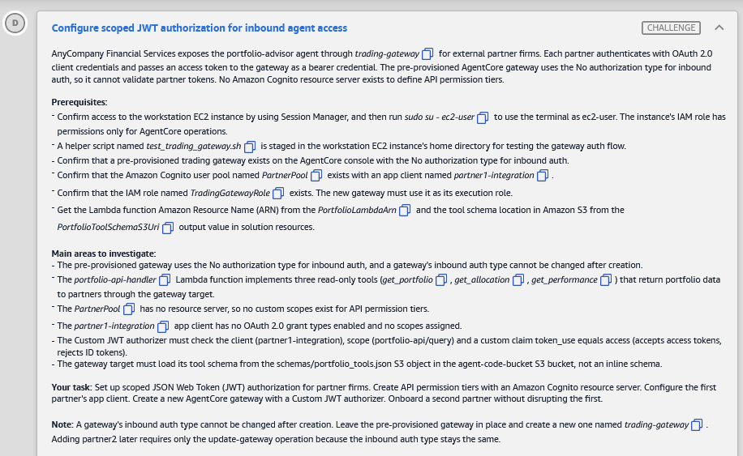
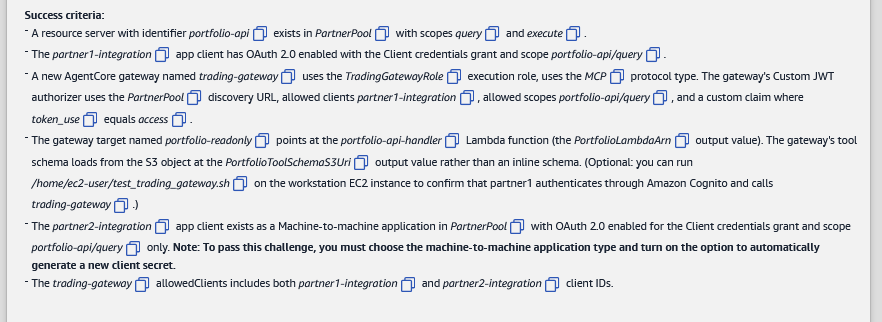
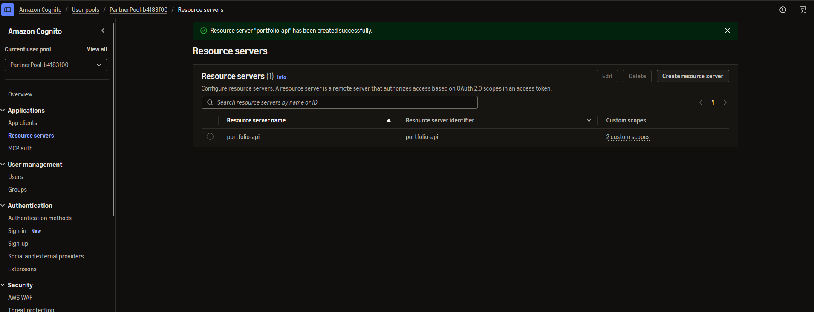
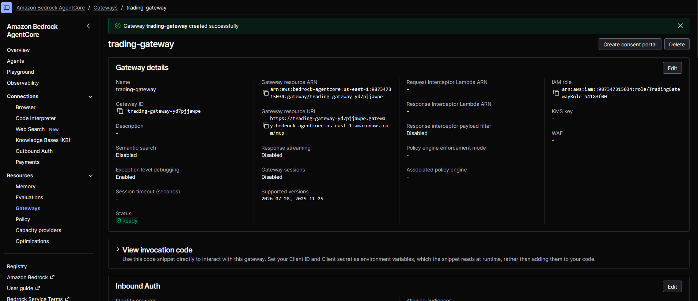
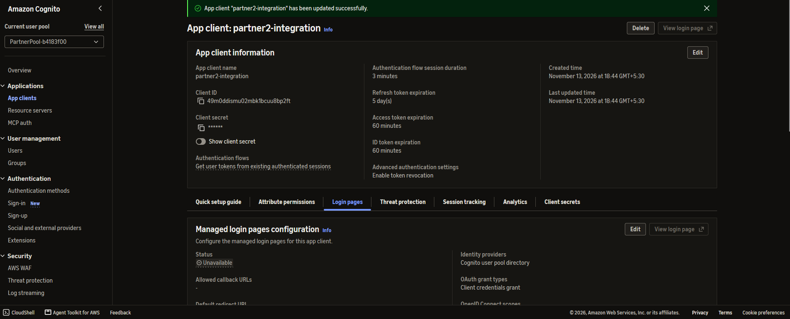
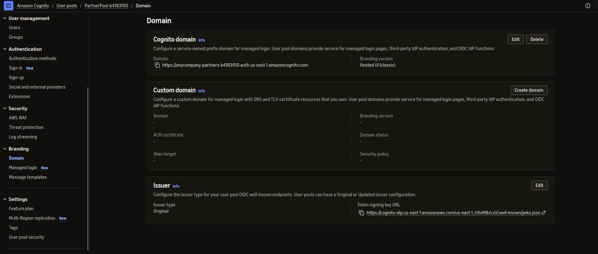

# 🅳 Challenge D: Configure scoped JWT authorization for inbound agent access

> **Status:** 🟡 In progress · **Diagram label:** D (**Partners** → *Get access token* → **Cognito user pool (Partner)** → *Request portfolio data* → **Trading gateway agent** → *Invoke tools* → **Lambda `portfolio-api-handler`**)
> **Services:** Amazon **Cognito** (resource server, custom scopes, M2M app clients, client credentials), Amazon Bedrock **AgentCore Gateway** (Custom JWT authorizer: allowed clients, allowed scopes, custom claims; MCP; Lambda target with an S3 tool schema), IAM (`TradingGatewayRole`), Lambda, S3
> **Lab:** [AWS Securing Agent Identities Demonstrated](README.md) · **Vault:** [index](../README.md)

---

## ✅ Status checklist (success criteria)

- [ ] Resource server **`portfolio-api`** in **PartnerPool** with scopes **`query`** and **`execute`**
- [ ] **`partner1-integration`**: OAuth 2.0 on, **Client credentials**, scope **`portfolio-api/query`**
- [ ] New gateway **`trading-gateway`** with:
  - role **`TradingGatewayRole`**, protocol **MCP**
  - Custom JWT authorizer: PartnerPool discovery URL, allowed clients **partner1**, allowed scopes **`portfolio-api/query`**
  - custom claim **`token_use` equals `access`**
- [ ] Target **`portfolio-readonly`** → `portfolio-api-handler` Lambda, tool schema loaded **from S3** (`PortfolioToolSchemaS3Uri`), not inline
- [ ] *(Optional)* `/home/ec2-user/test_trading_gateway.sh` shows partner1 authenticating and calling `trading-gateway`
- [ ] **`partner2-integration`**: **Machine-to-machine** app type, **auto-generated client secret**, Client credentials, scope **`portfolio-api/query` only**
- [ ] `trading-gateway` **allowedClients** = **partner1 + partner2**

---

## 🖼️ Task card





<details>
<summary>Text copy of the task</summary>

**Configure scoped JWT authorization for inbound agent access**

AnyCompany Financial Services exposes the portfolio-advisor agent through *trading-gateway* for external partner firms. Each partner authenticates with OAuth 2.0 client credentials and passes an access token to the gateway as a bearer credential. The pre-provisioned AgentCore gateway uses the No authorization type for inbound auth, so it cannot validate partner tokens. No Amazon Cognito resource server exists to define API permission tiers.

**Prerequisites:**
- Confirm access to the workstation EC2 instance by using Session Manager, and then run `sudo su - ec2-user` to use the terminal as ec2-user. The instance's IAM role has permissions only for AgentCore operations.
- A helper script named *test_trading_gateway.sh* is staged in the workstation EC2 instance's home directory for testing the gateway auth flow.
- Confirm that a pre-provisioned trading gateway exists on the AgentCore console with the No authorization type for inbound auth.
- Confirm that the Amazon Cognito user pool named *PartnerPool* exists with an app client named *partner1-integration*.
- Confirm that the IAM role named *TradingGatewayRole* exists. The new gateway must use it as its execution role.
- Get the Lambda function Amazon Resource Name (ARN) from the *PortfolioLambdaArn* and the tool schema location in Amazon S3 from the *PortfolioToolSchemaS3Uri* output value in solution resources.

**Main areas to investigate:**
- The pre-provisioned gateway uses the No authorization type for inbound auth, and a gateway's inbound auth type cannot be changed after creation.
- The *portfolio-api-handler* Lambda function implements three read-only tools (*get_portfolio*, *get_allocation*, *get_performance*) that return portfolio data to partners through the gateway target.
- The *PartnerPool* has no resource server, so no custom scopes exist for API permission tiers.
- The *partner1-integration* app client has no OAuth 2.0 grant types enabled and no scopes assigned.
- The Custom JWT authorizer must check the client (partner1-integration), scope (portfolio-api/query) and a custom claim token_use equals access (accepts access tokens, rejects ID tokens).
- The gateway target must load its tool schema from the schemas/portfolio_tools.json S3 object in the agent-code-bucket S3 bucket, not an inline schema.

**Your task:** Set up scoped JSON Web Token (JWT) authorization for partner firms. Create API permission tiers with an Amazon Cognito resource server. Configure the first partner's app client. Create a new AgentCore gateway with a Custom JWT authorizer. Onboard a second partner without disrupting the first.

**Note:** A gateway's inbound auth type cannot be changed after creation. Leave the pre-provisioned gateway in place and create a new one named *trading-gateway*. Adding partner2 later requires only the update-gateway operation because the inbound auth type stays the same.

**Success criteria:**
- A resource server with identifier *portfolio-api* exists in *PartnerPool* with scopes *query* and *execute*.
- The *partner1-integration* app client has OAuth 2.0 enabled with the Client credentials grant and scope *portfolio-api/query*.
- A new AgentCore gateway named *trading-gateway* uses the *TradingGatewayRole* execution role, uses the *MCP* protocol type. The gateway's Custom JWT authorizer uses the *PartnerPool* discovery URL, allowed clients *partner1-integration*, allowed scopes *portfolio-api/query*, and a custom claim where *token_use* equals *access*.
- The gateway target named *portfolio-readonly* points at the *portfolio-api-handler* Lambda function (the *PortfolioLambdaArn* output value). The gateway's tool schema loads from the S3 object at the *PortfolioToolSchemaS3Uri* output value rather than an inline schema. (Optional: you can run */home/ec2-user/test_trading_gateway.sh* on the workstation EC2 instance to confirm that partner1 authenticates through Amazon Cognito and calls *trading-gateway*.)
- The *partner2-integration* app client exists as a Machine-to-machine application in *PartnerPool* with OAuth 2.0 enabled for the Client credentials grant and scope *portfolio-api/query* only. **Note: To pass this challenge, you must choose the machine-to-machine application type and turn on the option to automatically generate a new client secret.**
- The *trading-gateway* allowedClients includes both *partner1-integration* and *partner2-integration* client IDs.

</details>

---

## 🗺️ Where it sits in the architecture

```text
BEFORE
  partner ──(any/no token)──▶ trading-gateway-b4183f00 [inbound auth: NONE]  ──▶ portfolio tools   ❌ anyone can call
  PartnerPool: no resource server, partner1 client has no OAuth flows/scopes

AFTER
  PartnerPool
    resource server portfolio-api  → scopes portfolio-api/query, portfolio-api/execute   (permission tiers)
    partner1-integration  (client_credentials, scope portfolio-api/query)
    partner2-integration  (M2M, secret, client_credentials, scope portfolio-api/query)
  partner ─POST /oauth2/token (client_credentials)─▶ access token {client_id, scope, token_use=access}
          ─Bearer─▶ trading-gateway [CUSTOM_JWT: discovery=PartnerPool, allowedClients=[p1,p2],
                                     allowedScopes=[portfolio-api/query], claim token_use == access]
                     └─ target portfolio-readonly ─▶ Lambda portfolio-api-handler (get_portfolio/allocation/performance)
                                                     schema: s3://agent-code-bucket-b4183f00/schemas/portfolio_tools.json
  old gateway trading-gateway-b4183f00 → left in place (inbound auth type can't be changed)
```

**Three checks on every token**, each with its own job:
- **client**: *which partner* is calling (partner1, partner2)
- **scope**: *which tier* the partner has (`query` = read-only, `execute` = trading, which no partner gets here)
- **`token_use`**: *what kind of token* it is. **Access** tokens pass. **ID** tokens are rejected, because they prove a login, not API authorization.

### Where each step happens

| Step | Where | UI path | CLI alternative |
|---|---|---|---|
| 0 | Cognito / IAM | Cognito → User pools → PartnerPool (pool ID, partner1 client ID). IAM → Roles → TradingGatewayRole (ARN) | CloudShell: `list-user-pools`, `list-user-pool-clients` |
| 1 | **Cognito → PartnerPool → Applications → Resource servers** | **Create resource server** | CloudShell: `create-resource-server` |
| 2 | **Cognito → App clients → partner1-integration → Login pages** | **Edit** → Client credentials + `portfolio-api/query` | CloudShell: `update-user-pool-client` (full replace ⚠️) |
| 3 | **AgentCore → Resources → Gateways** | **Create gateway** (JWT, clients, scopes, claim, role, MCP) | Workstation: `create-gateway` |
| 4 | **AgentCore → Gateways → trading-gateway → Targets** | **Add target** (Lambda + S3 schema + IAM role) | Workstation: `create-gateway-target` |
| 5 | **Cognito → App clients → Create app client** | **Machine-to-machine**, secret, then Login pages → Edit | *(console required by the card)* |
| 6 | **AgentCore → Gateways → trading-gateway → inbound auth → Edit** | Add partner2 to allowed clients | Workstation: `update-gateway` |
| 7 | Workstation | — | `bash ~/test_trading_gateway.sh` |

---

## 🔍 Root cause

1. **The gateway can't validate anything.** The pre-provisioned gateway's inbound auth is **NONE**, and the auth **type can't be changed** after creation. So a **new** gateway with `CUSTOM_JWT` is needed.
2. **No permission tiers.** Without a **resource server**, PartnerPool has no custom scopes. Tokens can't say *what* a partner may do.
3. **partner1 can't get a token.** Its app client has no OAuth grant types and no scopes, so client credentials doesn't work.
4. **Defense in depth on the token.** Checking the client alone isn't enough. Adding the **scope** (tier) and **`token_use=access`** (token kind) blocks over-scoped tokens and ID tokens.

---

## 🛠️ Solution

### Values

| Name | Value |
|---|---|
| User pool | **`PartnerPool-b4183f00`** (has a suffix) → ID **`us-east-1_HXxMBvLxV`** (read from the Domain page's Issuer URL; confirm with `echo $POOL`) |
| Cognito domain | `https://anycompany-partners-b4183f00.auth.us-east-1.amazoncognito.com` (Hosted UI classic) → token endpoint `…/oauth2/token` |
| Discovery URL | `https://cognito-idp.us-east-1.amazonaws.com/us-east-1_HXxMBvLxV/.well-known/openid-configuration`. **How to get it:** the console doesn't show it directly. Copy the **Token signing key URL** (`…/.well-known/jwks.json`, copy icon) from *Branding → Domain → Issuer* or *Overview*, and replace `jwks.json` with **`openid-configuration`**. Check it by opening it in a browser: it should return JSON with `"issuer"` and `jwks_uri`. Or in CloudShell: `echo "https://cognito-idp.us-east-1.amazonaws.com/$POOL/.well-known/openid-configuration"` |
| Resource server | identifier `portfolio-api`, scopes `query`, `execute` → full scope strings `portfolio-api/query`, `portfolio-api/execute` |
| partner1 client | name **`partner1-integration-b4183f00`** (lab suffix) → client ID **`3870k1r00ej1k1e53i6l52f2cg`** |
| partner2 client | name **`partner2-integration`** (exact, no suffix) → client ID **`49m0ddismu02mbk1bcuu8bp2ft`** (read from a screenshot, so copy it with the copy icon) |
| Gateway role | `TradingGatewayRole` → ARN _(copy from IAM)_ |
| Lambda | `arn:aws:lambda:us-east-1:987347315034:function:portfolio-api-handler-b4183f00` |
| Tool schema | `s3://agent-code-bucket-b4183f00/schemas/portfolio_tools.json` |
| Old gateway (leave it) | `trading-gateway-b4183f00-n4xfo3fdjk` (from the Challenge B identity list) |
| **New gateway** | ID **`trading-gateway-yd7pjjawpe`**, role `TradingGatewayRole-b4183f00`, URL `https://trading-gateway-yd7pjjawpe.gateway.bedrock-agentcore.us-east-1.amazonaws.com/mcp` |

### Step 0: Collect the IDs

- **PartnerPool ID:** Cognito → **User pools** → `PartnerPool` → *User pool ID* (top of the overview).
- **partner1 client ID:** PartnerPool → left nav *Applications* → **App clients** → `partner1-integration` → *Client ID*.
- **TradingGatewayRole ARN:** IAM → **Roles** → search `TradingGatewayRole` → *ARN* (copy icon).

CloudShell:
```bash
POOL=$(aws cognito-idp list-user-pools --max-results 50 --query "UserPools[?starts_with(Name,'PartnerPool')].Id | [0]" --output text); echo $POOL
aws cognito-idp list-user-pool-clients --user-pool-id $POOL --query "UserPoolClients[].[ClientName,ClientId]" --output table
aws iam get-role --role-name TradingGatewayRole --query Role.Arn --output text
```

### Step 1: Resource server `portfolio-api` (Cognito)

⚡ **Fastest: CloudShell.** In this console version the Domain page shows only *Cognito domain*, *Custom domain* and *Issuer*. There's **no Resource servers section** (Mistake 1).

```bash
POOL=$(aws cognito-idp list-user-pools --max-results 50 --query "UserPools[?starts_with(Name,'PartnerPool')].Id | [0]" --output text); echo $POOL
aws cognito-idp create-resource-server --user-pool-id $POOL --identifier portfolio-api --name portfolio-api \
  --scopes '[{"ScopeName":"query","ScopeDescription":"Read portfolio data"},{"ScopeName":"execute","ScopeDescription":"Execute trades"}]'
aws cognito-idp describe-resource-server --user-pool-id $POOL --identifier portfolio-api
```

**UI ✔️ confirmed 13 Nov 2026:** Cognito → **User pools** → **PartnerPool-b4183f00** → left nav ***Applications*** → **Resource servers** → **Create resource server**. It's under *Applications* with *App clients* and *MCP auth*, **not** under *Branding → Domain*.



| Field | Value |
|---|---|
| Resource server name | `portfolio-api` |
| Resource server identifier | `portfolio-api` |
| Custom scope 1 | name `query`, description `Read portfolio data` |
| Custom scope 2 (**Add custom scope**) | name `execute`, description `Execute trades` |

→ **Create resource server**.

**CLI (CloudShell):**
```bash
aws cognito-idp create-resource-server --user-pool-id $POOL --identifier portfolio-api --name portfolio-api \
  --scopes ScopeName=query,ScopeDescription=read ScopeName=execute,ScopeDescription=execute
aws cognito-idp describe-resource-server --user-pool-id $POOL --identifier portfolio-api
```

### Step 2: Configure `partner1-integration` (Cognito)

**UI:** PartnerPool → *Applications* → **App clients** → **partner1-integration** → **Login pages** tab → *Managed login pages configuration* → **Edit** ⚠️
- **OAuth 2.0 grant types:** ✅ **Client credentials** (only)
- **Custom scopes:** ✅ `portfolio-api/query` (**not** `execute`)
- → **Save changes**

Then check that *App client information* shows a **Client secret**. Client credentials can't work without one.

**CLI (CloudShell).** ⚠️ `update-user-pool-client` **resets any setting you leave out**, so the console is safer:
```bash
P1=$(aws cognito-idp list-user-pool-clients --user-pool-id $POOL --query "UserPoolClients[?ClientName=='partner1-integration'].ClientId | [0]" --output text); echo $P1
aws cognito-idp update-user-pool-client --user-pool-id $POOL --client-id $P1 \
  --allowed-o-auth-flows client_credentials --allowed-o-auth-scopes portfolio-api/query \
  --allowed-o-auth-flows-user-pool-client --supported-identity-providers COGNITO
```

### Step 3: Create the gateway `trading-gateway` (AgentCore)

Leave the old gateway, `trading-gateway-b4183f00`, untouched.

**UI:** Bedrock AgentCore → left nav *Resources* → **Gateways** → **Create gateway** ⚠️

| Field | Value |
|---|---|
| Gateway name | `trading-gateway` |
| Inbound auth | **Use JSON Web Tokens (JWT)** → *Use existing identity provider configurations* |
| Discovery URL | the PartnerPool discovery URL |
| Allowed audiences | **leave empty** (Cognito M2M access tokens have no `aud`) |
| Allowed clients | partner1 client ID |
| Allowed scopes | `portfolio-api/query` |
| Custom claims | name `token_use`, value type **String**, operator **Equals**, value `access` |
| Permissions | **Use an existing service role** → `TradingGatewayRole` |
| Protocol | **MCP** |
| Target (if the wizard includes it) | see step 4 |

→ **Create gateway**. Wait for **READY**, then copy the **Gateway ID** / URL.



**This launch:**
- Gateway ID `trading-gateway-yd7pjjawpe`
- URL `https://trading-gateway-yd7pjjawpe.gateway.bedrock-agentcore.us-east-1.amazonaws.com/mcp`
- Role `TradingGatewayRole-b4183f00`

Page layout, top to bottom:
1. **Gateway details** (Edit)
2. **View invocation code**
3. **Inbound Auth** (Edit)
4. Targets, further down ⚠️

**CLI (workstation).** Confirm the authorizer shape first:
```bash
aws bedrock-agentcore-control create-gateway --generate-cli-skeleton input \
  | python3 -c "import json,sys; print(json.dumps(json.load(sys.stdin)['authorizerConfiguration'],indent=2))"
```
```bash
cat > auth.json <<'EOF'
{"customJWTAuthorizer": {
  "discoveryUrl": "https://cognito-idp.us-east-1.amazonaws.com/<PartnerPoolId>/.well-known/openid-configuration",
  "allowedClients": ["<P1_CLIENT_ID>"],
  "allowedScopes": ["portfolio-api/query"],
  "customClaims": [{"inboundTokenClaimName": "token_use", "inboundTokenClaimValueType": "STRING",
     "authorizingClaimMatchValue": {"claimMatchValue": {"matchValueString": "access"}, "claimMatchOperator": "EQUALS"}}]
}}
EOF
aws bedrock-agentcore-control create-gateway --name trading-gateway --role-arn <TradingGatewayRole ARN> \
  --protocol-type MCP --authorizer-type CUSTOM_JWT --authorizer-configuration file://auth.json
export GW=$(aws bedrock-agentcore-control list-gateways --query "items[?name=='trading-gateway'].gatewayId | [0]" --output text); echo $GW
aws bedrock-agentcore-control get-gateway --gateway-identifier $GW --query "[status,gatewayUrl,authorizerConfiguration]"
```
⚠️ The `customClaims` structure comes from my memory of the API. If the skeleton shows different field names, match the skeleton.

### Step 4: Target `portfolio-readonly` (AgentCore)

**UI:** gateway `trading-gateway` → **Targets** → **Add target** ⚠️

| Field | Value |
|---|---|
| Target name | `portfolio-readonly` |
| Target type | **Lambda ARN** |
| Lambda ARN | `arn:aws:lambda:us-east-1:987347315034:function:portfolio-api-handler-b4183f00` |
| Tool schema | **Define with S3 resource** (not inline) → `s3://agent-code-bucket-b4183f00/schemas/portfolio_tools.json` |
| Outbound auth | **IAM role** (`GATEWAY_IAM_ROLE`) |

→ **Add target**. Wait for **READY**. **FAILED** usually means a bad S3 URI or schema.

**CLI (workstation):**
```bash
aws bedrock-agentcore-control create-gateway-target --gateway-identifier $GW --name portfolio-readonly \
  --target-configuration '{"mcp":{"lambda":{"lambdaArn":"arn:aws:lambda:us-east-1:987347315034:function:portfolio-api-handler-b4183f00","toolSchema":{"s3":{"uri":"s3://agent-code-bucket-b4183f00/schemas/portfolio_tools.json"}}}}}' \
  --credential-provider-configurations '[{"credentialProviderType":"GATEWAY_IAM_ROLE"}]'
aws bedrock-agentcore-control list-gateway-targets --gateway-identifier $GW
```

### Step 5: Create `partner2-integration` (Cognito, console)

The card **requires** the console's *Machine-to-machine* type and an auto-generated secret.

1. PartnerPool → *Applications* → **App clients** → **Create app client**.
2. **Application type:** **Machine-to-machine application**.
3. **Name:** `partner2-integration`.
4. **Client secret:** *Generate a client secret* / automatic, if the option is shown.
5. If it asks for scopes, tick **only** `portfolio-api/query`.
6. → **Create app client**.
7. Then **Login pages** → **Edit**:
   - Grant types: **Client credentials** only
   - Custom scopes: **only** `portfolio-api/query`. **Untick `portfolio-api/execute`** if it was added automatically
   - → **Save changes**
8. Copy the **partner2 client ID**.



The app client page has these tabs: *Quick setup guide · Attribute permissions · **Login pages** · Threat protection · Session tracking · Analytics · Client secrets*. OAuth grant types and scopes are on **Login pages** → *Managed login pages configuration* → **Edit**. "Status: Unavailable" there is normal for an M2M client with no callback URLs.

### Step 6: Add partner2 to the gateway's allowed clients

**UI:** AgentCore → **Gateways** → `trading-gateway` → inbound auth / *Inbound Identity* section → **Edit** → **Allowed clients**: **keep partner1**, add partner2 → **Save** ⚠️

**CLI (workstation).** `update-gateway` replaces the whole config, so build it from `get-gateway`:
```bash
export P2=<partner2 client ID>
aws bedrock-agentcore-control get-gateway --gateway-identifier $GW > gw.json
aws bedrock-agentcore-control update-gateway --generate-cli-skeleton input > gwskel.json
python3 - <<'EOF'
import json, os
g = json.load(open('gw.json')); allowed = set(json.load(open('gwskel.json')))
a = g['authorizerConfiguration']; cl = a['customJWTAuthorizer'].setdefault('allowedClients', [])
if os.environ['P2'] not in cl: cl.append(os.environ['P2'])
req = {'gatewayIdentifier': g['gatewayId'], 'authorizerConfiguration': a}
for k in ['name','roleArn','protocolType','protocolConfiguration','authorizerType','description','kmsKeyArn','exceptionLevel']:
    if k in allowed and g.get(k) is not None: req[k] = g[k]
json.dump(req, open('gw-update.json','w'), indent=2); print(json.dumps(req, indent=2))
EOF
aws bedrock-agentcore-control update-gateway --cli-input-json file://gw-update.json
aws bedrock-agentcore-control get-gateway --gateway-identifier $GW --query "[status,authorizerConfiguration.customJWTAuthorizer.allowedClients]"
```

### Step 7 (optional): Test, then Check

```bash
cat ~/test_trading_gateway.sh | head -30     # see what it expects
bash ~/test_trading_gateway.sh
```
Then press **Check**.

### Order of operations

```text
0 IDs → 1 resource server → 2 partner1 OAuth → 3 gateway (JWT) → wait READY → 4 target → wait READY
→ (7 test partner1) → 5 partner2 (M2M) → 6 update-gateway allowedClients [p1, p2] → Check
```

---

## ⚠️ Mistakes & lessons

### Mistake 1: Looked for "Resource servers" on the Domain page, but this console doesn't show it there



- **What I saw:** PartnerPool-b4183f00 → *Branding* → **Domain** shows:
  - **Cognito domain** `https://anycompany-partners-b4183f00.auth.us-east-1.amazoncognito.com` (Hosted UI classic)
  - **Custom domain** (empty)
  - **Issuer**: Original, with JWKS URL `https://cognito-idp.us-east-1.amazonaws.com/us-east-1_HXxMBvLxV/.well-known/jwks.json`

  There was no **Resource servers** card.
- **Fix:** it lives at left nav ***Applications*** → **Resource servers** (next to *App clients* and *MCP auth*). **Create resource server** works there ✅. CloudShell `create-resource-server` also works.
- **Two side findings:**
  - The pool is named **`PartnerPool-b4183f00`**, with a suffix. So `Name=='PartnerPool'` filters return nothing. Use `starts_with(Name,'PartnerPool')`.
  - The **pool ID** is visible in the Issuer/JWKS URL: `us-east-1_HXxMBvLxV`.
- **Lesson:** when a console section isn't where you expect it, switch to the CLI straight away in a timed lab. The API doesn't move around.

---

## 🧯 Troubleshooting table

| Symptom | Likely cause | Fix |
|---|---|---|
| Can't select Client credentials on partner1 | The client has no secret | Check *App client information*. A secret can't be added to an existing client |
| Scope `portfolio-api/query` isn't offered | Resource server not created, or identifier typo | Step 1, identifier exactly `portfolio-api` |
| Gateway token test → 401 | `allowedAudience` set, wrong discovery URL (wrong pool), client not in `allowedClients`, or scope mismatch | Leave audiences empty, use PartnerPool's URL, use full scope strings |
| Test → 401 with an ID token | `token_use=access` claim working as intended | Use the **access** token from `/oauth2/token` |
| `create-gateway` → validation error on `customClaims` | Field names differ in this CLI version | Match the `--generate-cli-skeleton` output |
| Target FAILED | Wrong S3 URI or schema, or the role can't read S3 or invoke the Lambda | Use the exact URI. The role must be `TradingGatewayRole` |
| After update, partner1 broken | `update-gateway` replaced the authorizer without partner1 | Rebuild from `get-gateway` (script) so the existing clients stay |
| Check fails on partner2 | Not created as M2M, no secret, or `execute` scope still ticked | Re-create as **Machine-to-machine**, scope `portfolio-api/query` only |

---

## 📚 Study notes

### Cognito resource server and scopes
- A **resource server** = an API you protect. Its **identifier** prefixes every scope: `portfolio-api/query`.
- **Scopes = permission tiers.** Partners get `query` (read). `execute` exists for future trading partners.
- **Client credentials (M2M):** `POST https://<domain>/oauth2/token` with `grant_type=client_credentials&scope=portfolio-api/query`, authenticated with client ID + secret. The access token carries `client_id`, `scope`, `token_use=access`, and **no `aud`**.

### Gateway Custom JWT authorizer

| Check | Field | Protects against |
|---|---|---|
| Signature + issuer | `discoveryUrl` (JWKS) | Forged tokens, other pools |
| Client | `allowedClients` | Unknown partners |
| Scope | `allowedScopes` | Partners with the wrong tier |
| Custom claim | `customClaims` (`token_use` = `access`) | ID tokens used as API credentials |
| Audience | `allowedAudience` | *(Not usable with Cognito M2M: no `aud`)* |

**Auth type can't change; settings can.** `CUSTOM_JWT` vs `NONE` vs `AWS_IAM` is fixed at creation. Clients, scopes and claims can be updated with `update-gateway`, which is why onboarding partner2 is a no-downtime update.

### 🧪 Self-test
1. Why create a new gateway instead of editing the old one?
2. What does each of the three JWT checks (client, scope, `token_use`) stop?
3. Why must allowed audiences stay empty with Cognito client-credentials tokens?
4. How do you add partner2 without breaking partner1?

---

## 📝 Run log (fill in as I go)

| Step | What I did | Result / output |
|---|---|---|
| 0 | IDs | Pool `PartnerPool-b4183f00` = `us-east-1_HXxMBvLxV` (from the Issuer URL). Domain `anycompany-partners-b4183f00`. partner1 `partner1-integration-b4183f00` = `3870k1r00ej1k1e53i6l52f2cg` (lab-created names carry the suffix; names I create follow the card exactly: `trading-gateway`, `partner2-integration`). _Role ARN = ?_ |
| 1 | Resource server | Not on the Domain page (Mistake 1). Found under **Applications → Resource servers**. ✅ "Resource server "portfolio-api" has been created successfully", identifier `portfolio-api`, **2 custom scopes** |
| 2 | partner1 OAuth | _saved? secret exists?_ |
| 3 | Gateway (console) | ✅ "Gateway trading-gateway created successfully", **Ready**. ID `trading-gateway-yd7pjjawpe`, ARN `arn:aws:bedrock-agentcore:us-east-1:987347315034:gateway/trading-gateway-yd7pjjawpe`, URL `https://trading-gateway-yd7pjjawpe.gateway.bedrock-agentcore.us-east-1.amazonaws.com/mcp`, role `TradingGatewayRole-b4183f00`, exception-level debugging Enabled. _Inbound Auth section to verify_ |
| 4 | Target | _READY?_ |
| 5 | partner2 | ✅ "App client "partner2-integration" has been updated successfully". Client ID `49m0ddismu02mbk1bcuu8bp2ft`, **client secret** present, OAuth grant types **Client credentials grant**, identity provider Cognito user pool directory. Managed login status *Unavailable*, which is normal for M2M. _Custom scopes = `portfolio-api/query` only?_ |
| 6 | allowedClients | _[p1, p2]?_ |
| 7 | Test / Check | _result_ |
