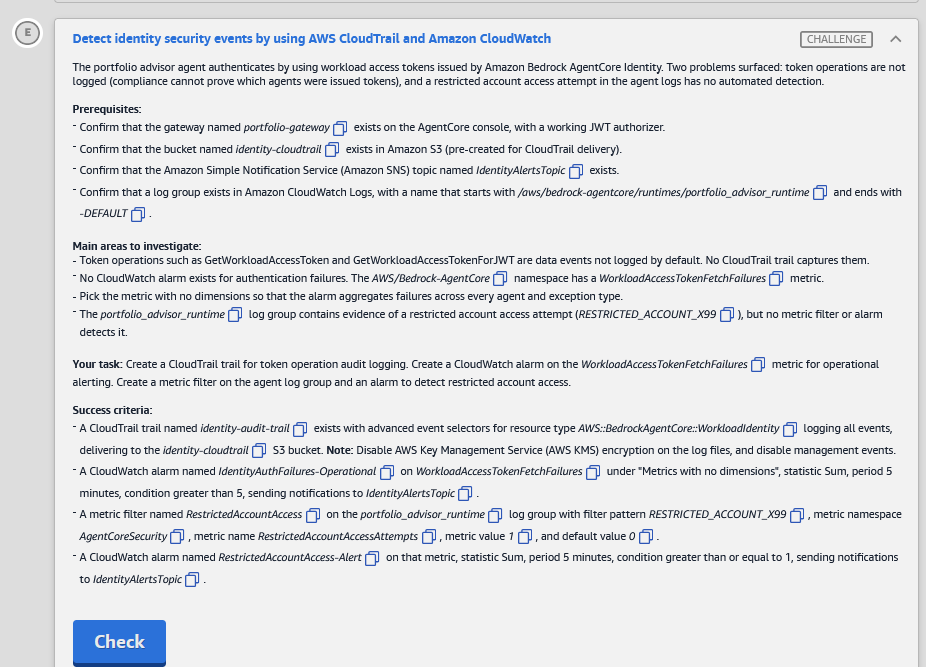
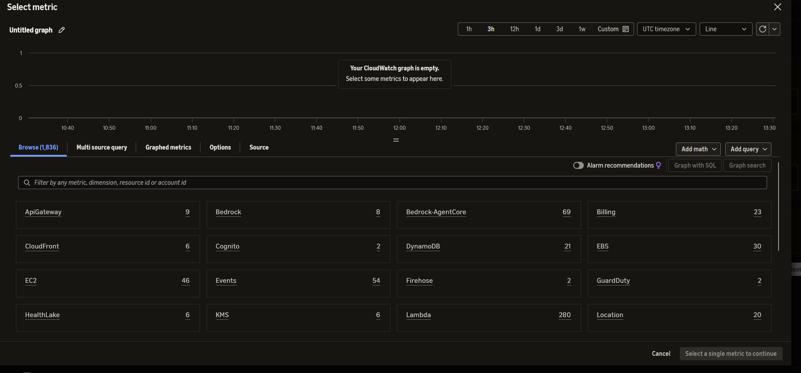
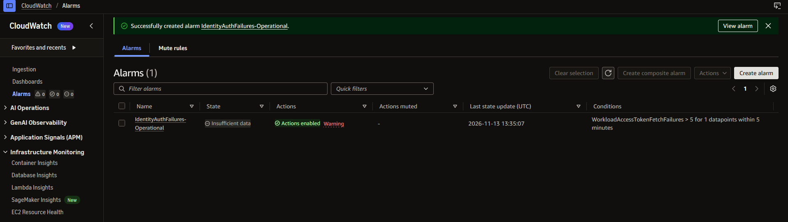
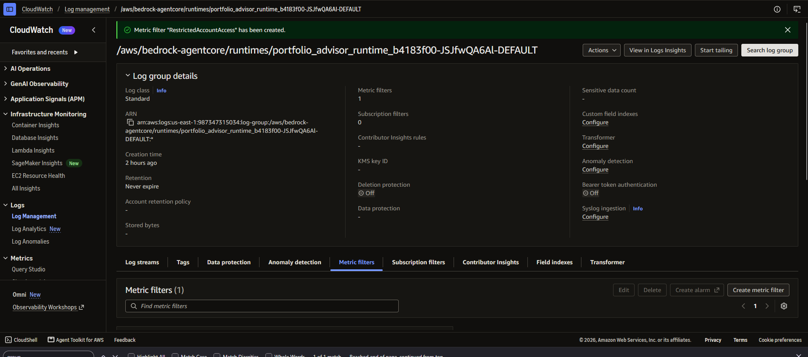
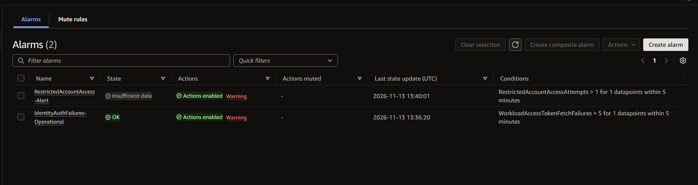
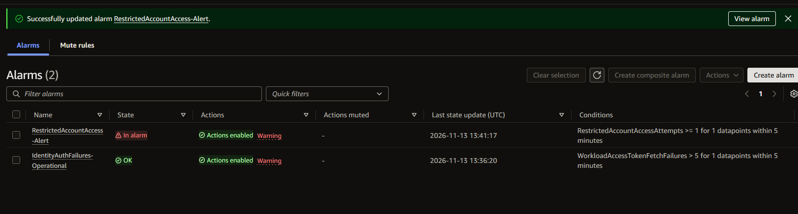

# 🅴 Challenge E: Detect identity security events by using AWS CloudTrail and Amazon CloudWatch

> **Status:** 🟡 In progress · **Diagram label:** E (the **Identity activity monitoring** box: portfolio advisor agent → CloudWatch Logs → alarms → SNS identity alerts topic; AgentCore agent identity → CloudTrail `identity-audit-trail` → S3 `identity-cloudtrail`)
> **Services:** **AWS CloudTrail** (trail, advanced event selectors, data events for `AWS::BedrockAgentCore::WorkloadIdentity`), **Amazon CloudWatch** (metric alarms, Logs metric filters), **Amazon SNS**, Amazon S3
> **Lab:** [AWS Securing Agent Identities Demonstrated](README.md) · **Vault:** [index](../README.md)

---

## ✅ Status checklist (success criteria)

- [ ] Trail **`identity-audit-trail`**:
  - advanced event selectors for **`AWS::BedrockAgentCore::WorkloadIdentity`**, **log all events**
  - delivers to the **`identity-cloudtrail`** S3 bucket
  - **KMS encryption off**, **management events off**
- [ ] Alarm **`IdentityAuthFailures-Operational`**:
  - metric `WorkloadAccessTokenFetchFailures` (*Metrics with no dimensions*)
  - **Sum**, **5 min**, **> 5**
  - notifies **`IdentityAlertsTopic`**
- [ ] Metric filter **`RestrictedAccountAccess`** on the `portfolio_advisor_runtime` log group:
  - pattern **`RESTRICTED_ACCOUNT_X99`**
  - namespace **`AgentCoreSecurity`**, metric **`RestrictedAccountAccessAttempts`**
  - value **1**, default **0**
- [ ] Alarm **`RestrictedAccountAccess-Alert`** on that metric:
  - **Sum**, **5 min**, **>= 1**
  - notifies **`IdentityAlertsTopic`**

---

## 🖼️ Task card



<details>
<summary>Text copy of the task</summary>

**Detect identity security events by using AWS CloudTrail and Amazon CloudWatch**

The portfolio advisor agent authenticates by using workload access tokens issued by Amazon Bedrock AgentCore Identity. Two problems surfaced: token operations are not logged (compliance cannot prove which agents were issued tokens), and a restricted account access attempt in the agent logs has no automated detection.

**Prerequisites:**
- Confirm that the gateway named *portfolio-gateway* exists on the AgentCore console, with a working JWT authorizer.
- Confirm that the bucket named *identity-cloudtrail* exists in Amazon S3 (pre-created for CloudTrail delivery).
- Confirm that the Amazon Simple Notification Service (Amazon SNS) topic named *IdentityAlertsTopic* exists.
- Confirm that a log group exists in Amazon CloudWatch Logs, with a name that starts with */aws/bedrock-agentcore/runtimes/portfolio_advisor_runtime* and ends with *-DEFAULT*.

**Main areas to investigate:**
- Token operations such as GetWorkloadAccessToken and GetWorkloadAccessTokenForJWT are data events not logged by default. No CloudTrail trail captures them.
- No CloudWatch alarm exists for authentication failures. The *AWS/Bedrock-AgentCore* namespace has a *WorkloadAccessTokenFetchFailures* metric.
- Pick the metric with no dimensions so that the alarm aggregates failures across every agent and exception type.
- The *portfolio_advisor_runtime* log group contains evidence of a restricted account access attempt (*RESTRICTED_ACCOUNT_X99*), but no metric filter or alarm detects it.

**Your task:** Create a CloudTrail trail for token operation audit logging. Create a CloudWatch alarm on the *WorkloadAccessTokenFetchFailures* metric for operational alerting. Create a metric filter on the agent log group and an alarm to detect restricted account access.

**Success criteria:**
- A CloudTrail trail named *identity-audit-trail* exists with advanced event selectors for resource type *AWS::BedrockAgentCore::WorkloadIdentity* logging all events, delivering to the *identity-cloudtrail* S3 bucket. **Note:** Disable AWS Key Management Service (AWS KMS) encryption on the log files, and disable management events.
- A CloudWatch alarm named *IdentityAuthFailures-Operational* on *WorkloadAccessTokenFetchFailures* under "Metrics with no dimensions", statistic Sum, period 5 minutes, condition greater than 5, sending notifications to *IdentityAlertsTopic*.
- A metric filter named *RestrictedAccountAccess* on the *portfolio_advisor_runtime* log group with filter pattern *RESTRICTED_ACCOUNT_X99*, metric namespace *AgentCoreSecurity*, metric name *RestrictedAccountAccessAttempts*, metric value *1*, and default value *0*.
- A CloudWatch alarm named *RestrictedAccountAccess-Alert* on that metric, statistic Sum, period 5 minutes, condition greater than or equal to 1, sending notifications to *IdentityAlertsTopic*.

</details>

---

## 🗺️ Where it sits in the architecture

```text
AUDIT (who was issued tokens?)
  agents ─GetWorkloadAccessToken / …ForJWT / …ForUserId─▶ AgentCore Identity (WorkloadIdentity resources)
        └─ CloudTrail DATA events ─▶ trail identity-audit-trail ─▶ S3 identity-cloudtrail-b4183f00   (SSE-S3, no KMS)
           (management events OFF: this trail is only for token operations)

OPERATIONAL (are token fetches failing?)
  AWS/Bedrock-AgentCore : WorkloadAccessTokenFetchFailures (no dimensions = all agents, all exception types)
        └─ alarm IdentityAuthFailures-Operational  Sum/5 min > 5 ─▶ SNS IdentityAlertsTopic

SECURITY (did someone touch the restricted account?)
  /aws/bedrock-agentcore/runtimes/portfolio_advisor_runtime…-DEFAULT  (agent logs)
        └─ metric filter RestrictedAccountAccess  "RESTRICTED_ACCOUNT_X99" → AgentCoreSecurity:RestrictedAccountAccessAttempts (1 / default 0)
              └─ alarm RestrictedAccountAccess-Alert  Sum/5 min >= 1 ─▶ SNS IdentityAlertsTopic
```

### Where each step happens

| Step | Where | UI path | CLI (CloudShell) |
|---|---|---|---|
| 0 | CloudShell | `>_` in the top bar, or the **CloudShell** link at the bottom-left | `sns list-topics`, `logs describe-log-groups` |
| 1 | **CloudTrail → Trails** | **Create trail** → existing bucket, KMS off → events: Data only, WorkloadIdentity, Log all | `create-trail`, `put-event-selectors`, `start-logging` |
| 2 | **CloudWatch → Alarms** | **Create alarm** → Bedrock-AgentCore → *Metrics with no dimensions* | `put-metric-alarm` |
| 3 | **CloudWatch → Logs → Log groups → …-DEFAULT → Metric filters** | **Create metric filter** | `logs put-metric-filter` |
| 4 | **Same Metric filters tab** | tick the filter → **Create alarm** | `put-metric-alarm` |

---

## 🔍 Root cause

1. **Token issuance is invisible.** `GetWorkloadAccessToken*` are **data events**. CloudTrail logs only **management** events by default, and no trail selected these, so compliance couldn't prove which agent got which token.
2. **Failures had no alert.** AgentCore already publishes `WorkloadAccessTokenFetchFailures`, but nothing watched it.
3. **A security signal only sat in the logs.** `RESTRICTED_ACCOUNT_X99` appears in the agent's logs, but logs alone don't alert. A **metric filter** turns the matching lines into a metric, and an **alarm** turns that metric into a notification.

---

## 🛠️ Solution

### Values

| Thing | Value |
|---|---|
| Trail | `identity-audit-trail` → bucket `identity-cloudtrail-b4183f00`, **no KMS**, **Data events only**: `AWS::BedrockAgentCore::WorkloadIdentity`, *Log all events* |
| SNS topic | `IdentityAlertsTopic…` (may have a suffix, so look it up) |
| Alarm 1 | `IdentityAuthFailures-Operational`: `AWS/Bedrock-AgentCore` / `WorkloadAccessTokenFetchFailures`, **no dimensions**, Sum, 300 s, **`>` 5** |
| Log group | `/aws/bedrock-agentcore/runtimes/portfolio_advisor_runtime…-DEFAULT` |
| Metric filter | `RestrictedAccountAccess`: pattern `RESTRICTED_ACCOUNT_X99` → `AgentCoreSecurity` / `RestrictedAccountAccessAttempts`, value 1, default 0 |
| Alarm 2 | `RestrictedAccountAccess-Alert`: `AgentCoreSecurity` / `RestrictedAccountAccessAttempts`, Sum, 300 s, **`>=` 1** |

### Step 0: Look up the topic and log group (CloudShell)

```bash
export AWS_DEFAULT_REGION=us-east-1
TOPIC=$(aws sns list-topics --query "Topics[?contains(TopicArn,'IdentityAlertsTopic')].TopicArn | [0]" --output text); echo $TOPIC
LG=$(aws logs describe-log-groups --log-group-name-prefix /aws/bedrock-agentcore/runtimes/portfolio_advisor_runtime \
  --query "logGroups[?ends_with(logGroupName,'-DEFAULT')].logGroupName | [0]" --output text); echo $LG
```

### Step 1: CloudTrail trail

**UI:**
1. Top search bar → **CloudTrail** → left nav **Trails** → **Create trail**.
2. **Choose trail attributes:**
   - Trail name: `identity-audit-trail`
   - Storage location: **Use existing S3 bucket** → **Browse** → `identity-cloudtrail-b4183f00`
   - **Log file SSE-KMS encryption:** **untick Enabled**, because it's on by default
   - Log file validation: leave it
   - SNS notification delivery: off
   - CloudWatch Logs: off
   - → **Next**
3. **Choose log events:**
   - Event type: ❌ **Management events** · ✅ **Data events** · ❌ Insights · ❌ Network activity
   - **Data events** → **Resource type** → **AgentCore Workload Identity** / `AWS::BedrockAgentCore::WorkloadIdentity` (type "workload" to filter) ⚠️
   - **Log selector template:** **Log all events**
   - → **Next**
4. **Review** → **Create trail**. Logging starts automatically.

**CLI (CloudShell):**
```bash
aws cloudtrail create-trail --name identity-audit-trail --s3-bucket-name identity-cloudtrail-b4183f00
aws cloudtrail put-event-selectors --trail-name identity-audit-trail --advanced-event-selectors \
  '[{"Name":"WorkloadIdentityDataEvents","FieldSelectors":[{"Field":"eventCategory","Equals":["Data"]},{"Field":"resources.type","Equals":["AWS::BedrockAgentCore::WorkloadIdentity"]}]}]'
aws cloudtrail start-logging --name identity-audit-trail
aws cloudtrail get-event-selectors --trail-name identity-audit-trail
aws cloudtrail get-trail-status --name identity-audit-trail --query IsLogging
```
- **No KMS:** `create-trail` without `--kms-key-id` uses SSE-S3.
- **Management events off:** the only advanced selector is the **Data** one, so no management events are logged.

### Step 2: Alarm `IdentityAuthFailures-Operational`

**UI:**
1. **CloudWatch** → **Alarms** → **All alarms** → **Create alarm** → **Select metric**.
2. **Browse** → click the **Bedrock-AgentCore** tile → **Metrics with no dimensions** → ✅ **WorkloadAccessTokenFetchFailures** → **Select metric** (bottom right).

   

   The **Browse** tab shows namespace **tiles** (ApiGateway, Bedrock, **Bedrock-AgentCore**, Billing, …).
   - Click **Bedrock-AgentCore**, then the **Metrics with no dimensions** group. Or type `WorkloadAccessTokenFetchFailures` in the filter box.
   - The bottom-right button reads *"Select a single metric to continue"* until exactly one metric is ticked.
   - On the next page, **Statistic defaults to Average**, so change it to **Sum**.
3. **Statistic:** **Sum** · **Period:** **5 minutes**.
4. **Conditions:** Threshold type **Static** · **Greater** · than **`5`** → **Next**.
5. **Notification:** Alarm state trigger **In alarm** → **Select an existing SNS topic** → `IdentityAlertsTopic…` → **Next**.
6. Alarm name `IdentityAuthFailures-Operational` → **Next** → **Create alarm**.



The expected result:
- State **Insufficient data**. That's not an error; there are just no datapoints yet.
- Condition `WorkloadAccessTokenFetchFailures > 5 for 1 datapoints within 5 minutes`.
- The red **Warning** next to *Actions enabled* usually means the SNS topic has no confirmed subscriber. Hover over it to read the reason. It doesn't change the alarm's configuration.

**CLI:**
```bash
aws cloudwatch put-metric-alarm --alarm-name IdentityAuthFailures-Operational \
  --namespace AWS/Bedrock-AgentCore --metric-name WorkloadAccessTokenFetchFailures \
  --statistic Sum --period 300 --evaluation-periods 1 --threshold 5 \
  --comparison-operator GreaterThanThreshold --alarm-actions $TOPIC
```
**No `--dimensions`.** A dimensioned variant only covers one agent or one exception type.

### Step 3: Metric filter `RestrictedAccountAccess`

**UI:**
1. CloudWatch → left nav **Logs** → **Log Management** (the newer name for *Log groups*) → search `portfolio_advisor_runtime` → open **`/aws/bedrock-agentcore/runtimes/portfolio_advisor_runtime_b4183f00-JSJfwQA6Al-DEFAULT`**.
2. **Metric filters** tab → **Create metric filter**.
3. **Filter pattern:** `RESTRICTED_ACCOUNT_X99`, with **no quotes**. Optional: **Test pattern** → pick a log stream → **Test pattern**, which should show matches. → **Next**.
4. Fill in:
   - Filter name: `RestrictedAccountAccess`
   - Metric namespace: `AgentCoreSecurity` (*Create new*)
   - Metric name: `RestrictedAccountAccessAttempts`
   - Metric value: `1`
   - Default value: `0`
   - Unit: leave it, or *Count*
   - → **Next** → **Create metric filter**

**CLI:**
```bash
aws logs put-metric-filter --log-group-name "$LG" --filter-name RestrictedAccountAccess \
  --filter-pattern RESTRICTED_ACCOUNT_X99 \
  --metric-transformations metricName=RestrictedAccountAccessAttempts,metricNamespace=AgentCoreSecurity,metricValue=1,defaultValue=0
aws logs describe-metric-filters --log-group-name "$LG"
```

### Step 4: Alarm `RestrictedAccountAccess-Alert`



**UI (shortcut):** in the same log group → **Metric filters** tab → **scroll down** to the filter card → ✅ tick **RestrictedAccountAccess** → **Create alarm ↗**.
- The button stays **greyed out until a filter is ticked**.
- It opens in a **new tab** with the metric pre-filled. **Browse** may not show a brand-new metric until it has data.

Then:
1. **Sum** · **5 minutes** · **Static** · **Greater/Equal** · **`1`** → **Next**.
2. **In alarm** → SNS `IdentityAlertsTopic…` → **Next**.
3. Name `RestrictedAccountAccess-Alert` → **Create alarm**.

**CLI:**
```bash
aws cloudwatch put-metric-alarm --alarm-name RestrictedAccountAccess-Alert \
  --namespace AgentCoreSecurity --metric-name RestrictedAccountAccessAttempts \
  --statistic Sum --period 300 --evaluation-periods 1 --threshold 1 \
  --comparison-operator GreaterThanOrEqualToThreshold --alarm-actions $TOPIC
```

### Step 5: Verify and Check

```bash
aws cloudtrail get-trail --name identity-audit-trail --query "Trail.[Name,S3BucketName,KmsKeyId,HasCustomEventSelectors]"
aws cloudwatch describe-alarms --alarm-names IdentityAuthFailures-Operational RestrictedAccountAccess-Alert \
  --query "MetricAlarms[].[AlarmName,Namespace,MetricName,Statistic,Period,Threshold,ComparisonOperator,AlarmActions[0]]" --output table
```
`KmsKeyId` should be `None`. Then press **Check**.

### Order of operations

```text
0 TOPIC/LG → 1 trail → 2 operational alarm → 3 metric filter → 4 security alarm (from the filter) → 5 verify → Check
```

---

## ⚠️ Mistakes & lessons

### Mistake 1: The security alarm was created with **Greater** (`>`) instead of **Greater/Equal** (`>=`)



```text
RestrictedAccountAccess-Alert       Insufficient data   RestrictedAccountAccessAttempts > 1 for 1 datapoints within 5 minutes   ❌ should be >= 1
IdentityAuthFailures-Operational    OK                  WorkloadAccessTokenFetchFailures > 5 for 1 datapoints within 5 minutes  ✅
```

- **Why it's wrong:** with `> 1`, **one** restricted-account attempt in 5 minutes (Sum = 1) does **not** alarm. Security detection must fire on the **first** event. The criterion says *greater than or equal to 1*.
- **Why it happened:** the alarm wizard's **Conditions** radio button defaulted to, or was left on, **Greater**. The first alarm needed Greater, so it was easy to carry over.
- **Fix:** Alarms → `RestrictedAccountAccess-Alert` → **Actions ▾ → Edit** → Conditions **Greater/Equal**, threshold 1 → Next ×3 → **Update alarm**. Or use CLI `put-metric-alarm … --comparison-operator GreaterThanOrEqualToThreshold`, which overwrites it.
- **How to check quickly:** the **Conditions** column on the Alarms list shows the operator (`>` vs `>=`). Read it after creating each alarm.
- **Lesson:** when two similar items differ in one setting (`> 5` vs `>= 1`), check that setting on each one separately.

**After the fix:**



`RestrictedAccountAccess-Alert` went straight to **In alarm**. The agent's logs contain `RESTRICTED_ACCOUNT_X99`, so the filter emitted `1`, Sum ≥ 1, and the alarm fired. With the old `> 1` it would have stayed quiet, which is the same bug seen in practice.

---

## 🧯 Troubleshooting table

| Symptom | Likely cause | Fix |
|---|---|---|
| Trail create → "Insufficient permissions to access S3 bucket" | Bucket policy expects a specific prefix or trail name | Use exactly `identity-audit-trail` and no prefix. The bucket was pre-created for this trail |
| Check fails: KMS | The console's SSE-KMS box was left ticked | Trail → **Edit** → untick SSE-KMS → Save |
| Check fails: management events | Left the Management events box ticked | Trail → **Data events / Management events** → Edit → remove the management selector |
| Can't find WorkloadIdentity in the resource-type list | Label differs | Type `workload` or `AgentCore` in the dropdown, or use the CLI `put-event-selectors` |
| `WorkloadAccessTokenFetchFailures` not under Browse | No datapoints yet, or the wrong Region | Region us-east-1. Or create it with the CLI `put-metric-alarm` (works without data) |
| `RestrictedAccountAccessAttempts` not under Browse | Metric filters don't backfill. No new log lines yet | Use **Create alarm** from the Metric filters tab, or the CLI |
| Filter pattern matches nothing in Test | Quotes or a typo | Exactly `RESTRICTED_ACCOUNT_X99`, no quotes |
| Alarm in **Insufficient data** | Normal when there are no datapoints yet | Not a failure. The Check looks at the configuration |
| Alarms list shows `> 1` for the security alarm | Conditions left on **Greater** | Edit → **Greater/Equal** (Mistake 1) |

---

## 📚 Study notes

### CloudTrail management vs data events

| | Management events | Data events |
|---|---|---|
| What | Control-plane changes (Create/Update/Delete…) | High-volume operations **on** resources (S3 Get/Put, Lambda Invoke, **AgentCore token fetches**) |
| Logged by default? | Yes (90-day Event history, free) | **No**: you must add selectors on a trail. Billed per event |
| Selectors | — | **Advanced event selectors**: `eventCategory=Data` + `resources.type=AWS::BedrockAgentCore::WorkloadIdentity` (+ optional `eventName`, `resources.ARN`) |

### Metric filter → metric → alarm

- **Metric filter:** matches log events, publishes `metricValue` per match, and `defaultValue` (0) when log events arrive without a match. **No backfill.**
- **Alarm:** a statistic (Sum) over a period (300 s) compared to a threshold → states OK / ALARM / INSUFFICIENT_DATA → actions (SNS).
- **Operational vs security thresholds:**
  - `> 5` failures in 5 min = **noise-tolerant** operational alerting
  - `>= 1` restricted access = **zero-tolerance** security alerting

### 🧪 Self-test
1. Why don't token fetches appear in CloudTrail Event history?
2. Why choose the metric with **no dimensions**?
3. Why does the restricted-access metric need `defaultValue 0`?
4. Why might a brand-new filter metric not show up under **Browse**?

---

## 📝 Run log (fill in as I go)

| Step | What I did | Result / output |
|---|---|---|
| 0 | TOPIC / LG | _ARN = ?, log group = ?_ |
| 1 | Trail | _created? KMS none? Data only?_ |
| 2 | Operational alarm (console) | ✅ "Successfully created alarm IdentityAuthFailures-Operational". State **Insufficient data** (normal, no datapoints yet). Actions **enabled** with a *Warning* link (usually an SNS topic with no confirmed subscription, which doesn't affect the config). Condition `WorkloadAccessTokenFetchFailures > 5 for 1 datapoints within 5 minutes` |
| 3 | Metric filter (console) | ✅ "Metric filter "RestrictedAccountAccess" has been created", Metric filters **(1)** on `/aws/bedrock-agentcore/runtimes/portfolio_advisor_runtime_b4183f00-JSJfwQA6Al-DEFAULT` (log class Standard, retention Never expire) |
| 4 | Security alarm (console, via the filter) | Created, but the condition reads `RestrictedAccountAccessAttempts > 1` ❌ (Mistake 1), so edit it to **Greater/Equal**. Meanwhile `IdentityAuthFailures-Operational` → state **OK** at 13:36:20 UTC. ✅ **Fixed** ("Successfully updated alarm RestrictedAccountAccess-Alert"). Condition `RestrictedAccountAccessAttempts >= 1 for 1 datapoints within 5 minutes`. State **In alarm** at 13:41:17 UTC, which means the filter caught `RESTRICTED_ACCOUNT_X99` and detection works end to end |
| 5 | Verify / Check | _result_ |
