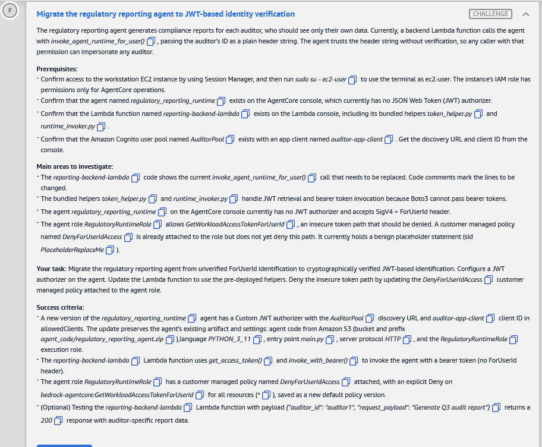

# 🅵 Challenge F: Migrate the regulatory reporting agent to JWT-based identity verification

> **Status:** 🟡 In progress · **Diagram label:** F (**Auditors** → *Invoke function* → **Lambda `reporting-backend-lambda`** → *Interact with agent* → **Regulatory reporting agent**)
> **Services:** Amazon Bedrock **AgentCore Runtime** (new version with a Custom JWT authorizer), Amazon **Cognito** (AuditorPool, auditor-app-client), AWS **Lambda** (code change + Deploy), **IAM** (explicit Deny in a customer managed policy, new default version), AgentCore Identity (`GetWorkloadAccessTokenForUserId` vs `…ForJWT`)
> **Lab:** [AWS Securing Agent Identities Demonstrated](README.md) · **Vault:** [index](../README.md)

---

## ✅ Status checklist (success criteria)

- [ ] A **new version** of `regulatory_reporting_runtime` has a **Custom JWT authorizer**: **AuditorPool** discovery URL, **auditor-app-client** ID in `allowedClients`. It **keeps** the existing settings:
  - S3 code `agent_code/regulatory_reporting_agent.zip`
  - `PYTHON_3_11`, `main.py`
  - `HTTP`
  - `RegulatoryRuntimeRole`
- [ ] `reporting-backend-lambda` uses **`get_access_token()`** + **`invoke_with_bearer()`** (bearer token, **no** ForUserId header)
- [ ] `RegulatoryRuntimeRole` → `DenyForUserIdAccess` has an **explicit Deny** on **`bedrock-agentcore:GetWorkloadAccessTokenForUserId`**, Resource **`*`**. Saved as a **new default version**
- [ ] *(Optional)* Lambda test `{"auditor_id": "auditor1", "request_payload": "Generate Q3 audit report"}` → **200** with that auditor's report

---

## 🖼️ Task card



<details>
<summary>Text copy of the task</summary>

**Migrate the regulatory reporting agent to JWT-based identity verification**

The regulatory reporting agent generates compliance reports for each auditor, who should see only their own data. Currently, a backend Lambda function calls the agent with *invoke_agent_runtime_for_user()*, passing the auditor's ID as a plain header string. The agent trusts the header string without verification, so any caller with that permission can impersonate any auditor.

**Prerequisites:**
- Confirm access to the workstation EC2 instance by using Session Manager, and then run `sudo su - ec2-user` to use the terminal as ec2-user. The instance's IAM role has permissions only for AgentCore operations.
- Confirm that the agent named *regulatory_reporting_runtime* exists on the AgentCore console, which currently has no JSON Web Token (JWT) authorizer.
- Confirm that the Lambda function named *reporting-backend-lambda* exists on the Lambda console, including its bundled helpers *token_helper.py* and *runtime_invoker.py*.
- Confirm that the Amazon Cognito user pool named *AuditorPool* exists with an app client named *auditor-app-client*. Get the discovery URL and client ID from the console.

**Main areas to investigate:**
- The *reporting-backend-lambda* code shows the current *invoke_agent_runtime_for_user()* call that needs to be replaced. Code comments mark the lines to be changed.
- The bundled helpers *token_helper.py* and *runtime_invoker.py* handle JWT retrieval and bearer token invocation because Boto3 cannot pass bearer tokens.
- The agent *regulatory_reporting_runtime* on the AgentCore console currently has no JWT authorizer and accepts SigV4 + ForUserId header.
- The agent role *RegulatoryRuntimeRole* allows *GetWorkloadAccessTokenForUserId*, an insecure token path that should be denied. A customer managed policy named *DenyForUserIdAccess* is already attached to the role but does not yet deny this path. It currently holds a benign placeholder statement (sid *PlaceholderReplaceMe*).

**Your task:** Migrate the regulatory reporting agent from unverified ForUserId identification to cryptographically verified JWT-based identification. Configure a JWT authorizer on the agent. Update the Lambda function to use the pre-deployed helpers. Deny the insecure token path by updating the *DenyForUserIdAccess* customer managed policy attached to the agent role.

**Success criteria:**
- A new version of the *regulatory_reporting_runtime* agent has a Custom JWT authorizer with the *AuditorPool* discovery URL and *auditor-app-client* client ID in allowedClients. The update preserves the agent's existing artifact and settings: agent code from Amazon S3 (bucket and prefix *agent_code/regulatory_reporting_agent.zip*), language *PYTHON_3_11*, entry point *main.py*, server protocol *HTTP*, and the *RegulatoryRuntimeRole* execution role.
- The *reporting-backend-lambda* Lambda function uses *get_access_token()* and *invoke_with_bearer()* to invoke the agent with a bearer token (no ForUserId header).
- The agent role *RegulatoryRuntimeRole* has a customer managed policy named *DenyForUserIdAccess* attached, with an explicit Deny on *bedrock-agentcore:GetWorkloadAccessTokenForUserId* for all resources (*), saved as a new default policy version.
- (Optional) Testing the *reporting-backend-lambda* Lambda function with payload `{"auditor_id": "auditor1", "request_payload": "Generate Q3 audit report"}` returns a *200* response with auditor-specific report data.

</details>

---

## 🗺️ Where it sits in the architecture

```text
BEFORE (unverified identity)
  Auditors → reporting-backend-lambda ─SigV4 + invoke_agent_runtime_for_user(runtimeUserId="auditor1")─▶
             regulatory_reporting_runtime [no authorizer]
             agent: GetWorkloadAccessTokenForUserId("auditor1")   ← trusts a plain string ❌
  → anyone allowed to call ForUser can claim to be any auditor

AFTER (cryptographically verified identity)
  Auditors → reporting-backend-lambda
             ├─ token_helper.get_access_token()  ─▶ Cognito AuditorPool / auditor-app-client ─▶ signed JWT
             └─ runtime_invoker.invoke_with_bearer(token, …) ─HTTPS Authorization: Bearer <JWT>─▶
             regulatory_reporting_runtime vN [CUSTOM_JWT: AuditorPool discovery URL, allowedClients=[auditor-app-client]]
             agent: identity comes from the verified token (…ForJWT path)
  RegulatoryRuntimeRole + DenyForUserIdAccess: explicit Deny GetWorkloadAccessTokenForUserId on *   ← old path closed
```

**Why three changes, not one:**

| Change | What it does | If you skip it |
|---|---|---|
| **JWT authorizer** | The runtime rejects unsigned or forged identities | — |
| **Lambda update** | The caller sends a real token | The runtime rejects the Lambda's calls |
| **Explicit Deny** | Removes the ForUserId fallback, even if another Allow exists | The ForUserId fallback stays open |

### Where each step happens

| Step | Where | UI path | CLI alternative |
|---|---|---|---|
| 0 | **Cognito → AuditorPool** | Overview (token signing key URL → discovery URL). Applications → App clients → `auditor-app-client` (Client ID) | CloudShell: `list-user-pools`, `list-user-pool-clients` |
| 1 | **AgentCore runtime** | Agents → `regulatory_reporting_runtime…` → Edit → Inbound auth JWT ⚠️ | **Workstation:** `get-agent-runtime` → script → `update-agent-runtime` |
| 2 | **IAM → Roles → RegulatoryRuntimeRole → DenyForUserIdAccess** | Edit → JSON → replace `PlaceholderReplaceMe` → Save changes | CloudShell: `create-policy-version --set-as-default` |
| 3 | **Lambda → reporting-backend-lambda → Code** | Edit `lambda_function.py` → **Deploy** | CloudShell: `update-function-code` (zip), console is easier |
| 4 | **Lambda → Test** | Event `{"auditor_id":"auditor1",…}` → Test | CloudShell: `aws lambda invoke` |

---

## 🔍 Root cause

1. **Identity by assertion.** `invoke_agent_runtime_for_user()` sends the auditor ID as a **plain header** (`X-Amzn-Bedrock-AgentCore-Runtime-User-Id` ⚠️). The agent exchanges it with `GetWorkloadAccessTokenForUserId` and **trusts it**. Nothing proves the caller *is* that auditor.
2. **No inbound authorizer.** The runtime accepts SigV4, so any IAM principal allowed to invoke "for user" can impersonate any auditor.
3. **The insecure path stays open in IAM.** `RegulatoryRuntimeRole` still allows `GetWorkloadAccessTokenForUserId`. `DenyForUserIdAccess` only holds a placeholder.

---

## 🛠️ Solution

### Values

| Name | Value |
|---|---|
| Runtime ID | `regulatory_reporting_runtime_b4183f00-97rzpCB6D8` (from Challenge B's identity list) |
| Code | `agent_code/regulatory_reporting_agent.zip` (bucket from the current config) |
| Role | `RegulatoryRuntimeRole…` |
| AuditorPool | `AuditorPool…` → ID _(fill in)_ |
| Discovery URL | `https://cognito-idp.us-east-1.amazonaws.com/<AuditorPoolId>/.well-known/openid-configuration` |
| auditor-app-client ID | _(fill in)_ |
| Policy | `DenyForUserIdAccess`: replace sid `PlaceholderReplaceMe` |

### Step 0: AuditorPool values

**UI:**
1. Cognito → **User pools** → **AuditorPool…** → **Overview**.
2. Copy the **Token signing key URL** and replace `jwks.json` with **`openid-configuration`**.
3. *Applications* → **App clients** → **auditor-app-client…** → **Client ID** (copy icon).

**CLI (CloudShell):**
```bash
APOOL=$(aws cognito-idp list-user-pools --max-results 50 --query "UserPools[?starts_with(Name,'AuditorPool')].Id | [0]" --output text); echo $APOOL
echo "https://cognito-idp.us-east-1.amazonaws.com/$APOOL/.well-known/openid-configuration"
aws cognito-idp list-user-pool-clients --user-pool-id $APOOL --query "UserPoolClients[].[ClientName,ClientId]" --output table
```

### Step 1: New runtime version with a JWT authorizer (workstation)

Use the Challenge A lessons: **read the current version explicitly**, build the update from it, and **change only the authorizer**.

```bash
sudo su - ec2-user
export AWS_DEFAULT_REGION=us-east-1
export RRID=regulatory_reporting_runtime_b4183f00-97rzpCB6D8
V=$(aws bedrock-agentcore-control get-agent-runtime --agent-runtime-id "$RRID" --query agentRuntimeVersion --output text); echo "current version=$V"
aws bedrock-agentcore-control get-agent-runtime --agent-runtime-id "$RRID" --agent-runtime-version "$V" > rr_current.json; cat rr_current.json
```

```bash
export DISC="https://cognito-idp.us-east-1.amazonaws.com/<AuditorPoolId>/.well-known/openid-configuration"
export AUD_CLIENT="<auditor-app-client ID>"
aws bedrock-agentcore-control update-agent-runtime --generate-cli-skeleton input > skel.json
python3 - <<'EOF'
import json, os
cur = json.load(open('rr_current.json')); allowed = set(json.load(open('skel.json')))
keep = ['agentRuntimeArtifact','roleArn','networkConfiguration','environmentVariables','lifecycleConfiguration',
        'metadataConfiguration','requestHeaderConfiguration','description']
req = {'agentRuntimeId': cur['agentRuntimeId']}
req.update({k: cur[k] for k in keep if k in cur and k in allowed})
if 'protocolConfiguration' in allowed: req['protocolConfiguration'] = {'serverProtocol': 'HTTP'}
req['authorizerConfiguration'] = {'customJWTAuthorizer': {'discoveryUrl': os.environ['DISC'], 'allowedClients': [os.environ['AUD_CLIENT']]}}
json.dump(req, open('rr_update.json','w'), indent=2)
print(json.dumps(req, indent=2)); print('NOT copied:', [k for k in cur if k not in req])
EOF
# check: artifact prefix agent_code/regulatory_reporting_agent.zip, role, env vars present; authorizer = your values
aws bedrock-agentcore-control update-agent-runtime --cli-input-json file://rr_update.json
aws bedrock-agentcore-control get-agent-runtime --agent-runtime-id "$RRID" \
  --query "[status,agentRuntimeVersion,authorizerConfiguration.customJWTAuthorizer,environmentVariables]"
```
Poll until **READY**, with the version one higher than before. The `DEFAULT` endpoint follows it automatically.

**Console alternative ⚠️:** AgentCore → **Agents** → `regulatory_reporting_runtime…` → **Edit / Update** → Inbound auth **Use JWT** → discovery URL + **Allowed clients** = the auditor client ID → leave the rest → **Save**. That creates a new version.

### Step 2: Explicit Deny on the ForUserId token path (IAM)

**UI:** IAM → **Roles** → search `RegulatoryRuntimeRole` → **Permissions** → **DenyForUserIdAccess** (Customer managed) → **Edit** → **JSON**. Replace the statement with `"Sid": "PlaceholderReplaceMe"` with:

```json
{
  "Sid": "DenyGetWorkloadAccessTokenForUserId",
  "Effect": "Deny",
  "Action": "bedrock-agentcore:GetWorkloadAccessTokenForUserId",
  "Resource": "*"
}
```
Keep any other statements, such as the lab Deny guardrails. Then **Next** → **Save changes** → **Policy versions** tab: the new version should be **(Default)**.

**CLI (CloudShell):**
```bash
P=$(aws iam list-policies --scope Local --query "Policies[?starts_with(PolicyName,'DenyForUserIdAccess')].Arn | [0]" --output text); echo $P
V=$(aws iam get-policy --policy-arn $P --query Policy.DefaultVersionId --output text)
aws iam get-policy-version --policy-arn $P --version-id $V --query PolicyVersion.Document > cur.json
python3 - <<'EOF'
import json
d = json.load(open('cur.json'))
d['Statement'] = [s for s in d['Statement'] if s.get('Sid') != 'PlaceholderReplaceMe']
d['Statement'].insert(0, {'Sid':'DenyGetWorkloadAccessTokenForUserId','Effect':'Deny',
                          'Action':'bedrock-agentcore:GetWorkloadAccessTokenForUserId','Resource':'*'})
json.dump(d, open('new.json','w'), indent=2); print(json.dumps(d, indent=2))
EOF
aws iam create-policy-version --policy-arn $P --policy-document file://new.json --set-as-default
```

**Why an explicit Deny:** in IAM, an **explicit Deny always wins** over any Allow, including the role's existing Allow. So the insecure path is closed no matter what other policies say.

### Step 3: Update the Lambda code

**UI:** Lambda → **Functions** → `reporting-backend-lambda` → **Code** tab → open `lambda_function.py`. Find the commented block around `invoke_agent_runtime_for_user(...)`.
- Replace it with `get_access_token()` (from `token_helper`) followed by `invoke_with_bearer(...)` (from `runtime_invoker`).
- Remove the ForUserId call and any `runtimeUserId` / user-ID header.
- → **Deploy**. The code isn't live until you deploy (Lab 01 lesson).

_Exact code: fill in after reading `lambda_function.py`, `token_helper.py` and `runtime_invoker.py` (signatures, env vars)._

### Step 4: Test, then Check

Lambda → **Test** tab → new event:
```json
{"auditor_id": "auditor1", "request_payload": "Generate Q3 audit report"}
```
→ **Test**. Expect **200** with auditor1's data. Then press **Check**.

### Order of operations

```text
0 pool/client → 1 runtime update (start first, it takes minutes) → 2 IAM Deny (while waiting)
→ 3 Lambda code + Deploy → wait runtime READY → 4 test → Check
```

---

## ⚠️ Mistakes & lessons

_Fill in as I go. Screenshots go in `assets/challenge_F/`._

---

## 🧯 Troubleshooting table

| Symptom | Likely cause | Fix |
|---|---|---|
| New version lost env vars or the artifact | Hand-built update / wrong source file | Build from `rr_current.json` read **with `--agent-runtime-version`** (Challenge A Mistakes 3–4) |
| Lambda test → 401 / 403 from the runtime | Lambda not deployed (still SigV4 + ForUser), wrong discovery URL or client ID, or `allowedAudience` set | Deploy. Check the authorizer values. Leave audiences empty |
| Lambda test → `ImportError` | Wrong module or function names | Match `token_helper.py` / `runtime_invoker.py` exactly |
| Lambda test → token error from Cognito | The helper's env vars (domain, client ID, secret) are missing or wrong | Check what `token_helper.py` reads, then Configuration → Environment variables |
| Lambda test → timeout | The runtime is still UPDATING, or the Lambda timeout is too short | Wait for READY. Raise the Lambda timeout if needed |
| Check fails on the policy | Placeholder kept, Allow instead of Deny, wrong action name, or the new version isn't the default | Exactly `Effect: Deny`, `bedrock-agentcore:GetWorkloadAccessTokenForUserId`, `Resource: "*"`, Default |

---

## 📚 Study notes

### Three ways an agent gets a workload access token

| API | Identity source | Trust |
|---|---|---|
| `GetWorkloadAccessToken` | The agent itself (machine) | The caller's IAM role |
| `GetWorkloadAccessTokenForUserId` | A **user ID string** passed by the caller | ⚠️ Only as good as the caller. **Assertion**, not proof |
| `GetWorkloadAccessTokenForJWT` | A **signed JWT** from the IdP | ✅ Verified signature, issuer, client and expiry. **Proof** |

### Why bearer needs helpers

- Boto3 signs requests with **SigV4**. A JWT-protected runtime instead expects `Authorization: Bearer <JWT>` on its HTTPS endpoint.
- So the Lambda calls the runtime URL directly with `requests`/`urllib`. That's what `runtime_invoker.invoke_with_bearer()` does.
- It gets the token from Cognito with `token_helper.get_access_token()`.

### 🧪 Self-test
1. Why is `invoke_agent_runtime_for_user()` an impersonation risk?
2. Why add an **explicit Deny** when you could just remove the Allow?
3. Why can't the Lambda use `boto3 invoke_agent_runtime` after the migration?
4. Which three runtime settings must survive the update, besides the authorizer?

---

## 📝 Run log (fill in as I go)

| Step | What I did | Result / output |
|---|---|---|
| 0 | AuditorPool / client | _pool ID = ?, client ID = ?_ |
| 1 | Runtime update | _old v = ?, new v = ?, READY? env vars kept?_ |
| 2 | DenyForUserIdAccess | _new default version = ?_ |
| 3 | Lambda code + Deploy | _deployed?_ |
| 4 | Test / Check | _200? result_ |
