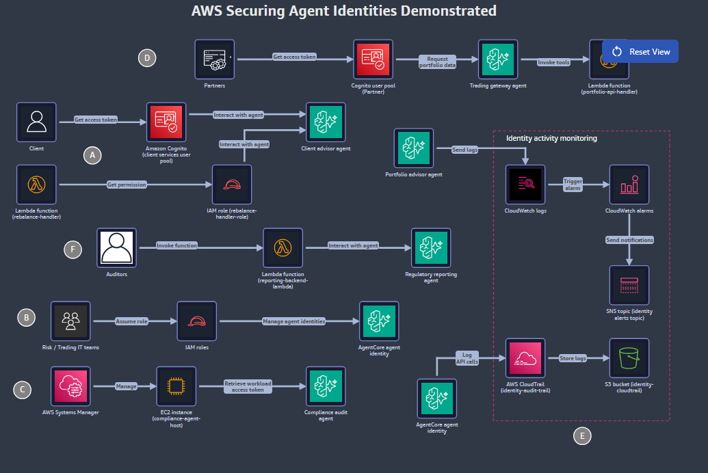

# 🔐 AWS Securing Agent Identities Demonstrated

> **Lab:** "AWS Securing Agent Identities Demonstrated", one of the challenge sets for the AWS Partner FDE credential.
> **Theme:** close **critical identity gaps** across a fleet of **Amazon Bedrock AgentCore** agents on *AnyCompany Financial Services'* AI trading platform, weeks before a **PCI DSS** audit. The work covers **workload identities** (including one for a **self-hosted** agent), **tag-based access control**, **scoped JWT** authorization for inbound calls, a **SigV4** path for a service caller, and **CloudTrail + CloudWatch** audit trails for token operations.
> **Region:** `us-east-1` only · **Time limit:** **135 minutes** (no pause, no restart) · **Retake wait if failed:** **25 days**
> **Started:** 13 Nov 2026 · **Status legend:** ✅ passed · 🟡 in progress · ⬜ not started · ⚠️ needs improvement
> **Back to:** [Vault index](../README.md) · Previous lab: [03 Agentic AI](../03_AWS_Agentic_AI_Demonstrated/README.md)

---

## 🏆 Result: _pending_

| | |
|---|---|
| **Microcredential** | AWS Securing Agent Identities Demonstrated |
| **Result** | 🟡 In progress |
| **Pass date** | _—_ |
| **Valid until** | _—_ (Labs 01/02 were valid for one year from the pass date) |
| **Renew / retake from** | _—_ (Labs 01/02: 9 months after passing) |
| **Badge** | Claim it from the **Credly** email, then add it to the **AWS Skills Profile** |

_Add the result screenshot as `assets/00_exam_result_passed.png` when I have it._

---

## 📄 Lab brief (verbatim, as given in the lab, 13 Nov 2026)

### Description

> AWS Securing Agent Identities Demonstrated is a hands-on exam lab that validates your AWS skills in the security domain, focusing on identity and access hardening for agentic AI workloads. In this timed assessment, you work in a live, AWS-provisioned environment to remediate critical identity gaps across a fleet of Amazon Bedrock AgentCore agents. You provision workload identities, enforce tag-based access control, gate inbound access with scoped JWT authorization, and establish audit trails for token operations.
>
> This exam lab runs in a live, AWS-provisioned environment. After you begin, you have 135 minutes to complete all challenges. This exam lab provides procedural guidance but no hints. To pass, you must demonstrate proficiency in the Securing Agent Identities domain.
>
> **Important:** Each exam lab is continuously tested for reliability. If something appears broken during your attempt, revisit the challenge guidance carefully; most issues stem from a missed configuration step rather than a technical fault.
>
> **Tip:** Participants who carefully read all provided guidance before acting are significantly more likely to pass. Take time to understand each challenge fully, even under time pressure.
>
> **Before you begin:** Challenges are randomized and might not reflect the sequence of real-life scenarios. This exam lab cannot be paused or restarted. If you exit, you will need to start again from the beginning. If you fail the exam lab, you will need to wait 25 days before attempting it again.
>
> To prepare for this assessment, we recommend the following training:
> - AWS Cloud Quest: Security
> - AWS Cloud Quest: Generative AI Architect
> - AWS SimuLearn: Getting Started with AgentCore Runtime
> - AWS SimuLearn: Identity and Access Management
> - Building Production-Ready AI Agents with Amazon Bedrock AgentCore

### Objectives

> 1. Restrict workload identity access by using tag-based access control
> 2. Provision a workload identity for a self-hosted agent
> 3. Configure scoped JWT authorization for inbound agent access
> 4. Configure a SigV4 path for the rebalancing service
> 5. Migrate the regulatory reporting agent to JWT-based identity verification
> 6. Detect identity security events by using AWS CloudTrail and Amazon CloudWatch

_The brief lists the objectives without numbers. I numbered them so the tables below can refer to them._

### AWS Services

> - Amazon Bedrock
> - AWS CloudTrail
> - Amazon CloudWatch
> - Amazon Cognito
> - Amazon Elastic Compute Cloud
> - AWS Identity and Access Management
> - Amazon Simple Storage Service
> - AWS Systems Manager

### Problem Description

> AnyCompany Financial Services' AI-powered trading platform on Amazon Bedrock AgentCore has failed a quarterly security review weeks before its PCI DSS audit. A fleet of specialized agents scaled fast and accumulated critical identity gaps: untagged shared workload identities, overly broad AWS Identity and Access Management (IAM) policies, missing inbound authorizers, an unverified user-ID header pattern, and no audit trail on token operations.
>
> The platform spans the following services and capabilities:
> - Agent and access – Amazon Bedrock AgentCore
> - Authentication – Amazon Cognito
> - Compute and operations – AWS Lambda, Amazon EC2, AWS Systems Manager
> - Access control – IAM
> - Observability – AWS CloudTrail, Amazon CloudWatch, Amazon Simple Notification Service (Amazon SNS)
>
> The platform's workstation EC2 instance is accessed by using Session Manager, a capability of AWS Systems Manager.
>
> **Your challenge:**
> - Isolate team-owned workload identities by using tag-based access control, and provision an identity for a self-hosted compliance agent.
> - Gate inbound gateway access with scoped Amazon Cognito JSON Web Token (JWT) authorization for multi-tenant partners.
> - Give an internal SigV4 service its own authentication path without breaking JWT callers.
> - Migrate the regulatory reporting agent to cryptographically verified JWT-based user identification.
> - Set up CloudTrail data events and CloudWatch alarms for token issuance and authentication-failure detection.
>
> Harden the platform's identity posture across all agents before the audit begins.

### Solution Resources

> To access the workstation, use the following steps:
> 1. Copy the WorkstationInstanceId value (this is the EC2 instance ID for your workstation).
> 2. On the AWS Management Console, open the Amazon EC2 console and locate the instance with that instance ID.
> 3. Select the instance, choose Connect, and then choose the Session Manager tab.
> 4. Choose Connect to start a terminal session on the instance.
> 5. For Region, confirm that US East (N. Virginia) us-east-1 is selected. If a different AWS Region appears, switch to US East (N. Virginia) us-east-1. The lab infrastructure is deployed in that Region.
>
> **Important:**
> - This AWS microcredential assessment has been preconfigured with the AWS Identity and Access Management (IAM) permissions your session needs for every challenge. You do not need to author or edit any IAM policy documents to complete any task.
> - Some challenges do involve IAM changes, such as editing an existing customer managed policy that is already attached to a pre-created role. You edit these policies in place by saving a new policy version. You never create or attach a policy from scratch.

| Name | Value |
|---|---|
| AgentCodeBucketName | `agent-code-bucket-b4183f00` |
| ClientAdvisorAgentCodeS3Uri | `s3://agent-code-bucket-b4183f00/agent_code/client_advisor_agent.zip` |
| ClientAdvisorRuntimeArn | `arn:aws:bedrock-agentcore:us-east-1:987347315034:runtime/client_advisor_runtime_b4183f00-jD0mCRBx4b` |
| ClientAdvisorRuntimeRoleARN | `arn:aws:iam::987347315034:role/ClientAdvisorRuntimeRole-b4183f00` |
| CloudTrailBucketName | `identity-cloudtrail-b4183f00` |
| PortfolioLambdaArn | `arn:aws:lambda:us-east-1:987347315034:function:portfolio-api-handler-b4183f00` |
| PortfolioToolSchemaS3Uri | `s3://agent-code-bucket-b4183f00/schemas/portfolio_tools.json` |
| WorkstationInstanceId | `i-019262426d5ae9111` |

> ⚠️ These values are for **this launch** (suffix `b4183f00`, account `987347315034`). A new launch gets new values.

---

## 🎯 Scope

**Rules that matter:**
- **135 minutes**, 5 more than Lab 03. The lab **can't be paused or restarted**, and failing means a **25-day** wait.
- Challenges are **randomized**: the order on screen isn't the dependency order.
- *"Procedural guidance but no hints."* Lab 03 said *"necessary guidance but not step-by-step solutions"*. Expect each card to say **what** to configure, not **where** or **how**.
- *"Most issues stem from a missed configuration step rather than a technical fault"*, so re-read the guidance before assuming a bug.
- **IAM rule for this lab (from the panel):** some challenges **edit an existing customer managed policy** that's already attached to a pre-created role. Edit it **in place**, which saves a **new policy version**. **Never create or attach** a policy. So "overly broad IAM policies" means: find the team role's existing policy and narrow it.
  - Click-path: IAM → **Policies** → filter *Customer managed* → the policy → **Edit** → **JSON** → **Next** → **Save changes**. The console saves the change as the new **default** version.
  - IAM keeps **at most 5 versions**. If Save fails on that limit, open **Policy versions**, delete an old *non-default* version, then save again.
- **Work happens in two places:** the **console**, and a **workstation EC2 instance** you open with **Session Manager** (EC2 → `i-019262426d5ae9111` → **Connect** → **Session Manager** → Connect). Expect the self-hosted agent, the CLI and any scripts to be on the workstation.

### Objectives → expected challenges

The problem description names **five gaps**. Each one maps to one or two objectives:

| # | Objective | Gap it fixes (problem description) | Likely work (confirm from the task card ⚠️) | Panel resources |
|---|---|---|---|---|
| 1 | **Restrict workload identity access by using tag-based access control** | *"untagged shared workload identities, overly broad IAM policies"* | **Tag** each team's workload identity (e.g. `team=<name>`). Then edit the team role's **existing** customer managed policy to a new version, narrowing `Resource: "*"` with a `Condition` on `aws:ResourceTag/<key>` for `bedrock-agentcore:GetWorkloadAccessToken*`. "Shared" identities may need **splitting** into one per team | none (the roles and policies are pre-created) |
| 2 | **Provision a workload identity for a self-hosted agent** | *"provision an identity for a self-hosted compliance agent"* (same bullet as #1) | The **compliance agent** runs outside AgentCore (likely on the **workstation**). Create a workload identity for it: in the console (AgentCore → Identity / Outbound Auth ⚠️), or on the workstation with `aws bedrock-agentcore-control create-workload-identity --name … --tags …`. Give it the **same tag scheme** as #1 so the compliance role can get its tokens | `WorkstationInstanceId` |
| 3 | **Configure scoped JWT authorization for inbound agent access** | *"missing inbound authorizers"*; *"Gate inbound **gateway** access with scoped Cognito JWT … for multi-tenant partners"* | On the **AgentCore Gateway**, set inbound auth to **Custom JWT**: Cognito discovery URL, **allowed clients** = the partner app clients, **allowed scopes** if offered ⚠️. If the gateway or its target is missing, add a target: Lambda `portfolio-api-handler-…` with schema `portfolio_tools.json` ⚠️ | `PortfolioLambdaArn`, `PortfolioToolSchemaS3Uri` |
| 4 | **Configure a SigV4 path for the rebalancing service** | *"Give an internal SigV4 service its own authentication path **without breaking JWT callers**"* | **Don't switch the existing JWT resource to IAM**, because that breaks the JWT callers. A runtime or gateway accepts **one** inbound auth type, so build a **second** resource with **IAM (SigV4)** auth. The panel's client-advisor **code zip + role** suggests deploying a **second runtime** from `client_advisor_agent.zip` with role `ClientAdvisorRuntimeRole-…` and **IAM** inbound auth. Another possibility is a second gateway with `AWS_IAM` auth ⚠️ | `ClientAdvisorAgentCodeS3Uri`, `ClientAdvisorRuntimeRoleARN`, `ClientAdvisorRuntimeArn` |
| 5 | **Migrate the regulatory reporting agent to JWT-based identity verification** | *"an unverified user-ID header pattern"* | Today the caller **asserts** the user ID in a header (`X-Amzn-Bedrock-AgentCore-Runtime-User-Id` ⚠️) and the agent trusts it, calling `GetWorkloadAccessTokenForUserId`. The fix is to switch the runtime's inbound auth to **Custom JWT** (Cognito). The user is then taken from a **signature-verified token**, and the agent uses `GetWorkloadAccessTokenForJWT`. This may also need an env var or flag change, and removing `InvokeAgentRuntimeForUser` from a policy ⚠️ | none |
| 6 | **Detect identity security events by using CloudTrail and CloudWatch** | *"no audit trail on token operations"*; *"CloudTrail **data events** and CloudWatch alarms for **token issuance** and **authentication-failure** detection"* | Create a **trail** that writes to S3 `identity-cloudtrail-b4183f00` and to **CloudWatch Logs**, with **data events** (advanced event selectors) for AgentCore identity/token resources. Add **metric filters** for (a) token issuance (`eventName` = `GetWorkloadAccessToken*`) and (b) auth failures (`errorCode` like `AccessDenied` / `Unauthorized*`), then an **alarm** on each that notifies an **SNS** topic | `CloudTrailBucketName` |

### Where each listed service probably shows up

| Service | Expected role in this lab |
|---|---|
| Amazon Bedrock (AgentCore) | The agent fleet: the client advisor runtime, the regulatory reporting agent, the **Gateway** (partner access), and workload identities (**Identity**) |
| AWS IAM | **Edit existing** team-role policies to new versions with tag conditions. Nothing is created or attached |
| Amazon Cognito | The JWT issuer: user pool, resource server + scopes, partner app clients, discovery URL |
| AWS Lambda | `portfolio-api-handler-…`, the gateway's tool target (schema `portfolio_tools.json`) |
| Amazon EC2 | The **workstation**: where the self-hosted compliance agent and the CLI live |
| AWS Systems Manager | **Session Manager**, the way into the workstation |
| AWS CloudTrail | A trail with **data events** for token operations → S3 `identity-cloudtrail-b4183f00` + CloudWatch Logs |
| Amazon CloudWatch | The trail's log group, metric filters (token issuance, auth failures), alarms |
| Amazon SNS | The alarm notification target |
| Amazon S3 | Agent code (`agent-code-bucket-…`), tool schema, CloudTrail logs |

### AgentCore Identity primer (read before starting)

From my own understanding, not verified against current AWS docs. Anything marked ⚠️ needs confirming in the console.

- **Two directions.**
  - **Inbound auth** decides *who may call the agent*: **IAM SigV4** (the default) or a **JWT bearer** token.
  - **Outbound auth** decides *what the agent may call*: the agent gets a **workload access token**, exchanges it at the **token vault** for OAuth2 tokens or API keys, using **credential providers**.
- **Workload identity** is the agent's own identity, stored in the workload identity directory. ARN format: `arn:aws:bedrock-agentcore:<region>:<account>:workload-identity-directory/default/workload-identity/<name>` ⚠️.
  - AgentCore Runtime and Gateway **create one automatically** for each agent they host.
  - A **self-hosted** agent (EC2, ECS, on-prem) needs one created by hand.
- **Token APIs** (data plane, `bedrock-agentcore`):

  | API | When it's used |
  |---|---|
  | `GetWorkloadAccessToken` | The agent acts as itself |
  | `GetWorkloadAccessTokenForJWT` | The agent acts for a user and passes that user's JWT |
  | `GetWorkloadAccessTokenForUserId` | The agent acts for a user identified by user ID |
  | `GetResourceOauth2Token` / `GetResourceApiKey` | The agent exchanges the workload access token for downstream credentials |

  These calls are the "token operations" to audit (objective 6), and the actions to restrict by tag (objective 1).
- **Management APIs** (control plane, `bedrock-agentcore-control`): `CreateWorkloadIdentity` (takes a name, allowed OAuth2 return URLs and **tags**), `Get/List/Update/DeleteWorkloadIdentity`, and `Create*CredentialProvider`.
- **Inbound JWT authorizer fields:** discovery URL, allowed audiences, allowed clients (+ scopes / custom claims ⚠️). A runtime is **either** IAM **or** JWT, not both ⚠️.
- **Cognito gotcha:** a client-credentials (M2M) **access token** has `client_id` and `scope` claims but **no `aud` claim**. So for Cognito M2M tokens, use **allowed clients**, not allowed audience. Lab 03 [Challenge B](../03_AWS_Agentic_AI_Demonstrated/Challenge_B_Cognito_OAuth2_M2M_Client_Credentials_JWT_Authorizers.md) has the same setup.
- **ABAC condition keys:**

  | Key | Matches |
  |---|---|
  | `aws:ResourceTag/<key>` | The tag on the workload identity being accessed |
  | `aws:PrincipalTag/<key>` | The tag on the calling role |
  | `aws:RequestTag/<key>` + `aws:TagKeys` | The tags sent in a create or tag request |

  Check that AgentCore supports each key for the action you're restricting ⚠️.

---

## 🔑 Lab resources (Solution Resources panel, annotated)

> The raw panel, word for word, is in *📄 Lab brief → Solution Resources* above. This table adds what each value is for.
>
> ⚠️ **Values change with every lab launch.** The suffix (`b4183f00` here), the account ID (`987347315034`) and the ARNs are all new each time.

| Output | Value (this launch) | Used for (expected) |
|---|---|---|
| `WorkstationInstanceId` | `i-019262426d5ae9111` | The **workstation**: EC2 → Connect → **Session Manager**. The CLI and the self-hosted compliance agent are here (#2, maybe #5/#6 test scripts) |
| `ClientAdvisorRuntimeArn` | `arn:aws:bedrock-agentcore:us-east-1:987347315034:runtime/client_advisor_runtime_b4183f00-jD0mCRBx4b` | The **existing** client advisor runtime, probably the JWT callers' path. Keep it working (#4) |
| `ClientAdvisorAgentCodeS3Uri` | `s3://agent-code-bucket-b4183f00/agent_code/client_advisor_agent.zip` | Code for a **second** runtime, if #4 means "same agent, IAM-auth copy". Pick the **existing S3** option, not upload (Lab 03 D lesson) |
| `ClientAdvisorRuntimeRoleARN` | `arn:aws:iam::987347315034:role/ClientAdvisorRuntimeRole-b4183f00` | The execution role for that runtime (#4) |
| `PortfolioLambdaArn` | `arn:aws:lambda:us-east-1:987347315034:function:portfolio-api-handler-b4183f00` | Gateway **Lambda target** (#3) |
| `PortfolioToolSchemaS3Uri` | `s3://agent-code-bucket-b4183f00/schemas/portfolio_tools.json` | That target's **tool schema** (#3) |
| `AgentCodeBucketName` | `agent-code-bucket-b4183f00` | Holds the code zip and the schema |
| `CloudTrailBucketName` | `identity-cloudtrail-b4183f00` | The trail's **S3 destination** (#6). Use this bucket and let the console create no new one |

### Testing toolkit (expected ⚠️, confirm in the console)

| Tool | How | What it tells me |
|---|---|---|
| **AgentCore console** | Bedrock AgentCore → **Agents** (runtimes are here; there's no "Runtime" nav item) → agent → inbound auth / endpoints | Each runtime's auth type, JWT config and status |
| **Workload identities** | AgentCore → Connections → **Outbound Auth** ⚠️, or `aws bedrock-agentcore-control list-workload-identities` | Which identities exist, their ARNs and tags |
| **Cognito** | User pool → **App integration** → resource servers, app clients, domain | Scopes, client IDs, token endpoint |
| **IAM policy simulator** | IAM → Policies → policy → **Simulate**, with the agent's role and a resource ARN | Whether a tag condition allows or denies, without calling the API |
| **Workstation (EC2 + SSM)** | EC2 → `i-019262426d5ae9111` → **Connect** → **Session Manager** → Connect. Start with `sudo su - ec2-user` ⚠️, `ls ~`, `aws sts get-caller-identity` | What's on the box (agent code, scripts, README), and which role the CLI runs as |
| **AgentCore CLI checks** | `aws bedrock-agentcore-control list-workload-identities` · `get-agent-runtime --agent-runtime-id …` · `get-gateway --gateway-identifier …` | Identities and tags, and each runtime's or gateway's `authorizerConfiguration` |

### 🧭 Console quick-nav (where things are, so I don't waste time searching)

Open any service by typing its name in the **top search bar**, then follow the path. **Which shell for CLI work:**
- **Workstation:** AgentCore commands only; its role can't call IAM, Lambda or CloudTrail.
- **CloudShell** (`>_` icon in the console top bar): IAM, Lambda, CloudTrail and so on, as the console user.

| Need | Console path | CLI (where) |
|---|---|---|
| Workstation terminal | EC2 → **Instances** → `workstation-b4183f00` → **Connect ▾** (the arrow, not *Connect ↗*) → **Session Manager** → Connect. Or Systems Manager → **Session Manager** → **Start session**. Then `sudo su - ec2-user` | — |
| AgentCore runtimes ("agents") | Bedrock AgentCore → **Agents** (there's no "Runtime" item) → agent → versions / **Endpoints** | Workstation: `get-agent-runtime`, `list-agent-runtime-endpoints` |
| AgentCore gateways | Bedrock AgentCore → *Resources* → **Gateways** → gateway → inbound auth / **Targets** | Workstation: `list-gateways`, `get-gateway` |
| Workload identities | **Not in the console** | Workstation: `list-workload-identities`, `tag-resource`, `list-tags-for-resource` |
| IAM role tags | IAM → **Roles** → search → role → **Tags** tab → **Manage tags** | CloudShell: `aws iam tag-role` |
| IAM customer managed policy | IAM → **Roles** → role → **Permissions** → policy name. Or IAM → **Policies** → filter *Customer managed* → **Edit** → **JSON** → Next → **Save changes** → **Policy versions** tab | CloudShell: `aws iam create-policy-version --set-as-default` |
| Lambda env vars | Lambda → **Functions** → function → **Configuration** tab → **Environment variables** (left) → **Edit** → Save | CloudShell: `aws lambda update-function-configuration --environment` (replaces **all** vars) |
| Lambda test | Lambda → function → **Test** tab → event JSON → **Test** | CloudShell: `aws lambda invoke` |
| Cognito pools / app clients | Cognito → **User pools** → pool → **App integration** / **App clients**, **Domain**, **Resource servers** | CloudShell: `aws cognito-idp …` |
| CloudTrail trail + data events | CloudTrail → **Trails** → **Create trail** (or the trail → **Edit**) → *Data events* → resource type | CloudShell: `aws cloudtrail put-event-selectors --advanced-event-selectors` |
| CloudWatch log metric filter | CloudWatch → **Logs** → **Log groups** → group → **Metric filters** tab → **Create metric filter** | CloudShell: `aws logs put-metric-filter` |
| CloudWatch alarm | CloudWatch → **Alarms** → **All alarms** → **Create alarm** → metric → conditions → **SNS topic** | CloudShell: `aws cloudwatch put-metric-alarm` |
| SNS topic | SNS → **Topics** → topic (ARN for alarm actions) | CloudShell: `aws sns list-topics` |
| **CloudTrail** | CloudTrail → **Event history** (management events), or the trail's log group | Who called which token API, and the `errorCode` |
| **CloudWatch** | Log group → **Metric filters** → test pattern; **Alarms** | Whether the filter matches real events and the alarm fires |

---

## 🗺️ Lab architecture (HLD)



_Diagram saved 13 Nov 2026. The lettered circles mark where each challenge happens. There are **six** labels (A–F), one per objective._

| Label | Component on the diagram | Data flow | Objective (confirm from the task card ⚠️) |
|---|---|---|---|
| **A** | **Client advisor agent**, with two callers: a **Client** through **Amazon Cognito (client services user pool)**, and **Lambda `rebalance-handler`** through **IAM role `rebalance-handler-role`** | Client → *Get access token* → Cognito → *Interact with agent* → client advisor. `rebalance-handler` → *Get permission* → role → *Interact with agent* → client advisor | **#4 SigV4 path for the rebalancing service.** JWT callers (clients) and a SigV4 caller (the rebalance Lambda's role) both reach the client advisor agent. Most likely: a second **IAM-auth** runtime from `client_advisor_agent.zip`, plus a **new version** of `rebalance-handler-role`'s policy allowing invoke on it |
| **B** | **Risk / Trading IT teams** → **IAM roles** → **AgentCore agent identity** | Teams *Assume role* → roles *Manage agent identities* | **#1 Tag-based access control.** Tag each workload identity by team (risk vs trading). Then narrow each team role's policy (new version) with an `aws:ResourceTag` condition, so a role can only manage its own team's identities |
| **C** | **AWS Systems Manager** → **EC2 instance (`compliance-agent-host`)** → **Compliance audit agent** | SSM *Manage* → instance *Retrieve workload access token* → compliance agent | **#2 Workload identity for a self-hosted agent.** Create the compliance agent's workload identity, then get a token from the host (through Session Manager). The host may differ from the workstation `i-019262426d5ae9111` ⚠️ |
| **D** | **Partners** → **Cognito user pool (Partner)** → **Trading gateway agent** → **Lambda `portfolio-api-handler`** | Partners *Get access token* → *Request portfolio data* → gateway *Invoke tools* → Lambda | **#3 Scoped JWT for inbound gateway access.** Gateway inbound = Custom JWT from the **Partner** pool (a separate pool from A's), with allowed clients and scopes. Portfolio Lambda target + `portfolio_tools.json` |
| **E** | **Identity activity monitoring** box: **Portfolio advisor agent** → **CloudWatch Logs** → **CloudWatch alarms** → **SNS topic (identity alerts topic)**. **AgentCore agent identity** → **AWS CloudTrail (`identity-audit-trail`)** → **S3 (`identity-cloudtrail`)** | Agent *Send logs* → alarm *Trigger* → *Send notifications*. Identity *Log API calls* → trail *Store logs* → bucket | **#6 CloudTrail data events + CloudWatch alarms.** Trail `identity-audit-trail` with **data events** for token operations → S3 `identity-cloudtrail-b4183f00`. Alarms on a log group → SNS identity-alerts topic. The diagram feeds CloudWatch from the **portfolio advisor agent's logs**, not from CloudTrail, so the auth-failure filter may run on the agent's log group ⚠️ |
| **F** | **Auditors** → **Lambda `reporting-backend-lambda`** → **Regulatory reporting agent** | Auditors *Invoke function* → Lambda *Interact with agent* → reporting agent | **#5 Migrate the regulatory reporting agent to JWT.** Today the Lambda asserts the user ID in a header. After the fix, the agent's inbound auth is **Custom JWT**, and the Lambda sends a **Bearer token** (env/config change ⚠️) |

### Data flows on the diagram

```text
A  Client ─(token)→ Cognito [client services pool] ─(JWT)→ CLIENT ADVISOR agent ←(SigV4)─ rebalance-handler-role ← Lambda rebalance-handler
B  Risk / Trading IT teams ─(assume)→ IAM roles ─(manage, tag-scoped)→ AgentCore workload identities
C  SSM ─(manage)→ EC2 compliance-agent-host ─(GetWorkloadAccessToken)→ COMPLIANCE AUDIT agent (self-hosted)
D  Partners ─(token)→ Cognito [Partner pool] ─(scoped JWT)→ TRADING GATEWAY ─(invoke tools)→ Lambda portfolio-api-handler
E  Portfolio advisor agent ─(logs)→ CloudWatch Logs ─(metric filter)→ alarm ─→ SNS identity alerts topic
   AgentCore identity ─(API calls, data events)→ CloudTrail identity-audit-trail ─→ S3 identity-cloudtrail
F  Auditors ─→ Lambda reporting-backend-lambda ─(JWT, was user-ID header)→ REGULATORY REPORTING agent
```

**What the diagram adds to the panel:**
- **Two Cognito user pools.** The *client services* pool serves A (clients → client advisor), and the *Partner* pool serves D (partners → gateway). Use the right pool's discovery URL for each.
- **Six agents.** Client advisor (A), trading gateway (D), compliance audit (C, self-hosted), regulatory reporting (F), portfolio advisor (E, the log source), and the identities themselves (B).
- **Resource names to look for:** `rebalance-handler` / `rebalance-handler-role`, `compliance-agent-host`, `reporting-backend-lambda`, `identity-audit-trail`, the identity alerts SNS topic, and `portfolio-api-handler`.

---

## 📋 Challenge tracker

| # | Obj | Challenge | Key services | Status | File |
|---|---|---|---|---|---|
| A | 4 | Configure a SigV4 path for the rebalancing service | `client_advisor_runtime` **new version without an authorizer** (same S3 code/settings), endpoint `internal_rebalance` → it, `advisor_portal` stays v1, Lambda `RUNTIME_ENDPOINT`, `InvokeRuntimePolicy` → runtime + endpoint ARNs (new default version) | 🟡 In progress | [Challenge_A](Challenge_A_SigV4_Path_Runtime_Version_Named_Endpoint_Scoped_Invoke_Policy.md) |
| B | 1 | Restrict workload identity access by using tag-based access control | Identities `Owner=risk-team` / `execution-team` (CLI only), roles `RiskTeamOperator` / `TradingTeamOperator` `Team=…`, `IdentityManagementPolicy` sid `IdentityManagementOVERLYBROAD` → Get/Update + `StringEquals bedrock-agentcore:ResourceTag/Owner = ${aws:PrincipalTag/Team}` | 🟡 In progress | [Challenge_B](Challenge_B_Workload_Identity_Owner_Tags_Role_Team_Tags_ABAC_Policy.md) |
| C | 2 | Provision a workload identity for a self-hosted agent | `create-workload-identity compliance-audit-agent` + `Team=compliance` (workstation CLI), SSM parameter `/compliance-agent/workload-identity-arn` = ARN, Run Command `RestartComplianceAgent` → `InvokeComplianceAgent` on `compliance-agent-host` | 🟡 In progress | [Challenge_C](Challenge_C_Self_Hosted_Compliance_Agent_Workload_Identity_SSM_Parameter_Run_Command.md) |
| D | 3 | Configure scoped JWT authorization for inbound agent access | PartnerPool resource server `portfolio-api` (`query`, `execute`), partner1 client credentials + `portfolio-api/query`, **new** gateway `trading-gateway` (TradingGatewayRole, MCP, CUSTOM_JWT clients + scopes + `token_use=access`), target `portfolio-readonly` (Lambda + S3 schema), partner2 M2M, allowedClients [p1, p2] | 🟡 In progress | [Challenge_D](Challenge_D_Scoped_JWT_Gateway_Cognito_Resource_Server_Partner_Clients.md) |
| E | 6 | Detect identity security events by using CloudTrail and CloudWatch | Trail `identity-audit-trail` (data events) → S3 `identity-cloudtrail-…`, CloudWatch metric filters + alarms → SNS identity alerts topic | ⬜ Not started | _—_ |
| F | 5 | Migrate the regulatory reporting agent to JWT-based identity verification | Reporting agent inbound → Custom JWT, `reporting-backend-lambda` sends a Bearer token instead of a user-ID header | ⬜ Not started | _—_ |

_Letters come from the diagram labels. I'll confirm each row when I post its task card._

Each challenge file uses the same layout as Labs 01–03:
1. status checklist
2. task card
3. where it sits in the architecture
4. root cause
5. solution, with a **"Where each step happens"** service table and click-paths
6. mistakes & lessons
7. troubleshooting table
8. study notes and self-test
9. run log

---

## 🧭 Folder layout

```text
04_AWS_Securing_Agent_Identities_Demonstrated/
├── README.md ................................. you are here (brief + objectives + identity primer + tracker)
├── Challenge_<X>_<Short_Title>.md ............ one file per challenge, added as I post them
└── assets/
    ├── 00_architecture_hld.png ............... shared architecture diagram
    └── challenge_<X>/ ........................ screenshots (+ code/ for policies, handler and config files)
```

---

## ⏱️ Time plan (135 min)

| When | Do |
|---|---|
| First ~10 min | Read **every** challenge card before touching anything (the lab's own tip). Note the dependencies |
| Early | **Start objective 6 (audit) early.** Trail delivery to CloudWatch Logs takes several minutes, and metric filters **don't backfill**: they only count events that arrive after the filter exists. Create the trail and filter first, then make the token calls that should trip them |
| Dependency order (probably) | **E** first: create the trail and filters early, since they don't backfill. Start any **runtime deploy** early too (**A**'s second runtime, **F**'s auth change), because runtimes take minutes to reach READY. **B** and **C** (identities and tags) are quick console or CLI work. **D** needs the **Partner** pool, while **A** and **F** probably use the client services pool ⚠️ |
| Last ~10 min | Press **Check** on everything. Re-check anything that changed after its first Check |

---

## 🔁 Carry-over from Labs 01–03 (likely to matter here)

- **Cognito M2M + JWT authorizers** are already worked out in Lab 03 [Challenge B](../03_AWS_Agentic_AI_Demonstrated/Challenge_B_Cognito_OAuth2_M2M_Client_Credentials_JWT_Authorizers.md). Reuse the click-paths.
- **AgentCore console layout** (confirmed in Lab 03): runtimes are under **Agents**, and there's no "Runtime" nav item. Outbound identity is under Connections → **Outbound Auth** ⚠️.
- **Changing a runtime's config creates a new version**, and the endpoint may need updating ⚠️ (Lab 03).
- **Grant to the exact principal** (Lakehouse C). Tag-based and SigV4 policies must name the real role ARN the caller uses.
- **Test as the agent, never as admin** (Agentic DB G). An admin console session passes every tag condition and hides the bug. Test from the agent's role: the EC2 instance through SSM, or the IAM policy simulator.
- **Prefer allow-lists to deny-lists** (Lakehouse E). Name exactly the allowed clients and scopes.
- **Look for missing settings, not just wrong ones** (Agentic DB D): a missing tag, scope, allowed client or event selector.
- **Edit isn't live until you deploy or save.** On EC2, restart the agent process after changing its config ⚠️.
- **Two auth layers:** **JWT/OAuth (who the caller is)** vs **IAM (what the principal may do)**. A 401 usually comes from the JWT side, and a 403 / `AccessDenied` from IAM.

---

## 🧠 Lessons from this lab (running list)

_Added as I finish each challenge._
